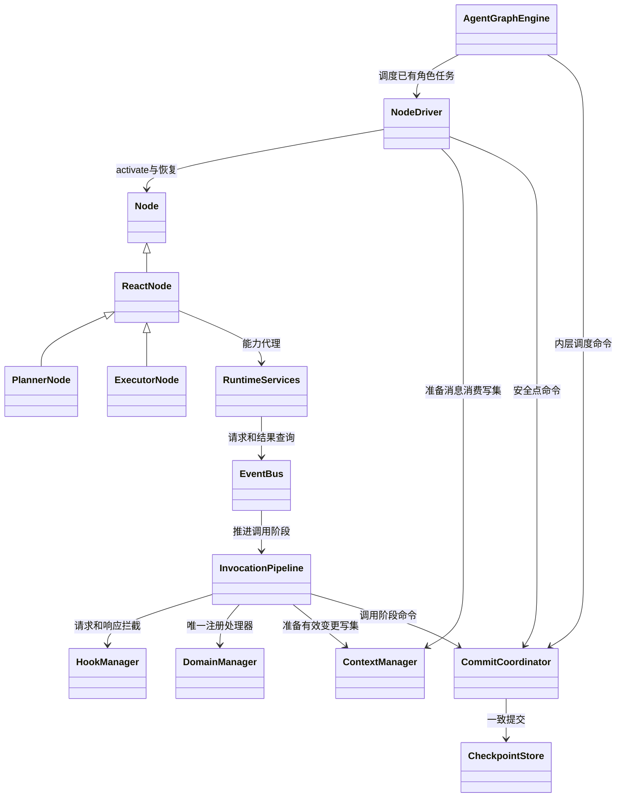
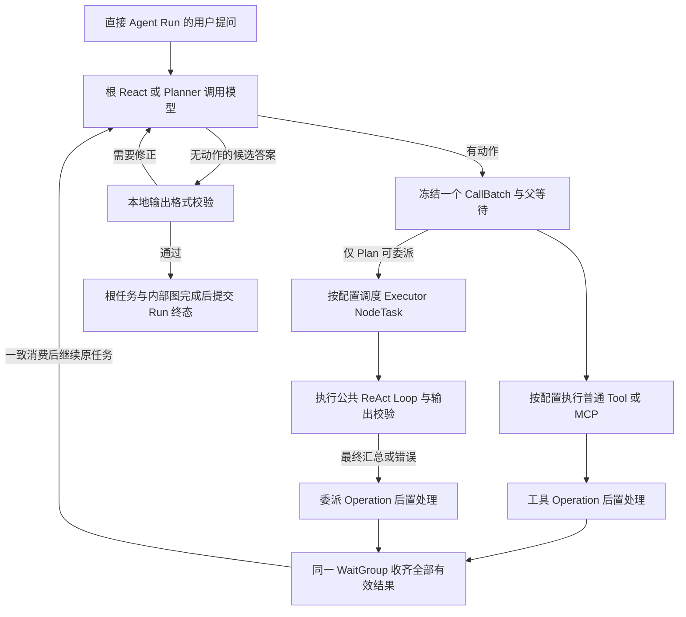
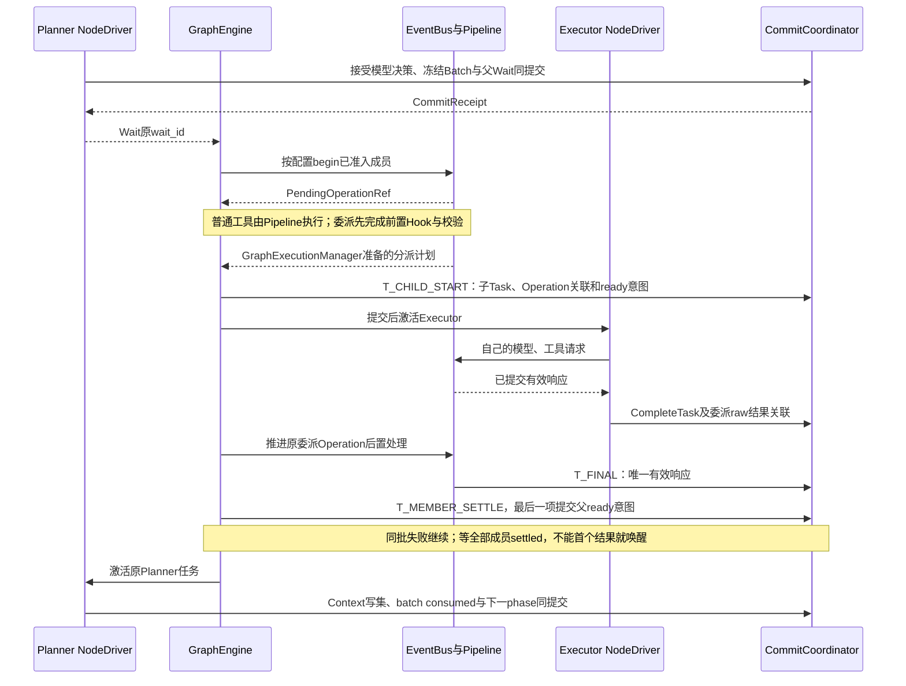

# Agent 执行与控制协议

> **重建边界（2026-10-15）**：旧业务实现已移除。本页保留为待调整的设计草案；用户、应用、发布与配置版本属于平台，SDK 只接收已解析配置并负责执行与恢复。涉及平台身份、发布绑定及表结构的内容需按 [SDK / Platform 边界](sdk-platform-boundary.md)重新划分，不直接作为 SDK 的必填契约或已实现功能。

**实施细则：[runtime-graph](implementation/runtime-graph.md)**。本页保留架构解释；具体方法、字段状态、事务和恢复分支见实施规格。

版本：SD-3，2026-10-15。状态：本轮架构设计提案，尚不代表现有代码已实现。本文落实[设计约定](../agent-design-decisions.md)、[领域模型](domain-model.md)、[图与节点协议](graph-node-engine.md)及[检查点协议](checkpoint-protocol.md)。角色执行统一为 React 类 NodeTask，Loop 阶段放在 ReactContinuation；一次完整应用调用为 AgentInvocation。不保留旧 AgentExecution 调度器。

## 1. 图引擎与 Agent 节点怎样分工

Agent 是配置生成的大模型应用。一次提问创建 Run，并在本次调度机器上装配运行实例。回答结束后释放本机实例；故障接管重新装配内存对象，沿用原 Run、图／节点执行、上下文和调用身份。

ReAct 和 Plan–Executor 使用同一种轻量图模型，由 AgentGraphEngine 调度。ReAct 的核心为一个 ReactNode；Plan–Executor 由 PlannerNode、ExecutorNode 及调度关系组成。PlannerNode 和 ExecutorNode 继承 ReactNode 的共同循环能力。图定义描述节点和流转关系，LLM 本轮的计划文本不会自动编译成另一张依赖图。外层由另一个 WorkflowEngine 编排，内层不依赖其 channels／Pregel；接口和检查点的衔接见[双引擎设计](dual-engine-integration.md)。



图为实现类的继承和服务依赖，不表示实体归属或调用时序。NodeTask／ReactContinuation 是 Driver 装载和提交的状态；节点实现不直接持有数据库 writer。

**ReactNode 一次被引擎激活，可以执行完成任务所需的多轮 Loop。** 它不是只调用一次模型的节点。遇到 Executor 委派等等待条件时，节点保存可恢复进度并把控制交回引擎；结果就绪后继续原节点执行，而不是另造一个 Planner 或从第一轮重跑。

| 职责 | 负责什么 | 关键边界 |
| --- | --- | --- |
| RunRuntime | 冻结本次配置、持有执行租约、共享预算与环境，最终收束和清理 | 一个 Run 同时只有一个有效执行拥有者；内存对象可重建 |
| GraphEngine | 激活节点、分派执行实例、管理等待及汇合、推进后继、恢复调度现场 | 不替 LLM 作业务决策，不把每个工具包装成 Agent |
| ReactNode 公共循环 | 上下文准备、模型决策、动作绑定、结果接受与最终输出校验 | Planner、Executor、ReAct 共用；节点负责自己的逻辑阶段 |
| PlannerNode / ExecutorNode | 分别增加委派与结果收集，或独立任务上下文的执行职责 | 同一 Executor 定义可产生多个执行实例 |
| EventBus / 调用代理 / 持久化中间件 | 统一请求与响应入口；代理注入身份并隐藏发送；记录调用和复用已完成结果 | 单个请求只交付一个最终 EventResponse；处理端不重新经过同一代理 |
| 各能力域 Manager | 向 EventBus 注册处理器，消费经 Hook 处理并由 CommitCoordinator 提交后的有效 payload／上下文版本 | 模型、工具、MCP、上下文及环境分别维护自己的业务责任 |
| HookManager | 有序 await 拦截器，处理校验、允许、修改和拒绝，记录决定及进度 | 合法 deny 生成显式阻止结果；Hook 异常 fail-open；纯观察不控制执行 |
| ModelGateway / InvocationService | 模型连接、工具调用、物理尝试、超时、内部流式接收 | 不创建隐藏 Run，不自行调度 Executor |
| CheckpointStore | 按命名空间保存图现场、节点现场、已完成任务及调用结果 | 与普通工作文件分离；提交失败不能被当作 Hook 失败忽略 |
| ContextManager / RunControlService | 分别准备作用域内有效上下文写集及管理根 Run 和完整 AgentInvocation 的额度、停止、截止 | Loop、后续模型、历史、压缩与恢复读取同一权威有效版本；同一完整 Agent 内的 Planner／Executor 共用额度，Executor 无独立总预算 |

这些职责不意味着每项都要单独部署。`CallBatchCoordinator` 负责冻结成员、建立 WaitGroup、关联结果和一致交付；任务启动、容量、等待、唤醒由 GraphEngine 唯一调度。Coordinator 不拥有另一套 ready queue，也不自行 `create_task` 运行 Executor。NodeDriver 负责推进既有 NodeTask，并通过 CommitCoordinator 提交 Progress／Wait／Complete／Fail 安全点。

EventBus 是统一通信入口，业务代码仍可调用普通的模型、工具、Executor 接口，由注入代理隐藏发送。调用管道为：保存原始意图 → HookManager 有序拦截 → schema／权限／预算重校验 → ContextManager 准备写集，由 CommitCoordinator 提交有效输入或 patch 及版本 → 对应 Manager 执行 → 保存 raw output → 结果 Hook → 提交有效结果与上下文变更 → 返回一个最终 EventResponse。Loop 得到有效响应和已提交上下文版本，不需要解析 Hook 内部记录。ContextManager 在此只准备已验证 patch 的写集，不独立 commit；Pipeline 将其与 Hook 决定和游标一并交 CommitCoordinator。内部准备和提交不再送回同一 Hook 链。业务模型前置 Hook 完成后还须由 NodeDriver 协调压缩、硬预算校验，以及冻结请求／预占票据／发放 permit 的一致提交，之后才允许出网。

Hook 可以校验、允许、修改或拒绝。合法 deny 必须关联原请求返回明确的 blocked／error，不能让 Future 永久等待，也不能由自动重试绕过。前置拒绝不执行对应能力；后置拒绝不能撤销已发生的外部副作用，raw output 及副作用事实仍须保存。Hook 抛错、超时或非法返回才属于 fail-open，沿用最后有效状态继续。

代理及处理器不得互相递归路由或分别执行一次相同动作。委派 Manager 只衔接图引擎，不再实现另一套 Executor 调度。图引擎保存调度状态，公共节点运行逻辑保存节点阶段，二者通过同一检查点抽象协作。Python 调用栈、Task、Future 和 Semaphore 均不能成为唯一恢复现场。

## 2. 两种模式怎样循环

ReAct 的图包含一个入口 ReactNode，产生一个根 ReactNodeTask：模型决定调用工具，结果加入该角色上下文，再调用模型，直到输出最终结果或被 Runtime 结束。循环发生在同一逻辑节点执行内。

Plan 的入口为 PlannerNode。Planner 同样可以调用自己授权的普通工具；委派由图引擎创建对应 ExecutorNode 的执行实例。各实例独享上下文；本批全部结束后，引擎汇合结果，唤醒原 Planner 的下一次 Loop。



同一响应里的工具和委派组成同一批次；上图的两条调用路径不意味着任意一条返回便立即调用 Planner。ReAct 没有委派分支；Executor 内部也不开放递归委派。默认不自动配置通用 Executor，只有配置过的执行器能被选择。

例如 Planner 同时委派两次“资料检索”：一份 Executor 配置产生 E1、E2 两个 NodeTask，加 P1 共三个角色任务，属于同一个 AgentInvocation、同一个内部 GraphExecution。各自有固定 context_id，可共享本次任务授权工作文件。P1 下一次 Loop、E1 第三次 Loop 及故障恢复都沿用原 node_task_id；只有 NodeActivation 可以重建。普通工具、MCP、Skill 阅读和脚本只产生 Operation，不产生 AgentInvocation 或子图。Planner 委派完成通过 WaitGroup 唤醒原 P1，不使用完成边重新创建 Planner。

## 3. 发布配置与请求装配

AgentGraphBuilder 按不可变执行模式及角色槽生成 GraphDefinition。AgentRelease 引用 AgentDefinition 与 GraphDefinition 版本，并固定 NodeBinding；GraphCompiler 产出 CompiledGraph。React／Planner／Executor 是节点实现类型，NodeDefinition 是图内位置，RoleDefinition 是行为配置，不能把三者合成一个有 messages 的长期单例。

发布阶段由配置服务生成并校验 `AgentRelease`：

1. 固定创建时选定的执行模式，解析资源版本及角色列表。
2. 固定模型连接、Think 和执行策略；Executor 与压缩任务继承模型，不能另选模型。
3. 为根角色和各 Executor 分别解析 Prompt、变量、Skill、工具、MCP 与输出要求；Hook 按触发时机配置，区分有序 await 的修改型拦截器与纯观察订阅。具体字段权限和筛选契约仍需统一。
4. 校验资源存在、能力名称唯一、绑定授权及 schema；ReAct 配置不得包含 Executor 委派。
5. 保存不可变发布快照；不在快照里保存 SDK client、数据库连接或密钥明文。

开始 Run 时，Runtime 绑定一个发布版本，解析输入，取得对应 CompiledGraph，创建 AgentInvocation 及其内部 GraphExecution，再创建入口 NodeTask，并取得 Session 文件视图与服务依赖。执行期间资源或草稿更新不能改变已冻结配置。所有角色使用同一 RunControlService 和工作文件范围；可读 Skill／知识资源、可调用工具和上下文仍按角色分别解析。

## 4. 可恢复的固定 Loop 阶段

节点恢复协议分别表达“正在做什么”和“是否可调度”：ReactContinuation.phase 保存逻辑阶段，NodeTask.status 保存 ready／running／waiting／succeeded／failed／cancelled 等调度状态。ReactNode 的公共循环推进阶段，NodeDriver 在安全点通过统一 CommitCoordinator 提交；GraphEngine 只根据已提交事实决定继续哪个原任务。没有第二套可独立修改同一执行位置的角色调度表。

| phase | 本阶段职责 | 成功后的阶段 |
| --- | --- | --- |
| prepare_context | 选择历史、读取已结算工具结果、领取根角色补充，生成模型视图 | prepare_model |
| prepare_model | 创建模型调用，准备输入并经请求拦截链得到有效请求，校验预算 | compact_context 或 call_model |
| compact_context | 恢复／运行 CompactionEpisode，重组视图并检查模型硬窗口 | call_model |
| call_model | 冻结有效请求、领取共享 LoopTicket，经 EventBus／模型 Manager 获取处理后的完整响应 | interpret_response |
| interpret_response | 接受模型消息、解析 action、消费票据，冻结批次或最终候选结果 | wait_batch 或 validate_output |
| wait_batch | 等待固定 WaitGroup 全部成员结算，唤醒原任务 | consume_results |
| consume_results | NodeDriver 取 ContextManager 写集，经 CommitCoordinator 一次交付并提交 consumed | prepare_context |
| validate_output | 校验当前角色的最终输出；不合规则记录修正反馈 | completed 或 prepare_context |
| completed | 固定该角色的最终结果／失败；根角色交付 Run，Executor 交付父批次 | 无 |

失败、用户停止和总预算异常可以使任意非终结阶段进入受控结束。`status=waiting` 可以表示等待批次或共享票据，恢复位置仍由 phase 及关联记录决定，不需要保存“等待某个 Python future”。

创建新业务模型 Operation 时分配新的 `role_loop_index`，接管同一 Operation 不增加序号。`purpose_key` 由服务端稳定生成，例如 `business-model:7`；其与 node_task_id 的唯一约束防止恢复重复创建模型调用。

HookManager 作为 EventBus 调用链中的拦截器，按顺序 await Hook；每个处理器读取上一个有效结果，可执行校验并返回 allow 或 deny；修改通过可选 payload_patch／context_patch 表达。失败或非法修改不覆盖上一个有效状态；合法 deny 结算本次请求并反馈明确原因。修改经 ContextManager 重校验并准备写集后，由 CommitCoordinator 提交，Manager 与 Loop 使用已提交的有效上下文。

Hook 可作用于授权 scope 内的整体有效上下文，不能只改一份临时消息副本。身份、causeId、原始用户记录、授权范围与模型窗口等约束始终受保护。字段权限与 patch 格式按能力和上下文契约校验；运行中 Hook 决定未知时，按[检查点协议](checkpoint-protocol.md)的技术建议先查询既有决定，无可靠结果且处理器失联时记 indeterminate 并以先前有效状态继续，不盲目重放脚本。允许／修改／拒绝能力本身已经确认。

模型请求最终组装、压缩和校验由 Runtime／对应 Manager 完成；请求 Hook 的有效修改必须纳入最终预算检查，不能检查旧请求后发送更大的新请求。有效输入及 patch 先由 ContextManager 保存版本，再冻结出网请求；已经发送的请求继续绑定原版本，不热改其载荷。`CompactionEpisode` 是所属 React 类 NodeTask 的独立压缩过程记录，使用继承模型及 `purpose=compaction` 的 Operation，不申请业务 LoopTicket，也不获得工具或委派能力。ReactContinuation 在 compact_context 阶段引用其身份与游标；不为一次压缩自动创建新图或第二套任务调度器。

节点每次恢复都先读取已提交事实，再执行下一项尚未完成的工作。提交阶段和关联结果必须一致；节点完成、输出与下一项可执行工作也必须一致提交，不能先把 phase 改到下一阶段，再依赖内存补写结果。持久化由公共执行边界调用 CheckpointStore，不由每个业务节点散落保存代码。具体边界见[消息、调用与检查点](runtime-messaging-checkpoints.md)及[存储与恢复](storage-recovery-api.md)。

## 5. LLM 的工具调用怎样解释

模型供应商的 `tool_calls` 由 Normalizer 统一，再按当前角色能力目录绑定。模型只给调用名称和业务参数，不负责生成 Run、NodeTask 或 Operation ID。

```python
@dataclass(frozen=True)
class BoundAction:
    call_id: UUID                    # 服务端生成
    ordinal: int                     # 本响应内顺序，从 0 开始
    provider_call_id: str
    action_kind: Literal["tool", "executor", "rejected"]
    target_key: str | None
    arguments: JsonValue
    validation_error: OperationError | None

@dataclass(frozen=True)
class ModelDecision:
    operation_id: UUID
    text: str
    actions: tuple[BoundAction, ...]
    finish_reason: str
    raw_response_ref: PayloadRef
```

能力目录明确区分普通工具和 Executor 绑定；不靠参数含有 `task` 等字样猜测调用类型。委派参数只包含任务、必要事实、约束及受控文件引用；可信角色身份、Session、模型、授权和预算由 Runtime 填充。

| 模型返回 | Runtime 行为 |
| --- | --- |
| 完整最终内容、没有动作 | 作为最终候选结果，进行输出校验 |
| 文本与动作同时出现 | 文本是过程输出；动作组成一批，不将该文字提前标为最终答案 |
| 未授权名称、参数校验失败、可定位的参数 JSON 错误 | 创建 rejected 成员，保留调用序号和错误；不执行外部动作，其余成员继续 |
| 无法归一化为完整消息，或正文与动作都为空 | ModelGateway 在 Operation 成功前识别协议错误；按连接层规则处理，无法恢复则当前角色失败 |
| 尚未结束的流式工具参数 | 仅在连接层组装为 Attempt 的未完成片段，不能启动工具 |

模型连接内部继续流式接收；模型 Manager 收齐完整响应并保存原始结果，响应拦截链处理后再次校验，提交有效结果和对应上下文变更，才通过 EventBus 一次交付最终 EventResponse。中途片段不发到消息总线，不执行半截工具参数。interpret_response 负责角色授权、业务参数绑定和接受决策；响应 Hook 后的动作仍需权限及参数校验，不把已完成外部调用退回 Attempt 重试。`finish_reason=stop` 不能单独证明整个 Run 已完成；不增加强制模型调用的 finish 工具。

provider_call_id 只用于供应商消息关联；平台使用 call_id。当前响应内重复供应商 ID 不能覆盖结果槽，视为协议错误。读取、更新计划是一项角色能力：计划内容和状态帮助 Planner 思考；它不会自动启动执行器，也不是 Runtime 必须依次解释执行的任务列表。

## 6. 批次和 Executor 的调度

接受模型决策时先冻结 `CallBatch` 的全体 `BatchMember`，再执行任何成员。通过 InvocationPort.begin 为当前准入成员登记能力请求并返回 PendingOperationRef；这只是可恢复调用身份，不是最终 EventResponse。串行只 begin 当前成员，并行也受既定准入规则约束。排队成员保留 member_id 和未启动状态，不为了取得引用提前执行。每个成员有固定 call_id、ordinal、action_kind、target_key、input_ref，运行中补充 operation_id、子执行引用、结果和终态。原始 arguments 保留；请求拦截链处理后，按 schema、授权及不可变字段规则校验最终有效参数，由 ContextManager 保存修改与有效版本后冻结。后续自动重试和故障恢复使用这一请求。实际执行的参数修改必须在所属角色的有效上下文中可见，避免模型以为执行的还是原参数。Hook 可以不配置，注册后按对应边界有序执行。

普通动作经调用代理进入 EventBus，由持久化调用中间件记录意图，按能力域路由到 ToolManager／MCP Manager 等处理器。委派也使用统一入口，但其 Manager 只调用图引擎的调度能力、记录父子关联并等待交付；不能由普通工具处理器另起隐藏 Agent，也不能重复实现图调度器。`kind=delegation` 的控制 Operation 表达交付关联，**没有物理 Attempt**；它关联 BatchMember、目标 Executor NodeTask 及 WaitGroup。委派 begin 保存 prepared 意图并返回持久引用，暂不激活目标；父 WaitGroup、dispatch 意图、成员关联和恢复键同一提交登记，GraphEngine 在提交后才激活对应 child_task_id，ContextManager 为其建立私有上下文。WaitGroup 成员按 operation／node_task／child_graph 区分引用种类；不能拿一组裸 ID 猜测该等待工具还是节点。

Planner 保存已获准成员的 PendingOperationRef、排队成员及 WaitGroup 后 yield Wait；恢复原任务后以 get_result／await_result 读取最终 EventResponse，consume_results 再一致消费。本批所有成员结算前，不把“委派已创建”的回执交给模型当作业务结果。普通便利 request 等于 begin＋await_result，不是另一条执行路径。

rejected 成员直接保存校验或授权错误，operation_id 和子执行引用都可以为空。合法 Hook deny 则保存与原请求关联的拒绝决定及错误响应，前置拒绝不创建 Executor，后置拒绝保留已执行事实。该成员照常结算并参加整批结果交付，不悬挂等待，不用自动重试绕过拒绝。Hook 自身异常按 fail-open 继续，两种情形必须分开。

begin 前的 rejected 或因停止未启动的 cancelled 成员，以 `WaitMember.local_outcome` 保存错误引用，和 BatchMember 结果同事务结算；不要求创建调用目标。已经 begin 的前置 Hook deny 则以已有 Operation 作为等待目标，不能伪造 Executor，也不能退回本地拒绝分支跳过调用结果链。精确字段与状态约束见[数据契约](data-contracts.md#6-批次调用和额度)。

| 配置 | 调度规则 |
| --- | --- |
| parallel_enabled=false，默认值 | 所有成员按 ordinal 逐项执行，工具和 Executor 之间也遵守此顺序 |
| 开启并行 | 普通工具成员进入就绪集合；Executor 按 ordinal 排队，默认最多两个活跃 |
| executor_max_parallel=2 | 一个 Executor 从准入启动到 NodeTask 终态提交均占名额，包括模型等待、内部工具、退避、压缩和故障恢复等待 |
| 并行 Executor 完成 | NodeTask 终态、TaskResult／TaskWrite 与名额释放同事务提交，即可补位下一项；不等待父委派的响应 Hook 或其余 Executor |
| 串行 Executor 完成 | 名额也在 NodeTask 终态时释放，但必须等父委派响应 Hook、最终 EventResponse 和当前成员结算后，才准入下一 ordinal |

名额是 GraphEngine 对同一 AgentInvocation 内本批获准 Executor 的占用投影，以已提交的 NodeTask 准入与终态为依据，不以父 Operation 或 WaitGroup 状态计数；接管按相同事实重建，重复终态提交不得重复释放。尚未准入的 queued 任务不占名额。响应 Hook 只在父调用管道后处理，不能把已终结 Executor 重新改为活跃。

未取得名额的 Executor 不提前运行。普通工具不占 Executor 名额；平台不额外设置模型 Key 的全局并发池。并行模式由每个 Agent 的配置决定，Runtime 不通过猜测文件依赖或工具类型私自切换。需要顺序依赖的操作由模型安排到后续批次。

任何成员的原始结果都及时保存；该成员响应 Hook 处理完、有效结果及对应上下文变更校验并提交后才算完成并可交付。合法 deny 也交付终结错误，不能让其他成员或父角色永远等待。单项失败、超时或重试耗尽不取消其他成员。**所有成员终结后**，批次按 ordinal 返回保留各自 call_id 的结果列表；GraphEngine 结算成员并持久唤醒原任务；NodeDriver 在 consume_results 阶段取得 ContextManager 写集，由 CommitCoordinator 一致追加工具结果、标记 consumed 并推进所属角色。调用者不从 Hook 日志或异步到达顺序拼装结果。



Executor 只把最终汇总或错误交付 Planner，其内部完整 Loop 记录保存在自己的上下文中，默认不复制到父上下文。没有额外语义验收 Agent。Executor 模型最终失败终结该任务并反馈 Planner；根角色模型最终失败或任一角色压缩失败，终结所属完整 AgentInvocation。直接 Agent Run 因而结束整次 Run；作为工作流中的 AgentNode 调用时，先收束该 Invocation 的角色与写入者，再将失败交给外层节点错误路由，不默认终止其他 AgentInvocation。根 Run 停止、根总额度耗尽或根截止仍终止整棵执行树。

## 7. 共享 LoopTicket 与执行预算

### 7.1 根控制与完整 Agent 调用的局部限制

直接调用一个 Agent 时，默认全 Run 合计 100 次业务 Loop；根角色和所有 Executor 共享额度，`AgentInvocation.budget_scope=run`，直接引用根 Run 控制，不重复设置一份局部预算。每次业务模型决策对应一张 LoopTicket，网络尝试和工具个数不单独增加 Loop。

外层 WorkflowRun 则有自己的整树额度及截止时间。其每个 AgentNode 创建的完整 `AgentInvocation` 使用 `budget_scope=invocation`，从冻结的 AgentRelease 解析 `local_loop_limit` 和调用超时；`started_at` 取初始 Invocation 持久化创建时的数据库时间，`local_deadline_at=started_at+该 Agent 的超时配置`。初始提交前不激活内部图；创建后的排队、模型等待、退避及故障恢复都计时。实际可执行截止是 `min(Run.deadline_at, local_deadline_at)`。接管、再次激活或外层重读结果不能重置这些值；若工作流明确再发起一次新的 Agent 调用，才有新的 Invocation 及局部期限，根额度继续累计。

局部限制作用于这一完整 Agent 的 Planner、所有 Executor、压缩与调用，不按角色分别发放 100 次。局部次数上限同样只计算业务 Loop，压缩不占次数但受局部及根截止约束。普通工作流 CapabilityNode 没有业务 LoopTicket，只受根截止及本次调用时限约束。

### 7.2 单一票据、双层约束

LoopTicket 保存 `ticket_id/run_id/invocation_id/node_task_id/model_operation_id/role_loop_index/business_loop_no/state`。`invocation_id` 是所属完整 Agent，不是 Executor 身份；role_loop_index 是角色内序号，business_loop_no 在消费时分配 Run 内序号。预留和释放票据时可以没有 business_loop_no。

**只有这一份票据账本。** 根计数是同一 run_id 的票据聚合，局部计数是其下同一 invocation_id 的票据聚合；两者可维护事务内查询投影，但不得有两次独立扣款或可分别恢复的余额。consume／release 同一票据时一起更新受影响投影；恢复以已提交票据校验或重建计数。直接 Agent Run 只检查根计数。

新业务 Loop 准备入口先检查根及适用局部已消费额度：额度已经实际用尽时，不先发压缩模型再拒绝下一次业务模型请求。只有已消费达到上限才进入耗尽；在途 reserved 占满任一层时只等待，不判耗尽。已获准决策的无新增模型动作仍可按最后一次 Loop 规则完成。所有物理调用及自动重试另检查停止、截止和对应 scope 是否已经关闭新工作，已存在票据不绕过这些门。

请求上下文准备完成、模型出网前进行原子预占。提交固定按 Run → AgentInvocation 顺序加锁，并检查有效租约；任一适用层必须满足 `0 <= consumed + reserved <= limit`。同一 model_operation_id 的申请幂等返回原票据，不产生第二次预留。

```python
with uow.lock_run_then_invocation(run_id, invocation_id):
    assert_current_lease()
    root = root_control(run_id)
    local = local_control(invocation_id)  # budget_scope=run 时为 None
    if existing_ticket(model_operation_id):
        return existing_ticket(model_operation_id)  # 只返回既有事实，不授权新 Attempt
    if root_has_control_error(root):  # 停止、截止或 consumed == limit；根优先
        return close_root_and_report(root.error)
    if local is not None and local_has_control_error(local):
        return close_invocation_and_report(local.error)
    if any_scope_reserved_full(root, local):
        return WAIT_FOR_TICKET_SETTLEMENT
    return reserve_one_ticket_and_update_projections()
```

根停止／根截止优先于局部控制；同一准入点发现两级实际耗尽也以根耗尽处理，禁止局部错误先返回后继续整树。局部耗尽只关闭该 Invocation 的新工作、收束其全部角色和调用，保存失败结果并结算原父 AgentNode；外层按编译时错误路由决定继续或失败。尚在运行的兄弟 AgentInvocation 不自动取消。根耗尽则关闭整棵树，没有额外模型总结。所有控制决定和待收束状态须持久化，不能只抛出内存异常后任由其他任务继续调度。

暂时预留满由 GraphEngine 挂起申请任务并继续推进已有调用；票据结算通知或接管重建后重新检查。压缩任务不申请业务票据，但同样不能越过已经生效的 scope 停止和截止。

| 情形 | 票据处理 |
| --- | --- |
| 完整模型决策已接受，包括最终候选输出、工具或委派 | 保存决策及后续阶段／批次时 consume，同时影响根和适用局部投影 |
| 输出格式错误，需要模型修正 | 原决策已消费；下一次修正申请新票据，无独立修正额度 |
| 工具参数或执行失败进入后续模型上下文 | 属于已消费决策的动作，不按错误数额外扣减 |
| 同一模型 Operation 内透明网络重试 | 使用同一 reserved 票据，不重复计数；新 Attempt 仍检查 scope 控制 |
| 根角色模型所有尝试失败，所属完整 Agent 调用直接终结 | release 未形成决策的票据，失败用量仍记录；外层获得明确失败而不是伪造模型决策 |
| Executor 模型最终失败，错误提交父上下文反馈槽 | 子结果、PendingFeedbackSlot 与 consume 同事务 |
| 停止前尚无完整决策、也不再反馈给父角色 | release；已有流片段保留为未完成 |
| 恢复已接受的决策或批次 | 复用原票据，幂等提交 |

Executor 模型失败后，父上下文先保存 pending 反馈槽，意味着该错误已经纳入下一次业务模型视图；Planner 仍须等本批全部结束。不能把失败票据一直 reserved 到整个批次收齐，否则可能形成“失败任务占最后额度，其他任务等额度，Planner 又等其他任务”的等待环。已经提交的反馈后来遇到用户停止，也不回滚已消费额度。

### 7.3 最后一次与局部截止

第 100 次可以完成模型决策及其无需新增模型请求的工具动作，合规最终回答正常成功。只有需要第 101 次模型决策时，才在准入前走耗尽逻辑；不能在第 100 张票据 consume 时立即取消其尚未执行的工具，也不能给它增加总结额度。局部上限为 5 时同理，第 5 次允许正常结束，第 6 次不得执行；根仍有额度不构成例外。

根期限一到，整树统一进入超时收束；只有局部期限到达时，终结对应 Invocation 并向外层返回 `INVOCATION_TIMED_OUT`。局部收束禁止新 Loop、未启动动作、新 Executor 和新 Attempt；在途调用的保存、取消与写入者收束按第 9 节执行。局部终结不删除同 Run 其他任务仍可使用的工作文件。终态保存后，父 AgentNode 读取同一结果并推进已定义的后继，恢复不重跑内层调用。

## 8. 输出校验与补充输入

output_schema 为空表示自由文本；否则 Runtime 使用冻结 schema 校验经过响应 Hook 处理后的最终候选结果。供应商原生结构化输出能力可以辅助生成，不能替代本地校验。校验错误包含有限的 JSON Pointer 和预期类型，保留原始输出及有效输出，反馈当前角色修正。Executor 修正自己的交付，完成后才交付 Planner。

模型流片段只在连接层接收和组装，不作为面向用户的逐 token 事件。完整模型响应仍可能是过程决策或待修正草稿；只有根角色完成输出校验且 Run 终态提交，才对外交付最终答案。Executor 的最终结果是父批次输入，不等于用户最终答案。若失败时保留已有片段，必须在错误结果中明确标为未完成，不拼接多个尝试或修正草稿成为有效 JSON。

Session 至多一个活跃 Run。每条补充是独立 UserInput；属于当前 Run 时不增加提问轮次。输入接收与 Run 终态更新串行化：queued/running 时入根角色队列，stopping 时进入 Session pending；没有活跃 Run 时用户主动发送新问题才创建下一 Run。后台不能因为 pending 补充自动启动模型。

ReAct 在根角色下一次准备上下文时注入；Plan 只在 Planner 下一次 Loop 注入，不广播 Executor。上下文更新通过 ContextManager 统一执行；`context.update` 是显式入口，调用链中的 Hook 修改也必须汇入相同的权威有效上下文。原始用户消息和原始调用载荷不覆盖，修改以有效记录／patch 及版本关联保存。后续 Loop、模型输入、历史组装、压缩和恢复都使用相同有效版本；Planner 与 Executor 私有历史仍分别归属，共享修改必须使用显式 shared scope。冻结请求时 UserInputDelivery 变 claimed；首个有效模型输出持久化后变 delivered。没有有效输出便最终失败的 claimed 输入，结束时转交下一用户启动的 Run；有过有效输出再失败则保留其 delivered 事实。

转交保留同一 input_id，以新 delivery_id 关联新 target_run_id，并保留 previous_delivery_id。后续组装按 input_id 去重。最近历史外的用户补充仍属于原始用户输入，不能随工具过程裁剪。具体消息投影与压缩见[上下文生命周期](context-lifecycle.md)。

## 9. 停止、总超时与清理

用户停止后，Runtime 先持久化终结意图并关闭新 Loop、新 Executor、新物理 Attempt 和尚未启动动作的调度门。**停止边界是当前已发调用的最近安全提交点，不是必须执行完当前 Loop 剩余动作。** 例如串行工具 A 已发出、B 尚未开始，停止后只收束 A，B 标 cancelled／未执行；模型在途时可保存其已取得结果，但不能启动它随后生成的动作。已开始的工具、脚本和模型连接发送可支持的取消通知，无法立即取消时受原调用／scope 截止约束收束；取消本机等待不等于外部写入已结束。

停止后只允许保存已取得事实、结算票据与取消成员、转交输入及必要清理；Hook 不得借后处理重新发起业务动作。未完成调用保存真实结束程度，停止的批次不再进入下一次模型决策。用户停止、根耗尽和根总超时都不能被迟到结果撤销；局部 Invocation 收束采用相同安全点，但不关闭兄弟调用。不会因为迟到结果再启动已结束 Run。

Run 默认创建后一小时截止，排队时间、重试退避和恢复等待都计入；接管机器不能重新开始计时。模型首个有效输出默认限时 60 秒；输出开始后取消首输出时限，根 Run 以及适用的 Invocation 截止仍生效。工具／脚本默认 10 秒。各值按 Agent 配置冻结，实际调用时限还须服从剩余 scope 时间。

总截止后取消本机等待并通知执行环境停止相关进程，必要时撤销旧代次的写权限。网络取消不意味着外部副作用回滚；无法确认的结果记录为 unknown。

实际终态提交及文件删除必须等待整个 Run 所有写任务退出或写权限已确认撤销，不能某个 Executor 先停就删除其他任务正在使用的目录。Runtime 负责必要清理，并发布相应生命周期事件供 Hook 观察；Hook 超时或失败不能跳过清理。普通 Run 结束删除无持久沙箱工作文件；持久沙箱文件保留，记录另行保存。

状态竞争由数据库 CAS 处理：终态先提交则 Stop 返回 already_terminal；Stop 先提交则成功回调不能覆盖终结意图。`cleanup_state` 与业务终态分开，清理失败只重试清理，不重开业务执行。无用户暂停／恢复动作；机器故障后的接管由 Runtime 自动处理。

## 10. 模型连接、尝试与流

自动重试默认关闭。按 Agent 开启时，默认 `max_attempts=2`（含首次），间隔 2 秒；ModelGateway 与 InvocationService 分别提供模型和工具的唯一物理重试循环，底层适配器只执行 invoke_once，SDK 隐式重试关闭。识别出的匹配异常按策略重试，无法识别或耗尽则返回上层；不依据工具方声明“是否幂等”决定允许调用与否。

LLM 在下一 Loop 再次调用相同工具或修改参数，属于新的 Operation，不能声称被上一次 max_attempts 限制。错误分类、未知副作用和 Hook 边界见[能力与 Hook](capabilities-hooks.md)。

空 keepalive、role 和 usage 不停止模型首输出计时；有效正文、推理或工具参数片段停止计时。`model_stream_idle_timeout_seconds` 默认空，只受 Run 截止；Agent 显式配置时由连接层检测输出后的停滞。

每个 Attempt 在连接层内部接收流。首个有效输出只需更新首输出时间与相关投递事实，不要求发布 token 事件或逐片段保存完整检查点。部分输出后重试产生新 attempt_id；旧片段如被记录则标为 incomplete 或 superseded，不能冒充成功响应。业务上下文只接收完整决策或明确的失败记录，不拼接不同尝试，不执行半截工具调用。

一次模型调用正常收齐后保存 raw output，再等待响应 Hook 链处理、校验并提交 effective output 及上下文变更，最后通过 EventBus 一次返回 EventResponse；异常结束返回明确错误，不等一个永远不会到来的完整输出。Hook 记录由调用设施处理，Loop 无需解释。生命周期通知保留开始、完成、失败等低频事件。客户端 SSE 可用于 Run 进度、错误和最终结果，按序号重放这些事件；默认不透传模型 token，SSE 断开也不自动取消 Run 或重发模型请求。

## 11. 原子提交点与恢复检查

| 提交点 | 必须一起保存的事实 |
| --- | --- |
| 接收输入 | UserInput、Session 序号、归属或 pending、ACK 事件 |
| 冻结请求 | 模型 Operation、原始与有效请求引用、统一提交的有效上下文版本、claimed 输入、角色 phase |
| 首有效输出 | Attempt 首输出事实及输入 delivered 证据；无需逐 token 公共事件 |
| 接受模型决策 | 完整模型记录、票据消费、冻结批次或最终候选、角色 phase |
| 委派启动 | 唯一子执行引用、父调用／成员关联、图调度任务与占用名额 |
| 外部结果已取得 | raw output、物理尝试事实、响应 Hook 待处理阶段；尚不交付最终响应 |
| Hook 处理进度 | 固定处理器版本与顺序、已完成 allow／deny 决定及 payload_patch／context_patch、有效 patch 及上下文版本、下一项位置 |
| Executor 节点终结 | NodeTask 终态、TaskResult／TaskWrite、结果引用、Executor 名额释放及后处理通知；父委派 Operation 可以仍待响应 Hook |
| 单项完成 | 校验后的 effective output、对应上下文变更及版本、最终 EventResponse、成员终态、父反馈与票据结算；不再次释放 Executor 名额 |
| 批次交付 | 全部工具结果、consumed 标记、上下文水位、所属角色下一 phase |
| 节点完成及后继就绪 | 节点终态、输出引用、图进度、下一项待调度工作及待发送通知 |
| 局部 AgentInvocation 结束 | 局部终态、调用结果和父 AgentNode 唤醒意图；自身写入者已静默，其他 Invocation 继续，共享根额度不重置 |
| Run 结束 | 终态、未投递补充转交、停止租约标记、清理任务、最终事件 |

检查点由统一 CheckpointStore 管理，以 graph_execution_id 区分图范围；NodeTask continuation、Operation 及上下文使用关联引用。外层工作流和内层 Agent 分开保存，通过 AgentInvocation 和父 AgentNode node_task_id 关联；不会散落在 Skill 或工作目录中。完整 GraphCheckpoint 配合任务级 TaskWrite／结果记录恢复：E1 完成即保存，E2 未完成时宕机不重跑 E1。具体结构和存储接口以[检查点协议](checkpoint-protocol.md)及[数据契约](data-contracts.md)为准，内存快照不能代替持久记录。

大内容可先存不可变 blob，再一致提交引用。图现场表达调度位置和待执行工作，节点现场表达 Loop 阶段和上下文游标，调用记录分别保存 raw output、Hook 版本／顺序／决定／进度、有效上下文及 patch 引用和 effective output。raw output 已持久化而后处理未完成时，恢复只继续后处理，不能重发模型或工具请求；effective output、有效上下文变更与响应已提交则复用同一最终响应。已提交的合法 deny 也应复用阻止结果，不重试绕过。已经开始但没有可靠决定记录的 Hook，先按 hook_invocation_id 查询提交事实；无法取得可靠结果且处理器失联时，采用检查点协议建议记录 indeterminate 并继续先前有效状态，不伪造已返回决定或随意重跑。

不得维护几份独立修改的相同状态。内部 Planner 恢复读取原 WaitGroup／Executor node_task_id；外层 AgentNode 恢复读取原 child_invocation_id 和 child_graph_execution_id。后者只有调用完整 AgentRelease 时产生，Executor 不创建子图。子执行已完成但父未收到通知时，直接补交付保存的结果。

存储成功而发送通知前宕机时，由持久待发送记录补发；事件重复到达不能导致重复交付。仍在 running 的记录需结合租约和执行代次判定可否接管，不能仅靠状态字面值推断正在运行。恢复不还原 Python 栈、不重置预算和截止，也不能从检查点推出外部副作用“恰好一次”。详见[消息、调用与检查点边界](runtime-messaging-checkpoints.md)。

## 12. 外层调用与公共节点协议

WorkflowEngine 通过 AgentNode 适配器和统一调用管道调用完整 AgentRelease，创建 AgentInvocation 和由 AgentGraphEngine 推进的内部 GraphExecution。父任务保存 child_invocation_id／child_graph_execution_id 并等待；子调用的有效结果完成后，WorkflowCheckpointAdapter 在保存原生任务 writes 时一致提交父消费标记。内外层恢复记录分范围管理，父未消费结果不构成重新执行内层 Agent 的理由；不让两套引擎直接操作对方的 ready 队列。

NodeDriver 消费 activate() 返回的 ActivationStream[NodeOutcome]，这是内部推进信号而非 token 流：Progress 提交 continuation 后继续，Wait 提交等待、resume_input_ref 和分派事实后释放当前激活，Complete／Fail 保存终结事实与明确后继。ReactNode 的完整任务可以有多次 NodeActivation，各次沿用 node_task_id、context_id、已有调用和预算。工作流完成边或回边重新访问已完成节点时才创建新的 NodeTask；这与 Planner 等待结果后继续原任务不同。

图状态只包括声明的业务字段，私有角色消息经 ContextManager 管理，不全量复制到 GraphState。外层状态可见性、合并和同步按[LangGraph 源码适配](architecture-discussion.md#6-workflow-产品范围与-langgraph-源码适配)重新确定，不再把旧的配对 Join／分支私有视图和禁用嵌套 fork 等自研限制作为产品约束。内部 Agent 的动作批次、Hook patch 和 raw 结果仍按既有协议及时记录，不用外层图的 step 代替业务 Loop 或能力调用阶段。

Session 仍归一个 Agent。未来 WorkflowSession 单独建模；AgentNode 默认显式传参，需要历史时指定受授权 ConversationScope，不能借用同一 session_id 读取所有应用的历史。外层图本轮只设计，运行代码及用户编排入口后置；接口与实例关系见[图与节点](graph-node-engine.md)。

## 13. 必测流转

| 场景 | 必须验证的事实 |
| --- | --- |
| ReAct 三次模型、两次工具 | 一个 AgentInvocation／GraphExecution／根 React NodeTask，三个业务票据，两项工具 Operation，无 Executor |
| 同一 Executor 连续委派三次，默认配置 | 三份独立执行按 ordinal 串行启动 |
| 并行上限二且 E1 父响应 Hook 很慢 | E1 NodeTask 终态提交即释放执行名额并补位 E3，父 WaitGroup 仍等 E1 effective 结果；宕机重建占用一致 |
| 同样场景但关闭并行 | E1 名额已释放也不能启动 E2，必须等 E1 成员完整结算 |
| 同批一项失败、其余成功 | 全部保存后才继续 Planner，结果顺序固定 |
| 99 consumed、1 reserved、另一个角色申请 | 等待已有票据结算，不提前误报耗尽 |
| 第 100 次最终回答／工具动作／需要第 101 次 | 前两者允许完成；后者出网前结束，无额外总结 |
| Workflow 总额 100，Agent A 上限 5，B 上限 20 | A 第 6 次仅终结 A，B 继续；根第 101 次终止整树；一张票据原子约束根和局部 |
| 局部额度被 reserved 占满但尚未 consumed | 等待结算，不错误判耗尽；接管后计数和等待结论相同 |
| 局部超时期间重建 Invocation | started_at 与局部 deadline 不重置；只收束该调用，父错误路由接收同一结果 |
| Executor 模型失败且另一项仍待额度 | 错误先入父反馈槽并结清票据，不能等父批次形成死锁 |
| 格式错误需要多次修正 | 每次新模型决策占共享预算，无第二个次数池 |
| 输入只有 claimed 就宕机 | 恢复原调用；最终未投递则转下一提问 |
| stop 后模型返回新工具调用／串行 A 已发 B 未发 | 新动作及 B 不执行；A 在安全点收束；整个 Run 所有写入者退出后才清理 |
| E1 完成、E2 未完成时机器宕机 | 保留 P1/E1/E2 与 E1 成果，不重复创建 Executor |
| 批次结果已存但上下文尚未提交时宕机 | CallBatchCoordinator 一次补交付，不重跑已成功能力 |
| 流中断再重试成功 | 尝试片段分离，无 token 公共事件，完整结果持久化后一次交付 |
| 模型有文本且含工具调用 | 完整收齐后执行动作，过程文本不提前成为 Run 最终答案 |
| 调用代理恢复同一调用／LLM 新发同参数调用 | 前者复用原结果，后者创建新调用；原始处理器只执行一次路径 |
| 节点完成已提交、后继尚未收到通知时宕机 | 恢复持久待执行工作，不重跑前驱、不漏掉后继 |
| 请求 Hook 修改、失败及非法修改 | Manager 消费经 CommitCoordinator 提交的最后有效上下文状态；身份及 causeId 不变；异常 fail-open |
| 合法前置／后置 deny | 前者不执行，后者保留 raw 副作用事实；均交付明确错误，不悬挂、不自动重试绕过 |
| 响应 Hook 后处理时宕机 | raw output 已存则不再外部调用，按已保存的 Hook 进度继续 |
| Hook 修改后的上下文一致性 | 实际参数、后续 Loop、历史、压缩、恢复使用同一有效版本；原始用户记录不覆写 |
| Planner／Executor 及已发请求隔离 | 私有历史不合并；shared scope 显式授权；已发请求不热改 |
| 纯观察处理器失败或超时 | 不改变请求或响应；检查点等必需提交不依赖 Hook 成功 |

本文给出 SD-3 的执行与恢复设计提案；代码实现、故障注入及 API 验收尚未进行。自主决策由 LLM 完成，ReactNode 复用完整循环，图引擎负责调度与汇合，统一执行边界和 CheckpointStore 负责可恢复提交。普通能力无需都变成图节点；Hook 在统一调用边界有序校验、允许、修改或拒绝，ContextManager 准备写集、CommitCoordinator 提交权威有效上下文；纯观察订阅不控制执行，必要的检查点和结果提交始终由 Runtime 保证。
