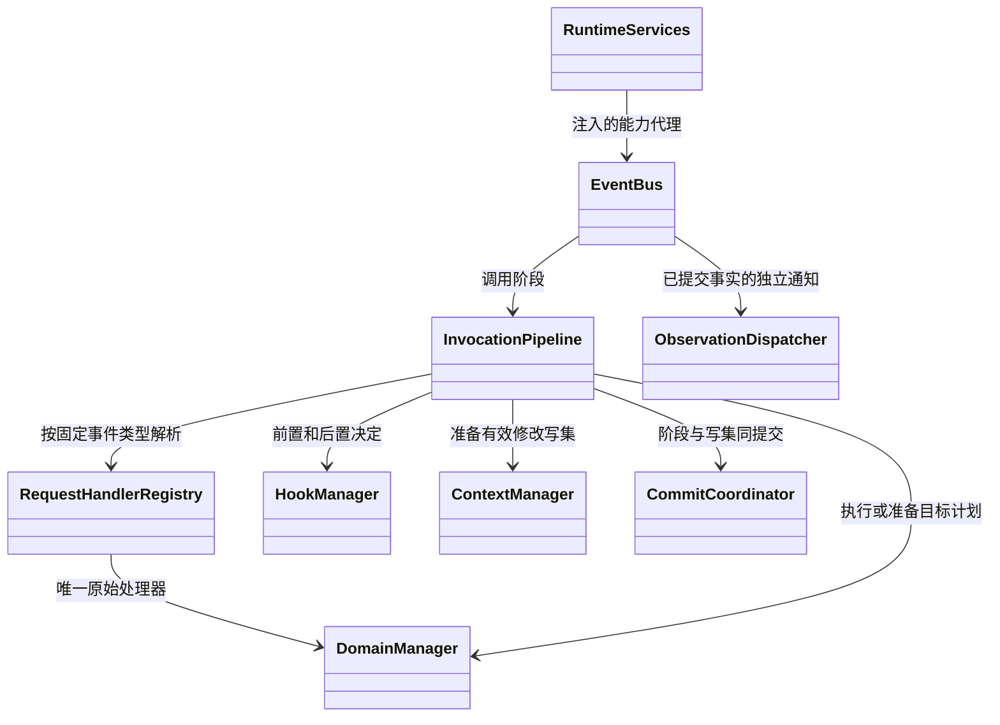

# 能力调用、Hook 与执行环境

> **重建边界（2026-10-15）**：旧业务实现已移除。本页保留为待调整的设计草案；用户、应用、发布与配置版本属于平台，SDK 只接收已解析配置并负责执行与恢复。涉及平台身份、发布绑定及表结构的内容需按 [SDK / Platform 边界](sdk-platform-boundary.md)重新划分，不直接作为 SDK 的必填契约或已实现功能。

**实施细则：[context-capabilities](implementation/context-capabilities.md)**。本页保留架构解释；具体方法、字段状态、事务和恢复分支见实施规格。

更新日期：2026-10-15。状态：SD-3 目标设计，尚未实现。本文定义 Agent 节点与未来工作流 CapabilityNode 共用的能力、Hook 和环境服务；角色任务身份统一为 NodeTask，完整 Agent 调用为 AgentInvocation。公共恢复及领域端口见[检查点协议](checkpoint-protocol.md)和[领域接口](domain-interfaces.md)，产品约束见[Agent 设计约定](../agent-design-decisions.md)。

本篇落实[设计约定](../agent-design-decisions.md)中的可配置能力、调用边界、Hook 和文件隔离。Agent 的 Loop、批次调度及委派见[Agent 执行](agent-execution.md)，提交与接管见[存储恢复和 API](storage-recovery-api.md)。

## 1. 模块边界

**EventBus 是统一通信骨架，InvocationPipeline 管理调用阶段，Manager 提供原始能力或待调度计划，HookManager 返回前后置拦截决定。** 同一总线也承载低频观察通知；普通订阅者的返回值不会修改业务请求或调用结果。下表定义职责，不要求每一行成为独立进程。

| 模块／职责 | 负责 | 不负责 |
| --- | --- | --- |
| `CapabilityRegistry` | 发布配置中的能力目录、名称与处理器映射 | 业务调用、Loop 决策和重试 |
| 调用代理 | 注入可信身份，把普通接口调用转换为事件请求并返回结果 | 在发请求后再次执行原方法 |
| `EventBus` | 请求关联、拦截链入口、最终事件分发、结果等待及观察通知 | 各领域的业务合并规则、授权判断或自行保证持久化 |
| `EventInterceptor` | 总线依赖的统一分发前扩展协议 | 成为所有业务 Manager 的共同基类 |
| `HookManager` | 实现拦截协议，按时机有序校验、允许／拒绝及修改请求／响应，形成明确决定 | 替代系统鉴权、预算裁决、必要检查点和原始业务执行 |
| `InvocationPipeline` | 调用意图、Hook 执行阶段、Attempt、原始结果／有效结果及可靠交付 | 角色下一轮决策、图路由算法 |
| `ModelManager` | 消费最终模型请求，调用 Gateway，归一完整响应 | 直接执行模型返回的工具或逐 token 广播 |
| `ToolManager` | 消费最终工具请求，选择原始内置／托管／脚本／MCP Handler | Agent 循环、图的子执行实例调度 |
| `ContextManager` | 消费上下文请求，校验 Hook 修改及来源，准备有效上下文写集、消息投影和摘要 | 覆盖原始事实，混合不同角色的私有历史 |
| 环境相关 Manager | 环境准备、挂载、文件服务和收束请求 | 根据 Hook 失败放弃必要清理 |
| 图引擎／公共 React 循环 | 调度、等待、汇合与可恢复角色状态；通过统一请求入口使用能力 | 逐点手写 Hook、消息发送与恢复胶水 |

这些名称属于接口草案。现有 `ModelGateway`、`WorkspaceService`、`SandboxGateway`、`SkillService`、`McpClientPool` 可以作为 Manager 内部适配器／服务保留，不要求业务节点改成直接依赖所有 Manager。



图中箭头是服务依赖，不是执行先后或对象归属。Pipeline 通过 `EventInterceptor` 使用 HookManager；HookManager 不负责处理器选择、图调度或持久提交。调用意图、阶段与上下文写集交 CommitCoordinator 一致提交；EventBus 不成为存储实现。完整前后置顺序见[调用管道时序](implementation/invocation.md#11-代理绑定与端到端时序)。请求阶段由唯一 Manager 消费已校验且已提交上下文变更的最终 payload；响应阶段先完成后置拦截、有效上下文及结果保存，才解除等待。拒绝同样形成明确结果，不能通过静默丢弃事件让调用方悬挂。

模型、文件、Skill 阅读、脚本、MCP、上下文、环境与执行控制通过同一事件入口协作。Executor 委派交给图调度负责人创建或恢复执行实例；普通工具调用不创建额外 Agent／图实例。检查点底层提交、总线自身及 Hook 适配器使用内部端口，避免再次进入相同请求链；并非给每个数据库方法再发一条事件。

Manager 注册的是**原始能力实现**。调用代理发出请求后不再执行本地原方法；Handler 不再向自己的请求主题发同一个请求。不同能力之间确有协作时，可以发新的关联请求，但要保留调用链、权限边界和递归限制。HookManager 不注册成普通业务工具，也不让自己的诊断事件重新触发自身。

### 统一总线中的三种交互

| 交互 | 执行与返回规则 |
| --- | --- |
| 请求／响应 | 请求交给唯一领域负责人；前后拦截完成后返回一个有效业务结果 |
| 一批请求 | `request_many` 或等价接口按用户并发配置调度，每项有独立身份／状态，全部结算后按请求顺序返回 |
| 观察通知 | 可有多个订阅者；不参与调用结果合成，失败不改变执行 |

多个 Hook 的处理记录可以构成内部 `responses` 报告，调用方仍获得最终 `value`；公共 Loop 不应自行解析 Hook 与业务 Handler 的返回值后猜测哪个生效。若未来确需一个请求向多个领域处理器收集结果，必须显式定义参与者、等待条件和聚合规则，不能把写文件或 MCP 命令默认广播执行。

事件的 `source`、branch/filter 和任务内调用栈信息便于路由、追踪，但不代替 owner／workspace_scope／Run 授权，也不构成故障恢复现场。请求／响应的 ID、causation、租户、角色和执行范围由 Runtime 固定；Hook 只修改契约允许的业务 payload。

## 2. 能力定义与调用契约

### 2.1 发布时固定的目录

```python
@dataclass(frozen=True)
class CapabilitySpec:
    resource_version_id: UUID
    capability_key: str                 # 版本内稳定身份
    kind: Literal["builtin", "hosted", "mcp", "script"]
    model_name: str                     # 本次角色目录中唯一
    description: str
    input_schema: dict                 # JSON Schema 2020-12
    output_schema: dict | None
    handler_ref: str                    # 可信注册项，不是模型输入
    credential_binding_ref: UUID | None

@dataclass(frozen=True)
class CapabilityRequest:
    operation_id: UUID                  # Runtime 产生
    resource_version_id: UUID
    capability_key: str
    arguments: dict

class CapabilityHandler(Protocol):
    async def invoke_once(self, request, context) -> "ToolResult": ...

class InvocationService(Protocol):
    async def invoke(self, request, context) -> "OperationResult": ...

class CapabilityRegistry(Protocol):
    def for_role(self, release_id, role_key) -> "ResolvedCatalog": ...
    def for_node_binding(self, release_id, node_binding_key) -> "ResolvedCatalog": ...
    def resolve(self, catalog, model_name) -> CapabilitySpec: ...
```

`InvocationContext` 来自 Runtime，以类型化 `owner_ref={kind: agent|workflow, id, space_id}` 标识本次能力调用的归属，另带 Run、图／NodeTask、固定发布及能力绑定、截止时间、取消信号、当前租约和 `workspace_scope_ref`。`conversation_ref`、`invocation_id` 和 `role_key` 都是可选字段：外层 CapabilityNode 使用 Workflow owner 和其 WorkflowSession，不伪造 Agent、AgentSession 或聊天角色；input_only 子 AgentInvocation 使用 Agent owner，但没有 AgentSession。Agent／Session ID 只有存在相应类型时才可由引用派生，不能作为所有工具必须具备的参数。SDK 仅暴露处理器必需的受限子集，LLM 和 Hook 均不能覆盖这些可信字段。

Agent 角色目录由 `for_role` 解析；外层 CapabilityNode 由 `for_node_binding` 从固定 WorkflowRelease 的节点能力绑定解析。发布编译必须确认 owner、资源授权、能力 schema、凭据绑定和环境依赖；文件／脚本／文件 MCP 必须有可解析的 WorkspaceScope，禁止用空 Agent ID、任意目录或假 Session 通过校验。能力声明无需工作卷时可不获取挂载句柄，但仍保留所属 owner、Run 与操作授权范围。具体工作区绑定规则见第 7 节。

目录以 `resource_version_id + capability_key` 指认能力；`model_name` 只用于模型协议。发布时生成合法名称和映射，冲突报发布校验错误。MCP 服务更新工具名或 schema 不热切换已发布配置；目录变化产生新资源版本，旧运行调用失配时返回明确错误。

输入先通过可信身份与基本授权检查，经过有序 Hook 修改后，再校验最终权限、schema 及相关预算，冻结后才允许执行；不能依靠 Hook 完成这些必要检查。平台 SDK 生成对象 schema 时默认 `additionalProperties: false`；MCP 原始 schema 按其声明校验，不能擅自禁止对方明确支持的扩展字段。禁止外部 `$ref` 网络拉取；导入时把许可的本地引用收拢为自包含 schema。

### 2.2 统一结果

```python
@dataclass(frozen=True)
class ToolResult:
    status: Literal["succeeded", "failed", "unknown"]
    content: list["ContentBlock"]        # text / json / artifact_ref
    error: "OperationError | None"
    artifacts: list["ArtifactRef"]
    metadata: dict

@dataclass(frozen=True)
class OperationError:
    code: str
    category: Literal["validation", "permission", "not_found", "conflict",
                      "transport", "rate_limit", "timeout", "business",
                      "protocol", "cancelled", "unknown"]
    message: str                        # 可提供给模型，移除凭据
    phase: str                          # connect / send / receive / execute
    external_outcome: Literal["not_started", "known", "unknown"]
    provider_code: str | None
```

上述 ToolResult 是原始能力结果草案；Hook 拒绝通过统一响应封装表达拒绝阶段与原请求关联，前置未执行时不伪造 Handler 结果，后置拒绝时保留原始状态。统一封装见[EventResponse 数据契约](data-contracts.md)。

原始结果与经后置 Hook 修改、大小限制和协议适配得到的有效结果分开保存。Hook 修改提交到所属作用域的权威有效上下文，不只改变本次返回对象；Loop、后续请求、历史、压缩和恢复均使用该有效版本。后置 Hook 不能把失败、未知结果或真实副作用改写成成功事实；各挂点可写字段由版本化 schema 限定。大结果全量保存为系统 Blob，模型得到有界预览、明确的覆盖范围／truncated 标记及受限 `result_ref`；后续 `result.read` 通过调用所属 owner、NodeTask／可选角色、workspace_scope 及显式结果授权校验，不以必须存在 AgentSession 为前提，也不暴露系统存储路径。最近历史从已提交有效版本重建响应及其更正，不自动展开未读取的原始 Blob；需要更多内容时模型调用 result.read，该读取本身另有 Operation 记录。普通业务文件返回 Workspace 文件引用；其有效期仍随持久沙箱配置，不因成为 artifact 自动永久化。

对于外层 CapabilityNode／AgentNode，payload 修改持久保存到 Operation 有效输入／结果并由节点映射交给 GraphState；只有 React 类节点拥有 RoleContext。context_patch 必须指向明确授权的 ContextScope，不能为无上下文的节点暗中创建共享 messages。

## 3. 一次逻辑调用、物理尝试与事件

### 3.1 提交顺序

以下阶段说明调用和恢复边界，表结构及名称仍是草案。

1. 调用代理附上 Runtime 的稳定身份及可信上下文，进入 EventBus。恢复同一调用沿用身份；LLM 后续提出相同参数属于新调用。
2. InvocationPipeline 保存或读取意图，检查 Run、执行权、原始授权和上下文版本。已有有效终态直接复用；只有 raw_result 时恢复后处理，不能重执行原能力。
3. 分发请求前等待 HookManager 有序执行。Hook 可以校验、允许、拒绝或给出合法修改；每项读取前面已接受的值。失败、超时或无效修改仅丢当前项；合法 deny 则立即结束该控制链，记录明确拒绝。
4. 前置被拒绝时，原始 Manager／Handler 不执行，不创建该能力的物理 Attempt。保存决定及拒绝上下文记录，返回与原请求关联的拒绝结果；不把拒绝前的候选参数描述成已执行参数。
5. 允许执行时，重检身份、授权、schema、保护输入和预算。ContextManager 准备合法 payload／context 写集，由 CommitCoordinator 与 Hook 决定及游标一并提交。业务模型随后由 NodeDriver 协调压缩、硬预算校验，原子冻结请求／claim 输入／预占票据／写 permit；普通能力也须先获得冻结请求和执行许可。提交成功后才允许实际执行。
6. 物理执行先记录 Attempt 意图，再调用原始能力；Runtime 重试沿用同一有效请求，不重跑已完成 Hook 链。模型流仍在 Adapter 内接收与聚合。
7. 外部尝试先保存完整原始响应或错误、未完成证据；只有选定本次逻辑调用的原始结果后才进入 `raw_saved`。尚待自动重试的 Attempt 材料不能伪装成完整模型响应。internal／graph／recoverable 调用不虚构 Attempt，分别提交内部写集或桥接已登记目标结果。
8. 关联响应进入同一 EventBus 的后置拦截。允许时校验并提交 effective_result、有效上下文版本及 Hook 记录；拒绝时保存后置拒绝及原执行事实，阻止普通结果交付和基于该结果继续成功流程。后置拒绝不能撤销已发生的外部副作用。
9. 终态与待交付记录保存后，唤醒原等待者；结果可以是成功、失败或明确拒绝。Runtime 按已提交状态消费；并行成员各自结算，批次收齐后提交完整反馈，不因一个成员被拒绝丢掉其他结果。

请求／响应都在各自事件分发之前拦截，不另建旁路总线。所有修改由 ContextManager 准备版本化写集，经 CommitCoordinator 提交后提供共同来源；不能让实际工具执行改后的参数，后续模型却仍以为执行了原参数。

必要持久化失败不能按 Hook fail-open 忽略，更不能先调用原能力或先应答再补写。数据库事务不跨网络、脚本或 Hook 等待；链游标、上下文更新和调用阶段通过一致提交协议衔接。具体落库方式见[调用、消息与检查点](runtime-messaging-checkpoints.md)。

### 3.2 路由、等待与领域合成

总线负责“把最终事件交给谁、哪个请求在等它”；HookManager 负责“哪些修改有效、怎样按顺序合成”；ModelManager／ToolManager／ContextManager 负责各自业务规则。不能把这些合并成 EventBus 遍历任意 `list<EventResponse>` 决定业务状态的通用算法。

请求注册／分发时须检查具名执行负责人；零个负责人形成明确路由错误，多个负责人对单执行请求形成冲突，不能争抢或重复执行。全局观察者不能冒充业务 Handler。过滤应基于最终 payload，仍需保证确定的负责人；发生无匹配时显式失败，不让请求永久等待。

请求 ID、响应 causation ID、事件类型及可信作用域不可由 Hook 修改。Hook 执行失败按 fail-open 保留此前合法值；合法拒绝则返回明确拒绝结果，两者不能混同。响应不能被静默吞掉；拒绝结果也不能无限重入同一拒绝链。拒绝状态、说明、阶段和原调用身份需可被调用者识别，确切字段随统一协议定稿。

用户停止、补充输入和恢复接管仍通过统一控制入口处理，不能排在长业务调用后无限等待。补充只进入根角色／Planner 的后续 Loop，不广播给 Executor。观察通知可以由多个订阅者消费，但任何观察者失败都不决定调用成功与否。

首版可采用进程内 EventBus；持久状态和可靠待交付记录由存储协议保证。内存 Future、source 包装和 branch 过滤均不是持久检查点或权限系统。恢复读取未消费结果，保持原调用身份后再唤醒；不靠消息恰好送达一次实现业务正确性。

### 3.3 自动重试

重试开关、总尝试次数、等待间隔来自每个 Agent 的 Run 快照，默认关闭、总尝试 2、间隔 2 秒。适配器只报告一次物理尝试；SDK 隐含重试关闭。等待、重连和重新请求全部受 Run 剩余时限约束。

| 错误事实 | 分类／处理 |
| --- | --- |
| 明确连接重置、临时连接超时、网关 502/503/504 | transport；开启重试且仍有次数时再试 |
| HTTP 429 | rate_limit；等待 max(配置间隔, 合法 Retry-After)，超过 Run 截止则结束 |
| 路径不存在、schema 错误、权限拒绝、业务校验失败 | 明确错误直接返回；由下轮模型纠正 |
| 普通业务 `isError`、不能识别的远程异常文字 | business/unknown；不靠匹配“网络”字样猜测重试 |
| 请求已发送但结果丢失 | 外部结果标 unknown；若异常被明确归类为可重试连接异常且用户启用重试，仍按次数策略重试 |
| Run 截止、用户停止、租约失效 | 控制信号；不把它们当作可重试业务错误 |

**工具的幂等、只读或可重试声明不参与重试决策。** SDK 可传稳定 `operation_id` 供提供方防重；这是方便业务方实现幂等，不是平台的重试准入门槛。LLM 后续发出的相同参数调用仍是新 Operation。

## 4. 模型连接与完整结果交付

```python
class ModelGateway(Protocol):
    async def generate(self, request: "ModelRequest", context
                       ) -> "ModelResponse": ...

class ModelAdapter(Protocol):
    async def stream_once(self, request, attempt_context
                          ) -> AsyncIterator["ProviderEvent"]: ...
    async def discover(self, connection_ref) -> list["ModelDescriptor"]: ...
```

这是接口草案：调用方等待一次完整结果，供应商适配器仍使用流式连接。二者的传输粒度不相同。

`ModelRequest` 包含已组装消息、工具目录、标准输出格式、Think 参数和输出上限；模型／凭据来自发布快照。模型适配层首版实现 `OpenAIChatAdapter`、`OpenAIResponsesAdapter` 两个明确协议适配器，GLM、Aliyun、DeepSeek、MiniMax 等连接通过供应商 preset 选择协议和独立的普通 API／Coding Plan 地址。preset 是版本化数据，不把“OpenAI-compatible”当作所有字段完全一致：Think、tool_calls、usage、错误与结束帧均有 provider-specific 映射；不支持的模型能力发布时明确拒绝，不静默忽略。未知或新增协议实现 ModelAdapter，不要求 ReactNode 公共 Loop 或批次调度改代码。`ModelDescriptor` 包含供应商 model ID、窗口、输出限制及其 `source/fetched_at`；窗口 W 未知时必须由 Agent 配置提供，不能把猜测标成供应商真实数据。输出预留 O 属于平台预算：供应商输出限制未知时可采用明确标注为平台默认的保守预算 `min(4096, floor(W/4))`，不能展示成模型真实上限；计算口径见[上下文设计](context-lifecycle.md)。

供应商的文本、reasoning、工具参数和 usage 片段由 ModelGateway 在本次 Attempt 内收集，结束后统一校验并保存为 raw_result；完整响应经过后置 Hook 和最终校验，保存 effective_result 及权威有效上下文后才返回 Loop；后置拒绝则返回明确拒绝状态。请求总线不发送 delta，Hook 不逐片段触发，客户端默认也不接收模型逐字内容。调用开始、完成、失败可以发低频事件；完整正文通过有权限的结果引用交付，不能广播所有角色的私有上下文。

```text
供应商流 → 内部聚合 → 完整响应校验 → 保存 raw_result
                                           ↓
                           后置 Hook → 校验／保存 effective_result
                                           ↓
                           解除等待 → 公共 React 循环解释
                                           ↓
                               工具／委派／候选最终回答
```

模型一轮响应结束，不等于 Agent 任务结束。完整响应可能包含工具调用或 Executor 委派，公共循环继续执行；只有根 Agent 满足终结条件且 Run 终态提交后，才交付本次最终答案。`finish_reason=stop` 只能辅助判断响应结束，不单独证明任务完成；本轮不引入强制 `finish` 工具。

工具名和 JSON 参数片段在响应完整前绝不执行。流中断、协议错误或取消形成明确失败结果，内部已有片段标 `incomplete`，不能当作一次成功响应或可执行动作。若需要向用户说明未完成，可以在错误结果中给出获准的部分内容；不能伪装成最终答案。

首次有意义输出为非空文本、reasoning 内容、工具名或参数片段；连接建立、SSE 心跳、空 delta、role 和 usage 不算。合法完整终帧也结束等待。默认等待 60 秒，计时依据适配器实际收到的内容，不依赖总线或前端有没有收到字。收到首个有效输出后取消首输出计时，整次 Run 默认一小时的总截止始终生效。`model_stream_idle_timeout_seconds` 仍是可按 Agent 配置的连接层策略草案，默认 `null`。

连接层对已输出后中断按每个 Agent 的 RetryPolicy 决策。旧 Attempt 的部分内容作为未完成材料留存，新 Attempt 独立聚合；不拼接两次尝试的文本或工具参数。只有一次完整成功响应进入后置处理，并在有效结果及上下文提交后成为逻辑调用结果；后置 Hook 故障或合法拒绝都不触发供应商重试。重连读取同一服务端请求不算重新物理执行；重新发送生成请求算新 Attempt。无法判断服务端是否支持接续时不得声称续上原响应。

模型准备过程仍由公共 React 循环协调：`prepare_context → prepare_model → 必要时 compact_context → call_model`。这些是可恢复阶段，不要求每段都注册成独立图节点。上下文请求经 EventBus 交 ContextManager；模型请求经拦截后交 ModelManager。前置 Hook 可以修改允许的消息／参数，但最终授权、保护输入和预算检查不可省略。压缩后从已提交有效上下文重新物化合法修改并检查预算，不重新执行同一前置 Hook 链；面向旧消息位置的补丁不能盲目应用到新视图，采用稳定记录引用和 base_revision 校验后重建，规则见[上下文修改协议](context-lifecycle.md)。ModelGateway 不暗中发起摘要模型。

压缩调用同样经过模型请求／响应拦截，带 `purpose=compaction` 供筛选；允许字段和预算约束与普通模型调用一致，其业务规则见[上下文设计](context-lifecycle.md)。模型 SDK、Adapter 和代理不能各自重复发出同一逻辑事件。入口／Planner 模型最终失败、压缩调用失败终结所属完整 AgentInvocation；直接 Agent Run 随之失败，工作流内由父 AgentNode 接收错误并走既定错误路由，不能自动终结兄弟调用。Executor 模型最终失败仅形成该角色执行的错误结果，Planner 在批次收齐后决策。根停止、根总截止和根额度耗尽仍控制整棵执行树。

## 5. Hook 控制、修改与观察协议

### 5.1 控制接口与返回结构

Hook 按时机配置，所属 Agent 的版本和顺序固定于 Run；matcher 可以筛选角色、能力、用途和结果。**Hook 可以校验、允许或拒绝执行，并修改输入、输出及上下文。** 修改必须进入权威有效上下文，让当前处理器、Loop、后续模型调用、历史投影、压缩与恢复看到一致版本。

EventBus 只依赖 EventInterceptor；HookManager 实现有序链，各领域 Manager 消费最终 payload。普通观察订阅者收到事实通知，但其返回不控制执行。HookManager 不是给模型调用的业务工具。

```python
class EventInterceptor(Protocol):
    async def before(self, event: EffectiveRequest,
                     context: HookContext) -> HookDecision: ...
    async def after(self, result: EffectiveResponse,
                    context: HookContext) -> HookDecision: ...

@dataclass(frozen=True)
class HookDecision:
    decision: Literal["allow", "deny"]
    payload_patch: PayloadPatch | None = None
    context_patch: ContextPatch | None = None
    reason: str | None = None

@dataclass(frozen=True)
class HookOutcome:
    execution_status: Literal["succeeded", "failed", "timed_out", "invalid", "abandoned"]
    decision_ref: str | None
    diagnostic_ref: str | None
```

本版固定上述返回结构，与[领域端口](domain-interfaces.md)一致。PayloadPatch 使用挂点 schema 允许路径和预期输入版本；ContextPatch 使用[上下文协议](context-lifecycle.md)定义的稳定记录标识及 base_revision。二者是同一语义变更的两种表达入口，不是两条独立写通道：Pipeline 依据版本化字段映射统一归一当前调用相关变更，ContextManager 校验后准备 effective payload 和有效调用记录写集；只改 context 中当前调用的字段也必须同步生成尚未发送的 payload，不能出现执行值与记录值不同。与当前调用无映射的获授权历史修改则仅影响对应 context。已经冻结或执行的历史请求不能改写实际参数与执行事实，只能追加有来源的说明。具体可改字段及映射由挂点 schema 声明，不能推定可改任意系统字段。

同一 Hook 的两侧 patch、单个 patch 内重复项、父对象替换与子字段修改都参与冲突检查。相同语义字段写相同值合为一次；不同值或无法证明兼容的重叠写入将本项全部 patch 标为无效，记录 `HOOK_PATCH_CONFLICT`。不靠应用先后次序选择一个值。归一集合通过完整校验后才一起提交，不允许只保留 payload 或 context 一侧。示例及恢复规则见[上下文修改协议](context-lifecycle.md)。

### 5.2 有序链、fail-open 与拒绝

每条链按固定配置逐项 await。Pipeline 对每项返回完成决定校验及双 patch 归一，ContextManager 准备有效写集，CommitCoordinator 一致提交决定、写集与游标，下一项读取该已提交 effective payload 与有效上下文版本；原处理器只在整条前置链完成后分发。后项可以在授权范围内显式再次修改前项的有效值，保留两次来源和顺序，不与同一项内部矛盾写入混淆。迟到返回不能再改已冻结请求。

控制决定与修改分别验证。处理器异常、超时或没有合法控制决定时，按 Hook 故障继续此前有效版本；无效 patch 或越权修改只丢弃本项全部修改，保留之前合法修改。合法 deny 不因附带 patch 无效而失效，必须保存拒绝和修改诊断，阻止原执行或结果交付。必要持久化错误则由 Runtime 处理，不属于上述 fail-open。

| 结果 | 意义与后续 |
| --- | --- |
| 合法 allow | 同意继续，仍需系统鉴权、schema、保护输入及预算检查 |
| 合法 deny，发生在执行前 | 阻止原处理器执行，保存拒绝决定，向等待者返回关联拒绝结果 |
| 合法 deny，发生在响应后处理 | 阻止原业务结果交付／据其推进成功路径；保留原始执行事实，明确说明副作用不曾回滚 |
| 合法 allow，但 patch 无效或同项语义冲突 | fail-open，本项全部 patch 不生效，继续此前有效版本并保存诊断 |
| 合法 deny，但 patch 无效或同项语义冲突 | 丢弃本项全部 patch，仍保存并执行拒绝；不得将 deny 降级成 allow |
| Hook 自身失败或控制决定无效 | fail-open，舍弃当前项的控制和修改，保留此前有效版本 |
| 核心权限、执行权、持久化或 Run 状态失败 | Runtime 自身错误，不能用 Hook allow 或 fail-open 绕过 |

合法 deny 后不再让后续 Hook 用 allow 覆盖；拒绝需要与调用及有效上下文一起保存。已接受的修改及拒绝记录可回查，但没有执行的候选参数必须标明未执行。后置拒绝不重新调用原能力，也不是把真实成功副作用改写为“未发生”。拒绝是本次边界的明确结果，不默默扩展为所有 Run 的全局禁止；Run、批次和下一次 Loop 按明确的拒绝状态处理。

逐项校验结构、权限、受保护字段和不可压缩固定材料；本项引入的非法修改，或新增固定材料本身已无法容纳，丢弃本项全部 patch；合法控制决定仍按上表处理。其余合法修改提交有效上下文后走原 CompactionPolicy；压缩前总输入超预算不等于 Hook 失败。正常压缩后仍超窗口，由 Runtime 按既有窗口异常终结，不重跑 Hook 或回滚已提交历史。原请求本身存在的错误和必要持久化失败不能忽略，不能在调用方和恢复存储之间保留两套不同事实。

### 5.3 修改范围与可见性

| 数据 | 规则 |
| --- | --- |
| 请求参数、模型输入、响应内容 | 按 schema 修改；提交有效上下文版本，实际调用和后续消费使用相同版本 |
| 原始 UserInput／模型响应／工具结果 | 不覆盖；raw 记录保留，变更通过有效版本和来源关联体现 |
| 工具参数变更 | 明确保存“模型提出的参数”和“实际执行的参数”；后续模型须看到改动及实际参数，不只留审计 |
| event ID、causation、类型、owner／workspace_scope／Run／可选会话与角色、lease | 不可变；不能通过 patch 改路由或跨执行范围 |
| 凭据、权限、额度、deadline、停止状态 | Runtime 掌握，Hook allow 不扩权、不续期、不重启已停止执行 |
| 真实执行状态和外部副作用 | 不可伪造；后置拒绝／替换结果不等于回滚 |

全上下文可见指**所属作用域内的权威有效上下文一致**，不等于把 Planner 和所有 Executor 的私有历史合并。角色私有修改仅作用于对应角色；明确的共享字段按共享作用域更新，授权消费者在后续读取时获得新版本。已经发出的模型／工具请求保持原冻结版本，不能被后来 Hook 倒改。

ContextManager 是上下文校验和写集准备入口，CommitCoordinator 是唯一运行事实提交入口。Hook 返回提案，由 Pipeline 调用 ContextManager 检查作用域、来源和预期版本；Hook 不直接修改数据库、某个内存 messages 列表，也不再次发送同一调用。冲突不能采用静默最后写入覆盖，以 base_revision 做 CAS；冲突重新读取有效版本后由 ContextManager 处理，不能重放已提交 Hook 或覆盖别人的修改，具体规则见[上下文协议](context-lifecycle.md)。

对模型响应 `tool_calls` 的允许修改必须在事件 schema 中明确，并重检工具授权及完整结构；Hook 来源不产生跳过校验的特权。受保护用户问题及补充仍须按既有规则保留，不能通过压缩或 patch 悄悄丢失。

### 5.4 挂点及处理器草案

| 挂点／事件 | 语义 |
| --- | --- |
| 模型请求分发前、完整响应交付前 | 有序 allow／deny／修改；收齐流后才处理完整响应 |
| Tool／MCP／脚本请求与响应 | 实际执行最终参数；raw 保存后处理有效结果或明确拒绝 |
| 上下文准备、更新、压缩请求与响应 | 统一拦截；ContextManager 保证版本、原始来源及摘要覆盖 |
| Executor 委派与结果 | 相同控制边界；不改角色身份或任意跳转父子执行状态 |
| Session／Run／Attempt 等生命周期事实 | 纯观察；返回值不改已经发生的流程 |

挂点级可写字段及隔离执行配置在实现阶段补充完整校验表；共同调用协议按[领域接口](domain-interfaces.md)。供应商 token 片段及脚本内部每个文件操作不默认发消息；不完整模型响应不能执行工具参数，也不能伪装为后置成功结果。

处理器环境沿用 SD-3 候选方案：隔离脚本、授权 HTTP、授权 MCP、平台可信函数。首版范围和格式尚待定稿；允许／拒绝／修改是 AgentLoom 已确认能力，并不等于所有 Claude Code 退出码、字段和处理器都已兼容。导入必须显式转换并校验，未知配置不能悄悄忽略。[Claude Code Hook 参考](https://code.claude.com/docs/en/hooks)

### 5.5 恢复与递归

固定保存 Hook 配置版本、顺序、输入版本、字段映射/schema 版本、归一变更引用/hash、前后有效引用、执行游标和决定。上述内容通过 HookInvocation 的决定与上下文变更引用保存，不增加第二套结果权威。已接受项的决定、语义变更、effective payload、context revision 与游标同事务生效；patch 被判无效时保存诊断及未生效事实，并独立保存合法 deny，不生成局部有效修改。恢复读取已完成决定和权威有效上下文，不再分别执行两种原始 patch，也不因为重新投递事件重跑整个链；已有 raw_result 时只继续后置处理与提交，不再次执行原能力。Hook 已启动但结果丢失时先按调用身份查询；无法确认则记录 indeterminate，放弃未提交 patch，按 fail-open 使用最后有效值，不盲目重放外部处理器；已提交 deny 不被撤销。详见[检查点协议](checkpoint-protocol.md)。存在 HookInvocation 记录不代表外部副作用恰好一次。

Hook 通过有界适配器执行，不进入与自身相同的业务请求链；必要时新发内部请求须携带来源及防递归信息。ContextManager 写集准备、Coordinator 底层写入和总线自身不再绕回相同拦截器。普通观察通知可异步，不作为有效结果提交的必要依赖。

停止控制和 Run 总截止始终优先。Hook 等待不得延长 Run 的额度或期限，迟到决定不会撤销已完成的拒绝／终态。必要清理、状态提交和权限验证由 Runtime 保证。

## 6. Skill 与 MCP 适配

### 6.1 Skill 导入与执行

目录采用 `SKILL.md` 加可选 `scripts/`、`references/`、`assets/`；元数据与按需加载参考标准规范。[Agent Skills 格式](https://agentskills.io/specification)

目录上传与 Git URL 均形成 immutable ResourceVersion：上传暂存 → 校验路径／链接／大小 → 解析 manifest → 生成内容摘要 → 存储只读版本。Git 固定完整 commit，记录来源；不在导入中运行安装脚本、Git hook 或仓库代码，不自动拉 submodule。支持单仓多 Skill，逐项报告有效入口。Git 导入只接受经过网络策略校验的 HTTPS／SSH 源，禁止 file/local path 和任意 protocol helper；SSH 凭据只绑定该导入任务，子模块需另行显式导入。

`SkillService.list_for_role()` 只提供名称、说明和入口；`skill.read` 或文件 read 加载正文／引用。相对引用以 Skill 目录解析，运行脚本以 `/skills/<name>/scripts/...` 只读路径调用；输出写 `/work`。脚本依赖由发布配置选择的版本化执行镜像提供，缺少解释器／包返回明确错误，不在平台服务进程随意 pip install。

| 元数据／语法 | 导入策略 |
| --- | --- |
| 标准 name、description、license、compatibility、metadata | 保存并校验；保留额外普通资源文件 |
| arguments、argument-hint、`$ARGUMENTS`、`$N` | 支持文本参数渲染，不做 shell 字符串插值 |
| user-invocable、disable-model-invocation | 进入角色发现／显式使用规则；后台不能替用户激活受限 Skill |
| allowed-tools、disallowed-tools | 转成当前角色权限的交集／排除，不能授予角色未配置能力 |
| model、effort、context:fork、agent | 本版发布校验拒绝；模型固定，协作只能通过显式 Executor 配置 |
| hooks | 导入为待绑定 Hook 资源，通过同一 Hook schema 校验后显式保存入 Agent 配置 |
| 动态 shell 注入、CC 专属变量／设置字段 | 本版报告不支持，不在 read 时暗中执行；可改为显式 exec 工具调用 |

这是跨平台可验证的支持范围；Claude Code 包含额外模型、子 Agent 和动态脚本扩展，不把读取文件成功等同于行为完全兼容。[Claude Code Skill 参考](https://code.claude.com/docs/en/skills)

### 6.2 MCP 支持 profile

首版采用 MCP `2025-11-25` 协议 profile，握手只接受已实现版本；能力协商明确声明。不实现旧独立 HTTP+SSE 自动降级。协议采用 `stdio` 和 `Streamable HTTP` 两种适配，HTTP 中 JSON 及 SSE 响应均处理。[生命周期](https://modelcontextprotocol.io/specification/2025-11-25/basic/lifecycle)、[传输](https://modelcontextprotocol.io/specification/2025-11-25/basic/transports)

| 功能 | 本版契约 |
| --- | --- |
| initialize、initialized、ping | 建连／重连必要流程，协商结果入连接记录 |
| tools/list、分页、tools/call | 注册版本化目录；JSON Schema 输入及 structuredContent 输出校验 |
| resources/list、templates/list、resources/read | 授权后包装普通读取能力，不自动加载资源文本 |
| prompts/list、prompts/get | 导入为可选模板资源，不自动覆盖用户／系统 Prompt |
| logging、progress、cancelled、list_changed | 记录观测；目录更新提示新版本，不更改当前 Run；取消不等同远端副作用已撤销 |
| roots/list | 只对受限本地进程提供当前可见根；roots 是协议提示，真正隔离靠挂载 |
| sampling、elicitation、tasks | 不宣告 client capability；服务端发出时返回不支持，不启动隐藏模型／暂停流程 |
| OAuth | 配置阶段完成授权码＋PKCE／metadata 发现、token 更新与 audience 绑定；执行时无交互补权 |
| 自定义 Header / API Key | 独立连接凭据方式；不冒称实现 OAuth，不把平台登录 token 转给 MCP |

MCP JSON-RPC protocol error 与 `isError: true` 工具执行错误分别归一；后者不默认认定为网络故障。工具 annotations 保留用于展示，不能用于放行授权或决定是否重试。[工具协议](https://modelcontextprotocol.io/specification/2025-11-25/server/tools)、[授权协议](https://modelcontextprotocol.io/specification/2025-11-25/basic/authorization)

stdio 服务启动在本次 `workspace_scope_id` 的专用受限进程中，与普通 exec 进程隔离，凭据只注入该 MCP 服务指定变量；不把 MCP 环境密钥留在通用脚本环境。HTTP pool 按 `(space_id, connection_version, credential_binding, workspace_scope_id)` 分区；运行中的 MCP 协议会话／进程句柄再绑定 Run 和当前 lease epoch，恢复不得把旧 epoch 的授权句柄交给新执行者。MCP-Session-Id 是远端协议身份，不是 AgentSession、WorkflowSession 或工作区授权身份。资源凭据保存在服务端 SecretStore，错误／日志脱敏。

任意远程文件服务无法仅靠给请求增加 `session_id` 获得隔离。访问平台共享工作区的 MCP 必须通过 Workspace 网关的短期 token，明确绑定 `owner_ref + workspace_scope_id + run_id + 当前 lease epoch + 获准路径/操作`，或运行在同一 scope 的受限挂载中。网关校验数据库中的可信归属和有效执行权，不能接受 MCP 自报路径／Session 作为授权依据；input_only 调用按 invocation 分区获得同样保护。不能把全 Agent／Workflow NFS 根和通用高权限凭据交给第三方服务器。普通业务 MCP 的远端授权范围由连接配置明确选择。

## 7. 文件工具与共享执行环境

### 7.1 固定根与实际视图

```text
共享 POSIX 根 /shared/agentloom/
  resources/<space>/<resource_version>/          # 平台共享不可变版本
  agents/<agent>/
    manifest.json                               # 固定根身份，系统维护
    sessions/<agent_session>/work/              # Agent 持久会话卷
    sessions/<agent_session>/runs/<run>/work/   # Agent 非持久会话卷
    invocations/<invocation>/work/              # 无 AgentSession 的持久子调用卷
    invocations/<invocation>/runs/<run>/work/   # 无 AgentSession 的非持久子调用卷
  workflows/<workflow>/
    manifest.json
    sessions/<workflow_session>/work/          # Workflow 持久会话卷
    sessions/<workflow_session>/runs/<run>/work/ # Workflow 非持久会话卷
  system/agents/<agent>/blobs/<prefix>/<sha256>  # 模型／脚本不可挂载
  system/workflows/<workflow>/blobs/<prefix>/<sha256>
  system/deletions/<job>/                       # 维护任务最小路径清单
```

Agent 与 Workflow 创建时分别分配固定 `file_root_id`，发布和跨机接管不能重建根身份。运行时使用类型化工作区视图：

```text
WorkspaceScope {
  workspace_scope_id, owner_ref:{kind:agent|workflow,id,space_id}, file_root_id,
  partition_kind:agent_session|workflow_session|invocation, partition_id,
  run_id, invocation_id?, persistent
}
```

WorkspaceScope 保存工作区身份及当前 Run 的绑定；当前 lease epoch 由 RunRuntime 验证后另行绑定到调用和环境句柄，不属于此持久 DTO，不能将旧检查点中的执行权当成恢复授权。挂载路径只能由 WorkspaceStore 依据上述已验证身份解析，用户、模型和 Hook 不提交宿主路径。

| 调用位置 | owner 与分区 | 工作目录与资源 |
| --- | --- | --- |
| 直接 AgentSession | Agent owner，agent_session 分区 | 延续原 Agent 会话目录；同 Invocation 的 Planner／Executor 共用 `/work` |
| 外层 Workflow 的 CapabilityNode | Workflow owner，workflow_session 分区 | 外层节点使用同一 WorkflowSession 工作卷；各节点的只读 Skill／资源按其发布绑定授权 |
| 外层 AgentNode，input_only | 子 Agent owner，invocation 分区 | 在该 Agent 固定根下按 invocation_id 建独立目录，不复用外层工作卷、不虚构 AgentSession |
| 外层 AgentNode，显式获得历史授权 | 子 Agent owner，仍为 invocation 分区 | 历史读取授权不改变工作文件分区，不能据此挂载被授权会话的工作卷 |

持久策略由各自 owner 的冻结发布配置决定，父 Workflow 不覆盖子 Agent 的沙箱策略。父子之间传文件使用显式授权 ArtifactRef；只读派生投影必须保存 source_owner 依赖，不通过共享宿主根绕过授权。父调用的 system blob 和 GraphState 不可挂载给子 Agent。

工作区登记以 `(owner_ref, partition_kind, partition_id, run_id)` 为唯一创建键；file_root_id 必须是该 owner 创建时固定的根，persistent 从本次冻结发布解析。分区身份从可信 Session／Invocation 得到：Workflow 根在 Run 启动时登记，子 scope 在 AgentInvocation 初始提交中登记。先提交身份和挂载意图，再幂等创建物理目录；宕机后复用相同 scope、partition 和路径，不生成新 invocation_id 或用新 Worker ID 建目录。恢复只更新本次执行授权和租约句柄。持久会话分区的目录可跨 Run 复用，但新 Run 必须取得新的 WorkspaceScope 和句柄，旧 Run 不能借路径相同保留写权限。会话分区仍受单活动 Run 的占用协议约束。

编译产物须固定节点的资源清单、凭据绑定、环境策略及 workspace 解析规则：外层工具从 Workflow scope 解析；内层角色从所属 AgentInvocation scope 解析；子调用的 invocation 分区及独立的历史授权在 AgentNode 上声明并校验。编译时不分配动态目录，也不硬编码宿主路径；运行时只填入已持久分配的 Run／Session／Invocation 身份。角色／节点未授权的 Skill 不挂载，配置缺少必需工作区或跨 owner 授权时编译失败。

执行时只映射当前 scope 的 `/work` 和获准的只读 `/skills`、`/wiki`、`/resources`。Planner 和 Executor 保持各自模型上下文与只读能力视图，但共用其 Invocation 的工作文件；不为 Executor 复制卷。AgentSession、WorkflowSession 和 input_only Invocation 分区彼此隔离，不依赖 Prompt，也不因为共享逻辑沙箱而挂载整个 Agent／Workflow 根。

共享后端选 NFSv4 POSIX；开发测试用相同 WorkspaceStore 接口的本地 POSIX。NFS 承载文件，PostgreSQL 负责执行 lease；NFS 文件锁不决定谁能推进 Run。独立稳定 `.locks/<file-key>` 配合 advisory lock＋ETag 校验用于**经文件服务**的并发修改，原文件更新采用同目录临时文件、fsync、rename；脚本绕过服务直接写时不承诺这些 advisory lock 自动生效。

共享可写文件天然可能发生业务冲突：工具编辑使用 `if_match` 暴露冲突，脚本应采用独立临时输出再提交。Runtime 不凭“只允许并发 2”保证两个 Executor 不写同一个文件；冲突错误交给模型重新读文件决策。

### 7.2 WorkspaceService 和 SandboxGateway

```python
class WorkspaceService(Protocol):
    async def open_view(self, scope) -> "WorkspaceHandle": ...
    async def read(self, handle, path, offset, limit) -> "FileSlice": ...
    async def write(self, handle, path, content, *, mode="create_only", if_match=None) -> "FileVersion": ...
    async def apply_patch(self, handle, path, patch, if_match) -> "FileVersion": ...

class SandboxGateway(Protocol):
    async def ensure(self, scope, image_digest, lease_epoch) -> "SandboxHandle": ...
    async def execute(self, handle, command, owner: "ExecutionOwnerRef",
                      deadline) -> "ExecutionHandle": ...
    async def inspect(self, execution_id) -> "ExecutionStatus": ...
    async def terminate(self, execution_id) -> None: ...
    async def revoke(self, run_id, lease_epoch) -> "RevocationReceipt": ...
```

`WorkspaceService.write` 的 create_only 要求目标不存在，replace 必须提供匹配当前版本的 if_match；参数组合不合法时拒绝写入。

`ExecutionOwnerRef` 的 business 分支记录 operation_id＋attempt_no，hook 分支记录 hook_invocation_id；执行服务分别核对可信调用者和归属，不要求 Hook 必须虚构一个 NodeTask。

平台文件工具通过 WorkspaceService 访问；脚本对授权挂载执行普通 POSIX 读写，并不会自动经过文件服务。两条路径共享同一 workspace_scope 的受控执行域与写入权；SandboxGateway 持有当前 epoch 和挂载控制权，切换前先收束旧执行域。仅在文件写前查一次 DB lease 不能提供原子写入 fencing。平台基础工具在 WorkspaceService 内做 scope 校验；Linux 使用 dirfd／`openat2` beneath、禁止路径逃逸／符号链接越界，不能用字符串前缀判断。用户脚本通过容器 mount namespace、非 root UID、只读资源、受限 `/tmp`、无宿主 socket/凭据及进程组控制落实相同边界；仅限制 cwd 不成立。

脚本执行网络默认关闭；Agent／Workflow 可在各自环境策略配置获准的 egress 域名／网段，由执行服务网络策略落实。授权 MCP／HTTP 连接使用各自绑定的受限网络出口，不因启用某个工具就给脚本全部连接凭据或网络访问权。

关闭持久沙箱仍使用受限临时执行器。容器属于执行服务，不把 Runtime/数据库进程放进用户脚本容器。执行服务按租约心跳撤销过期进程视图；接管先确认旧环境已终止／隔离，无法确认时不能把同一可写卷同时交给新进程。

外部机器被网络分区后仍可能写已挂载 NFS，单纯数据库 fencing epoch 不能约束其普通 POSIX write。因此生产 SandboxGateway 必须是具备进程撤销控制的独立服务；无法证明撤销时将接管挂起并明确报告，而不是宣称完成安全恢复。允许的可用性损失换取同一工作区分区不被双执行者同时改写。

### 7.3 基础工具契约

| 名称 | 输入核心字段 | 返回及错误边界 |
| --- | --- | --- |
| `fs.list` | path、cursor、limit | 有界目录项，路径均相对当前视图 |
| `fs.glob` | pattern、root、limit | 不越过授权根；返回排序结果及 truncated 标志 |
| `fs.grep` | pattern、paths、literal、limit | 路径＋行号＋片段；regex 限时，无 shell 拼接 |
| `fs.read` | path、offset、limit | UTF-8 片段／明确 binary 错误、etag、next_offset |
| `fs.write` | path、content、mode、if_match | create_only 默认；覆盖须带读到的 etag，原子替换 |
| `fs.edit` | path、old_text、new_text、expected_matches、if_match | 匹配数量和版本不符返回 conflict，禁止悄悄全量替换 |
| `fs.patch` | path、unified_diff、if_match | 单文件原子应用，路径／hunk 校验；多文件按各文件单独 Operation |
| `fs.mkdir/move/delete` | 受限路径；move/delete 要 if_match | 不允许 owner／分区根删除、资源写入；目录删除显式 recursive |
| `skill.list/read` | 授权 Skill 名称、资源相对路径 | 只读版本内容；read 是普通工具调用，不产生额外 NodeTask |
| `exec` | argv 或明确 shell_script、cwd、env_patch | stdout/stderr 预览、退出码、execution_id；默认每次 10 秒，超时终止进程组 |
| `result.read` | result_ref、offset、limit | 读取本角色获准的逻辑调用大结果；不接受系统绝对路径 |

工具响应有最大预览大小并返回完整结果引用，不把超长 stdout 全塞进模型。shell_script 仅在用户已授权 exec 时进入受限环境；平台自己的 argv 不用字符串拼接。普通脚本文件 open/read/write 不逐次生成 NodeTask 或 Hook；平台记录外层一次 exec 操作及其进程输出。

### 7.4 清理

整个 Run 收束后：禁止新调用 → 确认所有 owner／workspace_scope 的写进程终结／权限撤销 → 发出 `run.ending` → 按本 Run 的工作区登记清单删除全部非持久工作目录 → 提交清理结果。input_only 子调用结束不提前删除其文件；外层仍可能消费已授权产物。观察者不启动新的业务写入者；读取临时文件如需强制保证时序，应使用明确等待且有界的生命周期挂点，不能依靠异步通知抢在清理前执行。必要清理由 Runtime 保证，失败登记可重试清理任务，Hook 失败不会跳过必要清理；Run 已到硬截止时不再等待扩展 Hook，直接保证必要收束及清理。持久目录保留，默认无 TTL。

Agent／Workflow 删除先封禁该 owner 的新执行，停止相关 Run 并撤销其执行环境，再清理该 owner 的会话、调用记录、检查点、系统 blob 与专属工作目录。删除 Agent 还须依据 source_owner 索引撤销父工作流中的授权引用、派生可读投影及其内容副本，不能靠改存父 blob 保留已删除 Agent 的内容；可保留不含内容的删除标记。删除 Workflow 不连带删除被调用 Agent 的专属记录和持久文件；共享 Skill/MCP/模型资源也只解除引用。具体跨 owner 依赖和删除重试见[存储恢复设计](storage-recovery-api.md)，不得通过普通 `fs.delete` 绕过管理端删除协议。

## 8. 开发者 Tool SDK 契约

以下是**待实现 SDK 的目标接口示例**。开发者可以注册受限托管工具，或自行部署标准 MCP Server；两者最终通过同一调用代理及持久调用入口，不要求开发者理解 Agent 内部的 Loop 和批次调度。

```python
from agentloom_sdk import Tool, ToolContext, ToolResult, StrictInput

class WriteReportInput(StrictInput):
    path: str
    markdown: str
    if_match: str | None = None

class WriteReport(Tool[WriteReportInput]):
    name = "write_report"
    description = "在当前会话工作目录生成报告"
    input_type = WriteReportInput

    async def execute(self, args: WriteReportInput, ctx: ToolContext) -> ToolResult:
        saved = await ctx.files.write(
            path=args.path, content=args.markdown,
            mode="replace" if args.if_match else "create_only",
            if_match=args.if_match,
        )
        return ToolResult.success({"path": saved.path, "etag": saved.etag})
```

`ctx.files` 是已绑定可信 owner 与 workspace_scope 的受限 RPC，不接收 owner、Session、invocation 或宿主路径覆盖参数；同一 SDK 可用于外层 CapabilityNode、AgentSession 和 input_only 子调用。SDK 支持 `ctx.operation_id/attempt_no/deadline/cancelled` 和授权 SecretRef，禁止获得平台 DB 连接。托管上传代码在隔离 runner 中执行；工具 manifest 固定 schema、依赖镜像和入口版本，发布后不使用可变源码目录。

开发者工具若调用远程系统，可传 `ctx.operation_id` 作为业务幂等键；平台不要求其声明“可重试”才能运行。开发者返回的错误通过统一 code/category 归一，禁止把网络错误吞成成功字符串。

## 9. 模块验收条件

- 调用代理不同时执行原方法；原始 Handler 不递归进入同一代理。恢复同一已提交调用复用结果，LLM 新提出的相同参数调用仍产生新身份。
- 前后 Hook 有序校验、allow／deny／修改；合法拒绝阻止相应执行或交付，Hook 故障 fail-open，二者有明确不同结果。
- 修改经 Pipeline 归一、ContextManager 准备写集并统一提交后成为有效上下文版本，当前 Manager、Loop、后续模型、历史、压缩及恢复见到一致结果；raw 保留。覆盖同字段同值合并、异值整项 patch 失效、父子字段重叠、仅 context 修改当前调用、后续 Hook 合法再次修改和提交前后恢复；合法 deny 加冲突 patch 仍必须拒绝。
- Manager 实际使用 Hook 后参数，waiter 仅收到已保存的有效响应；raw_saved 后宕机只恢复后处理，不再次执行原能力。
- 原始 UserInput、身份、路由及 causation 不可覆盖；参数被修改后，后续模型知道实际执行参数。角色私有修改不泄漏给其他 Executor，已发请求不被追改。
- 观察者返回值不影响调用；零／多具名执行负责人、响应关联错误或无匹配都形成明确错误，不让请求悬空。
- 检查点或必要结果提交失败不得假成功应答，也不能借 Hook 的 fail-open 跳过。
- 模型供应商流仍正常接收，但总线、Hook 和客户端没有逐 token 消息；完整响应完成后置处理及有效结果保存后返回，根 Run 终态才交付最终答案。
- 模型首次输出超时、部分输出重试、心跳不算内容、流停滞与总截止均通过假连接适配器确定性验证。
- MCP 工具 schema 不匹配可定位到版本；协议错误和业务 isError 区分；服务端不得借 sampling 启动隐藏模型请求。
- Skill 上传不执行脚本；版本不可变；源码中的越界链接、未授权工具以及模型覆盖字段显式失败。
- Planner／Executor 共享同 Invocation 工作区；外层 CapabilityNode 无 AgentSession 仍能按 Workflow scope 调用文件工具／MCP；input_only 子调用使用稳定 invocation 分区。跨 owner／分区的 read、glob、grep、symlink、脚本及文件 MCP 全部验证拒绝，只有显式授权引用可读取派生产物。
- NFS 断连／重连、rename、ETag 冲突、旧进程失联的撤销失败都被测到；不能只测本地磁盘成功路径。
- 整个 Run 完成后登记的全部非持久工作文件删除；系统记录保留。Agent／Workflow 删除仅清其专属内容和依赖它的可读投影，保留其他 owner 专属记录及共享资源；父副本不能绕过 source_owner 删除。
