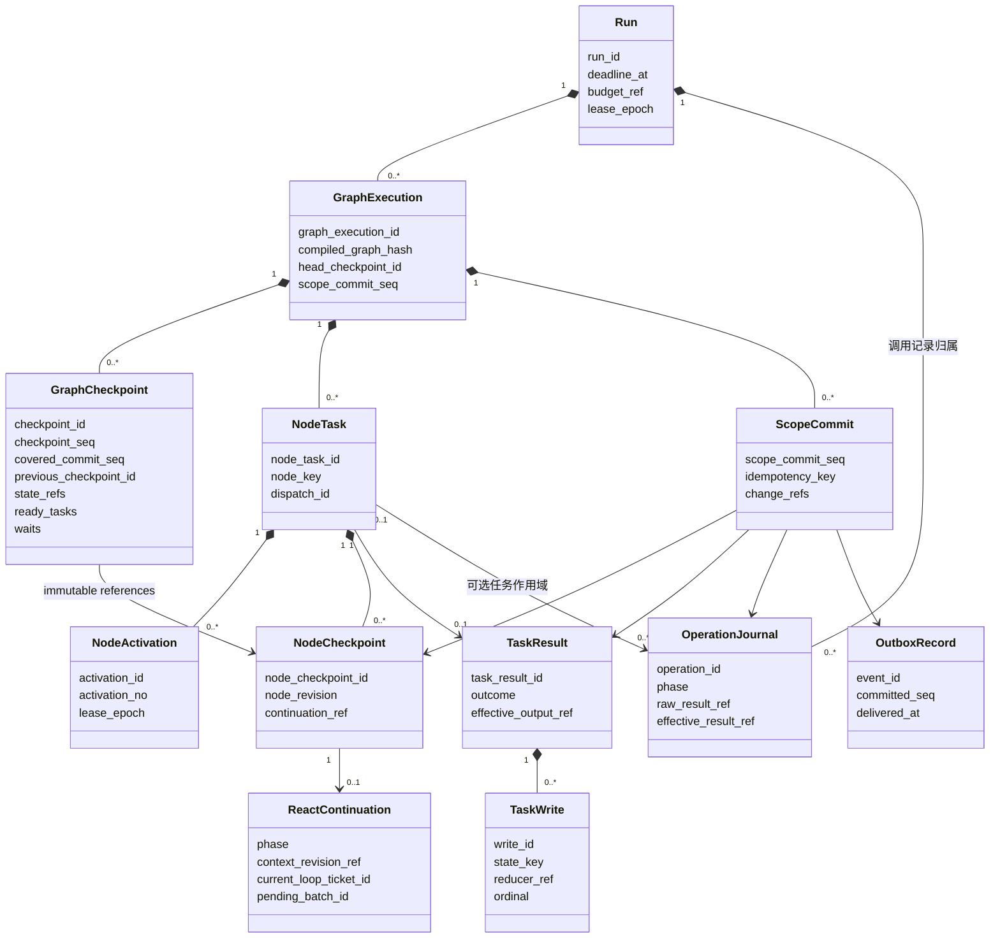
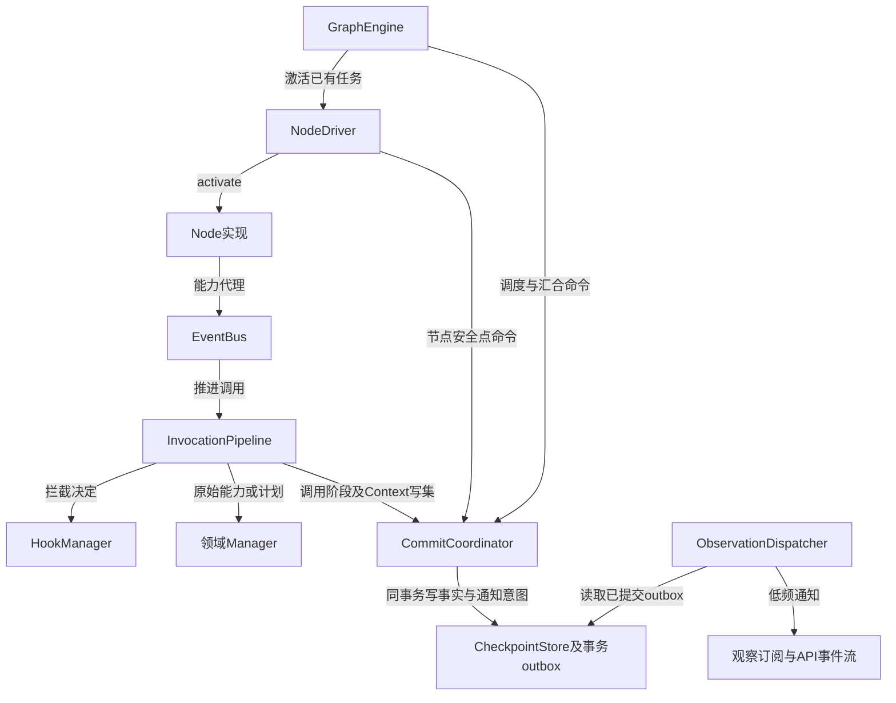
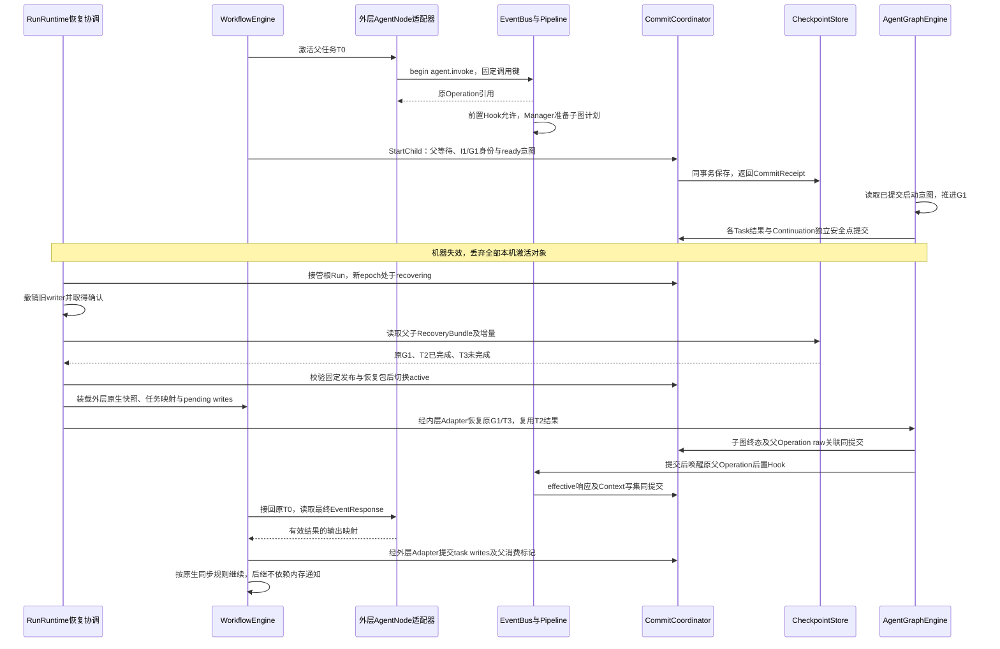

# 检查点结构、提交协议与父子恢复

> **重建边界（2026-10-15）**：旧业务实现已移除。本页保留为待调整的设计草案；用户、应用、发布与配置版本属于平台，SDK 只接收已解析配置并负责执行与恢复。涉及平台身份、发布绑定及表结构的内容需按 [SDK / Platform 边界](sdk-platform-boundary.md)重新划分，不直接作为 SDK 的必填契约或已实现功能。

**实施细则：[persistence](implementation/persistence.md)**。本页保留架构解释；具体方法、字段状态、事务和恢复分支见实施规格。

更新日期：2026-10-15。状态：**本轮目标设计，尚未实现**。本文将已确认的恢复原则落为可评审的结构与端口；具体方法名、表名属于技术设计，不声称运行代码已具备这些行为。

[设计总览](overview.md) · [领域模型](domain-model.md) · [Definition 与 Node](graph-node-engine.md) · [EventBus 与 Hook](runtime-messaging-checkpoints.md) · [Agent 设计约定](../agent-design-decisions.md)

## 1. 检查点回答什么问题

恢复需要回答：**这次 Run 属于谁、固定了哪些定义、每张图走到哪里、每个节点等待什么、哪些调用结果已经生效、下一步可以做什么。** `plan.json`、消息历史、一个 `running` 状态都不能单独回答这些问题。

采用**双引擎、统一检查点管理**。AgentGraphEngine 与 WorkflowEngine 各有独立 GraphExecution 和恢复载荷，分别经 AgentCheckpointAdapter／WorkflowCheckpointAdapter 接入同一 CommitCoordinator 和 CheckpointStore，共用根 Run 执行权。节点、Skill、工具不各自选择检查点目录。外层将 LangGraph 相关源码迁入本包适配，本轮不实现；本文外层 branch_scope／TaskWrite 等旧自研持久结构不作为其最终表结构。公共信封、原生 Saver 的提交／读取映射及父子交接以[双引擎适配协议](dual-engine-integration.md#6-统一检查点管理保留两种现场)为准。

| 层次 | 保存的现场 | 权威边界 |
| --- | --- | --- |
| Run | 截止时间、共享 Loop 额度、停止状态、租约代际、固定发布引用 | 一棵执行树的控制面；不在每张图复制可独立扣减的额度 |
| AgentInvocation | 工作流调用的局部 Loop 上限、started_at、局部 deadline、控制及终态 | 从同一 LoopTicket 账本按 invocation 汇总；局部只能收紧根限制，失败不自动取消兄弟调用 |
| GraphExecution | 图版本、状态字段、就绪与等待任务、分派／汇合关系、下一调度意图 | 图调度面，不保存角色的完整私有消息 |
| NodeTask | 一次逻辑节点任务的身份、阶段、输入和结果引用 | 同一任务恢复保持身份；不是每次 Loop 新建任务 |
| NodeActivation | 引擎一次推进 NodeTask 的记录、执行权、起止及返回指令 | 一个 Activation 可以执行多个 ReAct Loop；不是用户轮次或业务 Loop 计数 |
| ReactContinuation | ReactNodeTask 的阶段、私有上下文版本、Loop 票据与等待批次 | 节点内部的可恢复协议，不是第二套图调度器 |
| OperationJournal | 原始／有效请求、Attempt、Hook 进度、raw／effective 结果及消费关联 | 一次能力调用的事实；不是下一节点路由的权威来源 |

一次 ReAct 调用是 **1 个图实例、1 个 ReactNodeTask**。一次 Plan 调用中 Planner 委派两个 Executor，是 **1 个图实例、3 个 NodeTask**，每个任务有独立角色上下文。它们都不因为 Loop 或工具调用而增加图实例。未来外层 Workflow 中的 AgentNode 调用完整 Agent 时，才创建子 AgentInvocation 及其内层 GraphExecution。

这里明确更新早期“每次 Executor 委派创建子图”的称呼。Executor 的独立上下文与恢复现场保留，但使用 NodeTask＋ReactContinuation 表达；真正图嵌套保留给完整 Agent／Workflow 组合。

## 2. 从 LangGraph 源码借鉴什么

源码核对基线：本地 `/Users/bmilk/code/project/langgraph`，提交 `afbe7e48b17f62e139b5c6337ab934549e6dc73b`。以下是该提交的事实与本方案的取舍，不把其他版本行为或文档默认值混入。

| 源码事实 | AgentLoom 的采用方式与区别 |
| --- | --- |
| `Checkpoint` 保存 `channel_values`、`channel_versions`、`versions_seen`；`CheckpointTuple` 另带 `parent_config` 与 `pending_writes` | 保留“完整快照＋未归并增量＋版本”的结构；显式增加 NodeTask、Continuation、Operation 与上下文引用 |
| `BaseCheckpointSaver` 分开定义 `get_tuple`、`put`、`put_writes` | CheckpointStore 分开读取恢复包、保存快照与提交任务增量；统一 CommitCoordinator 负责跨域一致提交 |
| Pregel 将 PULL 路由和 PUSH／Send 分派组成下一批任务 | 保存明确的待调度任务与 dispatch 身份；相同节点定义可以产生多个 NodeTask |
| `apply_writes` 先按任务路径稳定排序，再调用 channel 的更新逻辑，并推进已读版本 | 状态字段声明 reducer 版本；并行结果按固定分派序号归并，不按网络完成先后归并 |
| Runner 单独保存任务 writes，恢复会向成功任务回填已保存 writes | 完成分支立即提交 TaskResult／TaskWrite；整批未结束也不丢已完成分支 |
| PostgreSQL Saver 按 thread、namespace、checkpoint 存快照／blob／writes | 我们按系统生成的 GraphExecution ID 分区，Session 不是检查点执行身份；大内容采用共享不可变 blob |
| LangGraph 有 `sync`、`async`、`exit` 持久模式，具体保存等待随模式改变 | 第一版建议关键推进采用提交确认后继续；不宣称照搬任何模式即可满足 AgentLoom 的 Hook、预算与外部调用恢复 |

参考源码：[Checkpoint／CheckpointTuple](https://github.com/langchain-ai/langgraph/blob/afbe7e48b17f62e139b5c6337ab934549e6dc73b/libs/checkpoint/langgraph/checkpoint/base/__init__.py#L93)、[Saver 接口](https://github.com/langchain-ai/langgraph/blob/afbe7e48b17f62e139b5c6337ab934549e6dc73b/libs/checkpoint/langgraph/checkpoint/base/__init__.py#L262)、[路由任务准备](https://github.com/langchain-ai/langgraph/blob/afbe7e48b17f62e139b5c6337ab934549e6dc73b/libs/langgraph/langgraph/pregel/_algo.py#L391)、[有序应用 writes](https://github.com/langchain-ai/langgraph/blob/afbe7e48b17f62e139b5c6337ab934549e6dc73b/libs/langgraph/langgraph/pregel/_algo.py#L233)、[成功任务恢复](https://github.com/langchain-ai/langgraph/blob/afbe7e48b17f62e139b5c6337ab934549e6dc73b/libs/langgraph/langgraph/pregel/_loop.py#L810)、[Runner 提交](https://github.com/langchain-ai/langgraph/blob/afbe7e48b17f62e139b5c6337ab934549e6dc73b/libs/langgraph/langgraph/pregel/_runner.py#L575)、[PostgreSQL 表](https://github.com/langchain-ai/langgraph/blob/afbe7e48b17f62e139b5c6337ab934549e6dc73b/libs/checkpoint-postgres/langgraph/checkpoint/postgres/base.py#L44)、[异步图的同步持久等待](https://github.com/langchain-ai/langgraph/blob/afbe7e48b17f62e139b5c6337ab934549e6dc73b/libs/langgraph/langgraph/pregel/main.py#L3550)。

LangGraph 的任务级恢复并不自动保存任意函数内部的 Python 执行位置。我们的 ReactContinuation 与持久能力调用协议，是为完整 ReactNode 内部的多轮调用补充的明确契约。

**区分内部 Agent 协议与外层源码适配。** 内部继续使用当前单机任务／动作批次和节点安全点协议。外层需把 LangGraph 的 channels、super-step、pending writes 和版本信息作为相互关联的机制评估，不再被“全平台不采用 Pregel”的旧选型限制。上表是自研恢复契约与上游能力的对照，不能当作字段一一兼容声明；检查点序号、业务 Loop、图 super-step 和 Context revision 分别计量。父子调用稳定引用、已完成结果复用及平台控制规则继续适用。

## 3. 身份、命名空间和版本

```text
Run R1
 └─ Workflow GraphExecution G0                 # 未来外层
     └─ AgentNode NodeTask T0
         └─ AgentInvocation I1
             └─ Agent GraphExecution G1
                 ├─ Planner NodeTask T1
                 ├─ Executor NodeTask T2
                 └─ Executor NodeTask T3
```

没有外层工作流时，Run 直接持有根 AgentInvocation 及 G1。子 AgentInvocation 复用顶层 Run，不新建根预算、根 deadline 或租约；其自身 Agent 配置可以收紧局部额度与 deadline，按[执行协议](agent-execution.md)统一申请和结算票据，不能用局部额度扩大根剩余容量。父任务通过 `child_invocation_id`、`child_graph_execution_id`、`dispatch_id` 固定关联，恢复不重新按节点名称查找“最新一次 Agent”。

| 字段 | 规则 |
| --- | --- |
| `scope_id` | 等于 `graph_execution_id`；命名空间由系统派生，不能由节点名、Prompt 或 LLM 提供 |
| `checkpoint_id` | 系统分配的不透明 ID；是否较新由 `checkpoint_seq` 判断，不按时间戳猜测 |
| `previous_checkpoint_id` | 同 scope 的上一快照，表达时间演进；不同于外层父图 |
| `parent_execution_ref` | `{graph_execution_id,node_task_id,dispatch_id}`，表达嵌套归属；根图为空 |
| `format_version` | 持久结构版本；与业务定义版本、快照序号分别管理 |
| `engine_kind`／`engine_protocol_version` | 固定 agent 或 workflow 及该引擎的载荷协议版本；选择唯一恢复适配器，不在恢复时切换引擎 |
| `engine_state_ref` | 引擎专属现场引用；外层原生 pending writes 在同一读水位另行关联，不强塞进内层 WaitGroup |
| `graph_definition_ref`／`compiled_graph_hash` | 固定运行所用图、绑定和编译结果；恢复不能偷换成最新发布 |
| `scope_commit_seq` | 同 scope 一致提交的单调序号；用于重建增量与消费水位 |
| `lease_epoch` | Run 的执行权代际；所有图、节点、调用提交均验证同一代际 |
| `node_revision`／`context_revision` | 分别表示节点恢复现场与有效上下文版本，不互相替代 |

新 Session 提问创建新 Run 和图实例，从会话历史读取模型输入；故障恢复继续原 Run 与图实例。不能将二者都做成“读取同一 Session 最新检查点继续”，否则会混淆正常下一轮和宕机续作。

## 4. 检查点对象与 UML



本图表达平台持久记录归属与引用，不表示服务调用；其中 NodeCheckpoint／TaskWrite 展开的是内部 Agent 结构。GraphCheckpoint 使用公共信封，通过 engine_state_ref 关联专属载荷；内层周期性汇总与 ScopeCommit 配合恢复，外层由 WorkflowCheckpointAdapter 保存原生快照和 pending writes，不能套用图中的 TaskWrite 格式。OperationJournal 是 Operation／Attempt 的恢复读取投影，不是第二份独立账本；graph／system 调用可以没有 NodeTask。ContextSnapshot 是摘要，不能混作 GraphCheckpoint。

`ScopeCommit` 是统一事务的变更索引，不是业务事件总线的回放日志；其中引用的不可变事实才是重建依据。可变的 `head`、`status` 查询列是这些事实的事务内投影，不能成为第二套可独立写入的真相。`AgentExecution` 旧称收敛为 NodeTask＋ReactContinuation 的读取投影，不再建立一张重复维护状态的表。

外层任务“产生了写入”不等于“结果已交付”。只有带 effective 结果的 task_result 写入才与平台消费／终态投影一致提交；原生 ERROR／INTERRUPT 不作此判断。WorkflowEngine 必须等全部必要 task writes 的真实回执，再应用状态、保存下一快照并启动后继，不能仅替换 Saver 而保留越过确认的后台写入路径。具体算法见[外层提交屏障](dual-engine-integration.md#63-任务写入的持久提交屏障)；内层定期汇总快照的优化不改变这一要求。

### 4.1 GraphCheckpoint

```python
GraphCheckpoint = {
    "format_version": 1,
    "run_id": "R1", "graph_execution_id": "G1",
    "owner_ref": {"kind": "agent", "id": "agent-1", "space_id": "space-1"},
    "engine_kind": "agent", "engine_protocol_version": 1,
    "checkpoint_id": "CP12", "checkpoint_seq": 12,
    "previous_checkpoint_id": "CP11", "covered_commit_seq": 86,
    "parent_execution_ref": None,
    "graph_definition_ref": {"id": "graph-1", "version": 4, "content_hash": "sha256:..."}, "compiled_graph_hash": "sha256:...",
    "engine_state_ref": {"kind": "blob", "blob_id": "agent-state-12", "sha256": "...", "size_bytes": 2048},
    "run_control_ref": {"run_id": "R1", "revision": 8},
    "created_at": "2026-10-15T00:00:00Z"
}

# 上述 engine_state_ref 对应的内层载荷，不能当作 Workflow 原生快照。
AgentCheckpointPayload = {
    "phase": "waiting",  # ready | executing | waiting | terminal
    "state": {"findings": {"value_ref": "blob:...", "version": 3,
                           "reducer_ref": "append_by_dispatch@1"}},
    "versions_seen": {"T1": {"findings": 2}},
    "ready_task_ids": [],
    "active_tasks": {"T2": {"activation_id": "A7", "node_checkpoint_ref": "NCP9"}},
    "settled_result_refs": {"T3": "TR3"},
    "waits": [{"wait_id": "W1", "owner_task_id": "T1", "kind": "batch",
               "members": [{"member_id": "M2", "ordinal": 0, "state": "admitted",
                            "target_ref": {"kind": "node_task", "id": "T2"},
                            "result_operation_id": "D2"},
                           {"member_id": "M3", "ordinal": 1, "state": "settled",
                            "target_ref": {"kind": "node_task", "id": "T3"},
                            "result_operation_id": "D3"}],
               "settled_member_ordinals": [1],
               "policy": "all_settled", "member_scope": "dispatch_batch", "generation": 1}],
    "operation_refs": ["D2", "D3"]
}
```

这是内层字段示意，不是默认业务内容。dispatch_batch 的 WaitGroup 成员使用带 `kind` 的引用：普通工具是 `operation`，Executor 是 `node_task`。外层等待内层的关联由 AgentNode 适配器及父 Operation 保存，不要求原生内核维护相同 WaitGroup。每个成员有固定 ordinal；尚未启动的成员保留 dispatch 意图，执行后关联实际 task／operation。`active_tasks` 表示最后已提交的调度事实，不证明进程仍存活。这里的 `versions_seen` 不是 LangGraph 同名字段的兼容声明；私有 messages 归 ContextManager。WorkflowCheckpointPayload 保留原生 checkpoint／metadata／parent chain，另附 pending writes 的一致读取关系，见[适配协议](dual-engine-integration.md#61-外层-saver-的具体适配要求)。

`run_control_ref` 用于记录快照当时的控制版本；恢复必须重新读取 Run 最新停止状态、deadline、额度和 lease，同时读取所属 AgentInvocation 的最新局部控制、固定截止和同票据账本聚合。不能用旧快照解除根或局部收束、重置计数后重新放行。

`covered_commit_seq` 表示快照已物化该 scope 到哪个提交位置。读取最新现场时，Store 在一致读事务中返回快照和 `(covered_commit_seq, read_upper_seq]` 内的 ScopeCommit；不能把旧快照配上无限向前变动的“当前状态”。查看历史快照默认不折叠之后的增量。

### 4.2 NodeCheckpoint 与 ReactContinuation

| 结构 | 字段与含义 |
| --- | --- |
| NodeCheckpoint | `node_checkpoint_id`、`node_task_id`、`node_revision`、`activation_id`、`node_protocol_version`、`continuation_ref`、`input_ref`、`consumed_result_ids`、`waiting_refs`、`scope_commit_seq` |
| ReactContinuation | `phase`、`role_binding_ref`、`context_revision_ref`、`role_loop_index`、`current_loop_ticket_id`、`model_operation_id`、`pending_batch_id`、`pending_operation_refs`、`supplement_delivery_watermark`、`compaction_ref`、`final_output_ref` |
| NodeActivation | `activation_id`、`node_task_id`、`activation_no`、`lease_epoch`、`start_node_revision`、`started_at`、`ended_at`、`outcome` |

React 阶段统一为 `prepare_context / prepare_model / compact_context / call_model / interpret_response / wait_batch / consume_results / validate_output / completed`；失败、取消与停止由 NodeTask.status 和 Run 控制表达，不另外增加一套 Loop 阶段名。阶段名表达恢复位置；NodeDriver 不重写角色决策，不把每个阶段都包装成一张新图。允许一次 Activation 内连续推进多轮，但每次持久能力边界都能更新同一任务的 Continuation。Planner 委派后返回 Wait，批次结算后激活原 Planner NodeTask；这不代表 Planner 已完成，也不重新创建 Planner 实例身份。

Loop 额度由根 Run 与适用的局部 AgentInvocation 共同约束，使用同一 LoopTicket 账本。NodeCheckpoint 只引用对应票据，恢复不能再扣一次；第 100 次已获准 Loop 可以正常完成，第 101 次不得开始。压缩调用有独立 Operation／上下文引用，不消耗业务 Loop 票据。

### 4.3 TaskResult、TaskWrite 与 ScopeCommit

| 结构 | 必需字段 | 提交语义 |
| --- | --- | --- |
| TaskResult | `task_result_id`、`node_task_id`、`dispatch_id`、`outcome`、`effective_output_ref/error_ref`、`context_revision_ref`、`scope_commit_seq` | 节点任务的一次终态结果，允许空输出；失败也必须有明确结算记录 |
| TaskWrite | `write_id`、`task_result_id`、`state_key`、`value_ref`、`reducer_ref`、`dispatch_ordinal`、`write_ordinal` | 等待加入图状态的增量；不能因再次读取结果而重复应用 |
| ScopeCommit | `graph_execution_id`、`scope_commit_seq`、`idempotency_key`、`lease_epoch`、`change_refs`、`committed_at` | 一次短事务中已生效的事实索引，包含节点进度、结果、调度意图或快照引用 |
| OutboxRecord | `event_id`、`run_id`、`scope_commit_seq`、`type`、`payload_ref`、`delivery_state` | 提交后的通知／唤醒；通知丢失仍能从事实重建，不作为唯一的待执行清单 |

同批成功、失败、拒绝均单独提交，等全部成员结算才恢复 Planner 下一轮。失败不会取消其他正常成员；停止 Run 和总超时属于全局控制，另行收束。动作批次按 `(dispatch_ordinal, write_ordinal)`、外层多步骤分支按 `(member.ordinal, task_sequence, write_ordinal)` 固定顺序归并；reducer 必须固定版本、纯函数、不访问模型／网络。无 reducer 的同字段并发写冲突必须报错，不静默最后写入覆盖。

TaskResult 是终态，不能为一次可重试 Attempt 失败提前创建它。激活失败后按 Continuation 恢复原任务；已形成终态结果后，Planner 明确重新委派则创建新 dispatch／NodeTask。

Executor 的 TaskResult 不直接成为 Planner 的最终工具结果：委派 Operation 还需完成后置 Hook。dispatch_batch 的 `node_task`／`child_graph` 成员同时保存 `result_operation_id`，以其最终 EventResponse 结算；已有子结果只恢复委派后处理，不能再次运行子任务。

Executor NodeTask 终态、TaskResult／TaskWrite 和执行名额释放在同一提交中生效；父委派结果 Hook 不再占 Executor 名额。开启并行时此后可以补位，原成员仍未 settled；关闭并行时等该成员的最终 EventResponse 和 settled 提交后才启动下一项。恢复从已启动且非终态 Executor 任务重建名额，不能用待 Hook 的成员数重建。普通分支任务完成只按路由推进分支，不强制套一层父 Operation 或委派 Hook。

GraphEngine 使用已提交 TaskResult 判断“已完成”，使用就绪任务判断“尚未启动”，使用 Continuation 与 Operation 判断“执行中该接哪里”。不得通过 LLM 计划状态或日志文本猜测执行状态。

批次中尚未 begin 即被拒绝／取消的成员没有 TaskResult 或 Operation，依据已提交的 `WaitMember.local_outcome` 与 BatchMember 结果恢复为 settled，不能为补齐空引用重新执行。已经 begin 的成员沿用其 Operation 的最终响应；前置 Hook deny 无子任务时目标引用指向 Operation 本身。成员结算、错误结果槽与唤醒意图同事务保存，原 call_id／ordinal 不改变。

### 4.4 多步骤分支、循环与读取视图的恢复现场

以下是[图设计第 7 节](graph-node-engine.md)的旧自研外层候选，需按 LangGraph 源码适配重新映射：分支使用 WaitGroup 成员表达，可依次关联 A1、A2 等多个任务。这些字段不要求上游内核照搬；中间节点完成不等于业务分支结束的需求仍保留。

| 对象 | 持久字段／引用 | 不变量 |
| --- | --- | --- |
| WaitGroup | member_scope、join_key、dispatch_id、generation、base_state_revision、loop_path | fork 冻结后成员身份、基线及循环位置不可变；恢复不生成新 generation |
| branch_scope 的 WaitMember | branch_data：entry_node_key、cursor_task_id、next_task_sequence、view_write_ids、terminal_reason | member_id 就是分支身份；target_ref／result_operation_id 为空；未结束时至多一个 cursor；终结后无新后继 |
| NodeTask | branch_ref：wait_id／member_id／task_sequence；loop_path；input_state_view：base_state_revision／write_ids | 调度时冻结；任务只能读取已授权基线和自身前驱的已提交写入，不读取兄弟前缀 |
| GraphCheckpoint | fork_generations 及等待成员现场；任务 manifest 关联上述输入视图／loop_path | fork_generations 为同图各 fork_route_key 已分配 generation 的高水位；可由 ScopeCommit 重建 |
| TaskWrite | 沿 TaskResult → NodeTask 取得分支与 task_sequence，仍以 write_id 标识不可变增量 | 不再复制 overlay 快照作为另一组写入；归并范围内消费唯一 |

LoopFrame 为 `{loop_key,loop_instance_id,iteration}`，loop_path 从外层到内层排列。进入循环时创建 frame，回边递增 iteration，退出时弹出；这些改变与新任务意图同事务保存，不独立建立一个只能在内存恢复的循环游标。ReactContinuation 的 role_loop_index 与这个工作流循环路径互不替代。

下面是 W7 执行中一次快照的分支片段，公共 GraphState 仍为 v10；A1 与 B1 已完成，A2 待运行：

```text
WaitGroup W7
  member_scope = branch_scope
  join_key = J; generation = 7; base_state_revision = 10
  loop_path = [{loop_key:L, loop_instance_id:LI1, iteration:0}]
  M0 ordinal=0, state=admitted
    branch_data = {entry_node_key:A1, cursor_task_id:TA2,
                   next_task_sequence:2, view_write_ids:[WA1], terminal_reason:null}
    target_ref=null; result_operation_id=null
  M1 ordinal=1, state=settled
    branch_data = {entry_node_key:B1, cursor_task_id:null,
                   next_task_sequence:1, view_write_ids:[WB1], terminal_reason:reached_join}
    target_ref=null; result_operation_id=null
NodeTask TA1 (succeeded)
  branch_ref = {wait_id:W7, member_id:M0, task_sequence:0}
  input_state_view = {base_state_revision:10, write_ids:[]}
NodeTask TA2
  branch_ref = {wait_id:W7, member_id:M0, task_sequence:1}
  input_state_view = {base_state_revision:10, write_ids:[WA1]}
```

恢复不把 A1 的 TaskResult 当作 M0 结束，也不重新查询全图最新字段给 A2。A2 的输入按 `(v10,[WA1])` 物化；M1 的 WB1 只在 Join 公共归并时可见。完整结果、错误和用户文件副作用各自按对应协议保存，不因分支等待而延迟落盘。

分支关闭结果包含该成员的最终状态、终结原因、已完成任务结果和写前缀。条件选中出口但跳过后续任务可标记 skipped；没有错误后继则标记 failed；控制取消需先确保当前 cursor 不再写入才标记 cancelled。已经成功的前驱写入仍在前缀中，不伪装回滚。所有成员关闭后才产生唯一 Join 归并意图；归并成功按 JoinDefinition.success_target_node_key 创建后继，归并错误保存唯一错误事实并按 error_target_node_key 继续或终结图；不构造虚假的 Join NodeTask。成员失败不等于 reducer／归并失败，后继始终收到完整成员状态。

Join 归并使用 `(member.ordinal,task_sequence,write_ordinal)` 确定顺序，消费键为 `(wait_id,generation,write_id)`。分支内物化视图是只读计算，不登记公共消费；Join 不重复应用一份分支最终快照。公共基线 CAS、归并结果、消费集合与后继意图原子提交，断电恢复不能二次调用 reducer 影响已生效状态。


## 5. 调用日志与 Hook 恢复

OperationJournal 保存以下不可变事实及事务内 head 投影：

```text
prepared → request_hooks → executing → raw_saved → response_hooks → completed
```

这是与数据契约相同的 `Operation.processing_phase`。日志中的 `intent_saved` 对应 prepared；`before_hooks` 对应 request_hooks；`request_frozen` 是有效请求已提交的事实，不另建状态机；`after_hooks` 对应 response_hooks；`effective_committed` 对应 completed。`consumed` 记录调用方的消费水位，不把已经 completed 的 Operation 再变成另一终态。失败或合法拒绝可提前进入 completed，同时保存明确错误和最终响应。

前置或后置合法 `deny` 形成 `HOOK_DENIED` 和关联原请求的 `blocked` 响应；前置不执行目标能力，后置不能撤销已发生的效果。合法拒绝不是 Hook 故障，不以重试绕过。Hook 自身报错／超时或没有合法控制决定时按 fail-open，使用此前有效状态继续；合法决定与修改独立校验，无效或冲突 patch 整项丢弃，但附带的合法 deny 仍保存并生效，不能退化为 allow。系统提交失败不能被这条规则吞掉。

`HookInvocation` 至少保存 `hook_invocation_id`、`operation_id`、`stage`、`hook_binding_version`、`ordinal`、`input_revision`、`status`、`decision_ref`、`context_change_refs`，以及字段映射/schema 版本、normalized mutation 引用/hash 和修改诊断。payload_patch 与 context_patch 先归一为同一组语义修改：同值合并，异值或父子路径冲突使本项全部 patch 无效；实际参数与有效上下文从同一归一集合生成。合法决定、已接受修改、effective 引用与游标同事务生效；patch 无效时不生成部分修改，但独立保存合法 deny，后一个 Hook 读取前一个已接受的有效版本。`raw_saved` 后宕机，只恢复后置链，绝不再次执行已经有完整 raw 结果的工具。

Hook 的 `payload_patch` 不能只改一个临时 DTO。ContextManager 准备有来源的 `ContextMutation` 和 `EffectiveContextRevision` 写集，由 CommitCoordinator 提交；有效结果记录绑定该 revision。当前处理器、后续模型输入、历史、压缩和恢复均使用该有效版本。原始记录保持不可变；角色私有消息与显式共享字段按授权 scope 分开。消费者只引用／物化已提交的归一修改，不再分别重放两份原始 patch。**GraphState 的 reducer 归并与角色 Context 的有效版本是两个领域**：Hook 的 context patch 经过校验后立即有版本地提交，后续授权读取即可见，不必等图 Join。节点消费结果时保留已经提交的后续上下文修改，不把 ContextManager 指针回退到旧 Continuation 的源版本。

**技术建议：未知 Hook 结果默认不盲目重放。** 若 `started` 后宕机且无已提交决定，先按 `hook_invocation_id` 查询提交结果；确认没有结果且处理器已失联时，记为 `indeterminate` 的 Hook 故障，保留之前有效上下文继续后续链。这样符合 Hook 故障 fail-open，又不会重复执行可能有副作用的任意脚本。已经提交的 deny 决定必须复用，不能按未知故障放行；本项未知 patch 不应用。已发生但未知的外部效果无法被撤销。若未来提供可恢复 Hook 适配协议，可由适配器查询既有结果；不能把“脚本看起来纯”当作重放保证。强制安全规则应由 Runtime 鉴权承担，不能依赖可 fail-open 的用户 Hook。

模型流片段由连接适配器内部组装，正常终帧后的完整响应才进入 `raw_saved`。断流留下的片段是 Attempt 的未完成证据，不伪装完整模型结果；按用户重试配置处理，已开始输出不取消 Run 总截止时间。

## 6. 低侵入：只在三个公共边界保存



图中箭头标明调用／读取方向；outbox 与事实在同一事务保存，观察分发读取已提交记录，不作为写入成功的条件。

1. **NodeDriver** 包装任务激活、Progress／Wait／Complete／Fail 信号，提交 NodeCheckpoint 与引擎指令。公共 ReactNode 基类暴露 Continuation；业务节点不在各个工具调用处手写 `save_checkpoint()`。
2. **InvocationProxy＋持久调用管道** 管理稳定 operation 身份、输入冻结、Hook 游标、raw／effective 结果与上下文变更。模型、MCP、文件、脚本共用这一恢复边界；Skill 脚本内每次 `open()` 不额外变成系统调用事件。
3. **CommitCoordinator** 在短事务内验证 Run lease、CAS、额度、写入事实、更新调度意图及 outbox。存储端口不递归经过总线和 Hook；CheckpointStore 也不是一个允许失败后继续的普通事件监听器。

所谓低侵入是统一框架协议，不是从任意 Python 调用栈自动推断恢复位置。自定义一次性 FunctionNode 只能恢复到调用边界；需要中途续作的节点必须实现版本化 Continuation 协议。用户节点不能绕开代理执行应被持久化的外部操作后宣称支持准确续作。

### 可恢复等待与原子推进

能力代理的 `begin()` 返回 PendingOperationRef，不把内存 Future 存入 Continuation；即使前置 deny 已形成终态，也返回同类引用。`request()` 是 `begin + await_result` 的便利封装，故障恢复用 `get_result(ref)` 查询持久结果。Planner 保存这些引用并产生 Wait，批次结算后才接收唯一最终 EventResponse。

委派 `begin()` 保存 Operation／dispatch 意图；Driver 在 Wait 提交中原子保存父等待、已获准的 Executor 任务、调用关联和启动意图，提交前不得启动子任务。前置 deny 不创建 Executor。冻结批次成员不等于全部启动：串行仅 begin 当前成员，开启并行时按配置容量 begin，未启动成员仍有确定的 ordinal 与待调度身份。


- 串行 `Complete(A)`：同一事务写 A 的 TaskResult／TaskWrite、终态与消费标记，提交公共状态版本，并写由已固定路由确定的 B 待调度意图；需要通知则一起写 outbox。
- `Complete(A1)` 位于 branch 时：同一事务保存节点终态、TaskWrite、分支写前缀及路由选择；若选中 A2，更新 cursor 和 task_sequence，并生成带固定 input_state_view 的 A2 意图，**不结算分支**。只有选中 branch_exit、无可用错误后继的失败或控制取消才关闭成员。
- 最后一个 branch 关闭的事务以 `(wait_id,generation)` 唯一键创建归并意图；归并提交新公共状态版本、逐写消费集合和下一待调度意图。原始 TaskResult、分支关闭、Join 归并是不同事实，不以同一个“完成”标志替代。
- 循环回边提交新的 loop_path 和 header 任务意图；再次进入 fork 时分配新的 wait_id／generation。重试提交／重复通知返回原身份；旧批次结果只匹配原 wait_id，不落入新迭代。
- Executor 的完成事务同时释放执行名额；父委派最终响应事务才结算动作成员。并行补位与串行准入按第 4.3 节区分，不能将 Hook 阻塞时的状态含混为 Executor 仍在运行。
- GraphCheckpoint 是这些事实的不可变物化快照，可以随后生成；不能把“快照还没生成”误认为“A 未完成”。快照保存必须带 covered watermark 和 head CAS。
- 路由与 reducer 是固定版本纯计算，可在事务外基于冻结输入计算，提交时验证基准版本，冲突则重新装载；分支固定公共基线被未授权写入改变时明确报冲突，不改用最新基线。事务内不等待 LLM、工具、用户 Hook 或共享文件 IO。
- 对同一 idempotency_key 重复提交，返回原 CommitReceipt；相同 key 不同内容拒绝，不能覆盖成功记录。

## 7. 对外领域端口

以下为领域间接口建议，不是给用户／LLM 暴露的工具，也不是承诺已有 HTTP 路由。结构定义、恢复与观察分开，业务方不能直接更新检查点表。

```python
class CheckpointStore(Protocol):
    async def load_latest(self, scope: CheckpointScopeRef,
                          authorization: InternalAuthorization) -> RecoveryBundle: ...
    async def load(self, checkpoint: CheckpointRef,
                   authorization: InternalAuthorization) -> RecoveryBundle: ...
    async def list_metadata(self, scope: CheckpointScopeRef, query: CheckpointQuery,
                            authorization: InternalAuthorization) -> CheckpointPage: ...
    # 以下仅供 CommitCoordinator 事务内调用，不是第二个公开提交入口。
    async def put(self, draft: GraphCheckpoint, expected_head: HeadRef,
                  tx: CommitTransaction) -> CheckpointRef: ...
    async def put_writes(self, delta: TaskCommit, tx: CommitTransaction) -> None: ...
    async def put_engine_writes(self, delta: WorkflowTaskWrites,
                               tx: CommitTransaction) -> None: ...

class CommitCoordinator(Protocol):
    async def commit(self, batch: RuntimeCommit,
                     claim: ExecutionLease) -> CommitReceipt: ...

class RecoveryService(Protocol):
    async def inspect(self, run_id: str) -> RecoveryAssessment: ...
    async def recover_run(self, run_id: str, claim: ExecutionLease) -> RunHandle: ...

class RecoverableNode(Protocol):
    def activate(self, input: NodeInput, continuation: ContinuationRef | None,
                 runtime: NodeRuntime) -> ActivationStream[NodeOutcome]: ...
```

`RecoveryBundle` 包含 `graph_checkpoint`、`read_upper_seq`、有序 `pending_commits`、不可变 NodeCheckpoint／TaskResult 引用、未完成 Operation 引用、父子关系和 Run 控制版本。`RuntimeCommit` 包含 expected revisions 和幂等键，其操作为明确联合类型：`ActivateTask / SaveNodeProgress / CommitOperation / CompleteTask / SettleJoin / StartChild / CompleteChild / SnapshotGraph / TerminateRun`，每种只接受其合法变更，避免一个任意字典修改所有领域。CompleteTask 的路由效果包含分支 cursor 移交／关闭、loop_path 更新或 fork 创建，必须携带发布固定的 route_key 并经区域约束校验；SettleJoin 只消费已关闭的固定成员，不负责猜测后续分支是否还有节点。

双引擎增加 `CommitWorkflowCheckpoint / CommitWorkflowTaskWrites` 两类强类型提交命令；不把 Workflow 原生 writes 塞入内层 TaskCommit。公共 GraphCheckpoint 以 engine_kind 判别载荷；RecoveryBundle 按该类型装配现场。内层 CompleteTask／SettleJoin 不得写外层路由；外层适配器的提交确认、父结果消费及 pending writes 按[双引擎协议](dual-engine-integration.md#5-父子调用交接协议)执行。

NodeRuntime 提供可信 scope、能力代理、上下文服务、预算与停止信号；不提供任意数据库句柄。内层 NodeDriver 使用 CommitCoordinator，业务 Node 产生 Progress／Wait／Complete／Fail 信号；Driver 必须提交并确认 Progress 后才推进同一异步信号流。`load_latest` 按所属适配器读取最新有效现场，`load(CheckpointRef)` 返回该历史版本，不悄悄带入后续结果。`recover_run()` 是系统故障接管动作，不新增用户“暂停／恢复”按钮；Run 已终结时只返回终态，不再次调用节点。

## 8. 内外层恢复交互



图中采用前置 Hook 允许的路径；StartChild 前的计划由唯一 GraphExecutionManager 准备，内层图只由 AgentGraphEngine 激活，外层由 WorkflowEngine 推进。两者分别通过 CheckpointAdapter 使用共同存储；RunRuntime 只协调根控制和恢复分派。接管若不能确认旧 writer 撤销，停在 recovering，不执行后续恢复分支。

父等待和子初始身份同事务，避免“子已创建、父不知是谁”。跨 scope 的 RuntimeCommit 分别分配各 scope 的提交序号，在同一数据库事务提交；按稳定 ID 顺序取得所需 scope 锁并验证 expected revisions。子完成和父调用 raw 结果关联同事务；父后置 Hook 完成后提交 effective 结果和可消费通知。父实际消费时，由 WorkflowCheckpointAdapter 把原生任务 writes 与平台消费标记一致提交；下一原生快照可以稍后生成，恢复必须包含未归并 writes。两层不要求每次内层 Loop 都同时生成快照，关键关联提交仍验证同一个 Run lease。

外层恢复先读取父任务关系，再装载仍未终结的子图；子已完成直接消费结果，子未完成续作原实例。不能靠子图发过一个 `completed` 内存事件就认为外层安全。图引擎本轮运行于单机；跨机器接管是整棵 Run 执行树迁移，不引入同时分布在多机器的节点调度要求。

## 9. 存储布局与最小约束

推荐 PostgreSQL 保存身份、事务状态、检查点索引与小内容；共享存储保存大消息、请求、结果及摘要的不可变 blob。与用户 `/work` 目录物理或权限隔离，Agent 工作文件销毁不删除恢复现场。

| 逻辑表 | 主键／唯一约束 | 查询与一致性约束 |
| --- | --- | --- |
| graph_executions | `graph_execution_id`；父任务＋dispatch 唯一 | `run_id` 索引；compiled hash 固定；head 用 CAS |
| graph_checkpoints | `(graph_execution_id, checkpoint_seq)`；checkpoint_id 唯一 | previous 指向同 scope；covered_seq 不回退；历史内容不可覆盖 |
| scope_commits | `(graph_execution_id, scope_commit_seq)`；scope＋idempotency_key 唯一 | 按序读取增量；记录全部本次提交引用 |
| node_tasks / node_activations | task_id；task＋activation_no 唯一；分支 wait＋member＋task_sequence 唯一 | graph＋状态索引；同一任务至多一个有效 Activation；输入视图与 loop_path 固定 |
| wait_groups / wait_members | wait_id；graph＋fork_route_key＋generation 唯一；wait＋member 唯一 | 成员集合冻结；branch cursor 至多一个；关闭后禁止新增后继；归并意图及消费按 wait＋generation 唯一 |
| node_checkpoints | `(node_task_id,node_revision)` | 不可变 Continuation 引用；恢复依据不是可变 current 字段副本 |
| task_results / task_writes | node_task_id 终态唯一；result＋write_ordinal 唯一 | task 成功但空输出也有结果；merge 消费键唯一 |
| operation_entries / operation_heads | operation＋entry_seq；task＋logical_call_key 唯一 | raw/effective 分开；head 只为查询投影；Attempt 编号不重置 |
| hook_invocations / context_revisions | operation＋stage＋ordinal；context＋revision | 决定、patch、effective 引用一致提交；ContextManager 为上下文权威 |
| run_leases / loop_tickets | run_id；model_operation_id 唯一 | lease 使用数据库时间；预算保留／消费／释放原子化 |
| outbox | event_id；scope＋commit_seq＋event ordinal 唯一 | `(delivery_state,next_attempt_at)` 索引；至少一次投递，消费者防重 |
| blob_refs | `(owner_kind,owner_id,space_id,hash)` | owner为Agent或Workflow；内容 hash、字节长度、编码、格式版本、source_owner依赖；不可变且提交前可读 |

共享 blob 先写临时对象、校验内容 hash 并完成持久写，再提交数据库引用。落盘成功而数据库事务失败留下的无引用 blob 可回收；数据库提交成功却指向尚未持久化文件是不允许的。外层嵌套引用按类型化 OwnerRef 管理：Agent 私有记录及内层检查点归 Agent；无 AgentInvocation 的外层工具结果、图状态及检查点归 Workflow。父引用或派生投影保留 source_owner 依赖，源 Agent 删除时相关载荷一并清除或变为不可读的无内容标记，不能在父副本保留已要求删除的内容。共享资源版本归资源域，不随引用者删除；目录与授权见[环境及存储](storage-recovery-api.md)。

检查点反序列化只接受明确 JSON／受控二进制 Schema，不从数据反序列化可执行 Python 对象。`format_version` 不支持时停止并报告，不静默猜结构。初版尚未上线，不为已废弃实验格式建立兼容层；正式发布后再制定 schema 升级策略。

## 10. 故障矩阵与必须验证的边界

| 故障切点 | 恢复动作 | 禁止行为 |
| --- | --- | --- |
| 保存调用意图之前失效 | 回到最后 NodeCheckpoint，创建该逻辑位置的稳定 operation | 根据参数相同去猜是旧调用 |
| 意图已提交、尚未发送 | 继续同一 Operation 的 Hook／有效请求阶段 | 创建第二个 Operation 或再次扣 Loop |
| 外部已执行但未保存结果 | 查询适配器可核对结果；无法确认则显式报告 outcome unknown，按既定错误／重试配置处理 | 宣称没执行；默默从头重跑整节点 |
| raw 已存、后置 Hook 未结束 | 恢复 Hook 游标和上下文版本 | 再调用外部工具获取一次结果 |
| Hook 决定已提交、通知未返回 | 复用已提交决定、归一变更 hash 与 revision | 再应用同一 patch，或换字段映射版本重新解释 |
| Hook 合法 deny 附带冲突 patch | 丢弃本项全部修改、保存拒绝和诊断；复用最后有效值并保持 blocked | 以 patch 无效为由撤销合法 deny |
| Hook 启动后结果未知 | 按第 5 节建议作为不确定 Hook 故障记录并继续前一有效状态 | 猜测 allow／deny 已经返回，或无条件重放任意脚本 |
| effective 已提交、节点未消费 | 消费保存结果，原子更新消费键与 Continuation | 重跑 Hook 或重复追加 tool message |
| A 完成、B 唤醒通知丢失 | 读取已提交 B 意图／outbox 启动 B | 因未见内存消息就重新执行 A |
| 并行 T2 完成、T3 失效 | 复用 T2，恢复 T3；全批结算后汇合 | 为等同批重新运行 T2 |
| Executor 终态已存、父结果 Hook 未完成 | 名额已释放；并行可补位，父调用只恢复后处理；串行仍等成员 settled | 重建为仍占 Executor 名额，或串行提前执行下一成员 |
| 分支 A1 完成、A2 尚未激活 | 按 branch cursor 继续 A2，读取基线＋WA1；原成员未结束 | 将 A1 的完成当成整个分支完成，或让 A2 读不到 WA1 |
| 一分支已退出、另一分支仍有后继 | 保留已关闭成员，只推进另一分支 cursor | 因最初派发任务已结束而提前 Join |
| Join 归并已提交、后继通知丢失 | 复用消费水位及状态版本，启动已保存后继 | 再次应用 reducer／追加 overlay 快照 |
| 循环已进入下一批，收到旧分支结果 | 按旧 wait_id／generation 去重记录，不影响新批 | 仅凭 node_key 把旧结果结算到新迭代 |
| 子图完成、外层未消费 | 固定 child_ref 复用子结果；父委派后置 Hook 尚未完成则继续后处理，最后消费 effective 响应 | 创建第二个 AgentInvocation，或跳过父调用后置 Hook |
| 快照落盘后 head CAS 失败 | 保留或回收未成为 head 的不可变快照，重新装载最新现场 | 用旧快照覆盖较新增量 |
| 压缩中有 Hook 更新上下文 | 依据源 revision 检测冲突并接回增量／重算 | 旧摘要覆盖最新修改 |
| 旧 Worker 迟到提交 | lease_epoch 校验拒绝；保留必要审计，不推进状态 | 覆盖新 Worker 的 context／结果／额度 |
| Stop／根总超时／根 Loop 耗尽已终结 | 保持终态，所有成员收束后由 Runtime 清理工作卷 | 迟到结果重启 Run，或首个 Executor 停止就删全员文件 |
| 仅局部 AgentInvocation 超时／耗尽 | 收束该调用、保存一次父调用结果并走外层错误路由，兄弟调用继续 | 重置局部额度／计时，或将局部控制无条件升级为全 Run 失败 |
| 存储不可用 | 停止新的能力执行与状态推进，明确服务错误 | 用内存成功响应掩盖未提交结果 |

未知外部结果不是“可靠恰好一次”。Runtime 可对能识别的瞬时异常按配置重试，工具方负责业务幂等防重；不新增按工具 `retry_safe` 声明决定是否重试的门槛。重试使用稳定 Operation 身份只是帮助提供方去重，不能强迫没有幂等接口的服务具备该能力。

最小故障注入测试应覆盖矩阵各提交前后切点，并断言：无重复结果消费、无重复额度扣减、已保存 raw 不重执行、并行成功分支保留、父子关联不分叉、Hook 修改恢复可见、Run 终态不可重启；多步骤分支不提前 Join、分支内前驱写入可见、分支外未归并写入不可见、循环批次不混用、恢复名额与故障前一致。检查点与事件总线的单元测试通过，不等于文件系统持久性、远程工具防重或真实部署接管已通过。
