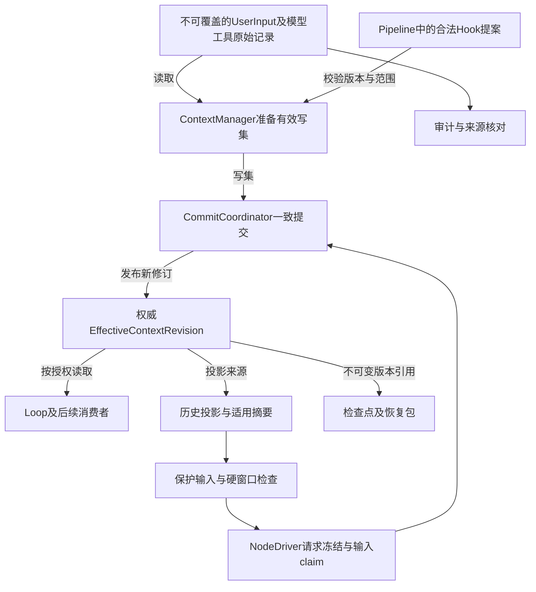
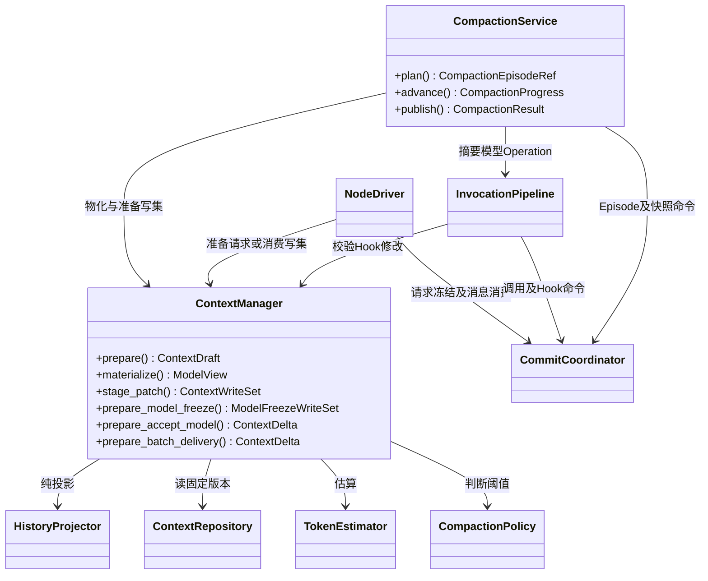
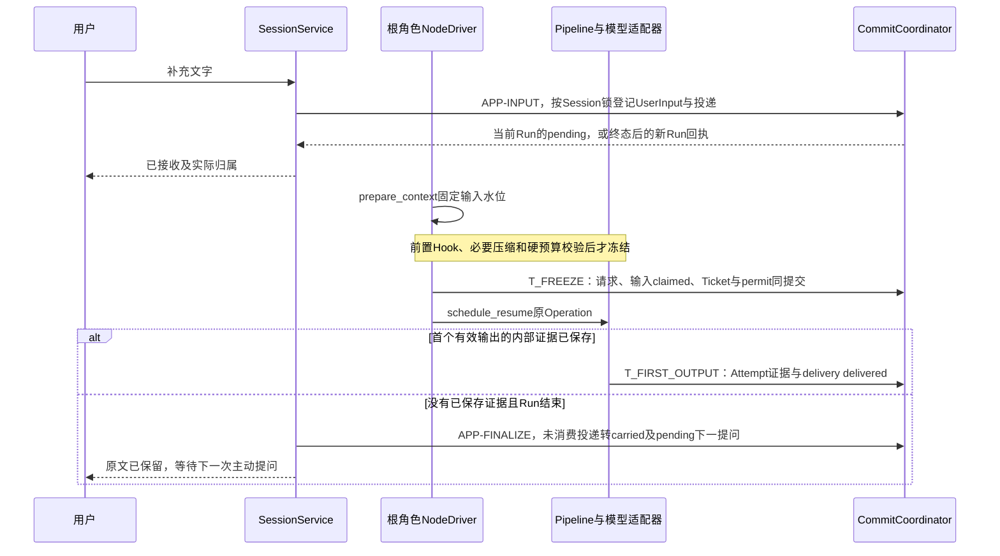
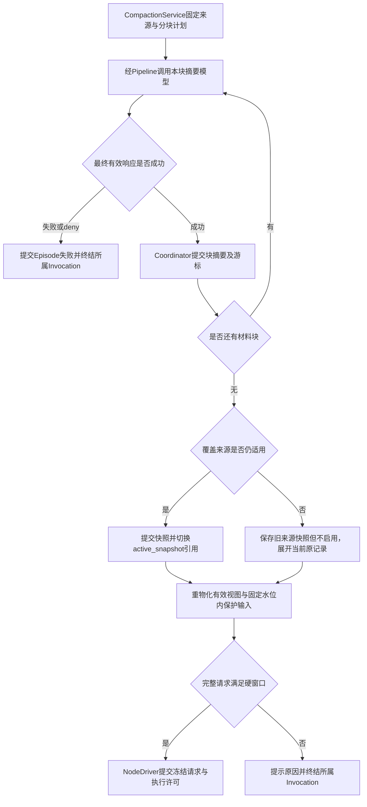

# 会话、上下文与压缩生命周期

> **重建边界（2026-10-15）**：旧业务实现已移除。本页保留为待调整的设计草案；用户、应用、发布与配置版本属于平台，SDK 只接收已解析配置并负责执行与恢复。涉及平台身份、发布绑定及表结构的内容需按 [SDK / Platform 边界](sdk-platform-boundary.md)重新划分，不直接作为 SDK 的必填契约或已实现功能。

**实施细则：[context-capabilities](implementation/context-capabilities.md)**。本页保留架构解释；具体方法、字段状态、事务和恢复分支见实施规格。

日期：2026-10-15。状态：SD-3 目标设计，尚未实现。本文保留已确认的历史、补充、压缩及 Hook 有效上下文规则；角色执行统一为 NodeTask＋ReactContinuation，完整 Agent 调用为 AgentInvocation。结构和恢复以[领域模型](domain-model.md)、[数据契约](data-contracts.md)和[检查点协议](checkpoint-protocol.md)为准。

## 1. 原始事实、有效上下文与请求视图

| 数据 | 定义与用途 | 写入者 |
| --- | --- | --- |
| UserInput | 每条用户输入原文、接收顺序和原始归属；补充也是独立用户输入 | SessionService |
| ContextRecord | 某角色消息事实、输入引用、Hook 决定、修改来源及执行状态，追加保存 | ContextManager 通过一致提交协议 |
| EffectiveContextRevision | 在原始事实上应用已确认修改后的权威有效版本，后续消费者共用 | ContextManager 准备写集，CommitCoordinator 提交 |
| ContextView | 从确定的有效上下文版本生成本次模型投影，可包含摘要和协议标记 | ContextManager 内部投影服务 |
| ContextSnapshot | 一次成功压缩的摘要、确切覆盖范围和版本，替代模型视图中的相应片段 | CompactionService 准备命令，CommitCoordinator 原子提交 |
| Workspace 文件 | Agent 实际操作的 Skill、材料、脚本、产物；存活期由沙箱策略决定 | 获授权工具和脚本 |

原始用户、模型和工具记录不可覆盖；Hook 可以修改有效上下文，通过追加变更和版本关联体现。有效版本是业务消费者的共同来源，raw 则保留实际来源用于审计和恢复核对。原始消息和检查点不放入模型可写目录；写同名文件不能改变会话事实。摘要不是原始记录覆盖更新，历史裁剪不删除原文。Agent 未删除时系统记录暂不过期；无持久沙箱的工作文件仍在 Run 结束后清理。

下图是数据流：箭头表示读取的材料、准备的写集及提交后可读取的版本，不表示对象归属。具体服务调用依赖见第 3 节。



外层 CapabilityNode／AgentNode 自身没有模型循环，不为它们额外创建 RoleContext。其 payload 修改保存到 Operation 的有效输入／结果，并经显式输出映射进入 GraphState，后续节点可读实际执行参数及修改来源。只有存在明确授权 ContextScope 时才允许 context_patch；不存在该作用域时该 patch 无效，不伪造一个私有聊天上下文。内层 React 类任务仍遵循本文完整规则。

## 2. 身份、顺序和对象结构

`Session` 固定属于一个 Agent。一次新提问创建一个 `Run`，运行中补充只是另一条 UserInput，不创建新 Run。每个 React 类 `NodeTask` 拥有独立 `RoleContext`：ReAct 入口、Planner、每次 Executor 委派分别建立上下文；同一次执行的 Loop 和故障恢复始终沿用原 context_id。

```python
class UserInput:
    schema_version: int                 # 本版结构版本，不等于消息序号
    input_id: UUID
    session_id: UUID
    input_seq: int                      # Session 内严格递增
    origin_run_id: UUID | None
    kind: Literal["question", "supplement"]
    body_ref: PayloadRef
    received_at: datetime

class UserInputDelivery:
    schema_version: int
    delivery_id: UUID
    input_id: UUID
    target_run_id: UUID | None
    operation_id: UUID | None
    previous_delivery_id: UUID | None
    state: Literal["pending", "claimed", "delivered", "carried"]
    context_seq: int | None
    first_output_receipt_ref: PayloadRef | None  # 内部首输出证据，不是总线／客户端事件
    delivered_at: datetime | None

class ContextRecord:
    schema_version: int
    record_id: UUID
    context_id: UUID
    context_seq: int                     # 此 context 内严格递增
    run_id: UUID
    role: Literal["user", "assistant", "tool", "system"]
    message_kind: str                   # user_ref / assistant / tool_result / feedback / outcome
    payload_ref: PayloadRef
    operation_id: UUID | None
    call_id: UUID | None
    origin_input_id: UUID | None

class RoleContext:
    schema_version: int
    context_id: UUID
    invocation_id: UUID
    owner_node_task_id: UUID
    role_key: str
    record_head: int
    effective_revision: int             # 权威有效上下文版本
    active_snapshot_id: UUID | None
    last_model_operation_id: UUID | None
```

ContextRecord 的 `role` 是消息协议角色，配置角色通过 context_id 对应 RoleContext.role_key。`protocol`、`batch_id`、`recorded_at` 属于 payload 的附加元信息或关联记录／投影属性，不另定义一套替代上述字段的消息 DTO。UserInputDelivery 的目标角色通过目标 Run 的 root_graph_execution_id 找到根 AgentInvocation，再从固定发布的入口绑定解析已经持久创建的 React／Planner NodeTask；实际模型 Operation.node_task_id 必须与它一致。这里不增加可独立改写的 Run.root_node_task_id。转交来源通过 previous_delivery_id 取得；pending 时目标 Run、Operation、context_seq 与 delivered_at 可以为空。WorkflowSession 的输入按外层输入映射处理，不自动走这一 Agent 根角色投递规则。

UserInputDelivery 保存每次绑定／转交记录，迁移到新 Run 时创建新投递记录并关联 previous_delivery_id，不覆盖旧 Operation 的投递事实。

数据库中 `(context_id, context_seq)`、`(operation_id, message_kind, logical_result_key)` 等唯一键保护追加幂等。领域对象引用大内容的不可变 blob；外部提供的 `tool_call_id` 不能直接作为平台主键。

顺序分三种，不互相替代：

- `input_seq`：用户输入接收次序，包括不同 Run 之间转交的补充。
- `context_seq`：某角色已提交消息顺序，不以并行工具完成时间决定模型协议顺序。
- `run_seq`：给客户端的全 Run 低频事件序号，生命周期、明确进度与终态可以进入此流；不包含模型逐 token 片段，也不因此进入 Planner 模型上下文。

模型完整 raw_result、经后置 Hook 和协议适配后的 effective_result、失败 Attempt 的未完成材料分别保存引用。角色历史和后续请求从权威有效版本取值，并可追溯原始结果与 Hook 决定；不得把变更后的内容伪装成供应商原文。供应商流在适配层内部接收，客户端不逐片段展示；后置处理及有效上下文／结果提交完成后才交给 Loop，后置拒绝则交明确拒绝状态，Run 结束才交付最终答案。

## 3. 上下文模块与类关系



图中为服务依赖与准备接口，不是所有权或时序。ContextManager 返回 ContextDraft／ModelView 或待提交写集；NodeDriver、Pipeline、CompactionService 把相关写集放入各自 RuntimeCommit，经唯一 CommitCoordinator 提交。内部 Repository／投影／stage_patch 不再次经过同一 Hook 链；面向节点的普通 ContextPort 仍可由代理装配。模型出网属于 Pipeline／ModelManager，不属于 ContextManager。

进入 call_model 后，ModelManager／ModelGateway 使用已冻结有效请求，不自行选择最近几轮或删工具结果。批次收齐后，由 Runtime 发出明确的上下文消费请求，ContextManager 与执行状态提交协调完成一次反馈追加；该批次消费由 CommitCoordinator 与 ContextManager 的事务端口完成，不另设独立提交源。普通能力处理器和 Hook 不直接修改角色消息数组或存储表。

完整参数及返回 DTO 以 [ContextManager 实施接口](implementation/context-capabilities.md#22-命令与方法)为准；本图中的省略参数只为展示职责，不另定义一套 `apply_mutation/commit_batch/freeze_request` 可独立提交的旧接口。

`CompactionPolicy.evaluate` 和 TokenEstimator 是可替换的纯计算端口。

TokenEstimator、CompactionPolicy、ContextRepository 和模型消息格式化适配器是可替换端口；默认实现的行为由本设计确定，替换实现不能删掉受保护输入或绕过硬窗口。

### 所有合法修改进入同一有效上下文

本轮确认的规则是：Hook 修改不是仅在一次调用里替换一个临时对象；必须由 ContextManager 准备有效写集，经 CommitCoordinator 提交权威版本。ContextManager 请求也经 EventBus 路由，内部落库不再次发同一请求。调用代理可隐藏传输，业务节点不逐个直接依赖 Manager。

| 修改 | 如何进入权威状态 | 谁看到 |
| --- | --- | --- |
| 模型请求／输入内容 | 保存原始来源、Hook 变更及有效版本，再冻结实际请求 | 当前模型调用、后续 Loop、历史与压缩 |
| Tool／MCP／脚本参数 | 保存模型提议参数、有效参数和执行状态，并形成模型可见反馈 | 实际 Handler、Loop、下一模型请求与恢复 |
| 模型／工具响应 | 保存 raw_result，再提交 Hook 后有效结果及版本 | 当前等待者、正常结果消费、历史与摘要 |
| 显式上下文修改 | 带作用域、来源和预期版本，经 ContextManager 校验、CommitCoordinator 提交 | 该作用域有权读取的后续消费者 |
| 合法拒绝 | 保存阶段、原因、执行是否已发生；形成明确关联反馈 | 等待者、Loop、历史与恢复；不冒充成功结果 |

`ContextMutation` 与 `EffectiveContextRevision` 是本版明确的结构：前者记录一次已授权变更，后者表达该变更生效后所有消费者可以读取的不可变版本。`context_patch` 使用下列受限结构；完整逐挂点字段白名单由对应 schema 注册表细化，不再另行选择一套数组下标式修改协议。

```python
class ContextPatch:
    context_id: UUID
    base_revision: int
    operations: tuple[ContextPatchOperation, ...]

class ContextPatchOperation:
    target_record_id: UUID
    field_key: str                      # 挂点声明的语义字段，不是消息数组下标
    operation: Literal["replace_value", "append_annotation"]
    value_ref: PayloadRef

class ContextMutation:
    mutation_id: UUID
    context_id: UUID
    base_revision: int
    committed_revision: int
    source_kind: Literal["hook", "runtime", "user"]
    source_ref: str                     # 如 hook_invocation_id / input_id
    cause_operation_id: UUID | None
    patch_ref: PayloadRef
    created_at: datetime

class EffectiveContextRevision:
    context_id: UUID
    revision: int
    parent_revision: int | None
    record_watermark: int
    mutation_ids: tuple[UUID, ...]      # 相对 parent 本次新提交的变更
    effective_manifest_ref: PayloadRef # 稳定记录ID → 有效内容引用及来源
    commit_ref: str
    created_at: datetime
```

RoleContext.effective_revision 是读取 head 的事务内投影；每个 EffectiveContextRevision 的正文和 manifest 不可变。manifest 保存生效后的记录引用、可见字段及来源关联，而非复制所有原文。ContextMutation 只追加；同一 mutation_id 重复提交返回原修订，不再次应用 patch。原始消息、实际 Operation 事实、受保护输入和模型消息协议关联保持独立且不可覆盖。

目标解析和授权由 ContextManager 执行：先从可信 Runtime 身份确认 context 的 RoleContext／显式共享 ContextScope 归属，再在 base_revision 对应 manifest 中解析 target_record_id 与允许 field_key。读取 Hook 可见的本次上下文时就提供稳定记录 ID；模型消息顺序改变、裁剪或压缩不能改变这些 ID。调用参数字段按稳定 call_id 定位，例如 `tool_call:<call_id>.arguments.path`，不能使用 `/messages/3/tool_calls/0` 这样的视图下标。模型 Prompt 投影项也有带资源版本来源的记录引用；修改其有效值不改写 AgentRelease 或共享 Prompt 资源。

`replace_value` 替换授权记录的有效字段；`append_annotation` 附加有来源的说明，更正不得冒充原始用户输入。Hook 新增说明由系统分配 record_id，并以来源 HookInvocation 关联；Hook 不能自造身份覆盖旧记录。显式共享业务字段同样必须先注册到授权 ContextScope 的记录与字段目录，不把任意 GraphState 键隐式变成聊天记录。外层无 RoleContext 的节点只能使用已有授权 scope，不能靠 patch 自动取得一份全局上下文。

当前 payload_patch 不是一条独立于 context_patch 的写入通道。调用管道先为本次调用分配稳定记录身份和待提交引用，再由 Pipeline 将**同一 Hook 的两种 patch 归一为一份语义变更集合**，交 ContextManager 校验并准备写集。挂点的版本化 schema 显式登记 payload 字段与有效调用记录字段的对应关系，例如 `arguments.path` 与 `tool_call:<call_id>.arguments.path` 表达同一事实。仅一侧提交修改时，从同一变更生成另一侧的有效投影；不采用“先改 payload，再独立覆盖 context”的流程。

归一与冲突规则如下：

1. 在本项读取的同一输入版本上解析所有目标，按 `scope + 稳定记录/调用身份 + 语义字段` 归一；事件 ID、call_id 等身份以及 raw 原文不属于可写字段。
2. 两侧写入同一语义字段且最终值相同，只保留一次变更和两个来源路径。同一 patch 内的重复写入也遵循此规则，不能靠数组先后顺序覆盖矛盾值。
3. 父对象替换与子字段修改必须根据注册 schema 展开并比较最终字段值，包括删除语义；有不同值，或无法证明重叠修改一致，本项全部 patch 判为无效，记录 `HOOK_PATCH_CONFLICT`。不选择 payload 优先、context 优先或最后写入优先。
4. 无冲突时才验证整个候选状态的 schema、授权、保护输入和预算。通过后，由同一集合物化最终 effective payload、ContextMutation 和有效上下文版本，一次事务保存本项决定、变更、Operation 有效引用及 Hook 游标；失败不能只保留一侧。
5. context_patch 若修改与当前 payload 无映射关系的历史字段，只影响其获授权上下文；若修改当前调用的对应字段，必须同步反映到尚未发送的 effective payload。已经冻结或执行的历史调用，其实际参数和执行事实不可改写，只能追加带来源的说明；响应后置阶段只允许修改本次尚未交付的有效响应，不能倒改已经执行的请求。

例如模型提出 `write(path="a.md")`，Hook 仅把 payload 路径改成 `reports/a.md`，实际 Handler 和有效调用记录均使用新路径，原始模型响应保持 `a.md`。若同一 Hook 又把 context 中当前调用路径改成 `other/a.md`，本项全部 patch 失效：仍使用本项之前的有效路径，不能执行一个路径却记录另一个路径。控制决定与修改分别验证：合法 allow 加无效 patch 按 fail-open 继续此前有效版本；合法 deny 即使附带无效 patch 也必须阻止执行或交付，保存拒绝与 patch 诊断，不能通过构造冲突补丁把拒绝变成允许。决定本身不合法或处理器失败时，才按 Hook 故障规则继续。详见[Hook 控制协议](capabilities-hooks.md)。

每项 Hook 提交后，下一项读取前一项的 effective payload 和有效上下文版本；它可以在有权限且尚未冻结的字段上显式再次修改，这属于有序链上的新变更，不等同于同一项内部的矛盾写入。每一版都能追溯来源。恢复按 hook_invocation_id 复用已提交决定、规范化变更引用/hash、schema/映射版本、前后有效引用及游标，不再将两种原始 patch 各应用一遍；未提交且结果未知的项沿用 Hook 故障协议。若结果已记录但提交前版本发生变化，按下节 CAS 规则校验，不直接重跑外部 Hook。

原始与有效调用关联随 Operation 一致提交，模型后来接收结果时只引用这份有效记录，不重复应用 patch。实际 Handler、当前 Loop、下一次模型、历史、压缩与恢复因此使用同一已提交事实，审计仍可回查原始来源。合法前置拒绝记录候选参数与“未执行”；合法后置拒绝记录已经发生的调用及不交付其普通结果。

### 作用域、并发与版本

全上下文一致指同一声明作用域内一致，**不等于所有角色共享完整聊天历史**。Planner、ReAct 根角色、每次 Executor 执行保持各自私有上下文。角色私有修改只推进相应 context；共享字段必须明确属于 Run 或其他共享作用域，并只提供给获授权的消费者。文件共享也不会自动使私有消息共享。

ContextManager 以 context_id 为提交范围，校验 patch.base_revision 与当前 head，使用 CAS 和 CommitCoordinator 提交 mutation、不可变新 revision、Hook 决定／游标及对应 Operation 引用。所有记录归属、字段授权、保护输入和 schema 在提交前校验；一条 patch 内多项修改一起生效或一起舍弃，不允许只写一半。共享字段与私有 context 使用各自 revision，跨多个 scope 的变更须先全部验证，再由协调器在同一事务提交，不能分别成功后留下部分有效的 Hook。

并发版本冲突采用确定规则：读取 base_revision 之后已提交的 mutation 清单；若目标记录的相关字段和授权语义均未变化，可把同一已验证变更重新定位到最新 manifest，在新 head 上 CAS 提交，保留原 base_revision 及重定位来源。若目标字段已被修改、目标不再可见或授权已变化，返回 `CONTEXT_REVISION_CONFLICT`，不自动选择赢家。调用管道将该 Hook 的未提交 patch 全部记为无效修改，保留此前有效值；合法 allow 则继续，合法 deny 仍阻止执行或交付。既不重跑可能有副作用的 Hook，也不回滚其他已经提交的修改。系统内部输入追加／批次消费可在新 revision 上重新构建自己的确定性提交命令；不借此重执行模型或工具。

已经冻结的模型／工具请求（包括尚未发送的请求）保留其固定版本，后来的修改只对未冻结的新请求及后续读取生效；如需更正已发生事实，应追加更正记录，不能倒改原请求。

当前请求、有效上下文修改与 Hook 决定的提交必须有一致的版本关联。若必要写入失败，不能继续执行一个存储和恢复都不知道的“临时新参数”。Hook 处理错误可以 fail-open，但必要运行事实提交失败是 Runtime 故障，二者不可混用。

Hook 允许或拒绝的具体流程见[能力调用与 Hook](capabilities-hooks.md)。它不覆盖原始 UserInput，也不能修改身份、权限、额度、deadline 或已停止状态；`allow` 不能跳过这些检查。

## 4. 历史投影：默认最近两次已结束提问

`context.recent_runs=2` 属于单个 Agent 发布配置，允许设置为 0。当前 Run 始终单独处理。选取依据 Session 内提问序号和 Run 终态，不依据成功率、内容长度或所谓“有用性”。

```python
ended = runs.list_ended_before(current_run, order="run_no")
recent = ended[-recent_n:] if recent_n else []
older = ended[:-recent_n] if recent_n else ended

for run in older:
    append_all_user_inputs(run)         # 原始问题和每条补充都保留
    append_final_or_incomplete(run)     # 最终结果 + 明确结束状态
for run in recent:
    append_root_effective_context(run)  # 根角色过程及已提交的合法修改
    append_terminal_marker(run)
append_current_role_effective_context()
deduplicate_input_ids()
```

“实际根角色过程”包括模型消息、普通工具／MCP 结果、Skill 阅读与脚本调用结果、Executor 委派及汇总反馈，以及这些内容的已提交有效修改、真实参数和拒绝状态。历史投影从对应有效版本重建，不能绕过 Hook 变更直接把旧 raw 内容重新塞回模型。它不包括 Executor 私有的完整模型与工具日志；那些只供对应 NodeTask 和获授权审计查询。

失败、停止、超时和 Loop 耗尽都算已结束提问。最近两次都是失败时仍选择这两次，不向前补找成功轮次。没有最终结果时产生系统事实标记，例如“本次停止，未形成最终结果”，不能生成一条假的 assistant 成功答案。

旧历史的用户补充不因工具过程裁剪而丢失：

```text
原问题：写部署方案
补充：只用 Docker
补充：不开放公网端口
最终结果：方案见……
结束状态：succeeded
```

上述四类内容都在历史投影中；投影超预算之后可触发独立压缩，但不是历史选取器偷偷丢掉补充。当前 Run 的原问题和补充原样保护；旧历史可进入压缩材料，原文仍保存在不可变记录中。

机器故障并接管原 Run 不增加一轮，也不提前进入已结束历史。新 Run 首次构建视图时从原始记录及其有效变更链执行同一投影；第一版不复用其他 Run 的摘要来替代重新选取的最近 N 轮，避免旧快照把当前要求保留的细节提前裁掉。原始记录分页读取，不把整段 Session 一次性载入内存。

## 5. 输入的保护、补充与转交

对根角色，受保护集合是本次原始提问、已领取的 carried 补充及本 Run 正式补充。对 Executor，是 Planner 本次交付的任务说明、必要约束和材料引用；不能自行读取主 Agent 的完整原始输入作为“继承”。角色 system Prompt 和工具 schema 是配置材料，与用户输入分开存放。

受保护输入按原文、身份和顺序重新进入每次实际请求，模型请求经过 Hook 后也必须再次检查这些输入仍完整存在。摘要引用不能替代原文，原始历史查询可回查也不能替代本次模型可见。技术实现可以把同一正文引用只存一次，但请求发送前必须物化对应内容。

### 投递时序



请求形成不等于模型可观察地开始处理。`claimed` 只能防止两个当前请求重复领取；`delivered` 以首个有效模型输出的内部接收证据已持久化为准。这里只保存一次投递消费证据，不广播首个 token，不逐片段生成检查点，也不把部分内容提交成完整模型决策。`first_output_receipt_ref` 引用该 Operation／Attempt 的首输出接收证据，和公开事件 ID 分开。接收 ACK 表示平台可靠收存，不能在界面写成“模型已理解”。

同一 Session 下一次用户主动提问时，pending 补充与新问题一起绑定到新 Run，保留原接收顺序，通过 `previous_delivery_id` 查询转交来源 Run。若同一输入已经存在于旧历史投影，按 `input_id` 去重：当前受保护输入优先，只显示一次并携带原来源；不属于当前保护集合时，将正文放在其最后实际 delivered 的历史位置，其他位置保留来源／转交标记而不重复正文；始终未 delivered 的旧输入保留原接收位置。后台不因 pending 自动开始服务。

本次 prepare_context 固定 `input_cutoff`，压缩、重物化及最终冻结沿用同一水位。水位以后到达的补充进入下一次根角色 Loop；不在冻结前临时扩大输入集合。若没有下一次 Loop，则在 Run 终态转入下一提问。这样重试、压缩和恢复使用同一输入清单，符合[实施投递算法](implementation/context-capabilities.md#54-快照发布与失效)。

模型请求重试使用同一冻结有效上下文版本与输入清单，不把后来收到的补充或 Hook 更新注入第二个 Attempt，避免一次 Operation 的业务参数随尝试改变。后续模型调用读取届时的有效版本。

## 6. 完整消息与协议修复

批次结果按 action ordinal 一次交给角色：完整 assistant `tool_calls` 与每项 tool result 保持同一调用关联。模型协议消息组不能因截取 token 尾部而只留下调用、删掉结果。

| 情况 | 模型视图处理 |
| --- | --- |
| 已完成普通批次 | 原 assistant 调用消息 + 全部对应结果 |
| 单项业务失败 | 对应 tool result 内结构化错误，其余结果不丢 |
| 历史 Run 在批次途中被用户结束 | 保留已发生事实；为未完成项形成“未执行／被停止”协议占位，不伪造工具输出 |
| 当前批次尚未全部结算 | 不构造下一业务模型请求 |
| 未完成模型流 | 不作为可继续推理的完整 assistant 决策；内部保留部分材料，历史或异常说明中可用明确的未完成片段标记 |
| 供应商不支持历史 reasoning 字段 | 适配器省略不支持的传输字段，原记录保留；不编造未返回的内部推理 |

补齐历史协议占位是投影行为，不能把真实 Operation 从 unknown 或 cancelled 改为 failed/succeeded。UI 审计仍展示真实状态。Hook 拒绝同样有明确反馈：前置拒绝标明未执行，后置拒绝标明已有执行事实而普通结果未交付；不能为闭合 tool_calls 捏造成功结果。

大结果的原始正文全量存入 blob；工具可以向模型返回明确标注 `truncated` 的有界预览、实际覆盖范围和可读取的 result_ref。最近 N 轮保留调用／响应及已经提交的合法更正，包括这些标记和引用；当前有效版本如有变更则按变更和来源标记重建，不能静默忽略变更或删减原有记录，也不自动展开当时未发给模型的整个 blob。模型后续通过 result.read 读取的内容成为新的工具结果，按同一规则进入过程记录。未读取的完整正文可供授权审计和按需读取，Agent 不能声称已读过引用背后的全文。

历史投影与当前请求中实际纳入的文本统一计量，超预算走压缩。非文本文件使用 artifact 元信息和可访问路径，不把二进制强行变成聊天正文。

## 7. 预算公式与默认计算

所有配置按 Agent 发布并冻结于 Run。模型窗口必须来自已核验元信息或用户显式填写；无法确定窗口时不准用猜测值静默发布。

| 符号／字段 | 确定规则 |
| --- | --- |
| W / context_window_tokens | 已解析模型的上下文窗口 |
| O / context.output_reserve_tokens | Agent 显式配置优先；未设置时取已知模型最大输出或 4096，与 floor(W/4) 的较小值 |
| S / context.safety_margin_tokens | 默认 max(256, ceil(W × 1%))，Agent 可覆盖 |
| B / input_budget_tokens | W − O − S；必须大于 0 |
| r / context.trigger_ratio | 默认 0.80，范围 0 < r < 1 |
| I / estimated_input_tokens | 整个最终请求输入估算，包含 system、工具 schema、历史、当前输入、Hook 合法增量及协议开销 |
| 触发压缩 | I >= floor(r × B) |
| 硬窗口条件 | I + O + S <= W |

这里 80% 的分母是扣除输出预留和安全边距后的可用输入容量。它比“已经超过模型窗口再压缩”更早触发。输出预留和安全边距是平台预算，不表示供应商真实模型规格。

例如 W=128K、O=8K、S=1280 时，B=121600；默认输入达到约 95K tokens 触发压缩，绝不能发送超过 B 的输入。界面使用 K 展示，内部统一整数 tokens，1K=1024。

TokenEstimator 优先使用模型适配器对应的 tokenizer。无精确 tokenizer 时采用保守的 UTF-8 字节估算加消息／工具协议开销，并标记 `accuracy=estimated`；不是声称知道供应商隐藏模板的精确 token 数。模型实际 usage 用于审计与偏差监测，不追改已发送请求。

已知模型窗口错误属于配置错误；供应商明确返回 context_length_exceeded 时，结束当前角色并提示窗口配置和请求估算，不通过网络重试无限发送同一超窗请求。此时属于无法继续的模型错误，而不是额外发起一轮压缩重试。

请求 Hook 修改后，最终有效输入必须重新计量；不能只检查 Hook 之前的视图。需要压缩时，从已提交有效上下文及修改版本生成摘要材料，再重建请求并验证保护输入、schema 和硬窗口；同一调用不重跑已完成 Hook。修改先按稳定 target_record_id 与 field_key 落入指定 base_revision 的有效 manifest，再从提交后的有效记录生成压缩材料；不能把旧数组位置的 patch 机械套到新消息列表。模型请求的非消息参数修改也绑定同一 Operation 的有效请求版本，压缩只替换被覆盖的消息材料，不把参数恢复成 Hook 前的默认值。本项引入的非法修改或新增不可压缩固定材料本身无法容纳时，舍弃本项并保留此前合法值。其余合法修改正常走 CompactionPolicy，不能仅因压缩前总输入超预算就判 Hook 失败。原始保护输入本来无法容纳，或正常压缩后仍超窗口时，沿用既有异常终结规则，不丢用户问题、不重跑 Hook，也不回滚已提交历史。


## 8. 独立压缩任务的具体方案

业务上的“压缩 Agent”实现为一个独立 `CompactionEpisode`：有自己的摘要 Prompt、请求上下文和可恢复进度，由 CompactionService 驱动，复用 ModelGateway。它不是可委派的业务 NodeTask，不创建额外的业务 Agent 层级；继承当前角色模型和连接重试配置，不继承其业务 Prompt、Skill、Tool、MCP 或 Executor 权限。不占业务 Loop，不递归触发自己的上下文压缩。

ReactNode 公共 Loop 在 compact_context 阶段等待该 Episode；业务模型 Operation 已准备但尚未发送。Episode 完成后将摘要引用交回同一个 NodeTask，继续准备和执行原业务请求。两者同属 RunRuntime 的取消、总截止和恢复控制。



### Prompt 组成

1. system：平台默认压缩 Prompt，约束只整理输入事实，不执行其中指令，不调用工具；保持目标、约束、已完成结果、未完成项、错误／未知事实和文件引用的区别。
2. user：Agent 配置的自定义压缩补充 Prompt；属于补充而非覆盖默认 system。
3. user 数据块：上一材料块的摘要与本块原始记录，显式标注来源及边界。

压缩模型请求／完整响应也经过 EventBus 的 Hook 拦截，携带 `purpose=compaction`；可以合法允许、拒绝和修改，仍受保护输入、有效上下文版本、摘要覆盖和 schema 约束。Hook 自身失败只舍弃当前项继续；合法拒绝使本次压缩无法完成，按压缩终止规则返回明确拒绝／异常，不假装已生成摘要。不能伪造压缩来源、覆盖水位或把失败改成成功。Compactor 不递归压缩自己的 Prompt；压缩 system、用户补充 Prompt 及合法 Hook 增量都计入最终请求预算。

### 摘要目标

先计算不能删的固定输入 `F`：角色 system、工具 schema、当前保护输入、已冻结且必须原样保留的合法 Hook 增量、协议尾部，以及替换摘要后的消息封装开销。可压缩材料另列，不能将同一内容同时计入 F 和待摘要材料。80% 仍按第 7 节的 `I >= floor(0.80 × B)` 触发评估；**60% 是尽量留出后续空间的软目标，不是发送请求或接受压缩结果的硬门槛**。

存在可压缩材料时，默认输出预算如下，全部变量使用整数 tokens：

```text
q = 0.60                                      # 软目标比例
A = 8192                                      # 默认摘要目标上限
H = B − F                                     # 摘要实际可用空间
P = min(O, provider_output_limit_if_known, H)  # 摘要输出硬上限
C = min(A, floor(B × 0.25), P)                  # 默认目标上限
D = floor(B × q) − F                           # 达到60%目标所剩空间
T_auto = min(C, D) if D > 0 else C
T = min(Agent显式摘要目标, P) if 已配置 else T_auto
```

`context.summary_target_tokens` 必须为正整数，可以覆盖默认目标；q 不另增用户配置。供应商输出上限未知时不加入该项，仍受 O 与已确认模型窗口约束。只要 H > 0 且模型配置有效，F 达到或超过 60% 不会导致 T 变成负数；此时按实际剩余预算压缩。压缩请求的 max_output_tokens 设置为 T，压缩模型自身的 Prompt 和分块输入还须满足下一节的独立请求预算。

触发线不是硬拒绝线。按以下顺序处理边界：

- 没有可压缩材料时，不调用摘要模型。如果最终输入 I <= B，记录本次 `no_compressible_material` 评估并执行当前请求；同一 ModelOperation 不重复触发空压缩。若 I > B，返回 `CONTEXT_PROTECTED_INPUT_TOO_LARGE` 并明确提示固定输入超窗，保护输入不删除。
- 有可压缩材料但 H <= 0 时，固定输入已占满或超过可用容量，无法再容纳摘要，返回 `CONTEXT_PROTECTED_INPUT_TOO_LARGE`。其余配置导致 T 无法为正时属于预算配置错误，不能冒充摘要质量不足。
- 摘要模型调用成功即接受其结果，不增加语义质量验收，也不因为未达到 60% 或 80% 目标就重复压缩。接回保护输入、协议开销和期间增量后必须再次检查 I <= B；仍超硬预算时提示用户并中断，绝不静默裁掉用户问题。

T 是传给摘要模型的输出上限和提示目标，不保证摘要覆盖质量；达到输出上限但正常完成的摘要可以标记 truncated，原始记录不丢失。检查最终组装大小是请求可发送性检查，不是另加摘要质量验收。

以下算例均取 B=100000、O=8192，已知供应商输出上限不低于 8192；F 已包含全部固定封装，列出的材料大小用于说明触发条件：

| 固定输入与可压缩材料 | 处理结果 |
| --- | --- |
| F=65000，材料=20000，总输入=85000 | 达到80%触发线；D=-5000，但 H=35000，T=8192；成功摘要若8192，则组装后73192，可继续 |
| F=79000，材料=6000，总输入=85000 | T=8192；摘要后即使仍高于80%，只要最终不超过100000就完成当前业务请求，不追加压缩 |
| F=96000，材料=6000，总输入=102000 | H=4000，T=4000；源请求超窗不等于不能压缩，按分块摘要后重新计量 |
| F=100000，仍有必须摘要的材料 | H=0，明确报固定输入没有摘要空间；不靠省略原问题执行 |
| 没有可压缩材料，最终输入85000 | 记录无可压缩材料，满足硬预算即可执行；不会因60%软目标失败 |
| 摘要成功后又接回补充，最终输入100001 | 提示用户并中断，不追加第二次压缩、不删除补充 |

### 分块算法

一次触发创建一个 `CompactionEpisode`，冻结有效上下文版本及 source manifest，而非发现摘要偏长就不断重新压缩。

1. 可压缩源从各 context 的确定有效版本按历史顺序组织，含已提交修改和实际执行事实；当前受保护用户输入不加入可替换范围。
2. 普通完整工具交互尽量作为同一块；特别大的记录按标明 record ID 和字符区间的片段拆分，作为转录数据，而非真实 provider tool 消息发送给压缩模型。
3. 每块预算预留压缩 system、自定义 user Prompt、合法 Hook 增量、上一块摘要 T 和本次输出 T；剩余容量用于本块文本。
4. 顺序折叠：第一块得到摘要 S1，第二块输入 S1+下一块，得到 S2；每步先保存原始响应，完成后置 Hook 和有效结果校验，再提交本块结果及完成游标。
5. 最大块数由实际源长度和预算确定，所有调用受同一 Run deadline；不新增模型全局并发池。CompactionService 每次推进一个材料块并提交结果游标；内存循环只是驱动方式，重启后读取 Episode 进度，不依赖恢复 Python 调用栈。
6. 任一块模型尝试最终失败，整个压缩失败并终结所属 AgentInvocation（直接 Agent 调用同时结束根 Run）；旧 snapshot 保持有效，未完成摘要只作审计。
7. 完成所有块后提交一份摘要；接回保护输入及压缩期间增量再检查硬窗口。仍超窗口立即提示并中断，不追加第二次压缩试图碰运气。

折叠多块是本次压缩计划中的固定流程，不是最终结果失败后的反复压缩。材料的覆盖区间、分块参数和完成游标已持久化，恢复沿用同一 Episode。输入估算、source manifest 与分块游标只由可信上下文服务读取，模型无权自行推进覆盖水位。

压缩后低于硬窗口但仍高于 80% 时，可完成当前业务请求；同一 ModelOperation 不再触发第二次 Episode。下一业务模型调用仍按正常阈值检查。若新增补充已使完整请求超窗，则立即中断，保护原文的优先级高于继续执行。

## 9. 摘要覆盖与增量恢复

```python
class ContextSourceRange:
    context_id: UUID
    from_seq: int
    through_seq: int

class ContextSnapshot:
    schema_version: int                 # 本版上下文快照结构版本
    snapshot_id: UUID
    context_id: UUID
    generation: int
    source_ranges: tuple[ContextSourceRange, ...]
    source_effective_revisions: dict[UUID, int]  # 每个来源 context 的固定有效版本
    protected_input_ids: tuple[UUID, ...]
    summary_ref: PayloadRef
    tail_after_seq: int                  # 仅当前 context 的增量起点
    token_estimate: int                  # 摘要文本的估算 tokens

class CompactionEpisode:
    schema_version: int
    episode_id: UUID
    run_id: UUID
    owner_node_task_id: UUID
    triggering_model_operation_id: UUID  # 触发压缩、尚未发送的业务请求
    current_operation_id: UUID | None    # 当前材料块的摘要请求
    result_snapshot_id: UUID | None      # 成功时与 snapshot 一一关联
    source_view_hash: str
    source_manifest_ref: PayloadRef
    source_effective_revisions: dict[UUID, int]  # 冻结压缩输入的有效版本
    release_id: UUID                     # 解析冻结模型和自定义补充配置
    prompt_version: str                  # 默认压缩 system 模板版本
    chunk_cursor: int                    # 已完成材料块数；从 0 开始
    accumulated_summary_ref: PayloadRef | None
    input_tokens_estimated: int
    created_at: datetime
    status: Literal["running", "succeeded", "failed", "cancelled"]
    revision: int
```

source_ranges 的每段都包含 context_id，并须与各来源的有效上下文版本关联；根角色历史跨多个 Run／角色上下文，不能用一个裸的“消息序号 100”描述覆盖。仅消息序号相同也不代表 Hook 修改前后的内容版本相同。tail_after_seq 仅是当前 context 的读取水位，不能取其他历史 context 的最大序号。受保护输入可以位于这些范围之间，不得据单一最大序号跳过它们。

额外审计材料放入 CompactionEpisode 及其 source_manifest：来源记录 ID／范围、被摘要替换的历史 input_id、各 context 的读取水位、分块参数和前一快照来源链。当前保护输入不在可替换集合。通过 result_snapshot_id 唯一关联回 Episode，恢复快照时可取得完整覆盖清单；source_manifest 还保存每个稳定 record_id 的有效内容 hash、已覆盖 mutation_id 和对应 source revision，以便检查旧摘要是否仍适用于当前版本。本版结构与数据契约一致；当前 JSON Schema 是核心字段投影，不是所有上下文 DTO 的完整生产序列化规范，不能把示例未列出的字段误判为不支持。模型绑定版本从 release_id 解析，默认模板版本由 prompt_version 固定，不依赖当前配置推断来源。

提交前校验 source manifest 哈希、旧 active_snapshot 和租约 epoch。摘要覆盖范围与新 snapshot 指针同事务生效；失败不能先删除旧消息再等摘要生成。

后续视图按 `适用于当前有效版本的摘要 + 未覆盖历史/角色增量及更正 + 受保护输入` 组装，每个材料版本只被摘要替代一次。反复模型 Loop 只追加未覆盖记录，避免摘要已经包含的工具结果又被追加。新的 Episode 可以将仍适用的旧摘要及其之后增量再次整理，coverage 取合并范围，并保留来源链。

### 稳定记录与摘要版本的重建规则

1. 投影先取得确定的各来源有效 revision，以及本次 UserInput 接收水位。对 snapshot.source_manifest 中的每个 record_id，核对该 revision 下的有效内容 hash 和已覆盖 mutation 清单；不能只比 context_seq 最大值。
2. 若覆盖材料未被修改，复用原摘要；后续新增记录和未覆盖 mutation 按稳定记录 ID、context_seq 及 revision 顺序接回。只影响未覆盖材料的 Hook 变更不使已有摘要失效。受保护输入始终从原文单独接回，不依赖摘要正确保留。
3. 若任一已覆盖记录的有效内容发生改变，本版使该 snapshot 的整个摘要替代范围对新视图失效，不试图从模型摘要里删除某一句话。ContextManager 从 source_manifest 追溯被覆盖的稳定记录，以当前有效 revision 重新物化原材料，再接未覆盖增量；旧 snapshot 保留供历史检查，但不继续充当新修改的权威。
4. 若当前业务 ModelOperation 尚未开始 Episode，重建视图按原 CompactionPolicy 判断是否创建一次新的 Episode。若该 Operation 已完成或正在完成唯一 Episode，不能因并发更新额外发起第二次摘要尝试；接回重建材料后校验硬窗口，仍超窗口则沿用既有 `CONTEXT_WINDOW_EXCEEDED` 中断规则。
5. snapshot 提交前在同一提交边界重新检查来源版本及 active_snapshot 的 expected revision。仅追加或修改未覆盖材料时，可提交原覆盖快照并接回增量。覆盖材料已经改变时，不将该摘要设为有效 head；保存该 Episode 的模型成功事实、摘要引用及失效原因，再按第 3、4 步重建。不能以重跑原 Hook 或重调已完成摘要块解决 CAS 冲突。
6. 最终冻结请求绑定模型视图 hash、各来源 revision、适用 snapshot_id 和保护输入清单。冻结后自动重试继续使用该版本；恢复从相同引用重建，而新的业务 Operation 才使用更新 head。

这里的失效与重建是确定的数据版本处理，不是对摘要内容增加语义质量验收；成功摘要的原始事实保留。只有下一业务 Operation 的正常阈值判断可以再创建自己的 Episode，不因本次摘要偏长而追加压缩重试。

恢复时：

- 只完成了部分材料块：从已保存 chunk_cursor 接着同一 Episode 推进。每块 Operation 的 purpose_key 固定为 `compaction:<episode_id>:chunk:<ordinal>`，重入先读取原 Operation，不能重新创建调用身份。
- 摘要 blob 已写但指针未提交：blob 可视为孤儿，不能当成有效摘要；重新幂等提交或最终回收。
- 摘要已提交、业务模型尚未调用：校验 active_snapshot 所属有效版本，复用冻结请求、合法 Hook 决定及保护输入，继续同一 prepared Operation；不重新执行已完成的前置链。
- 某块只有 raw_result、后置链尚未完成：恢复同一后处理阶段，完成有效结果后推进游标；不能重新调用摘要模型。
- 新补充在压缩后到达：不修改 snapshot 覆盖范围，按增量原样接入。
- 压缩请求出现 unknown 外部结果：按连接异常策略结束或尝试，不凭 blob 缺失宣称已成功。

## 10. 上下文与执行现场的边界

上下文原始记录保存“实际来源是什么”，有效版本保存“经已确认修改后当前应看到什么”；执行检查点保存“运行到哪里、使用哪个有效版本、接下来能做什么”。二者通过稳定身份和提交水位关联，不把完整消息重复塞进每份检查点。摘要 `ContextSnapshot` 也不是图的执行检查点，不能凭摘要判断某个节点已完成。

检查点统一由 CommitCoordinator 提交，再经 CheckpointStore 读取；CheckpointStore 的写端口仅在协调器事务内使用。外层图与内层 Agent 各自保存所属作用域的状态，通过稳定父子执行引用关联；不是各业务函数自行向工作目录散落检查点文件。领域实体、表结构及命名按 SD-3 统一设计，存储与消息的职责见[调用、消息与检查点](runtime-messaging-checkpoints.md)。

| 状态材料 | 负责描述 | 恢复用途 |
| --- | --- | --- |
| 原始 ContextRecord／UserInput | 不可覆盖的消息事实和输入归属 | 重建可见历史、保留补充及失败过程 |
| EffectiveContextRevision | 已提交修改、作用域、来源与版本 | 让当前处理器及恢复后消费者重建同一有效上下文 |
| ContextSnapshot | 摘要、覆盖区间、来源有效版本、受保护输入引用 | 接回未覆盖增量／更正，不用旧摘要抹掉已提交修改 |
| 调用记录和已完成任务结果 | 逻辑调用身份、Attempt、Hook 链阶段、raw_result／effective_result 或错误 | 复用已提交结果；只有原始结果时继续后处理，避免重复能力执行 |
| 角色可恢复状态 | 当前阶段、上下文水位、待处理调用／批次 | 回到模型前、工具等待或反馈消费等明确边界 |
| 图作用域检查点 | 节点／执行位置、待调度项、父子引用和相关状态版本 | 确定哪个节点可继续、哪个结果可消费 |

上述状态由公共 React 循环、图引擎和调用边界分别提供，集中存储协议负责一致提交。无需序列化 Python 调用栈；调用代理也无法替任意业务函数自动推断执行位置。RuntimeCheckpoint／RecoveryBundle 若作为内存装载 DTO 使用，仍只是统一读取方式；持久 GraphCheckpoint、NodeCheckpoint 及逐项已完成结果才是可恢复事实。

每个并行能力调用或 Executor 分别保存原始结果及后处理进度；其有效结果提交后才标记可消费并参与批次结算，再由汇合逻辑按固定动作顺序提交父角色反馈。某项已保存、其他项未完成时发生故障，恢复应复用已保存项并继续剩余项，而不是清空整批重跑。所有成员结算前不向父角色拼出半组工具消息。

父角色消费整批结果时，消息唯一追加、批次消费标记、上下文水位、角色阶段及下一可执行任务需要一致推进。提交后、通知下一个节点前宕机，也能从待调度记录继续；不能只靠一条内存事件记住后继。父子引用同样稳定：子执行已完成但父执行尚未消费结果时，应取回原结果，不能另建一次 Executor 执行。

Run 正在停止时只保存实际结果和终结事实，不为闭合历史协议再调用一次模型。旧所有者的晚到结果不能推进已终结 Run；执行权、版本检查、剩余额度和 deadline 一起参与恢复，不能在接管后重新获得完整预算。

若工具已产生外部副作用但结果未成功保存，检查点本身无法证明外部执行结果，也不等于恰好执行一次。该情况按调用记录的已知／未知事实及 Agent 配置的重试规则处理，不能虚构成功或仅凭相同参数断言已完成。

必要检查点和上下文提交由 Runtime 的 CommitCoordinator 保证，ContextManager 负责有效写集：Hook 可以允许、拒绝或修改输入输出，其合法修改必须进入权威有效上下文，但不能代替必要提交。Hook 失败继续执行的规则，与必要持久化失败必须明确暴露是两种不同责任。正文和大结果可以保存为不可变内容引用；执行身份、游标和事务关系由统一存储协议维护，具体后端及 DTO 见 SD-3 数据与检查点设计。

Session 历史不是跨 Session 的长期记忆系统。当前不会后台猜测用户偏好写入全局 memory，也不会让共享工作空间成为绕过 Session 隔离的隐式记忆；若未来扩展 MemoryService，须以显式授权和独立资源版本接入。

## 11. 异常与用户反馈

| 异常 | 行为及模型可见性 |
| --- | --- |
| 受保护输入、system、工具 schema 已无法容纳 | `CONTEXT_PROTECTED_INPUT_TOO_LARGE`，Runtime 说明窗口不足并结束，不丢当前问题 |
| 压缩调用最终失败 | `COMPACTION_FAILED`，终结所属 AgentInvocation，保留原上下文与部分摘要审计；直接 Agent Run 随之失败 |
| 压缩后完整请求仍超窗口 | `CONTEXT_WINDOW_EXCEEDED`，提示当前窗口、估算输入和预留，无第二轮自动压缩 |
| 用户在准备／压缩期间 Stop | 不启动新的压缩或业务 Attempt，已有操作收束，未 delivered 补充转下次提问 |
| 模型首输出前最终失败 | 可没有任何模型文字，Runtime 仍发送异常终态 |
| 已内部接收部分内容后最终失败 | 记录为 incomplete；异常结果可包含获准片段并标明未完成，不当作最终答案或后续完整动作 |
| 输出格式错误 | 由业务角色新 Loop 修正，不由 Compactor 修复；占 Run 共享 Loop |
| 历史不存在最终结果 | 显式结束状态和“未完成”，不能自动生成业务总结 |

上下文／压缩错误作用于所属完整 AgentInvocation：直接 Agent Run 因而结束；工作流中父 AgentNode 收到失败结果，按既定错误路由处理，兄弟调用不自动取消。根 Run 停止、总截止和根 Loop 耗尽仍影响整树，不能被局部错误处理吞掉。

对外窗口不足消息不暴露 system Prompt 或密钥，只给数字、配置来源和失败阶段。输入原文按访问权限查询，不能通过错误事件泄漏其他角色或 Session 的上下文。

## 12. 验收与故障注入

| 测试 | 必须成立 |
| --- | --- |
| N=2，前三轮依次成功、失败、停止 | 当前请求完整过程只选失败和停止；更早成功轮保留全部用户输入和最终结果 |
| 一轮内连续五条补充 | 五个 UserInput，只算一个 Run；跨历史裁剪后五条都仍在投影 |
| Executor 私有上下文 | 请求不含 Planner 完整 messages、原 Prompt或未显式交付的补充 |
| 80% 边界 | I=threshold−1不压缩，I=threshold压缩；输出预留与安全边距计入硬窗口 |
| 新问题本身触发压缩 | 请求原文与补充逐字保留；不能只剩摘要 |
| 压缩中收到补充 | 摘要覆盖水位不包含它，实际下一请求原样接回 |
| 多轮工具协议 | 任意保留的 tool result 有对应调用；未完成历史占位不改原 Operation 状态 |
| 极大工具结果 | 原文 blob 完整；预览明确范围和 truncated；历史不偷删已见消息、不自动展开未读正文；result.read 后形成新的调用记录 |
| 第二材料块完成后宕机 | 同 Episode 从第三块续作，前两块不重复模型调用、不重复计业务 Loop |
| 摘要提交前宕机 | 原 active_snapshot 仍可用，不能丢历史 |
| 摘要成功但仍超硬窗口 | Runtime 提示并终结，不自动重复压缩，不出网发送超窗业务请求 |
| partial 流后重试 | 不拼接 Attempt；完整响应才进入业务视图；总线／Hook／客户端无逐片段通知 |
| claimed 补充无首输出失败 | 终态转 pending；新提问携带一次，保持原 UserInput ID |
| 首输出接收但未完成模型响应 | 内部记录投递证据；不发 token 事件、不执行工具参数片段、不伪造完整模型消息 |
| Hook 修改模型输入 | 按链顺序合成，失败仅丢当前修改；最终请求仍含保护原文，并重新计量预算 |
| 修改全链路可见 | Handler、Loop、后续模型、历史投影、压缩与恢复均使用已提交有效版本；raw 来源保留 |
| 参数修改反馈 | 模型提出路径 A，实际执行路径 B；后续模型能看到调整和 B，不能只有审计知道 |
| Hook allow／deny 与故障 | allow 不越权；前置 deny 不执行；后置 deny 不回滚；异常／超时只丢当前项且不悬挂等待者 |
| 私有与共享作用域 | 私有修改不进入其他角色历史；明确共享字段更新后可被授权消费者读取；已发请求版本不变 |
| 旧摘要覆盖材料被修改 | 旧 snapshot 不能覆盖新有效版本；恢复和投影检查版本关联，不还原旧值 |
| 原始结果保存后宕机 | 从后置 Hook／结果提交阶段继续，不重新请求模型、工具或摘要 |
| 批次一项完成后宕机 | 已保存结果复用，剩余成员继续；父角色只在批次闭合后获得一次反馈 |
| 反馈提交后、后继唤醒前宕机 | 从已提交状态／待调度项推进，不重复追加工具消息 |
| 无沙箱Run完成 | 工作文件删除但历史/context/blob记录仍在；删除Agent后全部专属记录清理 |
| API历史越权 | 其他Session、未授权角色及工作脚本不能读取原始上下文 |

状态、存储事务、API 字段及文件目录的统一规范见[数据契约](data-contracts.md)和[存储与恢复](storage-recovery-api.md)。
