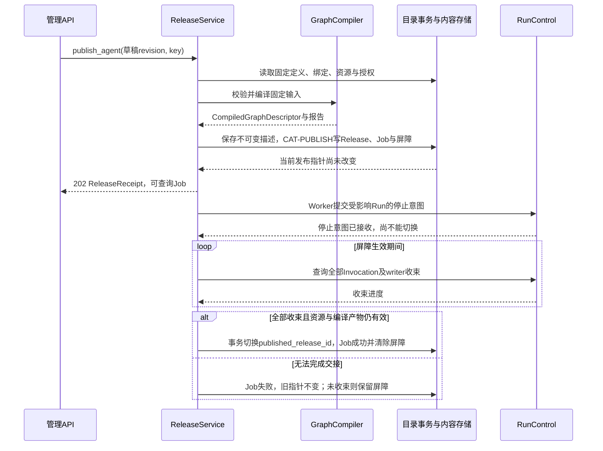
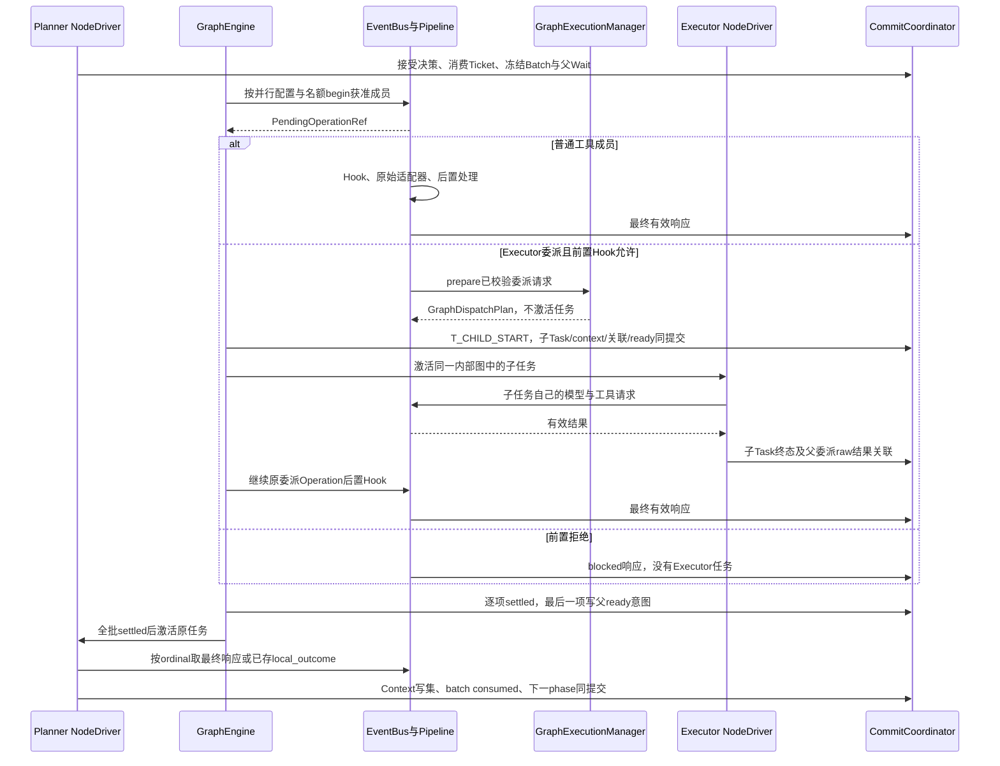
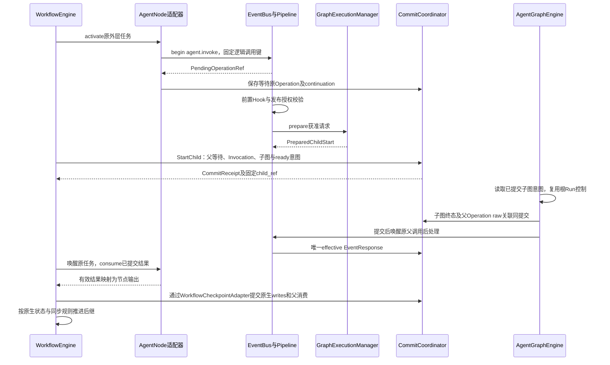

# 领域接口与跨域交互

> **重建边界（2026-10-15）**：旧业务实现已移除。本页保留为待调整的设计草案；用户、应用、发布与配置版本属于平台，SDK 只接收已解析配置并负责执行与恢复。涉及平台身份、发布绑定及表结构的内容需按 [SDK / Platform 边界](sdk-platform-boundary.md)重新划分，不直接作为 SDK 的必填契约或已实现功能。

**实施细则：[catalog-api](implementation/catalog-api.md)**。本页保留架构解释；具体方法、字段状态、事务和恢复分支见实施规格。

更新日期：2026-10-15。状态：**本轮目标设计，供评审；不代表当前 API 已实现。**

本文从领域的事实归属推导应用接口、内部端口及交互，不要求把每个领域部署成一个服务。Definition、Node 及运行实例关系见[领域模型](domain-model.md)，恢复结构见[检查点协议](checkpoint-protocol.md)，节点状态与激活信号见[图与节点引擎](graph-node-engine.md)，字段见[数据契约](data-contracts.md)。

本轮统一图领域、调用身份和恢复边界。Workflow 外层计划复制并适配 LangGraph 的状态、同步与检查点；本文端口是 AgentLoom 平台契约，不等同于上游接口或已完成的内核适配。外层只更新设计，不实现代码，具体影响见[源码适配决策](architecture-discussion.md#6-workflow-产品范围与-langgraph-源码适配)。

## 1. 谁持有事实，谁可以修改

| 领域／端口 | 权威事实 | 对外操作 | 不能直接修改 |
| --- | --- | --- | --- |
| Agent 配置 | Agent 身份、不可变 mode、文件根引用、草稿和 AgentDefinition 版本 | 创建、改草稿、验证、冻结版本、申请删除 | 图调度位置、角色运行上下文、共享资源内容 |
| 图编排 | GraphDefinition 身份及版本；内部 NodeDefinition、边、状态字段与合并规则 | 编辑图、验证、编译 | Agent 角色 Prompt、模型凭据、运行中的 NodeTask |
| 发布 | AgentRelease／WorkflowRelease、节点绑定及依赖清单 | 解析引用、验证绑定、发布、撤销 | 已发布内容；发布后变更必须创建新版本 |
| 工作流应用 | Workflow 身份、WorkflowDefinition、草稿及当前发布引用 | 编排 Agent／工具、验证、发布、创建工作流会话 | 所引用 AgentRelease 的内容与文件根 |
| 能力资源 | 模型连接、Skill、Tool、MCP、Hook 的资源与版本；凭据引用 | 导入、验证、冻结、撤销、授权 | 运行中的目录快照、调用参数及事实记录 |
| 会话 | 正式用户输入、顺序、补充交付和下一轮转交状态 | 接收输入、读取历史、转交未消费补充 | 根据内容价值删掉失败轮次或补充 |
| Run 执行 | 根 Run 状态、发布引用、总额度、截止时间、停止意图及执行权 | 启动、停止、读取状态、内部接管 | 不经调度提交直接完成 NodeTask |
| 图执行 | GraphExecution、NodeTask、激活与等待、结果消费、后继意图 | 激活、分派、汇合、提交完成、恢复 | 私有 Prompt、原始用户消息、工具真实副作用 |
| ContextManager | 原始记录、有效上下文版本、Hook 变更、摘要和消费位置 | 投影、读取、准备追加与修改写集、衔接压缩 | 跨角色无授权读取；伪造原始事实 |
| EnvironmentManager | Agent 文件根、授权文件视图、持久沙箱、Run 临时目录、清理状态 | 准备、绑定、文件操作、授予文件引用、清理 | 修改平台预算、消息和检查点文件 |
| CheckpointStore | 各执行范围检查点、任务写入和提交版本 | 装载、条件提交、读取历史、内部删除 | 决定业务计划、重新调用工具、生成用户恢复按钮 |

`NodeDefinition` 和 `RoleDefinition` 在本文中是各自 Definition 的组成部分，不提供可脱离父版本保存的单独资源 CRUD。`NodeTask`、`NodeActivation` 和 `Operation` 是运行对象，不允许管理端用通用 PATCH 任意改状态。

## 2. 三种入口和共同信封

### 2.1 用户、Runtime 和插件入口

| 入口 | 可信身份来自哪里 | 使用者 | 主要约束 |
| --- | --- | --- | --- |
| 应用 API | 登录会话或有范围的 API token | 管理页面、调用 Agent 的业务程序 | 校验 Space 权限、资源归属、幂等键与版本条件 |
| 内部端口 | Runtime 装配的调用身份和当前执行权 | 图引擎、公共 Loop、Manager | 重新验证 Run 及租约；不可相信模型参数中的身份 |
| 插件／Hook SDK | 已授权能力绑定及受限 InvocationContext | 工具、MCP 适配器、Hook 处理器 | 只访问获准数据；不取得数据库连接、全域写权限或其他角色上下文 |

同一套领域端口可以由 REST、Python SDK 和内部代理调用。REST 是传输映射，不是另一套业务状态机。公共 Loop 调用普通接口，由装配的代理进入统一 EventBus；不要求每个业务调用点自行发送事件、等待和写检查点。

### 2.2 版本和幂等

```python
@dataclass(frozen=True)
class MutationOptions:
    idempotency_key: str
    expected_revision: int | None = None

@dataclass(frozen=True)
class RequestIdentity:
    request_id: str
    actor_id: str
    space_id: str
    trace_id: str
```

`RequestIdentity` 由接入层创建；模型和用户 JSON 中同名字段不能覆盖它。上述名称是目标 Python 接口，实际序列化仍须遵循[数据契约](data-contracts.md)。

- 草稿、状态更新等有前一版本的写入必须带 `expected_revision`；创建操作不要求旧版本。
- 幂等作用域为调用主体、目标资源与操作类型。相同 key 和相同请求返回原 receipt；相同 key 携带不同内容返回 `IDEMPOTENCY_CONFLICT`。
- 幂等键解决网络重发，不按参数相等合并两次业务请求。LLM 两次工具调用即使参数一致，也拥有不同的 `operation_id`。
- Definition 版本与 Release 不可原地修改；编辑产生草稿 revision，冻结得到新版本引用。
- `RequestIdentity.request_id` 是一次传输请求；`operation_id` 是可恢复的逻辑调用；物理重试拥有各自 `attempt_id`，不混用。总线响应中的 EventResponse.request_id 则关联原 EventRequest.event_id，见第 7 节。
- 本设计不承诺外部工具副作用恰好一次；本地幂等提交不能代替工具提供者的防重。

## 3. 配置、图定义和发布端口

### 3.1 目标接口

```python
class AgentCatalog(Protocol):
    async def create(self, spec: CreateAgent, options: MutationOptions) -> AgentView: ...
    async def get(self, agent_id: str) -> AgentView: ...
    async def update_draft(self, agent_id: str, patch: AgentDraftPatch,
                           options: MutationOptions) -> AgentDraft: ...
    async def validate(self, agent_id: str, draft_revision: int) -> ValidationReport: ...
    async def freeze(self, agent_id: str, draft_revision: int,
                     options: MutationOptions) -> AgentDefinitionRef: ...
    async def delete(self, agent_id: str, options: MutationOptions) -> DeletionReceipt: ...

class GraphCatalog(Protocol):
    async def create(self, spec: CreateGraph, options: MutationOptions) -> GraphDraft: ...
    async def update_draft(self, graph_id: str, patch: GraphDraftPatch,
                           options: MutationOptions) -> GraphDraft: ...
    async def validate(self, graph_id: str, draft_revision: int) -> ValidationReport: ...
    async def freeze(self, graph_id: str, draft_revision: int,
                     options: MutationOptions) -> GraphDefinitionRef: ...
    async def get_version(self, ref: GraphDefinitionRef) -> GraphDefinition: ...

class GraphCompiler(Protocol):
    async def compile(self, graph: GraphDefinitionRef,
                      bindings: BindingManifest) -> CompiledGraph: ...

class WorkflowCatalog(Protocol):
    async def create(self, spec: CreateWorkflow, options: MutationOptions) -> WorkflowView: ...
    async def update_draft(self, workflow_id: str, patch: WorkflowDraftPatch,
                           options: MutationOptions) -> WorkflowDraft: ...
    async def freeze(self, workflow_id: str, draft_revision: int,
                     options: MutationOptions) -> WorkflowDefinitionRef: ...

class ReleaseService(Protocol):
    async def prepare_agent(self, request: PrepareAgentRelease) -> ReleaseValidation: ...
    async def publish_agent(self, request: PublishAgentRelease,
                            options: MutationOptions) -> ReleaseReceipt: ...
    async def prepare_workflow(self, request: PrepareWorkflowRelease) -> ReleaseValidation: ...
    async def publish_workflow(self, request: PublishWorkflowRelease,
                               options: MutationOptions) -> ReleaseReceipt: ...
    async def get(self, ref: ReleaseRef) -> ResolvedRelease: ...
```

这些端口并非节点暴露给 LLM 的工具清单。`GraphCompiler` 生成可校验、可重建的只读 `CompiledGraph`；`CompiledGraphDescriptor` 是它的序列化表示，具体 Python callable、数据库连接、模型客户端和 EventBus 实例在运行装配时注入，不序列化到 Definition 或检查点。

### 3.2 关键数据和校验

| DTO | 必须表达的信息 |
| --- | --- |
| `CreateAgent` | Space、名称、描述、`mode=react` 或 `plan_executor`；Agent 身份与文件根由系统创建 |
| `AgentDraftPatch` | 角色配置、模型与能力引用、Prompt、上下文、预算、并行、Hook 和环境策略；不允许改变 mode 或文件根身份 |
| `GraphDraftPatch` | 节点、连接、条件、入口／结束、汇合、状态 schema 和字段更新规则；不直接嵌入角色私有 Prompt |
| `BindingManifest` | 图节点位置与 `RoleRef`、`ToolBinding` 或 `AgentReleaseRef` 的绑定；每个引用带固定版本 |
| `PrepareAgentRelease` | AgentDefinitionRef、GraphDefinitionRef、NodeBinding 列表、预期草稿 revision |
| `PrepareWorkflowRelease` | WorkflowDefinitionRef、GraphDefinitionRef、节点到 AgentRelease／Tool 的绑定、工作流输入输出和根 Run 控制策略 |
| `ReleaseValidation` | 编译摘要、依赖清单、错误路径、警告、内容哈希；不调用业务 LLM 或实际工具 |
| `CompiledGraph`／`CompiledGraphDescriptor` | 前者为只读编译产物，后者为它的可序列化描述，不是第三份领域身份；GraphDefinitionRef、编译器／节点协议版本、节点路由和状态契约、binding digest；不是运行实例 |
| `ReleaseReceipt` | 发布任务 ID、publishing／succeeded／failed、release_ref、受影响 Run 及错误 |

发布至少检查：

1. 节点与边引用存在，入口和终点有效，条件路由只能指向声明目标；循环必须有执行控制，并受 Run 预算及截止约束。外层支持的拓扑需按迁移内核的能力矩阵验证；不能将旧自研候选的“禁止分支内再次 fork”等限制直接作为产品规则。
2. ReAct 入口绑定 React 角色；Plan–Executor 的 Planner／Executor 位置与角色类型匹配；Executor 不独立选择模型。
3. RoleRef 来自本次 AgentDefinition；工具和共享资源版本存在且有使用授权，凭据引用可解析但不复制明文凭据。
4. Workflow AgentNode 绑定不可变 AgentRelease；发布依赖无递归引用，不在本轮引入通用递归 SubgraphNode。
5. 节点输入输出和边的数据映射兼容；并行写入同一图状态字段必须有明确的 reducer 或排他规则，不能悄悄最后写入覆盖。
6. Hook 配置、可写字段和授权作用域有效；allow 不扩大权限。用户脚本、MCP、Skill 与文件访问都绑定运行文件视图。
7. 模型窗口等必须的预算信息可确定；未知值要求用户提供，不能把猜测当元数据。
8. 固定全部绑定和版本后才能生成 Release。运行中不重新读取“最新”角色、Skill 或图定义替换它。

AgentDefinition 与 GraphDefinition 是两个版本引用；AgentRelease 将它们和绑定固定在一起。两者不互为类的子类，也不因 Builder 生成图就混成一份身份。标准 Agent 的图由模板生成；工作流用户可以编辑图，但两者最终经过相同的编译校验。

### 3.3 发布交接



实际数据库事务不跨远程调用等待。发布屏障负责避免“解析旧版本的新 Run”穿过切换点；停止交接完成前，新的直接 Run 和新的 AgentNode 调用返回 `RELEASE_TRANSITION`，不在此接口隐式排队。仅收到停止 ACK 不能切换指针，必须确认目标调用及旧 writer 全部收束。

直接 Agent Session 的下一次提问使用最新有效发布。WorkflowRelease 对其 AgentRelease 的引用仍固定；Agent 发布不会偷偷改写工作流绑定，需要重新发布工作流才采用新版本。发布期间对相关在途调用应用既有停止规则，单次 Run 不热切换到新配置。

## 4. 能力资源端口

```python
class ResourceCatalog(Protocol):
    async def import_resource(self, source: ResourceSource,
                              options: MutationOptions) -> ResourceImportReceipt: ...
    async def validate_version(self, ref: ResourceVersionRef) -> ValidationReport: ...
    async def resolve(self, binding: ResourceBinding,
                      scope: AuthorizationScope) -> ResolvedResource: ...
    async def revoke(self, ref: ResourceVersionRef,
                     options: MutationOptions) -> RevocationReceipt: ...
    async def delete(self, resource_id: str,
                     options: MutationOptions) -> DeletionReceipt: ...
```

资源目录负责共享实体；Agent 只保存引用和获准参数。Skill 文件夹／Git 导入、MCP 服务发现、工具 schema、Hook 处理器和模型目录可以有各自 DTO，但都产出固定的 ResourceVersionRef。对模型目录的拉取只声明提供方实际返回的元数据；能力绑定和凭据解析由 Manager 处理。

凭据不是 Prompt 变量或 GraphState。Release 保存连接及凭据槽引用，运行装配按授权从凭据服务取值；凭据值不可出现在图状态、事件观察日志、检查点或普通 API 返回中。安全撤销立即生效：固定版本不意味着已撤销权限仍可调用。撤销导致明确失败，不静默换到其他账号或模型。

删除被有效 Release 引用的共享资源返回 `DEPENDENCY_CONFLICT`，先显式解除或撤销依赖；删除 Agent 只删除其专属内容，不连带删除共享资源。

## 5. Session、Run 与运行查询接口

### 5.1 用户操作只有输入、结束与查看

```python
class SessionService(Protocol):
    async def create_agent_session(self, agent_id: str,
                                   options: MutationOptions) -> SessionView: ...
    async def submit_input(self, session_id: str, input: UserInputCommand,
                           options: MutationOptions) -> InputReceipt: ...
    async def history(self, session_id: str, query: HistoryQuery) -> HistoryPage: ...

class WorkflowSessionService(Protocol):
    async def create(self, workflow_id: str,
                     options: MutationOptions) -> WorkflowSessionView: ...
    async def submit_input(self, workflow_session_id: str, input: UserInputCommand,
                           options: MutationOptions) -> InputReceipt: ...

class RunService(Protocol):
    async def get(self, run_id: str) -> RunView: ...
    async def stop(self, run_id: str, options: MutationOptions) -> StopReceipt: ...
    async def executions(self, run_id: str, query: ExecutionQuery) -> ExecutionPage: ...
    async def operation(self, operation_id: str) -> OperationView: ...
    def events(self, run_id: str, after_seq: int) -> AsyncIterator[RunEvent]: ...

class RecoveryService(Protocol):
    async def recover_run(self, run_id: str,
                          claim: ExecutionLease) -> RecoveryReceipt: ...
```

`recover_run` 只向内部执行服务开放。用户 API 不提供 pause／resume／随意指定检查点重跑。停止不是从历史检查点回滚；已终态 Run 也不会被新的补充或恢复服务重启。

`InputReceipt` 至少返回 `input_id`、`session_seq`、`run_id`（尚未绑定时可空）、`disposition=new_run|supplement|pending_next_run`、`delivery_state`。收到请求与模型已经看见输入是两种事实，不能用一个“成功”掩盖交接状态。

### 5.2 接收、补充与终态的竞态

接收输入与判断 Session 当前 Run 在同一串行化边界内完成：

| 当前事实 | 处理 |
| --- | --- |
| 没有活跃 Run，发布可用 | 保存正式输入，绑定固定 Release，创建新 Run 与启动意图 |
| 活跃 Run 允许接收补充 | 保存 supplement，等待当前入口角色下一轮模型调用前消费 |
| Run 已停止启动下一轮，补充尚未消费 | 保存 `pending_next_run`，不尝试强塞给已停止模型 |
| Run 在补充接收后完成 | 终态事务将未消费补充转交 Session 下一轮；不丢弃、不自动另起 Run |
| 重复提交同一 client_message_id／幂等键 | 返回原 input receipt，不产生第二条输入或第二次执行 |

Plan 模式的接收对象是 Planner 所属 ContextScope，不广播 Executor。历史查询保留原始问题、全部补充及真实终态；最近 N 次已结束提问保留完整过程，失败、停止也占一个名额，N 按 Agent 配置。

### 5.3 外层工作流会话与 Agent 调用

未来工作流使用归属于 Workflow 的 `WorkflowSession`，与 `Session` 区分。`Session` 始终只属于一个 Agent；`Run.conversation_ref` 是 `agent_session|workflow_session` 的联合引用。工作流调用不同 Agent 时，不能把工作流历史伪装成某个 Agent 的连续用户会话。

Workflow Run 的 AgentNode 创建 `AgentInvocation + child GraphExecution`，保存独立角色上下文和稳定调用位置。默认 `ConversationScope=none`，只传入本次显式任务输入和获准的 ArtifactRef，不自动复制工作流完整历史、其他 Agent 私有消息或之前所有调用。恢复按原 invocation 恢复，不创建用户新提问。工作流后续提问若要关联同一 Agent 的上下文，必须使用明确、受授权的会话绑定策略；第一版设计默认每次 AgentNode 调用使用新的调用上下文。

工作流内完整 Agent 的根角色模型失败、压缩失败或局部限制耗尽，均先终结所属 AgentInvocation，再由父 AgentNode 的错误路由决定后继；不得自动取消兄弟 Agent 调用。直接 Agent Run 的唯一 Invocation 失败仍导致根 Run 失败。

AgentNode／CapabilityNode 将已提交的 failed／blocked 封装为业务失败输出，不用未处理异常触发原生runner取消兄弟；无错误路由时待当前step收束后Workflow失败。父等待取消与根停止分开处理，恢复复用原Operation。平台结果消费只随已确认的任务完成写集发生，不能把任意原生ERROR／INTERRUPT当作交付。详见[失败映射与父子交接](dual-engine-integration.md#53-失败取消和重入的确定映射)。

根 Run 只产生一次。外层状态可见性、同步和写入合并按 LangGraph 源码适配后确定的规则执行，不再把旧自研 ready queue／分支私有视图当作唯一实现。后继输入、调用身份与恢复位置必须可重建，已完成结果不得重复消费；具体内核字段映射仍需补齐。Workflow 中每个 AgentInvocation 不再开一个重置额度和超时的子 Run；其 Agent 配置收紧本调用局部上限。每笔 LoopTicket 同时受根和所属 Invocation 限制，预占／结算在同一事务中进行；局部不足只终止本调用并回交外层，根不足终止整树，不能互相替代。局部时限自调用创建时计起，排队与重试计入，恢复不重新计时。父图不会直接改子图的角色上下文。

## 6. 图执行与 Agent 调用的内部端口

```python
class AgentInvocationService(Protocol):
    async def start(self, request: AgentInvocationRequest,
                    scope: ExecutionScope) -> AgentInvocationRef: ...
    async def get(self, ref: AgentInvocationRef) -> AgentInvocationView: ...

class GraphExecutionService(Protocol):
    async def create(self, request: CreateGraphExecution,
                     scope: ExecutionScope) -> GraphExecutionRef: ...
    async def dispatch(self, request: DispatchTasks,
                       scope: ExecutionScope) -> DispatchReceipt: ...  # 登记回执，不是最终能力响应
    async def activate(self, task: NodeTaskRef,
                       claim: ExecutionLease) -> ActivationReceipt: ...
    async def get(self, ref: GraphExecutionRef) -> GraphExecutionView: ...

class BudgetService(Protocol):
    async def reserve_loop(self, owner: NodeTaskRef,
                           purpose_key: str) -> LoopAdmission: ...  # granted(ticket) / wait / control_error(scope)
    async def settle_loop(self, ticket: LoopTicket,
                          outcome: LoopAccountingOutcome) -> BudgetView: ...
    async def check_deadline(self, scope: ExecutionScope) -> ControlDecision: ...
```

BudgetService 从可信 owner 解析根与本调用作用域，调用方不传可伪造的额度或新的截止时间。额度被在途预留暂时占满时返回持久可等待条件；已消费额度耗尽返回带作用域的控制错误。详情见[双层预算与停止协议](agent-execution.md)。

这些是应用／调度端的领域门面，不作为业务 Node 的直连依赖。`AgentInvocationService.start` 表示受控创建命令：AgentNode 实际经代理 begin `agent.invoke`，Manager 返回 PreparedChildStart，GraphEngine 经 Coordinator 提交才启动；不能从节点直接调用 start 绕过 Hook。BudgetService 的准入准备也须与模型请求冻结同事务结算，不能单独先扣票据。具体实现以 [AgentNodePort](implementation/runtime-graph.md#101-agentnode-和-capabilitynode)和共享票据命令为准。GraphEngine 通过 NodeDriver 调用 `Node.activate(...)`；节点输出 `ActivationStream[NodeOutcome]`；`NodeOutcome` 为 `Progress|Wait|Complete|Fail`，公共 React 实现通过 NodeRuntime 的统一安全点提交器交还可序列化 continuation。普通 Node 可用一次完成的实现；长运行自定义 Node 若不实现可恢复阶段，只能按声明的重执行／失败策略处理，不能承诺恢复任意 Python 调用栈。

| 场景 | 新增什么 | 不新增什么 |
| --- | --- | --- |
| 直接调用 ReAct Agent | 1 AgentInvocation、1 GraphExecution、1 入口 NodeTask | 每个 Loop 不创建新图 |
| Planner 同轮委派同一 Executor 两次 | 同一 GraphExecution 中新增 2 个 Executor NodeTask，各有 ReactContinuation 和上下文 | 不为 Executor 新建 AgentInvocation 或子图 |
| 普通工具、MCP、Skill 读取、脚本 | Operation；有外部实际执行时产生 Attempt | 不为每次调用生成图实例 |
| 工作流执行 CapabilityNode | 工作流 NodeTask 和能力 Operation | 不生成内部 Agent 图 |
| 工作流执行 AgentNode | 外层 NodeTask；一个完整子 AgentInvocation 与 child GraphExecution | 不创建新的根 Run 或独立全额预算 |
| 恢复／等待后继续 | 可新增 NodeActivation，沿用原 task／invocation／graph 身份 | 不复制已完成结果和调用身份 |

旧名 `AgentExecution` 不再是与 NodeTask 并行调度的另一实体；需要“角色执行列表”的页面时，用 React 类 NodeTask 的查询投影提供。

### 6.1 Planner、Executor 与普通工具

下图按成员展示分支，实际并行与串行由冻结 BatchPolicy 决定，不是默认同时执行。begin 之前的本地参数拒绝由同批 local_outcome 结算；图中的 blocked 指已创建 Operation 的前置 Hook 拒绝。



每项按图中对应分支处理；开启并行时可有多个获准成员同时推进，关闭并行时只 begin 当前成员，待它结算后再登记启动下一成员，错误同样作为批次成员结果收齐。单个成员失败不取消其余成员，也不提前唤醒 Planner。第 100 次允许的业务 Loop 正常完成可成功；需要第 101 次时由 Runtime 终结，不追加总结模型调用。

### 6.2 外层 AgentNode 调用

以下为前置 Hook 允许的路径；拒绝则由 Pipeline 交付 blocked，不创建 Invocation 或子图。AgentNode 只调用代理、返回恢复信号，Manager 准备计划；WorkflowEngine 和 AgentGraphEngine 分别是所属图的唯一调度者，所有关联经 CommitCoordinator 提交。



宕机后外层按稳定子引用查询或接管原调用，不能因为进程对象不存在重新创建一个 Agent。子图完成、外层尚未消费时复用子结果；若父调用后置 Hook 未完成，只继续其后处理。必须等父调用唯一有效 EventResponse 提交后才提交外层 AgentNode 输出，不能跳过父 Hook 使用 raw 子结果。原生任务 writes 与父消费标记同事务，之后由 WorkflowEngine 推进状态和后继；不能用内层路由算法代替。见[跨引擎协议](dual-engine-integration.md#5-父子调用交接协议)。

## 7. 统一 EventBus 与能力门面

总线的内部组成、事件信封、注册订阅、等待竞态和进程生命周期集中在[事件总线专篇](runtime-messaging-checkpoints.md)。本节保留调用方的统一门面；装配端口和观察端口不作为 LLM 的工具。

```python
class EventBus(Protocol):
    async def begin(self, event: EventRequest,
                    scope: ExecutionScope) -> PendingOperationRef: ...
    async def await_result(self, ref: PendingOperationRef,
                           scope: ExecutionScope) -> EventResponse: ...
    async def get_result(self, ref: PendingOperationRef,
                         scope: ExecutionScope) -> EventResponse | None: ...
    async def request(self, event: EventRequest,
                      scope: ExecutionScope) -> EventResponse: ...
    async def request_many(self, events: Sequence[EventRequest],
                           policy: BatchPolicy,
                           scope: ExecutionScope) -> list[EventResponse]: ...
    async def publish(self, event: CommittedEvent) -> None: ...

class EventInterceptor(Protocol):
    async def before(self, event: EffectiveRequest,
                     context: HookContext) -> HookDecision: ...
    async def after(self, result: EffectiveResponse,
                    context: HookContext) -> HookDecision: ...
```

同一个总线提供 request／reply 和已提交事实通知。能力域有明确的单一执行所有者：模型交 ModelManager，工具／MCP 交 ToolManager，上下文交 ContextManager，环境交 EnvironmentManager，Executor 委派交图执行 Manager。纯观察订阅不竞争成为请求响应者。

一个逻辑请求等待一个最终 `EventResponse`；批次按成员顺序返回 `list<EventResponse>`，每项仍按 call_id／operation_id 关联。

**登记调用、等待调用和最终响应分开。** `begin` 通过 CommitCoordinator 保存稳定 Operation、调用意图及关联，返回 `PendingOperationRef`；引用名中的 Pending 只表示调用方可按它等待，不保证此时调用仍未完成。前置 Hook 可以在 begin 期间合法拒绝：仍返回相同类型的引用，`get_result` 立即读到唯一的 blocked 响应；不创建 Executor NodeTask 或执行目标能力。

| 接口 | 含义 | 恢复约束 |
| --- | --- | --- |
| `begin` | 按稳定逻辑调用键登记调用，按执行策略进入 Hook／执行或排队，返回引用 | 幂等复用 Operation，不把网络重发当新调用；执行意图须先持久化 |
| `get_result` | 查询该引用的已提交最终响应，尚未结算返回 None | 不运行新能力、不触发重试、不重新应用 Hook patch |
| `await_result` | 等待该引用已有或后续提交的唯一最终响应 | 进程内 Future 可以重建；等待者消失不丢持久调用身份 |
| `request` | 短调用使用的 `begin + await_result` 便利封装 | 返回同一 EventResponse；不是另一条执行路径 |
| `request_many` | 按批次策略登记／推进成员，收齐后按冻结顺序返回响应列表 | 不因为名为 many 就默认并行；恢复按每个成员的引用继续 |

委派的 `begin` 有一项额外限制：它先保存 prepared Operation 与分派意图；NodeDriver 必须把父 Wait、引用、恢复键、获准子任务及启动意图一致提交，提交确认前不得激活 Executor。begin 返回后、父 Wait 提交前宕机，恢复按固定成员／purpose_key 取回相同引用并补交原 Wait，不重复分派。普通短能力 begin 不要求等待父委派 Wait。

Planner 的公共 Loop 持久保存批次与已启动成员的 PendingOperationRef，然后输出 `Wait`；恢复不靠仍然存在的 Python Future 或 await 调用栈。批次调度器通过持久成员状态推进未开始项；`node_task`／`child_graph` WaitMember 还保存 `result_operation_id`，以其包含后置 Hook 的最终 EventResponse 结算，不能仅以子 TaskResult 完成为准。待全部成员结算后再唤醒原 Planner，并读取各引用的最终 EventResponse。`DispatchReceipt` 只证明图内分派登记，不是 Executor 交付结果，也不作为同一请求的第一份最终响应。

Executor 执行名额在子 NodeTask 终态及 TaskResult／TaskWrite 持久化时释放；父委派 Operation 的后置 Hook 仍未完成时，成员保持未结算。并行可补位，串行仍须等当前成员完整结算才能准入下一成员；恢复按持久任务状态重建名额，不用 WaitMember 状态推断占用。

批次先冻结所有成员及顺序，但不等于立即 begin 或 dispatch 全部成员。关闭并行时只 begin 当前成员，结算后才 begin 下一成员；开启并行时按配置和 Executor 活跃上限放行。混合普通工具与 Executor 的批次使用同一策略闸门，不能通过先 begin 全批再等结果绕过串行或并发限制。恢复先查当前已启动成员的结果，再按相同策略放行后续成员。Hook 链内部可能产生多条执行记录，它们不成为需要 Agent Loop 解析的“多个答案”。缺处理者、拒绝、超时和异常都显式结算，不能无限等待。

| `HookDecision` 字段 | 约束 |
| --- | --- |
| `decision=allow` 或 `deny` | 合法 deny 终止当前允许链；后续 allow 不能推翻 |
| `reason` | 面向相关调用方的原因；按权限脱敏 |
| `payload_patch` | 只能改本挂点允许字段，修改后重新校验 schema、权限及预算 |
| `context_patch` | 进入所属角色或显式共享范围的 ContextMutation，带 expected revision 与来源 |

同一个 Hook 的 payload_patch 和 context_patch 必须先映射到规范语义字段并归一；同值重复合并，冲突值或父子路径冲突使本项修改整体无效，禁止靠应用顺序偷偷覆盖。实际参数和有效调用记录从同一变更集合生成，相关联的 context_patch 不能单独改变当前调用记录而留下旧实际参数。具体 deny 与无效 patch 的独立校验见[Hook 契约](capabilities-hooks.md)。

前置 deny 阻止执行；后置 deny 阻止交付或后续推进，但原始副作用已发生这一事实保留。Hook 自身报错、超时或返回非法修改时丢弃当前无效修改，继续此前的有效版本；这不等于忽略合法 deny。Hook 不能允许已停止、超限、无权调用的执行，必要持久化也不适用 fail-open。

调用管道顺序为：固定逻辑身份 → 处理并提交前置决定／有效输入 → Manager 执行 → 保存原始结果 → 处理后置决定／有效结果 → 提交上下文变更及响应 → 向等待者交付。恢复原始结果已保存的调用时只继续后处理，不重新执行工具。已验证 context_patch 的内部提交不再绕回相同 Hook 链，避免递归。

### 7.1 运行依赖与可恢复状态分离

```python
@dataclass(frozen=True)
class ExecutionScope:
    run_id: str
    graph_execution_id: str
    node_task_id: str | None
    invocation_id: str | None
    owner_ref: OwnerRef
    conversation_ref: ConversationRef | None
    workspace_scope_ref: WorkspaceScopeRef
    lease_epoch: int
    authorization: AuthorizationScope
    deadline_at: datetime

@dataclass(frozen=True)
class NodeRuntime:
    scope: ExecutionScope
    capabilities: CapabilityPorts
    contexts: ContextPort
    environment: EnvironmentPort
    control: RunControlPort
    safe_points: SafePointPort
```

NodeRuntime 是当前机器上的依赖容器，接管时重新装配；不能放进 GraphState。可序列化的 continuation 只保存引用、阶段、已消费序号、等待条件等恢复信息，不保存 EventBus、协程、模型客户端、凭据或文件句柄。

外层 CapabilityNode 与 ReactNode 内部工具调用使用同一 CapabilityPorts。区别是前者有图上节点位置和 NodeTask，后者只是既有角色任务的一次 Operation；不需要两种 MCP 调用实现。

## 8. 上下文和环境接口

以下 ContextPort 是面向调用者的受限门面；`commit_mutation` 进入统一调用管道，内部 ContextManager 仅返回 ContextWriteSet，不能自行写表。与模型接受、批次消费、请求冻结相耦合的上下文修改使用[准备接口](implementation/context-capabilities.md#22-命令与方法)，和对应状态命令一起提交，不先单独调用本门面。

```python
class ContextPort(Protocol):
    async def append_original(self, request: AppendOriginal,
                              scope: ExecutionScope) -> ContextRecordRef: ...
    async def materialize(self, request: ContextProjectionRequest,
                          scope: ExecutionScope) -> EffectiveContextView: ...
    async def commit_mutation(self, mutation: ContextMutation,
                              scope: ExecutionScope) -> EffectiveContextRevision: ...
    async def compact(self, request: CompactionRequest,
                      scope: ExecutionScope) -> CompactionResult: ...

class EnvironmentPort(Protocol):
    async def prepare(self, request: EnvironmentRequest,
                      scope: ExecutionScope) -> EnvironmentHandle: ...
    async def read(self, request: FileRead,
                   scope: ExecutionScope) -> FileResult: ...
    async def write(self, request: FileWrite,
                    scope: ExecutionScope) -> FileResult: ...
    async def grant_artifact(self, request: ArtifactGrant,
                             scope: ExecutionScope) -> ArtifactRef: ...
    async def cleanup(self, request: CleanupRequest,
                       scope: SystemCleanupScope) -> CleanupReceipt: ...
```

`append_original` 仅允许可信调用链记录原始事实；插件不能借此冒充用户输入。`materialize` 明确 projection_kind、context_scope、历史边界、有效 revision 和摘要覆盖范围；不返回其他角色全历史。`commit_mutation` 带来源、mutation_id 和 expected revision；同一变更恢复时不重复应用。并发冲突交回确定的重建／重试过程，不能随意覆盖。

Hook 修改后的工具参数、结果及上下文体现在后续 model projection、历史与恢复中；原始内容保留。压缩使用固定有效 revision，提交时检查后续增量，不能让旧摘要覆盖新 Hook 修改。已发出的模型请求不能被追溯改写。

同一 AgentInvocation 内 Planner 和 Executor 共享授权工作视图。外层不同 AgentInvocation 各自使用所属 Agent 的文件根；需要共享文件时，传递显式 ArtifactRef 和授权范围，不能把所有 Agent 的根目录挂进同一可写环境。ArtifactRef 表示授权引用，不保证文件永久存在；无持久沙箱的产物在所属 Run 清理后失效。

EnvironmentRequest 只接受注册的 WorkspaceScope 引用及获准环境配置，不允许自行指定宿主路径或伪造 Agent Session。EnvironmentManager 按带类型 owner、partition 与 run_id 幂等创建视图：直接 Agent 用 agent_session，外层用 workflow_session，无 Agent Session 的子调用用 invocation。外层 CapabilityNode 的 owner 为 Workflow，invocation_id 为空合法；模型角色与模型历史不是普通文件工具调用的前提。文件 MCP token 和连接池按 WorkspaceScope 隔离，恢复重新绑定有效 lease，不直接复用旧句柄。完整字段见[数据契约](data-contracts.md)。

工作文件清理以根 Run 全部执行收束为前提；某个子调用提前结束不能删除其他执行仍在用的文件。系统消息、上下文版本、操作和检查点通过服务保存，不暴露为模型可改的目录。

## 9. 检查点与恢复端口

下列是供 Runtime／图引擎使用的存储门面，业务节点仅使用统一安全点接口。完整结构和事务协议以[检查点设计](checkpoint-protocol.md)为准。

```python
class CheckpointStore(Protocol):
    async def load_latest(self, scope: CheckpointScopeRef,
                          authorization: InternalAuthorization) -> RecoveryBundle: ...
    async def load(self, checkpoint: CheckpointRef,
                   authorization: InternalAuthorization) -> RecoveryBundle: ...
    async def list_metadata(self, scope: CheckpointScopeRef,
                            query: CheckpointQuery,
                            authorization: InternalAuthorization) -> CheckpointPage: ...

class CommitCoordinator(Protocol):
    async def commit(self, batch: RuntimeCommit,
                     claim: ExecutionLease) -> CommitReceipt: ...

class CheckpointQueryService(Protocol):
    async def list(self, run_id: str, query: CheckpointQuery) -> CheckpointMetadataPage: ...
    async def inspect(self, ref: CheckpointRef) -> AuthorizedCheckpointView: ...
```

`CommitCoordinator` 是唯一跨域一致提交入口。`CheckpointStore` 对恢复调用方仅开放读取；其 `put`／`put_writes` 是 Coordinator 专用的事务 writer，不是业务端可以自行提交的另一条路径。

`RuntimeCommit` 在同一提交边界关联 `expected_revision`、任务写入、continuation、结果／错误、消费位置、图状态更新、后继调度意图及 outbox。结构化分支还要关联 cursor、分支视图、loop_path 与成员关闭事实；LoopTicket 则关联根和 Invocation 的原子额度变更。大 payload 可先写不可变 Blob，再在事务中引用；Blob 存在不等于状态已提交。`CommitReceipt` 是持久完成证据，内存事件只是通知。

外层和内层使用不同 CheckpointScopeRef，父图只保存稳定 child graph／invocation 引用和结果消费位置。`RecoveryBundle` 汇总快照与后续已提交任务写入，不要求外层复制一份内层所有 continuation。结果已写入的任务先复用结果，未完成任务按其阶段继续，未知外部副作用保留 unknown 事实。

查询端口不会把全库快照直接返回用户。查询者必须有 Run 归属、角色调试及上下文读取权限；凭据和系统私有字段始终排除，跨角色内容按权限过滤。知道 checkpoint_id 或 namespace 不能取得访问权。没有用户“恢复到此检查点” API；未来如加调试回放，必须是新的明确功能和身份语义。

## 10. 目标 HTTP API

统一前缀 `/api/v1`。下表是目标契约映射，不是已上线接口清单。写操作按领域约束带 `Idempotency-Key`；有 revision 的修改使用 `If-Match`，SDK 映射为 MutationOptions。

| 方法与路径 | 请求和响应 |
| --- | --- |
| `POST /agents` | 创建固定 mode 的 Agent，返回 AgentView 与草稿 revision |
| `GET /agents/{id}` | 身份、当前 Release、草稿状态、文件根的受限描述 |
| `PATCH /agents/{id}/draft` | 角色和配置变更；拒绝修改 mode |
| `POST /agents/{id}/validate` | 验证指定草稿 revision，返回字段级报告 |
| `POST /agents/{id}/releases` | 固定定义版本、图版本及绑定；返回 202 发布任务 |
| `GET /release-jobs/{id}` | 发布结果、停止交接和失败原因 |
| `POST /graphs` | 创建图草稿；要求图编排管理权限 |
| `PATCH /graphs/{id}/draft` | 修改节点、边、状态契约；整体 revision 校验 |
| `POST /graphs/{id}/validate` | 结构和类型验证，不执行节点 |
| `GET /graphs/{id}/versions/{version}` | 不可变图定义；角色 Prompt 由相应授权接口读取 |
| `POST /workflows`、`PATCH /workflows/{id}/draft` | 外层工作流目标接口，当前不实现 |
| `POST /workflows/{id}/releases` | 固定 WorkflowDefinition、GraphDefinition、AgentRelease 和 Tool 绑定 |
| `POST /agents/{id}/sessions` | 创建只归属该 Agent 的会话 |
| `POST /workflows/{id}/sessions` | 外层工作流会话入口，当前不实现 |
| `POST /sessions/{id}/inputs` | Agent 的正式问题或补充；返回 InputReceipt 和交付归属 |
| `POST /workflow-sessions/{id}/inputs` | 工作流正式输入；ConversationRef 与 Agent Session 分离 |
| `GET /sessions/{id}/messages` | 分页原始记录及有效投影，保留修改来源 |
| `GET /runs/{id}` | 根状态、终态原因、预算、停止与清理进度 |
| `POST /runs/{id}/stop` | 202 正在收束；已终态幂等返回原状态 |
| `GET /runs/{id}/executions` | invocation／graph／task 树及当前激活，不返回虚构第二套 AgentExecution 状态 |
| `GET /runs/{id}/events` | SSE 进度和终态；Last-Event-ID 续读 |
| `GET /runs/{id}/checkpoints` | 有权限的检查点元信息，不暴露完整内部存储 |
| `GET /checkpoints/{id}` | 限定权限、脱敏恢复视图；只读 |
| `GET /operations/{id}` | 原始与有效请求／结果、Attempts、Hook 决定、来源与上下文版本 |
| `GET /sessions/{id}/files` | 当前获准且仍有效的文件；过期临时产物明确返回不可用 |
| `POST /resources/imports` | 导入任务，返回导入 receipt；不在请求中明文回显密钥 |
| `DELETE /agents/{id}` | 返回删除任务，先阻止新运行并收束后清理 |
| `GET /deletion-jobs/{id}` | 清理阶段、进度和可定位错误 |

读接口按 cursor 分页并具有稳定顺序。Event SSE 使用持久化的 `run_seq` 作为 ID，`RunEvent` 包含 run_id、type、committed_at、受限 payload 和必要执行引用。公共事件建议限于 accepted、task.started／ended、batch.settled、operation.status、run.stopping、run.terminal；不把原始 model.delta、token 或 Hook 中间秘密数据作为公开事件。

客户端断线后按 run_seq 补读；重连不会新建 Run 或重发模型请求。终态 payload 指向同一已提交 Run 结果，事件重复投递可按 seq 去重。SSE 通知不是检查点或状态真相，也不能替代 GET 状态校验。

## 11. 错误、授权与拒绝的区别

| 情况 | API／领域结果 | 自动行为 |
| --- | --- | --- |
| 输入 schema 不合法 | HTTP 422／`VALIDATION_ERROR`，带字段路径 | 不运行模型或工具 |
| 草稿／上下文 revision 冲突 | HTTP 409／`REVISION_CONFLICT` | 读取新版本后由调用者重新决策，不盲覆盖 |
| 同 key 不同请求 | HTTP 409／`IDEMPOTENCY_CONFLICT` | 不执行第二次写入 |
| 缺少授权或资源不存在 | HTTP 403／404；敏感资源统一 404 | Hook allow 不能覆盖 |
| 发布切换、依赖不满足 | HTTP 409／`RELEASE_TRANSITION`、`DEPENDENCY_CONFLICT` | 不使用半解析版本启动 |
| Runtime 已停止、超时、Loop 耗尽 | 明确作用范围及终态原因；根控制终结整树，Invocation局部控制只终结该调用 | 不通过 Hook 或后台接管重启 |
| 前置 Hook 合法 deny | `EventResponse.status=blocked`、`HOOK_DENIED` | 不执行，不自动重试绕过拒绝 |
| 后置 Hook 合法 deny | blocked，保留 raw 结果及副作用事实 | 不再执行原工具；按拒绝返回调用者 |
| Hook 自身故障／非法 patch | Hook 记录 failure；业务沿此前有效版本继续 | fail-open，但必要持久化失败不能忽略 |
| 能力可识别临时网络异常 | 保留 Attempt 错误 | 按 Agent 自动重试配置，默认关闭 |
| 不能识别、规则不符或重试耗尽 | 有关联错误响应交回角色；模型调用不可继续时由 Runtime 终结 | 不由 Runtime 猜测参数纠正；LLM 可在后续 Loop 提出新调用 |
| 检查点提交失败／执行权过期 | `PERSISTENCE_UNAVAILABLE`／`LEASE_LOST` | 不交付虚假的已完成响应，旧执行者停止提交 |
| 外部执行可能已生效但没有持久结果 | `outcome=unknown`，保留证据 | 按已确认异常分类策略处理，不声明副作用已撤销或恰好一次 |

HTTP 成功收到一次请求不等于业务执行成功。能力拒绝与工具失败通常是 Run 内的响应事实，不必把整个输入 API 改成失败；只有 Runtime 规则决定 Run 终态。接口默认不向用户回传底层堆栈、连接凭据或文件系统绝对内部路径。

## 12. 删除、引用和外层工作流的约束

Agent 删除请求创建持久删除任务：先标记 deleting，禁止新的直接调用和新工作流调用，停止包含其 AgentInvocation 的相关根 Run，待调用收束后删除 Agent 专属配置、会话、记录、检查点和文件。根 Run 结束前不逐角色删除共享工作目录。

依赖该 AgentRelease 的 WorkflowRelease 不能悄悄改绑另一个 Agent；将其标记为依赖不可用，阻止后续启动并在管理接口显示原因。包含已删除 Agent 结果的外层运行投影也要按数据归属清理或去除载荷，不能借父图检查点另存一份被删除的私有消息。删除过程可保留不含用户内容的最小系统回执，用于避免重复执行和报告清理完成；不保留被要求删除的内容。

共享资源具有独立生命周期。Agent 文件根属于 Agent，Workflow 的外层工具拥有自身固定文件根；跨应用文件只能持有授权 ArtifactRef；删除一个 Agent 不删除另一个 Agent 的根目录，也不删除共享模型／MCP／Skill 实体。编排应用删除同样先停止自身 Run，再删除自身记录，不连带删除它引用的 Agent。

## 13. LangGraph 源码借鉴及边界

本轮读取本地 `/Users/bmilk/code/project/langgraph`，固定提交为 `afbe7e48b17f62e139b5c6337ab934549e6dc73b`。下面是源码能直接支持的参考点，不宣称本设计是 LangGraph 现成 API，也不要求兼容其全部数据格式。

| 源码位置 | 观察到的做法 | 本设计采用方式 |
| --- | --- | --- |
| [`runtime.py`：Runtime、ExecutionInfo、RunControl](https://github.com/langchain-ai/langgraph/blob/afbe7e48b17f62e139b5c6337ab934549e6dc73b/libs/langgraph/langgraph/runtime.py) | Runtime 聚合 context、store、stream_writer、execution_info 和 control；ExecutionInfo 提供 checkpoint／task／thread 等身份 | 可恢复状态与当前机器依赖分开；NodeRuntime 注入受限端口，稳定身份留在序列化记录 |
| [`types.py`：Send](https://github.com/langchain-ai/langgraph/blob/afbe7e48b17f62e139b5c6337ab934549e6dc73b/libs/langgraph/langgraph/types.py#L738) | Send 指向节点并携带任务专属参数；同一节点可被多次分派 | Executor 配置复用、NodeTask 分离，不把重复调用误判为新定义或新子图 |
| [`types.py`：Command](https://github.com/langchain-ai/langgraph/blob/afbe7e48b17f62e139b5c6337ab934549e6dc73b/libs/langgraph/langgraph/types.py#L833) | Command 区分状态更新、路由和恢复输入 | 图路由和状态更新通过显式契约提交；不把普通工具输出一律解释成调度命令，不引入用户 resume 动作 |
| [`types.py`：StateSnapshot、PregelTask](https://github.com/langchain-ai/langgraph/blob/afbe7e48b17f62e139b5c6337ab934549e6dc73b/libs/langgraph/langgraph/types.py#L665) | 快照包含值、next、config、metadata、parent、tasks；任务描述身份、错误和状态 | 查询接口分别提供快照、未完任务与结果，不仅返回 plan 文本或某个 finished 标志 |

把凭据排除在可恢复状态之外、Agent 会话归属、固定发布、Hook 全上下文生效、单 Run 预算和客户端无 pause／resume，都是 AgentLoom 自己的契约。源码中的 stream writer 也不要求我们逐 token 广播；对外粒度继续遵守已确认的模型收齐与 Run 终态交付规则。

## 14. 接口实现前的验收

- 同一发布请求重发返回同一 Release；修改请求 revision 冲突不能覆盖别人的配置。
- AgentDefinition、GraphDefinition 和绑定版本固定；恢复不得读取新的草稿替代运行配置。
- Planner 委派两次形成两个 NodeTask、一张内层图；外层 AgentNode 则确实形成子 AgentInvocation 和子图。
- 工具／MCP／Skill／脚本的普通调用不会额外生成图实例；CapabilityNode 和角色内调用复用同一能力管道。
- Hook 修改在实际执行、下一轮模型、历史、摘要和恢复中一致；deny 与 fail-open 分开验证。
- 批次全部结算后才交回 Planner；begin 返回持久引用而非最终响应，同 key 重发或重复事件不多创建子任务、不重复消费结果；串行 begin 不能提前启动后续成员。
- 子 Agent 不扩大根 Run 预算；停止、超时和清理贯穿全部图范围。
- 原始结果已提交而 Hook 未完成时恢复只补后处理；内层完成而外层未消费时复用原子调用。
- 检查点查看需授权且脱敏；不存在用户任意 PATCH NodeTask、pause／resume 或重置预算的接口。
- SSE 断线重连补读事件；新问题与已接收未消费补充均有明确归属，不丢输入。
