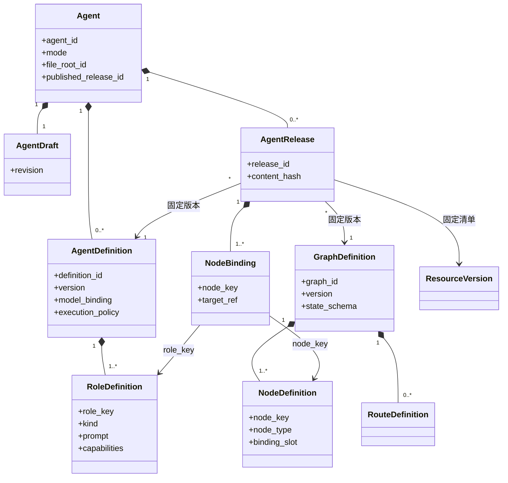
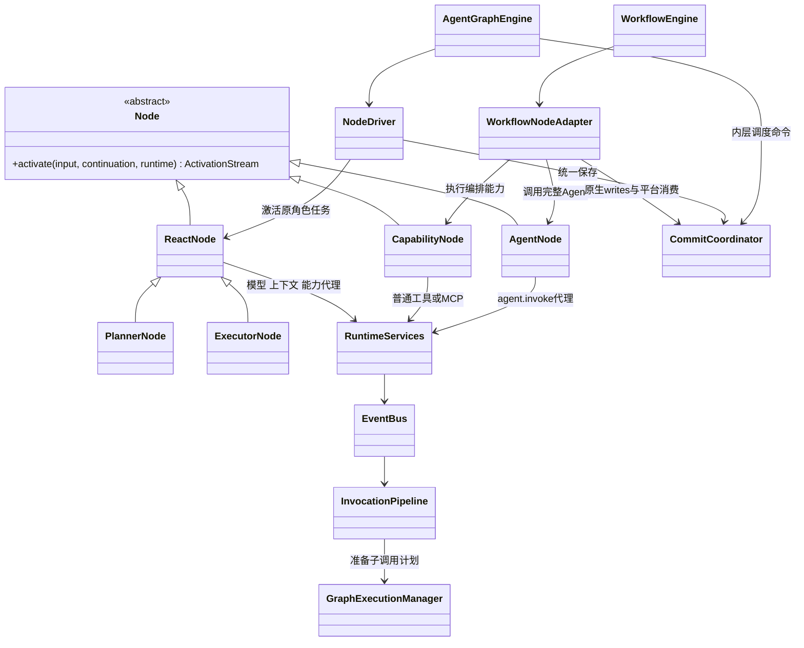
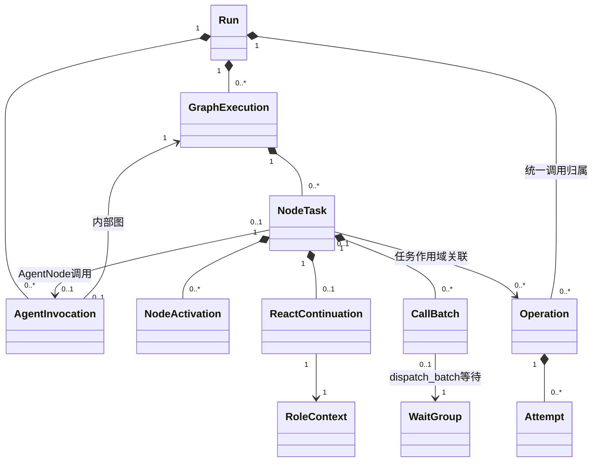
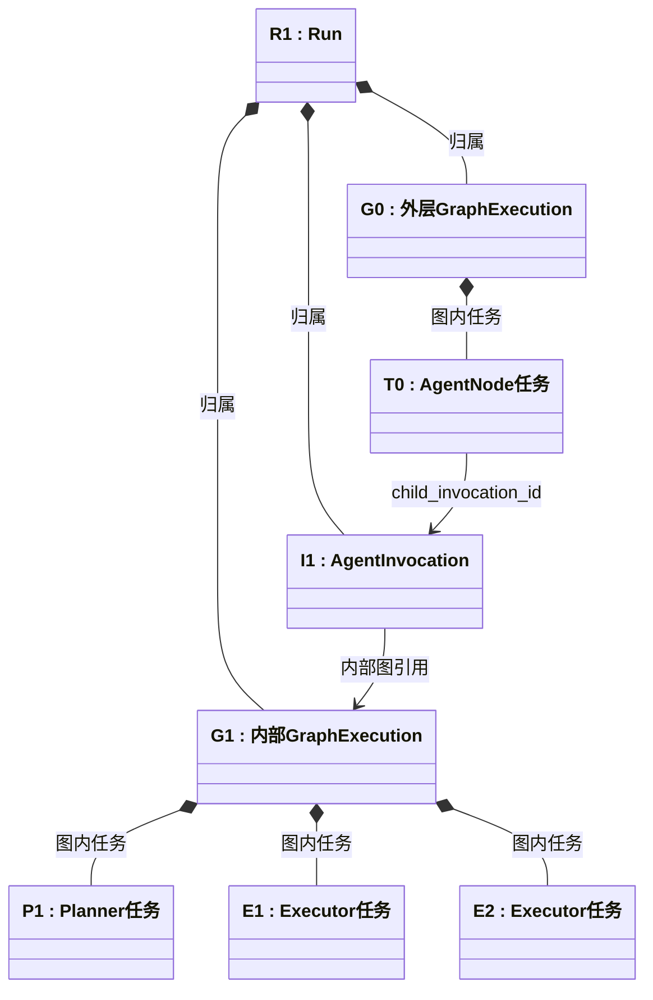

# 领域模型、Definition 与实例 UML

> **重建边界（2026-10-15）**：旧业务实现已移除。本页保留为待调整的设计草案；用户、应用、发布与配置版本属于平台，SDK 只接收已解析配置并负责执行与恢复。涉及平台身份、发布绑定及表结构的内容需按 [SDK / Platform 边界](sdk-platform-boundary.md)重新划分，不直接作为 SDK 的必填契约或已实现功能。

版本：SD-3，2026-10-15。**本轮推荐设计，供整体评审；旧运行代码已移除，本文等待按新交付边界实施。** 产品约束以 [Agent 设计约定](../agent-design-decisions.md)为准。本篇给出明确的对象和数量关系，替换此前将应用、角色执行及图实例混称 Agent 的 SD-2 草案。

[总览](overview.md) · [图与 Node](graph-node-engine.md) · [检查点](checkpoint-protocol.md) · [领域接口](domain-interfaces.md) · [数据结构](data-contracts.md)

## 1. 领域划分及事实归属

领域是职责边界，不要求拆成多个进程或微服务。

| 领域 | 负责的事实 | 对外操作 | 不拥有的事实 |
| --- | --- | --- | --- |
| 应用与发布 | Agent 身份、定义版本、角色、发布绑定；未来 Workflow 应用 | 创建、编辑、验证、发布、撤销、删除 | 图内任务实时进度 |
| 流程编排 | GraphDefinition、节点位置、端口、路由、状态合并及编译产物 | 校验图、编译、解析节点绑定 | 角色 Prompt、API Key、会话消息 |
| 运行执行 | Run、AgentInvocation、GraphExecution、NodeTask、额度、停止及接管 | 启动、输入、停止、查询、内部恢复 | 可随意修改的发布配置 |
| 能力资源 | 模型连接与元信息、Skill、Tool、MCP、Hook、Prompt 资源版本 | 导入、发现、引用、调用 | 图的后继调度真相 |
| 上下文 | 原始消息、有效修订、历史投影、摘要和输入投递 | 组装、更新、压缩、读取历史 | 图的就绪队列和工具副作用 |
| 执行环境 | Agent／Workflow 固定文件根、类型化 WorkspaceScope、沙箱、挂载和清理 | 准备、读写、运行脚本、撤销、清理 | 模型自行提供的权限边界 |
| 恢复与交付基础设施 | 统一持久化协议、租约、检查点、结果增量、outbox | 一致提交、装载、可靠唤醒、只读查询 | 自主决策、业务路由和用户 Hook 策略 |

EventBus 连接这些领域；它是通信基础设施。HookManager 处理有序拦截，ContextManager 校验有效修改并准备写集。公共调用管道和 NodeDriver 准备状态命令，由 CommitCoordinator 一致提交，不靠异步观察 Hook 补写。

## 2. 设计态：应用、行为、结构与绑定

### 对象身份

| 对象 | 身份及生命周期 | 内容 | 关系 |
| --- | --- | --- | --- |
| `Agent` | 稳定 `agent_id`；用户创建、删除 | 空间、名称、固定 mode、固定 file_root_id、当前发布指针 | 应用聚合根 |
| `AgentDraft` | Agent 的可编辑草稿，带 revision | 候选行为配置及资源选择 | 发布时生成不可变定义版本 |
| `AgentDefinition` | `definition_id + version`；版本不可变 | 模型、角色、执行／上下文／环境策略、Hook 绑定 | 属于 Agent；描述应用行为 |
| `RoleDefinition` | 定义版本内的 `role_key`；无独立生命周期 | Prompt、变量、输入输出、能力选择、角色职责 | AgentDefinition 内部组成 |
| `GraphDefinition` | 独立 `graph_id + version`；版本不可变 | 节点、端口、边、条件、分派、汇合、状态 schema | 编排领域的结构资产；可以被多份发布引用 |
| `NodeDefinition` | 图版本内的 `node_key`；不独立发布 | 节点类型、输入输出契约、绑定槽、允许路由 | GraphDefinition 内部组成 |
| `AgentRelease` | `release_id`；不可变发布包 | AgentDefinitionRef、GraphDefinitionRef、NodeBinding、资源清单与编译身份 | 把行为与结构组合成可执行应用 |
| `NodeBinding` | 发布包内的 `node_key`；无独立生命周期 | 指向 role_key、能力版本或被调用应用发布 | 将结构位置绑定到具体行为 |
| `ResourceVersion` | 独立资源身份及版本 | Skill、Tool、MCP、Hook、Prompt、模型元信息等 | 被引用；删除 Agent 只解除引用 |

`AgentDefinition` 与 `GraphDefinition` 是不同角度的描述，没有继承关系，也不互相包含全部配置。**发布包引用两者并保存绑定**，这才使某个节点位置具体执行某份角色或能力。

图中 `*--` 表示组成／生命周期归属，普通箭头表示引用；不表示每个框都必须有一张表。RoleDefinition、NodeDefinition 和 NodeBinding 可嵌入所属版本文档存储。

### 图从哪里来

- ReAct／Plan–Executor：`AgentGraphBuilder` 根据模式及角色槽生成 GraphDefinition，不让用户同时维护两套互相冲突的拓扑。
- 工作流：用户编辑结构，`WorkflowGraphBuilder` 验证并生成 GraphDefinition。
- 两类 Builder 输出同一种结构契约；GraphDefinition 是结构依据，原配置是生成式 Agent 图的编辑依据。生成结果固定于发布包，运行时不重新猜拓扑。
- 生成图记录 `origin=generated_agent`、来源定义版本和 builder_version；用户编排图记录 `origin=authored_workflow`。来源说明可编辑入口，不构成类型继承。
- 图按结构 hash 复用是优化，不能用 hash 代替业务身份。删除 Agent 可回收无引用的专属生成图；共享结构仍有引用时保留。

### 发布与编译

编译是 `GraphDefinition + NodeBinding + 类型注册表版本 + 资源清单 → CompiledGraph`。检查节点类型、绑定完整性、端口兼容、可达性、允许分派目标、Join 与 reducer、受控循环和引用权限。

CompiledGraph 是可重建的只读执行产物，不包含会话、运行进度、连接或 API Key。缓存键包括图版本 hash、绑定 hash、节点实现 ABI 和编译器版本；不能仅按 graph_id 缓存所有发布的行为绑定。

AgentRelease 固定定义和资源版本；发布新版本不修改旧发布对象。活动 Run 按既有发布停止流程收束，下一次直接 Agent 会话运行使用最新发布。未来 WorkflowRelease 固定引用具体 AgentRelease，不随其“最新版本”指针漂移。

## 3. Node 是类型、位置和任务三个不同对象

| 层次 | 对象 | 示例 |
| --- | --- | --- |
| 行为类型 | `ReactNode`／`PlannerNode`／`ExecutorNode` | 程序中的实现类 |
| 设计位置 | `NodeDefinition` | 图中 `research_executor` 位置及其输入契约 |
| 行为绑定 | `NodeBinding` | 该位置使用 `researcher` 角色配置 |
| 逻辑执行 | `NodeTask` | 本轮委派“检索数据库资料”的任务 T2 |
| 一次推进 | `NodeActivation` | T2 在当前 Worker 从保存位置向前执行 |
| 私有恢复状态 | `ReactContinuation` | T2 的 Loop 阶段、context_id、批次和当前调用 |

继承表达循环行为复用，不表示 Planner 应用包含 Executor 应用。Executor 是当前 Agent 内部的角色任务；外层 AgentNode 才把一个完整应用当作工作流节点使用。Node 是平台可执行协议，不代表两套引擎内部都使用同一 NodeDriver；WorkflowNodeAdapter 连接平台节点与原生任务，原生同步、快照经其所属适配器处理，详见[双引擎边界](dual-engine-integration.md)。

`ReactNode` 对外完成一项任务，内部可运行多轮 Loop。一次激活运行到 Progress／Wait／Complete／Fail 等协议边界；保存、退出进程、等待和重新激活都不改变 NodeTask 身份。NodeDriver 在公共安全点保存，不要求把模型、工具、压缩分别做成图节点。详见[节点与引擎协议](graph-node-engine.md)。

## 4. 运行态的唯一身份关系

| 对象 | 表达什么 | 何时新建／复用 |
| --- | --- | --- |
| `Run` | 一次顶层输入的完整执行树，共享额度、截止、停止与租约 | 新提问新建；故障接管复用 |
| `AgentInvocation` | 一次完整 AgentRelease 的调用，含内部图和所有角色 | 直接运行一次，或外层 AgentNode 每次新任务调用一次 |
| `GraphExecution` | 一份编译图的逻辑运行，拥有图状态及任务集合 | 顶层图或真正的嵌套图创建；Loop 不新建 |
| `NodeTask` | 一个节点位置接收一份输入后持续到终结的任务 | 新分派／工作流新访问创建；等待和恢复复用 |
| `NodeActivation` | 推进既有任务的一次执行尝试 | 调度／唤醒／故障重建时新增，记录 lease_epoch |
| `RoleContext` | 一个 React 类 NodeTask 的私有有效上下文 | 每个角色任务一份；历史从授权作用域投影进入 |
| `CallBatch`／`WaitGroup` | 模型调用集合／引擎等待与汇合条件 | 每次新批次创建；恢复复用固定成员 |
| `BranchMember` | 结构化 fork 的一条完整分支，作为 WaitGroup 成员变体 | 可顺序经过多项 NodeTask，出口或终止才结算，不等同入口任务 |
| `Operation`／`Attempt` | 逻辑能力请求／物理尝试 | 恢复复用 Operation；自动重试新增 Attempt |

Operation 归属 Run；任务作用域的 Operation 关联一个 NodeTask，graph／system 作用域可以不关联任务。CallBatch 关联一个 dispatch_batch WaitGroup；结构化分支的 branch_scope WaitGroup 不属于 CallBatch。每个 NodeTask 有且仅有所属 GraphExecution。已初始化的 AgentInvocation 与它的内部 GraphExecution 一对一；外层工作流 GraphExecution 没有所属 AgentInvocation，所以图的反向关联是 `0..1`。图不额外“拥有另一个 AgentExecution 调度器”。Run 可短暂处于尚未装配图的 queued 阶段，此时相应引用允许为空；启动完成后才要求根图存在。

**旧草案 `AgentExecution` 收敛为 React 类 NodeTask 的查询投影。** 原 `agent_execution_id` 对应 `node_task_id`，原 `phase/role_loop_index/context_id` 移入 ReactContinuation。不保留两个可独立更新的进度表。AgentInvocation 是新明确的整应用边界，不是给旧角色执行改个名字。

### 具体有多少实例

| 场景 | AgentInvocation | GraphExecution | NodeTask |
| --- | --- | --- | --- |
| 直接 ReAct，内部调用三次 MCP | 1 | 1 | 1 个 React 任务；MCP 是 Operation |
| 直接 Plan，Planner 同批两次委派同一 Executor | 1 | 1 | 1 个 Planner + 2 个 Executor |
| 上述 Planner 再 Loop 十次，未新委派 | 仍为 1 | 仍为 1 | 原三个任务；完成的 Executor 不重启 |
| 外层顺序 Tool → 一个 Plan Agent（两个 Executor）→ Tool | 1 | 2：外层工作流 + 内层 Agent | 外层 3 + 内层 3 |
| 外层并行调用两次相同 AgentRelease | 2 | 3：一个外层 + 两个内层 | 两个外层 AgentNode 任务，各自再有内部任务 |

表中不把临时 NodeActivation、模型调用和检查点算成图实例。图里同一节点的新工作流循环访问是新 NodeTask；Planner 的内部 Loop 或委派返回则继续原任务，不能混同这两个循环。

## 5. 外层工作流与内层 Agent

外层与内层共用 GraphDefinition、GraphExecution、NodeTask 的身份和引用规则，**底层明确采用 WorkflowEngine／AgentGraphEngine 两套实现**。GraphDefinition／编译产物／图实例固定 engine_kind；外层 NodeTask 通过稳定原生任务映射创建，不共享内层队列。Workflow 属于产品目标，本轮不实现外层编辑器、编排 API 或运行代码。外层源码迁移、两类现场与集中恢复的接口见[双引擎设计](dual-engine-integration.md)，下面实例数量和归属关系保持不变。

上图只表达一次嵌套调用的实例关系，框中是具体身份，连线不代表执行先后。P1、E1、E2 均属于 G1，Executor 不再创建子图；运行时序见[外层调用协议](domain-interfaces.md#62-外层-agentnode-调用)。

外层 AgentNode 保存 child_invocation_id／child_graph_execution_id，等待内层最终结果。内层已完成而外层尚未消费时，恢复读取原结果；绝不因为外层重新激活就创建第二个 AgentInvocation。

工作流的 AgentNode 不能把 Executor 角色误当独立已发布应用。普通 CapabilityNode 复用 ToolManager／MCP 处理器；一个工具不要求内层又套 Agent 或子图。通用任意 SubgraphNode 编辑接口仍可后置；当前 AgentNode 已明确必要的嵌套协议。

### 会话、预算和文件的外层约束

- 现有 `Session` 始终归属一个 Agent。未来 `WorkflowSession` 归属一个 Workflow；二者不混成一个多 Agent 会话实体。
- 子 AgentInvocation 默认只接收显式节点输入，不自动打开用户在该 Agent 的既有 Session，也不继承外层全部历史。需要历史时由受控 ConversationScope 显式绑定。
- Run 提供整树总额度与总截止。直接 Agent Run 使用该 Agent 策略；WorkflowRun 使用 Workflow 策略，内层 Agent 保留自己的上限作为额外约束，任何子调用不能重置根预算。不同完整 Agent 可以各自选择模型，内部 Executor 继续继承所属 Agent 的模型。
- 局部预算使用同一 LoopTicket 的 Invocation 归属投影，根和局部一次预占、一次结算，不建立两套可独立扣减的额度流水。局部额度／截止只收束对应 Invocation 并返回外层节点错误；根控制才收束整树。局部截止从 Invocation 创建提交起算，恢复沿用原值；直接 Agent Run 的策略只按根预算执行。
- Workflow 创建时获得自身固定文件根，供外层能力节点按 WorkflowSession 使用；无 Agent Session 的子调用在所属 Agent 根下按 invocation_id 分区。类型化 WorkspaceScope 的创建、租约和清理不依赖虚构会话，详细字段见[数据契约](data-contracts.md)。
- 同一 AgentInvocation 的 Planner、Executor 共享获准工作目录；不同 Agent 的固定文件根仍独立。外层通过显式 ArtifactRef／授权输入映射交接文件，不把别的 Agent 文件根整体挂入。
- 外层业务输入在哪些节点使用，由端口映射控制；不自动把补充广播给所有在途 Agent。默认补充排入外层下一安全点的输入增量，在途子调用不被倒改。详细用户交互属于工作流产品扩展，当前 Agent 的 Planner 补充规则不变。

## 6. 不同状态不能混成一份 messages

| 数据 | 权威所有者 | 读写边界 |
| --- | --- | --- |
| `GraphState` | 所属 GraphExecution | 节点通过 StateUpdate 提交；字段 reducer／Join 负责确定合并 |
| `ReactContinuation` | 所属 NodeTask | 公共 React 实现及 NodeDriver 维护阶段；业务工具不可改 |
| `RoleContext` 与有效修订 | ContextManager | 私有消息与 Hook 修改按 scope/version 提交 |
| `RuntimeContext` | 当前激活的装配器 | 可信身份、受限服务代理、取消和预算端口；不入模型和检查点正文 |
| `WorkspaceHandle` | 环境服务 | 解析授权视图；凭据及活挂载对象不序列化 |

Hook 修改角色上下文由 ContextManager 校验并准备写集，经 CommitCoordinator 一致提交后成为生效版本；GraphState 的并行合并在其明确提交边界发生。二者各有版本，不靠一个全局 messages reducer 混合所有角色。图状态可保存授权的结果引用，不能因此绕过私有上下文权限。

## 7. 版本、删除和实例生命周期

1. 草稿编辑采用 expected_revision；发布生成不可变定义、结构、绑定和资源引用，再原子切换当前发布。
2. Run 固定 release_id／compiled_hash／节点 ABI。恢复验证兼容版本，不读取最新草稿补齐旧现场。
3. Node 实现对象可以缓存为无状态对象；NodeActivation 的服务句柄由 Worker 重建。角色可变数据只进入 NodeTask／Context，不挂在共享 Node 对象上。
4. Agent 删除先停止所有包含它的根 Run，再删除其专属 Session、Invocation、角色消息、运行材料及文件；共享资源只解除引用。
5. 若未来工作流引用被删除 Agent，其发布标不可启动；不悄悄改绑其他版本。工作流自己的结构及不含 Agent 私有内容的审计保留，Agent 专属内容删除或移除可读引用。发布依赖清单用于发现这些引用。
6. GraphDefinition／资源仍被有效发布引用时不能直接删除；先显式撤销引用发布。无引用的生成结构可回收；不使历史查询假装还能调用已撤销资源。

## 8. 从源码借鉴了什么

核对本地 `/Users/bmilk/code/project/langgraph`，工作区干净，commit `afbe7e48b17f62e139b5c6337ab934549e6dc73b`。以下链接固定源码快照；AgentLoom 对象和接口为本轮设计，并非 LangGraph 原生同名类。

| 源码证据 | 本设计采用 | 有意不同 |
| --- | --- | --- |
| [StateGraph 与 compile](https://github.com/langchain-ai/langgraph/blob/afbe7e48b17f62e139b5c6337ab934549e6dc73b/libs/langgraph/langgraph/graph/state.py#L131) | 定义与可执行编译产物分开；状态 schema 与节点结构明确 | 增加 AgentDefinition／发布绑定的产品领域模型 |
| [StateNodeSpec](https://github.com/langchain-ai/langgraph/blob/afbe7e48b17f62e139b5c6337ab934549e6dc73b/libs/langgraph/langgraph/graph/_node.py#L91) | 节点描述与执行逻辑分开 | 不把 Python callable 序列化为用户配置；使用类型注册表和 ABI |
| [PregelTask／StateSnapshot／Send](https://github.com/langchain-ai/langgraph/blob/afbe7e48b17f62e139b5c6337ab934549e6dc73b/libs/langgraph/langgraph/types.py#L665) | 任务实例区别于节点类型；同节点可接收多份专属输入 | React 完整任务有显式 continuation，Executor 委派返回原 Planner |
| [Runtime](https://github.com/langchain-ai/langgraph/blob/afbe7e48b17f62e139b5c6337ab934549e6dc73b/libs/langgraph/langgraph/runtime.py#L129) | 运行时依赖与持久状态分开 | 保留 AgentLoom EventBus、Hook、预算和环境端口 |

本设计当前尚未迁移源码或引入 LangGraph 运行依赖；外层已明确采用后续源码复制与适配方向，不预先承诺 API／快照二进制兼容。Agent 内部继续遵守[任务与批次协议](graph-node-engine.md)，外层调度和检查点字段需按适配后的内核语义重新映射，见[决策补充](architecture-discussion.md#6-workflow-产品范围与-langgraph-源码适配)。
