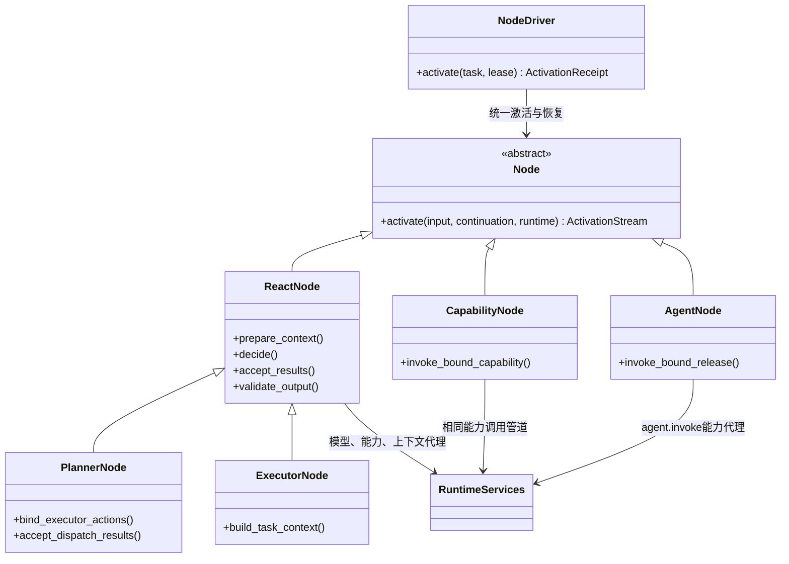
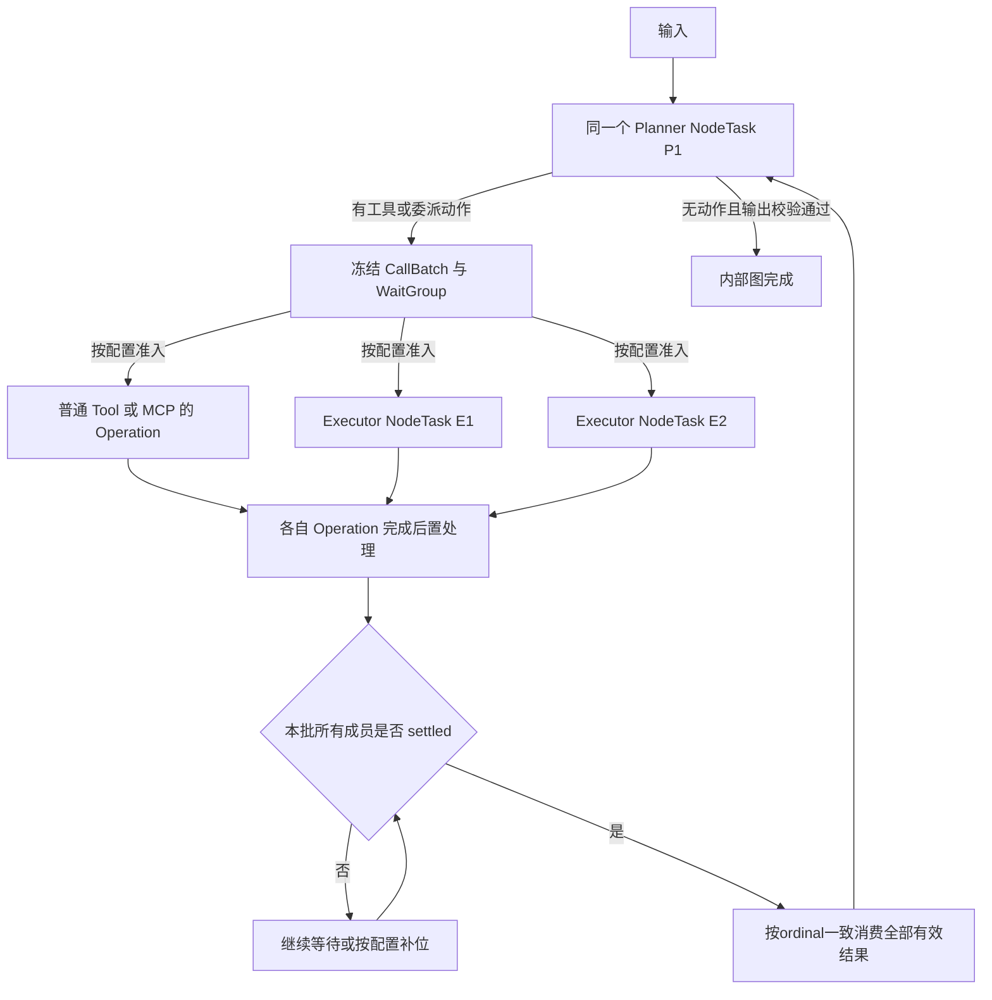
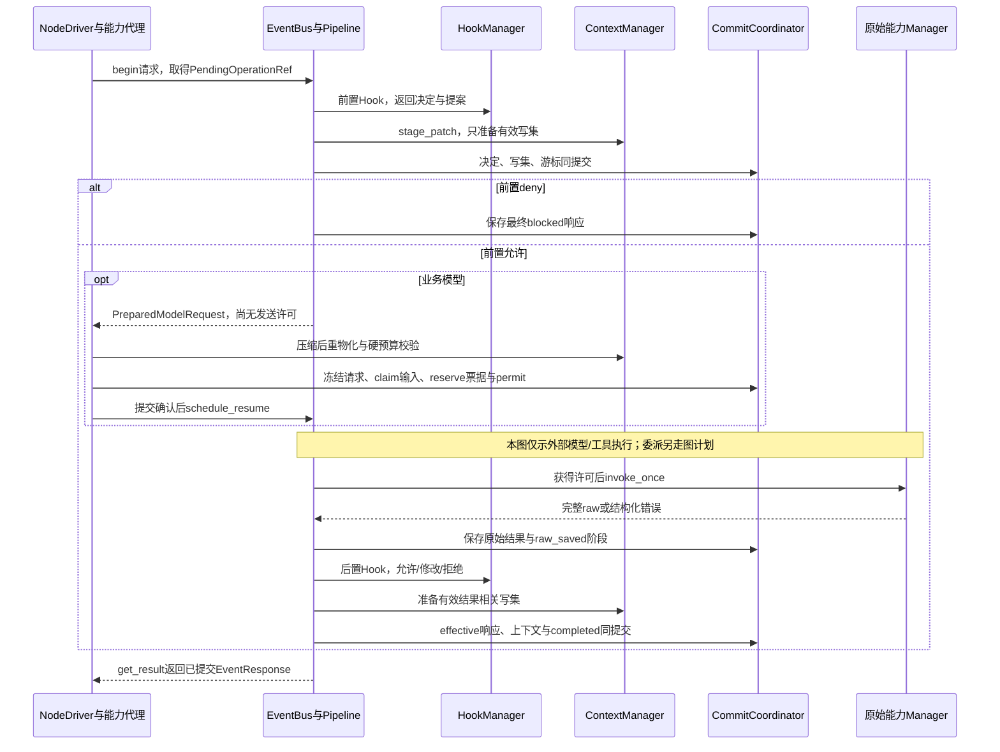
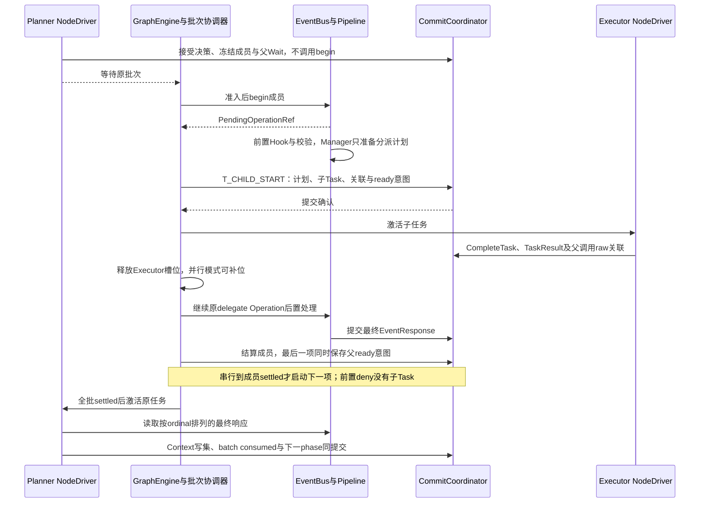
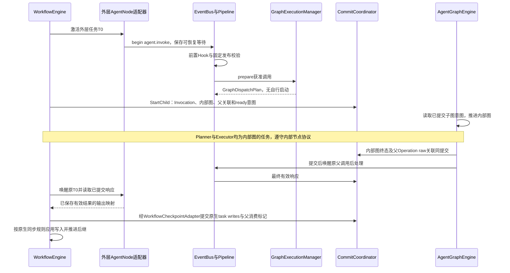

# 图、节点与执行引擎设计

> **重建边界（2026-10-15）**：旧业务实现已移除。本页保留为待调整的设计草案；用户、应用、发布与配置版本属于平台，SDK 只接收已解析配置并负责执行与恢复。涉及平台身份、发布绑定及表结构的内容需按 [SDK / Platform 边界](sdk-platform-boundary.md)重新划分，不直接作为 SDK 的必填契约或已实现功能。

**实施细则：[runtime-graph](implementation/runtime-graph.md)**。本页保留架构解释；具体方法、字段状态、事务和恢复分支见实施规格。

更新日期：2026-10-15。状态：架构设计方案；不表示已实现。本文定义 Agent 内部图与外层 Workflow 的领域模型、节点协议和调用边界。**外层状态、同步及检查点现计划复制并适配 LangGraph 源码；第 7.3–7.6 节的外层自研算法保留作对照，不再是外层最终编码指令。** 具体影响见[源码适配决策](architecture-discussion.md#6-workflow-产品范围与-langgraph-源码适配)。本轮不实现外层代码。

## 1. 设计结论

**采用两套引擎：AgentGraphEngine 负责内层 Agent，WorkflowEngine 负责外层编排。** 多份 GraphDefinition／GraphExecution 共用领域身份和运行控制，每个图固定 engine_kind，只允许所属内核推进。文中的 GraphEngine 是公共端口或图引擎泛称；内部 ready／wait／动作批次算法具体归 AgentGraphEngine，不能把它当作外层 Pregel 调度器。完整边界与调用、检查点适配见[双引擎设计](dual-engine-integration.md)。

- ReAct：内部图包含一个 ReactNode，节点内部执行多轮模型—动作循环。
- Plan–Executor：内部图包含一个 PlannerNode 及多个 ExecutorNode 定义；Planner 与 Executor 都继承 ReactNode。
- 工作流：图可以编排 AgentNode、CapabilityNode、条件、循环和汇合；AgentNode 调用完整 AgentRelease，才产生被调用 Agent 的内部图。
- GraphDefinition 描述执行组织；AgentDefinition 描述角色行为与资源配置；AgentRelease 用 NodeBinding 将二者组合为可运行发布。
- 普通工具、MCP、Skill 阅读和脚本调用在 ReactNode 内只产生 Operation。只有用户明确把某能力编排为工作流步骤时，才出现 CapabilityNode。

LLM 的计划文本不是 GraphDefinition，工具清单也不是图节点清单。LLM 可以选择已授权执行器并生成任务参数，不能凭输出修改已发布图结构或增加授权。

内层的“Planner → Tool／MCP／Executor → Join → Planner”是循环行为；Tool／MCP 是 Operation，Join 是批次结算，Replan 是原 Planner 的下一次决策，不据此额外建立工具节点或强制模型节点。外层用户显式编排的 CapabilityNode 则是真实工作流位置。[行为图](dual-engine-integration.md#2-内层-planexecutor-的循环)与实现类、运行身份分别表达。

## 2. 定义、实现、运行身份分别是什么

| 层次 | 对象 | 身份与生命周期 |
| --- | --- | --- |
| 应用 | Agent | 用户管理的应用、文件根与会话归属 |
| 行为定义 | AgentDefinition / RoleDefinition | 前者独立版本；角色是该版本内部组成部分 |
| 流程定义 | GraphDefinition / NodeDefinition | 前者独立版本；节点是图内组成部分，不独立发布 |
| 发布绑定 | AgentRelease / NodeBinding | 固定两类定义版本、角色或能力绑定、资源及策略快照 |
| 执行实现 | Node / ReactNode 等 | 服务端注册的实现类；可重建，不承担业务身份 |
| 图运行 | GraphExecution | 某张已编译图的一次运行，有独立图状态及检查点作用域 |
| 节点逻辑任务 | NodeTask | 一次带特定输入的节点任务；等待、循环、恢复沿用身份 |
| 节点推进 | NodeActivation | 对 NodeTask 的一次内存推进，可因等待或机器切换重新创建 |
| Agent 调用 | AgentInvocation | 一次完整 Agent 应用调用，关联内部图及所有角色任务 |
| 用户请求 | Run | 用户顶层执行，统一终态、控制、截止时间和预算归属 |

**NodeDefinition 不是 Python Node 对象，NodeTask 也不是 Python asyncio.Task。** 前两者能够持久化；实现对象及 asyncio 对象由定义和现场重新装配。

普通工作流回边再次进入已完成节点时，创建新的 NodeTask；这代表新一轮业务步骤。ReactNode 自身 Loop、Planner 等待委派结果后继续，以及故障恢复，继续原 NodeTask。两种“循环”不能通过一个含糊的节点 ID 混用。

## 3. GraphDefinition 的结构

建议最小结构如下；版本身份、通用值类型及约束与[领域模型](domain-model.md)、[数据契约](data-contracts.md)统一。

| 字段 | 含义 |
| --- | --- |
| graph_id / version | 独立定义及不可变版本 |
| input_schema / output_schema | 图边界输入与输出格式 |
| state_schema | 共享业务状态字段、字段类型和合并规则 |
| nodes | 图内 NodeDefinition，按 node_key 唯一 |
| entrypoints / exits | 入口及允许终结的位置 |
| edges | 正常完成后的静态后继 |
| conditional_routes | 条件选择器及允许目标，不执行任意用户代码字符串 |
| dispatch_rules | 允许的动态分派目标、任务输入映射、结果返回约束 |
| join_definitions | 汇合范围、成员识别、错误交付及合并规则；外层 branch_scope 明确 fork_route_key、region_node_keys、branch_exit_routes |
| loops | 单入口循环的 loop_key、header_node_key、body_node_keys、back_route_keys、exit_route_keys；与 ReactNode 内部 Loop 分开 |
| graph_limits | 图级调度保护，如最大调度推进次数；不能代替 Agent Loop 额度 |

`NodeDefinition` 建议包含 `node_key、node_type、input_schema、output_schema、local_state_schema、read_set、write_set、allowed_routes`。这些字段描述执行位置及契约；Prompt、模型 Key、Skill 授权不复制到节点定义中。

`NodeBinding` 按位置绑定以下之一：

| node_type | 绑定对象 | 约束 |
| --- | --- | --- |
| react / planner / executor | AgentDefinition 中的 role_key | 角色类型与位置匹配；同一发布内模型按继承规则确定 |
| capability | 已固定版本的 CapabilityBinding | 函数工具、MCP、脚本等统一能力描述与输入输出映射 |
| agent | 完整 AgentRelease 的固定引用 | 必须通过该应用的调用授权及输入校验 |

未来 WorkflowRelease 固定 GraphDefinition 与 NodeBinding，并固定引用的 AgentRelease／能力版本；它不伪装成 AgentDefinition。外层产品入口后置，但发布身份、绑定和图运行协议采用本文与领域模型的同一契约。本轮不开放任意 `SubgraphNode`，也不把任意图变成可调用 Agent。

## 4. 节点实现继承关系



继承表达共同 Loop 行为，资源访问通过组合的 RuntimeServices 提供。ExecutorNode 的多个实例使用同一实现和定义，但不能共享可变 messages、continuation 或 asyncio Future。

Node 实现应保持可重入，所有任务私有状态放入 continuation。不能将某个任务的输入保存在复用的 Node 对象字段上。角色资源目录、编译后 schema 等不可变对象可以缓存。

`LLMNode`、`HttpNode`、`FunctionNode` 暂不需要形成独立继承体系：一次能力调用可由 CapabilityNode 绑定对应适配器完成。将来只有行为契约不同、无法通过适配器表达时才增加节点类型。

## 5. 可恢复激活协议

ReactNode 的一次逻辑任务允许执行多轮 Loop。引擎不要求每次模型调用都新建图节点，也不能只等整段 Python 函数结束才知道进度。

建议 `activate()` 返回 `ActivationStream[NodeOutcome]`，其中 NodeOutcome 为 Progress／Wait／Complete／Fail；这是内部推进信号流，不是模型 token 流。公共 ReactNode 实现产生安全点；统一 NodeDriver 提交后确认，随后节点才继续下一阶段。业务插件不直接调用数据库或 CheckpointStore。

| 信号 | 意义 | Driver 行为 |
| --- | --- | --- |
| Progress | 阶段已推进，携带新的 continuation、关联 Operation 或上下文版本 | 持久化并确认；继续当前激活，不触发完成边 |
| Wait | 任务等待已声明的条件，附 wait_ref 及必要的分派意图 | 一致保存等待、持久 resume_input_ref 及子任务意图，释放本次激活；条件满足后激活原任务 |
| Complete | 节点逻辑任务最终成功，附输出及图状态更新 | 保存最终结果与后继调度意图；任务不可再次执行业务 |
| Fail | 节点逻辑任务最终失败，附规范错误及可用部分结果引用 | 保存失败；交给明确的图错误路由、父批次或 Run 终结策略 |

此处是内部技术恢复协议，**不是向用户增加暂停／恢复按钮**。用户仍只有补充说明和停止。

`Progress` 的持久化确认可以通过公共 Driver 封装的异步生成器推进实现，也可以由内部 continuation runner 实现；两种实现都必须满足“提交成功后才推进”。不能因为使用 `yield` 就假定检查点已经保存。

`ReactContinuation` 至少表达：逻辑 phase、所属 context_id 及有效 revision、当前模型 operation_id、loop ticket、已接受决策、待结算 batch_id、输出校验反馈。phase 统一为 prepare_context／prepare_model／compact_context／call_model／interpret_response／wait_batch／consume_results／validate_output／completed；失败或取消以 NodeTask.status 表达。它属于 NodeTask，不是另一套拥有 ready queue 的 AgentExecution。

模型／工具 Operation 的细粒度保存由统一调用边界负责。NodeDriver 的 Progress 只记录“节点消费到哪一步及引用哪些事实”；二者不会各保存一份互相覆盖的工具结果正文。

恢复时重新创建 NodeActivation，将保存的 continuation 交给同一节点类型：已完成模型调用读取已提交结果，已结算工具成员不再执行，已接受批次不重新分派。不能以重放任意 Python 调用栈代替此协议。

## 6. 一张 Plan 图怎样循环

下图回到 P1 的路径表示整批结果消费后继续同一个等待中的 Planner 任务；其 NodeTask 身份和上下文保持不变。



两次检索引用同一个 ExecutorNodeDefinition，只产生两个 NodeTask。**此例是一份内部 GraphExecution、三个 NodeTask；不是三份图。** 普通工具 Operation 不计入图实例数，也不创建角色上下文。

| 场景 | AgentInvocation | GraphExecution | NodeTask |
| --- | --- | --- | --- |
| 直接调用 ReAct Agent | 1 | 1 内部图 | 1 React 任务 |
| 直接调用 Plan Agent，本批委派两次 | 1 | 1 内部图 | 1 Planner + 2 Executor |
| 同一 Planner 又委派一批两次 | 仍为 1 | 仍为 1 | 原 Planner 保留，增加 2 个新 Executor 任务 |
| 外层工作流调用一个 ReAct Agent | 1 被调用 Agent | 1 外层 + 1 内部 | 外层 AgentNode 任务 + 内部 React 任务 |
| 外层同时调用两次同一 Plan Agent，各委派两次 | 2 被调用 Agent | 1 外层 + 2 内部 | 2 外层 AgentNode 任务；每份内部图各 3 个角色任务 |

GraphExecution 是逻辑身份。换机器、重建 Python 对象、继续下一 Loop 均不增加图实例数。重新发起独立任务或再次走到已经完成的工作流步骤，才增加对应任务／调用身份。

## 7. 调度、状态与汇合

### 7.1 唯一调度器

AgentGraphEngine 持有内层可恢复的 ready 集合、任务状态、wait 集合和汇合关系。NodeDriver 是它的执行组件；Executor Manager 只是委派入口适配器。它们不得各自维护一套独立的子 Agent 调度与恢复事实。WorkflowEngine 单独拥有外层原生调度事实；RunRuntime 只按类型装配和控制，不把外层任务合入内层 ready 集合。

执行在单机 asyncio 环境中。一个 Run 同时只有一个拥有租约的 Runtime；换机接管需要恢复现场并替换租约。这里不设计一张运行图同时分片到多台机器，也不把 EventBus 当成跨机工作队列。

外层可运行另一份 GraphExecution，但应通过同一调度服务推进；父 AgentNode 等待内部图时释放推进资源。Wait 释放 NodeActivation／Driver 的 worker，不释放仍活跃的 Executor 配额。Executor 从启动起占对应 Agent 的 executor_max_parallel 名额；其 NodeTask 终态、TaskResult／TaskWrite 同事务持久化时释放名额，父委派 Operation 的结果 Hook 尚未完成也不继续占执行名额。恢复按已提交的非终态 Executor 任务重建占用，不按尚未 settled 的批次成员计数。Planner 和外层 AgentNode 不占该 Executor 名额。不能让父任务占住所有 worker 或并发令牌，再等待拿不到令牌的子图，造成死锁。

### 7.2 共享图状态不等于全部 Agent 对话

| 状态 | 保存内容 | 更新所有者 |
| --- | --- | --- |
| GraphState | 图内业务字段，例如输入材料、阶段产物、汇总结果 | 引擎按声明的字段 reducer 和版本提交 |
| ReactContinuation | 节点 Loop 阶段与引用 | 公共节点协议，经 NodeDriver 提交 |
| EffectiveContext | 所属角色的消息、Hook 修改、压缩快照及有效视图 | ContextManager |
| Operation | 某次模型／工具调用意图、尝试、raw／有效结果和 Hook 进度 | 持久化调用管道 |
| RunControl | 额度、截止、停止、执行拥有者 | RunRuntime |

不能把所有角色 messages 放进一个默认共享字段，再依靠 Prompt 要求 Executor 不读取别人的上下文。图状态输入映射只暴露绑定允许的数据；角色上下文需要显式引用及权限。

Hook 的有效修改由 ContextManager 准备带 revision 的写集，经 CommitCoordinator 提交，当前处理器、后续模型调用和恢复都能看到。它不意味着 Hook 可以任意修改图调度字段；图状态变更仍需声明写集并经过引擎校验。

### 7.3 动作批次与外层分支等待

内部 Agent 的 dispatch_batch 协议继续有效。下文 branch_scope 是旧自研外层候选：曾用同一 WaitGroup 表达多步骤分支；迁移 LangGraph 后是否保留该内部结构需重新映射，不强制上游同步机制迁就它。无论采用什么实现，一个中间节点完成都不能被误报为整条业务分支完成。

| member_scope | 一个成员代表什么 | 什么时候结算 |
| --- | --- | --- |
| dispatch_batch | 一次普通能力、Executor 委派或完整 Agent 调用 | 唯一最终 EventResponse 已提交；委派的子结果还需经过父调用结果 Hook |
| branch_scope | 从 fork 选中入口到配对 Join 出口的一整条分支，可包含 A1 → A2 等多个任务 | 到达已声明分支出口、无错误路由的失败或控制取消；中间节点完成只移交分支 cursor |

每次动作分派先固定 `dispatch_id、parent_task_id、member_id、ordinal、target_node_key、input_ref`。成员身份先冻结，按串行／并行准入规则才为待启动成员调用 begin 并取得 PendingOperationRef；排队成员不要求立即拥有已运行的 Operation 或 NodeTask。相同节点可以出现多次，汇合按成员身份而非 node_key 统计。动作批次中普通能力、Executor、完整 Agent 调用的 target_ref 分别为 operation／node_task／child_graph。

外层分支继续使用 WaitMember，member_id 即分支身份；其 branch_data 保存 `entry_node_key、cursor_task_id、next_task_sequence、view_write_ids、terminal_reason`，target_ref／result_operation_id 为空。它是同一 WaitGroup 的结构化成员现场，不另建分支执行器或一个重复的 branch 目标实体。普通工作流分支无须创建父委派 Operation；CapabilityNode／AgentNode 内部各自仍遵循能力调用协议。

- Join 的等待范围是本次冻结成员集合，不能等待全图空闲，也不能只按 node_key 统计前驱。
- 分派意图、父等待、稳定恢复键通过同一提交登记；提交后才激活任务，不能先运行再补写等待。
- 普通失败仍结算当前成员，其他成员继续；全部成员结束后按 ordinal 交付完整成功／失败／跳过／取消结果。
- 用户停止、全 Run 超时或总额度耗尽属于控制终结，统一关闭新工作并收束全部活跃任务。
- Fork 的条件选择发生在冻结集合之前；未选择入口不加入集合。已经选中的分支若随后条件直接选中分支出口，明确结算 skipped，不能保持一个永远无任务的 active 成员。
- 成功结果、失败结果、路由选择及消费标记均持久化；恢复不重跑已经完成的任务。

当前 Agent 并行默认关闭；关闭时同一批普通工具与 Executor 按顺序执行，**当前成员的最终 EventResponse 及 settled 已提交后才准入下一成员**。开启后，Executor 活跃数受每 Agent 的 executor_max_parallel 限制，默认 2；Executor NodeTask 终态即可释放名额补位，但该成员仍需等待父结果 Hook。Planner 等整个批次 settled。普通工具没有 Executor 名额。

### 7.4 外层流程的编译边界与循环身份

本节至第 7.6 节描述**旧自研结构化流程候选**，用于源码适配时比较边界，不是要求迁移内核继续遵守这些特定区域限制。Workflow 的顺序、条件、循环、并行和汇合目标已确定；具体可编译拓扑由适配验证给出。外层并发策略独立配置，内部 Agent 的并行开关不因外层 fork 被绕过；图仍按固定发布定义执行。

| 结构 | 旧自研候选的形状与要求（待迁移映射） |
| --- | --- |
| 串行／条件 | 一个任务完成后至多选择一个普通后继；条件选择器版本固定、可选路由可枚举且含默认出口；合并互斥条件路径不是并行 Join |
| fork／Join | 显式 fork 路由与一个配对 Join；每个选中入口建立一个 branch 成员；成员内各时刻至多一个待推进 cursor，可顺序经过多个节点 |
| 循环 | 显式单入口 loop，声明 body、header、back／exit routes；可嵌套单入口 loop；回边不得绕过尚未完成的 Join |
| fork 与循环组合 | loop 可以包围完整 fork／Join；单个 branch 内可以有串行循环，但该循环不能跨出该分支；循环退出后继续原成员 |
| 当前不支持 | 未汇合 branch 内再次 fork、交叉／多出口 Join、从分支逃逸到区域外、跨分支跳转、跨区域回边、隐式多入口并发、无配对 Join 的 fan-out |

这些限制来自旧自研候选，不直接作为 Workflow 的产品限制；迁移后的支持范围必须另行明确。不支持的结构仍须在发布时给出带 route/node 定位的诊断，不能放行后依赖运行时超时。内部 Agent 的动作批次有自己的等待作用域，不套用外层拓扑限制。

`JoinDefinition.member_scope=branch_scope` 保存 `fork_route_key、region_node_keys、branch_exit_routes`。fork_route_key 引用 `kind=fork、completion_policy=activate_branches` 的路由；branch_exit_routes 引用 `kind=branch_exit、targets=[]、completion_policy=close_branch` 的出口路由，Join 本身不是需要额外执行的业务 NodeTask。普通／条件路由仍为 activate_target，Planner 的 dispatch 为 return_to_owner。

JoinDefinition 使用 `success_target_node_key`／`error_target_node_key` 和各自 input_mapping 指定归并后继，不借用一个不存在的 Join Node 作为普通边的 source。目标非空时，归并事务直接登记对应后继 NodeTask；成功目标为空须符合图 finish_rule，错误目标为空则图失败。成员失败已纳入 all_settled 结果但归并本身成功时仍走成功后继，让业务节点读取完整成员结果后决策；只有归并冲突／reducer错误走错误后继。目标必须处于 fork 所属的包围循环层级，不能直接跨越循环边界；需要回边时先到判断节点，再走其声明的循环路由。

编译器固定一个完成位置的路由选择规则，可由条件选择声明的 branch_exit；选择结果 `{route_key,selected_target?}` 与任务完成一起保存，不能等恢复时再读取新状态重新选择。它只允许一个普通后继或一个分支出口，不能两者同时发生。编译时检查入口在区域内，分支只从声明出口到 Join，fork 与 Join 配对，loop 的入口／回边／出口正确嵌套；去掉声明回边后无残留环；任何允许路径都有可达出口，动态条件另受 graph_limits 上限约束。错误路由只能继续同一分支中的一个合法后继，或关闭该成员，不改变其他成员集合。

每次进入 fork，分配新的 wait_id／dispatch_id，按 `(graph_execution_id, fork_route_key)` 原子递增 generation，并冻结当时的 loop_path。同一 fork 在循环下一次迭代必须新建等待集合；故障恢复沿用原身份和 generation。即使目标节点名称与任务输入相同，也不与前一批合并。

`loop_path` 是从外到内的 `LoopFrame{loop_key,loop_instance_id,iteration}` 数组。进入循环生成系统身份、iteration=0；声明回边提交 iteration+1 与新 header NodeTask，退出路由弹出该 frame；嵌套循环的每次重新进入创建新的 instance_id。它们与路由决定同事务保存，重放通知不再递增。NodeTask 的 loop_path 是调度时冻结的值；ReactNode 内部 Loop 不增改这些工作流 frame。

普通节点移交分支时，新任务带同一 `branch_ref={wait_id,member_id,task_sequence}`，其中 task_sequence 单调递增。节点完成事务同时提交该节点终态、写入、路由选择、新 cursor 及新任务意图；仅在选中明确 branch_exit_route 时关闭成员。A1 的 TaskResult 不是整条 A1 → A2 分支的 TaskResult。分支失败且无合法错误后继则以 failed 关闭；停止时取消未启动 cursor，等待已经运行的任务停止写入后才以 cancelled 关闭。成员关闭后不得再附加后继。

### 7.5 分支读取视图、TaskWrite 与合并

本节保留旧自研候选的分支内顺序视图和显式 Join 规则。它与 LangGraph 的 channel／super-step 状态可见性不同，外层迁移时必须选择并验证一致的规则，不能混合套用。模型／工具 raw 结果及角色 ContextMutation 的平台协议继续单独管理。

Fork 冻结公共 GraphState 的 base_state_revision。每个分支的有效视图为：**该基线 + 此成员此前已提交的有序 TaskWrite**。它不读取同批兄弟分支尚未归并的写入。NodeTask 的 `input_state_view={base_state_revision,write_ids[]}` 固定该任务能读的完整前缀，write_id 均引用不可变内容；节点输入映射在该视图上执行，不在恢复时重新读取“最新 GraphState”。

任务完成时，TaskResult、TaskWrite 与成员 view_write_ids／cursor 一致提交。下游任务拿到包含其前驱写入的新视图。因此 A2 能读取 A1 的 x，B1 读到的仍是 fork 基线 x。已失败任务不提交新的业务 TaskWrite；该分支此前成功节点的写入仍保留，Join 不伪装撤销已经发生的产出或文件副作用。若需要排除失败分支的产出，由 Join 后业务节点依据各成员结束状态显式处理。

Join 在全部 branch 成员关闭后，按 `(member.ordinal, task_sequence, write_ordinal)` 合并每个原始 TaskWrite，**不再追加一份已折叠 overlay 的完整快照**。串行同字段更新在分支内按任务顺序应用；跨分支的合并规则如下：

| 合并方式 | 规则 |
| --- | --- |
| single_writer 字段 | 一个 Join 范围只能有一个成员写该字段；同成员的多个顺序节点可以依次更新；多个成员写则明确冲突 |
| reducer 字段 | 版本固定的纯函数，按上述稳定顺序应用原始增量；不得要求按完成先后执行 |
| 集合／列表累计 | 每个 write_id 在该 Join 的归并中只应用一次；成员内物化视图不算公共状态归并，不能重复追加 |
| 分支输入 | 专属参数独立；授权映射决定可读哪些字段，不把全部私有消息放进 GraphState |

同一 GraphExecution 在 open fork 期间，公共状态的写入由该配对 Join 归并，外部请求不得绕过它修改同一 GraphState；控制状态、角色上下文和其他图各自推进。Join 提交前验证基准 revision；不符说明契约冲突，明确失败而非静默换基线。没有 open fork 时，串行节点的写入与后继输入视图同事务提交为新公共 revision。

成员结果、归并失败和后继路由都是显式事实。reducer／写集冲突时保存唯一 Join 失败结果，不生成成功后继；按已声明错误路由继续或终结图。归并按 wait_id／generation 幂等，快照只保存已物化水位。共享工作文件不在这个 reducer 范围内，文件工具仍需处理并发写冲突。

### 7.6 可核对的执行例子

```text
loop L，iteration=0
  fork F → W7 / generation=7 / base state v10
    member M0: A1(task_sequence=0) → A2(task_sequence=1) → join J
    member M1: B1(task_sequence=0) ----------------------→ join J
  J → 判断 → 回边 L（iteration=1）→ F → 新 W8 / generation=8
```

1. A1 产生写入 WA1：同一提交保存 A1 终态、M0 的写前缀、A2 输入视图 `(v10,[WA1])` 与 cursor；M0 仍 active。
2. B1 完成并从声明出口关闭 M1。W7 仍等待 M0，不因 A1、B1 都完成而提前归并。
3. A2 的条件若跳过后续节点，直接选中声明出口，关闭 M0；未执行节点不创建 NodeTask。它自己的成功写入 WA2（若有）已加入 M0 前缀；skipped 不删除 WA1。
4. 全部成员关闭后，唯一归并意图应用 M0 的 WA1、WA2，再应用 M1 的 WB1；保存 v11、消费记录和 J 后任务意图。失败成员仍包含具体错误及已完成任务引用。
5. 若 A1 提交后宕机，恢复 A2 及原输入视图，不重跑 A1；若 Join 提交后宕机，恢复 v11 与下一意图，不重复 reducer。下一迭代的新 W8 不接受 W7 迟到成员结果。

外层已改为 LangGraph 源码适配方向；上述示例的分支视图、合并时机与排序须随适配结果重新定稿。稳定身份、已完成结果不重跑及不重复应用更新仍是验收目标，不能仅替换类名就宣称支持上游语义。

## 8. 工具、MCP、Skill 与 EventBus 的位置

普通同步观感的调用使用 `request = begin + await_result`。`InvocationPort.begin(request, scope)` 返回持久 `PendingOperationRef`，即使前置 Hook 立即拒绝也返回可查询终态的引用；它不是业务最终结果，不包含 Python Future。`get_result(ref)`／`await_result(ref)` 最终取得唯一 EventResponse。

委派 begin 先保存 prepared 意图和持久引用；没有提交关联的父等待之前，目标 Executor 不进入可激活集合。父进程在 begin 后宕机时，按已冻结成员和 purpose_key 取回原引用，不能再新建一次委派。

Planner 的委派使用可恢复路径：先冻结整批成员，按准入规则 begin 当前可启动项，将已取得引用、未启动成员及 WaitGroup 一致保存，然后产生 Wait。GraphEngine 负责后续启动和补位；完成后唤醒原 Planner，由 consume_results 阶段读取最终 EventResponse。不能先把“已创建 Executor”当作工具最终结果交给模型，再另发第二个最终响应。



Skill 是文件与指令资源，读取走文件能力；脚本执行走环境执行能力；MCP 走对应协议适配器。它们进入相同调用管道，拥有 Operation，不因名称不同生成图实例。

前置 Hook 合法拒绝不执行能力；结果阶段拒绝保留实际副作用，阻止有效结果继续交付。Hook 自身异常按 fail-open 继续。完成事件只用于通知，图继续运行必须依据已提交状态，不依赖事件是否被观察者收到。

模型连接内部接收流式片段，组装完整响应后经过结果 Hook 一次交付。GraphEngine 不依据某个 token、`finish_reason` 或模型声称“完成”直接结束 Run；节点输出校验及顶层终态提交后才完成。



## 9. 外层图与内层 Agent 的交互



上图为前置 Hook 允许时的跨引擎调用边界，不是对象包含图或原生内核的完整时序；拒绝时只返回 blocked，不创建子调用。AgentNode 固定调用键，GraphExecutionManager 只准备计划，StartChild 提交父等待和内层启动意图；两套引擎各自推进所属图。外层通过其检查点适配器一致提交原生 task writes 与父消费，不用内层 CompleteTask 生成外层后继。恢复查原调用：不存在才创建；存在且未完成则继续原内部图；已完成则交付已有有效结果。详细事务边界见[双引擎交接](dual-engine-integration.md#5-父子调用交接协议)。

外层只保存子调用身份及消费位置，不复制内部角色上下文或每次工具现场。内部保存自己的节点、上下文及 Operation 引用。两层检查点分别提交并通过稳定调用键衔接：内部先完成、外层尚未消费时，恢复只补交付。

`Session` 始终归属一个 Agent。未来工作流采用独立的 `WorkflowSession`，不能把它作为所有被调用 Agent 的共同 Session。AgentNode 创建的 AgentInvocation 默认只接收显式输入，不自动加载某个 Agent 的历史对话；需要持续会话时，发布绑定／调用契约必须显式指定受授权的 `ConversationScope`。内层各角色仍各有私有上下文。

直接 Agent Run 按该 Agent 配置共享总 Loop 额度、截止和环境；Planner 与全部 Executor 消耗同一额度。Workflow Run 的根额度和截止来自 WorkflowDefinition，所有内层调用共同受它限制；各 AgentInvocation 可以依据自己的 Agent 配置额外收紧局部上限，不能扩大根剩余额度或另建 Run 重置计数。不同完整 Agent 可以各自配置模型，内部 Executor 继续继承所属 Agent 模型。各应用环境视图与文件根仍独立，通过 ArtifactRef 显式交接，不能默认混入同一目录。

## 10. 编译与领域接口

编译把定义和绑定转换成不可变 `CompiledGraph`。计划只保存实现标识、schema、路由与绑定引用，不序列化 Python 对象、密钥、连接或线程。

```text
GraphCompiler.validate(definition, bindings) -> Diagnostics
GraphCompiler.compile(definition, bindings) -> CompiledGraph
GraphEngine.start(plan_ref, input, run_context) -> GraphExecutionRef
GraphEngine.inspect(graph_execution_id) -> GraphSnapshot
RecoveryService.recover_run(run_id, lease) -> RecoveryOutcome
GraphEngine.request_stop(graph_execution_id, reason) -> StopReceipt
NodeDriver.activate(node_task_id, lease) -> ActivationOutcome
```

这些是服务端领域接口，不是全部直接公开的 HTTP 接口。`recover_run` 由运行时接管服务调用，用户没有任意改现场后恢复的入口；`NodeDriver.activate` 不允许外部绕过 GraphEngine 重复启动任务。

编译至少验证：节点键唯一、端口兼容、目标存在、条件路由可枚举、资源绑定类型匹配、入口／终结可达、循环有保护、汇合等待范围确定、reducer 有版本且无副作用、写集冲突可解释、AgentNode 发布引用有效。外层还须满足适配后公布的拓扑与同步规则，不能直接沿用第 7.4 节旧候选的全部限制；不支持的拓扑发布即拒绝，允许已声明的业务循环，不以“图必须为 DAG”拒绝 ReAct 或迭代工作流。

部署时检查服务端 NodeRegistry 是否具备计划要求的实现版本。某类节点不可用时明确拒绝启动或接管，不静默换成不同语义的实现。

## 11. LangGraph 源码依据及采用边界

核对本地仓库 `/Users/bmilk/code/project/langgraph`，提交为 `afbe7e48b17f62e139b5c6337ab934549e6dc73b`。以下结论对应这个固定提交，不代表未来版本保持不变。外层现以源码适配为方向，平台边界保留；旧稿单纯“不采用”的调度选择不再约束迁移。

| 证据 | 本次采用的思想 | 不直接照搬的部分 |
| --- | --- | --- |
| [StateGraph，state.py:131](https://github.com/langchain-ai/langgraph/blob/afbe7e48b17f62e139b5c6337ab934549e6dc73b/libs/langgraph/langgraph/graph/state.py#L131) | builder 与可执行计划分开，状态字段可声明 reducer | 不把 Agent 私有上下文全部放进公共 State |
| [compile，state.py:1177](https://github.com/langchain-ai/langgraph/blob/afbe7e48b17f62e139b5c6337ab934549e6dc73b/libs/langgraph/langgraph/graph/state.py#L1177) | 编译前校验定义，固定运行依赖 | 公开领域契约不暴露 Runnable／Callback；迁移内部的依赖保留或适配需按源码闭包决定 |
| [StateNodeSpec，_node.py:91](https://github.com/langchain-ai/langgraph/blob/afbe7e48b17f62e139b5c6337ab934549e6dc73b/libs/langgraph/langgraph/graph/_node.py#L91) 与 [PregelNode，_read.py:97](https://github.com/langchain-ai/langgraph/blob/afbe7e48b17f62e139b5c6337ab934549e6dc73b/libs/langgraph/langgraph/pregel/_read.py#L97) | 区分节点描述、执行组件和运行任务 | 不把这些类全映射成数据库独立实体 |
| [Send，types.py:738](https://github.com/langchain-ai/langgraph/blob/afbe7e48b17f62e139b5c6337ab934549e6dc73b/libs/langgraph/langgraph/types.py#L738) | 同一节点定义可以带不同输入产生多个任务 | 不把每个 Send 解释为新子图 |
| [Command，types.py:833](https://github.com/langchain-ai/langgraph/blob/afbe7e48b17f62e139b5c6337ab934549e6dc73b/libs/langgraph/langgraph/types.py#L833) | 更新与路由应成为明确返回契约 | 不允许模型任意控制父图或修改内部控制字段 |
| [add_edge，state.py:928](https://github.com/langchain-ai/langgraph/blob/afbe7e48b17f62e139b5c6337ab934549e6dc73b/libs/langgraph/langgraph/graph/state.py#L928) | 多前驱汇合需要明确等待全部成员 | 动态批次按 member_id，不只按节点名称 |
| [Pregel，main.py:460](https://github.com/langchain-ai/langgraph/blob/afbe7e48b17f62e139b5c6337ab934549e6dc73b/libs/langgraph/langgraph/pregel/main.py#L460) | 调度、执行、更新组成 super-step | 外层源码适配需连同 channel 可见性和 pending writes 一起确定，不能与旧分支私有视图规则混用 |
| [prepare_next_tasks，_algo.py:391](https://github.com/langchain-ai/langgraph/blob/afbe7e48b17f62e139b5c6337ab934549e6dc73b/libs/langgraph/langgraph/pregel/_algo.py#L391) | 从持久现场推导下一批任务，区分动态 Send 与边触发 | React 私有 continuation 仍由我们定义 |
| [put_writes，_loop.py:452](https://github.com/langchain-ai/langgraph/blob/afbe7e48b17f62e139b5c6337ab934549e6dc73b/libs/langgraph/langgraph/pregel/_loop.py#L452)、[apply_writes，_algo.py:233](https://github.com/langchain-ai/langgraph/blob/afbe7e48b17f62e139b5c6337ab934549e6dc73b/libs/langgraph/langgraph/pregel/_algo.py#L233) | 保存分支产出，稳定次序应用更新，减少恢复重跑 | 不宣称检查点可以令外部副作用恰好发生一次 |
| [LastValue.update，last_value.py:55](https://github.com/langchain-ai/langgraph/blob/afbe7e48b17f62e139b5c6337ab934549e6dc73b/libs/langgraph/langgraph/channels/last_value.py#L55) | 无合并规则的并发多写需要报冲突 | 不使用最后到达结果覆盖作为隐含策略 |

本文已记录外层复制并适配 LangGraph 的计划，尚未导入源码，也不承诺 API／检查点二进制兼容。旧外层自研字段和算法的状态见[适配范围表](architecture-discussion.md#63-对现有详细规格的影响)。

## 12. 验收与实现顺序

先实现并验证内部图需要的协议，再实现外层工作流 UI 与节点类型；两阶段共用下面的契约。

1. 一个 ReactNodeTask 完成多轮 Loop，恢复不改变任务身份；普通工具不增加图实例。
2. Planner 并发委派同类 Executor 两次，生成两任务，均完成后只唤醒原 Planner 一次。
3. 一成员失败不取消其他成员；重复结果不重复追加；未启动条件分支不阻塞 Join。
4. 宕机发生在 raw output、Hook 修改、任务完成或后继调度交界时，恢复继续准确位置。
5. Hook 修改进入后续模型有效上下文；拒绝产生显式结果；Hook 自身故障继续，强制安全与停止约束不被绕过。
6. 外层 AgentNode 的子调用完成但父未消费时，恢复只补交付；两层图现场不互相覆盖。
7. 同批同字段无 reducer 多写报冲突；稳定 reducer 合并不受网络完成顺序影响。
8. Run 停止后没有新模型调用／子任务；全部活跃成员收束后才清理临时工作文件。
9. A1 → A2 与 B1 并行时，A2 读取 A1 写入；Join 必须等 A2 的分支出口；条件直达出口能正确结算 skipped。
10. 带回边的 fork 每迭代产生新 wait_id／generation；恢复不重复创建，前一批迟到结果不能进入下一批。
11. branch 内循环与其退出恢复、归并前后宕机、失败成员已完成写入、无 reducer 的跨成员冲突均有确定预期；跨区域回边与未汇合内嵌 fork 发布时拒绝。
12. Executor 已终态、父结果 Hook 阻塞时：并行允许补位且 Planner 仍等待；串行不准入下一成员；恢复后的名额数与故障前一致。

外层图本轮不写运行代码，但 AgentNode 的调用身份、GraphExecution 父子关联、检查点命名空间及可恢复交付协议应在内部接口中保留，避免以后重新引入另一套执行与恢复模型。
