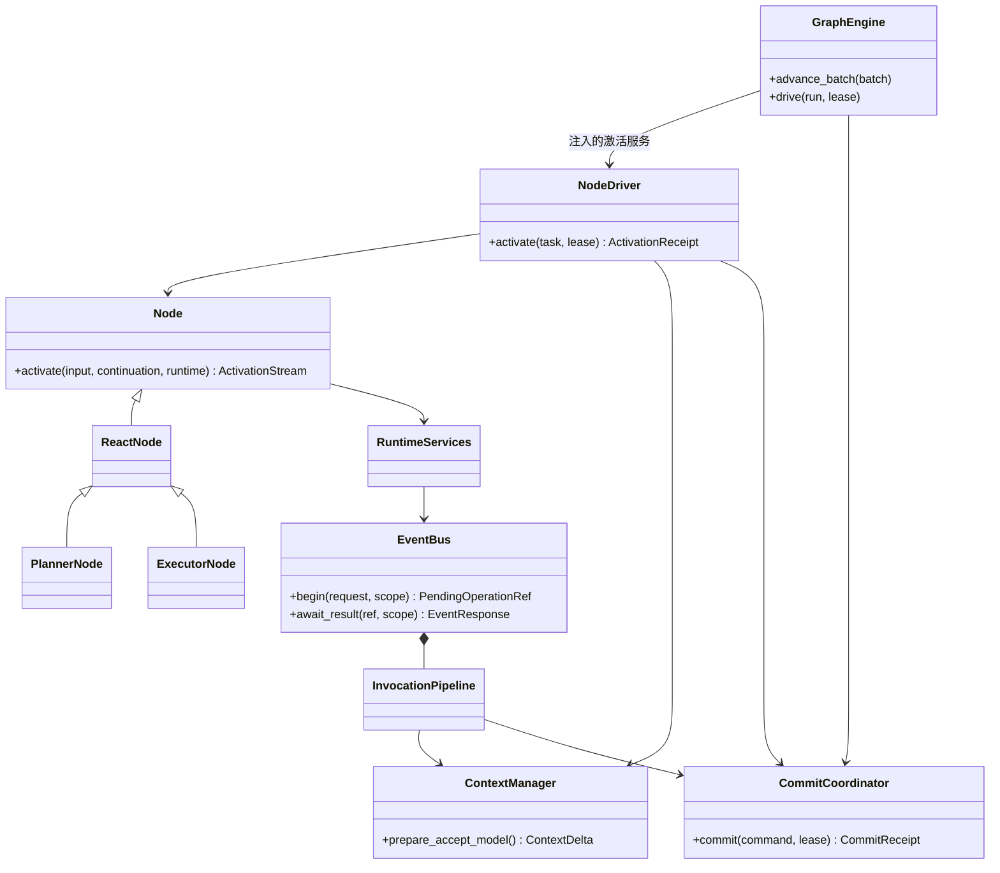
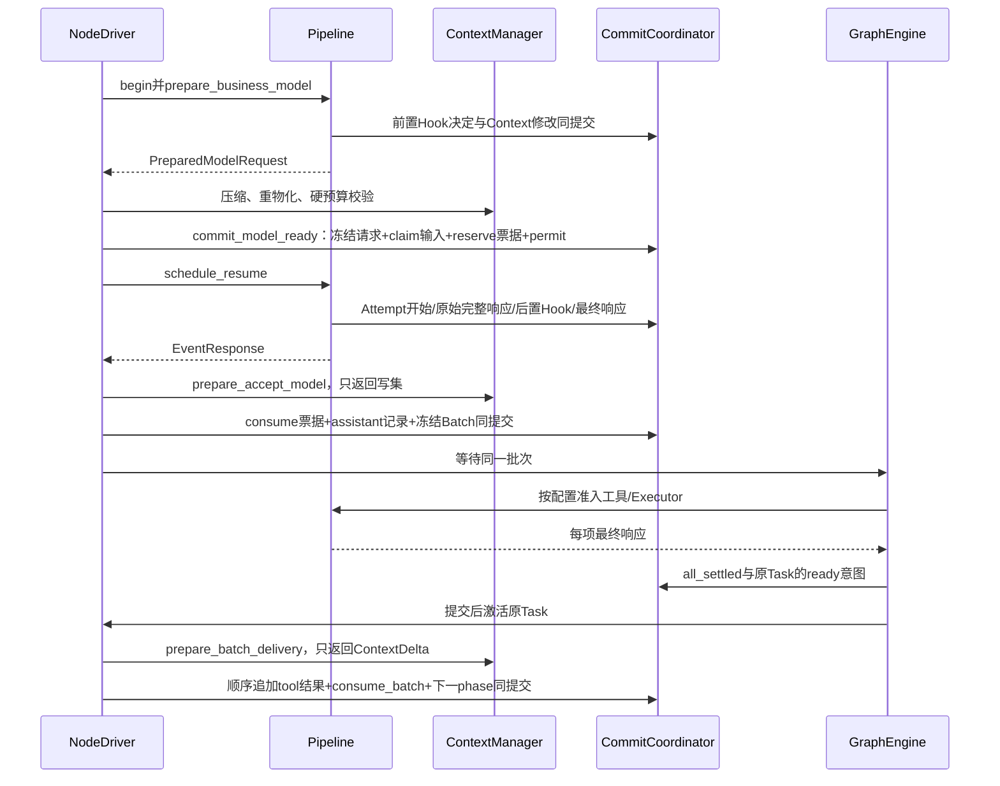

# 实施规格 · ID-1

> **重建边界（2026-10-15）**：旧业务实现已移除。本页保留为待调整的设计草案；用户、应用、发布与配置版本属于平台，SDK 只接收已解析配置并负责执行与恢复。涉及平台身份、发布绑定及表结构的内容需按 [SDK / Platform 边界](../sdk-platform-boundary.md)重新划分，不直接作为 SDK 的必填契约或已实现功能。

2026-10-15。**本组是可据以编码的目标实施规格，尚未实现。** [Agent 设计约定](../../agent-design-decisions.md)定义产品行为，[SD-3 总览](../overview.md)解释领域和架构；这里进一步指定字段、状态、接口、算法、事务、恢复分支和验收断言。无需保持未上线原型的代码或数据兼容。

开发顺序是先验证协议，再接模型和页面。产品目标包括内部 ReAct／Plan–Executor 和用户编排的 Workflow；本轮实现范围仍为内部 Agent，外层暂不写代码。**外层已调整为计划复制并适配 LangGraph 的状态、同步与检查点。** Workflow 的领域对象和调用边界保留，旧自研分支／合并算法、字段和对应持久化步骤需完成[迁移映射](../architecture-discussion.md#6-workflow-产品范围与-langgraph-源码适配)后再作为外层编码规格；本组内部 Agent 规格继续有效。

**引擎数量已确定为两套**：内部 AgentGraphEngine 与外层 WorkflowEngine；后者迁移源码后融合进 AgentLoom 包，不要求内层采用 Pregel，也不直接依赖外部 langgraph 包。两套恢复适配器使用同一提交／存储基础设施，公共信封和调用衔接见[双引擎协议](../dual-engine-integration.md)。下文 GraphEngine 的内部算法均指 AgentGraphEngine，不能用于推进外层原生状态。

## 1. 先读哪一篇

| 篇章 | 要实现的模块 | 必须从本篇拿到什么 |
| --- | --- | --- |
| [ID-1 配置、发布与应用 API](catalog-api.md) | Catalog、Release、Session、应用层、页面状态 | DTO、配置默认值、版本屏障、用户输入交接、HTTP例子和错误 |
| [ID-2 持久结构与恢复](persistence.md) | CommitCoordinator、Repository、Lease、Snapshot、Outbox | 物理表、键、锁序、提交命令、接管及故障矩阵 |
| [ID-3 Runtime 与图执行](runtime-graph.md) | Compiler、GraphEngine、NodeDriver、React/Planner/Executor | 内部编译、生成器握手、Loop阶段、批次准入、控制；外层调用边界及待适配的算法候选 |
| [ID-4 调用总线与 Hook](invocation.md) | EventBus、InvocationPipeline、HookManager、结果等待 | 完整方法契约、Operation/Attempt/Hook状态机、原子变更、重试和投递 |
| [ID-5 上下文、能力与环境](context-capabilities.md) | Context、Compaction、Model/Tool/MCP/Skill、Workspace | 历史算法、模型帧处理、压缩分块、文件和沙箱接口、错误分类 |

每篇都包含前置条件、确定步骤、写入结果、错误/恢复和断言。表中代码路径为重写后的目标包，不表示仓库已经具备这些实现。Python代码块是带明确类型的协议／算法伪代码，不能不经类型定义和异常处理直接当生产模块复制。

## 2. 命名、公共类型与权威来源

### 2.1 一种事实只有一个写入者

| 事实 | 唯一所有者 | 其他模块怎样使用 |
| --- | --- | --- |
| Agent配置/资源/发布 | Catalog与ReleaseService | 读取不可变ResolvedRelease |
| 根停止/执行权/额度 | RunControl＋统一票据流水 | 准备命令，Coordinator锁内重新校验 |
| 内层图位置、角色任务、WaitGroup | AgentGraphEngine | Node返回控制信号；调用设施报告结果 |
| 外层图位置、channels、原生任务写入 | WorkflowEngine | 平台只保存其Adapter提交，AgentNode通过固定Operation接回内层结果 |
| 调用和物理尝试 | InvocationPipeline | Node拿PendingOperationRef并查询最终响应 |
| Hook顺序和决定 | HookManager/Pipeline | ContextManager只校验、准备规范化写集 |
| 原始/有效上下文 | ContextManager | 返回ContextDelta，交同一RuntimeCommit提交 |
| 工作文件/写能力 | EnvironmentManager和执行域网关 | 使用WorkspaceScope受限句柄，不传宿主裸路径 |
| 一致提交/恢复包 | CommitCoordinator/CheckpointStore | 业务模块不自行提交相互依赖的记录 |
| 对外最终回答 | Run终态投影 | 普通模型完成事件不能宣称Run已完成 |

### 2.2 公共值类型

| 名称 | 严格结构／编码 |
| --- | --- |
| UUID | 服务端UUIDv4；示例R1/T1不是合法生产值 |
| OwnerRef | `{kind:agent|workflow,id:UUID,space_id:UUID}` |
| DefinitionRef / ResourceVersionRef | `{id:UUID,version:positive int,content_hash:sha256}`，由外层字段固定类型 |
| PayloadRef | `{kind:inline,value:JSON}` 或 `{kind:blob,owner_ref,blob_id:UUID,sha256,size_bytes:int,media_type:string}` |
| ContextRevisionRef | `{context_id:UUID,revision:nonnegative int}` |
| ExecutionLease | `{run_id,worker_id,epoch,expires_at}`；是当前授权引用，恢复时必须查服务端而非信任旧值 |
| Revision | 普通实体从1开始；Context effective_revision从0空manifest开始；seq的0表示尚无已提交记录 |
| JSON | null/bool/int/有限float/string/array/object；对象键字符串；禁止可执行对象及NaN/Infinity |
| Error | 稳定code+category+脱敏message+结构化details/reference；控制错误另带scope；不能按自然语言猜分支 |

inline 的Owner与来源依赖来自其所在受信记录；blob自带Owner仍不构成访问授权。所有引用经服务验证归属、hash和权限，不能让模型拼一个UUID绕过范围。

持久 `schema_version` 对应载荷DTO；`format_version` 对应提交/快照外壳；Definition.version是业务内容版本，不能混用。第一版均为1，但三个数字不互相推导。公共JSON字段拒绝未知项；业务payload由冻结JSON Schema校验。

ID-2表的短列 `graph_id/task_id/result_id` 分别映射领域 `graph_execution_id/node_task_id/task_result_id`，只在Repository mapper内转换；公开DTO不同时返回两种名称。算法伪代码 `op.phase/op.id` 仅是 `processing_phase/operation_id` 的局部别名，不是另一份字段。

### 2.3 状态和写集的唯一规范

- Operation：`processing_phase=prepared/request_hooks/executing/raw_saved/response_hooks/completed`，`status=pending/succeeded/failed/blocked`。失败原因中的 cancelled/unknown 不再另造Operation状态。
- Attempt：`prepared/started/succeeded/failed/unknown/cancelled`。未开始不算外部副作用；started之后恢复必须先核对。
- HookInvocation：`prepared/started/result_saved/applied/indeterminate`；execution_status与decision分开。
- NodeTask：`ready/running/waiting/succeeded/failed/cancelled`；ReactContinuation.phase记录内部位置，不重复承担任务终态。
- Run：`queued/running/stopping/succeeded/failed/cancelled/timed_out/budget_exhausted`。cleanup_state独立。
- UserInput不可变；UserInputDelivery保存pending/claimed/delivered/carried。API的pending_next_run是投影，没有第二张可独立写的“消息状态表”。

公共写集 `ContextDelta/ContextWriteSet/ModelFreezeWriteSet/PreparedDomainEffect` 都只描述待提交效果。没有“准备函数顺便commit”的例外；Coordinator是权威运行状态的唯一提交口。外部实际文件写、模型网络请求发生在受许可的Adapter，不可能放进数据库事务。

ID-3用语义命令名，ID-4用事务编号，例如 `commit_model_ready=T_FREEZE(business_model)`、`accept_model_decision=AcceptModelDecision`、`begin_operation=T_BEGIN`、`complete_operation=T_FINAL`、`settle_member=T_MEMBER_SETTLE`。它们注册到同一CommandRegistry，不能因为名字不同实现两套事务。

## 3. 目标包与类依赖

```text
agentloom/
  contracts/        # common.py definitions.py graph.py runtime.py invocation.py context.py
  catalog/          # agents.py resources.py publication.py policies.py
  application/      # sessions.py runs.py workflows.py deletion.py
  graph/            # compiler.py engine.py driver.py batching.py merge.py registry.py
  agent_nodes/      # base.py react.py planner.py executor.py continuation.py
  invocation/       # bus.py pipeline.py hooks.py waiters.py observation.py proxies.py
  context/          # manager.py history.py projection.py compaction.py delivery.py
  capabilities/     # model.py tool.py mcp.py skill.py script.py adapters/
  environment/      # scopes.py files.py sandbox.py artifacts.py
  persistence/      # coordinator.py commands/ repositories/ lease.py snapshot.py outbox.py
  api/              # identity.py routes/ errors.py stream.py
  bootstrap/        # registry.py run_runtime.py worker.py
```

每个包导出Protocol和DTO，具体驱动仅在bootstrap组装；contracts不导入业务包。graph不导入供应商SDK；agent_nodes不导入ORM/FastAPI；能力适配器不导入GraphEngine的ready queue；Hook适配器不拿CommitCoordinator。RuntimeServices注入受限代理，Manager内部持原始端口防止递归。



图中继承箭头表达实现复用，普通箭头表达服务依赖；EventBus 对 Pipeline 的组合是本机装配关系，不是持久实体归属。类型关系不等于实例关系：一份Executor配置/实现可服务多个NodeTask，各有独立context；同一次Plan的多个Executor仍在同GraphExecution。未来AgentNode才创建完整子Invocation/子图，复用相同Node协议和恢复Store。

## 4. 必须一起实现的交接点

### 4.1 从模型准备到动作消费



这条链不能拆出以下窗口：出网后才扣票据、模型消息先追加后再建批次、调用完成后才记录父关联、节点成功后才单独发后继通知。ID-2/3/4的命令表逐项关闭这些窗口。

### 4.2 权限、上下文与文件

`Hook allow` 不能授予未配置工具、增加预算、改模型或扩展文件根；合法patch必须生成后续Loop、历史、压缩和恢复共同可见的effective版本。当前请求一旦冻结，迟来的patch不能把实际已发送内容改写成另一份。

共享工作区是同Invocation内文件共享，不是跨角色私有上下文共享。文件工具和脚本从同WorkspaceScope取得路径；Skill资源只读挂载，工作文件使用可写/work；系统会话日志、检查点、凭据不作为可写/work暴露。

## 5. 开发顺序与完成门槛

| 批次 | 实现内容 | 合并前必须通过的证明 |
| --- | --- | --- |
| M1 | contracts、DTO校验、目录Repository、内容存储 | 非法字段/版本/引用拒绝，资源Hash固定，ID-1 CAT断言 |
| M2 | Coordinator、lease、receipt、ScopeCommit、outbox | 两进程竞争/提交回执丢失/旧epoch被拒绝；ID-2 DB断言 |
| M3 | EventBus、Pipeline、Hook、fake adapters | begin去重、不丢唤醒、Hook幂等与冲突、Attempt重试；ID-4断言 |
| M4 | Context、历史投递、压缩Episode、文件域 | 最近N/补充不丢/硬预算/目录越权/写撤销；ID-5断言 |
| M5 | NodeDriver、React、Budget、恢复 | 每个phase kill重启，无重复逻辑调用、100次边界成立 |
| M6 | Planner、Executor、Batch、Join | 并行关闭逐项、开启最大2、同批失败继续、all_settled；ID-3断言 |
| M7 | Catalog发布、Session、Run API、SSE、删除 | 输入/结束/发布竞态、断线游标、删除依赖闭包；ID-1断言 |
| M8 | 真实Provider/MCP/脚本与测试部署 | API全链路报告、真实错误分支、无浏览器替代API验证 |
| 后续工作流 | LangGraph源码适配、AgentNode／CapabilityNode、编排与编辑器 | 先完成内核和平台状态／事务映射，重基线外层断言并通过API故障测试，再开放产品入口 |

M1–M7先用确定性适配器，不把随机模型能否复现错误作为协议测试前提；M8再接真实模型。没有修改前端代码时不构建产品前端；文档独立执行docs构建。模型测试钥匙、数据库内容和真实测试环境变更另在实施任务中进行，不在设计任务隐式执行。

## 6. 评审与验收交付格式

每个模块PR需附：实现的规格节号、导出Protocol/DTO、Schema与migration、事务handler及其读写集合、故障注入报告。测试报告必须记录测试输入、注入位置、预期记录数/状态/调用次数、实际值；“测试通过”四个字不能替代证据。

最低贯穿用例：创建配置→发布→发起Plan→一轮委派3个任务、上限2→一项失败→等待其余→Planner收到全部有效结果→补充只在Planner下一Loop出现→故障接管不重跑已完成项→最终回答→临时目录清理→同Session新提问读到最近N完整过程。

同样跑ReAct单Task路径；拒绝为没有Executor的任务创建假子图；最后第100次正常结束与第101次拒绝分别测试。停止/超时/压缩失败/模型无首输出/部分流中断各有独立结果，不能由一个通用成功fixture覆盖。

本组文档的链接、Mermaid和现有结构样例可在设计阶段检查；这些检查不证明多进程恢复、数据库事务、供应商模型或沙箱撤权已实现。代码实施完成前，任何产品页面不得据此标为已支持。
