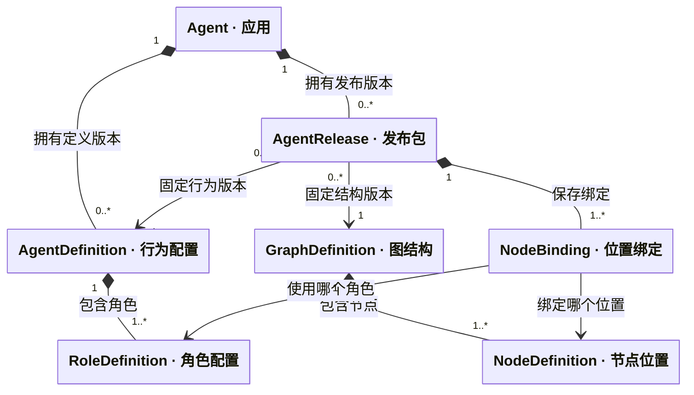
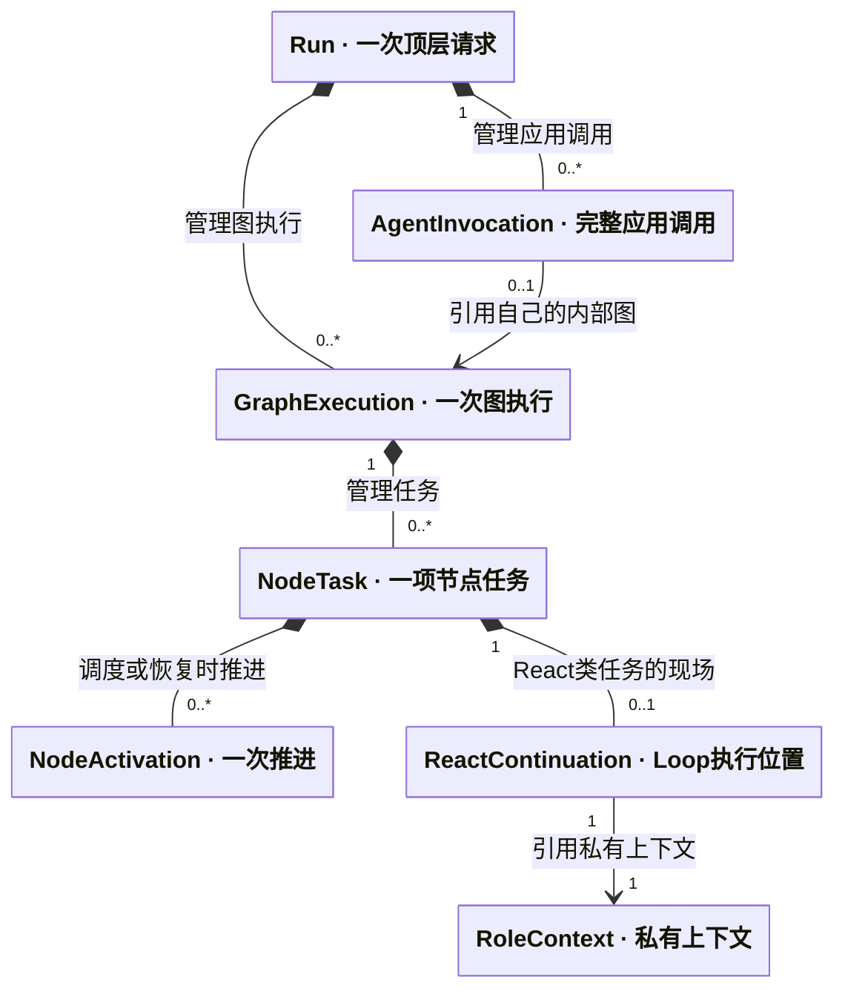

# 系统设计总览 · SD-3

> **重建边界（2026-10-15）**：旧业务实现已移除。本页保留为待调整的设计草案；用户、应用、发布与配置版本属于平台，SDK 只接收已解析配置并负责执行与恢复。涉及平台身份、发布绑定及表结构的内容需按 [SDK / Platform 边界](sdk-platform-boundary.md)重新划分，不直接作为 SDK 的必填契约或已实现功能。

2026-10-15。**架构提案，供评审；旧运行代码已移除，新 SDK / Platform 尚未实现。** 产品目标包括配置化 Agent 和用户编排的 Workflow；规则以 [Agent 设计约定](../agent-design-decisions.md)为准。本版统一 Definition、Node、运行身份、检查点和领域接口；外层工作流尚未实现，其状态、同步与恢复已调整为 LangGraph 源码适配方向，相关算法映射见[决策补充](architecture-discussion.md#6-workflow-产品范围与-langgraph-源码适配)。

**编码规格：[实施入口](implementation/index.md)**。本篇说明架构理由；字段、确定算法、持久表与事务、接口错误和验收场景由实施规格细化。

## 1. 核心对象关系

这里分开表达**配置对象怎样组合**和**运行时产生哪些实例**。图中的实心菱形表示组成／生命周期归属，箭头表示引用；连线旁的数字表示数量，不表示执行顺序。GraphEngine、EventBus 等服务负责操作这些对象，放在后面的职责表中说明。

### 1.1 设计态：发布包连接行为配置与图结构

`Agent` 是用户管理的应用。`AgentDefinition` 描述它做什么，`GraphDefinition` 描述执行位置如何组织。两者没有继承或包含关系，由 `AgentRelease` 固定版本并通过 `NodeBinding` 连接。

这张图展示 Agent 内部角色节点的绑定。比如图中的 `research_executor` 位置绑定 `researcher` 角色：位置决定它能怎样参与流转，角色决定 Prompt 与可用能力。未来工作流的能力节点绑定能力版本，AgentNode 绑定完整 AgentRelease，不能把所有节点都当作角色。

发布时先验证、编译候选定义、绑定和资源清单，再保存不可变 AgentRelease；发布切换屏障完成后才成为当前版本。Release 固定编译描述引用，运行和恢复加载该固定产物，不使用最新配置重新推导图。草稿、边、资源清单及编译字段的完整关系见[领域模型](domain-model.md#2-设计态应用行为结构与绑定)和[发布算法](implementation/catalog-api.md#32-发布算法)。

### 1.2 运行态：配置复用，执行身份与上下文独立

一个 Agent 拥有多个 Session；同一 Session 的每次新提问创建一个 Run。下面画的是 Run 内的逻辑执行对象；它们可以被保存、装载，不能等同于本机临时的 Python 对象。

- **AgentInvocation 固定一份 AgentRelease；GraphExecution 使用对应的编译图。** 已初始化的 Invocation 对应一张内部图。未来外层工作流图没有所属 AgentInvocation，因此图的反向关联是 `0..1`；queued Run 尚未装配时可没有图或调用实例。
- **Planner 与 Executor 是同一内部图中的 NodeTask。** 一份 Executor 配置被委派两次，就产生两个任务及两份私有上下文，不增加两张图；工作文件按同一 Invocation 的授权范围共享。
- **Loop、等待和故障恢复复用原任务身份。** 调度或恢复可新增 NodeActivation，ReactContinuation 保存从哪里继续。普通 Tool／MCP／Skill 读取和脚本调用产生 Operation，不产生新 AgentInvocation 或 GraphExecution。

`ReactNode`、`PlannerNode`、`ExecutorNode` 是实现类；`NodeDefinition` 选择实现类型，`NodeTask` 保存一项工作的身份和状态。PlannerNode 与 ExecutorNode 继承 ReactNode 的循环行为，不能把实现类画成运行任务的替代物。完整继承图见[Node 的类型、位置和任务](domain-model.md#3-node-是类型位置和任务三个不同对象)。

### 1.3 服务怎样操作这些对象

| 服务 | 操作哪些对象、负责什么 |
| --- | --- |
| `GraphCompiler` | 发布准备阶段验证结构、绑定和资源，生成只读编译描述；不保存会话进度 |
| `AgentGraphEngine`／`NodeDriver` | 调度内部 Agent 的角色任务与批次，处理 React 安全点、等待、完成和继续 |
| `WorkflowEngine`／工作流节点适配器 | 按迁移内核的状态和同步规则推进用户流程，通过 AgentNode／CapabilityNode 接入平台能力 |
| `RunRuntime`／两类 CheckpointAdapter | 根控制与按引擎类型分派恢复；适配器转换各自现场，不建立第三份节点调度状态 |
| `RuntimeServices`／`EventBus` | 为节点提供能力代理，按可信调用范围提交请求、等待结果；观察订阅不负责调度或关键落库 |
| `InvocationPipeline` | 维护 Operation／Attempt 的阶段，协调前置 Hook、实际能力执行、原始结果、后置 Hook 及最终响应 |
| `HookManager`／领域 Manager | 前者返回校验决定和修改提案；后者执行模型、工具等原始能力。HookManager 不选择业务处理器，也不负责落库 |
| `ContextManager`／`CommitCoordinator` | 前者校验上下文变更并准备写集；后者统一提交状态、上下文修订、调用结果及恢复关联，不让各模块分别提交同一事实 |

模型调用还要在前置 Hook 后完成压缩、硬预算校验和请求冻结，才能实际出网；响应经过后置 Hook 和一致提交后再交付。完整交接顺序见[模型准备到动作消费](implementation/index.md#41-从模型准备到动作消费)，总线和 Hook 的具体协议见[调用管道设计](implementation/invocation.md)。这些调用顺序不再混进对象关系图。

## 2. 三种执行结构

| 场景 | 结构 | 实例含义 |
| --- | --- | --- |
| ReAct | 一个 ReactNode 定义，内部多轮循环 | 1 AgentInvocation、1 GraphExecution、1 NodeTask |
| Plan–Executor | Planner 与可分派 Executor 位置；分派后汇合回原 Planner | 同一个 GraphExecution 中创建多个独立 NodeTask |
| Workflow（产品目标，尚未实现） | 用户编排完整 Agent、Tool／MCP、数据映射、条件、循环、并行及汇合 | 外层 AgentNode 调用完整 Agent，创建 child AgentInvocation／GraphExecution |

Planner 同时委派两次资料检索：1 张内层图、1 个 Planner 任务、2 个 Executor 任务，各自私有上下文。它们的工作文件共享本次授权范围。普通 Tool／MCP／Skill 读取和脚本调用只创建 Operation，不为每次调用建图。

产品上提供 ReAct、Plan–Executor 和 Workflow 三种搭建方式；领域上前两种属于 Agent，第三种由独立 Workflow 定义和发布承载。用户配置工作流结构及节点数据映射，模型在被调用 Agent 内决定具体动作；外层不靠解析 Planner 计划文本生成流程。

**外层和内层已选择两套执行内核。** AgentGraphEngine 处理轻量 Agent 循环与角色委派；WorkflowEngine 将 LangGraph 的相关逻辑和源码迁入本包，负责通用流程。两者共用领域身份、调用与根控制，通过不同 CheckpointAdapter 接入同一存储；外层只关联内层身份及有效结果，不复制角色私有 messages。详见[双引擎与检查点适配](dual-engine-integration.md)；本轮没有导入源码或新增可运行工作流产品。

## 3. 关键技术选择

| 决策 | 本版方案 | 原因与边界 |
| --- | --- | --- |
| 定义与实例 | Definition／Release 不可变；Run／GraphExecution／NodeTask 另建身份 | 配置复用不意味着运行状态共享 |
| 节点执行 | activate 返回 Progress／Wait／Complete／Fail 控制信号流 | 内部完整 Loop 可保存安全点，无需每轮变成新节点 |
| 图调度 | 明确采用双引擎；内部轻量调度，外层迁移适配 LangGraph 源码 | 每个图固定 engine_kind；统一控制不等于共用队列或相同调度语义 |
| 外层状态合并 | 以 channels／reducer／super-step 及 pending writes 的源码语义为适配依据 | 旧分支冻结视图＋配对 Join 为自研候选，不与迁移语义混用，需完成映射后重新确定 |
| 执行预算 | 根Run＋工作流内Invocation局部约束，单份票据原子结算 | 局部耗尽只影响所属调用，根耗尽影响整树 |
| 上下文 | GraphState、RoleContext、ReactContinuation 分开 | 编排共享状态、模型私有消息、执行位置各有所有者 |
| 低侵入交互 | 装配代理＋EventBus＋领域 Manager | 业务代码不用到处发送消息或手写检查点 |
| 可恢复等待 | begin 返回持久 PendingOperationRef；最终只交付一次 EventResponse | 调度回执不冒充执行结果，恢复不依赖内存 Future |
| 持久化 | PostgreSQL 一致事务、共享不可变 blob、事务 outbox | 集中管理现场，节点完成与后继意图一致；外部副作用仍不保证恰好一次 |
| 检查点适配 | 公共信封＋引擎专属载荷；Agent／Workflow 各有 Adapter | 统一身份、执行权与存储；外层保留原生快照和 pending writes，不伪装成内层 WaitGroup |
| Hook | 有序控制链；同项双patch归一；合法deny独立于修改有效性 | 冲突不产生两套有效值，原始事实不可覆盖 |
| 压缩预算 | 80%触发评估、60%软目标、最终硬窗检查 | 固定输入超过软目标仍可压缩，不静默删用户问题 |
| 模型交付 | 适配器内部流式，收齐经 Hook 后统一返回 | 不逐 token 发总线事件；模型一轮完成不等于 Run 完成 |

这些是本轮推荐实现方案，不将技术选择伪装成用户逐字段确认。外层领域关系已明确，源码适配导致的调度及持久化细节仍需补齐；不把已有自研伪代码冒称为迁移方案。

## 4. 模块和依赖方向

以下为目标包职责，不要求沿用原型目录，也不要求独立部署。

| 模块 | 核心内容 | 允许依赖 |
| --- | --- | --- |
| `contracts` | Definition、DTO、节点结果、恢复与领域端口协议 | 标准数据类型／Schema |
| `domain.catalog` | Agent／Workflow、草稿、资源、发布、授权 | contracts、仓储端口 |
| `graph/contracts` | 定义与执行身份、engine_kind、编译引用、公共运行端口 | contracts；不含统一的业务 ready 队列 |
| `graph/agent` | AgentGraphEngine、内部 Compiler、NodeDriver、动作批次和 WaitGroup | 公共图契约、能力／控制／持久端口；不依赖 WorkflowEngine |
| `graph/workflow` | 迁移适配的 WorkflowEngine、编译与状态同步、AgentNode／CapabilityNode 适配器 | 公共契约、调用管道、WorkflowCheckpointAdapter；不依赖内层队列 |
| `agent_nodes` | ReactNode、PlannerNode、ExecutorNode、公共 Loop 状态机 | Node 协议、受限 RuntimeServices |
| `invocation` | 代理、EventBus、Operation、Attempt、Hook 管道 | contracts、Manager 端口、提交协调器 |
| `context` | 历史投影、ContextMutation、压缩、消息格式化 | 模型调用端口、上下文仓储 |
| `capabilities` | 模型适配器、Tool／MCP／Skill／脚本处理器 | 各自协议和环境端口，不反向调用图内部队列 |
| `environment` | 文件范围、共享工作卷、沙箱、Artifact 授权与清理 | 存储／隔离驱动 |
| `persistence` | CheckpointStore、CommitCoordinator、两类 CheckpointAdapter、ScopeCommit、lease、outbox | 数据库和 blob 驱动；不选择图业务后继 |
| `application/api` | 登录与权限、配置管理、输入／停止／查询、事件输出 | 领域应用端口 |

依赖通过接口注入。NodeTypeRegistry 将类型名和实现 ABI 解析为实现，不把 ORM、FastAPI 请求对象或模型 SDK 塞入 NodeDefinition。Manager 内部执行原始实现，不能再次调用同一个代理造成递归。

## 5. 阅读路径

| 顺序 | 内容 |
| --- | --- |
| 1 | [Agent 设计约定](../agent-design-decisions.md)：产品行为与本轮需求补充 |
| 2 | [领域模型与 UML](domain-model.md)：所有权、版本、实例数、继承与组合 |
| 3 | [图与 Node](graph-node-engine.md)：Definition、编译、激活、循环、调度与外层设计 |
| 3a | [双引擎与检查点适配](dual-engine-integration.md)：内层循环、外层调用、Saver 映射及跨引擎恢复 |
| 4 | [数据契约](data-contracts.md)：字段结构、引用和不变量 |
| 5 | [检查点协议](checkpoint-protocol.md)：快照、增量、节点阶段、父子恢复与一致提交 |
| 6 | [领域接口与交互](domain-interfaces.md)：应用 API、内部端口、时序、幂等与权限 |
| 7 | [Agent 执行](agent-execution.md)、[上下文](context-lifecycle.md)、[能力与 Hook](capabilities-hooks.md)：各模块行为 |
| 8 | [事件总线设计](runtime-messaging-checkpoints.md)：总线 UML、注册订阅、请求响应、Hook 接入及恢复；[存储与 API](storage-recovery-api.md)、[验收计划](verification-roadmap.md) |
| 9 | [设计决策记录](architecture-discussion.md)：本轮选择、取舍、剩余工程细化 |

## 6. 与 LangGraph 的关系

本轮直接阅读本地源码，基线为 `afbe7e48b17f62e139b5c6337ab934549e6dc73b`。借鉴 StateGraph／CompiledStateGraph 的分离、节点任务及 Send、状态 reducer、命名空间检查点、pending writes 与运行时 context 注入；[图引擎](graph-node-engine.md)和[检查点](checkpoint-protocol.md)逐项给出固定源码链接与采用／不采用的边界。

外层的实施方向已从仅借鉴改为计划复制并适配 LangGraph 相关源码，当前尚未导入代码或接入依赖。迁移范围、依赖和旧外层算法的处理见[源码适配决策](architecture-discussion.md#6-workflow-产品范围与-langgraph-源码适配)。完整 ReactNode 的内部安全点与 AgentLoom 的 Hook／Operation 恢复仍需平台协议衔接，不能由一个 LangGraph Saver 自动推导。

设计不受当前原型兼容性约束；接下来按[验收计划](verification-roadmap.md)先验证状态与恢复协议，再实现内层执行，外层复用同一契约。文档和 Schema 检查通过不等于上述代码已经完成。
