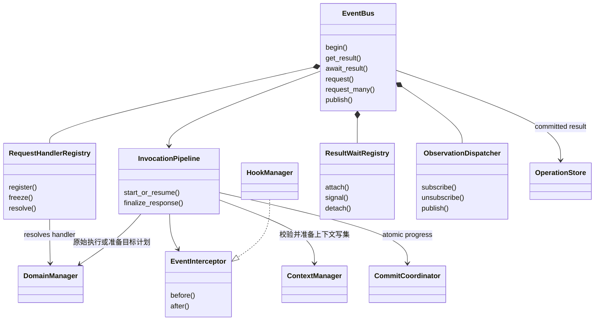
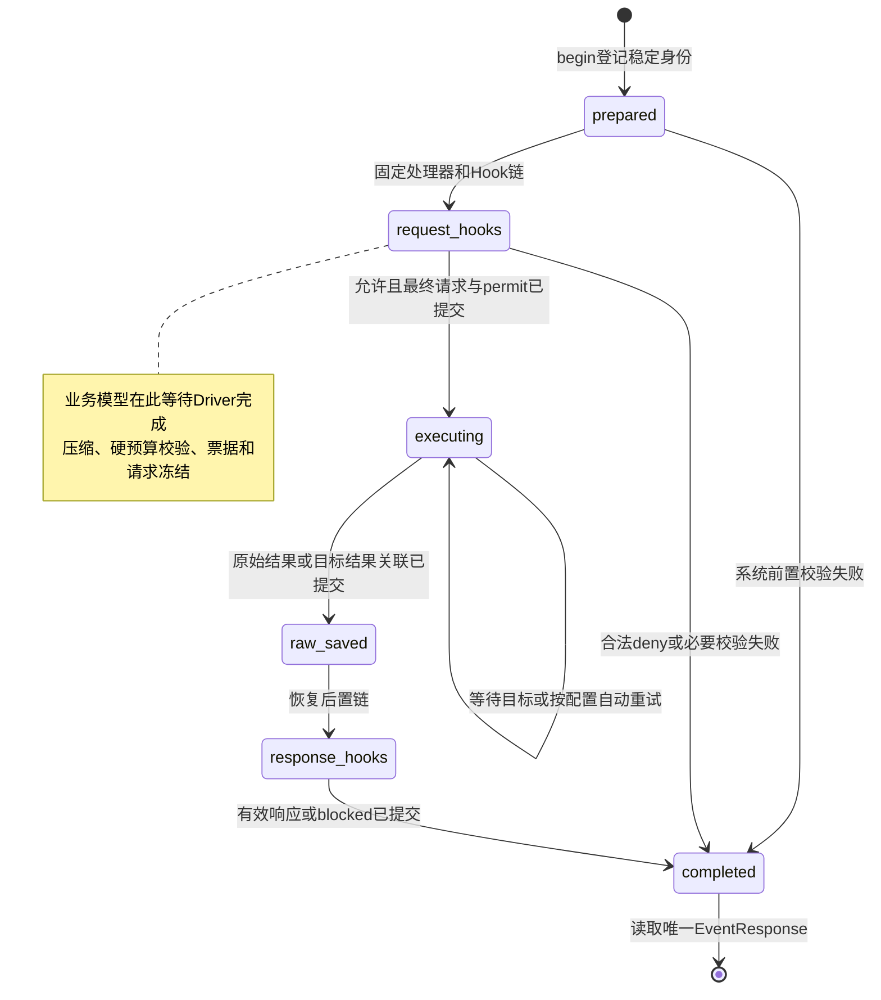
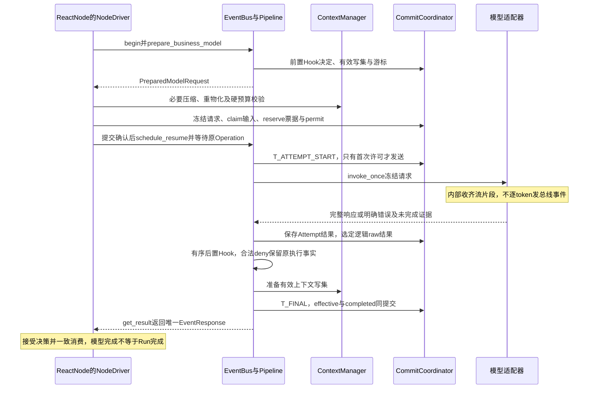

# 事件总线（EventBus）与调用交付设计

> **重建边界（2026-10-15）**：旧业务实现已移除。本页保留为待调整的设计草案；用户、应用、发布与配置版本属于平台，SDK 只接收已解析配置并负责执行与恢复。涉及平台身份、发布绑定及表结构的内容需按 [SDK / Platform 边界](sdk-platform-boundary.md)重新划分，不直接作为 SDK 的必填契约或已实现功能。

**实施细则：[invocation](implementation/invocation.md)**。本页保留架构解释；具体方法、字段状态、事务和恢复分支见实施规格。

更新日期：2026-10-15。**本轮设计记录，旧运行代码已移除，本文等待按新交付边界实施。**

**本文是事件总线模块的设计入口。** 定义总线组成、事件契约、注册订阅、请求／响应、Hook 接入、等待唤醒、进程生命周期及持久恢复边界。调用 API 的统一签名保存在[领域接口](domain-interfaces.md)，持久记录以[检查点协议](checkpoint-protocol.md)为准，Hook 字段修改规则见[能力与 Hook](capabilities-hooks.md)。本篇把这些协作关系集中说明，不另建一套调用或调度协议。

阅读重点：第 1 节看对象和接口，第 2 节看一次请求怎样完成，第 3 节看哪些行为走总线及总线如何运行；第 4–6 节解释恢复和 Hook，第 7 节解释流式交付。以下新增模块接口是 SD-3 工程方案，已确认的产品行为仍以[Agent 设计约定](../agent-design-decisions.md)为准。

## 1. 统一 EventBus 与各类 Manager

**EventBus 是 Runtime 统一交互入口。** 请求、响应、参数传递、上下文更新及生命周期通知均使用同一套事件协议；需要改变执行的 Hook 在事件处理链中等待完成，纯观察订阅则不决定执行结果。

| 部分 | 责任 | 边界 |
| --- | --- | --- |
| ReactNode 及 PlannerNode／ExecutorNode | 角色循环、上下文读取和可恢复阶段；通过事件或代理使用能力 | 不需要遍历处理器响应，猜测谁返回了最终结果 |
| EventBus | 按事件类型路由、调用拦截器、关联请求与响应、等待和通知 | 不把所有领域逻辑堆入总线；内存 Future 不代表可持久恢复 |
| 调用代理 | 将普通接口转成事件，注入可信执行身份 | 处理器调用原始实现，不再次路由到自己 |
| ModelManager／ToolManager | 分别处理模型请求与工具／MCP／脚本请求，使用 Hook 后的有效参数 | 名称是职责示意；不为每个生命周期时机新建 Manager |
| ContextManager | 管理权威有效上下文、版本、修改来源和模型视图 | 原始记录不覆盖；私有角色与共享字段按作用域管理 |
| HookManager | 按时机和作用域执行有序校验／修改，返回 allow 或 deny；观察处理器由 ObservationDispatcher 管理 | Hook 故障继续业务；合法拒绝必须生效，二者不能混同 |
| GraphExecutionManager／所属图引擎 | 前者按获准请求准备计划；AgentGraphEngine 与 WorkflowEngine 分别推进所属图并经适配器保存现场 | Manager 不启动图；两套引擎不操作对方队列，共用本调用管道 |
| 持久调用管道 | 保存调用意图、Hook 进度、有效输入、原始与有效结果；统一回复 | 不用参数相同判定是同一次调用；不把仅保存原始结果当成调用已完成 |
| CheckpointStore | 保存图／节点现场、调用与上下文版本关联 | 必需存储不由可失败的用户 Hook 负责 |

总线只依赖通用 `EventInterceptor` 等接口，HookManager 注册为拦截实现。Manager 接口和数据结构以 SD-3 领域接口为本轮方案；统一事件交互、Hook 控制与全链路上下文可见性已经确认。

### 1.1 总线的内部组成



这些是同一模块内的职责划分，不要求独立部署。EventBus 是门面；Pipeline 管理调用阶段；Registry 负责选处理者；WaitRegistry 只管理当前进程的等待者；ObservationDispatcher 分发已提交事实。GraphEngine 继续独占节点调度，CallBatchCoordinator 继续负责批次账本；`request_many` 复用它们，不在总线内再建一个 Executor 调度器。

### 1.2 事件、请求和结果的结构

| 对象 | 必需信息与用途 |
| --- | --- |
| 事件信封 | event_id、event_type、schema_version、created_at、source、cause_id?、可信 scope_ref、payload_ref；承载类型、因果、范围与内容引用 |
| EventRequest | 事件信封＋purpose_key；表示某执行主体发起的一次逻辑调用。purpose_key 与可信调用主体共同构成恢复去重键 |
| PendingOperationRef | operation_id、权威 request_id 及所属执行范围；只表示可查询／等待的持久调用身份 |
| EventResponse | request_id、operation_id?、状态、结果或错误、有效上下文引用；已 begin 的调用必须带 operation_id，表示经过后置处理的唯一最终结果 |
| CommittedEvent | 事件信封＋commit_ref、ordinal；只通知已经提交的事实，同一 outbox 事件重投保持 event_id |
| EventFrame | event_id、event_type、source、cause_id；任务局部调用栈元数据，不保存完整载荷或凭据 |

`EventResponse.request_id` 对应 Operation 初次登记的 EventRequest.event_id；`cause_id` 表示直接原因，不用于猜测响应应该交给谁。HTTP 层 RequestIdentity.request_id 只是一次传输请求，另作追踪，不能代替持久调用身份。恢复／传输重投以原 purpose_key 找到原 Operation，返回它已固定的请求身份；新的模型决策即使参数相同，也使用新的逻辑调用键。

可信 scope_ref 关联 Run、图／节点、类型化 owner、可选 AgentInvocation／会话以及 WorkspaceScope；当前租约在调用时重新验证。外层工具不需要伪造 AgentSession。source 和调用栈仅用于追踪，不能扩大授权。事件类型、身份和 scope 不允许 Hook 改写；业务内容经 Hook 后成为新的有效版本，不原地修改原始信封或载荷。

响应由调用管道在有效结果提交后形成，不要求 Manager 自己发布另一条响应事件来“碰运气匹配”。Manager 返回原始结果或可恢复等待句柄；Pipeline 负责后处理、持久化和通知。外部插件不能通过 publish 一个自制成功响应来完成 Operation。

### 1.3 注册、订阅与查询接口

业务调用方使用[领域接口中的 EventBus](domain-interfaces.md#7-统一-eventbus-与能力门面)。下列端口仅面向 Runtime 装配与获准的观察组件：

```python
class EventBusAssembly(Protocol):
    def register_handler(self, event_type: str, schema_version: int,
                         handler: RequestHandler) -> None: ...
    def set_interceptor(self, interceptor: EventInterceptor) -> None: ...
    def freeze(self) -> None: ...

class EventObservationPort(Protocol):
    def subscribe(self, event_type: str | None, observer: EventObserver,
                  scope: ObservationScope,
                  filter: EventFilter | None = None) -> Subscription: ...
    async def unsubscribe(self, subscription: Subscription) -> None: ...
    def event_stack(self) -> tuple[EventFrame, ...]: ...

class EventBusLifecycle(Protocol):
    async def open(self, run_ref: RunRef) -> None: ...
    async def close(self, reason: str) -> None: ...
```

- 请求按 `(event_type, schema_version)` 精确匹配一个具名 Handler；同键重复注册在装配时失败。首版不按 Python 父类／通配符抢占请求；多个具体事件类型可以显式注册同一个 Manager。
- Handler 可声明接收约束，依据前置 Hook 后的最终合法 payload 校验；约束不匹配形成明确路由错误，不转交多个处理器试执行。资源名称、MCP 工具名等二级选择由该 Manager 的固定能力目录负责。
- `freeze()` 后 Handler 与拦截器绑定不热替换；新发布／接管按已固定版本重新装配。Hook 配置按本次发布和 scope 解析，不能因共用总线混用不同 Agent 的 Hook 链。
- `subscribe(None, ...)` 仅观察获授权范围的已提交事实，不成为请求响应者。匹配规则是类型、授权 scope 和 filter 同时满足；filter 不取得超出 scope 的 payload。默认给元数据与受限内容引用，不广播角色私有 messages。
- Subscription 由创建它的模块持有。unsubscribe 只移除此订阅，先停止后续投递，再取消／限时收束其在途回调；到期释放本机订阅，不等待无限回调，也不撤销回调已经产生的外部效果。不得删除其他模块的同类订阅；总线关闭时回收本实例全部订阅。
- `event_stack()` 基于任务局部上下文；并行任务互不串栈，嵌套调用保留因果链。记录只用于诊断，恢复不依赖旧任务栈。

需要修改、允许或拒绝执行的扩展注册到 EventInterceptor／HookManager；普通观察者的返回值一律不参与请求或结果合成。没有通用的“广播给所有订阅者，再取返回列表当业务结果”。

## 2. 同一条事件链怎样完成调用

Runtime 装配时注入代理；节点仍可写普通调用，名称仅示意：

```python
response = await model.generate(request)
content = await files.read(path)
results = await executors.delegate(tasks)
```

这些调用均进入 EventBus。下图只表达 **Operation.processing_phase 状态转移**，由 InvocationPipeline 协调，所有阶段通过 CommitCoordinator 提交；图中框不是 Manager 或业务节点。



图为正常推进及前置拒绝分支；控制终结可由 `control_finalize_operation` 从任一非终态阶段到 completed，但必须先核对／收束已发执行、处理已有 Hook 结果，不能直接跳过清理。`completed` 是处理阶段，成功／失败／拒绝另由 status 表达。

调用实际使用 Hook 后的输入，返回 Hook 后的有效结果。仅修改一份 `ModelCallStartEvent`、执行时却继续使用旧 messages，不能算实现修改。处理器不再额外运行一遍原始方法，结果等待者也不能绕过后置 Hook 提前拿到原始输出。

### 调用与提交顺序

1. 登记响应等待关系，校验可信作用域，创建或装载稳定调用身份；随后分发请求，避免快速响应先到导致丢失。
2. 同一调用已提交终态时返回保存结果；未完成时按保存阶段继续，不重置 Hook 进度、参数和重试次数。
3. HookManager 按固定顺序处理请求。每项合法修改经过校验并形成有效上下文变更，后一个 Hook 读取前一个的有效版本；合法 deny 停止这条执行链。
4. ContextManager 准备有效写集，Pipeline 经 CommitCoordinator 提交变更来源、上下文版本和 Hook 决定。业务模型先把 PreparedModelRequest 交 NodeDriver 完成压缩、硬窗口校验与请求／票据／permit 同事务冻结，才允许出网。外部执行创建 Attempt；internal、graph、recoverable 调用分别提交内部效果或目标关联，不虚构物理尝试。已完成前置 Hook 不重复执行。
5. 保存原始执行结果，进入后处理阶段；此时尚不能回复成功。结果事件经 Hook 后，一致提交有效结果、上下文变更和完成通知，再唤醒等待者。
6. 调用方消费响应时，推进上下文消费水位和节点阶段。Hook 修改已在对应版本中生效，消费只引用／物化该版本，不再次应用同一修改。

Hook 失败、超时或无效修改，记录失败并使用之前的有效状态继续；必要鉴权、预算或持久化失败不适用这条 fail-open 规则。合法 deny 产生关联原请求的明确拒绝响应，不能用“无响应”表达拒绝；响应阶段也不能被 Hook 丢弃到让等待者一直挂起。

前置拒绝不执行目标能力。后置拒绝只能阻止该结果继续交付或推进后续执行，不能撤销已发生的工具副作用；原始执行结果和拒绝原因都保留。工具／委派拒绝作为本批对应调用的结果回交，其他成员按既有规则继续。模型等没有可继续决策路径的必要调用被拒绝时，按对应失败边界结束所属执行。

自动重试只处理同一调用的已冻结输入，不重新跑前置 Hook 获取另一套参数，也不把合法 deny 当成网络异常重试绕过。LLM 下一轮的新调用仍有新身份，并重新经过适用 Hook。工具业务防重继续由提供方负责。

ContextManager 的写集准备及 CommitCoordinator 的运行事实、CheckpointStore、额度和投递提交使用底层端口，不将同一变更再次送回原 Hook 链。统一 EventBus 不要求把每个内部函数或数据库写操作都递归包装成事件。

### 单次响应与响应列表

- `request()` 面向一次逻辑执行，由唯一 Manager 执行，Pipeline 完成后处理并提交、返回一个最终 `EventResponse`。观察者不计入响应责任。
- 一批工具或 Executor 请求分别关联响应，按 Agent 配置执行，全部结算后得到 `list<EventResponse>`；每项带调用身份及结果／错误，不按完成顺序猜测对应关系。
- 同一事件上的多个 Hook 形成有序处理记录，由 HookManager 合成修改，不把这些中间记录当作多个工具结果交给 LLM。
- `publish()` 提供生命周期观察。异步观察处理器无权在事后改写已经提交的调用；需要修改或拒绝时须注册到需等待的拦截阶段。

publish 仅对可信提交／outbox 适配器开放，检查事件已有提交依据；返回只表示本次本地分发尝试完成，不代表每个观察者已处理，更不代表业务持久化。已提交事件先有 outbox，后调用 publish；需要可靠消费的订阅用自己的持久游标确认，纯诊断订阅不影响 outbox 中的业务事实。观察者只获得不可变或防修改的投影，不能通过修改同一 Python 对象影响其他订阅者或权威结果。观察回调须为可信非阻塞实现；用户 Hook 代码经受限适配器执行，不能直接阻塞总线的事件循环。

### 2.1 等待怎样避免丢结果

`await_result` 以 OperationStore 为事实来源，内存通知只加快唤醒。算法为：校验范围 → 登记 operation_id 等待者 → 查询已提交最终结果 → 未完成则等待通知或定时复查 → 再读结果 → 移除等待者。登记后重新读，能覆盖“结果恰好先到”；定时复查能覆盖通知丢失。不能仅等待一个瞬时事件。

同一 Operation 可有多个获授权等待者，读取同一不可变最终结果；收到结果不等于已经推进节点。节点的消费水位和 Continuation 由 CommitCoordinator 一致提交，恢复不会重复消费或扣预算。NodeDriver 对长调用使用持久 Wait，不占着运行槽等待内存 Future。

调用方断连或取消 await 只解除这一个等待者，不取消 Operation；主动停止走 RunControl。Run 截止仍由 Runtime 处理并形成终态。租约丢失或当前总线关闭时，本机等待者收到明确的 `LEASE_LOST`／`BUS_CLOSED` 连接错误，不能把这一错误伪造成业务失败结果再写回原调用。接管者使用同一 PendingOperationRef 查询或继续。

首版不提供用于业务恢复的裸 `wait(EventType)`：一次性观察可以由临时订阅实现，但不能承担调用结果或调度恢复。业务等待统一用 await_result／持久 WaitGroup；SSE 重连按持久 outbox 游标重放。

## 3. 事件边界与作用域

下表是同一 EventBus 的接入清单。目标事件信封与领域端口见[领域接口](domain-interfaces.md)；适配器数量由实现配置决定。

| 边界 | 交互内容 | 主要负责者 |
| --- | --- | --- |
| 模型 | 生成、Embedding 请求；完整模型响应、失败 | ModelManager 与模型适配器 |
| Tool／MCP／Skill／文件／脚本 | 能力请求及结果；脚本内部每次 open 不单独发事件 | ToolManager 与注册处理器 |
| 上下文 | 读取、组装、压缩、显式更新；Hook 修改的有效上下文提交 | ContextManager 与压缩服务 |
| 知识能力 | 已配置的导入、索引与检索请求及进度 | 相应领域 Manager；不新增 Wiki 产品需求 |
| Executor／图 | 委派、任务结果、节点等待和汇合 | 图引擎调度入口 |
| Run 控制 | 启动、补充、停止、接管及终态 | Runtime 控制入口 |
| 环境 | 沙箱准备、挂载、收束清理及结果 | 环境服务 |
| Hook | 请求／结果的拦截，以及生命周期观察 | HookManager；不把自身调用递归广播为同类业务事件 |
| 对外交付 | 进度、完整最终结果或异常终态 | 同一 EventBus 的 API 适配器 |

`source`、层级来源和 task-local 调用栈用于追踪，不代替鉴权或恢复现场。请求／响应的 ID、causation 关联、事件类型、Run／Session／角色身份由系统管理，Hook 不能修改；接收过滤也不能代替授权检查。

停止控制不能被业务调用等待或用户 Hook 堵塞、拒绝或重新放行。用户补充仍只进入根角色／Planner 下一轮，不能借统一总线广播到所有 Executor 私有历史。

### 3.1 实例范围、生命周期与跨机恢复

一个 RunRuntime 装配一个进程内 EventBus 实例，服务本 Run 的外层工作流、内层 Agent 以及各角色。共享实例只复用通信设施，各调用携带独立授权 scope；它不使上下文、资源目录或 Hook 配置共享。其他 Run 使用其他实例，进程级连接池可以复用但不持有跨 Run 可变业务上下文。

| 阶段 | 操作 |
| --- | --- |
| 装配 | 注册 Handler、schema 与拦截器；校验缺失或重复绑定并 freeze |
| 打开 | Runtime 已取得执行权后 open；重建 scope、观察订阅、未完成调用的本机等待索引 |
| 执行 | 接收经授权的请求；持久调用先登记意图，再按批次／图策略启动；通知只引用已提交事实 |
| 停止／截止 | RunControl 先关闭新业务准入；控制入口独立于业务等待队列，现有结果提交和清理仍可继续 |
| 正常关闭 | Runtime 完成在途调用收束、必要提交及清理登记，再 close；释放订阅、连接视图与本机 Future |
| 租约丢失 | 立即拒绝本机新工作，撤销旧环境写权限并释放本机等待；不替接管者改写逻辑 Run 终态 |
| 接管 | 读取统一恢复现场，创建新 EventBus 并恢复原逻辑调用；不会恢复旧 EventBus 对象或 Python task |

Run 创建之前的用户请求先经过应用接口完成鉴权和 Run 登记；有运行范围后再交本 Run 总线。跨机器的停止／补充先持久写入控制记录，再通知当前执行者；不能只向某台机器的内存总线 emit 就宣称已经接收。当前 Worker 未收到通知时也须通过控制记录检查观察到更新。

这里没有新增 Kafka／Redis 等外部消息中间件依赖。跨机持久事实依靠数据库和共享内容存储；outbox 负责可重投通知，检查点负责恢复执行。总线自身不承诺外部副作用“恰好执行一次”。

### 3.2 异常、顺序与拥塞

| 情况 | 处理 |
| --- | --- |
| schema 不支持、缺 Handler、接收约束无匹配 | 登记明确错误并按所属调用边界结束；不得无期限等待。无法完成初始持久登记时直接报告 Runtime 存储错误 |
| Handler 抛错 | Pipeline 保存结构化 raw 错误并进行适用后处理，形成最终响应；不能只在后台 task 打日志 |
| 合法 Hook deny | 保存关联拒绝响应，不再执行目标；拒绝交付不再递归进入同一拦截链 |
| 用户 Hook 故障 | 按已定 fail-open 继续此前有效状态；必要权限、预算及持久化错误不会被吞掉 |
| 观察回调故障、超时、队列满 | 记录诊断，隔离该订阅；不撤销已提交结果，也不阻塞控制入口 |
| 结果通知重投 | 按 event_id／消费水位去重；通知不能再次执行 Manager 或重复应用 Hook patch |
| 宕机时执行状态未知 | 按 Operation 与 Attempt 恢复协议处理；总线不因“未收到响应”自行重发工具 |

请求 Handler 注册表与等待者索引只在短同步区间修改，不能持有全局锁去 await 模型、Hook 或观察者。嵌套请求必须建立新因果关联；同一 Operation 递归等待自己立即报 `REENTRANT_OPERATION_WAIT`，禁止代理再次调用已代理的原方法。可信基础设施通过内部端口提交变更，不重新进入同一 Hook 链。

同一 Operation 的阶段和 Hook 顺序由 Pipeline 串行推进；同一订阅按 outbox scope 序号和 ordinal 交付，跨 scope 不承诺全局时间顺序。批次结果按冻结 ordinal 返回，不按完成先后排序。是否并行仍取 Agent 配置，不由 EventBus 的 async 实现擅自决定。

观察分发采用有界队列和回调时限。纯诊断订阅拥塞可丢弃通知并标记 dropped；API 进度与终态订阅使用持久 outbox 游标，拥塞则断开实时推送并从游标重放，不丢最终结果。订阅策略由 Runtime 装配，业务调用方不能把临时订阅升级成可靠队列。具体容量属于运行设施配置，不新增模型并发预算。

## 4. 检查点在哪里

**统一存储接口，按执行范围分开保存。** 外层工作流与内层 Agent 有自己的执行位置和状态，各自保存，不把内层所有消息塞入外层单份状态。

概念定位信息至少区分：类型化 owner、可选会话、Run、图执行范围、节点任务、调用及检查点版本。外层保存内层执行的稳定引用，内层保存自己的 Loop、上下文和调用现场。具体字段按[检查点协议](checkpoint-protocol.md)定义。Executor 为同一内部图的 NodeTask；外层 AgentNode 调用完整 Agent 才产生 child GraphExecution。

| 记录层次 | 保存什么 | 恢复用途 |
| --- | --- | --- |
| 图检查点 | 已提交状态版本、等待条件、待执行任务、父子执行关联 | 找到可继续的节点及对应内层执行 |
| 节点进度 | 当前可恢复阶段、角色上下文引用、当前 Loop、待处理批次 | 继续原节点任务，而不是从头解释全部输入 |
| 任务／调用结果记录 | 每项已完成结果或错误、Attempt、消费标记 | 本批尚未结束也能复用先完成的分支 |
| Run 控制记录 | 固定配置、预算、截止时间、停止状态、执行权 | 防止恢复增加额度、换配置或重新启动已结束 Run |

图快照是某一已提交版本的恢复基线；此后完成的任务记录是增量。它们通过版本和任务身份关联，不维护互相独立、都声称是“最新”的可变状态。需要历史快照时，必须保存该版本实际内容或不可变引用；只保存一个旧版本号再读取当前行，不构成历史快照。

**存储建议尚属技术草案：** 先用现有 PostgreSQL 事务承载检查点索引、状态和任务结果，大消息／模型原始响应用共享存储中的不可变内容引用。也可在同一接口后替换存储实现；表结构和 CommitCoordinator 接口见[检查点协议](checkpoint-protocol.md)。

检查点属于系统数据，不散放在 Skill、用户工作目录或各节点自选文件中。工作文件删除不等于会话与恢复记录删除；删除 Agent 时再按既有约定清理其专属记录。

## 5. 怎样准确接着执行

以 A → B 为例，不能只写一个 `A=completed`，再依赖内存去启动 B。

| 故障位置 | 恢复依据与动作 |
| --- | --- |
| A 尚未开始 | 读取已提交的待执行任务，由取得执行权的 Worker 激活 A |
| A 执行中 | 按 A 的阶段及调用记录继续；已保存的模型／工具结果复用，未确认的外部结果保持未知 |
| A 的调用结果已提交，A 尚未消费 | 消费保存结果，提交上下文及后续阶段，不重新调用工具 |
| A 已完成，B 尚未投递 | A 的最终结果、任务完成状态和 B 的待执行意图一致提交；接管者投递 B |
| 并行 A 已完成，C 未完成 | 保留 A 的任务结果，继续 C；全批到齐后再推进汇合 |
| 内层 Agent 已完成，外层尚未消费 | 外层通过稳定引用取得内层已保存结果，不重新创建内层执行 |
| 已提交 Run 终态 | 返回终态，迟到结果和恢复任务不得重新启动 Run |

提交后通知可能丢失，因此使用同事务 outbox／持久待调度记录，在通知丢失时仍能发现未投递工作。通知至少一次投递，消费按稳定身份防重；任务完成、后继意图与通知的事务边界已在[检查点协议](checkpoint-protocol.md)给出，不依赖 EventBus 内存队列保证可靠性。

`running` 不能证明旧机器仍活着。接管需要执行权、租约及代际校验，旧 Worker 的迟到提交不能覆盖新进度。外部进程／文件写入的撤销还需执行环境配合，数据库租约本身不停止外部副作用。

检查点不保存活的 Python 栈、协程和 HTTP 连接。恢复是读取记录后重建实例，从已约定阶段继续。统一调用代理覆盖调用恢复，公共 Loop 和图引擎覆盖流程恢复，两者缺一不可。

## 6. Hook 校验、执行许可与全上下文可见

Hook 按触发时机配置，不另外划分“通用”与“角色专用”两套体系。HookManager 可以校验事件内容、允许或拒绝对应执行，并修改获准的输入、输出及上下文；纯观察处理器也由同一体系管理。

本版 HookDecision 契约为 `decision=allow|deny`、`reason`、`payload_patch`、`context_patch`，类型与处理端口见[领域接口](domain-interfaces.md)，稳定记录引用和版本校验见[上下文协议](context-lifecycle.md)。完整挂点可写字段表在实现阶段补齐；允许／拒绝和修改能力本身已确认。每个挂点声明可写范围，应用修改后重新验证结构、权限及模型预算。allow 不能绕过系统约束，deny 也不能取消必要的状态保存、用户停止或安全清理。

一次 Hook 的两类 patch 先归一到同一语义变更集合；当前调用参数／结果的 payload 与 context 映射必须一致。冲突不能通过先后覆盖消解，当前无效修改整体丢弃，前面已提交决定保留；合法 deny 的判定仍独立于修改校验。最后从同一集合生成 effective payload 和 context revision，见[上下文修改协议](context-lifecycle.md)。

### 修改必须成为有效上下文的一部分

“全上下文可见”指修改在**对应授权作用域内全链路生效**，不能只改变某次事件的临时副本，也不能只写入审计日志：

| 读取者或后续流程 | 应看到什么 |
| --- | --- |
| 后续 Hook、目标 Manager | 按顺序处理后的有效参数和上下文版本 |
| 当前 Loop 与后续 LLM 调用 | 实际执行参数、处理后的结果，以及需要继续遵守的上下文修改 |
| 历史投影、上下文组装和压缩 | 已提交的有效上下文，保留修改来源；不能从 raw 重建出旧值 |
| 检查点与故障恢复 | 对应版本、变更及处理进度，不能恢复成修改前的现场 |
| 共享业务字段的授权读取者 | 已明确归属共享作用域的更新；不会因此获得其他角色的私有消息 |

例如模型要求读取 `draft.sql`，Hook 将路径改成 `reviewed.sql`：文件工具读取后者，随后模型也必须知道实际读取的是后者；运行记录同时保留原始请求和修改来源。工具已经改了路径、下一轮模型却仍被告知读取的是 `draft.sql`，不符合约定。

由 ContextManager 维护权威有效上下文及版本，Hook 返回受控变更，不直接修改各模块的内存字典。技术上可用带来源的变更记录和有效视图实现：原始用户输入、模型原响应和工具原结果只追加保存；模型可见投影体现实际生效的修改，并明确来源为 Hook，不能伪造原用户或模型原本说过这些内容。

Planner 与 Executor 的私有上下文隔离继续有效。“全上下文”不等于全平台或所有角色的历史合并；角色消息修改进入所属角色，显式共享字段由共享作用域维护。更新对提交后的读取和下一安全点生效，已发出的模型请求不回溯修改，已生效的工具副作用不重写。

并行修改由 ContextManager 准备带版本前置的写集，CommitCoordinator 提交时检测冲突，不能最后写入者无条件覆盖。压缩读取变更后的有效视图并记录源版本；压缩期间产生的新增修改按增量接回，过期摘要不能覆盖它。历史细节仍按既有保留和压缩规则管理，Hook 修改不会获得无限 token 或无条件永久注入模型的特权。

### 失败、拒绝与恢复

- Hook 自身异常、超时、无效决定或非法修改：记录失败，整项未通过校验的修改不生效，保留此前有效状态继续。
- 合法拒绝：停止对应执行或交付，保存并返回明确原因；后续 Hook 不能通过 allow 覆盖已经生效的 deny。
- 拒绝不改写原始成功事实，也不让 request 等待者失联；错误响应的关联与交付由 Runtime 保证，不再次被同一 Hook 无限制拦截。
- 已完成 Hook 的配置版本、顺序、决定和有效上下文版本可恢复复用。已保存原始能力结果时，只恢复后处理，不能重跑能力。
- Hook 已启动但返回结果未知时，先查询可取回的决定；无法确认则记录 indeterminate，放弃未提交修改并按 fail-open 继续，不盲目重放。已提交 deny 仍生效；不能保证任意 Hook 外部副作用恰好一次。
- 系统必须提交的状态与上下文不能靠观察 Hook 补写，存储失败不能被当作 Hook fail-open 忽略。

## 7. 模型保持流式接收，收齐后统一交付

下图展示业务模型前置 Hook 允许的一次 Attempt；前置拒绝直接交付 blocked，不出网。失败 Attempt 是否产生下一次尝试由冻结重试策略决定。

模型请求仍以供应商流式协议发送。连接适配器内部组装文本、工具参数、完成原因与用量，**默认不把每个 token／chunk 转成总线消息，也不逐字透传给用户**。



调用开始、完成或失败仍可产生低频生命周期事件；一条请求及一条结果不会因文本长度增加成数千条事件。事件元数据引用授权可读的内容，不能默认把 Executor 私有模型响应广播给所有订阅者。

模型一次完成不等于 Agent 完成。Loop 收到经过 Hook 处理的完整有效响应后才能判断是否调用工具、委派或交付候选答案；格式修正、停止、额度及待处理动作仍需检查。`finish_reason=stop` 也不是 Run 终态；本轮不引入强制 `finish` 工具。

对外 API 可以用 SSE 传进度和终态，但完整最终答案在本次 Run 正式结束时交付。模型完整响应进入内部循环，Executor 最终结果进入 Planner；这些都不自动成为用户最终答案。`Last-Event-ID` 恢复的是已保存的进度／终态事件，不是重新生成模型 token。

### 超时与失败

- 默认 60 秒首输出超时由连接层根据内部首次有效输出解除，不等待用户看到答案或总线收到完成事件。
- 开始输出后，Run 的一小时总时限仍生效；自动重试沿用 Agent 配置，默认关闭。
- 正常终帧前连接失败、取消或达到截止，产生明确错误结果，不能为了“等完整输出”永远等待。
- 部分输出保留在该 Attempt 记录并标记未完成，不作为成功回答，不执行半截工具参数；重试的片段分开保存。
- 没有任何片段也必须向用户返回异常终态；如果提供部分内容查看，明确未完成，不拼接不同尝试冒充最终结果。
- 不逐 token 保存完整检查点；片段诊断保存方式和保留精度另定。客户端连接断开不等于用户停止 Run。

## 8. 与 SD-3 设计的对应

- Definition、发布绑定、NodeTask／Activation 的关系见[领域模型](domain-model.md)，本篇不另外定义一组执行实体。
- 节点通过 Progress／Wait／Complete／Fail 与 NodeDriver 交互；等待保存引用，不保存 Future，详见[节点协议](graph-node-engine.md)。
- 调用设施提供 begin／await_result／get_result。begin 返回持久 PendingOperationRef，不是最终 EventResponse；request 是 begin＋await_result 的便利封装。一个逻辑请求只结算一次。
- CommitCoordinator 统一提交图／节点／调用／有效上下文与通知；CheckpointStore 提供恢复读取及协调器专用事务写入，详见[检查点协议](checkpoint-protocol.md)。
- Hook 已启动但结果未保存时，先取回可查询决定；无法确认则记录 indeterminate，放弃未提交修改并按 fail-open 继续，不盲重放。已经提交的 deny 必须复用；外部副作用不保证撤销。
- 完整挂点可写字段清单、隔离环境驱动和性能指标仍属于后续实现细化；统一总线、合法拒绝及全上下文可见不是待选能力。

### 总线模块的验收重点

1. 重复 Handler 注册、无 Handler、无匹配和 schema 错误均显式失败；全局观察者不能接管请求。
2. 请求与结果均经过适用 Hook，最终有效结果提交前不解除业务等待；publish 不能伪造 Operation 成功。
3. 结果先到、通知丢失、重复通知、多等待者、客户端断连及恢复均读取同一最终结果，不重复执行／扣额。
4. 长模型调用、慢观察者和队列满时，停止仍能及时关闭新业务准入；订阅失败不拖住整条总线。
5. 外层 CapabilityNode、两个独立 AgentInvocation 和多个角色共用总线时，身份、Hook 链、文件 scope 与私有内容不会串用。
6. Run 结束释放本机订阅和等待者；机器宕机后由持久引用恢复，不依赖原内存 Future；SSE 终态可从 outbox 重放。

这些是后续实现验收场景；文档构建与结构样例校验不能代替上述并发、持久恢复和隔离测试。

## 9. 参考边界

LangGraph 的完整检查点、任务级 pending writes 和分范围保存为这里提供参考：已成功任务的结果可以早于整批检查点保存，恢复时复用。[官方持久化文档](https://docs.langchain.com/oss/python/langgraph/checkpointers)

外层／内层分别保存需要明确执行关联和各自状态范围，不能只把子 Agent 结果塞入普通消息就声称可恢复。[官方子图文档](https://docs.langchain.com/oss/python/langgraph/use-subgraphs)

本版参考 LangGraph 的快照与任务增量，采用自己的 SD-3 存储契约，不直接读取其快照格式；不宣称二进制格式、thread_id 或 Pregel 调度协议兼容。
