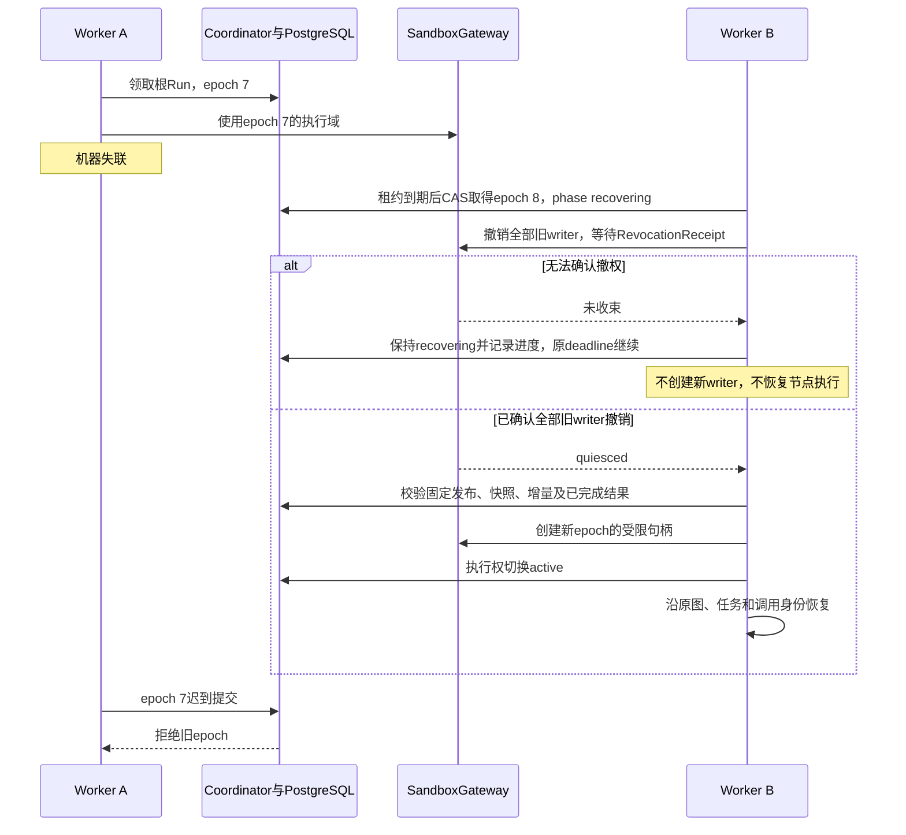

# 存储、故障恢复、应用服务与 API

> **重建边界（2026-10-15）**：旧业务实现已移除。本页保留为待调整的设计草案；用户、应用、发布与配置版本属于平台，SDK 只接收已解析配置并负责执行与恢复。涉及平台身份、发布绑定及表结构的内容需按 [SDK / Platform 边界](sdk-platform-boundary.md)重新划分，不直接作为 SDK 的必填契约或已实现功能。

**实施细则：[persistence](implementation/persistence.md)**。本页保留架构解释；具体方法、字段状态、事务和恢复分支见实施规格。

[总览](overview.md) · [领域模型](domain-model.md) · [数据契约](data-contracts.md) · [检查点协议](checkpoint-protocol.md) · [领域接口](domain-interfaces.md) · [验收](verification-roadmap.md)

更新日期：2026-10-15。状态：**目标存储与运维设计，尚未按新架构实现**。本篇保留存储部署、接管、发布、输入、停止和删除规则；Definition／Node 实体以[领域模型](domain-model.md)为准，检查点结构与提交 API 以[检查点协议](checkpoint-protocol.md)为准，完整领域及 HTTP 契约以[领域接口](domain-interfaces.md)为准，避免每篇维护一套相互冲突的字段。

## 1. 存储选型与权威来源

检查点通过统一 `CheckpointStore` 端口管理，按 Run、图执行范围和节点／调用身份定位。外层工作流和内层 Agent 分别保存各自执行现场，但使用一致的存取与恢复约定；它们不在各个 Skill、脚本或用户工作目录散落检查点文件。

存储实现推荐沿用 PostgreSQL 保存执行身份、检查点、任务结果、消息顺序、版本引用、额度和执行权；大内容可以通过共享存储保存不可变引用。字段、索引及事务接口已经在检查点协议中给出目标方案，仍须实现和故障注入验收。共享 POSIX 存储继续承担用户工作文件和资源包，单机测试可使用本地目录；跨机候选 NFSv4 必须通过锁与持久写验收。第一版不把对象存储直接作为脚本的 POSIX 工作目录。

进程中的 `RunRuntime`、`NodeDriver`、异步任务和连接都可以丢弃。恢复依据已经提交的领域记录，不依赖下一次请求调度到原机器，也不序列化 Python 调用栈。

```text
/shared/agentloom/
  resources/<space>/<resource_version>/          # 不可变 Skill/Prompt/资源包
  agents/<agent>/
    manifest.json                               # 系统维护的固定根身份
    sessions/<agent_session>/work/              # 持久 Agent 会话工作卷
    sessions/<agent_session>/runs/<run>/work/   # 非持久 Agent 会话工作卷
    invocations/<invocation>/work/              # 无 AgentSession 的持久子调用卷
    invocations/<invocation>/runs/<run>/work/   # 无 AgentSession 的非持久子调用卷
  workflows/<workflow>/
    manifest.json
    sessions/<workflow_session>/work/          # 持久 Workflow 会话工作卷
    sessions/<workflow_session>/runs/<run>/work/ # 非持久 Workflow 会话工作卷
  system/agents/<agent>/blobs/<prefix>/<sha256>
  system/workflows/<workflow>/blobs/<prefix>/<sha256>
                                                # 系统内容；均不暴露给脚本
  system/deletions/<job>/                        # 删除任务的最小路径清单
```

### 1.1 类型化归属与稳定工作区

`owner_ref={kind: agent|workflow, id, space_id}` 是资源归属，不以可选 Agent ID 推断。Agent 与 Workflow 创建时各自确定固定 `file_root_id`；实际宿主路径由存储适配器映射。运行时 `WorkspaceScope` 包含 `workspace_scope_id、owner_ref、file_root_id、partition_kind: agent_session|workflow_session|invocation、partition_id、run_id、invocation_id?、persistent`。Run 绑定持久保存；当前有效 lease 由 Runtime 另行验证并装配到调用和环境句柄，不放入此持久 DTO，保存的旧执行权不是恢复授权。

| 使用位置 | 分区与固定根 | 生命周期 |
| --- | --- | --- |
| 直接 AgentSession | Agent 根＋agent_session_id | 持久时跨该会话后续 Run 复用；非持久按 Run 分目录 |
| 外层 CapabilityNode | Workflow 根＋workflow_session_id | 同 WorkflowSession 的外层节点共用当前工作视图；不要求 Agent 或 AgentSession |
| input_only AgentInvocation | 被调用 Agent 根＋invocation_id | 不创建 AgentSession；同一次调用与恢复复用分区，不同调用使用不同目录 |
| 显式获得历史授权的 AgentInvocation | 被调用 Agent 根＋invocation_id | 历史读取授权不改变文件分区，也不授权挂载原 AgentSession 的工作卷 |

持久策略冻结自各自 owner 的环境配置，Workflow 不替子 Agent 改写该策略。input_only 即使开启持久，也只长期保存这一 Invocation 的文件，不自动把它变成可承接后续提问的会话。运行环境把本次授权目录映射为 `/work`，把角色或节点可用的资源版本映射为只读目录；同一 AgentInvocation 的 Planner 和 Executor 共享工作内容，模型上下文与只读能力资源可以不同。跨 owner／分区传递文件必须使用授权 ArtifactRef 或带来源的只读投影，不把父卷或全 Agent 根直接挂给子调用。

工作区登记的唯一创建键为 `(owner_ref, partition_kind, partition_id, run_id)`，file_root_id 必须匹配 owner 的固定根，persistent 来自本次冻结发布。Run 初始提交登记根工作区；AgentNode 初始提交登记子 Invocation 工作区，并保存创建意图。物理目录和句柄在事务后幂等建立；接管按相同创建键、scope ID 和路径恢复，不能改用新 Worker、重试号或新造 Session 建目录。持久会话工作目录可跨 Run 复用，但每个新 Run 都创建自己的 WorkspaceScope 并重新获得租约授权句柄；旧 Run 不因路径相同继续有权写入。会话分区配合单活动 Run 的占用协议，不同时发出互相覆盖的写句柄。

编译只固定 owner 类型、环境策略、节点/角色能力绑定以及 workspace 解析规则，不预分配运行目录。外层节点从 Workflow scope 取工作卷，AgentNode 按 invocation 分区在子 Agent 根解析，显式历史授权不改变其文件分区；文件、脚本和文件 MCP 所需 scope、凭据与授权缺失时发布失败。LLM 参数、Hook patch 或外部请求不能提供任意宿主路径、owner ID 或假 Session 绕过这些绑定。

开启持久沙箱时工作文件长期保留；不开启时，整个 Run 的全部写入者收束后，按工作区登记清单删除该 Run 所有 owner 下的非持久工作目录。单个子调用先完成不提前清理其产物。系统消息、调用记录与检查点另行保存，不随临时卷删除；逻辑沙箱共享不等于暴露所有分区的宿主目录。文件工具、脚本和 MCP 的具体授权见[能力与环境](capabilities-hooks.md#7-文件工具与共享执行环境)。

### 1.2 系统内容归属与跨 owner 依赖

系统 blob 按实际生产内容的 owner 保存：外层节点/Workflow GraphState 的自有内容归 Workflow，AgentInvocation 的上下文、模型/工具原始内容、摘要和产物归被调用 Agent，即使该 Invocation 没有 AgentSession。BlobRef 必须记录 owner 与访问范围，hash 不充当访问令牌。物理存储若内部去重，引用计数和授权仍按 owner 分开。

父工作流消费子结果时保存授权引用或可读派生投影，显式记录 `source_owner + source_ref` 依赖；复制到父 Operation、GraphState、消息、摘要或检查点也不能清除来源。派生投影继续携带传递依赖，注册依赖与发布可读引用在同一事务完成。缺少来源授权时不能仅因文件可读就生成副本。原始子内容不会因为外层 result mapping 自动成为 Workflow 自有内容。

来源依赖由映射、上下文与 Artifact 服务对已消费输入的依赖取保守并集传播，不要求 LLM 声明，也不从输出文本猜测。Artifact 导入须先登记接收工作区的来源依赖；任意脚本拷贝不承诺逐字追踪，无法拆分时撤销整个受影响工作区内容或派生投影，不能留下未登记的可读副本。

删除某 Agent 时，先撤销其源引用和所有依赖它的可读投影，再删除 Agent 内容；父侧混合内容无法安全拆分时将整个相应投影/摘要内容置为不可用并清理副本，保留无内容删除标记，不能继续提供缓存文本或从快照恢复该内容。正在依赖这些来源的 Run 先停止，后续执行读取明确得到 `SOURCE_OWNER_DELETED`，不能重放已删除 Agent。删除 Workflow 则清理 Workflow 自有记录、blob 与投影，并解除其引用，不级联删除 Agent 专属记录；必要时仅保留无正文的 Run/父关联墓碑供 Agent 审计引用，墓碑不能启动恢复。具体删除作业见第 5 节。

## 2. 持久对象的权威来源

设计态保存 Agent、AgentDefinition、GraphDefinition、AgentRelease 和资源版本；发布包固定节点绑定及依赖。运行态按以下层次保存，不再保留独立可写的旧 `AgentExecution` 状态机：

| 对象 | 保存与约束 |
| --- | --- |
| Session、UserInput、UserInputDelivery | 连续输入序号、原始补充、送达与下一轮转交；一个 Session 只绑定一个应用，直接 Agent 会话固定其 Agent |
| Run、ExecutionLease、LoopTicket | 顶层状态、截止时间、共享预算、执行权代际；Session 同时至多一个活动 Run |
| AgentInvocation | 一次完整 Agent 调用，固定 AgentRelease、工作环境、内层 GraphExecution 与结果关联；保存 budget_scope、started_at，Workflow 子调用另冻结 local_loop_limit／local_deadline_at 和局部控制状态 |
| GraphExecution、GraphCheckpoint、ScopeCommit | 编译图引用、不可变快照与提交增量；不同内外层图 scope 分开，统一 Store 保存 |
| NodeTask、NodeActivation、NodeCheckpoint | 逻辑节点任务、一次推进、版本化恢复现场；恢复保留 NodeTask 身份 |
| ReactContinuation | ReactNodeTask 的私有 Loop 阶段、context revision、模型调用和批次引用，不是新调度器 |
| CallBatch、WaitGroup、TaskResult、TaskWrite | 模型请求集合、等待条件、成员终态及待归并结果；任务可独立提交，全批结算后交回 Planner |
| OperationJournal、Attempt、HookInvocation | 实际请求与 raw／effective 结果、调用尝试、有序 Hook 决定及进度 |
| ContextRecord、ContextMutation、EffectiveContextRevision、摘要 | 原始记录不可变，ContextManager 维护有效模型视图，修改来源可追溯 |
| WorkspaceScope 登记、挂载意图 | owner、固定根、分区与稳定创建键；绑定当前 Run 的句柄须重新验证租约，不由保存的 epoch 授权 |
| Outbox、BlobRef、内容依赖、DeletionJob | 已提交通知、带 owner 的不可变大内容引用、source_owner 传递依赖、删除任务；通知不是执行事实的唯一副本 |

命名、DTO、索引与唯一约束不在此重复定义，见[检查点协议](checkpoint-protocol.md)及[数据契约](data-contracts.md)。`ScopeCommit` 是持久事实索引，`RuntimeCommit` 是提交命令；不能把消息通知当作唯一增量日志。图状态与 Context 是不同领域，后者的修改不等待图 Join。

快照保存当时内容或不可变引用；head/status 只是事务内维护的查询投影。根共享 Loop 额度归 Run。Workflow 内完整 AgentInvocation 的局部上限按同一 LoopTicket 账本中的 invocation_id 聚合，直接 Agent Run 则 alias 根控制，不重复建立局部预算。每张票据只有一份 state；根和局部计数如作查询投影须在同一事务更新，图／节点不能各自维护可独立扣减的余额。图调度检查 ready/wait/result，角色决策检查 Continuation 和上下文，不以 `plan.json` 的步骤状态充当运行现场。

## 3. 统一提交与低侵入调用

公开的提交入口为 `CommitCoordinator.commit(RuntimeCommit, ExecutionLease)`。CheckpointStore 提供恢复读取和协调器内部的快照／写入端口，不再暴露第二套任意业务提交入口。NodeDriver、InvocationProxy／持久调用管道及 GraphEngine 在公共边界提交；业务工具不手写检查点，总线观察者也不承担必须成功的保存。

| 提交边界 | 主要事实与恢复结果 |
| --- | --- |
| 接收输入 | 输入、交付记录，必要时 Run 与 Session.active_run；重复 client_message_id 返回原接收结果 |
| 请求与前置 Hook | 原始请求、固定 Hook 版本和顺序、已提交决定、有效上下文版本；恢复不重新应用 patch |
| 有效请求冻结 | 固定 actual request 与可信 scope；自动重试使用同一份请求，不随新补充漂移 |
| 模型首个有效输出 | 记录 Attempt 首输出证据并按输入协议更新送达；取消首输出计时，不生成 token 事件 |
| raw 结果保存 | 仅进入后处理阶段，尚不可交付成功；有 raw 的调用恢复后不再执行外部能力 |
| 后置 Hook 与 effective | 合法修改和 context revision 一致提交后返回；合法 deny 保留原副作用事实并交付明确 blocked 原因 |
| 模型票据预占／结算 | 固定按 Run → AgentInvocation 加锁，以同一票据检查根及适用局部约束并更新投影；reserved 满只等待，根实际耗尽优先关闭整树，局部实际耗尽仅关闭所属 Invocation |
| 接受模型决策 | 消费 effective 完整响应、结算 LoopTicket、固定 CallBatch 与成员或最终候选；不重复扣额度或再次分派 |
| Planner 委派 | begin 保存 Operation／dispatch 意图并返回 PendingOperationRef；Driver 的 Wait 提交固定父等待、获准的同图 Executor NodeTask 与启动意图；无新 GraphExecution，前置 deny 不创建子任务 |
| Executor 完成 | NodeTask 终态、TaskResult／TaskWrite 与名额释放同事务；委派 Operation 继续后置 Hook，WaitGroup 成员等最终 EventResponse 结算。并行可立即补位，串行须等成员完整结算才启动下一项 |
| 整批交付 | 按冻结 ordinal 一次性消费结果、推进原 Planner Continuation；若有图状态写入，按固定 reducer 归并 |
| 外层 AgentNode 启动 | 父等待、子 AgentInvocation／GraphExecution 初始身份、WorkspaceScope 登记/挂载意图、局部限制和 deadline 同事务；input_only 使用原 invocation 分区，提交后才激活，恢复不新建 Session/调用或重置期限 |
| 局部 AgentInvocation 结束 | 该调用全部角色与写入者收束后，保存局部结果和父唤醒意图；根租约与兄弟调用不受局部额度／超时影响，父按错误路由消费结果 |
| 节点完成 | TaskResult、完成状态和后继 intent 同事务；通知丢失仍能启动后继，不重做已完成节点 |
| 压缩完成 | 固定源 context revision 与摘要覆盖范围，检测新 patch；旧摘要不得覆盖后续有效修改 |
| Run 终结 | 终态、清 active_run、未送达补充转 pending、全部已登记非持久 scope 的清理意图和最终 outbox；迟到结果不能重启 Run |

具体状态、事务序列、父子恢复时序和故障矩阵见[检查点协议](checkpoint-protocol.md)。每项能力请求只有一个负责 Manager；HookManager 有序 await，允许、拒绝、修改都通过同一 EventBus 管道。合法拒绝必须回一个关联响应，不能靠丢弃事件表达；Hook 自身异常继续此前有效状态，必要权限、预算、存储失败不能被 fail-open 吞掉。

Hook 修改进入 ContextManager 的有效版本，当前执行、后续模型、历史、压缩及恢复均可见；原始事实不覆盖，私有角色消息不相互广播。已冻结或已发请求不追溯修改。ContextManager 准备写集，额度、CheckpointStore 与 outbox 由 Coordinator 一致更新；这些内部步骤不再递归进入同一 Hook 链。

节点输入输出更新、Loop 票据和上下文消费使用稳定幂等身份。`PendingFeedbackSlot` 是 Executor 模型失败反馈与票据结算的内部关联：失败已承诺进入父角色后续上下文时结算，不因此提前启动 Planner。该字段若作为投影实现，不建立一份可以绕开批次等待的独立状态。

默认不开并行；开启后默认同一批次最多两个活跃 Executor。名额覆盖 Executor NodeTask 从准入到终态提交的生命周期，含等待工具／模型和自动重试；排队但未准入者不占名额。TaskResult／TaskWrite 与终态提交后释放，父响应 Hook 后处理及 WaitGroup 等待不占 Executor 执行名额。恢复从同一组准入／终态事实重建占用，不能只靠内存 semaphore，也不能改按父 Operation 终态计数。串行配置另有 ordinal 准入门：当前成员完整结算前，即使名额空闲也不启动下一项。此处描述内部 Agent 的动作批次，按显式 WaitGroup 等待指定成员，普通成员错误不会取消其他成员；外层 Workflow 的同步语义另按 LangGraph 源码适配确定。

共享大内容先按类型化 owner 持久写入、校验 hash，再在短数据库事务中发布引用及来源依赖；事务内不等待模型、网络、Hook 或文件写入。只落盘但未被事务引用的 blob 可回收；引用已提交却不可读必须报告存储错误，不能重建猜测内容。模型可修改的工作文件与系统恢复 blob 分区。

## 4. 跨机器接管与阶段恢复

每个活动 Run 的调度权需要明确归属。图引擎调度节点、分派和汇合；ReactNode 及其 PlannerNode／ExecutorNode 子类沿用同一 Loop 规则。外层节点执行完整 Agent 时，外层保存该节点的状态和内层执行引用，内层保存自己当前的位置和调用记录。

外层恢复必须区分：节点未开始、节点正在执行、节点已完成但后继未被实际启动。正在执行时恢复原内层执行；内层已完成时读取原结果；外层完成推进已提交时继续已记录的后继。不能统一采用“再调用一次节点函数”的办法代替内部恢复。

采用单 Run 执行权覆盖整棵内外图执行树，数据库租约与写入域撤销配合。图引擎本轮在单机运行；跨机器接管迁移整棵执行树，不引入多机器同时调度同一图。旧执行者不能在接管后再次提交或与新执行者同时写同一现场。

Worker 用短事务领取 queued Run；失效运行通过 CAS 递增 lease_epoch。租约 TTL 和心跳间隔属于基础设施策略，具体数值待验收后确定，与用户的 Loop／并发配置无关。每个提交锁 Run、对 RunLease 持有共享锁；接管对租约行持排他锁递增代次。提交前使用数据库时钟再次检查代次、租约有效性和 Run 截止时间，不能只在请求开始时检查一次。

根超时后禁止新的业务推进和成功终态，但允许当前有效执行者提交取消、收束、补充转交、timed_out 及清理状态。失去租约的旧执行者连控制提交也不得写入，由新执行者处理。`deadline_at` 从 Run 创建时计算，排队、故障等待和重试均占用这一小时默认预算。

Workflow 子调用在初始 AgentInvocation 提交时记录数据库时间 started_at，并由冻结 Agent 配置计算 local_deadline_at；实际截止取根与局部较早者。接管必须恢复原期限与控制状态，不能用新 Worker 启动时间延长调用。每次准入、物理重试与成功提交都检查根及适用局部控制；局部过期只允许该 Invocation 收束并返回 INVOCATION_TIMED_OUT，外层按错误路由推进，兄弟调用继续。根和局部同时过期时根优先。局部结束不释放 Run 租约、不清理整 Run 工作目录。详细双层票据协议见[执行预算](agent-execution.md#7-共享-loopticket-与执行预算)。



数据库租约不能阻止已有脚本直接写 NFS。SandboxGateway 必须停止旧进程、撤销旧挂载权限，或强制隔离旧执行环境，然后才确认写入域可接管。无法确认则报告 `recovery_waiting_for_environment` 进度并等待，原 Run 截止时间继续推进。没有沙箱时同样需要受控脚本进程和写入域撤销，不能因为临时目录寿命短就跳过该边界。

恢复流程为：获取执行权 → 验证发布与资源引用 → 确认旧写入者撤销 → 装载范围检查点及其后已完成任务结果 → 沿父子引用重建执行对象 → 按保存的位置继续。内存对象重新创建，领域身份、根及局部原截止时间和已消耗／预留票据保持不变；记录为 running 并不能单独证明原 Worker 仍存活。

| 保存阶段／事实 | 恢复动作 |
| --- | --- |
| prepare_context / prepare_model | 使用同一 Context 和发布快照完成准备；冻结过的调用请求不随新补充变化 |
| compact_context | 按 CompactionEpisode 游标复用已完成摘要结果，继续未完成部分 |
| 请求 Hook 已完成，有效请求已冻结 | 复用其有效请求、已完成决定与 context revision，不重复修改或重新解析配置 |
| raw_saved，响应 Hook 尚未全部完成 | 从保存的 raw／当前有效载荷和 Hook 游标继续响应处理，不重新执行工具或模型 |
| 某 Hook 执行后结果未保存 | 先按 invocation 身份查询提交结果；确认无结果且处理器失联，建议记 indeterminate 并按 fail-open 继续此前有效状态，不应用未知 patch、不盲目重放 |
| 有效上下文 patch 已提交，后续 Loop 尚未开始 | ContextManager 读取提交后的 revision；不回退原始视图，不重复应用 patch |
| deny 决定已提交，回复未送达 | 补交付同一个 blocked／错误结果及原因，不改成重新执行 |
| effective 结果已提交，调用方未消费 | 复用原结果、对应 context revision 与消费关联，不重复外部执行或 Hook |
| call_model 且 Attempt 在途 | 接续可查询的执行句柄；无法确认结果时记录 unknown，再按连接异常分类与配置处理 |
| interpret_response | 解析持久化 effective 响应；幂等创建原批次或最终输出候选；raw 只作原始证据 |
| wait_batch | 成功成员保留；running Executor 恢复原 node_task_id/context_id；queued 成员按容量及串行 ordinal 门启动 |
| Executor 终态已存、父响应 Hook 未完 | 不占 Executor 名额，不重跑节点；只续接父后处理，未完成成员仍保留在 WaitGroup |
| 局部额度或期限触发收束 | 继续收束原 Invocation，结算原票据与父调用；不重置局部限额、不取消其他 Invocation |
| 全部成员完成、尚未 consumed | 批次消费提交一次性追加结果并重新激活原 Planner NodeTask |
| validate_output | 验证已有候选；不合规反馈进入下一业务 Loop，共用原 Run 额度 |
| stopping 或终态 | 仅收束、转交输入和清理；不恢复业务模型调用 |

这里必须区分“外部结果尚未保存”和“raw 已保存但 Hook／交付尚未完成”。后者已经有实际结果，不得因为响应处理未完成而重新执行原工具或模型；已提交 Hook 决定必须复用，最终 effective 结果提交之后才算可对外交付的调用终态。

合法 deny 已提交后应复用拒绝决定，它不是待重试的临时网络故障。未知 Hook 结果采用[检查点协议](checkpoint-protocol.md)中的技术建议：先查询已提交决定；确认无结果后记录不确定故障，保留此前有效状态继续，不能静默重放任意脚本。已提交 deny 必须复用，未知 patch 不应用，外部 Hook 副作用不保证能撤销。Hook 处理器自身异常可以按 fail-open 放行，合法业务拒绝不能放行；保存 Hook 进度或必要结果的基础设施失败也不能被当成普通 Hook 失败忽略。

调用请求已发出而原始结果尚未保存，无法单凭缺少记录判断是否产生外部副作用。可查询句柄优先核对；无法接续则标明 unknown。自动重试默认关闭；开启后，仅识别为匹配配置的异常且仍有剩余尝试时重试，默认最多两次执行（含第一次）、间隔两秒。工具幂等声明不作为 Runtime 的重试准入条件，外部提供方负责自身业务防重。

普通工具错误返回当前 Agent，整批收齐后继续 ReAct；Executor 模型最终失败进入父批次；根角色模型或压缩模型不能继续时结束所属完整 AgentInvocation。直接 Agent Run 随之结束；Workflow 内调用失败经父 AgentNode 错误路由处理，根停止／根耗尽／根超时才默认终止整棵树。不得把“未知是否执行”偷偷解释为“已安全撤销”，也不承诺外部副作用恰好一次。

## 5. 发布、输入、停止与删除

### 发布

1. 校验草稿 revision、模式、角色、能力引用和预算，冻结不可变候选 AgentRelease，引用 AgentDefinition／GraphDefinition 版本、节点绑定与资源清单，编译校验依据[领域模型](domain-model.md)。
2. 锁 Agent 标记 publishing，拒绝新 Run；请求已有 Run 停止。
3. 等已有 Run 收束，未送达补充保留待下一提问领取；发布自身不创建 Run。
4. 原子切换 published_release_id，解除 publishing。失败则保留旧指针，已经结束的 Run 不重新启动。
5. 同一 Session 下一次提问使用新 Release，文件根与历史身份不变。

发布期间空闲 Session 的新执行请求返回 409 `AGENT_PUBLISHING`；对正在收束 Run 接收的补充，明确回报 pending／未执行，不默默丢掉。每次 Run 配置固定，资源更新不会在中途修改其 Prompt、Tool 或 Skill 版本。

### 输入和结束竞争

Session 行锁定义输入接收与 Run 结束的先后顺序。存在活动 Run 时输入作为补充；无活动 Run 时，新提问创建下一 Run 并领取 pending 输入。重复 client_message_id 返回原结果。

模型准备只 claim 输入，首个有效模型输出持久化才标 delivered。Hook 前置拒绝造成请求没有实际送达模型时，不可伪造 delivered。Run 结束把未 delivered 输入转为待处理；下一次提问创建新的 UserInputDelivery，保留原 input_id 和 previous_delivery_id。按 input_seq 排序，历史投影与待处理输入去重。用户补充是正式 user 消息，较早历史也保留；它不额外占一个“最近 N 次已结束提问”的名额。

### 停止和清理

停止接口幂等设置 stopping，关闭新 Loop、新 Executor、未启动动作和新 Attempt 的启动入口。边界是当前已发调用的最近可保存安全点，不承诺执行完当前 Loop 的剩余动作：串行 A 在途、B 排队时，收束 A，B 标 cancelled／未执行；在途模型返回新的动作也不执行。向支持取消的模型连接、脚本环境和工具发送中断；不能立即中断的调用按原调用及 scope 时限收束。不能留下永远等待的成员，也不能由后处理 Hook 再启动新的业务动作。取消 Python coroutine 本身不代表远端操作已结束。

最后一个仍可能写工作卷的任务终结或被隔离后，Runtime 才提交 Run 终态并安排工作文件清理。不能第一个 Executor 停下来就删除其他 Executor 使用的目录。Hook 可参与终结通知，但默认文件寿命和必须执行的清理由 Runtime 保证；Hook 失败不能跳过清理责任。

停止和成功提交在数据库串行化：已经终态则停止返回原状态；停止先生效则迟到结果不能改回成功。deadline 过期禁止成功提交。Runtime 返回明确异常终态与未完成原因；已有模型片段保存为该 Attempt 的不完整记录，不直接作为成功答案交付，也不把不同 Attempt 拼起来。不追加模型总结。清理失败作为 cleanup_state 单独展示，不能把已结束 Run 重新启动。

### 删除

删除 Agent／Workflow 先按 owner 标记 deleting，拒绝其新执行和新内容引用，停止所有相关活动 Run；写入者收束后，DeletionJob 固定待删除 scope、记录和 blob 清单。删除 Agent 覆盖其会话、input_only Invocations、操作、上下文、检查点、系统内容及专属文件；根据 source_owner 依赖索引同时撤销和清理外层父记录中的授权引用、派生投影、摘要和缓存副本，避免内容换一个 owner 存放后残留。父 Workflow 的其他独立数据及定义仍保留，只将相关结果标为来源已删除。

删除 Workflow 覆盖其 WorkflowSession、根 Run 的自有记录、外层 GraphState/检查点、system/workflows blob 与专属目录，解除父子结果引用；不级联删除被调用 Agent 的专属上下文、调用记录或持久文件。跨 owner 关联只留下最小无内容墓碑和删除原因用于审计，不保留父内容或继续运行入口。共享 Skill／MCP／模型连接等资源仅解除引用，不删除其他 owner 使用的配置。

删除作业以 owner 和内容依赖为权威，不仅扫描一个物理目录。文件或投影清理失败则保留作业和 deleting 状态，读取端已撤销授权，重试清理后才能宣称完成。日志不另存会话内容副本。在线删除不表示离线备份已逐份擦除，备份擦除仍是运维职责。正常 owner 的记录和持久沙箱暂不自动过期；非持久 Run 工作文件在整个 Run 收束后删除。

## 6. Plan 文件及其他应用服务

PlanService 把计划保存到授权工作卷中的 `plans/<invocation_id>/plan.json`。Planner 通过 `plan.read/plan.update` 提交步骤序号、文本和状态；服务绑定 Run 和文件根，校验 revision，在独立锁文件上加排他锁，写临时文件并原子替换。目标路径以完整 AgentInvocation 区分，避免未来同一外层 Run 多次调用同一 Agent 时碰撞。

计划内容用于模型组织任务。真正执行的调用由模型响应、CallBatch、NodeTask 和 Operation 表达；计划步骤不会自动转成工作流，工具或 Executor 完成也不会自行修改步骤状态。Planner 收到结果后选择更新计划。

每次更新作为 Operation 保留版本 hash 和实际内容。文件与数据库不同步时按 revision/hash 核对已生效的更新，不能盲目再次覆盖。文件锁负责单个计划文件互斥，不承担整个 Run 执行权。无沙箱结束时计划工作文件删除，历史 Operation 仍保留实际更新记录。只有 Plan JSON 无法恢复 Agent Loop。

KnowledgeService 管理 Markdown/TXT/SQL 等文档版本；索引任务调用 EmbeddingProvider，检索作为授权 Tool 返回内容和出处。SQL 文档不自动执行数据库语句。MemoryService 若后续加入，作为独立能力接入，不直接覆盖原始记录或决定 Runtime 的恢复位置。

ModelCatalogService 发现可用 model ID 和元信息，保存来源、获取时间和人工覆盖。发布快照固定运行解析值；未知上下文窗口要求用户填写。凭据由 CredentialRepository 加密保存，前端只显示掩码。

## 7. 应用 API 与页面行为

统一前缀 `/api/v1`。鉴权后从资源 ID 反查类型化 owner 及 Space 归属，不信任客户端声明的 Agent／Workflow／Session 或工作目录。权限失败 403、缺资源 404、状态冲突 409、数据结构错误 422；敏感资源可统一返回 404。管理会话 cookie 配合 CSRF，程序调用使用有范围的 API token，两者经过同一 AuthorizationService。

| 方法与路径 | 请求／返回要点 |
| --- | --- |
| POST `/agents` | 名称、mode；返回 Agent 和 draft revision；模式在此固定 |
| PATCH `/agents/{id}/draft` | If-Match revision；角色、能力、预算、上下文和环境配置 |
| POST `/agents/{id}/validate` | 配置错误与解析后的角色／能力摘要；不调用业务模型 |
| POST `/agents/{id}/releases` | 草稿 revision；202 release_job_id |
| GET `/release-jobs/{id}` | publishing/succeeded/failed、release_id 和错误 |
| DELETE `/agents/{id}` | 202 deletion_job_id；幂等重复返回同一任务 |
| GET `/deletion-jobs/{id}` | 清理阶段与结果 |
| POST `/agents/{id}/sessions` | 新建属于固定 Agent 的连续会话 |
| POST `/sessions/{id}/inputs` | client_message_id、文本、可选结构化输入；返回 input_id、run_id、disposition=new_run/supplement/pending |
| GET `/sessions/{id}/messages` | 原始消息与有效视图明确区分；按序号分页，修改标来源、revision，包含补充与真实结束状态 |
| GET `/runs/{id}` | status、原因、额度、当前执行摘要、cleanup_state |
| POST `/runs/{id}/stop` | 202 表示正在收束；已终态返回原结果 |
| GET `/runs/{id}/events` | SSE；Last-Event-ID 按持久 run_seq 续读 |
| GET `/runs/{id}/executions` | AgentInvocation／GraphExecution／NodeTask 树、角色、phase、状态和关联批次 |
| GET `/runs/{id}/batches` | 该 Run 的 CallBatch 及各成员状态；可按执行实例过滤 |
| GET `/operations/{id}` | 脱敏的原始／有效请求、raw／effective 结果、Attempt、Hook 决定／来源、context revision 及交付状态 |
| GET `/sessions/{id}/files` | 当前授权可用文件；临时卷已删则明确不可用 |
| POST `/resources/skills/imports` | 文件夹包或 Git 引用；校验后建立不可变版本 |
| POST `/resources/mcp/connections` | 协议、地址、凭据引用；探测能力目录 |
| POST `/model-connections` | 供应商 profile 与 Key；只回掩码 |
| POST `/model-connections/{id}/discover` | 可用模型／元信息、来源与未知项 |
| POST `/knowledge/imports` | 文档、collection；返回索引任务 |

这是常用应用接口摘录，不承诺现有服务已经支持；完整目标接口以[领域接口](domain-interfaces.md)为准，包含已设计但暂不实现的工作流及图定义 API。用户侧不新增暂停／恢复操作。单 Session 不并行运行两个 Run；正在服务时的新输入是补充。

前端创建 Agent 时固定 ReAct 或 Plan–Executor，发布后才能运行。调试页展示角色执行和本轮调用，不要求用户理解阶段实现。用户停止后显示收束中，直到收到持久化 Run 终态。

模型提供方的连接仍使用流式协议，连接适配器先内部接收和组装。完整 raw 响应保存后经过有序响应 Hook 与最终校验，effective 结果及其有效上下文关联一致持久化后才交付 Loop；若响应被合法拒绝，交付关联的 blocked／错误及原因。SSE 不转发 `model.delta` 或每个 token／chunk，也不把 Planner／Executor 的每次模型输出当成对用户的最终回答。

| 对外交付类型 | 内容与边界 |
| --- | --- |
| 生命周期／进度 | Run 开始、调用完成摘要、执行器状态、收束进度等低频事件；字段和可见权限另定 |
| 成功终态 | Run 结果已经持久化且满足完成条件后，交付完整最终答案 |
| 失败／停止／超时终态 | 明确状态、原因及完成程度；拒绝保留阶段与原因，不伪造执行或成功答案 |
| 重连补读 | 依据持久事件序号恢复上述事件；不是重播模型 token 流 |

首个有效输出默认 60 秒超时由连接层观测，与用户是否已经收到内容无关。收到首输出后取消这一计时，整次 Run 默认一小时上限继续生效。连接错误按 Agent 的重试配置处理；已经中断的 Attempt 片段单独留存，不能与下一尝试拼成一个完整模型响应。

模型响应完成不等于 Run 完成：Runtime 要读取经 Hook 后持久化的 effective 完整结果，判断工具调用、委派或最终候选，再应用输出校验与执行状态规则。不执行尚未收齐的工具参数，不依赖前几段文本猜测最终答案，也不增加强制模型调用 `finish` 工具的协议。

## 8. 事件、运维与参考

调用代理负责把普通接口调用转换成统一 EventBus 上的请求／回复。分发前等待 HookManager 按固定顺序校验 allow／deny 与修改，各能力域 Manager 只消费获准的最终有效内容；纯通知观察者也订阅同一 EventBus，但不控制执行。持久边界记录原始／有效内容及 Hook 进度。相同调用恢复时复用已提交决定和结果，LLM 后续再次提交相同参数仍是新调用。

统一总线覆盖模型、工具／MCP、上下文更新、委派、环境和控制消息，但命令、响应与观察通知具有不同消费语义。一项执行请求只分发给一个负责 Manager；多项操作使用请求 list，各自关联回复，避免广播造成重复外部副作用。Hook 不可修改响应关联身份、causation、消息类型或可信 scope，也不能移除必需响应；deny 通过关联错误回复表达。没有负责人或无法形成合法回复时返回明确错误，不能留下永久等待的 Future。

Hook 自身失败或超时不阻断主体，保留该处理器前的有效状态；合法 allow／deny、输入／输出及有效上下文修改已纳入本轮方案。业务 schema、权限、版本与必要存储失败仍由 Runtime 明确处理，不能混入 Hook fail-open。无需再把 Hook 执行转换成 `hook.execute` 业务请求。必需的检查点、Hook 处理进度、预算、终态及清理由 Runtime 基础设施提交，底层存储不会再递归经过同一总线。统一 EventBus 不自动提供持久化，也不意味着必须引入外部消息中间件。

Outbox 至少一次投递，消费者按 event_id 幂等处理。SSE 先订阅通知再从数据库游标补读，遗漏通知可以补齐。客户端断线只停止订阅；不取消业务 Run，重新连接也不重新发起模型调用。raw 已保存但响应 Hook 未完成时，不发送逻辑调用“已完成”；effective 结果与交付事实持久化后才通知。Run 也必须先持久化其终态，再发布最终交付。Executor 节点结束通知仅表示执行名额可以释放，不能冒充父委派 Operation 的 effective 结果或提前结算其 WaitGroup 成员。

指标按 run_id、invocation_id、graph_execution_id、node_task_id、batch_id、operation_id 关联，覆盖阶段等待、Loop 使用／预留、并发占用、首输出延迟、重试、压缩、Hook 处理／未知状态、raw 到 effective 的等待、上下文 patch／revision 冲突、租约、存储和清理。常规日志不保存明文 Key、完整 Prompt 或用户文件；有权限的运行记录接口分别读取原始事实与有效视图，并展示 Hook／系统修改来源、版本与因果关联，不能把修改后的内容标成原始返回。

备份同时覆盖 PostgreSQL 和其引用的系统 blob。跨机验收必须验证 NFS 锁、rename、稳定写、不同 owner／会话／input_only Invocation 分区隔离及旧写入域撤销；仅用两台机器都能读同一个目录，不能证明恢复正确。

外层 Workflow 计划复制并适配 LangGraph 的状态、同步和检查点源码；具体导入范围及与平台持久化的映射见[适配决策](architecture-discussion.md#6-workflow-产品范围与-langgraph-源码适配)，不等于迁移全部仓库或直接兼容其持久化格式。具体模块与接口见 [检查点协议](checkpoint-protocol.md)和[领域接口](domain-interfaces.md)。[官方检查点说明](https://docs.langchain.com/oss/python/langgraph/checkpointers)、[Checkpoint 与 Saver 接口](https://github.com/langchain-ai/langgraph/blob/afbe7e48b17f62e139b5c6337ab934549e6dc73b/libs/checkpoint/langgraph/checkpoint/base/__init__.py)、[任务结果保存与复用](https://github.com/langchain-ai/langgraph/blob/afbe7e48b17f62e139b5c6337ab934549e6dc73b/libs/langgraph/langgraph/pregel/_runner.py)。
