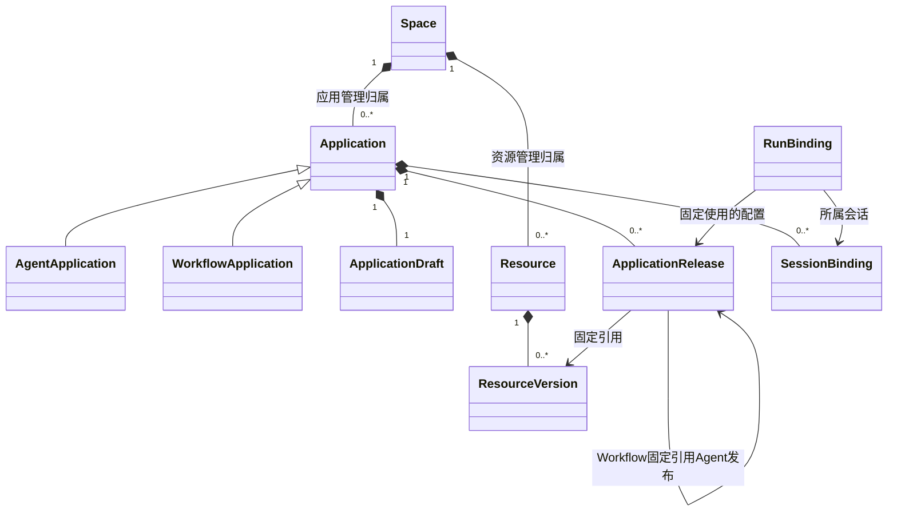

# 平台领域对象与归属

本页描述管理实体。SDK 的 AgentDefinition、GraphDefinition、Run 和 NodeTask 是执行领域，见[SDK 对象关系](../sdk/definitions.md)。

## 1. 实体

| 实体 | 所有权和身份 | 生命周期 |
| --- | --- | --- |
| User / Membership | 平台账号及空间成员关系 | 平台管理 |
| Space | 应用和共享资源的管理范围 | 不向 SDK 暴露为必填运行字段 |
| AgentApplication | space_id、agent_id、不可变 mode、file_root_id | 创建、编辑、发布、删除 |
| WorkflowApplication | space_id、workflow_id、file_root_id | 用户编排与发布 |
| ApplicationDraft | 属于一个应用，revision 用于编辑 CAS | 可修改，不可直接运行 |
| ApplicationRelease | 属于一个应用，release_id／业务版本 | 不可变配置快照，引用固定资源版本 |
| Resource / ResourceVersion | 属于空间或获授权共享目录 | 模型连接、Prompt、Skill、Tool、MCP、Hook 等 |
| SessionBinding | 应用、可见性、SDK session_id 的关联 | 管理权限与展示，不持有第二套上下文真相 |
| RunBinding | 应用／发布／会话与 SDK run_id 的关联 | 管理索引、分派和查询，不保存可写 Loop 现场 |
| DispatchIntent | 一次待交给 SDK 的执行／控制请求 | 持久派发，支持重投 |
| DeletionJob | 应用及其专属资源的清理进度 | 阻止新输入，等执行收束后删除 |

## 2. UML：归属和引用

发布包引用资源，不拥有共享资源；删除 Agent 不能连带删除模型连接或别的应用使用的 Skill。Workflow 发布包可以引用完整 Agent 发布包，不能引用另一个 Agent 的私有 Executor 任务。

## 3. 发布与 SDK 定义的关系

发布包保存可以重新装配的行为、结构、资源版本和环境配置。AssemblyService 将它转换为 SDK AgentDefinition／GraphDefinition、NodeBinding、策略及依赖。SDK 构造对象没有发布记录依赖。

SDK 定义是行为／结构的值描述，平台可以用版本库保存这些值，但不是要求 SDK 内置一个 DefinitionVersion 仓库。发布校验结果、平台配置 hash 和编辑 revision 留在平台，不作为 SDK 恢复兼容指纹。

RunBinding 固定 execution_snapshot_ref、release_id、sdk_run_id、sdk_session_id 和 runtime_namespace_ref。凭据值不进入快照或日志；恢复时重新解析连接依赖，模型参数、Prompt、能力和策略保持原值。

## 4. 管理状态与执行状态

- 应用 lifecycle：active / publishing / deleting / deleted。
- 草稿 revision 和发布版本属于平台。
- DispatchIntent 状态表示待派发、已被 SDK 接收或派发错误，不代表业务执行成功。
- RunView 中的运行状态从 SDK 查询或事件投影；事件重复／延迟不能反向改写 SDK 状态。
- SDK 对象和平台实体可以存于同一物理数据库，但分开 schema／repository，禁止跨层写入。

## 5. 删除与保留

应用存续期间记录暂不过期；无持久沙箱的 Run 工作文件仍在整次 Run 收束后删除。删除应用先关闭接入、停止关联执行，再通过 SDK 清理已收束的执行／会话记录，最后删除专属文件与平台配置。

清理需根据 RunBinding、资源依赖和文件根清单确定范围。引用该应用的 Workflow 不得绕过删除屏障新建执行；现有依赖的处置见[生命周期](storage-lifecycle.md)。SDK 不根据某个 agent_id 自行推断要删除哪些数据。
