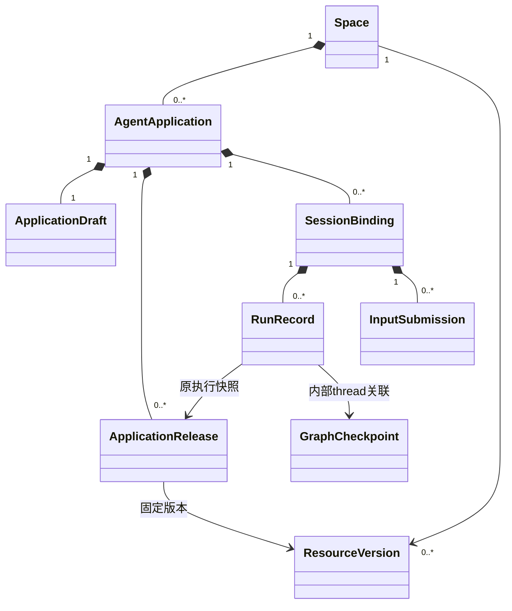

# 平台领域对象与归属

更新：2026-10-20。以下为待实现的平台领域模型。平台运行底座为 LangChain + LangGraph；RunRecord、InputSubmission 等属于平台，不是 agentloom-sdk 的 ExecutionRecord 或 NodeTask。

## 1. 实体

| 实体 | 所有权和身份 | 生命周期 |
| --- | --- | --- |
| User / Membership | 平台账号及空间成员关系 | 平台管理 |
| Space | 应用和共享资源的管理范围 | 平台授权边界，不等同于文件工作区 |
| AgentApplication | space_id、app_id、不可变 mode、file_root_id | 创建、编辑、发布、删除 |
| ApplicationDraft | 属于一个应用，revision 用于编辑 CAS | 可修改，不可直接运行 |
| ApplicationRelease | release_id、不可变执行快照及实现清单 | 固定配置、资源、图和状态格式版本 |
| Resource / ResourceVersion | 属于空间或获授权共享目录 | 模型、Prompt、Tool、Skill、MCP、middleware、环境等 |
| SessionBinding | app_id、owner_actor_id、稳定 session_id | 私有会话及顺序控制 |
| RunRecord | run_id、session_id、release_id、graph_thread_id | 排队、执行控制、终态、清理及恢复关联 |
| InputSubmission / InputDelivery | 正式用户内容、稳定 input_id、目标 Run、采用回执 | 幂等接收、图内采用和待下轮交接 |
| DispatchIntent / StopCommand | 执行任务及独立停止意图 | 持久投递，重试不换逻辑身份 |
| OperationLedger | Tool／MCP 操作身份、参数摘要、外部回执 | 副作用对账与受控重试 |
| RunEvent / RunView | 可公开进度和查询结果 | 平台单调序号，不透传原始图状态 |
| ReleaseJob / DeletionJob / CleanupJob | 发布、删除及执行域清理进度 | 分阶段、可重试 |

WorkflowApplication 是后续独立产品类型，首版不创建。以后可引用完整 Agent 发布；不把某个应用私有的 Executor 当作可跨应用引用的独立实体。

## 2. UML：归属和引用

图中的 GraphCheckpoint 表示上游 Saver 管理的状态，不是平台 ORM 级联实体。资源为共享目录对象，删除应用只解除引用。

## 3. 发布与执行图的关系

ReleaseCompiler 生成可序列化 ExecutionSnapshot；AssemblyService 将其转换为 LangChain Agent 或 LangGraph 图，以及模型、工具、中间件、checkpointer 和受限环境依赖。图结构及状态格式版本属于发布实现清单，不能只固定 Prompt 而允许恢复时换一套图。

RunRecord 固定 execution_snapshot_ref、release_id、graph_thread_id、runtime_binding_ref 和 deadline_at。一个 Session 有多次 Run，首版每次 Run 使用独立 thread；恢复沿用同一个 thread。跨轮上下文来源和私有角色状态边界见[身份与检查点](runtime-integration.md#2-sessionrun-与检查点)。凭据明文不进入快照或日志。

## 4. 管理状态与执行状态

- 应用 lifecycle：active / publishing / deleting / deleted。
- Run 状态：queued / running / stopping / completed / failed / cancelled。恢复情况用独立 recovery_state 表示，不根据心跳超时伪造业务失败。
- DispatchIntent 状态只表示任务传递；InputSubmission.status 只表示输入接入；两者都不代表回答成功。
- 图状态、计划、角色消息和采用标记由 checkpointer 保存；平台从持久图结果确认终态，禁止直接改 Saver 私有表来“完成任务”。
- cleanup_state 独立于业务终态；有结果但清理失败仍能读取答案。

## 5. 删除与保留

应用存续期间正式输入、公开答案和恢复记录暂不过期。工作文件按 run／session 保留策略清理，与沙箱启停无关。删除先关闭准入并停止活动执行，再清理图 thread、会话、待交接输入、专属文件与配置；共享模型、Tool、Skill、MCP 不被级联删除。

删除按持久清单及任务回执恢复，保留防迟到启动的最小墓碑。具体顺序见[生命周期](storage-lifecycle.md)。
