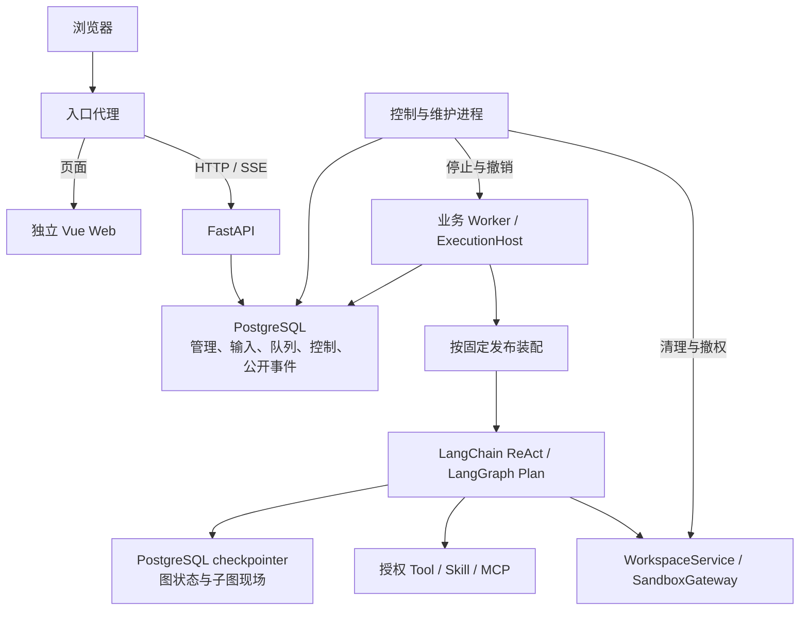

# Platform 团队私有部署实施方案

更新：2026-10-20。已确定团队私有部署、多人、空间权限、应用发布及前后端分离；运行底座改为 **LangChain + LangGraph**，不再使用 agentloom-sdk。首个可运行开发版本已落地，详见[当前实现与限制](implementation.md)。本页保留目标架构和阶段计划，不能将整份计划视为已完成。

## 首版范围

| 范围 | 首版交付 |
| --- | --- |
| 身份与空间 | 登录、成员管理、viewer／editor／admin、私有会话、管理员操作审计 |
| 应用 | ReAct／Plan；新建时名称、必选模式与描述；草稿 CAS、校验、不可变发布 |
| 资源 | 独立 Tool／Skill／MCP 管理页，先注册／导入／发现，再按应用角色绑定 |
| 运行 | 新提问、活动补充、停止、历史、Plan 任务进度、SSE 重连、同机重启恢复 |
| 环境 | 工作区读写与文件保留；执行沙箱单独接入，未验收时 exec 不开放 |
| 运维与删除 | 持久派发、控制、清理、应用完整删除、升级与备份恢复验收 |

Workflow 画布、跨机器接管、任意代码上传执行、完整知识库、逐 token 输出、供应商内置工具、客户端执行工具及企业 SSO 放到后续阶段。具体上游能力与平台交付范围见[能力类型](capabilities.md)。

## 部署和技术选型

`web/` 使用 Vue + TypeScript SPA；`api/` 使用 Python + FastAPI，管理数据采用 SQLAlchemy + PostgreSQL。后端提供 API、业务 Worker、控制／维护进程入口，可共享一个安装包和镜像；生产图状态使用 PostgreSQL checkpointer，资源包与工作文件使用独立持久卷。

LangChain 负责模型、Tool 和 ReAct，LangGraph 编排 Plan 并保存图状态。平台直接安装上游开源包，不迁入 LangGraph 源码，不要求 LangSmith 云服务；如启用外部观测须单独配置数据发送范围。具体版本在 P0 锁定，不能把 beta 接口或框架版本默认值当成稳定的平台合同。

### 前后端分离约束

| 层 | 工程与交付边界 |
| --- | --- |
| Web | 独立 package.json、锁文件、测试和构建任务；静态服务器或 Web 容器托管；构建不需要 Python 或数据库 |
| API | 独立 Python 包和镜像；仅提供 `/api/v1` JSON、SSE 及将来的文件接口，不包含 web/dist、不挂载 SPA |
| Worker | 后端独立进程；解析服务端凭据、装配图、推进执行；不依赖浏览器在线 |
| 控制／维护 | 独立于业务队列处理停止、进程撤销、发布、清理与恢复；不可用时展示待处理意图 |
| 合同 | OpenAPI、SSE Schema 及版本化 DTO；前端不导入内部图类型，不读取数据库或检查点 |
| 发布 | Web 与后端分别生成版本化产物，分别启动和回滚；API／Worker 兼容性不依赖同时升级 |

入口代理将 `/` 转给 Web，将 `/api/v1/*` 转给 API。同域简化登录，不合并构建或进程。Web 处理深层路由刷新，未知 API 返回 JSON 404；SSE 关闭代理缓冲并设置连接超时。本地分别启动 Vite 和 API，开发代理只转发 API。

前端公开运行配置可指定 API 地址，不含凭据和宿主路径。跨源部署须明确 Origin、Cookie／credentials、CSRF 和 SSE 登录重连策略，不用通配 CORS 代替权限。

已检查 oracle-a2 旧版提交 `25b9fd2`：旧版虽按 apps/web、apps/api 分目录，但前端产物被复制进 Python 镜像并由 FastAPI 托管。新版只参考[页面布局](interaction-design.md#旧版布局参考)，采用上述独立部署合同。



API 保存控制意图，不在请求中调用不存在的 LangGraph runs.stop。业务 Worker、控制进程和图写者的协作见[运行接入](runtime-integration.md)，图示名称均为计划模块。

## 持久化和运行控制

| 区域 | 内容与写入者 |
| --- | --- |
| platform schema | 管理实体、正式输入、RunRecord、执行权、任务、操作回执与公开事件；平台 repository 写入 |
| graph checkpoint schema | 图消息、计划、采用标记、子图状态和 pending writes；选定 checkpointer 写入 |
| 资源卷 | 固定 Skill 包、资源清单与实现缓存；导入服务写入，运行只读 |
| 工作卷／沙箱 | 隔离的应用、会话和任务文件；WorkspaceService 与环境服务按授权访问 |

同一数据库实例不代表跨 schema 提交自动原子。图中持久输入标记、结果引用和平台回执通过对账闭合；运行日志和状态缓存不能取代检查点。首版每 Run 一个 graph_thread_id，故障复用，下一轮通过公开会话历史建立新图；这样新发布不读取旧图的内部结构。

派发采用 PostgreSQL 队列表，以短事务领取任务；可以用 `FOR UPDATE SKIP LOCKED` 分摊不同任务，但同一 Session 的输入顺序须额外检查最早未决提交，不能仅靠 ORDER BY。[PostgreSQL 锁定查询](https://www.postgresql.org/docs/current/sql-select.html#SQL-FOR-UPDATE-SHARE)

ExecutionHost 为每个活动 Run 启动可单独撤销的执行子进程，并负责单写者。租约过期后先由同机 Supervisor 确认旧进程、沙箱及文件写入已撤销，再接续图；无法确认则阻塞恢复。上游 checkpointer 不自带平台 Worker 租约，跨机 fencing 属于后续验证。外部副作用使用稳定 operation_id、目标幂等键及回执对账；未知结果不得盲目重放。

API 和 Worker 各管理连接池与启动关闭流程；每请求／任务使用独立数据库 Session，不把 ORM Session 长期注入图。控制与清理有独立扫描，不能被某个未决模型请求堵住。

## 后端模块和前端页面

以下是计划目录：

```text
agentloom-platform/
  api/
    pyproject.toml
    src/agentloom_platform/
      bootstrap/       API、Worker、控制维护入口和依赖生命周期
      identity/        身份、成员、授权与审计
      applications/    应用与草稿 CAS
      resources/       Tool、Skill、MCP、模型、凭据与版本
      releases/        ReleaseCompiler、固定快照和发布任务
      execution/       RunRecord、InputInbox、队列、执行权、停止和对账
      runtime/         RuntimeGateway、AssemblyService、ReAct / Plan 图
      runtime/tools/   工具注册、MCP 适配和操作回执
      runtime/skills/  技能目录、按需读取和角色隔离
      runtime/middleware/  输入、预算、授权、上下文和审计
      environment/     WorkspaceService、SandboxGateway、模板和挂载
      lifecycle/       发布屏障、删除、清理及墓碑
      persistence/     平台 ORM、repository 和迁移
      http/            OpenAPI、DTO、SSE 与错误映射
  web/
    package.json       独立开发、构建、测试和锁文件
    src/app/           AppShell、路由和空间上下文
    src/features/      agents、tools、skills、mcp、sessions、settings
    src/api/           从平台合同生成的客户端
  tests/
    contract/          API、图、输入、停止及环境合同
    integration/       PostgreSQL、真实进程和故障切点
    e2e/               浏览器关键流程
  deploy/              分离 Web、API、Worker、控制维护和入口代理
```

只在 runtime 集中装配上游对象，其他业务模块通过平台 DTO 和 RuntimeGateway 协作。SDK 的 RuntimeEngine、AgentBuilder、FileRuntimeStore、HookSet 不进入平台实现。

页面保留旧版布局参考，并明确提供应用、Tool、Skill、MCP、模型与环境、私有会话及空间管理入口。Plan 编辑器按 Planner／Executor 选择能力；创建表单模式必选且不可后改。页面操作合同见[交互设计](interaction-design.md)。

## 身份和资源授权

viewer 使用已发布应用及自己的会话；editor 编辑、绑定资源与发布；admin 登记资源、管理成员凭据、删除及审计授权的跨用户操作。Space、应用、Session、Run、资源的归属都从持久关联校验，不能相信客户端 space_id。

首版由部署管理员初始化账号，关闭公开注册；浏览器采用可撤销会话及 CSRF，API Token 单独作用域。实例管理员和空间 admin 分开，不从空间角色推导全站管理权。

资源授权取空间授权、发布绑定、角色授权与当前撤销限制的交集。模型或 Skill 不能扩大权限；角色目录与运行调用都校验。新权限撤销立即阻止新访问和动作，并请求停止受影响 Run，仍保留必要恢复／清理依赖。SSE 每批读取复核权限。

Tool 和 middleware 从受信注册表选择；Skill 脚本和受控 stdio 需要实际隔离环境。密钥加密或外置密钥服务，明文不进入快照、检查点和日志。模型调用、MCP discovery、资源导入和图纯构造验证分别执行。

## 数据约束和发布快照

详细表见[存储设计](storage-lifecycle.md#1-平台逻辑表)。必须有同会话 client_message_id 唯一、HTTP 幂等键唯一、graph_thread_id 唯一、单活动／预留 Run、草稿 revision CAS 和同应用单活动发布任务约束。领取回执核对 generation；不持应用或 Session 行锁等待图执行。

```text
ExecutionSnapshot
  snapshot_version, release_id, content_hash
  mode, definition, executors
  resolved_execution_policy, resolved_context_policy
  model_binding                 provider、model、endpoint、credential_ref
  resource_bindings             固定 Tool / Skill / MCP 版本、Schema 和授权
  middleware_bindings           固定受信实现、配置、顺序和失败策略
  environment_binding           沙箱、工作区访问、文件保留
  graph_version, state_schema_version
  implementation_manifest       依赖锁、后端镜像、注册实现摘要
```

ReleaseCompiler 固定可序列化值，AssemblyService 创建本机连接与图。模型／工具客户端不放进图 state；不同 Run 不复用可变角色状态。validate 使用无外部调用的桩与内存 Saver，不接入生产文件、模型或沙箱。生产使用 PostgreSQL Saver。[上游持久化说明](https://docs.langchain.com/oss/python/langgraph/persistence)

## 输入派发和恢复流程

API 首先返回持久 202，运行侧检查点确认输入后才显示已接收。图写者在模型决策边界接入收件箱，Plan 仅在 Planner 接入；输入采用记录与模型响应一起持久化。终态事务确定未采用输入的 pending_next_run 归属，用户下次主动提问才携带它们。

Worker 同时扫描未确认分派和非终态 Run。恢复重建原发布、原图和原 thread；若检查点已经结束，仅完成平台终态对账。图尚未初始化才使用原初始输入，不能每次重试都追加输入。恢复不换配置、不重置预算、期限或操作 ID。

停止先关闭准入，再通知执行与环境服务。LangGraph interrupt 是等待输入的机制，不是强制取消任意动作；远端调用结果未知要明确诊断。完整竞态、对账和副作用合同见[运行接入](runtime-integration.md#3-新请求与故障恢复)。

## 发布屏障和删除前提

发布阶段为 prepared → stopping → waiting_cleanup → activating → succeeded。任务固定候选快照，关闭 gate 后覆盖所有旧版本 Run，包括预留但尚未启动的记录；图启动前及后续动作边界都要检查控制状态。旧写者与执行域未确认撤销，不能激活候选版本。

删除必须完成指定 thread／子图、待下轮输入、正式历史、操作记录及专属文件的清理，并保留最小准入墓碑。只删数据库应用行不算完成；通过受支持 checkpointer 公开接口清理，不硬编码其私有表。能力就绪前原型保持删除禁用，API 明确返回未就绪诊断。

## 查询 DTO 和 SSE

HTTP DTO 由平台定义。RunView 分开展示 dispatch_status、status、recovery_state、cleanup_state 和 observed_at；不把派发回执、检查点存在或模型单步完成当作最终回答。

公开 RunEvent 先落库再经 SSE 推送，使用 Run 内单调 seq，终态和结果同事务写入。上游事件流仅是来源，不直接用其内存游标支持断线重连。结果和采用状态可由检查点对账；允许非关键实时进度在故障窗口缺失，不承诺每个 token 可回放。初始版仍显示阶段与完整答案。

## 实施顺序和验收门槛

| 阶段 | 实现内容 | 完成条件 |
| --- | --- | --- |
| P0 合同验证 | 依赖锁、前后端骨架、Schema、策略默认值、ReAct／Plan 图、输入节点、单写者与 Saver 合同 | 证明重入不重复输入、子图可恢复、角色工具隔离、停止可收束；明确环境和清理接口 |
| P1 最小纵向流程 | 登录与授权、独立资源管理／绑定、ReAct 草稿发布、API、Worker、结果与 SSE | Web／API／Worker 分别部署；两用户会话隔离；资源流程和重试／进程故障验收通过 |
| P2 团队运行 | Plan、活动补充、完整发布屏障、middleware、权限撤销、沙箱接入 | Planner／Executor 授权独立；补充、停止、发布竞态与旧图恢复通过；沙箱通过后开放 exec |
| P3 正式交付 | 完整应用删除、诊断、升级迁移、备份恢复 | thread／输入／文件删除闭环；真实模型和远端 MCP 联调通过 |

P1 可先提供受信资源集与基础导入，页面与后端都必须具备“先管理资源，再绑定应用”的路径。尚未交付的能力显示原因，不能用原型模拟成功替代接口。

必测场景包括：独立构建部署、API 路由与 SSE 代理、权限撤销、重复 HTTP／消息 ID、两个并发首问、数据库提交后通知丢失、图接入后回执丢失、图完成后终态回执丢失、旧进程未退出时禁止接管、补充与终态竞争、迟到旧分派、未知外部副作用、MCP Schema 漂移、资源角色隔离及删除重试。

备份先使用停写窗口，不承诺在线跨系统原子备份。使用确定性模型、真实 PostgreSQL 和独立进程做故障测试，真实供应商与远端 MCP 另测。文档构建通过只证明文档可交付，完整矩阵见[平台验收](verification.md)。
