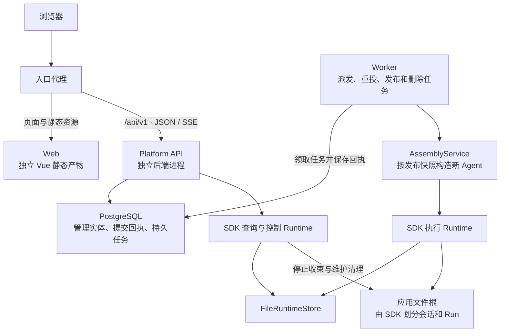

# Platform 团队私有部署实施方案

更新：2026-10-20。产品方向已确定为团队私有部署，支持多人、空间权限和应用发布；前后端分离是明确的工程要求。本方案将现有目标设计收敛为首版工程范围；Platform 当前仍为目录骨架，下面的模块、表扩展和接口补充属于待实现方案。

首版交付一个团队可共同使用的 Agent 工作台：编辑者配置并发布 ReAct／Plan，成员在自己的会话中运行，管理员管理资源、成员和运行故障。执行、停止、检查点和恢复继续使用 SDK。已有产品规则以[配置与权限](configuration.md)、[生命周期](storage-lifecycle.md)为准。

## 首版范围

| 范围 | 首版交付 |
| --- | --- |
| 身份与空间 | 登录、成员管理、viewer／editor／admin、私有会话、管理员操作审计 |
| 应用 | ReAct 和 Plan、草稿 CAS、配置校验、不可变发布、发布任务进度 |
| 资源 | 模型连接与凭据、受信注册工具、文件工具、固定版本的 Skill 和 MCP、已注册函数 Hook |
| 运行 | 新提问、活动补充、停止、历史、任务进度、SSE 重连、同机 Worker 重启恢复 |
| 运维 | 持久派发、故障重试、清理诊断、部署与备份恢复验收 |
| 删除 | 完整应用删除仍是交付要求；需要先补齐 SDK 的会话清理合同，不能用隐藏应用代替 |

Workflow 编排、跨机器接管、任意代码上传执行、独立附件内容服务、逐 token 输出和企业 SSO 放到后续阶段。SDK 当前能力及限制见[实现状态](../sdk/implementation.md#当前接口与交付状态)。第一批 Skill 支持资源读取；脚本执行须等配套隔离环境可用，不能把本地文件隔离当作进程沙箱。

## 部署和技术选型

前后端必须独立开发、构建和部署。`web/` 是 Vue + TypeScript SPA，`api/` 是 Python + FastAPI 后端，管理数据采用 SQLAlchemy + PostgreSQL。后端保持一个可安装包，提供 API 和 Worker 两个进程入口；首版部署一组同机 API／Worker，通过 PostgreSQL 保存管理数据和派发任务，通过本地持久卷保存 SDK 执行状态及工作文件。具体依赖版本在实现时锁定。

### 前后端分离约束

| 层 | 工程与交付边界 |
| --- | --- |
| Web | 独立 `package.json`、锁文件、前端测试和构建任务；生成静态产物，由专用 Web 容器或静态服务器托管；不需要 Python、SDK 或数据库即可构建 |
| API | 独立 Python 包和后端镜像；提供 `/api/v1` JSON、上传／下载及 SSE 接口；不包含 `web/dist`，不通过 FastAPI `StaticFiles` 托管 SPA |
| Worker | 复用后端包或镜像，以独立进程入口运行；凭据解析、SDK 执行和工作区访问留在服务端 |
| 接口合同 | OpenAPI 和明确的 SSE 事件 Schema 是前后端协作边界；前端客户端从已固定的合同生成，前端不导入后端内部类型、直接访问数据库或读取 SDK 状态文件 |
| 发布 | Web 与后端分别生成版本化产物，API 与 Worker 可复用同一后端镜像；三个服务单独启动、重启和回滚，接口变更须检查兼容性，不能依赖它们总在同一瞬间升级 |

默认部署由入口代理把 `/` 转给 Web，把 `/api/v1/*` 转给 API；同一域名只简化登录 Cookie 和运维，不合并前后端构建或进程。前端路由刷新由 Web 返回 SPA 入口，API 未知路径仍返回 JSON 404，不能被 SPA fallback 吞掉。SSE 路径关闭代理缓冲并配置合适的连接超时。

本地开发分别启动前端和 API，Vite 仅代理 API 请求。前端允许通过公开运行配置设置 API 地址，配置中不能含凭据或服务端文件路径；生产默认使用同源 `/api/v1`。若部署为不同源，须显式配置允许的前端 Origin、Cookie／credentials 和 CSRF 策略，并验证 SSE 登录与重连，不能用通配 CORS 代替授权。

已检查 `oracle-a2` 上旧版提交 `25b9fd2`：它按 `apps/web`、`apps/api` 分目录，但 Dockerfile 将前端产物复制进 Python 镜像，FastAPI 挂载静态页面。新版采用上面的独立部署合同；旧版的页面参考见[布局核对](interaction-design.md#旧版布局参考)。



两种 Runtime 位于各自进程，通过同一 SDK 存储协调；图中的调用不跨进程传递 Python 对象。API 的控制 Runtime 可以处理停止和 SDK 维护任务，业务执行由 Worker 发起。这样业务 Worker 暂时不可用时，停止意图仍能进入 SDK。

用户停止先保存平台控制意图，再由 API 直接调用本进程的 SDK 控制入口。回执未知时，API 生命周期内的控制扫描继续重投稳定 command_id；业务 Worker 的执行队列停机不影响这条路径。HTTP 响应区分平台已保存和 SDK 已确认，不能用前者宣称停止已经完成。

三个持久数据区域分别管理：

| 区域 | 保存内容 | 写入者 |
| --- | --- | --- |
| PostgreSQL | 用户、空间、应用、发布、资源引用、输入提交、分派和运维任务 | 平台 repository |
| SDK state volume | Run、Session、操作、检查点、输入交接及 SDK 命令回执 | SDK 公共入口背后的 RuntimeStore |
| Resource 和 workspace volumes | 固定资源包、应用专属文件根、SDK 派生工作区 | 资源导入服务及受限文件服务 |

API 和 Worker 挂载相同的 SDK 状态目录和应用工作区，使查询、停止收束和维护清理都能访问原现场；资源包使用固定路径和内容。每个应用分配固定 namespace，跨发布沿用；namespace 是存储分区，权限仍由平台检查。当前文件后端按 namespace 串行提交，第一版通过限制同时运行的 Run 数控制压力，跨机扩展需单独实现和验收共享存储及环境撤权。

派发先使用 PostgreSQL 队列表。Worker 用短事务领取任务、保存领取期限和领取代次，事务提交后调用 SDK；确认回执必须核对领取代次。领取过期只允许重新投递同一 SDK 身份，不表示取得 SDK 执行权。可使用 `FOR UPDATE SKIP LOCKED` 避免多个消费者争抢；它只用于任务领取，不用于需要完整视图的发布扫描和权限判断。[PostgreSQL 锁定查询说明](https://www.postgresql.org/docs/current/sql-select.html#SQL-FOR-UPDATE-SHARE)

API 连接池和 RuntimeRegistry 由 FastAPI lifespan 管理；Worker 有独立启动与关闭流程。每个请求或任务使用独立数据库 Session，不把 Session 注入 SDK 的长期执行对象。[FastAPI lifespan](https://fastapi.tiangolo.com/advanced/events/)、[SQLAlchemy 并发 Session 约定](https://docs.sqlalchemy.org/en/20/orm/extensions/asyncio.html#using-asyncsession-with-concurrent-tasks)

## 后端模块和前端页面

以下是计划目录，不表示文件已经创建：

```text
agentloom-platform/
  api/
    pyproject.toml
    src/agentloom_platform/
      bootstrap/       配置、API 入口、Worker 入口、依赖生命周期
      identity/        登录、成员、授权与审计
      applications/    应用、草稿和编辑 CAS
      resources/       资源版本、导入、凭据和模型连接
      releases/        ReleaseCompiler、发布任务、配置快照
      execution/       输入路由、RunBinding、派发和恢复扫描
      sdk_adapter/     RuntimeRegistry、AssemblyService、SdkGateway、投影
      lifecycle/       删除任务与专属资源清理
      persistence/     平台 ORM、repository 和迁移
      http/            路由、DTO、错误映射和 SSE
  web/
    package.json       独立依赖、开发、构建与测试命令
    package-lock.json
    src/
      app/             AppShell、路由、登录和空间上下文
      features/        spaces、agents、resources、sessions、administration
      api/             从平台 OpenAPI 生成的客户端
  tests/
    contract/          HTTP 和 SDK 适配合同
    integration/       PostgreSQL、文件后端和真实进程故障
    e2e/               浏览器关键流程
  deploy/              分别交付 Web、API、Worker，入口代理按路径分流
```

http 调用应用服务，应用服务调用 repository 和 SdkGateway。SDK 调用集中在 sdk_adapter；其他平台模块不读取 SDK 私有文件或导入内部恢复类。ReleaseCompiler 生成可持久化的值，AssemblyService 生成本机客户端和 Agent，两者分开以便校验与恢复复用同一配置转换。

前端先做六个页面：空间与成员、应用列表、Agent 编辑器、资源管理、会话工作台、运行及发布任务详情。Plan 编辑器增加 Executor 定义表，入口仍是完整 Agent 应用。会话工作台分别显示提交中、SDK 已接收、执行中、终态和清理异常；最终答案与中间任务进度使用不同区域。

页面结构、关键操作和异常反馈见[首版交互设计](interaction-design.md)。交互中的「已接收」须等待 SDK 确认，界面不直接展示内部 Runtime 名称。

## 身份和资源授权

权限沿用[既有矩阵](configuration.md#1-访问与应用)：viewer 使用应用及自己的会话，editor 编辑和发布，admin 管理成员、凭据、删除及审计授权的跨用户操作。共享应用不自动共享聊天历史。Space、应用、Session、Run 和资源都通过持久关联查出所属空间，客户端传来的 space_id 不能代替这条校验。

首版建议由部署管理员初始化第一个账号，再由管理员添加团队成员，关闭公开注册；认证实现收在 AuthProvider 边界内，后续可替换为 OIDC。浏览器使用服务端可撤销的登录会话，状态变更校验 CSRF；API Token 单独绑定 actor、space 和作用域。平台实例管理员与空间 admin 的权限分别检查，不从某个空间的角色推导全站管理权。

Worker 在执行未接收的分派前重新核验应用 gate、资源可用状态和提交者权限。权限撤销后的新访问立即拒绝；已经持久接收的工作通过可重试控制任务调用 SDK stop，不删除恢复所需资源。SSE 在连接建立和后续读取批次时检查授权，管理员查看或停止他人会话留下审计记录。

工具与 Hook 从部署方的受信注册表选择；HTTP 配置只引用注册标识和版本，不接受任意 Python import 或宿主命令。模型凭据单独加密保存或引用密钥服务，解密密钥放在数据库之外。日志、发布快照和前端 DTO 都只记录凭据引用。

## 数据约束和事务

沿用[平台逻辑表](storage-lifecycle.md#1-平台逻辑表)，增加以下工程约束。SDK 执行状态继续只有一个权威来源，平台只保存提交事实和带 SDK revision 的展示缓存。

| 对象 | 必须落库的约束 |
| --- | --- |
| Membership | `(space_id, actor_id)` 唯一；角色变更可审计 |
| ApplicationDraft | 一个应用一份草稿；更新必须匹配旧 revision |
| ApplicationRelease | `(app_id, version)` 唯一；快照不可变；published_release 属于同一应用 |
| SessionBinding | 固定 app_id、owner_actor_id 和 sdk_session_id；新建 Run 的路由在该行上串行决定 |
| RunBinding | `(runtime_namespace_ref, sdk_run_id)` 唯一；固定 release_id、snapshot_ref、sdk_session_id 和初始 input_id |
| RequestReceipt | `(actor_id, space_id, idempotency_key)` 唯一；摘要覆盖方法、目标和业务正文 |
| InputSubmission | 新增平台提交记录；`(session_binding_id, client_message_id)` 唯一，固定 payload 摘要、input_id 和提交序号 |
| DispatchIntent | 固定逻辑请求和目标身份，保存状态、重试时间、领取代次；重试不生成新的 run_id／input_id |
| ReleaseJob | 一个应用同时只有一个未结束的发布任务；阶段与 gate_revision 持久化 |
| RuntimeBinding | 新增部署关联；固定 namespace、状态目录引用、文件根和运行环境版本，客户端不可编辑 |

InputSubmission 保存“用户请求了什么、被路由到哪里”，不维护第二份模型上下文。其 status 为 submitting／accepted／rejected；SDK 尚未确认时保留 submitting，补充的实际 delivery_state 从 SDK 获取。HTTP Idempotency-Key 与 client_message_id 同时校验，不允许换一个 HTTP 键后重复创建同一条用户输入。

新提问的 RunBinding、DispatchIntent、InputSubmission 路由和 HTTP 回执在同一事务中保存，提交成功后才能通知 Worker。事务统一按应用、Session 的顺序加锁；不持锁等待 SDK、模型、导入或文件操作。需要根据 SDK 状态重新路由时，先在事务外查询，再在事务内核对原路由修订和接入 gate，SDK 的原子检查处理两者之间的竞态。

## 发布快照和 SDK 装配

ReleaseCompiler 将草稿解析为以下平台快照。这里的 snapshot_version 是平台序列化格式，与 SDK 检查点版本分开维护。

```text
ExecutionSnapshot
  snapshot_version, release_id, content_hash
  mode                         react | plan_executor
  definition, executors        已解析 Prompt、Schema、变量和能力绑定
  agent_properties             模型选项、执行策略、上下文策略、工作区策略
  model_binding                协议、model_id、endpoint、窗口元信息、credential_ref
  resource_bindings            固定版本、成员 Schema、包摘要、配置及授权
  hook_bindings                处理器版本、顺序、matcher 和配置
  runtime_binding_ref          稳定存储和工作区身份
  implementation_manifest      SDK 构建产物及工具／Hook／文件提供者实现版本
```

冻结 endpoint 和处理器实现是必要的：当前 SDK 恢复校验覆盖多项定义及资源绑定，但没有给所有注入的 Python handler 和客户端地址建立完整版本指纹。平台记录精确的构建产物标识，接管前核对实现可用性；相同版本字符串不能替代产物摘要。[SDK 恢复范围](../sdk/implementation.md#与完整目标设计的差异)

校验先处理 DTO、资源授权和纯配置，再使用 SDK 构造校验。验证环境显式注入 MemoryRuntimeStore，并使用未打开的 Runtime 和无调用行为的受信适配器；适配器复用生产的模型规格与选项校验逻辑。默认文件 Runtime 的构造可能准备目录，不能把它直接用作“无副作用校验”。模型连接检查、MCP discovery 和资源导入是单独的显式管理操作。

RuntimeRegistry 在同一进程的固定事件循环中管理长期存活的 RuntimeEngine，按 runtime_binding_ref 缓存；AgentBuilder 按发布快照构造，Agent 按 Run 构造。API 查询及控制直接使用公开 RuntimeEngine，不依赖模型凭据；Worker 用 AgentBuilder 注入该 Runtime。AgentLoom／app.build 仍是等价的公开装配入口。

| 平台字段或动作 | 当前 SDK 映射 |
| --- | --- |
| mode=react | `builder.build(definition, mode="react")`，不传 executors，包括空字典 |
| mode=plan_executor | `builder.build(definition, mode="plan", executors=...)` |
| execution／context | AgentProperties.execution_policy／context_policy |
| 模型请求参数 | AgentProperties.model_options；模型客户端单独注入 Builder |
| 首次投递或回执未知 | `agent.start(input, session_id=..., run_id=..., input_id=...)`，使用持久保存的原值 |
| 已确认接收后的恢复 | 原配置重新构造 Agent，`agent.start(run_id=...)` |
| 只观察已有运行 | `runtime.runs.attach/get`；attach 本身不启动恢复 |
| 停止、补充 | `runtime.runs.stop`、`runtime.inputs.append` |

每个 Agent 实例成功绑定后只服务一个 Run。Runtime 关闭只结束本机推进，不表达用户停止。平台拥有注入的模型客户端等资源，在 Runtime 停止使用它们之后再关闭。凭据引用允许轮换，但当前内置模型适配器在构造时接收静态 Key；若要满足每次新物理 Attempt 重新取 Key 的目标，需由平台提供实现相同 ModelAdapter 协议的凭据包装器，不在运行中修改共享客户端。

## 输入派发和恢复流程

初次输入先以 202 返回平台持久回执；页面显示提交中。收到 SDK 确认后才显示已接收，执行终态随后通过查询或 SSE 获得。异步接口使用 start，不将等待最终答案的 ainvoke 绑定到 HTTP 请求生命周期。

新提问保留 AgentInput 的结构化 content 和 variables。活动补充只接受非空文本，拒绝非空 variables 和 artifacts；当前 inputs.append 没有这些参数，平台不能丢弃字段后假装提交成功。

同一 Session 的提交按持久提交序号决定路由。同一时刻只处理该会话最早一个尚未确定接收结果的提交；正在准备但尚未被 SDK 接收的新 Run 也占用路由预留，防止两个请求各分配一个初始 Run。SDK 接收确认后释放提交顺序阻塞，后续文本可路由为活动补充。

队列领取条件必须排除同一 Session 中仍有更早未决提交的候选，不能只依靠 ORDER BY 和 SKIP LOCKED 保证顺序。停止、发布和删除控制独立派发，不排在可能回执未知的用户输入后等待。

| Worker 观察结果 | 处理 |
| --- | --- |
| 没有活动或预留 Run | 在平台事务中分配 RunBinding，再调用 start |
| Run 正在执行 | 用稳定 input_id 调用 inputs.append；Plan 仍只交给 Planner |
| append 明确返回 RUN_ENDED 且该输入未被接收 | CAS 更新同一 InputSubmission 的路由；若旧 Run 正在 stopping，则等终态后创建下一 Run |
| SDK 调用回执未知 | 重投原目标和相同身份；确认结果前不创建新 Run |
| SDK 已接受补充但终态时尚未投递 | 展示 pending_next_run，等下一次主动提问由 SDK 交接，不复制内容重新提交 |
| SDK 返回 SESSION_BUSY | 查询并核对平台关联，重新处理路由；不循环生成新的 run_id |
| 发布或删除 gate 已关闭 | 拦截新的输入路由；未执行分派按所属任务取消，已分配 run_id 进入停止清单 |

Worker 维护两条独立扫描：重投未确认的 DispatchIntent，以及检查 RunBinding 中尚未确认 SDK 终态的执行。已确认接收的分派不会因 Worker 崩溃重新变为待派发，所以只扫描队列无法恢复全部 Run。

恢复扫描使用保存的 runtime_binding_ref 和快照，通过公开查询核对 SDK 状态；非终态使用原配置调用 start，终态只更新投影。SDK 有效 owner 存在时不强行接管。Run 查询与清理状态分开保存，业务终态后仍可重试 SDK 清理。无法重建资源或读取存储时记录基础设施诊断，不将缓存改成业务 failed，也不换发布版本重跑。

停机流程先停止领取新任务，再关闭本机 Runtime 和连接池。发布和用户停止走持久控制任务，沿用稳定 command_id；即使 SDK 已执行但平台回执丢失，也只重投原命令。升级前完成活动执行收束，或保留能重建原配置与实现的部署产物；当前不承诺任意 SDK 版本之间迁移。

## 发布屏障和删除前提

发布任务采用 prepared → stopping → waiting_cleanup → activating → succeeded 的阶段；失败保存失败阶段和诊断，重试从该阶段继续。候选版本生成后，在事务内 CAS 核验草稿 revision、资源状态和旧 gate_revision，再关闭接入并保存发布任务。

关闭 gate 后枚举旧版本的 RunBinding，包含尚未初始化 SDK 的 ID；对每个 ID 发出稳定 stop 命令。已存在 Run 必须观察终态与清理完成；对从未初始化的 ID，以 SDK 的 admission_closed 回执为准，不等待一个永远不会生成的 Run 终态。未确认的初始投递也受该关闭标记保护。最后在平台事务中核验同一发布任务和 gate_revision，切换 published_release。

发布期间可以继续编辑后续草稿；当前任务只激活自己固定的候选快照。任务失败不提前开放候选版本，也不因后来的草稿变化重建候选配置。停止、查询和管理员重试入口在 gate 关闭期间保持可用。

删除顺序沿用[生命周期约定](storage-lifecycle.md#3-删除顺序)。当前 SDK 只有逐 Run 的 records.delete：它要求已终态、清理完成、没有后续历史引用，且没有 pending_next_run 输入；它没有完成整个 Session 及辅助索引的删除。已有应用的彻底删除需要先补齐：

1. SDK 会话级清理端口，明确待交接输入在授权删除下的处置、依赖删除顺序和幂等回执。
2. 输入索引、会话记录、所属检查点和命令保留范围的完整合同，保留防迟到启动的关闭事实。
3. SDK 清理完毕、应用专属文件清理完毕之后，平台才能删除发布快照和绑定；共享资源保留。

这些是首版正式交付的前置任务，不作为已经存在的方法调用。补齐前内部演示不开放彻底删除入口，API 返回明确的能力未就绪错误，不创建无法完成的“成功删除”回执。

## 查询 DTO 和 SSE

平台定义自己的版本化 HTTP DTO，并在 sdk_adapter 中用白名单转换 SDK 投影。当前 SDK runs.get 可提供 status、output、error、usage、各阶段时间、revision、terminal_seq 和 cleanup_state；RunView 同时关联 application_id、release_id 和平台 Session。尚未暴露的精确 deadline、已用 Loop 明细和完整操作结果不通过私有字段补齐。

SDK 未初始化时，RunView 的 sdk_snapshot 为 null，配合 dispatch_status 显示提交中。已经确认接收后若 SDK 记录异常缺失，返回基础设施错误或带观测时间的陈旧投影，不退回“提交中”。展示缓存保存 SDK revision 和观测时间，不能反向成为恢复依据。

session.history 当前返回每个 Run 的结果摘要，session.inputs 返回输入及投递状态。聊天页面按 input_id 去重并结合平台提交顺序关联回答，不把它们当作模型内部 messages；结构化输入从原 InputSubmission 保留其 JSON 形状。sessions.inputs 尚无分页，首版对外分页明确是平台适配，规模化前补 SDK 分页接口。

SSE 使用公开 RunEvent 的 seq 作为 id，Last-Event-ID 表示排他的续读游标。通过 events.read 分页读取，并在同一 API 进程内合并同 Run 的观察；传输心跳不分配业务 seq。慢连接关闭后可续读，不无限缓存。终态事件到达后读取最终 RunView；清理诊断继续通过查询观察。

公开事件仍需按类型白名单投影，任务结果中的内部材料不能直接输出。关闭页面或断开 SSE 仅结束观察；用户点击停止才产生 SDK 控制命令。补充输入的投递状态单独查询，不能假定每个状态变化都有现成 RunEvent。

## 实施顺序和验收门槛

| 阶段 | 实现内容 | 完成条件 |
| --- | --- | --- |
| P0 合同 | 前后端独立工程与接口合同、平台 DTO、快照格式、错误映射、SDK 适配合同测试、会话清理接口设计 | 前后端可分别构建；ReAct／Plan 模式转换、Run 身份与实际查询字段没有猜测接口 |
| P1 最小纵向流程 | 真实登录与空间授权、模型连接、ReAct 草稿和首次发布、平台事务、Worker、运行查询和 SSE | 独立 Web／API／Worker 完成部署联调；两名成员可使用同一应用且会话隔离；通过重复提交和进程故障测试 |
| P2 团队功能 | Plan、补充输入、资源导入、Hook、完整发布屏障、权限撤销控制 | 发布／补充／停止竞态、旧版本接管和资源版本固定通过 |
| P3 正式交付 | SDK 会话清理及应用删除、部署迁移、升级和备份恢复、诊断页面 | 删除闭环及下表故障场景通过；真实模型与 MCP 单独联调 |

P1 的 UI 以表单和运行工作台为主，P2 再完善配置体验。第一阶段已有实际身份授权，避免后期给无权限的数据访问路径补洞。P3 的备份先使用停写窗口：关闭接入、停止领取并关闭运行宿主，保存平台库、SDK 状态、资源和工作区的同一静止部署状态；恢复演练验证原配置及同一 Run 接续，不宣称在线跨存储原子备份。

| 必测场景 | 断言 |
| --- | --- |
| 独立构建与发布 | Web 在无 Python／SDK 环境构建；后端在无 Node／前端产物环境启动；重启 Web 不终止后台 Run，API 重启后页面可重连 |
| 入口与路由 | 刷新应用、会话和运行详情深层链接成功；未知 API 返回 JSON 404；登录、CSRF、SSE 经部署代理可用 |
| 两用户共享应用 | 对方 Session／Run／事件不可见；管理员跨用户操作有审计 |
| 重复 HTTP 键或 client_message_id | 相同正文返回原提交；不同正文冲突；只有一个 SDK 输入 |
| 两个并发首问 | Session 路由串行，尚未接收的新 Run 也计入预留，输入不丢失 |
| 平台已提交但尚未通知 Worker | 扫描队列后可继续，不依赖内存通知 |
| SDK 已接受但平台未记回执时杀进程 | 重投相同身份，输入与执行不重复初始化 |
| 分派已确认后杀 Worker | 恢复扫描重建原配置和 Run；不重新建立执行身份 |
| 补充与停止或终态竞争 | 已接收、待下轮、未接收后创建新 Run 三种归属明确 |
| 发布时旧 Worker 迟到初始化 | admission 关闭阻止启动；不存在的 Run 按停止回执完成屏障 |
| SSE 断线及权限撤销 | 续读不重复展示，撤权后停止推送，断线不停止 Run |
| 清理失败及待下轮输入存在时删除 | 失败可重试，输入按明确清理合同处置，共享资源不被删除 |
| 备份恢复和版本重建 | 平台关联、SDK 身份、资源内容及工作目录匹配；未知副作用不盲目重放 |

上述验证先使用确定性模型、真实 PostgreSQL、文件存储和独立进程；真实供应商及远端 MCP 按部署配置另测。测试报告区分运行行为、部署恢复和外部服务验证，文档构建通过只表示文档本身可交付。
