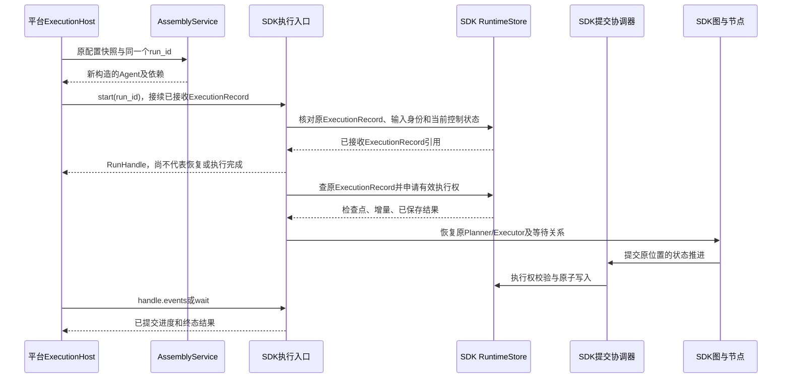

# 平台如何装配和调用 SDK

这是两份交付物的唯一执行衔接方式。平台不把 SDK 当成管理服务，也不在数据库里补写执行现场。

## 1. AssemblyService

输入：已固定的 execution_snapshot_ref、运行身份、所需资源访问授权。

输出：可执行 Agent／Workflow、SDK RuntimeEngine 及受限依赖。输出只存在于本机，不序列化模型客户端、连接或协程。

| 平台配置 | 传入 SDK |
| --- | --- |
| 应用模式、入口和 Executor 配置 | 按模式选择构造函数；传入入口 AgentDefinition，Plan 另传 Executor key → AgentDefinition 映射 |
| 模型连接与凭据引用 | ModelAdapter／CredentialResolver、模型参数 |
| 工具／MCP／Skill 资源版本 | 已解析 Registry、MCP 连接配置、只读 Skill 目录／Loader |
| Hook 配置 | HookSet：有序 HookBinding 和已解析受限处理器 |
| 上下文、执行、并行策略 | SDK Policy 值对象 |
| 应用文件根、持久策略及授权挂载 | WorkspaceBinding；另注入 EnvironmentProvider，运行期 WorkspaceScope 由 SDK 创建／恢复 |
| 部署的执行存储 | RuntimeStore、ContentStore、StorageNamespace |
| Workflow 中的 Agent 引用 | 预先装配的 ReactAgent／PlanAgent（实现 SDK Agent 接口），或指向它们的 PreparedAgentRef |

装配所有 Workflow Agent 依赖时固定所引用配置并保存依赖清单。SDK 运行中不调用平台发布查询接口，AgentNode 通过已装配程序注册表启动内层执行。

SDK 构造字段和所有权遵循[装配合同](../sdk/assembly.md)。同一 Workflow 的 Agent 使用同一个 RuntimeEngine，平台注册本地 agent_key，SDK 派生 program_key；平台发布号不进入该地址。公开 Agent 格式取 definition 的 Schema；Plan 的 Planner 使用同一份定义，Executor 使用各自定义的格式。草稿的 execution、context 分别转换为 execution_policy、context_policy，模型参数转换为 model_options；这些都是完整 Agent 的构造参数，不嵌入每份 Executor 定义。

AssemblyService 根据固定 mode 选择 ReactAgent 或 PlanAgent 构造函数；两者返回值都可按 SDK 的 Agent 接口使用。Workflow 则通过 StateGraph.compile 构造。平台的 Agent 应用实体与 SDK 的 Agent 接口属于不同模块；不要让 SDK 接口兼任平台应用工厂或资源查询服务。

## 2. 新请求接入

1. HTTP 层认证，校验空间与应用访问权、发布状态、输入格式和幂等键。
2. 平台事务锁应用接入 gate 和 SessionBinding；生成稳定 sdk_run_id、input_id，保存原发布配置引用、RunBinding、DispatchIntent。先提交，再通知 Worker。
3. Worker 重新检查该分派未被平台屏障取消，按保存配置调用 AssemblyService。
4. 调用 SDK start 并取得 RunHandle。SDK 在自己的存储中幂等初始化 ExecutionRecord、输入及执行意图，由本机 supervisor 取得执行权后运行；start 不等待答案。HTTP 需要直接等待时可用 ainvoke，底层复用同一路径。
5. SDK 回执返回后平台更新分派投影；如果回执丢失，重投同 run_id/input_id，SDK 返回原运行／原结果。
6. 平台通过 SDK 事件／查询展示结果，HTTP 连接断开不撤销 ExecutionRecord。

两个存储不依赖跨库事务。平台 DispatchIntent 保证不会丢请求，SDK 的执行入口幂等保证不会重复初始化；dispatch_status 只表示传输，不成为运行事实。

## 3. 故障恢复

平台只处理“让哪台机器再调用 SDK”，不处理“恢复哪个 Executor”。失效判断、epoch、旧环境写权限撤销、已有结果复用和下一节点激活均由 SDK／其注入适配器完成。

有效 owner 尚在执行时，平台重复投递不能强行夺权；SDK 默认附着观察。已终态的 ExecutionRecord 不重新开始，原输入不重复追加，额度和截止时间不重置。仅查询使用 runtime_engine.runs.attach；需要在 owner 失效后接续执行，仍须按原配置构造程序并调用 start。

## 4. 执行中补充

以下流程用于直接 Agent 应用。Workflow 的活动输入接收点尚未定稿，平台不能把通用聊天补充入口接到任意 AgentNode；需与 SDK 的显式输入映射合同一起完成后再开放。

平台接收文本时，先根据 SessionBinding 查询 SDK 当前状态；该查询仅用于路由，不能代替 SDK 的原子检查。

- 仍在执行：以稳定 input_id 调用 SDK inputs.append。SDK 将其存为正式用户输入，并决定 pending／delivered／carried。
- 初次 append 遇到 RUN_ENDED，且 SDK 明确未接收该 input_id：平台在 SessionBinding 事务内将这次请求改为下一提问，创建新的 RunBinding；同一 HTTP 幂等键不得同时形成两次新 ExecutionRecord。
- 已接收补充后 ExecutionRecord 结束：该输入由 SDK 标为 carried，平台展示“待下次提问”；不再另发一个同内容输入，不自动开始下一 ExecutionRecord。
- 回执未知：先以同 input_id 重试／查询，不能先创建新 ExecutionRecord。SDK 的去重和终态转交决定最终归属。

Plan 的补充只交给 Planner；平台不能为了“及时生效”广播到 Executor。下一 ExecutionRecord 的 SDK 初始化会接入 carried 输入，平台不重新拼接历史。

## 5. 停止、发布和删除

用户停止通过 SDK runs.stop 发出幂等控制命令；没有 Worker 时也能保存控制意图，由 SDK 后续接管入口先处理控制，不能先启动业务动作。

发布／删除先在平台关闭新分派 gate，再对所有已分配 sdk_run_id 调用 stop；SDK 对尚未初始化的 ID 也持久关闭准入，防止通过旧检查的 Worker 迟到启动。RunBinding 必须在新分派通知前保存，Workflow 的依赖清单必须包含所调用应用，避免发布扫描漏掉已经派发的旧执行。

平台不持应用锁等待 SDK 收束。SDK 确认终态及环境清理后，平台完成发布切换或删除；跨存储失败通过持久任务重试，不直接修改 SDK 的状态。

## 6. 状态和事件展示

SDK 是 ExecutionRecord／任务／调用状态的权威源；平台保存展示缓存和访问关联。SSE 带稳定 seq，可用 Last-Event-ID 续读；重复事件去重，终态优先于迟到进度。完整模型响应可产生进度，不能当成 ExecutionRecord 最终答案。

平台的会话页只访问获授权的 SessionBinding；模型参数、Hook、错误等敏感诊断通过 SDK 权限投影和平台字段过滤输出，不透出凭据或原始宿主路径。

## 7. 适配器位置

通用 PostgreSQL、内存、文件与模型协议实现可以随 SDK 的可选扩展交付；只依赖平台凭据库、资源库或特定运维系统的适配放在 Platform。适配器实现 SDK Protocol，不让 SDK import Platform。

持久执行存储必须完整实现一致提交协议。给 SDK 传一个只有 save_checkpoint 的回调，无法保证上下文、操作结果、批次和检查点的一致恢复。

## 8. 验收

- 拦截平台目录查询：Agent 构造完成后，SDK 执行不再访问应用／发布表。
- 在 SDK 已接收、平台尚未收到回执处终止 Worker；重投不新增 ExecutionRecord 和输入。
- A 机器 Executor 执行中故障，B 使用同配置和 ExecutionRecord 恢复；平台没有任何针对角色阶段的分支。
- 发布与新分派并发，旧发布关联执行全部被纳入停止范围。
- SDK 存储与平台库分开运行仍能通过上述场景。
