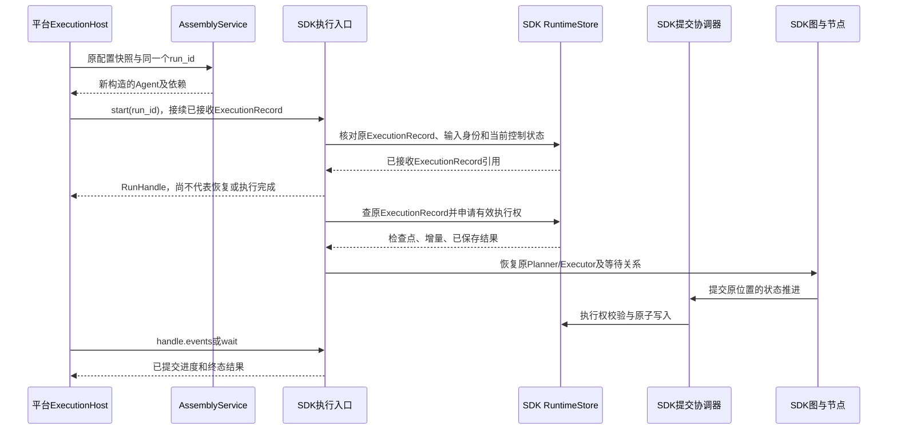

# 平台如何装配和调用 SDK

本页说明平台与 SDK 的装配边界；Platform 本身仍为设计，不表示下面的分派服务已经实现。当前 SDK 接入代码以 [SDK 接入指南](../sdk/integration.md) 为准，接口与缺口见[实现文档](../sdk/implementation.md#当前接口与交付状态)。Workflow、独立内容存储和跨机接管仍属于后续设计。

当前推荐按 Worker／应用生命周期创建 `PropertiesConfig` 和 `AgentLoom`，由 `app.build(entry_definition, executors=...)` 为每次新请求装配独立 Agent。默认状态存储是 JSON 文件，无需平台业务库或数据库服务；平台不直接改写 SDK 执行现场。

团队私有部署的工程方案将 Runtime 生命周期独立交给 RuntimeRegistry：Worker 使用 AgentBuilder 注入公开 RuntimeEngine，API 的查询／控制 Runtime 无需模型凭据。两种装配入口遵循同一 SDK 合同，具体作用域见[实施方案](implementation-plan.md#发布快照和-sdk-装配)。平台 mode=plan_executor 映射为 SDK mode="plan"；ReAct 构造时省略 executors，不能传空字典。

## 1. AssemblyService

输入：已固定的 execution_snapshot_ref、运行身份、所需资源访问授权。

当前输出：可执行 ReAct／Plan Agent 及其已打开的 SDK 宿主与受限依赖。Workflow 输出是后续合同。输出只存在于本机，不序列化模型客户端、连接或协程。

| 平台配置 | 传入 SDK |
| --- | --- |
| 应用模式、入口和 Executor 配置 | `app.build()` 的 AgentDefinition、mode 和 Executor key → AgentDefinition 映射 |
| 模型连接与凭据引用 | 平台先解析凭据，再传入 `ServiceProperties.model`；模型参数放 `AgentProperties.model_options` |
| 工具／MCP／Skill 资源版本 | `ServiceProperties.capabilities` 的已解析目录；MCP 发现由平台显式执行并冻结选定成员，定义按角色绑定 |
| Hook 配置 | `ServiceProperties.hooks` 的 HookSet：有序 HookBinding 和已解析受限处理器 |
| 上下文、执行、并行策略 | `AgentProperties.context_policy/execution_policy` |
| 应用文件根、持久策略 | `AgentProperties.workspace` 的 WorkspaceBinding；可注入 `ServiceProperties.environment`，当前默认 LocalEnvironment |
| 部署的执行存储 | `RuntimeProperties.namespace/state_directory` 配置默认文件后端；自管存储使用 `ServiceProperties.store` |
| 内容存储／附件授权、Workflow 引用 | 当前未提供完整接入合同，不传入 ContentStore／PreparedAgentRef 等目标设计类型 |

固定配置后，SDK 运行中不调用平台发布查询接口。Workflow 将来需要固定全部 Agent 依赖及依赖清单，AgentNode 通过已装配程序注册表启动内层执行；该路径当前不开放。

SDK 构造字段和所有权遵循[装配合同](../sdk/assembly.md)。当前用 PropertiesConfig 汇总 runtime／defaults／services，AgentLoom 维护 Runtime，AgentBuilder 按定义生成新的 Agent；需要不同模型或能力目录时通过 `app.builder.with_options(...)` 派生。公开输入／输出格式取 definition 的 Schema；Plan 的 Planner 使用入口定义，Executor 使用各自定义的格式。草稿的 execution、context 分别转换为 execution_policy、context_policy，模型参数转换为 model_options；这些参数不嵌入每份 Executor 定义。

AssemblyService 可通过 build 的固定 mode 选择 ReAct／Plan，结果均实现 SDK Agent 接口；直接构造器也继续可用。宿主应覆盖 Worker 生命周期，不能在 start 返回后立即关闭；同一 Agent 实例也不能处理另一个 Run。Workflow 的 StateGraph.compile 尚未实现。平台的 Agent 应用实体与 SDK Agent 接口属于不同模块。

## 2. 新请求接入

1. HTTP 层认证，校验空间与应用访问权、发布状态、输入格式和幂等键。
2. 平台事务锁应用接入 gate 和 SessionBinding；生成稳定 sdk_run_id、input_id，保存原发布配置引用、RunBinding、DispatchIntent。先提交，再通知 Worker。
3. Worker 重新检查该分派未被平台屏障取消，按保存配置调用 AssemblyService。
4. 调用 SDK start 并取得 RunHandle。SDK 在自己的存储中幂等初始化 ExecutionRecord、输入及执行意图，由本机 supervisor 取得执行权后运行；start 不等待答案。HTTP 需要直接等待时可用 ainvoke，底层复用同一路径。
5. SDK 回执返回后平台更新分派投影；如果回执丢失，重投同 run_id/input_id，SDK 返回原运行／原结果。
6. 平台通过 SDK 事件／查询展示结果，HTTP 连接断开不撤销 ExecutionRecord。

两个存储不依赖跨存储事务。平台 DispatchIntent 保证不会丢请求，SDK 的执行入口幂等保证不会重复初始化；dispatch_status 只表示传输，不成为运行事实。

## 3. 故障恢复

平台只处理“让哪台机器再调用 SDK”，不处理“恢复哪个 Executor”。失效判断、epoch、旧环境写权限撤销、已有结果复用和下一节点激活均由 SDK／其注入适配器完成。

有效 owner 尚在执行时，平台重复投递不能强行夺权；SDK 默认附着观察。已终态的 ExecutionRecord 不重新开始，原输入不重复追加，额度和截止时间不重置。仅查询使用 runtime_engine.runs.attach；需要在 owner 失效后接续执行，仍须按原配置构造程序并调用 start。

## 4. 执行中补充

以下流程用于直接 Agent 应用。Workflow 的活动输入接收点尚未定稿，平台不能把通用聊天补充入口接到任意 AgentNode；需与 SDK 的显式输入映射合同一起完成后再开放。

平台接收文本时，先根据 SessionBinding 查询 SDK 当前状态；该查询仅用于路由，不能代替 SDK 的原子检查。

- 仍在执行：以稳定 input_id 调用 SDK inputs.append。SDK 将其存为正式用户输入，并维护 pending／claimed／delivered／pending_next_run 状态。
- 初次 append 遇到 RUN_ENDED，且 SDK 明确未接收该 input_id：平台在 SessionBinding 事务内将这次请求改为下一提问，创建新的 RunBinding；同一 HTTP 幂等键不得同时形成两次新 ExecutionRecord。
- 已接收但未送达的补充在 ExecutionRecord 结束后由 SDK 标为 pending_next_run，平台展示“待下次提问”；不再另发一个同内容输入，不自动开始下一 ExecutionRecord。
- 回执未知：先以同 input_id 重试／查询，不能先创建新 ExecutionRecord。SDK 的去重和终态转交决定最终归属。

Plan 的补充只交给 Planner；平台不能为了“及时生效”广播到 Executor。下一 ExecutionRecord 的 SDK 初始化会按接收顺序接入待转交输入，平台不重新拼接历史。

## 5. 停止、发布和删除

用户停止通过 SDK runs.stop 发出幂等控制命令；没有 Worker 时也能保存控制意图，由 SDK 后续接管入口先处理控制，不能先启动业务动作。

调用 SDK 控制门面仍需一个打开的 Runtime／AgentLoom；这里“没有 Worker”是没有推进该 Run 的业务执行者，而不是直接向 SDK 文件写命令。宿主关闭只暂停本机推进，不自动发送用户停止。

发布／删除先在平台关闭新分派 gate，再对所有已分配 sdk_run_id 调用 stop；SDK 对尚未初始化的 ID 也持久关闭准入，防止通过旧检查的 Worker 迟到启动。RunBinding 必须在新分派通知前保存，Workflow 的依赖清单必须包含所调用应用，避免发布扫描漏掉已经派发的旧执行。

平台不持应用锁等待 SDK 收束。SDK 确认终态及环境清理后，平台完成发布切换或删除；跨存储失败通过持久任务重试，不直接修改 SDK 的状态。

## 6. 状态和事件展示

SDK 是 ExecutionRecord／任务／调用状态的权威源；平台保存展示缓存和访问关联。SDK 的 `RunHandle.events(after_seq=...)` 返回已提交 RunEvent；平台可将其包装为 SSE 并用 Last-Event-ID 保存稳定 seq。SDK 自身不提供 HTTP／SSE 服务或供应商 token 订阅。重复事件去重，终态优先于迟到进度，单次模型完成不等于 Run 最终答案。

当前 runs／tasks／operations／events／sessions 查询返回 dict／列表投影，尚无完整机器 DTO；sessions.inputs 也没有分页。RunResult 过滤内部 reasoning 和未完成材料，执行审计不应原样转发给用户。平台仍负责 SessionBinding 的用户授权和最终字段过滤；namespace 是存储分区，不能代替平台权限判断。业务终态与 cleanup_state 分开观察，清理或撤权失败可从 maintenance 读取诊断。

## 7. 适配器位置

SDK 当前提供 FileRuntimeStore、MemoryRuntimeStore 和模型协议适配器，没有 SQLite／PostgreSQL 实现。默认文件后端用于单机多进程，平台若需要其他存储，须另行实现并验证 RuntimeStore 的事务与时钟合同。只依赖平台凭据库、资源库或特定运维系统的适配放在 Platform，不让 SDK import Platform。独立 ContentStore 与完整环境／沙箱 SPI 仍未实现。

持久执行存储必须完整实现一致提交协议。给 SDK 传一个只有 save_checkpoint 的回调，无法保证上下文、操作结果、批次和检查点的一致恢复。

## 8. 验收

- 拦截平台目录查询：Agent 构造完成后，SDK 执行不再访问应用／发布表。
- 在 SDK 已接收、平台尚未收到回执处终止 Worker；重投不新增 ExecutionRecord 和输入。
- 当前文件后端：同机进程 A 执行中退出，进程 B 使用原目录、namespace、工作区及配置恢复同一个 Run，平台不判断具体 Executor 阶段。跨机器接管须等共享存储和环境授权合同具备后单独验收。
- 发布与新分派并发，旧发布关联执行全部被纳入停止范围。
- SDK 存储与平台库分开运行仍能通过上述场景。
