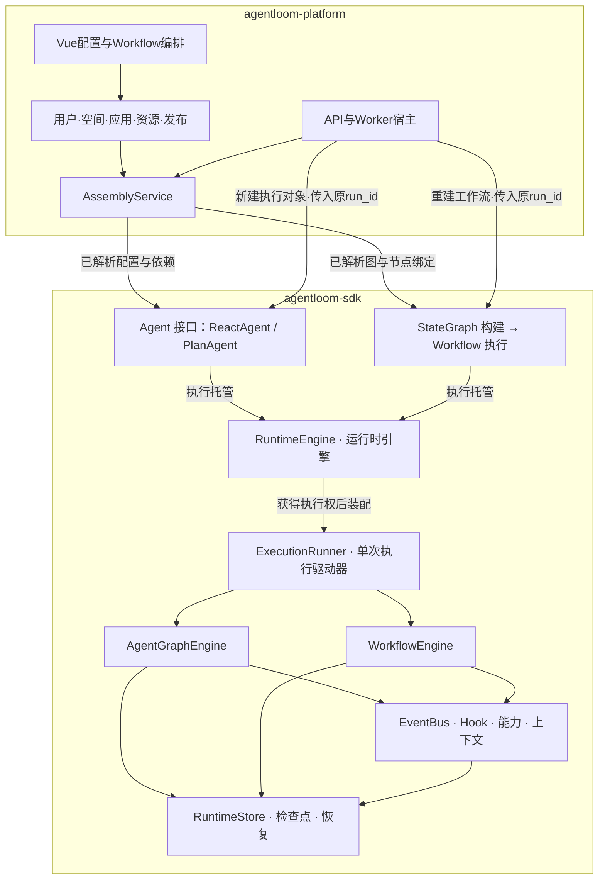

# SDK 与 Platform 的职责边界

更新：2026-10-16。两份独立交付物暂在一个仓库：agentloom-sdk 是高代码执行底座，agentloom-platform 用配置装配 SDK。本文是跨层边界的唯一说明；详细设计分别在 [SDK](sdk/index.md) 和 [Platform](platform/index.md)。

## 1. 依赖方向

没有 SDK → 平台目录查询。两套图引擎都在 SDK 内；Platform 不实现另一套 Agent Loop、Workflow 调度或检查点恢复。RuntimeEngine 负责组织运行服务和托管执行，图内节点路由由各自内核负责；ExecutionRunner 驱动某一次执行并管理它的本机现场。

Agent 是 SDK 的执行接口，ReactAgent 和 PlanAgent 是具体实现；Workflow 是另一个执行入口，不继承 Agent。图内 Node 协议服务调度，不承担平台创建应用的职责。Platform 的 AssemblyService 负责选择构造类型并注入依赖。

## 2. 责任与接口

| 事项 | Platform | SDK |
| --- | --- | --- |
| 用户、组织空间、权限 | 管理身份、鉴权及资源授权 | 执行注入的 scope 与访问范围，不识别平台用户 |
| 应用与版本 | 草稿、发布、资源版本及 RunBinding | 固定执行定义，不查询发布、不维护发布兼容指纹 |
| 构造 Agent | AssemblyService 解析全部资源和客户端 | 构造校验、生成内部图或编译 Workflow |
| 运行时宿主 | 创建并注入 RuntimeEngine，负责服务器部署和 Worker 分派 | RuntimeEngine 管理本机活动执行、共享服务引用及宿主生命周期 |
| 会话 | 将 Session 绑定同一应用及发起人 | 连续输入、轮次、上下文历史和投递消费 |
| 任务运行 | 选择 Worker，保存提交意图，展示进度 | ExecutionRecord、Loop、批次、操作、限额、停止与结果 |
| 故障恢复 | 重建对象，传原配置／run_id／共享存储 | 识别现场、取得执行权、恢复未完成阶段 |
| 模型、Skill、MCP、Tool、Hook | 管理目录、Key、上传／Git、版本与配置页面 | 标准端口、运行绑定、实际调用和 Hook 链 |
| 工作文件 | 分配应用固定文件根及生命周期策略 | scope 隔离、挂载、读写、脚本、收束和单次执行的临时文件清理 |
| 应用删除 | 决定删除范围、阻止新启动、编排删除任务 | 停止并清理指定执行记录；不删除共享资源目录 |
| 对外接口 | 登录、HTTP、SSE和网页 | Python公共API及可插拔适配器 |

SDK 默认通过文件系统保存状态和恢复现场，可显式选择纯内存运行，不要求数据库。平台可以选择数据库保存自己的业务数据；若另行选择数据库作为 SDK 适配器，两层的事务、表和写入权仍必须独立，不能要求建立平台用户与应用表才能执行 Agent。

## 3. 一次调用传什么

Platform 传入 AgentDefinition／GraphDefinition、已解析模型客户端、能力目录、Hook、Skill 路径／加载器、WorkspaceBinding 与 EnvironmentProvider 及存储适配器。资源可按需读取，构造阶段不用加载所有历史正文。

高代码调用者直接构造同样的对象；平台只是其中一个调用者。平台特有 resolver 可以实现 SDK 端口，但 SDK 代码不能反向导入平台实现。

## 4. 恢复与版本

新建 Agent 对象不意味着新建 ExecutionRecord。原 run_id 未结束时恢复原现场；已结束返回原结果；另一进程仍持有效执行权时不重复运行。Plan 直接继续原 Executor／Planner 位置，不依赖模型重规划代替恢复。

调用方负责重建原配置与资源。平台用 RunBinding 指向原 Release；独立开发者自己保存配置。SDK 只验证自己的恢复格式、协议、身份和内容完整性，不以业务发布 hash 决定配置版本。

## 5. 交付边界

SDK 已提供可安装的 ReAct / Plan–Executor 及本地持久恢复，实际范围见[实现记录](sdk/implementation.md)；新版平台仍为设计与目录骨架。Workflow 的 LangGraph 源码迁移尚未实施；目标是声明范围内的图构建与状态语义兼容，不承诺整个上游生态无修改替换。

优先独立验证 SDK，再接平台。三个 SDK 示例、两进程恢复及平台 HTTP 全链路分别验收。所有已删除旧方案以 Git 历史保留，正文不再并列维护过时架构。
