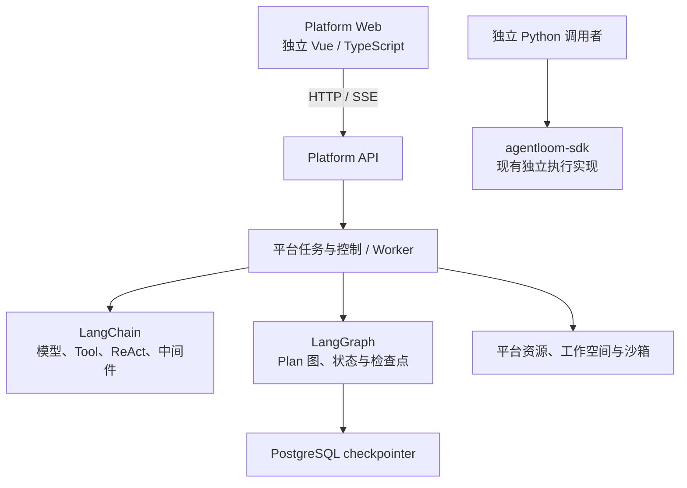

# SDK 与 Platform 的交付边界

更新：2026-10-20。仓库保留两份独立交付物。**Platform 改用 LangChain + LangGraph，不再以 agentloom-sdk 为底层。** 旧的 Platform → SDK 装配、FileRuntimeStore、停止与恢复映射被本页及平台运行设计取代；旧方案保留在 Git 历史中。

## 1. 依赖方向

平台直接使用上游包，不复制 LangGraph 源码，也不借道 SDK 的 RuntimeEngine／AgentBuilder。agentloom-sdk 继续独立提供已有 Python 接口、文件持久化与测试，不依赖平台数据库或页面；本次技术选型不修改 SDK 实现。

## 2. 责任与接口

| 事项 | Platform | LangChain / LangGraph |
| --- | --- | --- |
| 身份、空间、资源与凭据 | 认证、授权、目录、版本、审计 | 通过适配层使用已授权依赖 |
| 应用与发布 | 创建、固定模式、草稿、不可变快照、发布屏障 | 按固定配置构建 Agent／图 |
| ReAct | 管理配置、工具绑定、策略与中间件 | LangChain Agent 循环 |
| Plan | 定义 Planner／Executor 合同、角色授权、输入输出和预算 | LangGraph 编排及子图执行 |
| 任务与会话 | HTTP 幂等、输入收件箱、队列、Run 生命周期和跨轮公开历史 | 图内消息与计划状态 |
| 恢复 | 单写者、重建原版本、撤销旧环境、外部副作用对账 | 检查点、pending writes 和原图接续 |
| 停止 | 持久命令、准入关闭、进程／沙箱控制和收束确认 | 在受控图边界响应；interrupt 不等于强制终止 |
| Tool / Skill / MCP | 资源导入、固定版本、按角色授权和执行适配 | 工具接口、MCP 适配、可选技能 middleware |
| 文件与沙箱 | 存储、挂载、隔离执行、撤权、清理 | 通过绑定工具访问，不自动提供隔离 |
| 事件与删除 | 公开事件持久化、SSE、清理任务、墓碑 | 提供图结果与所选 checkpointer 的清理合同 |

平台管理事实与图内部状态分开保存。两者通过持久身份和回执对账，不让浏览器或管理接口直接修改检查点。

## 3. 保留的产品约束

前后端独立开发、构建和部署。创建应用时同表单填写名称、必选 ReAct／Plan 和描述；模式无默认值，创建后固定。Tool、Skill、MCP 各有独立管理页面，先维护再绑定；Planner 与各 Executor 独立授权。执行沙箱、工作区访问和文件保留分别配置。

应用属于空间，会话默认私有。发布停止相关旧 Run，新提问采用新发布；故障恢复保持原图、原快照及运行身份。具体运行保证由平台合同和测试给出，不能继承 SDK 测试结果。

## 4. 当前交付状态与阅读入口

- SDK：已有独立可安装实现，范围见[SDK 实现记录](sdk/implementation.md)；其 Workflow 源码适配计划仅属于 SDK。
- Platform：目前为设计和原型，尚无正式业务前后端；见[实施方案](platform/implementation-plan.md)。
- 上游接入：[LangChain / LangGraph 运行合同](platform/runtime-integration.md)。
- 能力分类：[Tool、Skill、MCP 及其他扩展](platform/capabilities.md)。

SDK 设计页中的 AgentDefinition、ExecutionRecord、HookSet、RuntimeStore 等仍描述 SDK 自身。即使两份文档使用相近产品术语，也不能将它们直接当作新版平台类型或恢复接口。
