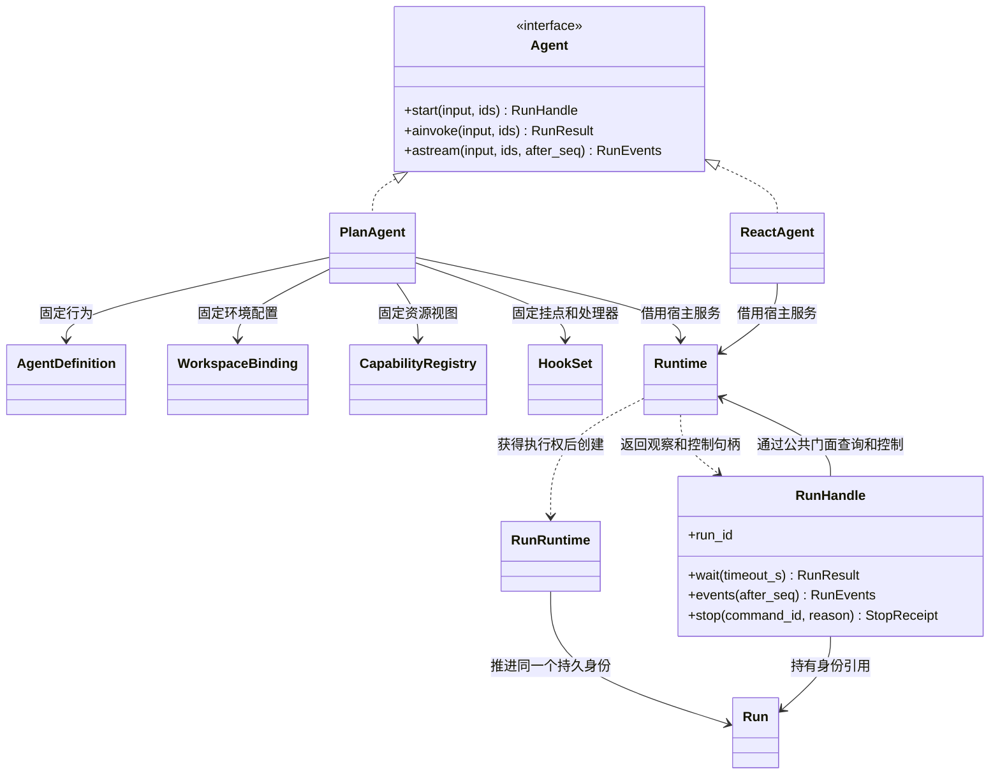
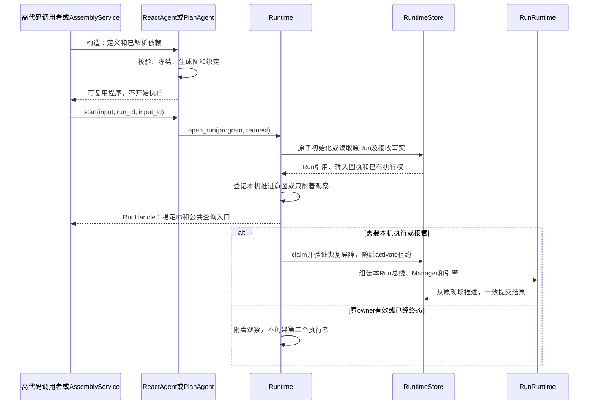

# SDK 构造、资源绑定与对象生命周期

状态：推荐的详细设计，尚未实现。本文补齐“开发者传什么、SDK 创建什么、对象存活多久”；不改变已确认的 Loop、并行、重试和历史规则。执行入口见[公共 API](public-api.md)，运行数据和恢复事务分别见[定义](definitions.md)与[检查点](checkpoints.md)。

## 1. 四层对象，分别承担什么

| 层次 | 对象 | 谁创建 | 可以跨 Run 复用吗 | 是否进入检查点 |
| --- | --- | --- | --- | --- |
| 配置 | AgentDefinition、RoleDefinition、WorkspaceBinding、HookBinding | 调用者 | 可以，构造后不可变 | 保存执行所需的值或引用；不保存平台发布关系 |
| 可执行程序 | ReactAgent、PlanAgent、Workflow | SDK 构造／编译 | 可以，不存消息和当前进度 | 保存本地绑定 key；不序列化 Python 对象 |
| 宿主服务 | Runtime、ModelAdapter、CapabilityRegistry、存储和环境适配器 | 调用者装配 | 可以，必须遵守并发契约 | 连接、函数、锁、协程不保存 |
| 执行现场 | RunRuntime、EventBus、NodeDriver；Run、Task、Operation、Context | SDK 在执行时创建 | 不能把本次可变状态交给另一 Run | 前者是进程设施，后者是持久事实 |

`AgentDefinition` 描述行为，`GraphDefinition` 描述组织，具体的 `ReactAgent`／`PlanAgent` 把两者和依赖关联起来，并实现公共 `Agent` 接口。`Workflow` 是独立的已编译程序，`StateGraph` 是其构建器。`Runtime` 是服务宿主，不是 Agent 配置，也不是某一次 Run。普通开发者构建 Agent 时无需手动创建 EventBus、HookManager、NodeTask 或检查点。

下面以 PlanAgent 展开配置引用；ReactAgent 使用相同构造依赖，但不配置 Executor。Agent 接口只定义使用合同，不拥有这些对象。



虚线空心三角表示实现接口，普通虚线箭头表示创建依赖。RunHandle 不拥有 RunRuntime；一个运行可有多个本机／跨进程观察者。观察者关闭不会级联停止执行。

## 2. Python 构造合同

以下是目标签名，引用的协议分别在模块设计中定义；不是已发布的包用法。ReactAgent／PlanAgent 此处只列构造函数；两者都必须实现[公共 Agent 接口](public-api.md#21-正式签名)中的执行方法。

```python
class Runtime:
    runs: RunService
    inputs: InputCommands

    def __init__(
        self, *, namespace: StorageNamespace,
        store: RuntimeStore, content_store: ContentStore,
        environment: EnvironmentProvider,
    ) -> None: ...

    async def __aenter__(self) -> "Runtime": ...
    async def __aexit__(self, exc_type, exc, traceback) -> None: ...
    async def aclose(self) -> None: ...


class ReactAgent(Agent):
    def __init__(
        self, *, definition: AgentDefinition, model: ModelAdapter,
        capabilities: CapabilityRegistry, hooks: HookSet,
        workspace: WorkspaceBinding, runtime: Runtime,
    ) -> None: ...


class PlanAgent(Agent):
    def __init__(
        self, *, definition: AgentDefinition, model: ModelAdapter,
        capabilities: CapabilityRegistry, hooks: HookSet,
        workspace: WorkspaceBinding, runtime: Runtime,
    ) -> None: ...
```

所有依赖通过关键字传入。暂不叠加 Builder、全局默认 Runtime、自动平台查询三套装配入口；便利工厂可以后续包装相同构造合同。空能力和空 Hook 分别使用 `CapabilityRegistry(tools=(), skills=())`、`HookSet(bindings=(), handlers={})`。内存适配器可以独立运行，持久恢复则注入满足合同的后端。

### 2.1 参数的唯一责任

| 参数 | 包含什么 | 不能包含什么 |
| --- | --- | --- |
| definition | 角色、Prompt、变量、能力选择、策略与格式 | API Key、活动消息、平台资源查询回调 |
| model | 一个已配置的 ModelAdapter；内部可持有连接和凭据获取端口 | 通过 role_key 再选择另一模型 |
| capabilities | 已解析工具描述、原始适配器、Skill 包与 Loader | 运行中扩大角色能力的目录搜索 |
| hooks | 本程序的不可变绑定和已解析处理器 | 全局可变 Hook 列表、可改写身份／额度的处理器权限 |
| workspace | 稳定根句柄、内容范围、环境策略、资源挂载 | 本次 run_id、lease 或事先构造的 WorkspaceScope |
| runtime | 存储、内容、环境及宿主生命周期 | 平台用户、应用、发布服务 |

Executor 和压缩调用使用 `model` 的同一连接，按所属 Agent 的固定策略生成请求。不同完整 Agent 可以注入不同模型；将它们放入同一 Workflow 不合并模型配置。

### 2.2 构造校验与副作用

按以下顺序执行；任何失败均抛 `ConfigurationError(code, field_path, message)`，不创建 Run：

1. 校验 Definition 字段、角色 key 唯一性和模式：ReactAgent 只接受 react／无 Executor，PlanAgent 只接受 plan_executor／Planner 主角色。
2. 检查 Prompt 变量、角色输入输出 Schema 和静态策略；只使用调用者给出的本地 Schema，不读取远程 `$ref`。
3. 逐角色解析 CapabilityBinding，固定模型可见名称、输入 Schema、实际适配器与访问范围；拒绝重名和悬空引用。
4. 检查 HookSet 的 key、阶段、匹配条件及处理器，生成不可变绑定表。
5. 校验 WorkspaceBinding 的资源挂载与角色授权对应关系；不创建运行目录、容器或脚本进程。
6. 生成内部 GraphDefinition、NodeBinding 和编译描述，深度复制／冻结所有 JSON、列表及映射。

不得在构造中调用模型、MCP initialize／tools/list、运行 Hook、读取历史或领取租约。导入／发现远端工具是调用方显式准备步骤；远端内容未准备好不能用一个占位平台 ID 通过构造。

调用者后来修改原 dict 不影响已构造对象。适配器实例本身不深拷贝；调用者负责其连接有效性与并发安全，SDK 负责每次传入正确 scope。更改行为应重新构造程序，不能热改运行中的定义。

## 3. 角色、公开输入和格式的归属

输入输出格式统一由 **RoleDefinition** 声明：直接 Agent 的公开格式取 `main_role.input_schema / output_schema`，Executor 的格式取该 Executor 的声明。AgentDefinition 不再重复维护第二份顶层 input_schema／output_schema。

| 内容 | 来源和规则 |
| --- | --- |
| 根问题 | AgentInput.content；按主角色 input_schema 校验。无 Schema 时接受非空文本 |
| 根 Prompt 变量 | AgentInput.variables；只允许主角色声明的变量，校验后渲染。不给调用者覆盖系统身份、scope 和资源绑定 |
| Executor 任务 | Planner 委派参数；按目标角色的输入声明校验，再作为该任务受保护输入 |
| Executor Prompt | 目标角色自己的 Prompt 和变量，不拼接 Planner 的系统 Prompt |
| 角色最终结果 | 按该角色 output_schema 校验；无 Schema 时为自由文本。格式纠正共享根 Loop 额度 |
| Workflow 根输入输出 | Workflow 自身的 Schema；AgentNode 的映射再满足被调用 Agent 主角色的格式 |

Prompt 变量值属于本次输入的一部分，随请求固定并参与幂等比较。执行中补充说明是新增用户输入，不是修改变量或配置的暗门。变量类型、默认值与模板语法的机器合同仍归后续 Definition Schema 工作，不在此处另造模板语言。

## 4. 能力如何注册和绑定

开发者提供资源目录，RoleDefinition 从目录中选择。**注册可用资源不等于授权所有角色使用。** 目录构造为纯本地操作，执行期间不可增删。

```python
class CapabilityRegistry:
    def __init__(
        self, *, tools: tuple[CapabilityRegistration, ...],
        skills: tuple[SkillRegistration, ...],
    ) -> None: ...

    def for_role(self, program_key: str, role_key: str) -> ResolvedCatalog: ...
    def for_node_binding(self, program_key: str, binding_key: str) -> ResolvedCatalog: ...
    def resolve(self, catalog: ResolvedCatalog, model_name: str) -> CapabilitySpec: ...
```

前三类数据的字段合同如下；CapabilitySpec、SkillPackage 等已有 DTO 的完整字段见[能力设计](capabilities.md)。

| DTO | 字段 | 校验 |
| --- | --- | --- |
| CapabilityRegistration | adapter_key、adapter:CapabilityAdapter、members:tuple[CapabilitySpec,...]、config_schema:JsonObject | adapter_key 在整个目录唯一；members 非空，各 capability_key 唯一；每个 handler_ref 等于 adapter_key；config_schema 只允许本地引用 |
| SkillRegistration | adapter_key、package:SkillPackage、loader:SkillLoader | key 与工具注册共用唯一命名空间；包已准备好，Loader 不回查平台目录 |
| CapabilityBinding | 沿用 Definition 字段：binding_key、kind、visible_name、adapter_key、member_key?、config、access_scope | binding_key 与 visible_name 在角色内分别唯一；kind 与资源描述匹配；授权只能缩小 |

工具绑定的 `member_key` 对应注册内的 capability_key。只有注册恰好一个成员时可以省略，否则构造报 `CAPABILITY_MEMBER_REQUIRED`；不把省略解释成“整个 MCP 服务全部授权”。一个 MCP 连接有多个工具时，角色需要逐项明确绑定。

Skill 绑定的 member_key 对应包内唯一 entry_name；只有一个入口时可以省略。visible_name 是该角色看到的 Skill 名，不会自动注册同名可执行工具，也不会因为有 scripts 目录自动获得 exec 权限。Skill 的 binding.config 首版必须为空对象，其参数通过实际 SkillRead.arguments 传递。

CapabilitySpec.model_name 是资源提供的建议名称，RoleDefinition 的 visible_name 是最终模型可见名称；编译器生成角色专属副本，不回写共享描述。kind 的映射为 builtin_tool→builtin、tool→hosted／script、mcp→mcp；skill 走 SkillRegistration。角色 binding.config 只能满足注册的 config_schema，冻结后通过 ToolInvocationContext.binding_config 传入；没有配置项的适配器使用只允许空对象的 Schema。它不属于模型 arguments，不能包含新的凭据、路径授权或替代连接。

Registry 的 `for_role / for_node_binding` 面向**已绑定视图**：Agent 构造时把角色选择解析好；组装根执行程序时关联 program_key。注册表本体不因开始某个 Run 而原地修改。查询返回只读 ResolvedCatalog，不产生 I/O。

## 5. HookSet 与 HookBinding

这里只冻结已设计的 **Operation 请求／响应挂点**。Run／节点生命周期 Hook 需要另一种输入和控制合同，尚未开放；不能拿 operation_id=null 冒充调用型 Hook。

```python
class Hook(Protocol):
    async def evaluate(
        self, input: HookInput, context: HookContext, *, reader: HookReadPort,
    ) -> HookDecision: ...


class HookSet:
    def __init__(
        self, *, bindings: tuple[HookBinding, ...],
        handlers: Mapping[str, Hook],
    ) -> None: ...
```

| DTO | 精确字段 | 规则 |
| --- | --- | --- |
| HookBinding | binding_key:str、handler_key:str、event_type:str、stage:request\|response、matcher:HookMatcher、ordinal:int、timeout_ms:int=5000 | key 在程序内唯一；ordinal 为非负且在同 event_type／stage 内唯一；超时正数；handler 必须存在 |
| HookMatcher | role_keys:tuple[str,...]\|null、node_binding_keys:tuple[str,...]\|null、capability_binding_keys:tuple[str,...]\|null、purposes:tuple[business\|compaction\|system,...]\|null | 非 null 的条件之间 AND；集合内 OR；null 表示不限制，空集合非法；按固定绑定校验引用 |
| HookInput | event_type、stage、payload_ref、context_refs:tuple[ContextRevisionRef,...] | 指向该项开始时已提交的有效输入；由 HookReadPort 读取，不暴露原始存储客户端 |

绑定按 ordinal 升序串行执行；ordinal 是配置内顺序，不是跨 Operation 的全局序号。matcher 只匹配可信元数据，首版不开放任意 Python 表达式或 JSONPath。要按输入内容检查，由获得受限有效输入的 Hook.evaluate 实现并返回 allow／deny／patch。

HookContext 沿用总线篇的持久元数据，不往该 DTO 塞数据库客户端。每次 evaluate 另注入本次处理器专属的只读端口：

```python
class HookReadPort(Protocol):
    async def read_payload(self) -> JsonValue: ...
    async def read_context(
        self, ref: ContextRevisionRef, *, after_seq: int = 0, limit: int = 100,
    ) -> HookRecordPage: ...
```

read_payload 读取固定 HookInput 的有效 payload；read_context 只接受 input.context_refs 中的精确版本，limit 为 1..256。返回 `HookRecordPage{records:tuple[HookRecordView,...],next_seq:int|null}`；记录按 context_seq 升序，`HookRecordView{record_id,context_seq,role,message_kind,effective_payload:JsonValue,visible_fields:tuple[str,...]}` 仅物化获准字段。next_seq 是下页 after_seq，无更多记录则 null。

读取过程复查授权及来源可用性，不能切到最新上下文或读取其他 Executor。返回值不可原地修改；变更只能通过 HookDecision 提案提交。端口随本次 Hook 结束而失效，不保存到检查点。脚本 Hook 通过受限适配器获得同样的输入和读取视图，不获得宿主 ContentStore 连接。

`capability_binding_keys` 仅适用于 capability.invoke；role_keys 仅适用于具有角色的程序。不适用字段、未知事件／阶段或未注册挂点在构造时明确报错。某次调用没有 matcher 所要求的元数据则不匹配，不以空值通配。

FunctionHook 实现可信异步函数，ScriptHook 经受限 HookAdapter 执行；HookAdapter 是执行机制，不是第二套用户挂点。timeout、失败放行、合法 deny、补丁校验、持久游标全部复用[Hook 管道](event-bus.md#23-hook-输入与补丁)。HookSet 不提供 fail_closed 开关，不允许修改停止／额度／必要清理控制。

同一注册可被不同角色命中，不设“通用 Hook／角色 Hook”两套类型。程序固定的 HookSet 与运行时按可信 scope 筛选是两件事。

## 6. program_key 从哪里来

program_key 是**一次根程序装配内的本地地址**，不是平台应用 ID、发布号或配置指纹。

| 位置 | 本地地址 | 运行身份 |
| --- | --- | --- |
| 直接 ReactAgent／PlanAgent | root | 每次执行新 Run／Invocation |
| 根 Workflow | root | 每次执行新根 Workflow 图 |
| Workflow 注册的完整 Agent | `agents/{agent_key}` | 每次 AgentNode 业务调用产生新 Invocation／内层图 |
| Planner 的 Executor 角色 | 沿用所属 Agent 的 program_key，加 role_key 定位 | 每次委派产生 NodeTask，不新增程序或完整 Invocation |

`agent_key` 由 Workflow 构建者为预装配 Agent 指定，在该 Workflow 内唯一；推荐静态短 key，语法为 `[A-Za-z_][A-Za-z0-9_-]{0,63}`。PreparedAgentRef 只含此 key；编译时解析本地映射，执行期不可从平台加载。SDK 内部根绑定表根据上述规则派生地址，调用者不在 AgentDefinition 写入它。

同一个完整 Agent 被调用两次，program_key 相同而 invocation_id 不同；Hook 集合可复用，匹配 scope、上下文和处理游标各自独立。两个不同 Agent 即使 role_key、Hook binding_key 相同，也由 program_key 区分。

Workflow 编译接收的 Agent 必须绑定同一个 Runtime 实例；否则报 `RUNTIME_BINDING_MISMATCH`。运行时根控制、存储 namespace 和环境服务由根 Runtime 统一提供，各程序仍保留模型、角色资源、WorkspaceBinding 和局部策略。不能在 AgentNode 内调用 child.ainvoke 创建另一个根 Run。

Workflow 的图构建／compile 精确签名、映射 DSL 和原生类型还待专篇完成。本节只固定预装配程序的身份和依赖规则，不宣称 LangGraph 编译器接口已经逐参数兼容。

## 7. 生命周期与资源所有权

### 7.1 Runtime

Runtime 状态为 created → open → closing → closed。进入异步上下文开启本机 supervisor；只允许 open 状态创建／接续执行和控制请求。已注入适配器必须由调用方准备为可用状态；SDK 不通过 `__aenter__` 隐式登录模型、发现 MCP 工具或启动 Agent。

同一 Runtime 绑定一个 asyncio event loop，可并发服务多个 Run；不得跨线程／跨 loop 共用活动对象。不同 Runtime 可以使用相同持久后端与 namespace，执行权由存储租约协调。内存后端只支持持有同一存储对象的本进程范围，不能据此证明多进程恢复。

Runtime 持有本机执行任务的强引用。取消 ainvoke 的等待协程、关闭 RunHandle.events 或断开 SSE，仅取消观察，不向执行任务传播 CancelledError。用户终止必须调用 stop。

### 7.2 关闭与主动停止不是同一件事

| 动作 | 执行如何处理 | 持久事实与文件 |
| --- | --- | --- |
| RunHandle 的等待／订阅关闭 | 本地解除观察 | 不改 Run，不删文件 |
| Run 正常或异常终结 | 等全部写入者收束，提交真实终态 | 临时文件清理独立登记；保留记录，持久工作区不删除 |
| runtime.aclose／退出 async with | 关闭本机准入，停止本机调度，按 shutdown 撤销／收束已拥有执行域后释放租约；挂起本机等待者 | 不伪造 cancelled，不清除未完成的工作区和检查点；新进程重建依赖后接续 |
| runtime.runs.stop | 保存永久关闭该 run_id 准入的控制命令，全体收束 | 按用户停止规则形成终态，然后清理临时文件 |

aclose 幂等，关闭后不能 reopen；需要新建 Runtime。关闭过程不保证任何第三方业务副作用被撤销。无法证明旧写入者已停止时保留恢复屏障，不把“关闭方法返回”解释成允许新写入者访问共享卷。关闭流程沿用[总线 shutdown](event-bus.md#11-生命周期)和[检查点接管](checkpoints.md)约束。

注入的 RuntimeStore、ContentStore、EnvironmentProvider、模型客户端和共享 Adapter **由调用方拥有**；Runtime 只关闭自己创建的任务、句柄、观察者和受限执行连接，不关闭别的 Runtime 还在使用的客户端池。调用者应在 Runtime 退出后再退出这些依赖的资源上下文。

## 8. 装配流程与实现位置



图中的存储步骤不表示持锁执行网络操作；claim／环境撤权／activate 的具体边界遵循检查点协议。start 在提交接收事实并登记本机执行意图／观察后返回，不等待整段恢复、环境准备或任务完成。

建议模块落点：

| 模块 | 实现内容 |
| --- | --- |
| sdk/public/agents.py | ReactAgent、PlanAgent 门面及模式校验 |
| sdk/public/inputs.py、results.py | 输入规范化、RunHandle 和公开只读 DTO |
| sdk/assembly/ | Definition 校验、角色目录、HookSet、程序绑定及构造报告 |
| sdk/runtime/host.py | Runtime 生命周期、本机 supervisor、open_run |
| sdk/runtime/ | RunRuntime、执行控制、已定义的管道／检查点服务 |

这里的 sdk 表示后续 Python 包根，实际分发名仍为 agentloom-sdk；不要求为每一行再拆独立服务。

## 9. 本项设计的验收边界

1. 构造期间拦截所有外部 I/O：不得调用模型、MCP、Hook，也没有 Run／沙箱创建。
2. 修改调用者原始配置 dict；已构造对象行为不变。
3. 注册三个工具但只绑定一个；模型目录、文件与脚本视图均不扩大授权。
4. 两个程序存在同名 Hook；同 Run 内各自只运行自己的固定链。
5. 同一个 Agent 并发处理不同 Session；消息、Task、EventBus 和 RunHandle 不串用。
6. 取消等待后任务仍执行；显式 stop 后不能再启动新动作。
7. 关闭 Runtime 后，用新对象和原 ID 接续；不生成新的问题、Executor 或程序地址。

这些是待实现测试。本文不补造尚未完成的 Workflow compile、生命周期 Hook、机器 Schema 和存储适配器代码。
