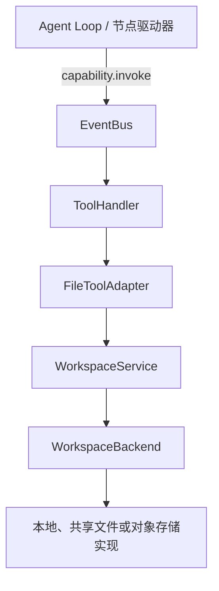
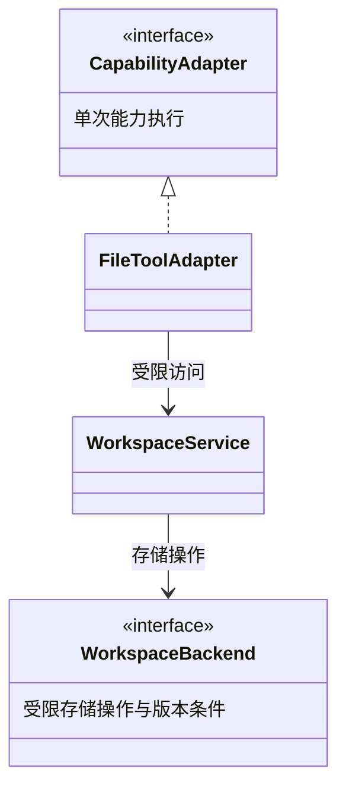
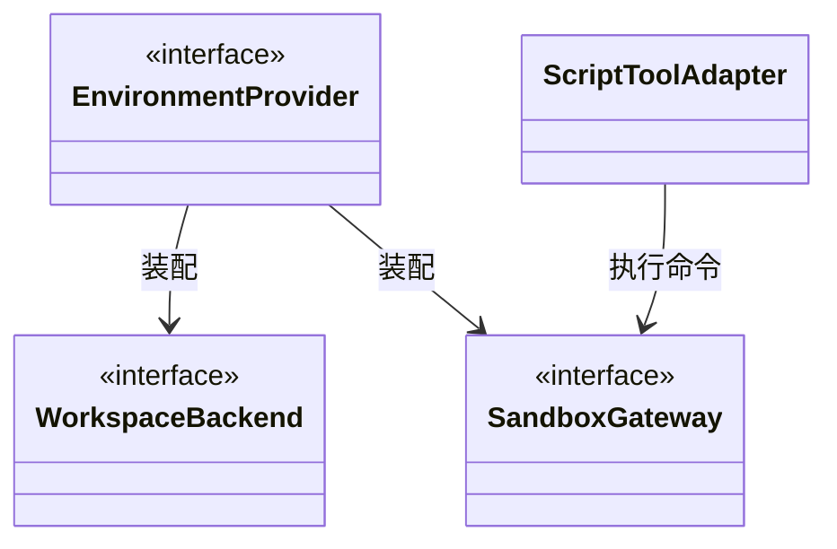

# SDK 默认工具与 SPI 扩展设计

更新：2026-10-18。文件后端 SPI 已实现：普通抽象方法、entry points 注册、按配置发现与实例化，覆盖全部 11 个文件操作。EnvironmentProvider／SandboxGateway 的完整目标协议及真实共享存储、对象存储驱动仍待实现，具体边界见[第 9 节](#9-当前代码与待调整部分)。Workflow 不在本轮范围。

SDK 自带一套基础工具，内置工具与用户扩展使用相同的调用机制。增加业务工具通过工具执行 SPI；给文件工具更换存储介质通过文件后端 SPI；更换脚本运行环境通过沙箱执行 SPI。文件 SPI 使用 `WorkspaceBackend` 抽象基类、Python 包 entry points 和标准库 `importlib.metadata`；业务安装实现包，在 `PropertiesConfig.files` 选择名称，无需手动创建后端对象。

## 1. 默认工具清单

“默认提供”表示 SDK 提供描述、参数 Schema 和对应实现或适配入口。**注册进目录不等于授权给所有 Agent。** Planner 与各 Executor 仍由自己的 AgentDefinition 选择能力；模型只看到该绑定位置获准的入口。

表中的名称为标准建议名。文件能力的内部成员 key 为 read、write 等，现有协议文档用 `fs.read`、`fs.write` 标识同一行为；最终模型可见名称由 `CapabilityBinding.visible_name` 固定，不同时注册多组别名。

| 分类 | 提供的工具 | 行为与启用条件 |
| --- | --- | --- |
| 文件读取 | `read`、`list`、`stat` | 分段读取、分页列举、查询文件类型和版本；须绑定获准的工作区或只读资源 |
| 文件搜索 | `glob`、`grep` | 按路径模式查找、搜索文本；结果有确定顺序、数量上限和截断标记 |
| 文件修改 | `write`、`edit`、`patch` | 创建／覆盖、精确文本替换、单文件精确补丁；修改已有文件须校验版本 |
| 文件管理 | `mkdir`、`move`、`delete` | 创建目录、移动和删除；限定授权范围，后端须支持相应语义 |
| Skill 读取 | `skill_list`、`skill_read`、`skill_read_resource` | 配置 Skill 后提供共用读取入口；SkillHandler 校验资源与 manifest，读取不执行脚本 |
| 脚本执行 | `exec` | 装配配套执行环境后才能绑定；执行命令或 Skill 脚本，工作目录来自运行环境 |
| 大结果读取 | `result_read` | 分片读取当前调用方可访问的完整有效结果；不因共享工作区而开放其他 Executor 的私有调用记录 |

基础文件工具的参数、默认大小、UTF-8 边界和补丁规则沿用[文件行为合同](capabilities.md#6-基础文件工具的完整行为)。当前本地实现的 grep 只支持字面匹配，RE2 正则是后续能力；不能仅因参数名相同就宣称支持。

文件读取与搜索可组成只读工具集，修改与管理可组成写工具集。工具集只负责批量生成注册描述及供调用方选择，不是新的授权系统，也不改变显式逐项绑定规则。

`web_fetch`、`web_search`、数据库、Git 和业务 API 可作为独立扩展包或经 MCP 接入，本轮不纳入核心默认工具。默认套件不增加通用的“执行任意 Python”入口；脚本统一经 exec 与配置的执行环境运行。

### 1.1 与执行器委派的区别

Planner 委派 Executor 向模型表现为一次结构化调用，但背后负责创建角色任务、独立上下文、共享额度和恢复现场，继续由图执行模块处理。它不注册成任意可替换的文件或函数工具适配器。

普通文件、MCP、Skill 和 exec 调用只形成调用记录，不创建新的 Agent 或图实例。Skill 文件中出现命令也不会自动授予 exec；必须由后续显式调用执行。

## 2. 一次调用怎样经过这些对象

以下以文件工具为例，展示从模型动作到真实存储的调用路径：



一次文件调用选择一个后端，不是向所有存储广播。当前每个 RuntimeEngine 选择一个提供者，所有文件操作一起切换；多个后端的挂载路由仍属于后续设计。路径不能由模型转换成任意存储连接。调用脚本时，ToolHandler 选择 ScriptToolAdapter → SandboxGateway；MCP 与函数工具分别选择自己的适配器。

调用仍遵循现有[事件与 Hook 协议](event-bus.md)：

1. Loop 根据冻结目录解析工具名，创建或接回本次 Operation，并发送 before 阶段事件。
2. 等待阶段处理结果；合法拒绝直接结算，有效改参继续通过 Schema 和范围校验。
3. 经 EventBus 交给 ToolHandler，后者调用所选 CapabilityAdapter。
4. 文件适配器使用 WorkspaceService；文件服务检查逻辑路径和权限，再调用 WorkspaceBackend。脚本适配器使用 SandboxGateway。
5. 单次实际调用返回后，统一设施保存 raw。Loop 再发送 after，等待有效结果保存并交付上下文。

ToolHandler、文件后端和沙箱不代发本次外围 before／after，也不自行调用 HookHandler。一次 edit 内部的读取与条件写入不创建两个新的模型工具调用或独立 Operation；操作元数据沿用原调用。脚本内部每次系统调用也不进入 EventBus。

Skill 的三个入口直接路由 SkillHandler → SkillLoader；result_read 沿用结果读取路由与授权。它们复用调用阶段协议，不必为了“都是模型工具”再绕一次 FileToolAdapter。

## 3. 接口分工与 UML

| 接口／对象 | 负责 | 不负责 |
| --- | --- | --- |
| `CapabilityAdapter` | 业务能力执行 SPI；完成一次具体调用并返回结构化结果或错误 | 模型循环、外围 Hook、自动重试、平台查询 |
| `FileToolAdapter` | 把文件工具参数映射到文件服务，保持模型可见 Schema | 选择云账号、直接拼宿主路径、独立保存检查点 |
| `WorkspaceService` | 当前调用的受限文件视图；路径规范化、挂载路由、读写权限及公共文件行为 | 固定绑定某种磁盘、持有所有角色的权限并集 |
| `WorkspaceBackend` | 完整 11 方法的文件 SPI；版本条件、存储原子性、精确修改与搜索语义 | 模型上下文、Skill 模板、运行状态提交 |
| `EnvironmentProvider` | 准备工作区和只读资源挂载，装配后端与沙箱，提供撤权和清理能力 | 业务工具选择、Planner 决策、平台应用创建 |
| `SandboxGateway` | 执行环境 SPI；命令执行、状态查询、终止和执行域撤销 | 静默启用宿主 shell、创建第二套 Agent Loop |
| `SkillLoader` | 从固定资源包读取入口和附属资源，验证 manifest | 自动执行包内脚本或扩大工具权限 |
| `RuntimeStore` | 执行记录和检查点的关联状态一致提交 | 向模型暴露存储目录或承担工作文件读写 |

文件工具接口关系：



环境装配与命令执行关系：



第二张图的 ScriptToolAdapter 同样实现 CapabilityAdapter；重复出现的 WorkspaceBackend 是同一个接口。RuntimeEngine 独立接收 EnvironmentProvider 和 RuntimeStore，后者不参与文件工具调用。图中的实线箭头表示使用或装配依赖，不代表继承或独占资源生命周期。WorkspaceService 按当前可信调用范围创建；后端客户端可以共享，但不能用可变的全局 `current_session`、`current_role` 保存身份。

## 4. 文件存储 SPI 的合同

### 4.1 可信上下文与路径

模型参数只包含 `/work/reports/result.md` 之类的逻辑路径和业务参数。WorkspaceScope、角色访问范围、run／operation／attempt 身份、有效执行权及截止时间由 SDK 提供，不能从工具 JSON 接收替代值。

WorkspaceService 根据只读挂载表解析路径；Backend 接收受限句柄与相对路径，不能以路径参数选择另一个 bucket、服务器或应用根。正常工具结果和错误只返回逻辑路径，不暴露宿主根、凭据或内部连接。

共同规则由文件服务验证，后端必须使用其介质适用的方式约束真实访问。POSIX 的 dirfd、符号链接处理，或对象 key 前缀与网关授权属于各实现内部细节；上层不能 import 本地 driver 的私有路径函数。

### 4.2 可导入的完整文件接口

`agentloom.WorkspaceBackend` 是抽象基类。实现包必须继承并实现 `read/write/list/mkdir/stat/edit/patch/move/delete/glob/grep` 全部 11 个普通方法。SDK 不要求 `async def`，不代建事件循环或 I/O 线程池；内部连接、线程和异步客户端由实现包管理，方法返回时本次操作必须已完成或明确失败。

完整签名及返回 TypedDict 见 [`workspace/contracts.py`](../../agentloom-sdk/src/agentloom/workspace/contracts.py)。每个方法的首个业务参数是可信的 `WorkspaceCallContext`，随后是原文件工具参数。例如：

```python
# 实现类中的方法签名；返回普通 DTO 字典。
def read(self, context, path, *, offset=0, limit=16384): ...
def write(self, context, path, content, *, mode="create_only", if_match=None): ...
def list(self, context, path=".", *, cursor=None, limit=100): ...
```

`WorkspaceCallContext` 携带 namespace、session_id、run_id、稳定 workspace_id、lease_epoch、role_key、operation_id、attempt_id、attempt_no、deadline_at、access_scope 和 `check_active()`。身份与授权由 SDK 构造并冻结，不能使用全局 current_session 保存。临时 workspace_id 按 namespace／session／run 隔离；持久工作区按 namespace／session 复用。

| 方法 | 返回 DTO 及约束 |
| --- | --- |
| read | FileRead：版本、UTF-8 字节范围、text、next_offset、total_bytes；默认 16 KiB，最大 64 KiB |
| write／stat／move | FileVersion：path、kind、size、etag；文件操作返回 sha256，etag 保持不透明 |
| list | DirectoryPage：entries、etag、next_cursor；直属项含 name 和版本，排序、限制及失效游标语义保持一致 |
| mkdir | DirectoryCreated：path、kind=directory |
| edit／patch | FileEdit／FilePatch：文件版本与 matched_count／hunks_applied |
| delete | FileDeleted：deleted_path、previous_etag；非空目录须显式 recursive |
| glob／grep | GlobResult／GrepResult：有界、排序的 paths／matches 与 truncated；当前 grep 只允许 literal=True |

SDK 在调用前检查 Schema、逻辑路径、只读权限、访问根和输入大小，在返回时检查 DTO、路径范围、顺序、数量及读取偏移，不将供应商私有字段或越权路径交给模型。写入版本条件、真实存储隔离、符号链接／对象前缀处理和原子性必须由实现包保证，SDK 的 Python 接口不能自动证明存储语义。

### 4.3 修改、搜索与执行权

edit／patch 的完整实现由提供者接管；实现包可复用自己的固定版本 read 与条件 write。必须保持精确匹配、单文件补丁、禁止 fuzz、20 MiB 上限和冲突语义。glob／grep 同样由提供者接管，搜索加速不能改变公共结果、范围或匹配语法。

长调用应在 I/O 过程中检查 deadline_at 和 check_active，写入发布前再次核验，服务端需要 fencing 时使用 lease_epoch 建立可撤销的执行域。方法不能返回后继续留下不受控写入者。普通同步方法并不获得强制中断能力；网络超时、取消、连接回收与远端失权由实现包落实。

执行租约由 Runtime 的独立心跳续期，从工作区 prepare 开始覆盖整个执行过程；同步提供者阻塞事件循环时仍可续期。该心跳只维护原 worker／epoch，不执行提供者 I/O，也不延长工具或 Run 的业务截止时间。续租失败后 check_active 和业务提交立即拒绝继续推进；真实接管仍按 epoch 拒绝旧 owner。终态提交前停止并回收执行心跳，撤权和清理使用各自的租约保护，宿主关闭时等待线程收束。

本地后端用同一逻辑路径规则处理授权与 glob 相对路径：`.`、重复分隔符及 `/work` 别名表示相同工作区位置。`/work//sub` 仍表示工作区内的 `sub`，不会成为宿主绝对路径；`..`、其他绝对路径和受限范围外的访问仍被拒绝。

### 4.4 启动与生命周期校验

启动时只加载选中名称。不存在报 `FILE_PROVIDER_NOT_FOUND`，重名报 `FILE_PROVIDER_DUPLICATE`，缺方法、签名不兼容、异步入口报 `FILE_PROVIDER_INTERFACE_INVALID`，导入或构造失败报 `FILE_PROVIDER_LOAD_FAILED`；不回退本地。实例构造后也复核方法，防止构造器把接口覆盖为无效属性。运行时意外返回协程会拒绝，不由 SDK 代为 await。

所有提供者都实现完整接口；只读限制仍由每项 CapabilityBinding.access_scope 控制。后端若不能满足选用工具的实际存储语义，应提供不同的能力接口或明确失败，不能声称完整实现后静默降级。

可选生命周期方法均为普通方法：prepare(context) 可准备空间与 fence；revoke(context) 可撤销远端写入者；cleanup(context) 默认使用 list／delete 清空临时内容；close() 释放当前实例。prepare／revoke 默认无额外 I/O，适合仅通过同步调用访问的后端。需要服务端撤权的实现必须覆盖 revoke。cleanup context 另带 cleanup_job_id／cleanup_lease_epoch，与目标工作区的业务 lease_epoch 分开；由独立清理租约保护，失败保持诊断并重试；持久工作区不会调用 cleanup。额外容器或元数据回收由提供者覆盖 cleanup 完成。

Runtime 在调用第三方 prepare 前先持久化 scope 身份。prepare 中途失败、停止或截止时，后续撤权和清理仍使用该 scope；提供者的生命周期方法须允许处理尚未完成准备的空间。

## 5. 三种介质怎样接入

| 介质 | 接入方式 | 必须明确的边界 |
| --- | --- | --- |
| 本地 POSIX 文件系统 | 默认实现，以授权目录句柄读写，文件版本与锁保护受控操作 | 只能声明已验证的单机语义；SDK 文件锁不约束任意宿主脚本 |
| 共享文件系统 | 实现相同 SPI，验证跨进程／跨机器锁、可见性和旧执行权撤销 | NFS 挂载成功不等于多机故障接管已安全；失联不能降为无锁写 |
| 对象存储 | 将逻辑路径映射到受限 key，封装范围读取、条件写及列举 | 前缀不等于真实目录；复制再删除不能冒充原子 move；分页、版本及删除能力按实际合同声明 |

当前可导入接口要求实现全部 11 个方法。按后端静态能力裁剪工具集、跨挂载路由和共享／对象存储驱动的完整验收属于后续能力，不以本次测试提供者代替。

## 6. 文件工具与脚本必须看到同一份文件

Planner 和 Executor 共享同一次任务获准的工作文件，各自保留独立上下文及资源授权。exec 和 read／write 必须使用同一工作区身份及逻辑挂载表；`/skills/<name>` 只读、`/work` 可按授权写入。不能把多个角色的只读资源取并集挂给所有角色。

本地目录或共享文件系统可由 EnvironmentProvider 将对应卷挂到沙箱。若文件存储是对象存储，执行环境还需要实现可见性协议：

- 提供满足文件合同的共享访问／挂载网关，使脚本与文件工具访问同一份内容；或
- 在脚本前物化固定版本，结束后按版本条件发布变更，并在同步期间阻止同范围的不兼容访问。

两种方式均由环境实现负责。同步方案必须处理冲突、失败和部分写入；确认发布完成前不能把 exec 作为文件已对其他执行器可见的成功结果。若无法实现一致视图，则拒绝该存储与 exec 的组合，仍可单独提供已满足合同的文件工具。

不能只上传到对象存储、同时让脚本修改另一份临时副本，并期望模型自行识别数据不一致。仅实现 WorkspaceBackend 也不等于实现了脚本隔离。

SandboxGateway 沿用[执行、查询、终止和撤销合同](capabilities.md#7-sandboxgateway-的运行与撤销驱动)。工具层不决定使用 Docker、其他容器还是远程沙箱；显式绑定的环境负责实现相应保障。默认本地文件环境不自动获得宿主 shell 权限。

## 7. 错误、Hook、恢复与生命周期

- 路径不存在、权限不足、版本冲突和明确的网络异常使用统一结构化错误；不依据错误文字猜测重试类别。
- CapabilityAdapter 和 Backend 不叠加隐藏的自动重试。SDK 继续使用用户配置的统一策略；若底层客户端存在无法关闭的重试，应明确作为适配边界，不能声称一次 Attempt 只发送一次请求。
- operation_id 可传给支持防重的后端，自动重试仍是同 Operation 的新 Attempt；LLM 再次提出调用是新 Operation，不按参数相同自动合并。
- Hook 改参不能扩大授权；修改后的请求再次校验。后置 Hook 可以产生有效输出修订，但不能抹去真实失败或撤销已经发生的文件写入。
- 提供者已返回但 DTO 非法时保留 completed 事实并拒绝公开非法内容；已返回的有效结果超过工具截止时保留 completed 与结果材料，不能按 unknown 自动重写。
- 已保存 raw 的恢复只续后处理；外部写入发生而 raw 尚未可靠保存时须核对后端证据，无法确定则保留 unknown，不把“没有记录”当作未执行。
- 工作文件与 RuntimeStore 检查点分开。即使二者都保存为 JSON 文件，也不能假设工作文件修改与执行状态提交是同一个原子事务。
- 临时目录在整个 ExecutionRecord 收束、所有相关写入者失效后清理；持久沙箱按既定规则保留文件。单个 Executor 完成不清理共享目录。

RuntimeStore 的实现可以独立替换，必须满足[一致提交与恢复合同](checkpoints.md)。WorkspaceBackend 不因此获得写检查点或删除执行记录的权限；模型文件工具不能访问系统记录目录。

## 8. Python 包注册与配置加载

第三方在自身 `pyproject.toml` 登记实现类，发布并安装该包：

```toml
[project.entry-points."agentloom.workspace_backends"]
acme = "acme_files:AcmeWorkspaceBackend"
```

业务只配置提供者名称和可选构造参数：

```python
from agentloom import FileProperties

# properties 是原有 PropertiesConfig；安装实现包后按名称选择。
properties = properties.with_options(
    files=FileProperties(provider="acme", options={}),
)
```

`options` 是冻结的 JSON 参数，SDK 使用 `实现类(**options)` 创建对象；可以为空，地址可完全内置在第三方包里。模型、能力目录和业务 AgentDefinition 不因更换文件后端改变。第三方持有根地址时，AgentProperties 中可使用 `WorkspaceBinding()`；默认 `local` 必须指定本地 root，配置错误在 build 阶段拒绝。

`FileProperties()` 默认选择内置 local，使用同一 WorkspaceBackend 调用合同；已有直接 RuntimeEngine／WorkspaceService 用法保持兼容。高级入口可使用 `RuntimeEngine(files=FileProperties(...))`。Runtime 构造只解析本地登记元数据，async entry 才导入选中模块并实例化；`AgentLoom(properties)` 本身不加载提供者。

一个 RuntimeEngine 只创建一个提供者实例，不同 Run 共用客户端，通过各自 context 隔离身份与权限。宿主退出先等待运行及维护任务收束，再调用 close，成功后释放引用；关闭失败可再次 aclose 重试。原先注入的模型、store、environment 等服务仍由调用方拥有。

恢复清单保存提供者名、entry point、发行包名称与版本、保留数值类型的 options 摘要，不保存原始参数和凭据。改变上述绑定会在派发前拒绝非终态恢复；维护任务也检查持久 scope 的提供者绑定，不会拿另一后端执行清理或撤权。默认本地旧检查点保持兼容。第三方实现或内置地址改变时必须更新发行版本；SDK 不对安装包全部源码做哈希。

安装包发现不执行未选中的实现，不引入全局可变注册表。第三方文件提供者与未经验证的自定义 environment／ScriptToolAdapter 组合明确拒绝，避免 exec 和文件工具访问两份不同的文件；脚本、共享挂载和完整环境 SPI 后续单独对齐。

## 9. 当前代码与待调整部分

| 内容 | 当前实现 | 边界 |
| --- | --- | --- |
| 文件 SPI | WorkspaceBackend 抽象基类、完整 DTO、11 个普通方法 | 实现包自行保证真实存储语义；不自动提供远端强制取消 |
| 注册加载 | entry points、FileProperties、按名称选择／校验／创建／关闭 | 只加载选中类；不提供全局可变注册表或热切换 |
| 公共文件层 | 独立 workspace 包，参数／逻辑路径／授权／结果校验 | 一个 Runtime 一个文件后端；多后端挂载路由待实现 |
| 本地默认实现 | LocalWorkspaceBackend 适配现有 POSIX 读写、版本、精确修改、搜索、撤权与清理 | 仍是单机保证，不宣称 NFS／跨机 fencing |
| 第三方接入验证 | 独立测试包安装；全部 11 操作、ReAct／Plan、进程退出恢复 | 测试包是合同替身，不是生产云存储驱动 |
| 脚本与 Skill | 原能力目录、SkillLoader、脚本适配入口保留 | 完整 EnvironmentProvider／SandboxGateway 协议、对象挂载与脚本一致性待补齐 |
| 检查点 | RuntimeStore 独立配置，继续默认 JSON 文件系统 | 不由 WorkspaceBackend 接管运行记录 |

## 10. 后续实现验收

下表仍为完整环境／文件／沙箱目标的验收清单；本轮文件 SPI 的具体结果见[实现记录](implementation.md#文件提供者-spi)。不能把文件接口与确定性提供者测试当成共享存储、脚本及多机验收：

| 编号 | 场景 | 必须验证 |
| --- | --- | --- |
| SPI01 | 内置和自定义工具各执行一次 | 同一 EventBus／ToolHandler 路径，before／after 各一次，不额外创建 NodeTask |
| SPI02 | 替换文件后端 | 相同 Agent 工具 Schema、逻辑路径与公共行为；高层不依赖本地目录或供应商模块 |
| SPI03 | 注册全套文件工具，只给某 Executor 绑定 read | 该 Executor 无写工具；伪造路径、scope 或 Handler 不能越权 |
| SPI04 | 两个 Executor 带同一 etag 修改 | 至多一次条件写成功，另一结果明确冲突；raw 与有效结果均可追溯 |
| SPI05 | 只读后端或缺少原子移动 | 不符合配置的绑定在执行前拒绝；不静默降级为无条件覆盖／复制删除 |
| SPI06 | 分段读取与分页期间文件变化 | 固定版本读取或返回失效；不拼接版本，不返回无截断标记的残缺结果 |
| SPI07 | Skill 脚本写入，再由 Planner 读取 | 同一逻辑工作区可见，资源目录只读；同步失败不宣称文件已成功交付 |
| SPI08 | 后置 Hook 前故障及写入结果不明 | 已存 raw 不重写；无可靠结果先核对，unknown 不被转换成假成功 |
| SPI09 | 执行权失效及根任务清理 | 旧句柄不能继续写；全部写任务收束后才删临时目录，持久文件按策略保留 |
| SPI10 | 新插件／共享客户端／脚本缺少环境 | 显式注册和冻结生效；不关闭其他运行共用客户端；无环境时不落回宿主 shell |

共享后端需在实际介质及至少两个独立执行进程上验证其声明；涉及跨机器接管时还需跨机器故障与撤权测试。对象存储测试须覆盖其真实条件请求和分页行为，不能由内存字典替代这些验收证据。
