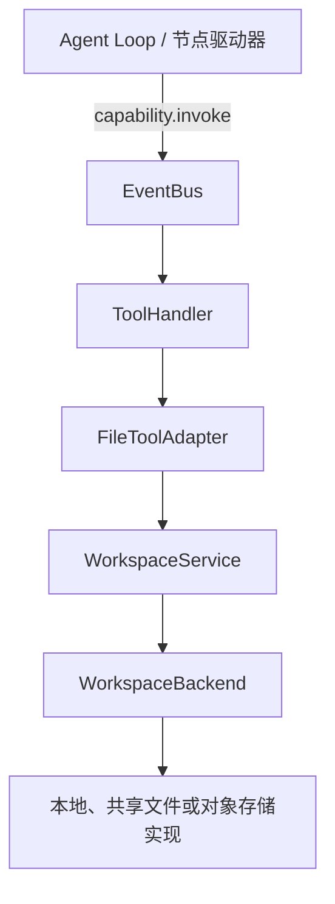
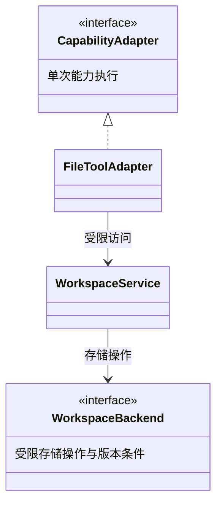
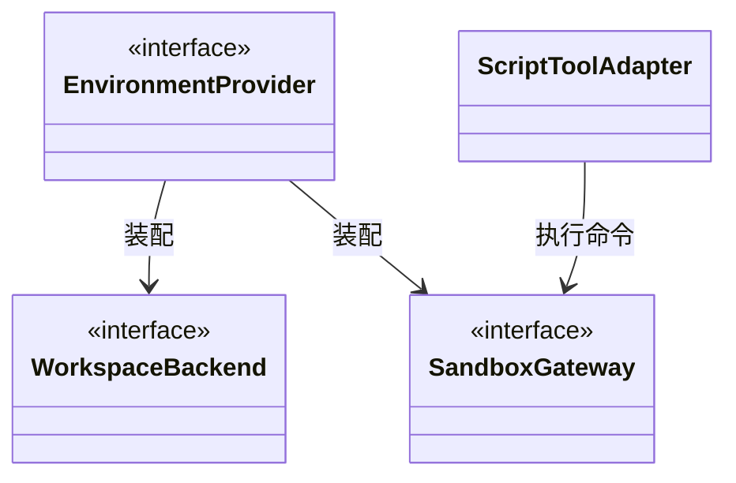

# SDK 默认工具与 SPI 扩展设计

更新：2026-10-17。本文记录本轮确认的默认工具与扩展方向，并细化各层的实现职责。**这是目标设计；与本地预览实现的差异见[第 9 节](#9-当前代码与待调整部分)。** 本轮只更新文档，不表示共享存储、对象存储和沙箱驱动已实现。

SDK 自带一套基础工具，内置工具与用户扩展使用相同的调用机制。增加业务工具通过工具执行 SPI；给文件工具更换存储介质通过文件后端 SPI；更换脚本运行环境通过沙箱执行 SPI。SPI 即供实现方扩展的接口，Python 使用 `Protocol` 和显式依赖注入表达，不要求引入插件加载框架。

## 1. 默认工具清单

“默认提供”表示 SDK 提供描述、参数 Schema 和对应实现或适配入口。**注册进目录不等于授权给所有 Agent。** Planner 与各 Executor 仍由自己的 AgentDefinition 选择能力；模型只看到该绑定位置获准的入口。

表中的名称为标准建议名。文件能力的内部成员 key 为 read、write 等，现有协议文档用 `fs.read`、`fs.write` 标识同一行为；最终模型可见名称由 `CapabilityBinding.visible_name` 固定，不同时注册多组别名。

| 分类 | 提供的工具 | 行为与启用条件 |
| --- | --- | --- |
| 文件读取 | `read`、`list`、`stat` | 分段读取、分页列举、查询文件类型和版本；须绑定获准的工作区或只读资源 |
| 文件搜索 | `glob`、`grep` | 按路径模式查找、搜索文本；结果有确定顺序、数量上限和截断标记 |
| 文件修改 | `write`、`edit`、`patch` | 创建／覆盖、精确文本替换、单文件精确补丁；修改已有文件须校验版本 |
| 文件管理 | `mkdir`、`move`、`delete` | 创建目录、移动和删除；限定授权范围，后端须支持相应语义 |
| Skill 读取 | `skill_list`、`skill_read`、`skill_read_resource` | 配置 Skill 后提供共用读取入口；SkillHandler 校验资源与 manifest，读取不执行脚本 |
| 脚本执行 | `exec` | 装配配套执行环境后才能绑定；执行命令或 Skill 脚本，工作目录来自运行环境 |
| 大结果读取 | `result_read` | 分片读取当前调用方可访问的完整有效结果；不因共享工作区而开放其他 Executor 的私有调用记录 |

基础文件工具的参数、默认大小、UTF-8 边界和补丁规则沿用[文件行为合同](capabilities.md#6-基础文件工具的完整行为)。当前本地实现的 grep 只支持字面匹配，RE2 正则是后续能力；不能仅因参数名相同就宣称支持。

文件读取与搜索可组成只读工具集，修改与管理可组成写工具集。工具集只负责批量生成注册描述及供调用方选择，不是新的授权系统，也不改变显式逐项绑定规则。

`web_fetch`、`web_search`、数据库、Git 和业务 API 可作为独立扩展包或经 MCP 接入，本轮不纳入核心默认工具。默认套件不增加通用的“执行任意 Python”入口；脚本统一经 exec 与配置的执行环境运行。

### 1.1 与执行器委派的区别

Planner 委派 Executor 向模型表现为一次结构化调用，但背后负责创建角色任务、独立上下文、共享额度和恢复现场，继续由图执行模块处理。它不注册成任意可替换的文件或函数工具适配器。

普通文件、MCP、Skill 和 exec 调用只形成调用记录，不创建新的 Agent 或图实例。Skill 文件中出现命令也不会自动授予 exec；必须由后续显式调用执行。

## 2. 一次调用怎样经过这些对象

以下以文件工具为例，展示从模型动作到真实存储的调用路径：

一次文件调用选择一个后端，不是向所有存储广播。多个挂载可分别使用不同后端，由受限文件视图按逻辑路径选择；路径不能由模型转换成任意存储连接。调用脚本时，ToolHandler 选择 ScriptToolAdapter → SandboxGateway；MCP 与函数工具分别选择自己的适配器。

调用仍遵循现有[事件与 Hook 协议](event-bus.md)：

1. Loop 根据冻结目录解析工具名，创建或接回本次 Operation，并发送 before 阶段事件。
2. 等待阶段处理结果；合法拒绝直接结算，有效改参继续通过 Schema 和范围校验。
3. 经 EventBus 交给 ToolHandler，后者调用所选 CapabilityAdapter。
4. 文件适配器使用 WorkspaceService；文件服务检查逻辑路径和权限，再调用 WorkspaceBackend。脚本适配器使用 SandboxGateway。
5. 单次实际调用返回后，统一设施保存 raw。Loop 再发送 after，等待有效结果保存并交付上下文。

ToolHandler、文件后端和沙箱不代发本次外围 before／after，也不自行调用 HookHandler。一次 edit 内部的读取与条件写入不创建两个新的模型工具调用或独立 Operation；操作元数据沿用原调用。脚本内部每次系统调用也不进入 EventBus。

Skill 的三个入口直接路由 SkillHandler → SkillLoader；result_read 沿用结果读取路由与授权。它们复用调用阶段协议，不必为了“都是模型工具”再绕一次 FileToolAdapter。

## 3. 接口分工与 UML

| 接口／对象 | 负责 | 不负责 |
| --- | --- | --- |
| `CapabilityAdapter` | 业务能力执行 SPI；完成一次具体调用并返回结构化结果或错误 | 模型循环、外围 Hook、自动重试、平台查询 |
| `FileToolAdapter` | 把文件工具参数映射到文件服务，组织 edit／patch 等工具语义 | 选择云账号、直接拼宿主路径、独立保存检查点 |
| `WorkspaceService` | 当前调用的受限文件视图；路径规范化、挂载路由、读写权限及公共文件行为 | 固定绑定某种磁盘、持有所有角色的权限并集 |
| `WorkspaceBackend` | 文件存储 SPI；受限读写、列举、版本条件及已声明的原子操作 | 模型上下文、Skill 模板、运行状态提交 |
| `EnvironmentProvider` | 准备工作区和只读资源挂载，装配后端与沙箱，提供撤权和清理能力 | 业务工具选择、Planner 决策、平台应用创建 |
| `SandboxGateway` | 执行环境 SPI；命令执行、状态查询、终止和执行域撤销 | 静默启用宿主 shell、创建第二套 Agent Loop |
| `SkillLoader` | 从固定资源包读取入口和附属资源，验证 manifest | 自动执行包内脚本或扩大工具权限 |
| `RuntimeStore` | 执行记录和检查点的关联状态一致提交 | 向模型暴露存储目录或承担工作文件读写 |

文件工具接口关系：

环境装配与命令执行关系：

第二张图的 ScriptToolAdapter 同样实现 CapabilityAdapter；重复出现的 WorkspaceBackend 是同一个接口。RuntimeEngine 独立接收 EnvironmentProvider 和 RuntimeStore，后者不参与文件工具调用。图中的实线箭头表示使用或装配依赖，不代表继承或独占资源生命周期。WorkspaceService 按当前可信调用范围创建；后端客户端可以共享，但不能用可变的全局 `current_session`、`current_role` 保存身份。

## 4. 文件存储 SPI 的合同

### 4.1 可信上下文与路径

模型参数只包含 `/work/reports/result.md` 之类的逻辑路径和业务参数。WorkspaceScope、角色访问范围、run／operation／attempt 身份、有效执行权及截止时间由 SDK 提供，不能从工具 JSON 接收替代值。

WorkspaceService 根据只读挂载表解析路径；Backend 接收受限句柄与相对路径，不能以路径参数选择另一个 bucket、服务器或应用根。正常工具结果和错误只返回逻辑路径，不暴露宿主根、凭据或内部连接。

共同规则由文件服务验证，后端必须使用其介质适用的方式约束真实访问。POSIX 的 dirfd、符号链接处理，或对象 key 前缀与网关授权属于各实现内部细节；上层不能 import 本地 driver 的私有路径函数。

### 4.2 后端提供的基础操作

以下是待落实为 `Protocol` 的合同，不是当前可导入的方法签名。面向可能发生远程 I/O 的后端，执行入口采用异步接口；本地适配器负责处理阻塞 I/O，不占住 Agent 的事件循环。

| 操作 | 输入要点 | 返回与保证 |
| --- | --- | --- |
| 能力描述 | 注入时已准备的静态描述 | 可用操作、版本条件、列举一致性、原子移动和可执行挂载支持；读取描述不出网 |
| `stat` | 受限句柄、相对路径 | 文件类型、大小及不透明版本标识 |
| `read` | 路径、偏移、长度及需要固定的版本 | 数据分片与实际版本；禁止悄悄拼接不同版本 |
| `list` | 目录、游标、数量上限 | 稳定顺序的目录项、后续游标与目录版本；内容变化时按合同返回失效 |
| `write` | 正文、create_only 或 replace、版本条件 | 一次条件写入后的版本；已存在／版本不符明确冲突 |
| `mkdir` | 路径、是否创建父目录 | 明确的目录语义；已有同名文件不能视作成功 |
| `move` | 源、目标、源版本 | 仅在声明支持的范围内原子移动，目标须不存在；不支持时不模拟成功 |
| `delete` | 路径、版本、递归选项 | 按约定范围删除；目录递归语义及未知执行事实明确返回 |

这些方法均携带截止、取消和当前执行权信息。失权、只读或范围不匹配时不得产生新的写入；后端连接不能成为绕过 WorkspaceService 的公共模型接口。

`FileVersion.etag` 对调用方是不透明的版本条件，不能要求所有后端计算相同格式的值。对象的版本号或条件请求标识可由后端封装；本地实现可使用内容摘要。仅返回 etag 字符串不代表实现了条件写入：校验和提交必须由后端保证不可被另一个受控写入者插入。

### 4.3 复用公共工具行为

edit／patch 使用固定版本读取和同版本条件写入；文本匹配、补丁格式、UTF-8 和大小限制由公共文件层保持一致。两个 Executor 读取同一版本后修改，至多一个条件写入成功，另一个收到冲突并由模型决定下一步。

glob／grep 默认可以基于受限 list／read 实现。后端可提供搜索加速，但结果范围、排序、截断、权限和支持的匹配语法必须相同；不能直接把供应商自己的查询语言变成同名 grep。

公共层能组合操作不等于获得跨文件事务。目录递归删除、原子移动和并行目录枚举需要单独的后端保证；无法满足时按能力描述拒绝相应绑定或参数，不静默退化。

### 4.4 装配时校验能力

调用方显式准备后端和能力描述，Agent 构造阶段做纯本地检查。例如，绑定 move 要求对应挂载提供约定的原子移动；只读存储只能绑定读取类工具。未知的关键能力不按“支持”处理。

同一工具允许可选参数时，实际支持范围必须写入冻结 Schema。例如暂不支持目录移动或正则搜索，应固定可用类型或参数值，并在调用边界再次校验。环境准备时发现真实挂载与声明不符则报错，不能悄悄删除工具或换后端。

这些能力声明用于语义兼容与装配，**不新增“工具声明幂等才允许重试”的门槛**。自动重试规则仍由结构化错误及用户配置决定。

## 5. 三种介质怎样接入

| 介质 | 接入方式 | 必须明确的边界 |
| --- | --- | --- |
| 本地 POSIX 文件系统 | 默认实现，以授权目录句柄读写，文件版本与锁保护受控操作 | 只能声明已验证的单机语义；SDK 文件锁不约束任意宿主脚本 |
| 共享文件系统 | 实现相同 SPI，验证跨进程／跨机器锁、可见性和旧执行权撤销 | NFS 挂载成功不等于多机故障接管已安全；失联不能降为无锁写 |
| 对象存储 | 将逻辑路径映射到受限 key，封装范围读取、条件写及列举 | 前缀不等于真实目录；复制再删除不能冒充原子 move；分页、版本及删除能力按实际合同声明 |

新后端不是必须支持整套默认文件工具。可以仅提供满足合同的只读子集；调用方若要求未支持的能力，装配时给出明确错误，而不是运行中偷偷换实现。

## 6. 文件工具与脚本必须看到同一份文件

Planner 和 Executor 共享同一次任务获准的工作文件，各自保留独立上下文及资源授权。exec 和 read／write 必须使用同一工作区身份及逻辑挂载表；`/skills/<name>` 只读、`/work` 可按授权写入。不能把多个角色的只读资源取并集挂给所有角色。

本地目录或共享文件系统可由 EnvironmentProvider 将对应卷挂到沙箱。若文件存储是对象存储，执行环境还需要实现可见性协议：

- 提供满足文件合同的共享访问／挂载网关，使脚本与文件工具访问同一份内容；或
- 在脚本前物化固定版本，结束后按版本条件发布变更，并在同步期间阻止同范围的不兼容访问。

两种方式均由环境实现负责。同步方案必须处理冲突、失败和部分写入；确认发布完成前不能把 exec 作为文件已对其他执行器可见的成功结果。若无法实现一致视图，则拒绝该存储与 exec 的组合，仍可单独提供已满足合同的文件工具。

不能只上传到对象存储、同时让脚本修改另一份临时副本，并期望模型自行识别数据不一致。仅实现 WorkspaceBackend 也不等于实现了脚本隔离。

SandboxGateway 沿用[执行、查询、终止和撤销合同](capabilities.md#7-sandboxgateway-的运行与撤销驱动)。工具层不决定使用 Docker、其他容器还是远程沙箱；显式绑定的环境负责实现相应保障。默认本地文件环境不自动获得宿主 shell 权限。

## 7. 错误、Hook、恢复与生命周期

- 路径不存在、权限不足、版本冲突和明确的网络异常使用统一结构化错误；不依据错误文字猜测重试类别。
- CapabilityAdapter 和 Backend 不叠加隐藏的自动重试。SDK 继续使用用户配置的统一策略；若底层客户端存在无法关闭的重试，应明确作为适配边界，不能声称一次 Attempt 只发送一次请求。
- operation_id 可传给支持防重的后端，自动重试仍是同 Operation 的新 Attempt；LLM 再次提出调用是新 Operation，不按参数相同自动合并。
- Hook 改参不能扩大授权；修改后的请求再次校验。后置 Hook 可以产生有效输出修订，但不能抹去真实失败或撤销已经发生的文件写入。
- 已保存 raw 的恢复只续后处理；外部写入发生而 raw 尚未可靠保存时须核对后端证据，无法确定则保留 unknown，不把“没有记录”当作未执行。
- 工作文件与 RuntimeStore 检查点分开。即使二者都保存为 JSON 文件，也不能假设工作文件修改与执行状态提交是同一个原子事务。
- 临时目录在整个 ExecutionRecord 收束、所有相关写入者失效后清理；持久沙箱按既定规则保留文件。单个 Executor 完成不清理共享目录。

RuntimeStore 的实现可以独立替换，必须满足[一致提交与恢复合同](checkpoints.md)。WorkspaceBackend 不因此获得写检查点或删除执行记录的权限；模型文件工具不能访问系统记录目录。

## 8. Python 装配与资源所有权

首版采用 `Protocol` 描述扩展接口，调用方显式创建实现并注入。内置 FileToolAdapter 与用户工具均使用 CapabilityRegistration 注册，再由 CapabilityBinding 选择；不另设只能由内置工具使用的旁路。

装配顺序：

1. 调用方准备模型、工具资源、Skill 包，以及存储和执行环境实现。
2. 注册工具描述与适配器；EnvironmentProvider 接收具体 WorkspaceBackend 和可选 SandboxGateway，提供其能力描述。
3. 各 AgentDefinition 选择工具，构造时冻结 Schema、配置与访问范围，并校验后端兼容性。
4. 执行开始时，由 SDK 创建运行身份；环境按身份准备挂载和受限句柄，ToolHandler 为具体调用提供 WorkspaceService。
5. 运行结束后撤销本次句柄、按策略清理工作文件；调用方注入的共享客户端仍由调用方关闭。

Backend、Adapter 和 Gateway 可以在满足并发合同后复用；当前路径、角色和会话只能从调用上下文读取。凭据和挂载配置不能写入模型参数或序列化进检查点，恢复时重新注入客户端与有效句柄。

后续可增加 Python entry points 发现插件，但仍需调用方显式选择和绑定。本轮不实现自动扫描并执行所有已安装包，也不增加全局可变注册表。

## 9. 当前代码与待调整部分

以下是 2026-10-17 对本地 SDK 预览实现的核对；实现代码另行交付，不包含在本次设计文档提交中。

| 内容 | 当前实现 | 本方案需要的调整 |
| --- | --- | --- |
| 工具接口 | 已有 CapabilityAdapter、注册描述、角色绑定及文件／函数／MCP／脚本适配器 | 保持统一调用路径；对照目标协议补齐类型和一致性测试 |
| 文件视图 | 已有 WorkspaceService；文件能力通过它访问 LocalEnvironment | 提取独立 WorkspaceBackend Protocol；公共路径解析不再依赖本地 driver 私有函数 |
| 本地文件 | 已有读写、版本检查、精确修改、搜索及受限访问 | 将本地实现适配到新 SPI；保持模型可见语义，明确能力描述 |
| 脚本入口 | 已有 ScriptToolAdapter，要求外部配套隔离环境和网关 | 通过正式受限接口取得执行域，消除访问 WorkspaceService 内部属性的耦合；提供真实环境实现后才能宣称可用 |
| Skill | 已有只读包、manifest、读取入口和参数处理 | 复用逻辑挂载／后端能力；仍由 SkillLoader 负责资源规则 |
| 其他介质 | 尚无通过本方案验收的共享文件或对象存储后端 | 分别实现及验证，不能用本地测试替代跨机器验证 |
| 检查点 | 已有独立 RuntimeStore 接口 | 继续独立注入，不并入文件工具 SPI |

本轮文档不会给当前包新增可导入的 WorkspaceBackend、对象存储类或默认沙箱。公共装配合同见[构造与资源绑定](assembly.md)，实际可导入接口与测试证据随实现版本交付。

## 10. 后续实现验收

以下为待实施的合同测试，不表示已通过：

| 编号 | 场景 | 必须验证 |
| --- | --- | --- |
| SPI01 | 内置和自定义工具各执行一次 | 同一 EventBus／ToolHandler 路径，before／after 各一次，不额外创建 NodeTask |
| SPI02 | 替换文件后端 | 相同 Agent 工具 Schema、逻辑路径与公共行为；高层不依赖本地目录或供应商模块 |
| SPI03 | 注册全套文件工具，只给某 Executor 绑定 read | 该 Executor 无写工具；伪造路径、scope 或 Handler 不能越权 |
| SPI04 | 两个 Executor 带同一 etag 修改 | 至多一次条件写成功，另一结果明确冲突；raw 与有效结果均可追溯 |
| SPI05 | 只读后端或缺少原子移动 | 不符合配置的绑定在执行前拒绝；不静默降级为无条件覆盖／复制删除 |
| SPI06 | 分段读取与分页期间文件变化 | 固定版本读取或返回失效；不拼接版本，不返回无截断标记的残缺结果 |
| SPI07 | Skill 脚本写入，再由 Planner 读取 | 同一逻辑工作区可见，资源目录只读；同步失败不宣称文件已成功交付 |
| SPI08 | 后置 Hook 前故障及写入结果不明 | 已存 raw 不重写；无可靠结果先核对，unknown 不被转换成假成功 |
| SPI09 | 执行权失效及根任务清理 | 旧句柄不能继续写；全部写任务收束后才删临时目录，持久文件按策略保留 |
| SPI10 | 新插件／共享客户端／脚本缺少环境 | 显式注册和冻结生效；不关闭其他运行共用客户端；无环境时不落回宿主 shell |

共享后端需在实际介质及至少两个独立执行进程上验证其声明；涉及跨机器接管时还需跨机器故障与撤权测试。对象存储测试须覆盖其真实条件请求和分页行为，不能由内存字典替代这些验收证据。
