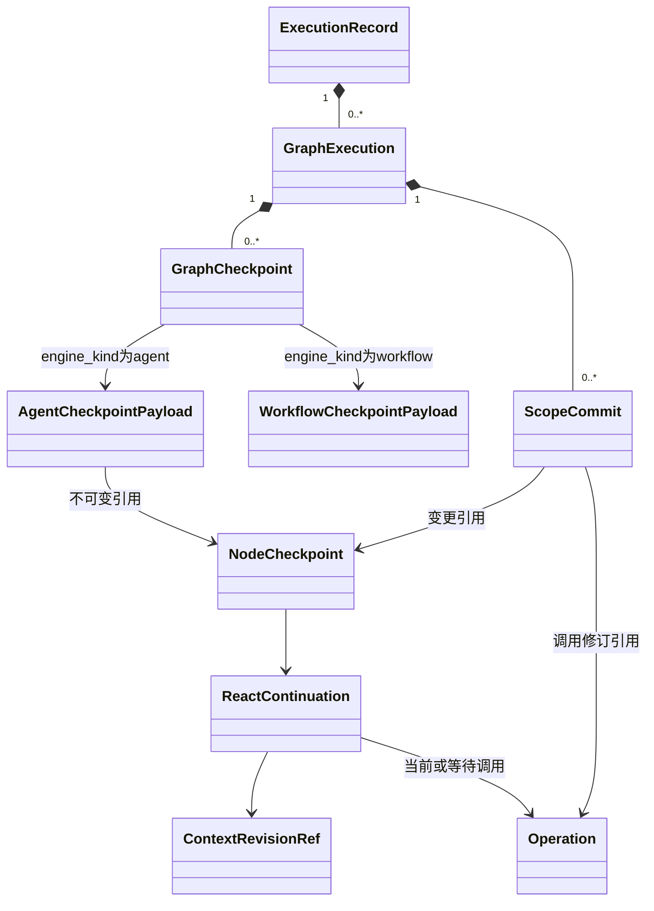

# SDK 检查点、持久化与故障接管

状态：详细设计，尚未实现。SDK 不要求 Platform 数据库。RuntimeStore 默认可用内存实现；持久部署可选 PostgreSQL／文件等适配器，但必须通过本页原子性、CAS、执行权和恢复测试。以下 SQL 与表结构是 **PostgreSQL 参考适配器** 的设计，不是高代码用户必须部署的管理端。

平台记录用户、应用、发布和资源版本，见[平台存储](../platform/storage-lifecycle.md)。本文事务全部属于 SDK 执行存储；即使两层共用一个 PostgreSQL，也不能依赖跨层表事务。

## 1. 持久化包与公开端口

```text
persistence/
  coordinator.py       # RuntimeCommit分发、锁序、租约、CAS、receipt
  commands/            # 一种明确推进命令一个handler
  repositories/        # 有限业务查询，不暴露任意SQL给Node/Hook
  lease.py             # claim/renew/revoke/activate
  snapshot.py          # 快照组装与恢复包校验
  adapters/agent.py     # 内层任务、Continuation与批次现场
  adapters/workflow.py  # 外层原生Saver接口与公共事务适配；待迁移实现
  content_store.py     # put/read/verify/delete不可变内容
  outbox.py            # 提交事实、游标投递
  cleanup.py           # 指定scope删除、ExecutionRecord文件清理、无引用暂存回收
  schema/              # SQL schema及显式format_version
```

```python
class CommitCoordinator(Protocol):
    async def commit(self, command: RuntimeCommit,
                     lease: ExecutionLease) -> CommitReceipt: ...
    async def commit_cleanup(self, command: CleanupCommit,
                             lease: CleanupLease) -> CommitReceipt: ...

class CheckpointStore(Protocol):
    async def load_recovery_bundle(self, run_id: UUID,
                                   lease: ExecutionLease) -> RecoveryBundle: ...
    async def get_commit_receipt(self, run_id: UUID,
                                 command_id: UUID) -> CommitReceipt | None: ...
    async def read_scope(self, graph_id: UUID,
                         at_commit_seq: int | None) -> GraphProjection: ...

class ContentStore(Protocol):
    async def put(self, scope: ContentScopeRef, data: bytes,
                  source_scopes: frozenset[ContentScopeRef]) -> BlobCandidate: ...
    async def read(self, ref: PayloadRef, auth: ReadScope) -> bytes: ...
    async def verify(self, ref: PayloadRef) -> None: ...

class LeaseService(Protocol):
    async def claim(self, run_id: UUID, worker_id: str) -> LeaseClaim: ...
    async def activate(self, claim: LeaseClaim,
                       revocation: RevocationReceipt) -> ExecutionLease: ...
    async def renew(self, lease: ExecutionLease) -> ExecutionLease: ...

class CleanupService(Protocol):
    async def claim(self, run_ref: RunRef, worker_id: str) -> CleanupLease | None: ...
    async def renew(self, lease: CleanupLease) -> CleanupLease: ...
    async def execute(self, lease: CleanupLease) -> CleanupReceipt: ...
```

业务端不能拿 repository connection，不能分别调用 save_context/save_operation/save_node 组成“尽量一致”。它提交一种有名字的命令，协调器在同一事务更新关联记录。纯读查询可独立；原始大内容先落 blob，再以引用参加事务。

## 2. 数据库编码与锁序

### 2.1 所有表的共同约定

- ID 使用 `uuid`（服务端 UUIDv4）；单调排序用 `bigint` seq/revision，不依赖 UUID 时间顺序。
- 时间使用 `timestamptz`，持久截止以数据库 `clock_timestamp()` 判断；网络计时转换为进程单调剩余时间。不得混用一个值充当两种时钟。
- 金额/比例如需要用 numeric；token/seq/计数用 bigint；配置比例限制在 JSON DTO 校验中，不存 NaN。
- 下表 `?` 表示 nullable，未标记则 NOT NULL；`id` 是主键；所有可变投影表含 `revision bigint >=1, updated_at`（Context effective_revision 另从0起）；不可变记录含 `created_at`，无可变业务字段。
- 枚举使用 text + CHECK，避免客户端把任意字符串当合法状态；JSONB 只存有 schema_version 的 DTO，不把所有事实塞进一个 state 大对象。
- SDK 主键在 namespace 内解析；Repository 必须绑定注入的分区和 scope，不能靠任意字符串越界。平台空间权限在调用前检查。
- 外键默认 RESTRICT；删除走 SDK records.delete 和内容清理协议，时机由调用方决定。运行结果、外部事实不能由一次意外 ORM cascade 无审计地清空。

### 2.2 锁序

使用 READ COMMITTED + 显式行锁 + revision CAS。不可用“一个 Python asyncio.Lock”替代数据库边界。

```text
初始化与停止：RunAdmissionControl → Session → ExecutionRecord
运行推进：                          [Session] → ExecutionRecord
                                    → Invocation（UUID排序）
                                    → GraphExecution（UUID排序）
                                    → NodeTask（UUID排序）
                                    → Operation（UUID排序）
                                    → AgentContextHead（UUID排序）
                                    → 各子记录（表名、主键排序）
```

只有初始化／停止入口取得 admission 行锁；普通推进不需要该锁，也不得逆序追加。普通 RuntimeCommit 从 ExecutionRecord 开始，不再回头拿 Session；终态和补充转交命令先取 Session，再 ExecutionRecord。跨图提交先收集完整锁集合排序；若计算期间发现还需要更早的锁，回滚重新读取，禁止途中逆序补锁。平台发布与删除 gate 不在此锁序内。

终态清理使用独立锁路径 `ExecutionRecord → CleanupJob → CleanupLease → WorkspaceScope（UUID排序）`，不获取图／任务／Operation 锁，也不回头获取 Session。它使用第 8.1 节的清理权限，不能拿清理租约进入普通 RuntimeCommit。

数据库事务内不调用模型、MCP、Hook、脚本、共享盘写入、DNS 或沙箱停止。commit 超时不意味着外部能力失败；先按 command_id 查询回执，不直接重复业务调用。

## 3. 持久表字典

以下是目标物理表，不要求名称与原型一致。ExecutionRecord 映射到 `runs` 表，持久身份仍为 `runs.run_id`；ExecutionRunner 是本机驱动对象，没有对应数据表。其余公共 ID 使用已定义 DTO 的 `_id` 字段。JSON列对应的完整字段在关联实施规格中定义，未知版本必须拒绝装载。

### 3.1 会话与正式输入

以下记录由 SDK 保存；平台 SessionBinding 只保存归属和 SDK Session ID，不复制输入消费状态。

| 表 | 必须保存的列 | 约束 |
| --- | --- | --- |
| run_admission_controls | run_id,closed,reason?,command_id?,revision | namespace内run_id唯一；T_INIT与T_STOP先锁此行，关闭后不可重开 |
| sessions | session_id,input_seq,run_seq,active_run_id? | namespace 内 session_id 唯一；高代码调用可不使用会话 |
| user_inputs | input_id,session_id,input_seq,origin_run_id?,kind,body_ref,received_at | UNIQUE(session_id,input_seq)、UNIQUE(session_id,input_id)；同 ID 不同正文冲突 |
| user_input_deliveries | delivery_id,input_id,target_run_id?,operation_id?,previous_delivery_id?,state,context_seq?,first_output_receipt_ref?,delivered_at? | 当前投递唯一；state=pending/claimed/delivered/carried；旧投递不可覆盖 |
| first_output_receipts | attempt_id,operation_id,kind,has_display_content,received_at | PK(attempt_id)；heartbeat 不算首输出 |

SDK 保证同一 Session 的顺序与活动 ExecutionRecord 约束。平台保证同一 Session 绑定同一应用；独立 SDK 调用者负责为同一 Session 提供正确的可执行配置。

### 3.2 根执行、图与任务

| 表 | 必须保存的列 | 约束和查询索引 |
| --- | --- | --- |
| runs | run_id,session_id?,session_run_seq?,status,deadline_at,loop_limit,loops_reserved,loops_consumed,root_graph_id?,control_reason?,public_seq,terminal_seq?,cleanup_state | CHECK两计数>=0且和<=limit；UNIQUE(session_id,session_run_seq) WHERE session_id 非空；终态必须有terminal_seq，对应同提交公开终态事件 |
| execution_leases | run_id,epoch,worker_id,phase,expires_at,revocation_ref? | PK(run_id); phase=recovering/active/released；epoch只递增 |
| agent_invocations | invocation_id,run_id,program_key,graph_id,parent_node_task_id?,budget_scope,local_limit?,local_reserved,local_consumed,local_deadline?,control_state,terminal_reason?,workspace_scope_id,result_ref? | UNIQUE(graph_id); UNIQUE(parent_node_task_id) WHERE非空；直接调用local限制为null |
| graph_executions | graph_id,run_id,engine_kind,engine_protocol_version,invocation_id?,parent_node_task_id?,program_key,status,state_revision,scope_commit_seq,head_checkpoint_id?,task_creation_count | UNIQUE(run_id,graph_id)供复合FK；index(run_id,status)；引擎类型固定 |
| node_tasks | task_id,run_id,graph_id,node_key,binding_ref,parent_task_id?,dispatch_id?,dispatch_member_id?,input_ref,status,current_activation_id?,activation_no,ready_seq,resume_input_ref?,continuation_ref?,result_id? | UNIQUE(graph_id,dispatch_id,dispatch_member_id) WHERE dispatch_id非空 |
| node_activations | activation_id,task_id,activation_no,lease_epoch,start_revision,started_at,ended_at?,outcome? | UNIQUE(task_id,activation_no)；task至多一条未结束同epoch激活 |
| task_results | result_id,task_id,outcome,effective_output_ref?,error_ref?,completed_revision | UNIQUE(task_id)；不可变 |
| ready_intents | intent_id,run_id,graph_id,task_id,cause_key,status | UNIQUE(task_id,cause_key)；status=pending/claimed/done；本地通知仅加速 |
| loop_tickets | ticket_id,run_id,invocation_id,task_id,model_operation_id,role_loop_index,state,consumption_kind?,business_loop_no?,feedback_ref? | UNIQUE(model_operation_id); UNIQUE(task_id,role_loop_index); state=reserved/consumed/released；consumed时kind=decision/error_feedback |

复合FK保证 task.graph_id 和 task.run_id 一致，不能只分别检查两个ID存在。图、任务、Operation之间同样使用 `(run_id,id)` 或 `(graph_id,id)` FK；其他跨图关联由命令handler校验显式父子关系。

Root ExecutionRecord 和 Invocation 计数是 loop_tickets 的受事务维护投影。恢复时校验流水，不在发现不一致后静默“修成看起来合理”，应报 `PERSISTENCE_INVARIANT_BROKEN` 并停止推进。

### 3.3 等待和批次

| 表 | 必须保存的列 | 约束 |
| --- | --- | --- |
| call_batches | batch_id,owner_task_id,model_operation_id,ticket_id,parallel_enabled,executor_max_parallel,delivery_state,member_count | UNIQUE(model_operation_id)；member_count>0；model_operation_id/ticket_id非空且属于owner；与接受决策/consume同事务创建，成员集不可增加 |
| batch_members | batch_id,member_id,call_id,ordinal,action_kind,target_key,input_ref,operation_id?,child_task_id?,status,result_ref? | PK(batch_id,member_id); UNIQUE(batch_id,ordinal); UNIQUE(batch_id,call_id) |
| wait_groups | wait_id,run_id,graph_id,owner_task_id,batch_id,generation,delivery_state,settled_count | UNIQUE(batch_id)；仅内层 dispatch_batch 汇合 |
| wait_members | wait_id,member_id,ordinal,state,target_ref?,result_operation_id?,local_outcome? | PK(wait_id,member_id); UNIQUE(wait_id,ordinal) |
| executor_admissions | admission_id,batch_id,member_id,lease_epoch,state,child_task_id? | UNIQUE(batch_id,member_id); state=reserved/converted/released |
| join_consumptions | wait_id,member_id,result_operation_id | 联合PK，保证成员结果只消费一次；不可变 |
| pending_feedback_slots | slot_id,owner_task_id,batch_id,member_id,source_task_id,error_ref?,effective_result_ref?,state | UNIQUE(batch_id,member_id); state=pending/finalized；消费由所属WaitGroup.delivery_state判定 |

admission 是准备Hook期间防并发越界的短暂占位，不是活跃Executor计数：`活跃任务数 + reserved admission数 <= executor_max_parallel`。准入到child Task时原子转移；deny/停止释放。队列里尚未获准的成员没有admission。需要恢复旧admission时先按Operation阶段查询，不能释放后又重复创建child。

`local_outcome` 只允许调用begin以前的校验拒绝/取消；已经有Operation必须通过它完成。外层分支等待由 Workflow 原生状态保存，不写入内层 WaitGroup。

CallBatch 的来源限定为完整模型决策；ticket 必须已消费为 decision。request_many 只读取已有 batch，不另建显式事件批次。无模型来源的 Workflow／函数节点不使用该表，空模型动作直接验证最终输出。

### 3.4 Operation 与 Hook

| 表 | 必须保存的列 | 约束 |
| --- | --- | --- |
| operations | operation_id,run_id,graph_id?,task_id?,trusted_subject,purpose_key,request_event_ref,request_fingerprint,kind,purpose,processing_phase,status,before_stage_result_ref?,after_stage_result_ref?,candidate_request_ref?,effective_request_ref?,effective_request_hash?,execution_permit_ref?,raw_result_ref?,effective_result_ref?,final_response_ref?,retry_policy,next_attempt_at?,target_ref?,batch_member_ref?,context_revision_refs[] | UNIQUE(run_id,trusted_subject,purpose_key)；completed要求response；前置deny允许无Attempt |
| call_stages | operation_id,stage,event_ref,source,initial_operation_revision,result_ref?,revision | PK(operation_id,stage)；信封首次固定；StageResult与Operation对应引用同事务保存；处理器内部Hook游标单独保存 |
| attempts | attempt_id,operation_id,attempt_no,lease_epoch,status,effective_request_hash,started_at?,first_output_at?,first_output_kind?,ended_at?,provider_request_id?,raw_ref?,incomplete_ref?,error_ref?,retry_after_at?,dispatch_evidence_ref? | UNIQUE(operation_id,attempt_no)；operation至多一个活跃attempt |
| model_call_slots | operation_id,call_id,ordinal,provider_call_id?,raw_call_ref | PK(operation_id,call_id); UNIQUE(operation_id,ordinal)；完整raw响应保存时分配，Hook和接受决策复用 |
| hook_invocations | hook_invocation_id,operation_id,stage,hook_binding_key,ordinal,input_revision,input_payload_ref,input_context_refs[],mapping_version,schema_version,status,execution_status?,result_ref?,decision_ref?,normalized_patch_ref?,normalized_patch_hash?,context_change_refs[],patch_status,diagnostic_ref?,before_payload_ref,after_payload_ref? | UNIQUE(operation_id,stage,hook_binding_key,ordinal)；status=prepared/started/result_saved/applied/indeterminate |
| hook_processing | operation_id,phase,chain_ref,next_index,effective_payload_ref,context_revision_ref?,committed_decisions_ref | PK(operation_id,phase)；游标只能和决定/修改同事务推进 |
| execution_permits | permit_id,operation_id,run_id,invocation_id?,request_hash,context_revision_refs[],ticket_id?,lease_epoch,kind,created_by_command | UNIQUE(operation_id)；kind=business/nonbusiness/delegation；无permit不得外发，接管验证后续epoch授权 |
| operation_notifications | operation_id,notification_kind,generation | 可选投影去重；不得替代Operation已完成查询 |

Operation.status固定为pending/succeeded/failed/blocked，处理阶段另存processing_phase；控制取消以failed + error.category=cancelled表示。Attempt.status为prepared/started/succeeded/failed/unknown/cancelled，unknown不是Operation终态名。Hook执行状态和allow/deny决定分开。

同一次 SDK 自动重试沿用Operation，只新增Attempt。网络重投 begin 复用purpose_key；模型下一Loop再次调用相同参数使用新purpose_key。请求指纹按原始业务信封计算，用于检测重投冲突；effective_request_hash是Hook/上下文处理完成后冻结的实际输入，两个hash不混用。

### 3.5 上下文、内容和环境

| 表 | 必须保存的列 | 约束 |
| --- | --- | --- |
| agent_contexts | context_id,invocation_id,owner_task_id,role_key,record_head,effective_revision,active_snapshot_id?,last_model_operation_id? | UNIQUE(owner_task_id) |
| raw_records | record_id,context_id,context_seq,run_id,role,message_kind,operation_id?,call_id?,origin_input_id?,payload_ref,source_scopes | UNIQUE(context_id,context_seq)；不可改原始事实 |
| effective_context_revisions | context_id,revision,parent_revision?,record_watermark,mutation_ids[],effective_manifest_ref,commit_ref | PK(context_id,revision)；manifest包含上下文设计的完整EffectiveRecordEntry；不可变 |
| context_append_keys | context_id,source_kind,source_id,message_kind,logical_result_key,record_id | 联合唯一前五列；消息append和key登记同事务 |
| context_mutations | mutation_id,context_id,base_revision,committed_revision,source_kind,source_ref,cause_operation_id?,patch_ref,mutation_key | UNIQUE(context_id,committed_revision); UNIQUE(context_id,source_ref,mutation_key) |
| context_snapshots | snapshot_id,context_id,revision,covered_seq,summary_ref,protected_input_refs,source_scopes,episode_id | 不可变；与GraphCheckpoint不是同类 |
| compaction_episodes | episode_id,context_id,source_revision,input_watermark,block_plan_ref,cursor,intermediate_refs,result_snapshot_id?,stage,status,error_ref? | 同一context至多一活跃episode；模型操作按episode/block生成purpose_key |
| blobs | blob_id,scope_key,sha256,size_bytes,media_type,relative_storage_key,status | UNIQUE(namespace,scope_key,sha256)；禁止客户端自选storage key |
| content_dependencies | consumer_kind,consumer_id,source_scope_key | 联合PK；输入来源保守并集，不靠LLM报告 |
| workspace_scopes | scope_id,content_scope_ref,root_handle,partition_kind,partition_key,run_id,invocation_id?,persistent,view_ref,status | UNIQUE(content_scope_ref,partition_kind,partition_key,run_id)；scope不保存可恢复权限 |
| execution_domains | domain_id,run_id,scope_id,execution_view_key,role_binding_ref?,resource_mount_digest,lease_epoch,driver_handle_ref,status,revocation_ref? | UNIQUE(scope_id,execution_view_key,lease_epoch); index(run_id,lease_epoch,status)；仅运行设施可读handle |
| file_operations | operation_id,scope_id,path_key,expected_version?,result_version?,phase,result_ref? | Operation.id为PK；用于文件实际动作结果查询 |
| cleanup_jobs | job_id,run_id,scope_manifest_ref,barrier_receipt_refs[],state,attempt_count,next_retry_at?,last_error_ref?,receipt_ref? | UNIQUE(run_id)；state=pending/running/succeeded/failed；finalize_run同事务登记，manifest固定，不自动过期 |
| cleanup_leases | job_id,worker_id,epoch,expires_at,state | PK(job_id)；state=active/released；独立清理epoch只递增，不替代execution_leases |
| cleanup_scope_results | job_id,scope_id,state,receipt_ref?,error_ref? | PK(job_id,scope_id)；state=pending/retained/removed/retry_pending；只有固定manifest中的scope可更新 |

SQL 列展开 namespace 和 scope_key；DTO 仅表达逻辑引用。影响唯一性／索引的投影列必须与 JSON 一致。没有 SDK → 平台用户、应用、发布表的外键。

### 3.6 提交、快照和通知

| 表 | 列 | 约束 |
| --- | --- | --- |
| runtime_commits | command_id,run_id,command_kind,fingerprint,authority_kind,lease_epoch?,result_ref,committed_at | UNIQUE(run_id,command_id)；不可变；authority_kind=execution/control/cleanup，epoch按对应权限域解释，控制入口可为null |
| scope_commits | graph_id,scope_seq,command_id,changes_ref | PK(graph_id,scope_seq)；同command跨图各记一条 |
| node_checkpoints | node_checkpoint_id,task_id,node_revision,scope_seq,continuation_ref,status,result_ref? | UNIQUE(task_id,node_revision)；不可变 |
| graph_checkpoints | checkpoint_id,graph_id,engine_kind,engine_protocol_version,checkpoint_seq,covered_scope_seq,previous_id?,payload_ref,content_hash,format_version | UNIQUE(graph_id,checkpoint_seq); UNIQUE(graph_id,covered_scope_seq)；payload保存公共信封及专属engine_state_ref |
| workflow_task_bindings | graph_id,origin_engine_checkpoint_id,engine_task_id,engine_task_path,node_task_id | UNIQUE(graph_id,origin_engine_checkpoint_id,engine_task_id,engine_task_path)；node_task_id唯一；在能力或Agent调用前保存 |
| workflow_checkpoint_mappings | graph_id,engine_checkpoint_ns,engine_checkpoint_id,checkpoint_id | UNIQUE(graph_id,engine_checkpoint_ns,engine_checkpoint_id)；命名空间由 SDK 检查点适配层按图身份确定；原生父快照链不可丢失 |
| outbox | event_id,run_id,public_seq?,scope_kind,scope_id,scope_seq,ordinal,type,payload_ref | UNIQUE(run_id,public_seq) WHERE非空；UNIQUE(scope_kind,scope_id,scope_seq,ordinal) |
| subscription_cursors | consumer_id,scope_kind,scope_id,commit_seq,ordinal,filter_hash,lease_generation | 联合PK；ACK单调，过滤变化需新consumer版本 |

恢复只读快照+增量不回放观察事件执行工具。outbox没有投递成功不影响事实成立；可靠观察消费不代表业务状态已提交。

## 4. RuntimeCommit 的结构与提交算法

```text
RuntimeCommit
  format_version=1
  command_id: UUID                # 同一逻辑安全点恢复重投沿用
  command_kind: enum              # 只能使用已注册typed command
  run_id: UUID
  subject_ref: trusted scope
  expected: [{kind,id,revision}]
  body: typed command payload
  blob_candidates: [{blob_id,sha256,size_bytes,source_scopes}]
  requires_session_lock: bool # 由command registry决定，调用方不能任意覆盖

CommitReceipt
  command_id, fingerprint, committed_at, run_revision
  scope_versions: [{graph_id,scope_commit_seq,state_revision}]
  entity_versions: [{kind,id,revision}]
  allocated_refs: {typed result identities}
  public_event_seqs: int[]
```

Node/Handler不得传任意 `sql/update/delete` 指令。命令handler定义合法旧状态、新状态、锁集合和受影响记录；expected缺一项而handler需修改它时拒绝，不擅自读最新继续。指纹含命令语义body/subject/expected，不含本次传输时间、trace或lease epoch；同一命令接管后仍可查询已提交回执。

```text
commit(command, lease):
  validate DTO and trusted scope
  verify staged blob checksum/existence outside transaction
  BEGIN
    acquire conversation lock if registry requires it
    lock ExecutionRecord
    verify caller lease epoch, phase=active, expires_at > DB now
    old_receipt = lookup(run_id, command_id)
    if exists:
      require fingerprint matches; return old receipt (no new events)
    verify root control permits this command (settlement allowed while stopping)
    load lock set; acquire sorted locks; check expected revisions
    handler.validate_cross_record_invariants()
    handler.apply_all_changes()
    for each touched graph sorted: increment scope_commit_seq
    write immutable state/NodeCheckpoint/ScopeCommit change refs
    register blob candidates + conservative source dependencies
    allocate public_seq for public observations
    insert outbox and runtime_commits receipt
  COMMIT
  signal local waiters/dispatcher best-effort
  return receipt
```

同命令在旧lease下即使已提交也不允许继续执行业务；读回执可走只读查询，新lease验证后重投返回旧结果。CAS冲突属于内部竞争：重新装载并判断命令是否已成立；不能无脑用最新revision重复执行能力。需要重算且锁内已证明旧command未提交时，创建新的command_id承载新expected/写集，保留原领域幂等键（operation/member/task/feedback identity）；不能复用同command_id悄悄改fingerprint。回执不确定时先查旧命令，不能立刻换ID外发。不可恢复冲突抛内部一致性错误，既不伪装工具错误也不进入LLM重试。

上面的 commit 算法仅接受业务 ExecutionLease。终态清理走独立 commit_cleanup，以 CleanupLease 校验和清理白名单代替业务租约校验；不是跳过授权。其允许写集和身份见第 8.1 节，不能把一个 RuntimeCommit 标成 cleanup 后执行任意命令。

## 5. 事务命令目录

| 命令 | 原子写集合 | 幂等／关键前置 |
| --- | --- | --- |
| initialize_run（T_INIT） | ExecutionRecord、Session轮次与活动引用、初始输入、初始化回执 | admission 行未关闭；同 run_id/input_id 重入复用，内容不同报冲突；公开入口使用受限初始化权限 |
| create_root_execution | Invocation、Graph、入口Task、Context、WorkspaceScope引用、ready intent | ExecutionRecord queued且root未建；UNIQUE ExecutionRecord根引用 |
| activate_task | Task running、Activation、intent claimed | Task ready、无活跃同epochActivation |
| commit_progress | Continuation、NodeCheckpoint、相关wait/op引用 | task revision CAS；Progress receipt后才asend继续 |
| begin_operation | Operation prepared、权威EventRequest、调用关联 | trusted_subject+purpose_key唯一且fingerprint相同 |
| save_call_stage | 原Loop／节点的阶段信封、operation_id/stage、初始revision | 首次发送前保存；恢复使用原event_id/source，不新增业务Operation |
| complete_call_stage | StageResult及Operation对应stage_result_ref、有效引用 | 累计处理已完成或合法deny；空链也提交 |
| save_hook_start | HookInvocation prepared→started、HookProcessing.pending | 唯一handler位置；不得重复启动已记录未知Hook |
| save_hook_result | 原始HookDecision、result_saved | 不能在此独立修改有效上下文 |
| apply_hook_decision | ContextMutation/Revision、effective payload、decision、cursor | 语义patch归一/CAS一致；合法deny独立保留 |
| commit_model_ready | 冻结请求/hash、LoopTicket reserved、root/local计数、execution permit、Continuation.call_model | 尚无Attempt；Hook完成、压缩/硬预算通过；原子检查额度 |
| start_attempt | Attempt started、Operation executing、physical调用意图 | 有有效permit；无活跃Attempt；自动重试上限/等待/控制检查 |
| save_attempt_raw | Attempt终态/原始分片引用、Operation raw_saved | 不触发下一Loop；raw已存不得重跑能力 |
| control_finalize_operation | 保留raw/已应用修改、未启动Hook的skipped_control记录、最终failed响应、Operation.completed | scope已关闭且in-flight收束/撤权证据有效；不可新发Hook，见调用总线设计 |
| complete_operation | after StageResult已提交或before已拒绝、effective result、EventResponse、Operation completed | 终态响应恰一次；用于唤醒不等于已被节点消费 |
| accept_model_decision | 有效assistant记录、Ticket consumed、root/local计数、Continuation、CallBatch/WaitGroup成员 | 模型回应尚未消费；同message不得被EventBusImpl重复append |
| settle_model_failure | 有效反馈槽/错误、ticket consumed或released、Continuation/Task状态 | 是否进入下一模型上下文决定扣额；和反馈事实同事务 |
| reserve_executor | admission reserved、批次成员准入状态 | 活跃+reserved低于上限；串行member顺序检查 |
| StartExecutor | 最终请求/hash、permit/executing、admission converted、唯一子Task/Context/ready intent、父Operation及Wait引用 | 允许的StageResult和纯PreparedDelegate、版本/授权/控制重验；固定dispatch/member身份；禁止先独立发permit |
| StartChild | 最终请求/hash、permit/executing、父wait、唯一子Invocation/Graph/root Task及ready intent | 固定父task/logical_call_key；复用原Operation；提交后才能激活子图 |
| complete_task | Task终态、TaskResult、后继intent或父raw结果槽 | TaskResult唯一；活跃Executor名额同时释放 |
| CommitWorkflowTaskWrites | 原生任务有序writes、适用的父Operation消费、外层NodeTask终态投影 | task_result才消费effective结果；ERROR／INTERRUPT不消费；重复包取原回执，迟到错误不得覆盖已完成交付 |
| CommitWorkflowCheckpoint | 原生快照、原生ID映射、parent chain、已确认writes水位、公共检查点信封 | 所属step写入已确认；验证原生版本／执行权；不得先开始下一step再等待回执 |
| settle_member | BatchMember结果、WaitMember settled、settled_count | 已有Operation须最终EventResponse；local_outcome仅未begin |
| consume_batch | 按ordinal追加tool结果、补齐反馈槽、WaitGroup consumed、Continuation.prepare_context | settled_count=member_count，消费标记CAS |
| stop_run（T_STOP／ControlCommand） | admission closed、StopReceipt；ExecutionRecord已存在时另写stopping/control_reason、取消未准入意图、stop intent、outbox | 独立控制身份，无需Worker活跃lease；ExecutionRecord不存在也阻止迟到初始化；不伪造活跃工具终态 |
| finalize_run | ExecutionRecord终态、根输出、Session输入转交、Session.active清空、唯一CleanupJob及scope清单/撤权证据、各scope初始清理记录、公开终态事件及terminal_seq | Session先锁，全部写任务已收束；终态不可复活；terminal_seq是该公开事件序号，恢复不能分配第二个结束事件 |
| record_scope_cleanup／finish_cleanup／retry_cleanup | scope删除回执、CleanupJob进度/重试时间、runs.cleanup_state | 仅commit_cleanup入口；有效清理租约、终态和固定manifest；不修改业务结果或图状态 |

表中命令是允许的语义提交，不要求每个命令独立公开HTTP。Driver可以一次Progress调用其中一个typed命令；命令可以拥有多个内部handler，但最终只能提交一个事务。

### 5.1 额度的具体 SQL 逻辑

在锁ExecutionRecord及Invocation后：

```text
if consumed >= limit: exhausted(scope)
elif consumed + reserved >= limit: wait_for_ticket_settlement(scope)
else:
    repeat local check if budget_scope=invocation
    INSERT ticket(state=reserved) with unique model_operation_id
    UPDATE root/local reserved += 1
    persist frozen request and permit in this same transaction
```

Executor前置deny没有票据但需向父反馈时，使用相同额度准入，在一个事务创建并立即consume一张consumption_kind=error_feedback票据及反馈槽，不造Attempt/permit；暂满等待、真正耗尽控制优先。根角色前置deny直接失败，不造票据。

消费时条件更新 `reserved→consumed`，reserved减1、consumed加1；release仅reserved减1。`business_loop_no`在根ExecutionRecord锁内按consume顺序分配，role_loop_index表达本角色模型决策位置。重复consume查原票据不再扣。根暂时reserved满不能直接终结整个ExecutionRecord，否则并发的第100次合法调用会被错误取消。

### 5.2 节点刚完成时崩溃

`complete_task` 同时保存终态、结果及后继意图。崩溃位置只有两种可见事实：事务没提交，恢复前一个安全点并查已有Operation；事务已提交，旧Task不再执行，扫描ready_intents启动后继。不能先commit Task succeeded，之后单独发消息创建下一节点。

### 5.3 无Worker时也能停止：ControlCommand

公共 SDK 控制门面、调用方管理任务和 SDK deadline 扫描器调用 `RunControl.request_stop(run_id, reason, ControlIdentity, idempotency_key)`。它使用Coordinator的**受限控制命令入口**，不是拿一个伪造ExecutionLease调用普通RuntimeCommit。

ExecutionRecord 尚不存在时先关闭 run_admission_controls，保存 StopReceipt；ExecutionRecord 初始化必须在相同 admission 行锁内验证未关闭。已存在 ExecutionRecord 的控制事务先锁 admission、Session（若修改输入交接）再ExecutionRecord，校验调用方持有的 SDK 执行 scope/control capability及幂等键；终态则返回原结果，否则固定第一个终结原因、设置stopping、关闭新工作、保存stop intent/outbox。允许ExecutionRecord尚queued无lease、lease过期或phase=recovering；只能写这些控制事实，不能写TaskResult、有效Context、模型response或绕过writer barrier直接宣称已收束。

Worker每次准入读取当前控制，不靠旧快照授权。接管中的Worker看到stopping只执行撤权/收束，不能激活正常Loop。queued且从未有execution_domain的ExecutionRecord，控制服务可用empty-writer-set证明完成终态；已有writer时须由有效恢复/清理执行权持有者完成barrier后再finalize。deadline扫描器使用DB时间，按同一入口请求停止，不能因无active租约使超时永远失效。

控制receipt另带control_identity而非lease_epoch，ScopeCommit显式标记control命令来源；普通业务命令仍全部要求active lease。这个例外由CommandRegistry白名单固定，用户不能把任意RuntimeCommit标成control。

## 6. 内容存储与快照

### 6.1 Blob 提交

1. 按注入的 ContentScopeRef 隔离目录，在暂存区写随机文件；写完校验sha256/size并fsync。
2. 以`namespace/scope_key/hash`为目标做原子安装（临时与目标同一文件系统），fsync父目录；目标已存在验证hash一致后复用。
3. 生成BlobCandidate。RuntimeCommit在同一事务登记blob行、引用和来源依赖；数据库提交以前文件不会进入读目录列表。
4. DB失败产生未引用blob，由独立GC按暂存登记和引用检查清理；使用至少24小时安全窗。业务已引用内容不按这个窗口过期。

大载荷统一通过PayloadRef；节点不得存绝对路径。小JSON可inline，但仍需Owner/来源标记和大小校验。推荐inline阈值16KiB作为存储实现常量，不改变业务返回值。

### 6.2 GraphCheckpoint 何时生成

以下异步汇总只适用于 **AgentGraphEngine**：每张内层图累计16个ScopeCommit、进入稳定等待、图结束时请求快照；并发请求合并到最新水位。关键正确性来自已提交增量，内层汇总快照失败不倒退运行也不重新执行已成功任务。WorkflowEngine 的原生保存点由其内核确定，任务writes与下一快照均须等待持久回执，不能套用16次聚合或“快照失败仍推进”的优化；完整顺序见[外层提交屏障](workflow.md)。

- 在短REPEATABLE READ读事务里读取graph水位S及相应不可变版本引用、task/checkpoint、CallBatch／WaitGroup及其generation、父子引用；只构建内层任务与调用引用清单，提交读事务。这里不读取外层分支游标或channels。
- 在事务外序列化并写不可变blob；内容不得包含协程、Future、连接或可继续使用的旧lease。
- 短挂接事务验证当前lease，插入 `(graph,S)` 唯一快照；只在head覆盖水位更旧时推进head。过时的构建结果可保存历史，但不得覆盖较新head。
- ScopeCommit和所引用不可变版本在Owner删除前保留；不以快照建立成功为由立即删除恢复需要的中间原始记录。

NodeCheckpoint是在每次相关RuntimeCommit里保存的小型不可变记录；GraphCheckpoint是这些记录与图状态的汇总。两者集中在同一Store，没有每个工具自己创建一套检查点目录。

```text
AgentCheckpointPayload（位于公共 GraphCheckpoint.engine_state_ref 中）
  phase, state_revision_ref
  tasks[{task_id,node_revision,node_checkpoint_id,status}]
  waits[{wait_id,revision,members_ref,delivery_state}]
  ready_intent_refs[], operation_refs[]
  context_revision_refs[], source_scopes[]
```

ExecutionRecord／图身份、定义／编译版本和覆盖水位保存在公共信封，内层载荷不维护另一份可变副本。外层通过WorkflowCheckpointAdapter保存专属载荷及原生writes，不能使用此角色任务清单替代原生快照。

恢复使用调用方重新构造的执行程序及原绑定，校验 SDK 协议版本、节点 key、状态载荷格式与内容完整性；不读取平台 Release、不比较配置版本指纹。调用方必须保证本次提供原配置。内层恢复从最近校验通过快照S装载，按ScopeCommit顺序应用S+1..head的不可变after引用；发现缺号/hash错误先尝试更早完整快照，仍缺失则 `CHECKPOINT_CORRUPT` 停止。不得“跳过一条看起来不重要的增量”。`read latest AgentContextHead`不是读取指定历史快照的实现。

## 7. 执行权接管与恢复算法

### 7.1 租约协议

基础设施默认lease TTL=30s，每10s续期；这是Worker参数，不是Agent业务超时。工作节点不能因本机墙钟不同判断别人lease过期。claim/renew在DB端判断。

1. 锁ExecutionRecord和execution_leases，ExecutionRecord非终态且现lease过期/明确释放才可claim。epoch加1，phase=recovering，记录新worker；原worker从此提交必然被fence拒绝。已终态仍拒绝业务claim；若清理未完成，由第8.1节CleanupService领取独立清理租约，不创建ExecutionRunner。
2. 新Worker取得原execution_domains清单，请SandboxGateway撤销旧进程/挂载写权限，等待RevocationReceipt。**DB epoch不能阻止旧进程继续写NFS文件。**
3. 无法证明旧writer已停止时保持recovering并告警，不启动新的写任务。ExecutionRecord总deadline仍继续流逝。
4. 已撤权后验证快照与增量、定义/ABI/blob完整性；绑定新scope handle，activate lease为active；重建bus/Handler/Driver。
5. 扫描原图/task/op IDs继续，不重新创建ExecutionRecord或替换业务配置。续租失败立即关闭新工作，撤销本地能力句柄，不提交伪造完成。

启动queued ExecutionRecord没有旧writer时，revocation receipt明确为empty-domain-set。正常停止/终态释放lease前也要完成或撤销旧writer；不能把“本地Future取消了”当远端脚本已经停下。

### 7.2 恢复包与恢复分派

RecoveryBundle包含执行位置 key 与引擎协议、ExecutionRecord控制、全部Invocation、按engine_kind分类的图恢复载荷、Task/Continuation、OperationJournal、未消费结果、未完成压缩episode、WorkspaceScope和当前lease。内层Adapter折叠ScopeCommit和角色现场；外层Adapter读取原生checkpoint、任务映射及pending writes，保留其同步语义，不将全部外层任务标ready后塞入内层队列。实际payload按需加载，不能装载后自动执行Hook或工具。

外层原生 writes 的持久键、保留channel更新规则及修订表须随导入版本逐项定义，不能复用内层 TaskResult 表冒充。新增 `CommitWorkflowCheckpoint / CommitWorkflowTaskWrites` 经相同锁序／lease／receipt路径提交；其中完成AgentNode的任务writes与父Operation结果消费、NodeTask终态投影同事务。随后由外层内核应用状态和安排后继，不能由Coordinator再执行一次外层reducer。具体步骤见[父子交接](workflow.md)。

CommitWorkflowTaskWrites 区分 task_result、task_error、task_interruption、system_writes。只有 task_result 允许携带结果消费，业务 failed／blocked 也以已交付的 task_result 保存；原生故障／取消写入不能冒充完成或覆盖已消费结果。所有 channel 的必要写入都纳入 WorkflowEngine 提交确认集合；Coordinator 的原子事务和内核等待回执是两项都必须满足的条件。恢复 ERROR／INTERRUPT 时重新检查根控制和SDK Operation，不因原生节点重入创建新的调用身份。

| 现场 | 接管动作 |
| --- | --- |
| ready Task / pending intent | 同task新Activation，不换task_id |
| running Task且旧Activation失效 | 结束旧Activation为abandoned，从NodeCheckpoint恢复 |
| wait_batch | 查WaitGroup/成员最终响应，全部结算才唤醒原Task |
| model_ready有permit但无Attempt | 控制检查后开始第一个Attempt，票据不重复reserve |
| Attempt有provider handle且可查询 | 查询原执行，保存结果；不先重试 |
| Attempt执行结果未知 | Handler先reconcile；无结果按调用策略转unknown/错误，是否自动重试见调用总线设计，不宣称无副作用 |
| raw_saved/after_call | 原Loop／节点续发已保存的after事件；复用已提交StageResult，只补最终结算，不重复模型/工具 |
| completed Operation尚未消费 | 返回原response，节点消费事务幂等 |
| Hook started但无结果 | 尝试取回；不可取回记indeterminate并fail-open，不盲目重放 |
| 子Task已终态、父成员未结算 | 用原TaskResult推进父委派Operation后处理，不新建Executor |
| 外层同一步A的writes已保存、B未完成 | WorkflowCheckpointAdapter按原生checkpoint/任务映射/pending writes恢复，复用A并接回B原Operation；不读自研branch cursor |
| 内层WaitGroup已消费、父任务未激活 | 扫描持久ready intent，不重新消费结果；外层状态合并遵循原生step屏障 |
| stopping | 只收束/补齐终态，不恢复正常下一Loop |
| terminal | 只允许cleanup/查询；拒绝启动/late result复活 |

异常分类由能力Handler给出规范错误；恢复层不通过字符串里有没有“timeout”判断幂等或业务失败。所有自动重试仍尊重ExecutionRecord控制和原始max_attempts/next_retry_at。

## 8. Outbox、停止、清理

Outbox与事实同事务写。dispatcher至少一次投递；订阅者以event_id或(scope_seq,ordinal)幂等。唤醒事件丢失时周期扫描ready/wait/Operation仍可继续；周期扫描是恢复投影查询，不再创建新的业务身份。

可靠订阅ACK要求当前lease，且单独更新cursor，不产生新的outbox避免递归；观察者失败不让业务回滚。普通诊断订阅可丢弃；HTTP公开事件从public_seq持久回放，不依赖Worker的EventBus是否还活着。

用户停止、超时、额度耗尽进入相同ControlCoordinator：先close admission/关闭后续模型与重试，再收束在途任务。ExecutionRecord已经进入stopping后，允许raw/result/Task终态写入，拒绝新的模型permit、子任务和非收束工作。

清理分两个事实：`ExecutionRecord.status`已经终态表示无活跃执行/写句柄；`cleanup_state=pending/running/succeeded/failed`表示临时文件删除进度。已撤权但文件删除失败时可以看到终态和cleanup_failed，不能谎称文件已销毁。新ExecutionRecord使用新临时目录，不复用清理失败目录。持久沙箱不执行普通ExecutionRecord结束删除，只释放本ExecutionRecord句柄。

### 8.1 终态清理执行权与重试

CleanupService 是 RuntimeEngine 托管的后台基础服务，绑定调用方注入的存储分区与环境适配器；不需要 AgentDefinition、模型、EventBus 或活动 ExecutionRunner。RuntimeEngine 打开后扫描本分区到期未完成清理任务；宿主停止只停止本机扫描，不删除任务。下一宿主使用同一存储和环境适配器即可继续；没有宿主运行时任务保持待处理，不声称后台服务会自行存在。

| 类型 | 精确字段／允许用途 |
| --- | --- |
| CleanupJob | job_id、run_ref、scope_manifest_ref、barrier_receipt_refs、state、revision、attempt_count、next_retry_at?、last_error_ref?、receipt_ref?；每个终态Run一项 |
| SystemCleanupScope | job_id、run_ref、workspace_scope_ids、scope_manifest_ref、barrier_receipt_refs；由服务从已提交Job生成，只准处理固定目录，不由LLM／Hook构造 |
| CleanupLease | job_id、run_ref、worker_id、epoch、expires_at；只授权清理，不是ExecutionLease或业务permit |
| CleanupCommit | command_id、job_id、run_ref、kind:record_scope_cleanup\|finish_cleanup\|retry_cleanup、expected_job_revision、expected_scope_revisions、body；body只含本Job的scope回执／错误引用及重试事实 |

scope_manifest 在 finalize_run 锁内由已登记 WorkspaceScope 生成，保存 scope ID、不可变的准确目录定位和 persistent 标记；必须附全体旧业务 writer 已收束／撤权的证据。同事务为每个scope创建cleanup_scope_results初始记录：临时目录为pending，持久目录为retained。无任何目录的Run形成成功空清理；不能把应用根、共享资源或ContentStore加入待删集合。业务终态和Job登记不可拆成两笔，否则宕机可能漏清理。

1. **领取。** claim 通过 Coordinator 的受限清理控制入口，在上述清理锁序内验证调用方存储分区、Run已终态、Job非成功且重试到期、旧CleanupLease已过期／释放；递增清理epoch和Job.attempt_count，保存active租约、Job/runs.cleanup_state=running及领取回执。无需业务lease。已有有效清理owner时返回None；旧业务lease仍存在不授权它执行清理。claim／renew是固定的清理控制命令，不接受任意RuntimeCommit。
2. **续期与权限。** 清理lease默认TTL 30秒、每10秒续期，使用DB时间；每个文件动作和结果提交重新验证job/epoch/有效期。expire或释放后，新worker领取更大epoch。EnvironmentProvider的清理端口只接受这个scope和CleanupLease，不提供exec／写文件／准备新沙箱权限。
3. **删除。** 仅对manifest内的非持久Run目录调用清理适配器，物理幂等键为`cleanup:<job_id>:<workspace_scope_id>`；事务外执行。原目录永不分配给新Run，不跟随越界软链接，不扩大为父目录删除。旧清理动作即使延迟完成也只能删除同一已封闭目录；旧epoch结果不可提交。若驱动不能保证上述固定目标及权限校验，拒绝接入为可恢复清理适配器。
4. **提交。** commit_cleanup 按清理锁序验证active CleanupLease、终态、manifest、expected revisions及命令回执，只写 cleanup_scope_results、CleanupJob、runs.cleanup_state 和对应不可变清理回执。可变清理字段须增加其revision，但不改变业务status、output、usage、terminal_seq、Session、图、Task、Operation或执行准入；不生成第二个公开终态事件。无scope_commit或NodeCheckpoint。重复命令按command_id返回原回执。
5. **失败与接管。** 删除失败保存retry_pending／Job failed及错误，next_retry_at默认DB now+30秒（基础设施参数），释放清理lease；到期或进程宕机lease过期后由扫描器继续同Job。已经removed/retained的scope跳过；文件已删而回执未存时重查同一固定目录，缺失可形成幂等removed回执，不能据此推断普通fs.delete已执行。未知DB回执先查原command_id，不把它当物理删除失败。全部scope removed/retained时finish_cleanup置succeeded并释放lease。

aclose停止新清理领取，收束或放弃本机等待，由租约过期触发后续接管；不把失败改成成功。SDK公开start读取终态仍仅返回只读RunHandle；清理扫描与start无关，不调用模型、Loop、用户Hook。records.delete的记录／内容范围删除使用另外的删除合同，不得复用这份仅删除Run临时目录的权限扩大删除范围。

## 9. 故障注入矩阵

每项需两进程执行，强制kill旧Worker，不能只mock一个异常然后继续原内存对象。

| 用例 | kill位置 | 恢复后断言 |
| --- | --- | --- |
| DB-01 | Blob安装后、DB提交前 | 没有可见业务记录；孤立内容可GC；不误删已引用同hash内容 |
| DB-02 | 模型permit提交后、请求前 | 一个ticket、一组冻结输入、最多一个有效首Attempt |
| DB-03 | raw结果提交后 | provider调用计数不增加，只执行剩余Hook |
| DB-04 | Hook result_saved、尚未apply | 原决定应用一次，ContextRevision只加一次 |
| DB-05 | Task终态提交后、唤醒前 | 后继从intent启动；旧Task不重跑 |
| DB-06 | 三分支完成两个 | 两个TaskResult保留，第三个接续；join只消费一次 |
| DB-07 | 同一ExecutionRecord两个新Worker抢claim | 一个epoch active；旧Worker提交被拒绝 |
| DB-08 | 旧沙箱无法撤权 | 新Worker不能写同scope，不能只凭lease抢跑 |
| DB-09 | 完成与新输入争锁 | 无死锁、无丢输入；恰一个active ExecutionRecord |
| DB-10 | 节点提交成功但HTTP/DB连接报错 | 重投command_id取得原receipt，不重复扣额/推进 |
| DB-11 | 快照生成期间继续提交10步 | head不倒退，回放到最新scope_seq一致 |
| DB-12 | root剩1额度、两个Executor抢票 | 一个reserve，另一个等待；不能超额或提前结束获准者 |
| DB-13 | 删除owner中断 | Job继续原phase，不能先删定位信息造成文件残留 |
| DB-14 | finalize_run提交后、任何文件删除前kill | 新RuntimeEngine扫描同CleanupJob，领取清理lease；业务claim仍拒绝，无Runner／模型调用，原终态不变 |
| DB-15 | 目录已删、清理回执未提交时kill | 同job/scope重试确认removed；只清理原临时目录，持久目录和新Run目录不变 |
| DB-16 | 两个清理Worker争抢，旧epoch迟到写receipt | 至多一个有效CleanupLease；迟到提交拒绝；cleanup_state可前进而terminal_seq/业务结果不变 |

每个故障测试结束断言无重复逻辑Operation、无重复TaskResult、计数等于票据账本、无未归属Blob、无已撤权scope仍能写。外部工具重复副作用需提供方幂等测试单独证明，本表不声称自动保证。

## 10. 快照共同信封与引擎载荷

GraphCheckpoint 保存以下完整结构；ID 示例只为说明关联，不使用平台应用或发布标识。

```text
GraphCheckpoint
  format_version: 1
  namespace: string
  run_id, graph_execution_id, checkpoint_id: UUID
  engine_kind: agent | workflow
  engine_protocol_version: positive int
  checkpoint_seq, covered_commit_seq: int
  previous_checkpoint_id: UUID | null
  parent_execution_ref: {parent_graph_id,parent_node_task_id,parent_operation_id} | null
  engine_state_ref: PayloadRef
  run_control_ref: {run_id,revision}
  created_at: UTC

NodeCheckpoint
  node_checkpoint_id, node_task_id, activation_id: UUID
  node_revision, node_protocol_version, scope_commit_seq: int
  continuation_ref, input_ref: PayloadRef
  consumed_result_ids: UUID[]
  waiting_refs: WaitCondition[]
```

共同信封描述“哪个执行范围、哪个保存水位”，不塞入平台 Release。NodeContext 含当前 lease 和服务引用，只在接管后重新装配，不能进入信封或引擎载荷。parent_execution_ref 是完整子 Agent 图的关系，Executor 的父子关系在同图 NodeTask 内保存。

AgentCheckpointPayload 至少含图阶段、ready task IDs、任务及 NodeCheckpoint 引用、已结算结果、CallBatch／WaitGroup 成员与 ordinal、未消费结果、Operation 引用和当前控制引用。私有消息通过 ContextRevisionRef 定位，不复制任意最新 messages。这里只需要角色调度，不引入 Workflow channels／reducer 的第二套实现。

WorkflowCheckpointPayload 保留迁入内核的 checkpoint、metadata、parent chain、channel versions／versions_seen、pending writes 及 WorkflowTaskBinding。原生 writes 必须先收到持久提交回执，才能跨过 reducer／后继屏障，见[Workflow](workflow.md)。

最新恢复在一致读水位 read_upper_seq 下取快照以及 (covered_commit_seq, read_upper_seq] 内增量；历史查询默认不混入后续变化。run_control_ref 只表示快照当时状态，实际恢复必须读取最新停止、截止、额度和 lease，不用旧快照重新放行。



Agent 的内存 AgentContext 从消息头／有效记录和 NodeCheckpoint 的 continuation 共同恢复；continuation 只保存一份，不能在 AgentNode 或 NodeContext 再建独立进度。原始消息、有效修订与进度的变更同事务发布，物理 Agent 释放不触发记录删除。

此图表示持久载荷的引用；一个 GraphCheckpoint 只选一种引擎载荷。ContextSnapshot 是摘要，GraphCheckpoint 是执行现场，两者不能相互替代。Snapshot 可以延后物化，但已经提交的结果、消费与后继意图不能延后到一起“补存”。
