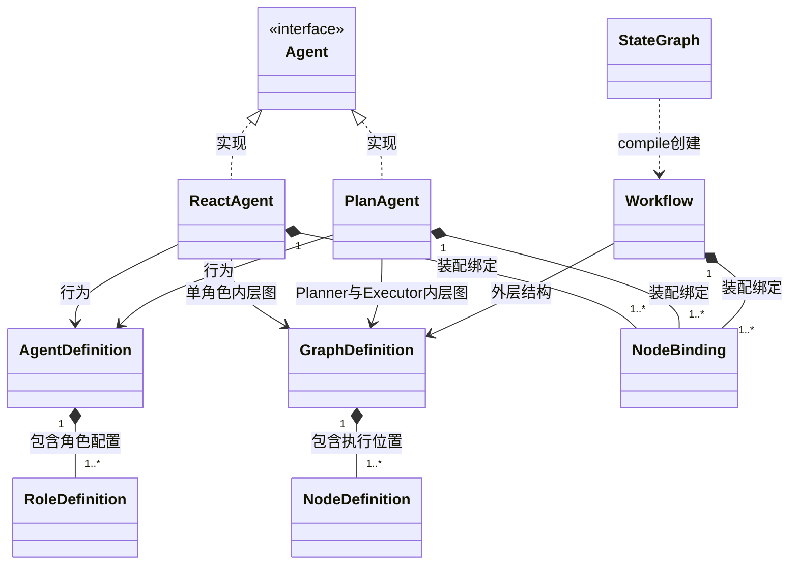
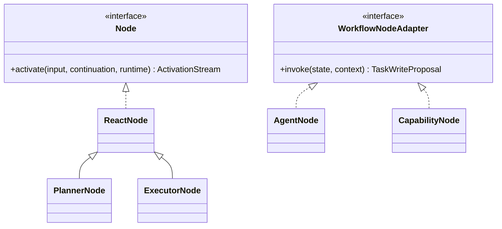
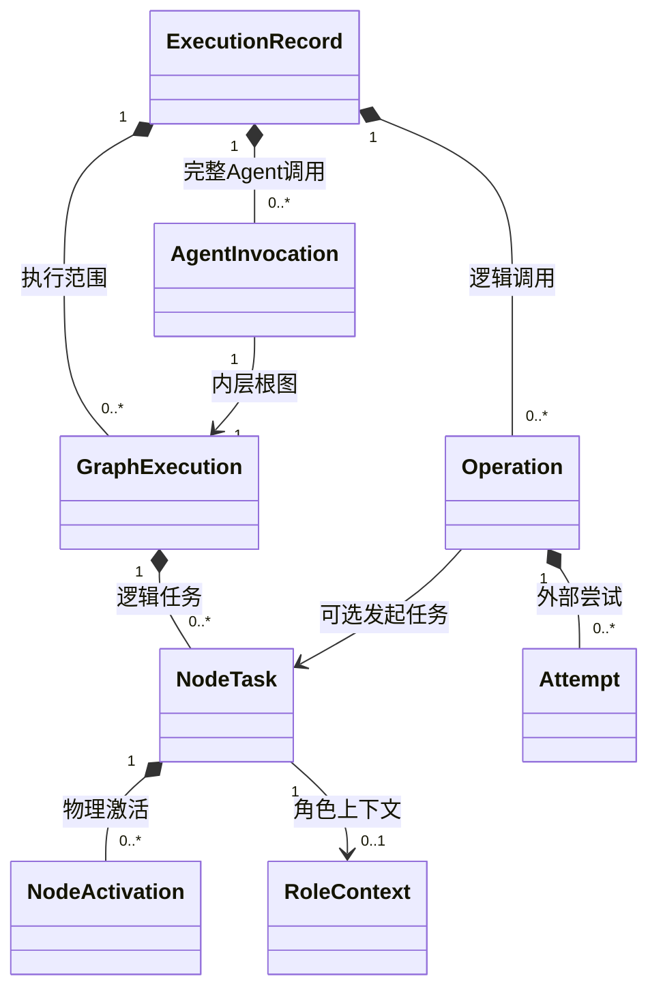

# SDK 定义、节点与运行对象

本页只描述 SDK。平台的应用、发布、用户与资源目录见[平台领域模型](../platform/domain-model.md)。

## 1. 定义不是管理实体

| 对象 | 身份与生命周期 | 内容 |
| --- | --- | --- |
| AgentDefinition | 调用方提供的行为定义；无平台发布生命周期 | mode、主角色、Executor 角色、模型与策略 |
| RoleDefinition | 属于一份 AgentDefinition，role_key 在其中唯一 | Prompt、变量、输入输出、能力绑定 |
| GraphDefinition | 独立描述组织关系 | 节点位置、边、条件、入口、汇合 |
| NodeDefinition | 属于一份 GraphDefinition，node_key 在图中唯一 | node_type、输入输出及路由配置 |
| NodeBinding | 一次装配的值对象 | node_key 与已解析角色／能力／可执行 Agent 的绑定 |
| WorkspaceBinding | 调用方提供的环境配置值；没有 ExecutionRecord 身份 | 稳定文件根句柄、内容范围、环境策略及授权资源挂载 |
| Agent | SDK 公共执行接口；接口本身没有实体身份 | start、ainvoke、astream 的调用合同，不负责构造其他对象 |
| ReactAgent / PlanAgent | 实现 Agent 的具体可执行程序 | AgentDefinition、生成图及绑定、已注入依赖 |
| Workflow | 独立的可执行工作流类型，不实现 Agent | GraphDefinition、状态 schema、reducer 与已解析节点绑定 |
| StateGraph | 工作流构建器 | 收集节点、边和状态定义；compile 后返回 Workflow |

运行服务由 RuntimeEngine（运行时引擎）组织；它是进程内宿主服务，可以托管多次执行。ExecutionRecord（执行记录）保存一次执行的身份、状态、预算、结果引用和恢复关联；ExecutionRunner（单次执行驱动器）在取得执行权后组装本机现场、驱动所属图引擎并协调收尾。RunHandle 提供观察和控制入口。三者的作用域与持久性不同，详见[对象作用域](object-collaboration.md#11-作用域与生命周期的读法)。

`ExecutionRecord` 对应协议中的 `run_id`，它并非另一种运行身份。`run_id`、`RunRef`、`RunHandle`、`RunResult`、`RunControl`、`RunService`、`runs` 表及 API 路径继续表示同一次执行的标识、引用、结果、控制或访问入口；本次只确定核心实体和执行驱动器的名称，不另设旧类型别名。图调度仍由 AgentGraphEngine／WorkflowEngine 负责，ExecutionRunner 也不是 Planner 委派的业务 Executor。

AgentDefinition 与 GraphDefinition 没有继承或业务上的包含关系。它们分别表达行为和结构，由具体可执行程序关联。ReactAgent／PlanAgent 的构造过程生成内部图；高代码 Workflow 由 StateGraph 构建后编译。Agent 是使用这些程序的接口，不能把接口画成持有配置和节点绑定的实体。



图中的菱形表示组成，普通箭头表示引用，虚线空心三角表示实现接口，都不表示调度顺序。模型客户端、数据库连接和可执行函数属于进程内依赖，不直接序列化进定义或检查点。恢复时由调用方重建这些依赖。

统一公开名称为 `Agent`、`ReactAgent`、`PlanAgent`、`Workflow`。Workflow 可以只编排函数和工具，所以不继承 Agent。两者可以复用 RuntimeEngine 和 RunHandle，复用执行设施不构成业务上的继承关系。

SDK 不维护应用发布版本或配置兼容指纹。Definition 可以使用本地 key 定位绑定，key 不承担平台版本解析；相同 ExecutionRecord 的恢复配置由调用方保证。

## 2. 最小配置结构

```text
AgentDefinition
  mode: react | plan_executor
  main_role: RoleDefinition
  executors: RoleDefinition[]       # ReAct 必须为空
  execution: ExecutionPolicy
  context: ContextPolicy
  model_options: ModelOptions

RoleDefinition
  role_key: string
  kind: react | planner | executor
  prompt: PromptTemplate
  variables: VariableSpec[]
  capabilities: CapabilityBinding[]
  input_schema?, output_schema?

CapabilityBinding
  binding_key: string
  kind: builtin_tool | tool | mcp | skill
  visible_name: string
  adapter_key: string
  member_key?: string
  config: JSON
  access_scope: CapabilityAccessScope
```

模型连接由 Agent 构造依赖提供。Executor 和压缩角色继承所属 Agent 的模型，不能借 role 配置替换连接。Executor 的 Prompt 不拼接 Planner Prompt；其能力集合独立，文件授权可以共享。

输入输出 Schema 不执行远程引用。Prompt 变量按声明类型检查，纯文本替换，不执行模板代码。构造校验不调用模型或执行工具；资源准备、导入和授权在 SDK 外完成。

直接 Agent 的输入输出格式取 main_role 的 Schema，Executor 使用自己的 Schema；AgentDefinition 不再重复设置顶层格式。精确装配参数、CapabilityRegistration、HookSet、program_key 派生及资源所有权见[构造与绑定](assembly.md)。

## 3. Node 类与 NodeTask

Agent 面向 SDK 调用者，描述完整智能体怎样使用；Node 面向图引擎，描述一个执行位置怎样被激活。Agent 不继承 Node，Node 也不要求实现 Agent。ReactAgent 是完整程序，ReactNode 是它内部承担角色 Loop 的节点；PlanAgent 则装配 PlannerNode 和所配置的 ExecutorNode。



这是运行接口的实现关系。Node 是内层图的可恢复节点协议，由 NodeDriver 驱动；外层的 AgentNode／CapabilityNode 通过 WorkflowNodeAdapter 对接迁移内核。它们都可绑定到图中的 NodeDefinition，但不因此实现同一个激活接口。这里保留双引擎的适配边界，不给 Node 强塞两套 activate／invoke 方法，也不要求 Agent 暴露图内激活方法。TaskWriteProposal 表示外层输出及 SDK 结果消费提案；其原生写入类型与逐方法映射仍需在 Workflow 适配中定稿，不等同于已经提交的 pending writes。

AgentNode **组合完整 Agent**，不继承 Agent，也不继承 ReactNode。它通过 SDK 的内部调用桥执行已装配程序，不在节点里另起一个根 ExecutionRecord。首版可嵌入的程序限定为 SDK 的 ReactAgent／PlanAgent；仅实现公共 Agent 接口不足以声明可恢复嵌入能力，编译器须拒绝不支持该协议的绑定。具体映射见[公共接口](public-api.md#6-workflow-与-agentnode-的边界)。

ReactNode 一次激活可以推进到 Progress、Wait 或 Complete；运行位置保存在 ReactContinuation，恢复不依赖原协程。Planner 在 React 能力上增加委派；Executor 使用同一 Loop，但不能递归创建新 Executor。不是每一次模型调用都新建一个节点任务。

普通 Tool、MCP、Skill 文件读取与脚本调用进入 Operation。只有工作流把一次能力配置为独立步骤时，才对应 CapabilityNode；能力调用本身不创建 GraphExecution。

## 4. 运行身份与数量



| 场景 | 实例数量 |
| --- | --- |
| 直接 ReAct | 1 ExecutionRecord、1 AgentInvocation、1 内层 GraphExecution、1 React NodeTask |
| Planner 同批两次委派同一种 Executor | 同一内层图，1 Planner + 2 Executor NodeTask，各有 RoleContext |
| 两次不同提问 | 2 ExecutionRecord，可属于同一 Session；没有共享可变角色上下文 |
| 外层 Workflow 调用完整 Plan Agent | 同一根 ExecutionRecord；1 外层图 + 1 内层图，增加 1 AgentInvocation |
| 普通 MCP 调用 | 增加 Operation；实际请求可以增加 Attempt，不增加图 |
| 接管未完成 ExecutionRecord | 保留原 ExecutionRecord／Invocation／Graph／Task／Operation；新进程创建新的物理对象和激活 |

图的数量表描述已初始化的执行。queued ExecutionRecord 在完成初始化前可没有图；开始执行时恰好有一个根图，之后可以创建子图。一个纯工具 Workflow 可以没有 AgentInvocation 和 RoleContext。Operation 也可由 SDK 系统组件发起，因此不能强制每个 Operation 都有 node_task_id。

## 5. SDK 身份与作用域

| 类型 | 结构／意义 |
| --- | --- |
| StorageNamespace | 调用方注入的存储分区标识，无用户／应用语义；默认本地分区可用于演示 |
| ContentScopeRef | namespace + scope_key；标识内容归属范围，由 SDK 验证可读范围 |
| RunRef | namespace + run_id |
| InvocationScopeRef | run_id、graph_execution_id?、node_task_id?、invocation_id?、content_scope_ref、session_id?、workspace_scope_ref?、subject_kind、subject_id |
| ExecutionLease | run_id、worker_id、epoch、expires_at；由共享执行存储验证 |
| PayloadRef | inline JSON，或 SDK ContentStore 的不可变引用及长度／摘要 |
| ContextRevisionRef | context_id + revision |
| PreparedAgentRef | 已装配程序集合内的 agent_key；不解析平台发布 ID |

namespace 不是授权凭据。公开接口接收调用方选定的 RuntimeEngine／分区，插件和 LLM 只能获得受限 scope，不能靠传入其他 ID 越界。

输入幂等、调用幂等和内容完整性可以使用 hash；这些 hash 不是 Agent 发布版本指纹，也不能驱动 SDK 选择配置版本。

## 6. 两类状态不可混合

GraphState 是 Workflow 的业务数据；RoleContext 是某个角色给模型的消息；ReactContinuation 是该任务下一步怎样执行；RunControl 是整次执行的额度、截止和停止。它们通过显式引用关联，不能塞进一个任意可写的 messages 字典。

## 7. 状态与序列化约定

| 实体 | 合法状态 |
| --- | --- |
| ExecutionRecord | queued / running / stopping / succeeded / failed / cancelled / timed_out / budget_exhausted |
| AgentInvocation.control_state | active / stopping / terminal；具体终结原因单独保存 |
| GraphExecution、NodeTask | ready / running / waiting / succeeded / failed / cancelled |
| Operation.status | pending / succeeded / failed / blocked；另存 processing_phase |
| Attempt | prepared / started / succeeded / failed / unknown / cancelled |

ExecutionRecord 终态不再被迟到结果覆盖；cleanup_state 与业务终态分开。NodeTask 的失败不等于整次 ExecutionRecord 必然失败，Executor 业务失败可由父批次反馈；根控制错误按所属执行域的控制规则收束。

DTO 使用 schema_version／protocol_version 声明自身格式，不对应平台发布号；ID 为 SDK 生成或调用方稳定传入的 UUID。状态序号、revision 为整数，时间为 UTC；对外超时换算使用单调计时。未知字段默认拒绝，明确声明的业务 JSON 除外。

ExecutionBindingRef 为 program_key、node_binding_key、role_key?；它定位调用方已经装配的程序，不查询平台版本。SDK 中 resource_key／credential_generation 也是适配器键，不内置平台资源库管理。

GraphCheckpoint 的共同信封及各引擎载荷见[检查点](checkpoints.md)。原混合平台身份的 JSON Schema 与样例已撤下；后续 SDK Schema 必须从本组 DTO 单独实现和验证，不能继续使用原版要求 space_id／release_id 的结构。
