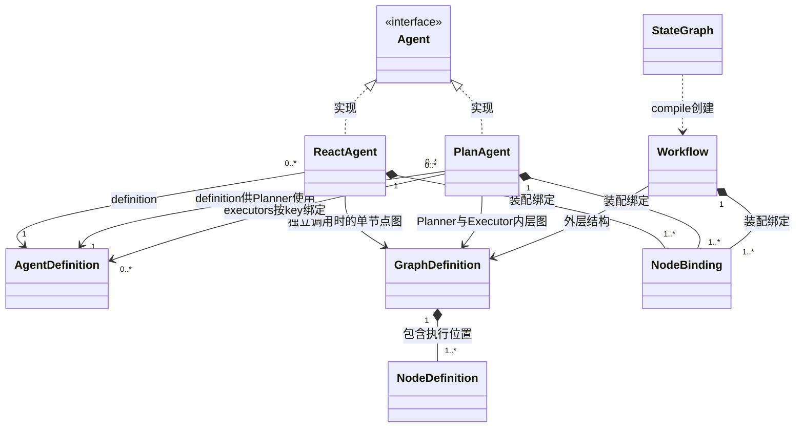
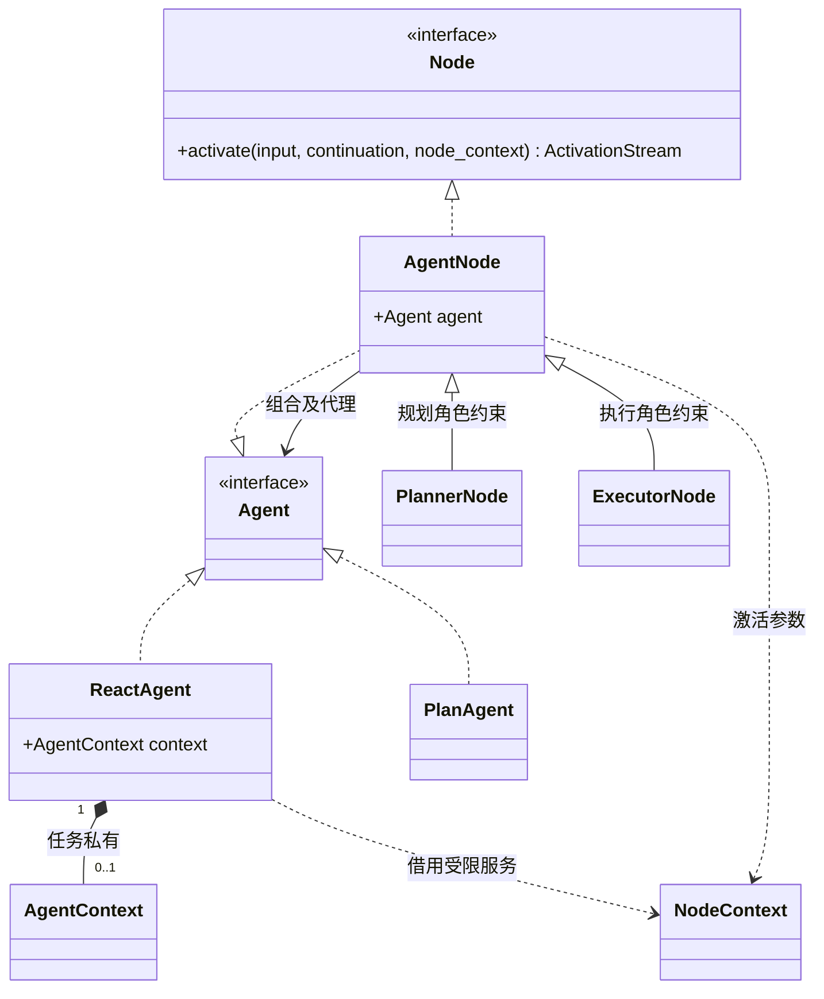
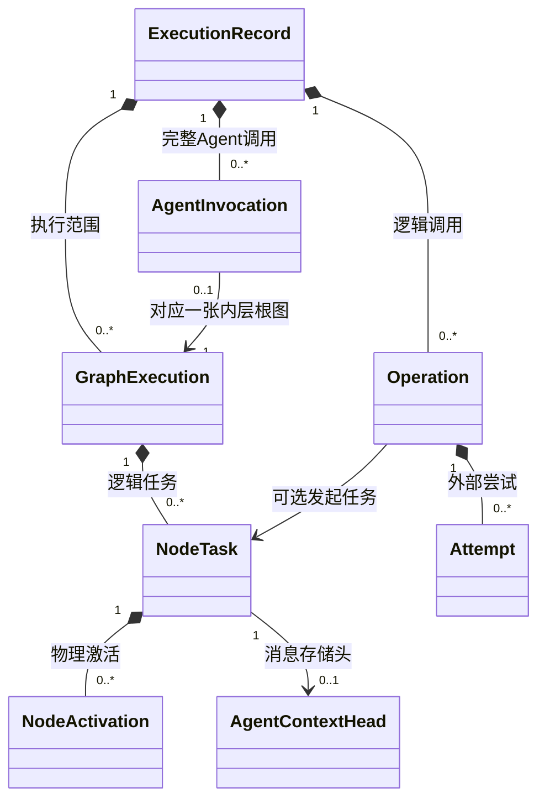

# SDK 定义、节点与运行对象

本页只描述 SDK。平台的应用、发布、用户与资源目录见[平台领域模型](../platform/domain-model.md)。

## 1. 定义不是管理实体

| 对象 | 身份与生命周期 | 内容 |
| --- | --- | --- |
| AgentDefinition | 一份可复用的 Agent 行为配置；无平台发布生命周期 | 名称、职责说明、Prompt、变量、输入输出、能力绑定 |
| GraphDefinition | 独立描述组织关系 | 节点位置、边、条件、入口、汇合 |
| NodeDefinition | 属于一份 GraphDefinition，node_key 在图中唯一 | node_type、输入输出及路由配置 |
| NodeBinding | 一次装配的值对象 | node_key 与 Agent 定义及创建依赖／能力的绑定；执行时创建任务专属对象 |
| WorkspaceBinding | 调用方提供的环境配置值；没有 ExecutionRecord 身份 | 稳定文件根句柄、内容范围、环境策略及授权资源挂载 |
| Agent | SDK 公共执行接口；接口本身没有实体身份 | start、ainvoke、astream 的调用合同，不负责构造其他对象 |
| ReactAgent / PlanAgent | 实现 Agent 的具体对象，运行时按任务／完整调用绑定 | 固定定义与依赖；ReactAgent 持有私有 AgentContext，PlanAgent 关联本次角色图 |
| Workflow | 独立的可执行工作流类型，不实现 Agent | GraphDefinition、状态 schema、reducer 与已解析节点绑定 |
| StateGraph | 工作流构建器 | 收集节点、边和状态定义；compile 后返回 Workflow |

运行服务由 RuntimeEngine（运行时引擎）组织；它是进程内宿主服务，可以托管多次执行。ExecutionRecord（执行记录）保存一次执行的身份、状态、预算、结果引用和恢复关联；ExecutionRunner（单次执行驱动器）在取得执行权后组装本机现场、驱动所属图引擎并协调收尾。RunHandle 提供观察和控制入口。三者的作用域与持久性不同，详见[对象作用域](object-collaboration.md#11-作用域与生命周期的读法)。

`ExecutionRecord` 对应协议中的 `run_id`，它并非另一种运行身份。`run_id`、`RunRef`、`RunHandle`、`RunResult`、`RunControl`、`RunService`、`runs` 表及 API 路径继续表示同一次执行的标识、引用、结果、控制或访问入口；本次只确定核心实体和执行驱动器的名称，不另设旧类型别名。图调度仍由 AgentGraphEngine／WorkflowEngine 负责，ExecutionRunner 也不是 Planner 委派的业务 Executor。

AgentDefinition 与 GraphDefinition 没有继承或业务上的包含关系。它们分别表达行为和结构，由具体可执行程序关联。ReactAgent／PlanAgent 的构造过程生成内部图；高代码 Workflow 由 StateGraph 构建后编译。Agent 是使用这些程序的接口，不能把接口画成持有配置和节点绑定的实体。



图中的菱形表示组成，普通箭头表示引用，虚线空心三角表示实现接口，都不表示调度顺序。模型客户端、数据库连接和可执行函数属于进程内依赖，不直接序列化进定义或检查点。恢复时由调用方重建这些依赖。

AgentDefinition 可以被多个 Agent 引用；同一个 Plan 中也可将同一定义绑定到多个 Executor key。图的引用描述完整调用的装配：独立 ReactAgent 有单节点内层图，Plan 内的 ReactAgent 使用所属 Plan 的既有图和任务绑定，不各自创建一张图。

统一公开名称为 `Agent`、`ReactAgent`、`PlanAgent`、`Workflow`。Workflow 可以只编排函数和工具，所以不继承 Agent。两者可以复用 RuntimeEngine 和 RunHandle，复用执行设施不构成业务上的继承关系。

SDK 不维护应用发布版本或配置兼容指纹。Definition 可以使用本地 key 定位绑定，key 不承担平台版本解析；相同 ExecutionRecord 的恢复配置由调用方保证。

## 2. 最小配置结构

```text
AgentDefinition
  name?: string                    # 可选显示名，省略为 None
  description: string              # 职责说明；作为 Executor 时供 Planner 选择
  prompt: PromptTemplate
  variables: VariableSpec[]
  capabilities: CapabilityBinding[]
  input_schema?, output_schema?

ReactAgent 构造
  definition: AgentDefinition

PlanAgent 构造
  definition: AgentDefinition       # Planner 的行为，也定义公开输入输出
  executors: Mapping[string, AgentDefinition]  # Executor key → 行为；默认空表

两种构造共同接收
  execution_policy: ExecutionPolicy # 完整调用的额度、截止、并行和重试
  context_policy: ContextPolicy     # 历史选择、压缩与上下文预算
  model_options: ModelOptions      # 模型请求参数；与注入的 model 配套
  model, capabilities, hooks, workspace, runtime_engine

CapabilityBinding
  binding_key: string
  kind: builtin_tool | tool | mcp | skill
  visible_name: string
  adapter_key: string
  member_key?: string
  config: JSON
  access_scope: CapabilityAccessScope
```

`AgentDefinition` 只描述一个 Agent 的行为，不再包含角色列表、执行模式或其他 AgentDefinition。模式由选择 `ReactAgent`／`PlanAgent` 构造函数确定；Plan 的组合关系由 PlanAgent 的 `definition`、`executors` 和生成的 NodeBinding 表达。Planner 任务直接使用 PlanAgent.definition，不再包装一份主角色配置。Executor 表保存定义，不保存可被多次委派共用的活动 Agent。

执行、上下文和模型策略是完整 Agent 构造参数，默认值见[行为约定](requirements.md)。同一 Plan 中 Planner 与各 Executor 使用这套固定策略和模型连接；Executor 的定义没有独立模型、额度或策略覆盖字段。预算仍按同一 ExecutionRecord 共同计数，不为每个 ReactAgent 复制额度；压缩继承模型且不占业务 Loop。Executor 的 Prompt 不拼接 Planner Prompt，其能力集合独立，文件授权可以共享。

`name` 是可选显示名，省略为 None；`description` 是职责说明，二者不作身份。推荐 `AgentDefinition(prompt=...)`；旧 `(name, prompt, ...)` 构造兼容，Executor 路由始终使用 executors 映射的 key。用于 Plan 的 Executor 必须有非空职责说明。一个定义可以独立构造 ReactAgent，也可以作为某个 Plan 的 Executor；两种用法采用同一配置结构。每次委派创建任务专属 ReactAgent 和 AgentContext，复用定义不等于复用活动实例。

运行 DTO 中的 `role_key` 仅表示装配位置：直接 ReAct 为 `react`，Planner 为 `planner`，Executor 为 executors 映射的 key。Executor key 采用 `[A-Za-z_][A-Za-z0-9_-]{0,63}`，保留 `react`、`planner`，在所属 Plan 内唯一；它由 NodeBinding 提供，不是 AgentDefinition 的字段，也没有独立实体或 CRUD。一个定义绑定到不同位置时拥有不同 key，修改显示名不改变恢复定位。Hook matcher 和能力目录按这些固定位置筛选。

输入输出 Schema 不执行远程引用。Prompt 变量按声明类型检查，纯文本替换，不执行模板代码。构造校验不调用模型或执行工具；资源准备、导入和授权在 SDK 外完成。

`prompt` 是业务提示词；ReAct、Planner、Executor 的执行指令由 SDK 按绑定角色自动组装。调用方不负责解释模式、动作协议或角色循环。SDK 指令与业务 Prompt 分开保存，组装、保护和恢复合同见[SDK 模式指令与业务 Prompt](assembly.md#25-sdk-模式指令与业务-prompt)。

直接 Agent 的公开输入输出格式取 `definition.input_schema / output_schema`；Plan 的 Planner 使用同一份定义，Executor 取 `executors[key]` 的 Schema。精确装配参数、CapabilityRegistration、HookSet、program_key 派生及资源所有权见[构造与绑定](assembly.md)。

## 3. Node 类与 NodeTask

Agent 面向 SDK 调用者，Node 面向图引擎。两种接口互不继承；AgentNode 同时实现它们，内部持有并代理 Agent。ReactAgent 执行角色 Loop 并持有 AgentContext；AgentNode 负责图接入，不复制 Loop 或消息。



PlannerNode／ExecutorNode 是可选的节点特化类，均持有使用 AgentDefinition 的 ReactAgent；Planner／Executor 职责由节点位置与绑定约束确定，不是定义中的另一种类型。不另建 ReactNode Loop 实现。每个任务的实际对象独立；GraphDefinition 中的节点位置、绑定配置和工厂可复用。NodeTask 是持久调度记录，不是 Python 节点类。

NodeContext 是每次激活的身份、控制及受限服务引用，不存消息和进度，也不保存到检查点。AgentContext 属于执行中的 ReactAgent，包括消息有效视图、压缩关联与 ReactContinuation。存储由统一提交设施完成；其消息头 AgentContextHead 和不可变进度是存储组成，不是额外引擎。

AgentNode 的公共方法转发给内部 Agent；图内 activate 使用内部执行绑定接续已有任务，不调用公共 start 新建根执行。激活可以推进到 Progress、Wait 或 Complete／Fail，运行位置不依赖原协程。Planner 增加委派能力，Executor 使用同一 Loop 但不递归委派。一次模型调用不等于创建一次 NodeTask。

外层原生协议仍经 WorkflowNodeAdapter 衔接：完整 Agent 调用通过调用桥创建或恢复 AgentInvocation，CapabilityNode 调用能力管道。外层适配器组合执行绑定，不因名称中都有 Node 就直接调用内层 activate。TaskWriteProposal 表示外层输出及结果消费提案，不等于已经提交的 pending writes。首版只支持两种内置 Agent 的可恢复绑定；仅实现公共 Agent 接口不足以保证可恢复嵌入。

普通 Tool、MCP、Skill 文件读取与脚本调用进入 Operation。只有工作流把能力配置为独立步骤时，才对应 CapabilityNode；能力调用本身不创建 GraphExecution。

对象作用域和完整实例例子见[Node、角色与执行实例](object-collaboration.md#3-node角色与执行实例)。

## 4. 运行身份与数量



| 场景 | 实例数量 |
| --- | --- |
| 直接 ReAct | 1 ExecutionRecord、1 AgentInvocation、1 内层 GraphExecution、1 React NodeTask |
| Planner 同批两次委派同一种 Executor | 同一内层图，1 Planner + 2 Executor NodeTask，各有一个 ReactAgent 与私有 AgentContext |
| 两次不同提问 | 2 ExecutionRecord，可属于同一 Session；没有共享可变角色上下文 |
| 外层 Workflow 调用完整 Plan Agent | 同一根 ExecutionRecord；1 外层图 + 1 内层图，增加 1 AgentInvocation |
| 普通 MCP 调用 | 增加 Operation；实际请求可以增加 Attempt，不增加图 |
| 接管未完成 ExecutionRecord | 保留原 ExecutionRecord／Invocation／Graph／Task／Operation；新进程创建新的物理对象和激活 |

上图描述持久记录：NodeTask 引用的 AgentContextHead 是消息头，进度由 NodeCheckpoint 引用；本机 ReactAgent.context 将它们装配为同一任务的 AgentContext，不另建第二份消息权威。

图的数量表描述已初始化的执行。queued ExecutionRecord 在完成初始化前可没有图；开始执行时恰好有一个根图，之后可以创建子图。一个纯工具 Workflow 可以没有 AgentInvocation 和 AgentContext。Operation 也可由 SDK 系统组件发起，因此不能强制每个 Operation 都有 node_task_id。

上图中每个 AgentInvocation 恰好对应一张内层 GraphExecution；每张 GraphExecution 可关联零或一个 Invocation。engine_kind=agent 时必须有一个，engine_kind=workflow 时没有；外层调用完整 Agent 后，新增 Invocation 只关联新建的内层图。

## 5. SDK 身份与作用域

| 类型 | 结构／意义 |
| --- | --- |
| StorageNamespace | 调用方注入的存储分区标识，无用户／应用语义；默认本地分区可用于演示 |
| ContentScopeRef | namespace + scope_key；标识内容归属范围，由 SDK 验证可读范围 |
| RunRef | namespace + run_id |
| InvocationScopeRef | run_id、graph_execution_id?、node_task_id?、invocation_id?、content_scope_ref、session_id?、workspace_scope_ref?、subject_kind、subject_id |
| ExecutionLease | run_id、worker_id、epoch、expires_at；由共享执行存储验证 |
| PayloadRef | inline JSON，或 SDK ContentStore 的不可变引用及长度／摘要 |
| ContextRevisionRef | context_id + revision |
| PreparedAgentRef | 已装配程序集合内的 agent_key，定位固定定义、依赖与创建绑定；不引用共享的活动上下文，也不解析平台发布 ID |

namespace 不是授权凭据。公开接口接收调用方选定的 RuntimeEngine／分区，插件和 LLM 只能获得受限 scope，不能靠传入其他 ID 越界。

输入幂等、调用幂等和内容完整性可以使用 hash；这些 hash 不是 Agent 发布版本指纹，也不能驱动 SDK 选择配置版本。

## 6. 两类状态不可混合

GraphState 是 Workflow 的业务数据；AgentContext 是角色 Agent 私有的消息与执行上下文，其中 AgentContextHead 是消息存储头，ReactContinuation 表示下一步执行位置；NodeContext 是本次激活的身份与服务视图；RunControl 是整次执行的额度、截止和停止。它们的作用域不同，不能塞进一个任意可写的 messages 字典。

## 7. 状态与序列化约定

| 实体 | 合法状态 |
| --- | --- |
| ExecutionRecord | queued / running / stopping / succeeded / failed / cancelled / timed_out / budget_exhausted |
| AgentInvocation.control_state | active / stopping / terminal；具体终结原因单独保存 |
| GraphExecution、NodeTask | ready / running / waiting / succeeded / failed / cancelled |
| Operation.status | pending / succeeded / failed / blocked；另存 processing_phase |
| Attempt | prepared / started / succeeded / failed / unknown / cancelled |

ExecutionRecord 终态不再被迟到结果覆盖；cleanup_state 与业务终态分开。NodeTask 的失败不等于整次 ExecutionRecord 必然失败，Executor 业务失败可由父批次反馈；根控制错误按所属执行域的控制规则收束。

DTO 使用 schema_version／protocol_version 声明自身格式，不对应平台发布号；ID 为 SDK 生成或调用方稳定传入的 UUID。状态序号、revision 为整数，时间为 UTC；对外超时换算使用单调计时。未知字段默认拒绝，明确声明的业务 JSON 除外。

ExecutionBindingRef 为 program_key、node_binding_key、role_key?；role_key 从节点绑定派生，含义见第 2 节。它定位调用方已经装配的程序，不查询平台版本。SDK 中 resource_key／credential_generation 也是适配器键，不内置平台资源库管理。

GraphCheckpoint 的共同信封及各引擎载荷见[检查点](checkpoints.md)。原混合平台身份的 JSON Schema 与样例已撤下；后续 SDK Schema 必须从本组 DTO 单独实现和验证，不能继续使用原版要求 space_id／release_id 的结构。
