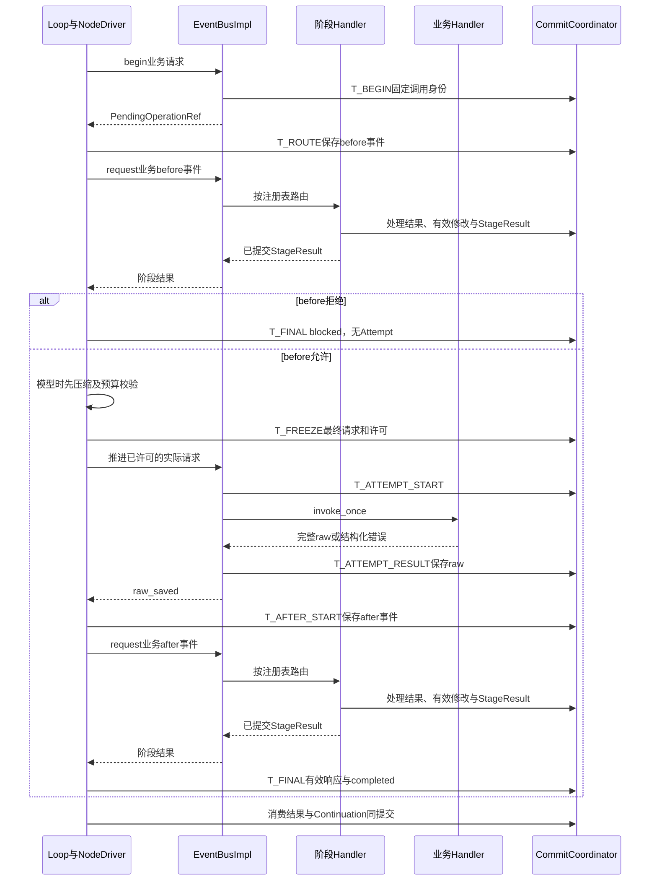

# SDK 事件总线、能力调用与 Hook

状态：版本化路由、调用阶段持久化、节点持久等待，以及模型／工具／Skill／Context／Environment／Executor Handler 已实现。完整可靠订阅、outbox ACK 和统一公共请求门面仍为目标能力；当前范围见[实现记录](implementation.md#节点协议与检查点设计对齐)。Workflow 相关调用不在本轮范围。

## 1. 实现边界与模块装配

一个 ExecutionRunner 创建一个根 EventBusImpl。ReactAgent 的 Loop 决定何时准备调用、执行动作和接收结果，并发出对应阶段事件；NodeDriver 负责按已保存位置推进这些阶段。根总线登记 Operation、路由事件、管理 Attempt 和等待结果，不主动生成调用前后事件。HookHandler 是注册在根总线上的组合处理器，拥有自己的子 Hook 注册表。各方共用当前执行的存储、租约与提交设施。

Loop 发出的是“准备调用模型”“模型调用已结束”等业务事件，不调用 HookHandler，也不判断是否配置了 Hook。ModelHandler（模型 EventHandler）只处理实际模型请求、聚合供应商流并返回原始结果；它不发本次调用的 before／after 事件。阶段事件、实际执行请求和只读观察通知虽共用总线，完成语义不同。

### 1.0 三个接口与组合关系

| 接口 | 最小职责 | 实现对象 |
| --- | --- | --- |
| HandlerRegistry | register_handler、resolve、freeze | EventBusImpl、HookHandler |
| EventBus | request：发送已声明类型的事件并取得对应结果 | EventBusImpl、HookHandler |
| EventHandler | handle：处理收到的事件 | HookHandler、各业务处理器、各末端 Hook 处理器 |

HandlerRegistry 是接口，各实现内部持有本地绑定表；不要求额外创建注册中心对象。EventBus 不继承 HandlerRegistry，EventHandler 也不隐含发送或注册权限。运行中的 Agent／Node 得到受限发送端口，只有装配器能够注册。

接口以类型参数声明各自接受的事件、处理环境和结果，不能因为都实现 EventHandler 就任意互换处理器：

```python
from typing import Protocol, TypeVar

EventT = TypeVar("EventT", contravariant=True)
ContextT = TypeVar("ContextT", contravariant=True)
ResultT = TypeVar("ResultT", covariant=True)
BindingT = TypeVar("BindingT")


class HandlerRegistry(Protocol[BindingT]):
    def register_handler(self, event_type: str, schema_version: int,
                         binding: BindingT) -> None: ...
    def resolve(self, event_type: str,
                schema_version: int) -> tuple[BindingT, ...]: ...
    def freeze(self, required_manifest: "HandlerManifest") -> None: ...


class EventBus(Protocol[EventT, ContextT, ResultT]):
    async def request(self, event: EventT, scope: ContextT) -> ResultT: ...


class EventHandler(Protocol[EventT, ContextT, ResultT]):
    async def handle(self, event: EventT, context: ContextT) -> ResultT: ...
```

| 对象／入口 | 输入 → 输出 | 固定规则 |
| --- | --- | --- |
| EventBusImpl.request 业务重载 | EventRequest＋InvocationScopeRef → EventResponse | begin＋await_result，沿用唯一 Operation |
| EventBusImpl.request 阶段重载 | CallStageEvent＋InvocationScopeRef → StageResult | 路由调用方发出的业务阶段事件，等待已提交结果；不调用 begin |
| HookHandler.handle | CallStageEvent＋HookDispatchContext → StageResult | 仅转交自己的 request(event, context.scope)，不再发回根总线 |
| HookHandler.request | CallStageEvent＋InvocationScopeRef → StageResult | 按本地注册表继续原 Operation 的固定 Hook 链 |
| 末端 Hook 的 handle | HookInput＋HookCallContext → HookDecision | 返回决定／修改提案；由组合处理器校验和提交 |
| 业务处理器的 handle | 对应业务 payload＋领域调用环境 → HandlerOutcome | 返回原始结果或准备计划，由根调用流程完成结算 |

根总线的两个重载按事件的具体类型分派，响应类型必须与输入类型对应。构造 CallStageEvent 不是授权：根总线验证 scope、当前 lease 与保存的阶段信封；HookHandler 自己校验内部固定链。公开能力代理只允许业务 EventRequest，Loop／节点的内部端口才有阶段发送权限；伪造同名事件不能获得此权限。

HookDispatchContext 是装配器为阶段 Handler 注入的受限本机环境，包含可信 scope 和控制读取入口；HookCallContext 包含 `metadata: HookContext` 与 `reader: HookReadPort`。二者均不进入检查点。子处理器只获得后者，不获得根注册权限或存储 writer。

根装配器把 HookHandler 绑定到明确声明的业务阶段键，例如 `model.generate.before`、`model.generate.after`、`capability.invoke.before`、`capability.invoke.after`。HandlerBinding.execution_kind 为 call_stage，返回 StageResult；阶段事件沿用原 Operation，不创建另一次能力调用。总线没有“收到 model.generate 就先调 Hook”的隐含规则。业务绑定仍分 external/internal/graph/recoverable 四类。

首版阶段处理默认由 HookHandler 承担；无用户 Hook 时，其空链返回原有效视图。也可装配满足相同阶段协议的处理器。阶段键必须在装配时声明并校验，不能把漏注册解释成允许。只读观察者不参与允许／拒绝决定。

根业务键只允许一个主 Handler。HookHandler 的本地表允许同一源事件多个 HookBinding，按 program_key、stage、ordinal 组织；binding_key 在程序内唯一。resolve 总是返回不可变有序元组，根总线要求至多一项，本地 Hook 查询可有多项。根表和子表分别冻结；freeze 检查接口类型、必需绑定、自引用和循环注册，再一次性冻结根表和子表，失败时不留下半冻结现场。

本地查询不向父表回退。HookHandler.handle → HookHandler.request → 子 Handler.handle 是本地分发，不要求根总线为这个阶段再生成前后事件。Hook 自身执行不会再次触发自身 Hook；明确允许的跨领域请求必须使用另行注入的受限根发送端口及新 purpose_key，不能将当前阶段事件转发回根。

| 模块 | 持有的对象 | 提交与状态职责 |
| --- | --- | --- |
| ReactAgent／NodeDriver | 当前角色 Loop 与已登记 Operation 的阶段位置 | 发出 before／after 事件；等待处理结果；准备许可及最终结算。阶段算法是 Loop 的内部方法，不另设 InvocationPipeline 对象 |
| EventBusImpl | 根 HandlerBinding 表、每 Operation 的 Attempt 执行索引、WaitRegistry、Dispatcher、只读 Store | 登记、路由、等待；在已有许可下执行／重试主 Handler 并保存 raw。既不调用 Hook 专用方法，也不推进前后业务阶段 |
| HookHandler | 本地 HookBinding 表与末端 EventHandler | 选择固定链，逐项执行，经 CommitCoordinator 保存决定／有效修改／游标；不直接写表 |
| 末端 Hook Handler | 函数、脚本等受限适配器及固定配置 | 只返回 HookDecision；没有修改注册表、上下文或调用状态的直接权限 |
| ResultWaitRegistry | operation_id → 多个本机 waiter | 本机 generation、通知和关闭原因 |
| ObservationDispatcher | Subscription、每 scope 有界队列 | 可靠订阅游标命令；不写业务结果 |
| 领域 Handler | 已解析能力目录和原始 Adapter | 实现 EventHandler，生成原始结果或图执行计划，不发布伪造响应 |
| CommitCoordinator | 事务 writer | 全部权威运行事实、CAS、幂等及 outbox 的唯一提交入口 |

HookHandler 用阶段事件关联的原 EventRequest.event_type 和 request／response 匹配 HookBinding，既有配置仍写 model.generate/request 等业务挂点，不要求调用方发送 hook.*。本地绑定按 program_key 分组，按可信 ExecutionBindingRef 选择程序，再按事件、stage／matcher 选择子链。Operation 固定已选绑定与游标；恢复不使用另一个程序的 Hook，也不重新挑选最新处理器。子链之间不共享私有上下文。

调用者通过 [HookSet／HookBinding](assembly.md#5-hookset-与-hookbinding)提供配置，SDK 装配到 HookHandler。matcher 首版只匹配绑定身份、角色和 purpose；业务内容校验由子 Handler.handle 完成。读取有效上下文使用本次 HookCallContext.reader，不序列化客户端。

业务请求绑定为 `model.generate/model.embed → ModelHandler`，`capability.invoke/result.read → ToolHandler`，`skill.list/skill.read/skill.resource.read → SkillHandler`，`context.materialize/context.mutate/context.compact → ContextHandler`，`environment.prepare/environment.read/environment.write → EnvironmentHandler`，`executor.delegate/agent.invoke → GraphExecutionHandler`。这些类统一以 Handler 命名，均实现 EventHandler；一个处理器可以绑定多个请求键，不通过广播或“第一个返回成功”选择主处理器。根处理器和 Hook 子处理器的关系集中见[注册关系图](object-collaboration.md#42-根处理器与-hook-子处理器的注册关系)。

SkillHandler 是运行时的事件处理入口，SkillLoader 是它使用的只读资源接口；SkillPackage 是配置资源，不是处理器。三个 Skill 请求按 internal 只读结果提交，沿用工具类 Operation 和同一阶段协议；Skill 脚本另外通过 capability.invoke 调用 exec。入口映射、DTO 和恢复规则见[Skill 调用设计](capabilities.md#33-skillhandler-的事件入口)。

内部 mutation、额度事务、检查点 writer、HookAdapter、outbox ACK 不再次进入业务代理。GraphExecutionHandler 返回图计划，由对应引擎调度；根总线和 HookHandler 不新增 Executor 调度器。停止有独立受信控制入口，不等待业务队列，也不接受 Hook deny。

建议代码目录为 `runtime/invocation/{dto,interfaces,registry,bus,dispatch,hooks,waiters,observation,proxy}.py`。interfaces 定义三个接口，dispatch 只放路由及 Attempt 推进；Loop 的阶段算法留在 Agent 执行模块。DTO 不依赖数据库模块，任何实现拆分都必须沿用同一 Operation 状态机和 CommitCoordinator。

### 1.1 生命周期

| 本机状态 | 允许操作 | 转移 |
| --- | --- | --- |
| `assembling` | register_handler（含根挂点和本地子处理器） | freeze → frozen |
| `frozen` | open；读取绑定 | open 校验成功 → open；失败保持 frozen |
| `open` | begin/get/await/publish/subscribe | 根停止 → draining；close/lease_lost → closed |
| `draining` | 读结果、已有结果提交、已有调用收束、观察与清理 | close → closed；拒绝新业务准入 |
| `closed` | 重复 close | 不允许 reopen；接管创建新对象 |

`open(run_ref)` 读取已提交 ExecutionRecord／租约，校验注册表满足保存的 handler key 和协议格式，重建 scope 工厂及可靠订阅，扫描未完成 Operation、待执行意图和 outbox。扫描唤醒原调用所属的执行驱动器；只有 executing 且许可有效的 Operation 可交总线恢复 Attempt。不能根据“没有 Future”重新调用 Handler，也不能由扫描器代发 before／after。重复 open 同一对象、ExecutionRecord、epoch 返回成功；不同 ExecutionRecord 或 epoch 报 `BUS_SCOPE_MISMATCH`。

`close(reason)` 的 reason 仅为 `completed|shutdown|lease_lost|startup_failed`。先原子关闭本机准入并使所有 waiter 收到 `BUS_CLOSED` 或 `LEASE_LOST`；停止新观察分发；取消 runner 的网络等待并使受限适配器终止；每个回调最多等待 5 秒；最后解除连接引用和本机索引。重复 close 等待同一 close task，不重复操作资源。

`completed` 只在 提交协调器已提交终态和清理登记后调用。`shutdown` 不把尚未完成的 ExecutionRecord 改成 cancelled：保留恢复阶段，释放执行权。`lease_lost` 立即禁止一切旧 epoch 提交和外部写入，迟到结果不落业务表。close 本身不伪造业务结果；外部副作用无法确认时由持有新租约的恢复器记录 unknown。

运行设施固定默认值：runner 通知队列 1024、每订阅实时队列 256、结果复查间隔 1000ms、观察回调时限 5000ms、关闭等待 5000ms。它们属于部署参数，有界且启动时固定，不是用户的模型／工具并发额度。runner 队列满时仅合并唤醒提示，持久意图保留并由 1 秒扫描补齐；停止通道不使用这些队列。

### 1.2 挂点覆盖与尚未细化的生命周期扩展

以下阶段名的 before／after 由调用方显式选择；不是 EventBus 自动添加的中间件。

| 发出者 | 事件例子 | 等待规则 |
| --- | --- | --- |
| ReactAgent Loop 的模型阶段 | model.generate.before／after | before 处理完才能冻结并执行；完整 raw 持久保存后才发 after；after 处理完才能接受有效响应 |
| 同一 Loop 的动作成员推进逻辑 | capability.invoke.before／after、skill.list／skill.read／skill.resource.read 的 before／after、executor.delegate.before／after | 每个成员分别等待自己的阶段结果；整批结算后才进入下一次模型决策 |
| 压缩 Agent 或上下文操作的发起方 | context.compact.before／after、压缩模型的 model.generate.before／after | 沿原压缩 Episode 恢复，不递归触发 Hook 内部 patch 的提交事件 |
| 环境／完整 Agent 调用的发起方 | environment.prepare.before／after、agent.invoke.before／after | 由所属执行驱动器发出；没有业务 Loop 时不能虚构一个 Loop |
| 图引擎、ExecutionRunner | 节点、批次、整次执行的已提交生命周期事件 | 按各自事实边界发出；普通观察不阻塞执行、不修改执行结果 |

Planner、Executor 和独立 ReAct 复用同一 Loop 逻辑。并行动作有独立 Operation 阶段；发出者仍是原 Agent 的动作执行逻辑，不是 ToolHandler／ModelHandler。成员的 raw 先到可以先走该成员 after，但不能提前触发下一次 ReAct。外层 Workflow 的普通能力节点由节点驱动器遵循同一阶段协议，不让总线猜测调用者业务。

| 边界 | 当前设计入口 | 允许的作用 |
| --- | --- | --- |
| 模型、能力、环境、委派及完整 Agent 调用 | 发起方显式发送的 before／after 事件 | 阶段 Handler 可按注册白名单修改、允许或拒绝；决定与有效上下文一致提交 |
| 上下文物化、修改及压缩请求 | 发起方显式发送对应业务阶段事件 | 使用本页字段规则；内部提交／物化子步骤不递归触发 Hook |
| ExecutionRecord、节点、批次及环境的已提交生命周期变化 | CommittedEvent 的观察订阅 | 读取授权投影、告警或展示；返回值不改变原执行 |
| run.ending 等用户生命周期 Hook | 预留，仍需定义独立输入、身份、去重与超时协议 | 不得套用要求 operation_id 的 HookContext，也不得把观察回调当作已支持的修改型 Hook |
| 停止、额度、租约和必要清理 | 受信控制／存储入口 | 不接受用户 Hook 拒绝或延长根截止 |

Lifecycle Hook 的完整事件目录和输入 Schema 仍是设计缺口。已有调用型 Hook 的算法不等于覆盖了全部时机；在补齐协议前，run.ending 不参与必要清理，也不成为 SDK 成功收束的前提。

## 2. DTO 与校验

所有 DTO 都是不可变对象；JSON Schema 使用 `additionalProperties:false`。ID、UTC 时间、PayloadRef、ContentScopeRef、ExecutionLease 采用[数据契约](definitions.md)及持久化篇的共同类型。本文列出的可空字段必须显式为 null，不能利用省略与 null 表达不同状态。整数禁止浮点及布尔值冒充。普通实体 revision、schema_version 从 1 开始；Context.effective_revision、记录水位初始为 0，首条记录 seq 为 1；数组 ordinal／handler index 从 0 开始，attempt_no 从 1 开始。

JSON hash 使用 RFC 8785 规范化后的 UTF-8 字节 SHA-256；BlobRef 验证长度、摘要、owner 和读取授权，不能接受任意 URL／宿主路径。请求 payload、结果、诊断的大内容先写不可变 Blob；没有 CommitReceipt 的 Blob 只是孤儿材料，不是已提交事实。

### 2.1 范围、信封和响应

| DTO | 完整字段 | 强校验 |
| --- | --- | --- |
| `InvocationScopeRef` | run_id, graph_execution_id?, node_task_id?, invocation_id?, content_scope_ref, session_id?, workspace_scope_ref?, subject_kind, subject_id | subject_kind 为 node_task/graph/system；主体由 SDK 按执行 scope 推导；node_task 非空时主体必须是该任务；引用同 ExecutionRecord，跨图必须有固定父子关系 |
| `EventEnvelope` | event_id, event_type, schema_version, created_at, source, cause_id?, scope_ref, payload_ref | event_type 是已登记的小写点分标识；source 为装配期组件 ID；cause_id 仅追踪、不授权 |
| `EventRequest` | EventEnvelope 全字段 + purpose_key, purpose | purpose 为 business/compaction/system；purpose_key 长 1..256，禁止空白首尾；不接受调用方覆盖 epoch、权限或凭据 |
| `PendingOperationRef` | operation_id, request_id, scope_ref | 必须与已存 Operation 全部身份一致；Pending 不是状态断言 |
| `OperationError` | code, category, message, phase, external_outcome, provider_code? | category 为 validation/permission/not_found/conflict/transport/rate_limit/timeout/business/protocol/cancelled/unknown；phase 为 prepare/connect/send/receive/execute/after；external_outcome 为 not_started/known/unknown |
| `EventResponse` | request_id, operation_id?, cause_id?, status, result_ref?, error?, effective_context_ref?, blocked_stage?, execution_fact | status 为 succeeded/failed/blocked；execution_fact 为 not_started/completed/unknown；blocked_stage 为 null/request/response |
| `CommittedEvent` | EventEnvelope 全字段 + commit_ref, scope_kind, scope_id, scope_commit_seq, ordinal, run_seq? | scope_kind 为 run/graph；commit_ref 与 outbox 内容摘要必须相符；同事务 ordinal 连续从 0 开始 |
| `EventFrame` | event_id, event_type, source, cause_id, operation_id? | task-local 只读诊断；不携带 payload、权限或凭据 |

EventResponse 的成功必须有 result_ref 且 error=null；失败必须有 error；blocked 必须 error.code=HOOK_DENIED 且 blocked_stage 非空。普通失败可用 result_ref 返回受限的未完成材料，但不能执行其中的半截工具参数。已 begin 的响应必须有 operation_id，request_id 固定为首次 EventRequest.event_id；不能写成 HTTP request ID。begin 前的批次本地拒绝响应 operation_id=null，保留该成员原 request_id/call_id/ordinal，execution_fact=not_started。

`effective_context_ref` 是当前调用的主 ContextRevisionRef；附加共享 Context 修订保存在 Operation.context_revision_refs，不能把多个角色私有 context 塞进一个聚合消息。无 AgentContext 的 CapabilityNode 使用 null，不暗建 context。

EventEnvelope 的 scope、source 和 ID 来自代理；插件只提交 payload 和 HookDecision。序列化对象即使含有合法 ID，也必须重新检查它与当前 ExecutionScope、已注入绑定、资源访问范围的关系。租约不写进幂等业务键，但每次执行／提交都验证当前 lease。

### 2.2 持久调用记录

以下是实现必须保存的逻辑字段，SQL 和索引集中在持久化篇；不能只保存模型输入输出两列。

| 记录 | 完整逻辑字段 |
| --- | --- |
| `Operation` | operation_id, scope_ref, purpose_key, purpose, kind, request_event_ref, request_fingerprint, status, processing_phase, revision, candidate_request_ref?, effective_request_ref?, effective_request_hash?, raw_result_ref?, effective_result_ref?, final_response_ref?, context_revision_refs[], before_stage_result_ref?, after_stage_result_ref?, request_hook_state_ref?, response_hook_state_ref?, retry_policy, next_attempt_at?, execution_permit_ref?, batch_member_ref?, target_ref?, created_at, completed_at? |
| `Attempt` | attempt_id, operation_id, attempt_no, lease_epoch, status, revision, effective_request_hash, started_at?, first_output_at?, ended_at?, provider_request_id?, error?, raw_result_ref?, incomplete_ref?, retry_after_at?, dispatch_evidence_ref? |
| `HookProcessingState` | operation_id, phase, chain_key, next_handler_index, committed_decision_refs[], effective_payload_ref, context_revision_refs[], pending_handler_ref?, revision |
| `HookInvocation` | hook_invocation_id, operation_id, stage, hook_binding_key, ordinal, input_revision, input_payload_ref, input_context_refs[], mapping_version, schema_version, status, execution_status?, result_ref?, decision_ref?, normalized_patch_ref?, normalized_patch_hash?, context_change_refs[], patch_status, diagnostic_ref?, before_payload_ref, after_payload_ref?, started_at?, ended_at?, revision |
| `RetryPolicy` | enabled, max_attempts, interval_ms, tool_timeout_ms, model_first_output_timeout_ms, model_stream_idle_timeout_ms? |
| `PreparedDomainEffect` | effect_kind(read/context_mutation), expected_context_revisions[], effect_ref?, result_ref, effect_hash；Handler纯准备，只有Coordinator应用写集 |
| `RecoverableWaitPlan` | wait_kind=compaction_episode, wait_ref, source_operation_id, expected_revision, initial_effects_ref；等待实体必须与当前Operation同ExecutionRecord/授权scope |
| `PreparedModelRequest` | operation_ref, operation_revision, candidate_payload_ref, context_revision_refs[], before_stage_result_ref, prepared_hash, effective_parameters_ref, purpose, protection_manifest_ref, model_budget_ref |
| `PreparedDelegate` | operation_ref, expected_operation_revision, before_stage_result_ref, effective_request_ref, effective_request_hash, context_revision_refs[], parent_task_ref, parent_wait_key, batch_member_ref?, target；target 为 `executor{executor_key,input_ref}` 或 `agent{prepared_agent_ref,input_ref,file_grants[]}`，严格二选一 |

PreparedDelegate 是前置阶段允许后生成的纯启动提案，不含已授予的 permit 或活动子任务。parent_wait_key 定位已有批次Wait，或由父任务与 logical_call_key 固定的外层等待位置；需要新建的父等待在StartChild中保存，提案不把它冒充已有记录。提案只引用固定绑定和内容，读取服务不得出网、执行工具、创建任务或提交记录。目标 ID 在启动事务内分配并按原 Operation 唯一保存，重入先读已有 target，不能重新分配一个子实例。

Operation.kind 为 model/tool/context/environment/delegation；kind 根据 event_type 的固定映射产生，不能由 payload 选择。skill.list／skill.read／skill.resource.read 属于 tool 类，只读查询使用 execution_kind=internal，不新增 skill 类执行状态机。Operation.status 为 pending/succeeded/failed/blocked，只有 completed 阶段允许后三者；completed 必须 final_response_ref 非空，其他阶段必须为空。raw_result_ref 是本逻辑调用选定的原始结算结果；重试中间错误只属于 Attempt，不提前成为 Operation 的最终原始结果。

RetryPolicy 来自所属 AgentInvocation 的固定执行策略；外层普通工具来自 Workflow 的固定根策略。默认 enabled=false、max_attempts=2、interval_ms=2000、tool_timeout_ms=10000、model_first_output_timeout_ms=60000、idle=null；max_attempts≥1，interval_ms≥0，其余时限非 null 时严格正数。重试不重新解析配置。

`execution_permit_ref` 引用已提交许可：业务模型关联 LoopTicket；普通能力关联已冻结请求和控制版本；委派关联父 Wait 与图启动计划。它不是客户端可上传的 bearer token。每次实际发送前仍检查停止／截止；历史许可不能使已停止的调用重新启动。

### 2.3 业务阶段事件与 Hook 输入

CallStageEvent 是 Loop／调用节点发出的业务阶段事件，字段为 `event_id, event_type, schema_version:int=1, source, cause_id, operation_id, stage:request|response, operation_revision`。例如原请求 model.generate 对应 model.generate.before／after；stage=request／response 是存储中的阶段标识。event_id 由 `(operation_id,stage)` 稳定生成；source 沿用发起 Loop／节点的可信身份，cause_id 指向原请求。阶段输入和初始 revision 在首次发送前保存，恢复读取原信封；后续 patch 引起 revision 增长不改变事件身份。

阶段事件不含 hook_state_ref，也不要求发送方知道 Hook 是否存在、有哪些子处理器。HookHandler 收到事件后，按原 Operation 查回或首次固定自己的链。`request(CallStageEvent)` 不创建另一个 Operation／Attempt／LoopTicket；before 事件本身也不再套 before。

StageResult 字段为 `operation_id, stage, outcome:allowed|denied, operation_revision, effective_payload_ref, context_revision_refs[], commit_ref`；denied 是 outcome 的只读判断。阶段处理器通过 CommitCoordinator 保存最终阶段结果及 Operation 的 before_stage_result_ref／after_stage_result_ref，再返回。根总线只交付它，不再次应用 patch。Loop 读取累计有效修订继续执行，不读取 Hook 的内部游标。

HookHandler 只有整条链完成或合法 deny 已提交才结算 StageResult；空链也保存 allowed 和原有效视图。存储／控制异常向上抛出，不能伪造 allowed。无用户 Hook 时，阶段协议仍有效；普通观察 subscribe 的返回值永远不变成 StageResult。

HookCallContext 是本机调用参数，字段为 `metadata:HookContext, reader:HookReadPort`；HookDispatchContext 只有阶段路由所需的可信 scope 与控制视图。末端 Handler 实现 `EventHandler[HookInput, HookCallContext, HookDecision]`，组合 HookHandler 实现 `EventHandler[CallStageEvent, HookDispatchContext, StageResult]`、`EventBus[CallStageEvent, InvocationScopeRef, StageResult]` 及 `HandlerRegistry[HookBinding]`。根业务 HandlerOutcome 与 HookDecision 不混用。

| DTO | 字段／限制 |
| --- | --- |
| `HookContext` | hook_invocation_id, operation_id, phase, scope_ref, deadline_at, input_revision, input_context_refs[], mapping_version；全部由系统绑定 |
| `HookDecision` | decision=allow/deny, reason?, payload_patch?, context_patch?；reason 最多 2048 字符，先脱敏 |
| `PayloadPatch` | base_payload_hash, operations[]；每项为 `{field_key,operation:replace_value,value_ref}`，最多 128 项 |
| `ContextPatch` | context_id, base_revision, operations[]；每项为 `{target_record_id,field_key,operation:replace_value/append_annotation,value_ref}`，最多 128 项 |
| `NormalizedWrite` | scope_id, record_id, semantic_field, operation, value_ref, source_paths[]；由 ContextHandler 生成 |
| `NormalizedPatch` | hook_invocation_id, mapping_version, input_payload_hash, original_base_revisions[], writes[], read_set[], authorization_digest |

首版一个 HookDecision 的 context_patch 只指向一个 context；payload 映射可同时产生当前调用主 context 的 mutation，因此规范化提案仍可能涉及多个 scope，必须一次提交全部。History/GraphState 的其他字段只有已登记显式 ContextScope 才可修改。空 patch 合法且不生成无意义修订。

`read_set` 包含目标字段、父对象结构、存在性、记录可见性及授权版本，用于 CAS 重定位；不能仅比较待写字段而遗漏结构或授权变化。ContextPatch 使用稳定 record ID 和语义 field_key，拒绝 `/messages/3` 一类位置路径。

挂点白名单是版本化 `HookSchemaRegistry`；首版固定如下，未列出的字段全部只读。

| 事件／阶段 | 可写 payload 语义字段 | 必须保留的事实 |
| --- | --- | --- |
| model.generate/request | 已授权记录的有效文本、temperature/top_p、max_output_tokens、已支持的 think 参数 | 模型连接、工具绑定身份、受保护用户原文、schema、角色与预算不可改 |
| model.generate/response | 完整 assistant 文本、已声明的 tool_calls 名称及 arguments | 系统分配 call_id/ordinal、完成性、usage、raw 状态不可改；工具名重查角色目录 |
| capability.invoke/request | arguments 的 input_schema 允许字段 | capability_key/binding_key/credential/content_scope 不可改 |
| capability.invoke 或 result.read/response | content 中可展示文本／JSON、预览 | status/error.category/external_outcome/artifact 授权／原始长度不可改 |
| skill.list/request 或 response | 无可写 payload 字段；允许 allow／deny | 授权目录、入口身份与元信息、调用来源不可改，不得新增未授权 Skill |
| skill.read/request | raw_arguments、arguments | 两字段作为一个参数组校验；resource_key／entry_name／relative_path／manifest／调用来源不可改 |
| skill.resource.read/request | 授权 Skill 根内的相对 path | resource_key／entry_name／绑定、manifest 和 scope 不可改；修改后重新校验路径及授权 |
| skill.read 或 skill.resource.read/response | 非 null 的可展示 text／预览 | 原始资源引用、路径、manifest、读取事实及错误不可改；二进制引用不能改成执行结果 |
| executor.delegate、agent.invoke/request | task/input、业务约束、显式材料引用 | 目标角色／PreparedAgentRef、身份、文件授权、预算不可改 |
| executor.delegate、agent.invoke/response | 已成功结果中的可展示内容 | 子任务终态、真实失败、执行范围不可改 |
| environment.read/write/request | 已授权 scope 内相对 path、write.content | scope/root/mount/lease 不可改；更改 path 再做路径与授权校验 |
| context.materialize/mutate/compact | 对应事件 schema 中的有效内容／补充压缩指令 | record 身份、原始用户输入、scope、覆盖边界、CAS、摘要来源不可改 |

完整模型raw保存时，EventBusImpl在同一事务为候选tool_calls按原始顺序分配一次call_id/ordinal，保存ModelCallSlots；重投查回原槽。后置Hook读取这份持久槽，Node接受决策时复用，不能晚到interpret_response再分配身份。

model.generate/response 的 tool_calls 数量、call_id 和 ordinal 固定，不允许增加、删除或重排；只可修改原槽位的名称和完整 arguments。model.embed 只允许修改获授权输入文本，响应向量、维度和模型绑定只读。没有允许字段的响应仍可 allow/deny；context_patch 继续按 scope 授权独立校验。RunControl、必要清理、持久提交不注册可控制 Hook。

## 3. 完整方法契约

下表明确每个方法所属范围：注册／查询／冻结归 HandlerRegistry，request 归 EventBus；begin、get_result、await_result、request_many、prepare_graph、execute_or_resume、观察订阅和 open／close 是根 EventBusImpl 的附加能力，不要求 HookHandler 复制。所有业务方法共有基础异常：`BUS_CLOSED`、`LEASE_LOST`、`SCOPE_MISMATCH`、`PERMISSION_DENIED`、`PERSISTENCE_UNAVAILABLE`。前三者是连接／控制异常，不写成工具失败。表中新增异常之外，Handler 业务失败先保存为 raw，由调用方结算为 EventResponse，不能从后台 task 静默丢失。

| 方法 | 输入与返回 | 特定异常／约束 |
| --- | --- | --- |
| `register_handler(type,version,binding)->None` | 根表的 HandlerBinding 含 handler_id, manifest_hash, execution_kind, request_schema, final_acceptance, raw_port；子表使用 HookBinding | 仅 assembling；根同键重复／子表同 program_key 与 binding_key 重复报 HANDLER_CONFLICT；接口类型不符报 HANDLER_CONTRACT_MISMATCH；代理原端口混淆报 PROXY_AS_HANDLER |
| `freeze(required_manifest)->None` | 验证根与子表、处理器合同和必需挂点后原子冻结；不做平台发布检查 | 缺项 ASSEMBLY_INCOMPLETE；循环引用 HANDLER_REGISTRATION_CYCLE；失败不半冻结，重复同清单幂等 |
| `resolve(type,version)->tuple[Binding,...]` | 精确、本地、只读查询；无匹配返回空元组 | 根表至多一项；Hook 子表可多项，进一步按程序和阶段选链；不回退父表或通配符 |
| `open(run_ref)->None` | 校验当前 lease，启动扫描与 dispatcher | BUS_SCOPE_MISMATCH、ASSEMBLY_NOT_FROZEN |
| `begin(event,scope)->PendingOperationRef` | 仅业务 EventRequest；持久登记或复用，不保证已经完成 | VALIDATION_ERROR、IDEMPOTENCY_CONFLICT；内部 call_stage 类型报 INVALID_STAGE_REQUEST；新建时 RUN_NOT_ACCEPTING |
| `get_result(ref,scope)->EventResponse?` | 强一致读唯一 final response，未完成为 null | OPERATION_NOT_FOUND、REFERENCE_MISMATCH；不启动执行 |
| `await_result(ref,scope)->EventResponse` | 多等待者读取同一不可变响应 | REENTRANT_OPERATION_WAIT；调用者取消只移除本等待者 |
| `request(event:EventRequest,scope)->EventResponse` | 根总线业务便捷入口，begin＋await_result；持久调用意图由原调用方驱动器推进 | 同 begin／await_result；不能冒充内部挂点 |
| `request(event:CallStageEvent,scope)->StageResult` | 路由已经由调用方发出的阶段事件，等待 StageResult；不自动发前后事件 | CALL_STAGE_MISMATCH／SCOPE_MISMATCH／LEASE_LOST；不 begin、不新增 Operation |
| `HookHandler.handle(event,context)->StageResult` | 校验 HookDispatchContext 后委托自己的 request(event,context.scope) | 原样返回阶段结果；不再向根发送同一事件 |
| `request_many(batch_ref,scope)->list[EventResponse]` | 推进并等待已提交的模型决策批次，全部结算后按 ordinal 返回；不接受原始 events 或另传策略 | BATCH_NOT_FOUND、INVALID_BATCH_OWNER、INVALID_BATCH_SOURCE；不创建无模型来源的批次 |
| `publish(event)->None` | 仅内部 outbox 能力；验证已提交后安排本机分发 | UNCOMMITTED_EVENT、OUTBOX_CONTENT_MISMATCH、FORBIDDEN_PUBLISH |
| `subscribe(type?,observer,scope,filter?)->Subscription` | 由授权装配器确定可靠／诊断类型；不运行回调 | INVALID_FILTER、SUBSCRIPTION_CONFLICT；相同 consumer＋配置复用 |
| `unsubscribe(subscription)->None` | 仅该订阅；停止新投递、取消并限时收束 | 其他拥有者 SUBSCRIPTION_OWNER_MISMATCH；重复取消幂等 |
| `event_stack()->tuple[EventFrame]` | 当前 task 的不可变帧副本 | 不跨协程串栈；不代表恢复调用栈 |
| `close(reason)->None` | 有界释放本机对象 | INVALID_CLOSE_REASON；执行关闭不需要业务 Hook 许可 |

以下内部入口明确区分所属对象。NodeDriver 是原执行驱动器；将阶段推进留在 Loop／节点中，不另建 InvocationPipeline。EventBusImpl 的 request 便捷方法等待最终结果，不能由正在推进同一 Operation 的驱动器递归等待自己；驱动器使用 begin、阶段 request 和 execute_or_resume，并在等待时让出激活。

| 方法 | 返回与效果 | 异常／并发结果 |
| --- | --- | --- |
| `schedule_resume(operation_id)->None` | 唤醒原调用所属驱动器，队列满依靠持久扫描；不等待网络 | BUS_CLOSED／LEASE_LOST；不由总线生成业务阶段事件 |
| `NodeDriver.advance_call(operation_id,lease)->DispatchProgress` | 原 Loop／节点的阶段推进：before、实际执行、after、最终结算 | 合并同 Operation 的激活；不额外调用 LLM、不新增执行引擎 |
| `EventBusImpl.prepare_graph(operation_id,lease)->PreparedDelegate` | 仅在 graph 绑定、before_call 且已有允许的 StageResult 时，路由 GraphExecutionHandler 纯准备启动计划 | 无 permit 也可纯准备；不创建目标、不执行能力、不提交；已启动时由驱动器读取原 target，不再准备 |
| `EventBusImpl.execute_or_resume(operation_id,lease)->DispatchProgress` | 只在 executing 且有许可时推进外部 Attempt／内部效果；graph 只查询或唤醒原 target；raw_saved 返回原始结果引用 | 未许可 INVALID_PHASE；graph 缺 target 报 GRAPH_TARGET_MISSING，不补建；不调用 Hook、不发 before／after、不提交最终有效响应 |
| `NodeDriver.prepare_business_model(ref,scope)->PreparedModelRequest` | 推进原调用的 before 事件，读取已提交 StageResult；允许则返回候选，拒绝则返回 blocked 引用 | 已完成成功不再准备；Driver 改读 final_response；不能出网 |
| `NodeDriver.finalize_response(operation_id,expected_revision)->CommitReceipt` | 通过 CommitCoordinator 提交唯一 effective＋context＋completed | 非终阶段 INVALID_PHASE；已完成返回原 receipt |
| `attach(operation_id)->WaitHandle` | 原子注册 handle，包含 generation 和关闭状态 | 关闭后拒绝注册 |
| `signal(operation_id)->None` | 原子递增该 Operation 的 generation，唤醒所有 handle | 无等待者也成功；不写 Operation |
| `wait_changed(handle,observed,timeout_ms)->WakeReason` | generation 已变立即返回，否则原子登记等待，超时返回 poll | BUS_CLOSED／LEASE_LOST；无网络／DB 锁 |
| `detach(handle)->None` | 只删除该 handle，最后一个时回收索引 | 重复删除无作用 |
| `deliver(subscription,event)->None` | 获授权投影副本交回调，成功后提交 ACK | 回调异常保存诊断并重试；返回值被丢弃 |

`prepare_business_model` 的返回用严格联合类型 `PreparedModelRequest | FinalResponseRef` 表示；上表中的“blocked 引用”不是抛异常。BatchPolicy 在接受模型决策时由 SDK 从固定执行配置创建，包含 `batch_key, parallel_enabled, executor_max_parallel`；LLM 不能覆盖。request_many 只接受已提交的 CallBatchRef，读取原 model_operation_id／ticket_id／策略，校验票据已按 decision 消费且 owner 与 node_task 主体一致。不满足时分别报 INVALID_BATCH_SOURCE／INVALID_BATCH_OWNER；它不是通用的任意事件并行接口。无模型来源的 Workflow 节点使用外层原生分派，单项能力仍可使用 request。

## 4. 幂等登记、等待和批次算法

### 4.1 固定身份

唯一键 `K=(run_id,subject_kind,subject_id,purpose_key)`。node_task 主体的 purpose_key 按保存的阶段生成，例如 `loop/7/model`、`loop/7/call/call-id`；同一模型决策的两个同参数工具调用仍有两个 call_id。系统主体使用持久任务 ID，不能用当前 Worker ID。Activation、HTTP 重投、lease_epoch 不能参与 K。

`request_fingerprint=hash(stable_scope,event_type,schema_version,purpose,payload_content_hash,resolved_binding_keys)`。忽略新的 event_id、created_at、cause_id、source、epoch 等传输／追踪差异；命中 K 后必须比较 fingerprint，冲突返回 IDEMPOTENCY_CONFLICT。已保存 request_event_ref、request_id、原 cause_id 不被新重投覆盖。

```python
async def begin(event, scope):
    bus.require_open_or_draining()
    trusted = scope_factory.validate_and_bind(scope, event.scope_ref)
    require_business_event(event)                  # 拒绝伪造call_stage
    validate_envelope_and_payload_reference(event)  # 尚不执行外部代码
    key, fingerprint = identity_of(event, trusted)
    old = await store.find_by_key(key)             # 主库强一致读
    if old is not None:
        require_equal(old.request_fingerprint, fingerprint)
        return old.pending_ref()                  # 停止后仍可复用；不重置阶段
    await control.require_admission(trusted)       # 只限制新建
    candidate = new_prepared_operation(event, trusted, fingerprint)
    admission = await batches.find_admission(key)  # 批次调用由已保存意图解析，普通调用null
    try:
        receipt = await commits.commit(T_BEGIN(candidate, admission), current_lease())
    except UniqueKeyConflict:
        old = await store.require_by_key(key)
        require_equal(old.request_fingerprint, fingerprint)
        return old.pending_ref()
    owner_wakeup.try_offer(candidate.operation_id)  # 提示原Loop/节点驱动器，满则依靠持久扫描
    return receipt.operation_ref
```

T_BEGIN 锁内再次检验准入，不能依赖事务前检查抵挡停止竞态。存在batch admission时，在同一事务创建Operation并关联BatchMember.operation_id、WaitMember.result_operation_id和初始operation target；输入的call_id/purpose_key必须等于保存的admission intent。不得begin返回后再另交关联。短能力不需要等待调用者先登记 Future；因 await_result 总会重读，快速完成不会丢结果。结构合法但 schema 未支持／没有 Handler 的请求仍保存 Operation 后提交明确 failed，不永久 pending；可在 begin 之前确定的批次参数／授权错误使用 local_outcome。

```python
async def get_result(ref, scope):
    bus.require_open_or_draining()
    access = scope_factory.authorize_result_read(scope, ref.scope_ref)
    op = await store.load_authorized_primary(ref.operation_id, access)
    require_exact_ref(ref, op)                     # request_id 和所有 scope 也比较
    if op.processing_phase != 'completed':
        return None
    response = await blobs.load_verified(op.final_response_ref, access)
    require_response_invariants(response, op)
    return immutable_copy(response)

async def await_result(ref, scope):
    scope_factory.authorize_result_read(scope, ref.scope_ref)
    if ref.operation_id in active_operation_stack():
        raise ReentrantOperationWait(ref.operation_id)
    handle = waiters.attach(ref.operation_id)      # attach 与 close 用同一短锁
    try:
        while True:
            observed = handle.generation          # 在读 DB 之前取代数
            final = await get_result(ref, scope)
            if final is not None:
                return final
            await waiters.wait_changed(handle, observed, timeout_ms=1000)
    finally:
        waiters.detach(handle)

async def request(event, scope):
    return await await_result(await begin(event, scope), scope)
```

`wait_changed` 在同一短同步区间检查 generation、检查关闭标志和安装 Future；signal 在同一短区间递增并取出待唤醒 Future，退出锁后 set_result。通知发生于 attach 前、读 DB 中、读后等待前均能被重读或代数变化覆盖；丢通知最多由下一次 1 秒复查发现。不得采用 `if not done: clear_event(); await event.wait()`。

用户断线／取消 await 不取消 Operation。长任务由 NodeDriver 保存 Wait 后释放激活；HTTP 长轮询可以使用 await_result，但占用的连接不等于节点运行槽。节点消费结果还须单独提交 continuation／消费水位，读取一次响应不会扣 Loop 或唤醒下一轮。

### 4.2 request_many 推进已提交的模型批次

CallBatch 只由接受模型决策的事务创建。ordinal 为该决策的原始位置；call_id、purpose_key 和 batch_key 固定保存。最大成员数由模型工具调用 schema 的上限验证，不能静默截断；成员集合、原始输入 hash、顺序与策略不可再改。无动作的决策走输出验证，不创建空 CallBatch，也不为普通函数调用伪造模型 Operation 或 LoopTicket。

```python
async def request_many(batch_ref, scope):
    batch = await batches.load(batch_ref.batch_id)
    validate_saved_model_batch(batch, batch_ref, scope)
    while True:
        snapshot = await batches.load(batch_ref.batch_id)
        if snapshot.wait_group.settled_count == snapshot.member_count:
            return await batches.read_ordered_responses(snapshot)
        await graph_engine.advance_batch(batch_ref, current_lease()) # 唯一准入
        await batches.wait_changed_or_poll(batch.batch_id, 1000)
```

`GraphEngine.advance_batch` 先按 ordinal 读取已经有 operation_id 的成员，只以其 completed EventResponse 结算；然后处理已保存的本地拒绝。串行只选择第一个尚未结算成员，且前项未结算时不 begin 下一项；并行选择全部普通工具及由 GraphEngine 计算有名额的 Executor。普通工具不占 Executor 名额；批次没有额外用户工具并发配置。

被选 queued 成员先在 T_MEMBER_ADMIT 保存 admitting 状态、恢复键和 begin 意图；Executor 还须在同一事务预留 admission token，串行与并行都适用，普通工具不创建该令牌。Executor token 与活跃 NodeTask 共同占用本批次准入容量，执行前置 Hook 时仍计入，防止并发 Hook 提前超额。T_MEMBER_ADMIT 与 T_BEGIN 之间，admitting 成员可以尚无 Operation 和 target；恢复补投原意图，不重复预留。begin的T_BEGIN同时关联Operation和两个成员引用，回执丢失按K找回同一关联。委派 begin 只能运行请求 Hook；待其候选有效请求准备好，GraphEngine 通过一个跨域提交关联父 Wait、该 Operation、唯一子 NodeTask／Graph、启动意图及执行许可，同事务将 admission token 原子转为该子 NodeTask 的活跃名额，然后才激活子任务。前置拒绝在 blocked 提交时释放 token，不创建子任务。

子任务终态保存 TaskResult 时释放 Executor 名额，并把结果送入父 Operation.raw_saved；后置 Hook 完成前该成员仍未结算。并行模式可以补位，串行不能提前开始下一项。无批次的单独委派允许先begin登记prepared，但同样必须等Driver在一个图事务提交父Wait、调用/子任务关联及启动意图后才启动。GraphEngine 唯一计算子任务名额；CallBatchCoordinator 不通过本地 semaphore 自建第二套名额账本。

begin 前校验失败：T_LOCAL_SETTLE 同时写 BatchMember.result_ref 和 WaitMember.local_outcome，target_ref/result_operation_id 均为 null。已有 Operation 的成员只能通过该 Operation 最终响应结算。单项 business/blocked 不取消其他成员；根停止关闭新准入，queued 成员记录 cancelled，本 ExecutionRecord 不进入下一 Loop。

CallBatchCoordinator.freeze(owner,decision,policy) 只返回 PreparedBatch；接受决策、消费票据和 T_BATCH_FREEZE 写集必须同事务提交，只有 CommitCoordinator 保存。首版不提供 freeze_requests。NodeDriver 的持久用法是 freeze→提交→GraphEngine.advance_batch→返回 Wait；恢复再执行 advance_batch 并查询最终批次，不在节点激活内调用上面阻塞便利封装。wait_changed_or_poll 与 ResultWaitRegistry 使用相同登记后重读原则。最后一项 T_MEMBER_SETTLE 只产生一次父唤醒意图，父消费 key 固定为 `(owner_task_id,batch_id)`；重复 request_many 读取结果，不再次消费上下文。

## 5. Operation、Attempt 与 Hook 状态机

### 5.1 Operation

| 当前 phase | 允许下一 phase | 必须保存的条件 |
| --- | --- | --- |
| prepared | before_call／completed | 调用方固定主 Handler 绑定及 before 事件信封；路由错误直接 failed |
| before_call | before_call／executing／completed | 发起方等待 StageResult；处理器内部保存自己的游标；允许后冻结请求与 permit，拒绝则 blocked |
| executing | executing／raw_saved／completed | RetryPolicy 下新增 Attempt／retry_at；子执行等待；控制收束可直接 failed |
| raw_saved | after_call／completed（控制收束） | 原始成功／失败／unknown 已持久；严禁再次执行原能力 |
| after_call | after_call／completed | 发起方等待 after 的 StageResult，再提交有效结果／context 和唯一响应 |
| completed | completed | 同幂等 key 读同响应；禁止改终态或重放已处理阶段 |

Operation.status 在前五阶段保持 pending。系统前置校验失败可以直接 completed/failed；合法 Hook deny 为 completed/blocked。控制取消通过 failed + error.category=cancelled 表达，ExecutionRecord 的 cancelled/timed_out 状态继续由 RunControl 管理。普通业务失败必须经过适用后置链并最终 failed，Hook 不能改成成功。

停止时统一调用 `control_finalize_operation(op,control_ref,writer_barrier_ref)`，这不是普通后置Hook成功路径：

1. 已completed返回原响应；否则验证scope关闭、当前控制原因及有效执行权，阻止新增Attempt和Hook START。
2. 对已started未结算的外部调用/Hook先核对、收束或确认撤权；没有证据不提前宣称Operation结束。已有raw、partial、已应用有效修改全部保留。
3. 先处理已有result_saved：不重跑外部Hook，按原schema、双patch归一和CAS规则纯校验/应用一次；合法决定、有效修改或冲突诊断与cursor同提交。若保存了合法deny决定则据此结算blocked；否则继续控制取消。再将前后链内prepared或尚未创建的剩余Hook逐项登记 `status=applied, execution_status=skipped_control, decision_ref=null, patch_status=none`，保存原因与cursor；已started且无法取回结果用indeterminate，不能伪造allow。
4. 同事务提交取消错误、唯一EventResponse(status=failed,error.category=cancelled,execution_fact按实际证据)、Operation.phase=completed和成员可结算通知。若已有合法deny终态则不覆盖。ExecutionRecord具体终态原因仍由RunControl决定。
5. 此命令允许任意非终态phase→completed，保留原执行事实，并与控制步骤一起幂等；不要求不可运行的后置链继续正常执行。

### 5.2 Attempt

| 状态 | 转移／含义 |
| --- | --- |
| prepared | 已保存发送意图，尚未取得发送许可；恢复可继续 started 提交 |
| started | 持有 T_ATTEMPT_START 首次提交回执后才可调用 Adapter；此后崩溃视为可能已发送 |
| succeeded | 完整合法 raw_result 已保存；终态，不再发送 |
| failed | 有确定错误事实；按分类决定新 Attempt 或逻辑结算 |
| unknown | 可能发生副作用、没有可证明的完整结果；仍可按明确的 transport 分类重试 |
| cancelled | 控制已终结本次尝试并收束本机执行；副作用字段仍可 unknown |

prepared→started→上述四个终态；prepared 可因控制取消直接 cancelled。is_retry_terminal 仅指 failed/unknown 且 Operation.next_attempt_at 已保存、raw_result_ref 仍为空的当前 Attempt，不能把任意终态都当作重试许可。attempt_no 在同 Operation 内从 1 单调增加，不因接管重新编号。T_ATTEMPT_START 重复／结果不确定时不能再次出网：即使幂等提交返回旧 receipt，也不代表获得第二次发送资格；交恢复算法处理已 started 事实。

外部 Adapter 只能报告一次物理尝试，SDK 隐含重试关闭。纯内部查询 Handler 不创建外部 Attempt；模型、工具、MCP、脚本等物理调用使用 Attempt。委派本身无 Attempt；子 Agent 的模型／工具拥有自己的 Operation／Attempt。

### 5.3 HookInvocation

| status | execution_status／下一步 |
| --- | --- |
| prepared | 保存输入、固定绑定、ordinal，随后 started |
| started | 已登记外部调用意图；只首次成功登记的 runner 执行 Hook |
| result_saved | 原始返回／异常／超时已保存，尚未应用；恢复直接验证与 APPLY |
| applied | 决定、patch 诊断、context、effective payload、链游标已原子提交 |
| indeterminate | started 后结果无法取回；abandoned，全部未提交修改不生效，链游标前进 |

execution_status 为 succeeded/failed/timed_out/invalid/abandoned/skipped_control，不能拿它代替 decision。合法 deny＋非法 patch 可以 execution_status=invalid、decision=deny、patch_status=invalid，最终仍 blocked。`patch_status=none|accepted|invalid`；applied 的合法 allow 无 patch 也是完成项。

input_revision 是本项开始时的 Operation revision，input_context_refs 各自携带独立Context revision；两者不能混用。HookHandler 在同一阶段串行处理固定 ordinal。matcher 仅依据该项读取的已提交有效输入及可信元数据求值；不匹配保存 HOOK_NOT_MATCHED 诊断、status=applied、execution_status=null、decision_ref=null、patch_status=none并推进游标，不调用适配器。已结束项的 matcher 不因恢复或后续 context 变化重新求值。

## 6. Loop 发出阶段事件，总线执行主请求

以下是 **ReactAgent Loop／调用节点经 NodeDriver 推进的阶段算法**。`advance_call` 是已有执行驱动器的内部方法，不是新引擎或新的公共流水线对象。Operation.scope_ref 确定原任务／系统调用主体；注册意图与恢复扫描都唤醒该主体。同一任务的并行成员各推进自己的 Operation，不因此提前开启下一轮 LLM 决策。

```python
async def advance_call(self, operation_id, lease):
    async with local_call_ownership(operation_id):  # 不是数据库锁
        while True:
            op = await store.load_primary(operation_id)
            lease_guard.require_current(lease)
            if op.phase == 'completed':
                return Finished(op.final_response_ref)
            if await controls.is_closing(op.scope):
                return await control_finalize_operation(op, current_control(), writer_barrier())
            if op.phase == 'prepared':
                binding = require_single_business_binding(bus.resolve(op.event_type, op.schema_version))
                await commit_route_and_before_event(op, binding)
            elif op.phase == 'before_call':
                # 发起方只知道业务阶段，不知道接收者是不是HookHandler
                result = await bus.request(saved_stage_event(op, 'request'), op.scope)
                if result.denied:
                    await self.finalize_blocked(op, result, 'request')
                elif is_business_model(op):
                    return AwaitingPermit(await prepared_model_view(op, result))
                elif saved_binding(op).execution_kind == 'graph':
                    plan = await bus.prepare_graph(op.id, lease)  # 纯准备，不要求permit
                    await graph_engine.commit_start(plan, lease)  # 同事务冻结+permit+target+ready
                else:
                    await validate_freeze_and_permit(op, result)
            elif op.phase == 'executing':
                progress = await bus.execute_or_resume(op.id, lease)
                if not progress.raw_saved:
                    return progress  # 等原Attempt、子任务或压缩目标；恢复不另建调用
            elif op.phase == 'raw_saved':
                await commit_after_event(op)  # 原始结果先保存，后事件身份再保存
            elif op.phase == 'after_call':
                result = await bus.request(saved_stage_event(op, 'response'), op.scope)
                await self.finalize_response_or_block(op, result)
```

每次 request 在本机可以表现为 await；持久执行实现必须在等待前保存阶段和 wait 引用，释放 Driver worker，完成后在原位置继续。不得依赖 Python 调用栈作为恢复现场，也不得让一个正在推进的驱动器等待自己才能处理的事件。

总线的 `execute_or_resume` 只处理已经获准的实际执行：

1. raw_saved／after_call／completed 时直接交付已存 raw 引用；没有 raw 的前置拒绝不得误当成可执行请求。
2. 仅 executing 且 permit 有效时推进实际执行。external 使用 Attempt、配置允许的超时与重试；internal 提交 PreparedDomainEffect；recoverable 等待原 Episode。graph 的计划已经在 before_call 纯准备并原子启动，此处只等待或唤醒已关联目标，不再次调用 Handler 生成计划；executing 却无 target 属于持久不变量错误 GRAPH_TARGET_MISSING。
3. 结果按规定提交到 raw_saved，然后唤醒原调用方。总线在此停止业务阶段推进，不发 after，也不运行后置 Hook。
4. Attempt 尚在等待／重试间隔时返回等待信息，不占父任务的 Driver worker；接管仍按已保存 Attempt 恢复。网络超时和重试属于调用执行设施，ModelHandler 的单次适配器不隐式重试。

图计划来自已绑定 GraphExecutionHandler。`graph_engine.commit_start` 是所属引擎的受信提交门面：executor 计划使用 register_executor／StartExecutor，完整 Agent 计划使用 StartChild，经 Coordinator 同事务保存最终请求、permit、父等待关联、唯一目标及 ready 意图，并将 Operation 变为 executing；Executor 还转换原 admission token。纯准备可在提交前故障后重算；提交成功后只接回原 target。提交时重验 StageResult、请求 hash、上下文 revision、授权、控制和名额；禁止先单独 T_FREEZE 再创建子任务。总线不另建调度器。目标已完成时只把已有结果关联到原 Operation。Context 压缩 Episode 的模型请求各有 purpose=compaction 的 Operation；context.compact 自身不虚构物理 Attempt。压缩 Agent 发自己的模型阶段事件。

`saved_binding(op)` 只读取 T_ROUTE 固定的 Handler 绑定，不接受 payload 指定 execution_kind。纯准备发现参数、授权或目标绑定错误时，按前置校验失败提交原 Operation 的 failed 响应，error.phase=prepare、execution_fact=not_started，不创建 permit、Attempt 或子目标。已经准入的批次成员按原失败响应结算并释放预留令牌；存储错误、失权或停止走控制／恢复路径，不伪装成可交付的工具参数错误。

local_call_ownership 合并本机同 Operation 激活；跨 Worker 依靠租约和每步 CAS。适配器错误转为结构化 raw error；CancelledError、LeaseLost、PersistenceUnavailable 走控制／存储路径，不因 Hook fail-open 而继续执行。

### 6.1 模型门禁与最终交付

`NodeDriver.prepare_business_model` 推进到 before_call 的 StageResult 已提交，再返回 PreparedModelRequest；已有最终拒绝则返回 FinalResponseRef。候选引用 before_stage_result_ref，不要求 Loop 读取 Hook 链。重复读取或恢复使用已存阶段结果，不重新执行已完成处理器。

1. Loop 发出 model.generate.before，并等到 allowed／denied 和有效请求版本。
2. 允许后，ContextHandler 对有效视图执行必要压缩、保护输入和硬窗口校验；保持已经提交的非 messages 参数修改。
3. NodeDriver 经 commit_model_ready 一次提交有效请求、InputClaim、LoopTicket、permit 和 executing。额度被其他任务暂占则等待；锁内竞争使用原有 BUDGET_ADMISSION_CHANGED／REVISION_CONFLICT 规则。
4. 取得回执后推进总线的实际执行。完整响应或最终调用错误保存为 raw_saved 后，Loop 发出 model.generate.after；ModelHandler 不发该事件。不同 Attempt 不重复 before／after，不重复压缩或领取票据。
5. after 阶段完成后，Loop 经 CommitCoordinator 结算唯一 EventResponse，再解释模型决定。get_result／await_result 在此之前仍不能向普通调用者交付 raw。

这里 before 的语义是“本逻辑调用准备阶段”，不是某个网络包即将发送。Hook 之后的压缩可能重建 messages；冻结请求仍记录实际发送内容。原始结果先于 after 保存，所以 after 处理期间崩溃只能续处理阶段，不得重发模型或工具。

完整流式模型响应只产生一次 after；每个 token／delta 不走这条事件路径。首输出证据、连接诊断和不完整 Attempt 片段分别记录，不替代 after。最终失败同样有 after 的错误事实；before 拒绝则没有实际执行，不伪造 after。停止／租约丢失走受信收束，不要求用户 Hook 批准。

## 7. Hook 执行、双 patch 归一与 CAS

HookHandler.request 先用 `(event.operation_id,event.stage)` 查已提交 StageResult，有则直接返回；否则读取自身固定链和游标，不存在时按装配配置固定一次，再逐项调用以下算法。每项完成提交后再读取最新有效视图；合法 deny 结算 denied，否则直到链末结算 allowed；阶段结果、Operation 对应 stage_result_ref 与累计有效引用同事务保存。已 applied 的项不再调用；空链同样返回原阶段结果。相同阶段的并发 request 合并到本机同一阶段任务，跨进程仍受 lease／CAS 约束，不能以接口重入再执行子 Hook。

以下算法属于 HookHandler；CommitCoordinator 仍是唯一提交入口。子处理器由受限适配器调用 handle(HookInput, HookCallContext)，其返回值先保存再校验／应用。外部 Hook 的重跑不是解决 CAS 冲突的手段。

```python
async def run_one_hook(op, stage, binding, ordinal):
    h = await load_or_prepare_hook(op, stage, binding, ordinal)
    if h.status in ('applied', 'indeterminate'):
        return saved_outcome(h)
    if h.status == 'prepared':
        started = await commits.commit(T_HOOK_START(h), current_lease())
        if started.is_first_commit:
            result = await adapter.invoke_bounded(h)   # 调用已注册子Handler.handle，无 DB 锁
            await commits.commit(T_HOOK_RESULT(h, result), current_lease())
    h = await hooks_store.load(h.id)
    if h.status == 'started':
        recovered = await adapter.retrieve_existing(h.id) # 只查旧结果，不重执行
        if recovered.available:
            await commits.commit(T_HOOK_RESULT(h, recovered), current_lease())
        else:
            return await commits.commit(T_HOOK_INDETERMINATE(h), current_lease())
    h = await hooks_store.load(h.id)                # RESULT提交后重读持久引用
    parsed = validate_control_separately(h.result_ref)
    if not parsed.valid_decision:
        return await commit_fault_with_no_patch(h, parsed.diagnostic)
    proposal = contexts.normalize_hook_patch(h, parsed.payload_patch, parsed.context_patch)
    if proposal.invalid:
        return await commit_decision_no_patch(h, parsed.decision, proposal.error)
    return await apply_with_context_cas(h, parsed.decision, proposal)
```

`retrieve_existing` 对本机结果缓存／已登记远程回执查询一次；不支持查询的适配器返回 unavailable，直接记 indeterminate。查询时限为 min(2000ms,当前有效剩余期限)，不可启动新脚本。Hook 调用时限由绑定 `timeout_ms` 固定，默认 5000ms，受 ExecutionRecord/Invocation 剩余时间截断；绑定超时归 timed_out，根停止／截止走控制收束，不作为“Hook 超时继续执行”放行。

返回 JSON 中 `decision` 非 allow/deny、返回结构错误或异常属于 Hook 自身故障；保存诊断并丢本项全部修改。合法决定的 patch 校验失败只丢 patch，deny 仍生效。后置 Hook 不能把 Handler 的 failed/unknown 改成 succeeded，也不能删除错误后让响应变成功。必要提交失败中止推进，不能据此跳到下一 Hook。

system 消息区分可编辑的业务 Prompt 与 SDK 的 `sdk_instructions` 记录。SDK 模式指令可通过受限读取端口查看，但 context_patch 或模型请求 messages 补丁试图覆写它时，返回 HOOK_SYSTEM_PROMPT_IMMUTABLE 并丢弃整项 patch；合法 deny 仍有效。业务 Prompt 的现有修改能力保留。Hook 应根据 role／message_kind／record_id 选择记录，不依赖消息总数或用户输入的固定数组下标。

规范化按以下确定顺序执行：

1. 在 Hook 固定 input_revision 和 mapping_version 上解析 payload/context 的所有 target，验证可见性及挂点可写字段；非法 target 使整项 patch 无效。
2. 每项映射成 `(scope_id,record_id,semantic_field,operation,value)`；当前调用相关字段从同一语义集合同时生成 payload 和有效记录，不能只改一侧。
3. 父对象替换按 schema 展开为叶字段和显式删除 tombstone；数组整体作为一个叶字段，不能同时改数组整体与内部下标。无法穷尽结构的父子重叠直接 HOOK_PATCH_CONFLICT。
4. 相同语义字段、相同操作和规范化值合并，并保留 source_paths；任何不同值、不同操作或删除／写入冲突使两侧全部 patch 无效。后一个 Hook 的显式覆盖不属于本项冲突。
5. 一次验证完整候选 schema、授权、受保护原文、协议关联和不可压缩固定材料；合法可压缩输入变长仍走正常压缩流程，不直接判 Hook 失败。
6. 事务外产生不可变 candidate、NormalizedPatch，并交 ContextHandler.stage_patch(normalized_change_ref/hash,mapping_schema_ref,base_revision_refs) 得到 ContextWriteSet；事务内重新验证版本／授权并一次提交决定、所有 mutation/修订、effective 引用及 next_handler_index。ContextHandler 不绕过 Coordinator 独立 commit_patch。

append_annotation 的新 record_id 由 `(hook_invocation_id,normalized_item_index)` 稳定派生；恢复不因随机新 ID 插入两份说明。原始 UserInput／raw_result／已冻结 actual request 只能引用，不能替换；更正历史实际参数只能 append_annotation。

CAS 处理：若 context head 与 original_base_revision 不同，读取中间 mutation 的字段集合；任何 read_set 相关字段、父结构、可见性或授权变化均使本项所有 patch 记为 CONTEXT_REVISION_CONFLICT。若完全不相交，把同一 NormalizedPatch 重定位到新 head，重算 manifest 和对应 payload，保留原始 base 和 rebase 来源；重新提交 CAS，不重跑 Hook。

非相交 CAS 再竞争时重复“读增量→重定位→CAS”，直到成功或控制截止；每次只做有限本地计算，不持 DB 锁等待。交叠冲突的 fallback 命令不再带 mutation，仅在最新 Operation revision 下提交合法决定／诊断及游标；已有合法修改保留，合法 deny 仍终结。所有 context_id 按升序参与同事务，不能部分成功。

合法 deny 一经保存立即停止该链，不再触发后续 allow；阶段结果固定 denied，调用方不能改成允许。前置 deny 不跑 after，调用方直接提交 blocked。后置 deny 保存 raw、actual request、execution_fact 和拒绝原因；仅阻止普通结果交付，不声称撤回已发生的副作用。恢复只复用已提交决定，不能把 deny 当 unknown 处理。

## 8. 事务边界与不变量

以下每个 T 都使用 `CommitCoordinator.commit(RuntimeCommit,ExecutionLease)`。业务写、Context head、Operation head、ScopeCommit 与 OutboxRecord 在一个短事务完成；不可变 Blob 在事务前写好。所有事务都重新验证根 lease、有效截止和该动作的控制准入类型。

总锁序固定为 **Session → root ExecutionRecord → Invocation → Graph 按 ID → NodeTask 按 ID → Operation 按 ID → Context 按 ID → 子记录**；没有该类对象时跳过。普通 RuntimeCommit 不触会话，从 ExecutionRecord 开始；终态／补充转移命令须预先声明并先锁 Session，禁止拿 ExecutionRecord 后补拿 Session。HookInvocation／Attempt 在其 Operation 之后锁定；Batch／Wait 在其 Graph/NodeTask 之后锁定。事务内禁止 await 网络、模型、Hook、文件或观察者。

| 事务／幂等键 | 读取与版本检查 | 同事务写入 |
| --- | --- | --- |
| T_BEGIN：`op-begin/K` | ExecutionRecord控制/lease、Invocation控制、Graph/NodeTask归属、K唯一键、可选Batch/Wait准入intent与版本 | prepared Operation、原始EventRequest、可选BatchMember/WaitMember调用关联、ScopeCommit、operation.pending outbox |
| T_ROUTE：`op-route/O` | O.revision、装配绑定清单/schema hash | 主Handler绑定、before事件信封、phase=before_call；路由失败则唯一failed响应 |
| T_STAGE_BIND：`stage-bind/O/stage` | 保存的阶段信封、处理器manifest、O.revision | HookHandler首次固定本地链及候选视图；恢复使用原绑定 |
| T_STAGE_RESULT：`stage-result/O/stage` | 本阶段全部处理完成或合法deny、O/Context revisions | 唯一StageResult、before/after_stage_result_ref、累计有效引用；空链也保存 |
| T_HOOK_PREPARE：`hook-prepare/O/stage/ordinal` | O.revision、Hook链cursor、输入Context revisions | HookInvocation.prepared、固定输入/版本/映射引用、pending_handler_ref |
| T_HOOK_START：`hook-start/O/stage/ordinal` | O/H.revisions、Hook链cursor、H仍prepared、当前控制 | HookInvocation.started、开始时间；不重复执行已started项 |
| T_HOOK_RESULT：`hook-result/H` | H.revision、status=started、对应epoch仍有效 | 原始返回/异常、result_saved、诊断；不应用patch |
| T_HOOK_APPLY：`hook-apply/H` | O/H/HookState revisions、全部Context CAS、归属授权read_set | 合法决定、NormalizedPatch、全部mutation/revision、effective候选、游标及已确认deny；调用方据StageResult提交blocked响应 |
| T_HOOK_INDETERMINATE：`hook-unknown/H` | H仍started、无已存结果、O与游标版本 | indeterminate/abandoned、无patch、游标；不伪造allow决定 |
| T_FREEZE：`op-freeze/O` | 非graph的O及Context revisions、schema/最终授权/控制；业务模型附根与局部额度 | actual effective_request/hash、permit、phase=executing；业务模型原子预占LoopTicket并绑定本轮claimed输入水位；graph必须走StartExecutor／StartChild |
| StartExecutor／StartChild | graph绑定、已允许StageResult、提案版本/hash、父等待、控制及目标授权；Executor另读admission token | 最终请求、permit、executing、唯一子目标和父关联、ready意图同事务；Executor同时转换token，不单独先发permit |
| T_INTERNAL_RAW：`op-internal/O` | O.revision/冻结请求、effect_kind注册校验、全部Context revisions | 一次应用PreparedDomainEffect、保存其raw结果、O.raw_saved；read无业务修改 |
| T_INTERNAL_WAIT：`op-wait/O` | O.revision/冻结请求、episode身份唯一、Context versions | 压缩episode初始写集、O.target_ref与待推进意图；不创建Attempt |
| T_TARGET_RAW：`op-target-raw/O` | 目标已终态、结果hash、O.revision | 目标结果关联raw_saved；子图事务同时验证父子scope，压缩不重调模型 |
| T_ATTEMPT_PREPARE：`attempt-prepare/O/n` | O.revision、冻结hash、已用attempt数、retry_at与控制 | Attempt.prepared，固定n/hash；不发生网络 |
| T_ATTEMPT_START：`attempt-start/A` | A.revision=prepared、O/ExecutionRecord/Invocation可发送、permit有效 | Attempt.started、时间/epoch、operation.status outbox；仅首次receipt允许发送 |
| T_ATTEMPT_RESULT：`attempt-result/A` | A未终态、O.revision、当前lease | Attempt终态/raw/error/partial；完整模型结果同时保存稳定call_id/ordinal槽；若重试保存next_attempt_at，否则O.raw_saved及raw引用 |
| T_AFTER_START：`op-after/O` | O.raw_saved与raw引用hash | phase=after_call、after事件信封与候选有效响应；由调用方提交 |
| T_CONTROL_FINAL：`op-control-final/O` | scope已关闭、Operation版本、Attempt/Hook收束或撤权证据 | 未启动Hook的skipped_control、唯一失败响应、completed、结果唤醒；保留raw/partial/已提交修改 |
| T_FINAL：`op-final/O` | O.revision、after StageResult已提交或before已拒绝、Context revisions、最终schema | effective_result、final_response、Context事实、completed/status、低频outbox |
| T_BATCH_FREEZE：`batch/B` | owner NodeTask revision、完整模型决策尚未接受、模型Operation终态、有效票据与策略hash、至少一个动作 | 与accept_model_decision同事务消费decision票据并冻结CallBatch/WaitGroup成员、ordinal/恢复键、父continuation关联；不作为通用事件批次入口 |
| T_MEMBER_ADMIT：`member-admit/B/m` | Batch/Wait/owner revisions、串行前项、GraphEngine名额判定、控制 | 成员admitting与恢复键、必要admission token，不提前执行 |
| T_LOCAL_SETTLE：`member-local/B/m` | 成员尚未begin、批次/Wait版本 | local_outcome、对应error响应、成员settled；不创建假Operation |
| T_MEMBER_SETTLE：`member-settle/B/m` | O.completed且response匹配、Batch/Wait版本 | 结果槽与WaitMember结算；最后一项写唯一父唤醒 |
| T_OBSERVER_ACK：`observer-ack/S/scope/seq/ordinal` | Subscription revision/代次、旧cursor、已投递event id | 持久cursor、失败重试状态清理；无业务状态更新，不产生递归outbox |

委派启动／子完成的跨 Graph 事务由 Agent 执行／图协议定义：启动必须同事务保存父 Wait、Operation引用、子任务身份和启动意图；完成必须把 TaskResult 与父 Operation 的 raw_result 关联。上述 T_FINAL 不能跳过父 Operation 后置 Hook。

节点消费 final_response 时，只引用其中已经提交的有效记录，不再次应用 Hook patch；Context head 若已有后来修订必须保留，不能回退到响应携带的旧 revision。

如果 commit 返回未知（连接断开），用相同幂等键查询／重交同一命令，不生成新 key。返回旧 receipt 表示事实已存在；它不再次授权外部发送或重新执行 Hook。若本机已获得原始结果但保存失败，只重试保存该不可变结果；结果未持久且进程丢失才进入 unknown 恢复。

## 9. 自动重试与恢复分类

重试判断只用固定 RetryPolicy、结构化错误类型／码、调用阶段、已用次数和有效截止；不以“工具声明幂等／可重试／可查询”为准入门槛。提供方可接收稳定 operation_id 自行防重，SDK 不保证外部副作用恰好一次。

| 事实 | 分类 | 唯一动作 |
| --- | --- | --- |
| 明确 connection reset、connect timeout、HTTP 502/503/504 | transport | enabled且次数有余且等待后未截止时新Attempt |
| HTTP 429 | rate_limit | 等max(interval_ms,合法Retry-After剩余)，然后按同规则重试 |
| 模型首输出超时、明确工具尝试超时、配置的stream idle超时 | timeout | enabled且次数有余时重试；根/Invocation截止不在此类 |
| schema、权限、路径不存在、业务isError、协议畸形 | validation/permission/not_found/business/protocol | 不自动重试；保存raw错误走后处理 |
| 只有未知远程错误文本、崩溃后没有typed错误证据 | unknown | 不猜测为transport；最终error.external_outcome=unknown |
| 发送后连接中断，结果不明但typed错误为transport | transport + outcome unknown | 开启重试可新Attempt；保留前一Attempt的unknown事实 |
| Hook合法deny／Hook非法patch | 拒绝／Hook诊断 | 均不重跑供应商；前者blocked，后者保留旧有效值 |
| 根停止、根/局部截止、lease lost | 控制 | 禁止新Attempt，转统一收束／接管 |

`Retry-After` 只接受有限非负秒或合法HTTP时间，非法值忽略；不延长deadline。`next_attempt_at` 落库，定时器只发提示，重启不重新完整等待一次，也不提前启动。等待结束必须再查控制；剩余时间≤0不发送。max_attempts 包含首次，模型后续新决策即使参数一样也用新Operation。

恢复按保存阶段确定动作：

- prepared/before_call：复用已完成Hook；started Hook只取回已有结果，取不到则indeterminate。
- executing＋Attempt.prepared：重新验证permit，提交started后首次发送；已经started不能按“未见响应”再发送。
- executing＋Attempt.started：先查已持久Attempt结果；有provider_request_id且Adapter实现retrieve时限时查旧结果，成功则保存；不支持或不可确认则unknown。查询失败不自动建立新Attempt，只有已保存typed可重试事实满足策略才重试。
- executing＋Attempt终态：若已保存next_attempt_at，按原时刻／次数决定；否则同幂等键完成raw选择，不能凭本机时间重置次数。
- raw_saved/after_call：仅补后处理与最终提交；Handler调用次数不再增加。
- completed：返回同response；只补投outbox、批次结算或节点消费，禁止再次应用patch。

ModelGateway 仍内部收集供应商流。首个非空文本、reasoning、工具名／参数片段或完整合法终帧取消首输出计时；连接／心跳／空delta／usage不取消。不同Attempt片段分别保存为incomplete_ref，不能拼接成完整结果；完整响应后才运行后置Hook，默认无model.delta/token公开事件。

## 10. outbox、订阅游标与背压

`publish` 不创建事实、不能完成Operation。调用者必须持有装配期内部 OutboxPublishCapability；外部插件只拿观察端口。CommittedEvent 的event_id重投保持不变，event_id和(scope_kind,scope_id,seq,ordinal)均唯一。

```python
async def publish(event):
    require_internal_outbox_capability()
    bus.require_open_or_draining()
    stored = await outbox.load_committed(event.event_id)
    require(stored is not None, 'UNCOMMITTED_EVENT')
    require(stored.digest == event.digest, 'OUTBOX_CONTENT_MISMATCH')
    for subscription in dispatcher.match_metadata(stored):
        if subscription.mode == 'reliable':
            dispatcher.wake_cursor_reader(subscription, stored.scope_key)
        else:
            accepted = subscription.queue.try_put(stored.event_id)
            if not accepted:
                diagnostics.increment(subscription.id, 'dropped')
    if stored.type == 'operation.completed':
        waiters.signal(stored.operation_id)
    return None                                  # 不是观察者ACK，也不是业务提交
```

publish 可在业务提交后马上运行，也可由 outbox 扫描重投；两者执行结果等价。waiter 可提前获得可信通知，但仍只读取已提交final_response。来自用户的任意operation.completed JSON不能进入此内部能力。

Subscription DTO：`subscription_id,owner_module_id,consumer_id?,mode,event_type?,scope,filter,filter_hash,state,generation,queue_capacity,callback_timeout_ms`。mode=diagnostic/reliable；reliable必须固定consumer_id；scope包含获准run_id、scope集合、payload权限；filter仅接受event_type/purpose/node_task_id/invocation_id的等值或集合匹配，禁止任意可执行函数或越权payload查询。

可靠游标为 `(consumer_id,scope_kind,scope_id) → (last_commit_seq,last_ordinal,revision)`，每个scope只允许一个在途回调，按(seq,ordinal)升序读取；跨scope无时间全序。过滤掉的事件也在验证授权后推进扫描游标，禁止泄露被滤掉的私有payload。filter_hash改变必须创建新consumer_id，不能沿旧游标静默换过滤规则。

可靠投递流程为：读cursor之后一页已提交事件→对首个事件构造权限投影→限时await回调→回调成功后T_OBSERVER_ACK。回调返回值一律丢弃。直接回调只接受 SDK 审核过的非阻塞异步实现；用户脚本／插件回调通过受限进程适配器执行，超时可终止进程，不能在事件循环内运行任意同步用户代码。ACK成功前宕机可能重复回调，因此是至少一次交付；消费者有外部副作用时自行按event_id防重，SDK 不宣称exactly once。

回调异常／超时不推进该事件游标，记录attempt_count及next_delivery_at，退避 `min(30秒,2**min(attempt_count,5)秒)`；后续该scope事件等待，其他订阅继续。授权被撤销时暂停订阅并报告诊断，不能为了“投递成功”读取不再获准内容。可靠事件不会因重试次数多被丢弃。dispatcher 不删除业务 outbox；保留与清理由持久化篇的归属／删除事务执行，活动订阅游标是保留判断的输入。

实时队列满：diagnostic丢本次通知并计dropped；reliable断开实时推送，保留cursor并转持久扫描，不阻塞业务T_FINAL。可靠payload每次从已提交Blob生成独立不可变投影，不能复用一个可变dict供多个回调修改。回调不持有Handler、Context writer或结果提交能力。

unsubscribe先把本机state设closing并递增generation，阻止新回调；在途回调最多5秒，迟到ACK必须检查generation，取消后不推进。可靠cursor保留为paused，重新装配相同consumer_id继续；诊断订阅直接删除。close对本实例全部订阅执行同样流程，不删除其他ExecutionRecord或其他模块订阅。

本ExecutionRecord总线的cursor写入仍要求有效执行租约；租约丢失立即停止ACK，接管者读取同cursor。ExecutionRecord结束后的HTTP/SSE重放直接读持久RunEvent，以Last-Event-ID=run_seq续读，不依赖已关闭EventBus；服务端不把socket write当成客户端已处理。run_seq只提供本ExecutionRecord公开事件顺序，不替代内部跨scope提交位置。

## 11. 代理绑定与端到端时序

ExecutionRunner 装配 ScopeFactory，按NodeTask/Invocation分别构造 `BoundModelPort`、`BoundCapabilityPorts`、`BoundContextPort`、`BoundEnvironmentPort`。代理内只保存不可变绑定引用和当前lease provider，不序列化进GraphState。恢复按调用方提供的相同执行配置和稳定身份新建代理，凭据／连接重新解析，不能复用旧对象或旧token。

代理从保存的continuation或批次成员取得purpose_key，把DTO和可信scope交begin；不得从用户参数接受run_id、role_key、workspace或retry policy。Handler绑定raw port时做标记校验，拒绝代理作为Handler。模型Adapter与SDK不会再次发同一逻辑事件。

不同能力之间确需嵌套调用时创建新的purpose_key并以外层event_id作cause_id；权限取调用者与下层绑定的交集。task-local栈通过ContextVar令牌push/finally reset；并行任务复制只读祖先帧，再加入本任务帧，不共享可变list。恢复重新生成诊断栈，不借旧栈证明权限。



上图仅描述 `execution_kind=external` 的单次尝试；重试仍使用同一冻结请求和 Operation。`internal` 通过 T_INTERNAL_RAW 提交准备效果，`graph` 交 GraphEngine 创建／桥接目标，`recoverable` 使用已登记 Episode；后三种不走图中的 T_ATTEMPT_START。ObservationDispatcher 独立读取事务 outbox，既不承担响应责任，也不阻塞调用者取得最终结果。

## 12. 测试实现与明确断言

测试使用可注入 `Clock`、FakeAdapter、可记录调用次数的Handler、事务边界Failpoint、真实存储事务实现。取消和崩溃注入点必须放在commit前／commit后／网络发送后，不能只测一个最终happy path。

| 测试 | 设置与动作 | 必须断言 |
| --- | --- | --- |
| 登记并发去重 | 100个协程同K、同fingerprint、不同event_id同时begin | 仅1 Operation；所有request_id为首次权威ID；Handler执行1次 |
| 冲突重投 | 同K第二次改变arguments | IDEMPOTENCY_CONFLICT；旧请求hash/结果不变；不增加Attempt |
| 新模型调用 | 同参数但新call_id/purpose_key | 2 Operation；各自重试次数独立 |
| 唯一Handler | 注册同键两次；再测试缺Handler | 装配冲突；缺路由请求最终failed且等待有界结束 |
| Hook拒绝 | 前置deny；后续Hook设置计数器 | 无Attempt、无子NodeTask；后续Hook计数0；唯一blocked响应 |
| deny带坏patch | allow/deny分别带同字段异值patch | 所有patch均未生效；allow继续旧值；deny仍blocked |
| 双patch一致 | payload及context将path写成相同值 | 仅1规范写；实际Handler输入=有效历史=恢复视图 |
| 父子冲突 | replace arguments父对象并改其path为不同值 | HOOK_PATCH_CONFLICT；两侧都不提交 |
| 无关CAS竞争 | Hook读r10，另一事务修改不相交字段至r11 | 不重跑Hook；保留对方修改并在r12应用本项 |
| 相交CAS竞争 | 另一事务改目标或撤销可见性 | 本项无mutation；合法deny保留；无静默覆盖 |
| 中间结果不可见 | raw_saved后阻塞后置Hook | get_result=null；waiter未完成；Handler只调用1次 |
| 最终提交失败 | T_FINAL提交前Failpoint | 不signal最终成功；恢复只补T_FINAL／后置，不重跑能力 |
| 丢失唤醒 | 在attach前、DB读中、读后安装wait前提交结果 | 三种竞态均返回相同响应；丢全部通知时≤一次复查间隔发现 |
| 多等待者取消 | 两waiter，一个cancel，另一个正常 | Operation不中止；第二个收到原响应；索引无泄漏 |
| 租约过期 | Hook/Adapter运行中更换epoch，再返回旧结果 | 旧commit失败LEASE_LOST；新worker不读到旧临时effective |
| 模型门禁 | begin前置完成但未commit_model_ready | Adapter调用0；Ticket=0；提交permit后才各1 |
| 串行批次 | 3成员，第1后置Hook阻塞 | 仅第1有Operation；第2/3尚未begin |
| 并行Executor | 上限2，3委派，第1Task终态但后置Hook阻塞 | 活跃子任务≤2；第3可补位；父仍未消费完整批次 |
| begin回执丢失 | T_BEGIN已提交调用与成员关联，返回前崩溃 | 原K取回同Operation及相同成员引用；唯一子任务／父Wait引用一致 |
| 内部Context变更 | context.mutate成功，raw_saved后崩溃重启 | mutation仅应用一次；无外部Attempt；后处理复用已存raw |
| 业务失败 | 工具isError=true，后置allow或patch尝试改status | 最终failed；不走Hook fail-open变success；其他成员完成 |
| unknown分类 | 发出后typed reset vs纯process_lost | 前者按开关重试，后者不猜测重试；前一Attempt保留unknown |
| 重试停止竞态 | 保存next_attempt_at后停止，随后推进时钟 | 不产生新Attempt；不重新起算ExecutionRecord截止 |
| 流式完整性 | 心跳59秒、空delta；第二例1秒有效reasoning后长流 | 首例60秒首输出超时；第二例首输出计时取消；无公开token事件 |
| Hook未知恢复 | started后崩溃，retrieve unavailable | 记录indeterminate、游标+1、Hook外部执行次数不增加 |
| 可靠观察重投 | 回调完成、ACK前崩溃 | 同event_id至少再投一次；不改变Operation终态 |
| 观察背压 | 填满诊断和可靠队列，各回调挂起 | 诊断计dropped；可靠cursor不跳；停止控制按时被处理 |
| 观察无控制权 | 回调返回deny或修改收到的dict | 对响应／其他观察者无影响；无ContextMutation |
| close竞态 | close与attach/subscribe/publish同时运行 | 无新增悬挂waiter；回调≤5秒收束；cursor保留；重复close幂等 |
| 外层无AgentSession | Workflow CapabilityNode调用工具并读result_ref | 正常授权成功；未伪造Invocation/AgentContext；跨owner非法引用拒绝 |

验收时额外扫描数据库不变量：每Operation最多1 final_response；每 `(O,attempt_no)` 与 `(O,stage,ordinal)` 唯一；completed与最终响应同时存在；accepted Hook patch与所有相关Context修订同时存在；raw_saved恢复不新增Attempt；不存在游标越过失败回调的记录。上述断言与API快照一致，不能以日志里出现“completed”代替持久事实。
