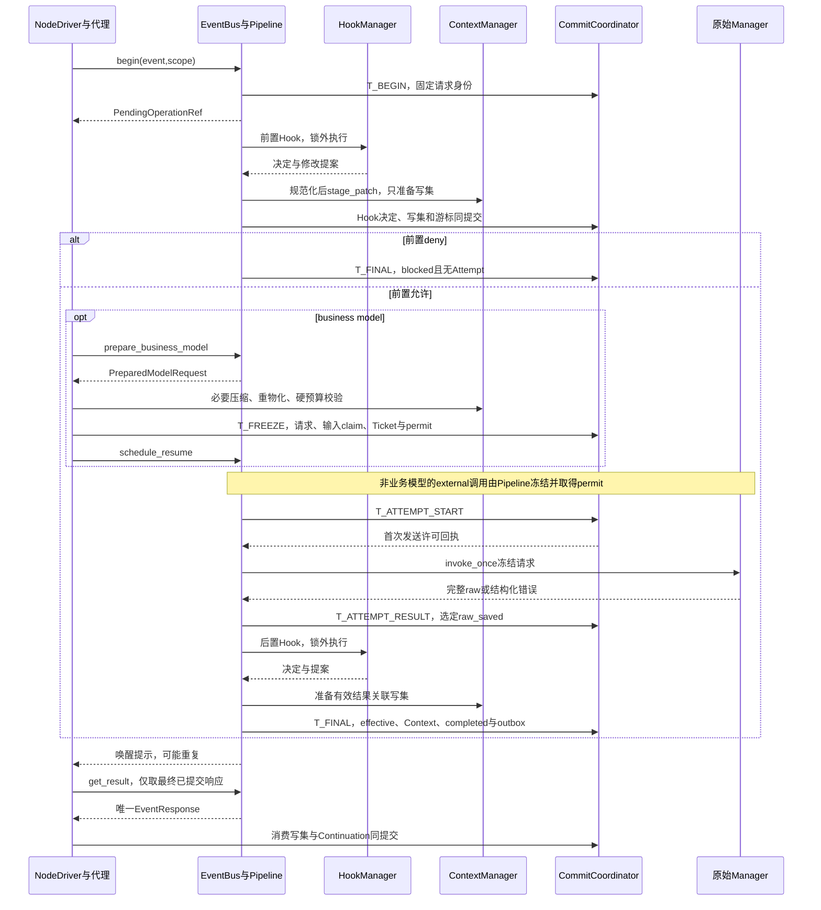

# SDK 事件总线、能力调用与 Hook

状态：详细设计，尚未实现。节点注入代理端口，SDK 集中提供调用路由、拦截、结果等待和可靠观察；平台只在外部消费公开事件。相关状态提交见[检查点与持久化](checkpoints.md)，Loop 见[运行时](runtime.md)，作用域见[定义](definitions.md)。

## 1. 实现边界与模块装配

一个 `RunRuntime` 创建一个 `EventBusImpl`，同时服务直接 Agent、Workflow 外层以及内层 AgentInvocation。隔离由调用方注入的可信 scope、执行绑定和访问范围；共用总线不共用角色上下文。不同 Run 不共享可变总线对象。

| 模块 | 持有的对象 | 唯一写入职责 |
| --- | --- | --- |
| `EventBusImpl` | Registry、Pipeline、WaitRegistry、Dispatcher、只读 Store | 组装提交命令，不直接写表 |
| `RequestHandlerRegistry` | 不可变 `(event_type,schema_version) → HandlerBinding` | 装配期注册；运行期只读 |
| `InvocationPipeline` | 每 Operation 的当前本机 runner 索引 | Operation、Attempt、Hook 阶段命令 |
| `HookManager` | 构造时固定的有序 HookBinding、受限适配器 | 返回决定／诊断与规范化提案，不独立提交 |
| `ResultWaitRegistry` | operation_id → 多个本机 waiter | 本机 generation、通知和关闭原因 |
| `ObservationDispatcher` | Subscription、每 scope 有界队列 | 可靠订阅游标命令；不写业务结果 |
| 领域 Manager | 已解析能力目录和原始 Adapter | 生成原始结果或图执行计划，不发布伪造响应 |
| `CommitCoordinator` | 事务 writer | 全部权威运行事实、CAS、幂等及 outbox |

HookManager 的固定绑定按 program_key 分组。每次从可信 ExecutionBindingRef 选择所属程序，再按 event_type／stage／matcher 选择链；相同 Run 内不同 AgentInvocation 不共享一条混合 Hook 链。Operation 固定选中的链及处理游标，恢复复用原链。共享一个 EventBus 只共享调用设施，不合并资源授权、Hook 或私有上下文。

请求键只匹配一个 Manager。绑定清单为 `model.generate/model.embed → ModelManager`，`capability.invoke/result.read → ToolManager`，`context.materialize/context.mutate/context.compact → ContextManager`，`environment.prepare/environment.read/environment.write → EnvironmentManager`，`executor.delegate/agent.invoke → GraphExecutionManager`。一个 Manager 可绑定多个键；不通过继承、多播或“第一个返回成功”选择 Manager。

ContextManager 的内部 mutation、额度事务、检查点 writer、HookAdapter、outbox ACK 不再次进入业务代理。GraphExecutionManager 返回图计划，由对应引擎决定启动；普通工具没有第二个 Executor 调度器。RunControl 有独立任务和持久控制记录，不等待业务队列或 Hook 执行，也不接受 Hook deny。

建议代码目录：`runtime/invocation/{dto,registry,bus,pipeline,hooks,waiters,observation,proxy}.py`。DTO 不导入数据库模块；`pipeline` 只依赖 `CommitCoordinator` 和只读 Repository；Manager 注册原始端口，节点注入代理端口。HandlerBinding的execution_kind固定为external/internal/graph/recoverable：模型和实际工具/文件/环境动作走external；纯内部物化/结果读取/ContextMutation走internal；委派走graph；context.compact走recoverable。恢复不重新推断该类型。

### 1.1 生命周期

| 本机状态 | 允许操作 | 转移 |
| --- | --- | --- |
| `assembling` | register_handler、set_interceptor | freeze → frozen |
| `frozen` | open；读取绑定 | open 校验成功 → open；失败保持 frozen |
| `open` | begin/get/await/publish/subscribe | 根停止 → draining；close/lease_lost → closed |
| `draining` | 读结果、已有结果提交、已有调用收束、观察与清理 | close → closed；拒绝新业务准入 |
| `closed` | 重复 close | 不允许 reopen；接管创建新对象 |

`open(run_ref)` 读取已提交 Run／租约，校验注入 Registry 满足保存的 handler key 和协议格式，重建 scope 工厂及可靠订阅，扫描未完成 Operation、待执行意图和 outbox。扫描只安排 `start_or_resume`，不能根据“没有 Future”重新调用 Manager。重复 open 同一对象、Run、epoch 返回成功；不同 Run 或 epoch 报 `BUS_SCOPE_MISMATCH`。

`close(reason)` 的 reason 仅为 `completed|shutdown|lease_lost|startup_failed`。先原子关闭本机准入并使所有 waiter 收到 `BUS_CLOSED` 或 `LEASE_LOST`；停止新观察分发；取消 runner 的网络等待并使受限适配器终止；每个回调最多等待 5 秒；最后解除连接引用和本机索引。重复 close 等待同一 close task，不重复操作资源。

`completed` 只在 Runtime 已提交终态和清理登记后调用。`shutdown` 不把尚未完成的 Run 改成 cancelled：保留恢复阶段，释放执行权。`lease_lost` 立即禁止一切旧 epoch 提交和外部写入，迟到结果不落业务表。close 本身不伪造业务结果；外部副作用无法确认时由持有新租约的恢复器记录 unknown。

运行设施固定默认值：runner 通知队列 1024、每订阅实时队列 256、结果复查间隔 1000ms、观察回调时限 5000ms、关闭等待 5000ms。它们属于部署参数，有界且启动时固定，不是用户的模型／工具并发额度。runner 队列满时仅合并唤醒提示，持久意图保留并由 1 秒扫描补齐；停止通道不使用这些队列。

### 1.2 挂点覆盖与尚未细化的生命周期扩展

| 边界 | 当前设计入口 | 允许的作用 |
| --- | --- | --- |
| 模型、能力、环境、委派及完整 Agent 调用 | Operation 的 request／response Hook 链 | 按注册白名单修改、允许或拒绝；决定与有效上下文一致提交 |
| 上下文物化、修改及压缩请求 | 对应 ContextManager 请求的 Hook 链 | 使用本页字段规则；内部提交／物化子步骤不递归触发 Hook |
| Run、节点、批次及环境的已提交生命周期变化 | CommittedEvent 的观察订阅 | 读取授权投影、告警或展示；返回值不改变原执行 |
| run.ending 等用户生命周期 Hook | 预留，仍需定义独立输入、身份、去重与超时协议 | 不得套用要求 operation_id 的 HookContext，也不得把观察回调当作已支持的修改型 Hook |
| 停止、额度、租约和必要清理 | 受信控制／存储入口 | 不接受用户 Hook 拒绝或延长根截止 |

Lifecycle Hook 的完整事件目录和输入 Schema 仍是设计缺口。已有调用型 Hook 的算法不等于覆盖了全部时机；在补齐协议前，run.ending 不参与必要清理，也不成为 SDK 成功收束的前提。

## 2. DTO 与校验

所有 DTO 都是不可变对象；JSON Schema 使用 `additionalProperties:false`。ID、UTC 时间、PayloadRef、ContentScopeRef、ExecutionLease 采用[数据契约](definitions.md)及持久化篇的共同类型。本文列出的可空字段必须显式为 null，不能利用省略与 null 表达不同状态。整数禁止浮点及布尔值冒充。普通实体 revision、schema_version 从 1 开始；Context.effective_revision、记录水位初始为 0，首条记录 seq 为 1；数组 ordinal／handler index 从 0 开始，attempt_no 从 1 开始。

JSON hash 使用 RFC 8785 规范化后的 UTF-8 字节 SHA-256；BlobRef 验证长度、摘要、owner 和读取授权，不能接受任意 URL／宿主路径。请求 payload、结果、诊断的大内容先写不可变 Blob；没有 CommitReceipt 的 Blob 只是孤儿材料，不是已提交事实。

### 2.1 范围、信封和响应

| DTO | 完整字段 | 强校验 |
| --- | --- | --- |
| `InvocationScopeRef` | run_id, graph_execution_id?, node_task_id?, invocation_id?, content_scope_ref, session_id?, workspace_scope_ref?, subject_kind, subject_id | subject_kind 为 node_task/graph/system；主体由 Runtime 推导；node_task 非空时主体必须是该任务；引用同 Run，跨图必须有固定父子关系 |
| `EventEnvelope` | event_id, event_type, schema_version, created_at, source, cause_id?, scope_ref, payload_ref | event_type 是已登记的小写点分标识；source 为装配期组件 ID；cause_id 仅追踪、不授权 |
| `EventRequest` | EventEnvelope 全字段 + purpose_key, purpose | purpose 为 business/compaction/system；purpose_key 长 1..256，禁止空白首尾；不接受调用方覆盖 epoch、权限或凭据 |
| `PendingOperationRef` | operation_id, request_id, scope_ref | 必须与已存 Operation 全部身份一致；Pending 不是状态断言 |
| `OperationError` | code, category, message, phase, external_outcome, provider_code? | category 为 validation/permission/not_found/conflict/transport/rate_limit/timeout/business/protocol/cancelled/unknown；phase 为 prepare/connect/send/receive/execute/after；external_outcome 为 not_started/known/unknown |
| `EventResponse` | request_id, operation_id?, cause_id?, status, result_ref?, error?, effective_context_ref?, blocked_stage?, execution_fact | status 为 succeeded/failed/blocked；execution_fact 为 not_started/completed/unknown；blocked_stage 为 null/request/response |
| `CommittedEvent` | EventEnvelope 全字段 + commit_ref, scope_kind, scope_id, scope_commit_seq, ordinal, run_seq? | scope_kind 为 run/graph；commit_ref 与 outbox 内容摘要必须相符；同事务 ordinal 连续从 0 开始 |
| `EventFrame` | event_id, event_type, source, cause_id, operation_id? | task-local 只读诊断；不携带 payload、权限或凭据 |

EventResponse 的成功必须有 result_ref 且 error=null；失败必须有 error；blocked 必须 error.code=HOOK_DENIED 且 blocked_stage 非空。普通失败可用 result_ref 返回受限的未完成材料，但不能执行其中的半截工具参数。已 begin 的响应必须有 operation_id，request_id 固定为首次 EventRequest.event_id；不能写成 HTTP request ID。begin 前的批次本地拒绝响应 operation_id=null，保留该成员原 request_id/call_id/ordinal，execution_fact=not_started。

`effective_context_ref` 是当前调用的主 ContextRevisionRef；附加共享 Context 修订保存在 Operation.context_revision_refs，不能把多个角色私有 context 塞进一个聚合消息。无 RoleContext 的 CapabilityNode 使用 null，不暗建 context。

EventEnvelope 的 scope、source 和 ID 来自代理；插件只提交 payload 和 HookDecision。序列化对象即使含有合法 ID，也必须重新检查它与当前 ExecutionScope、已注入绑定、资源访问范围的关系。租约不写进幂等业务键，但每次执行／提交都验证当前 lease。

### 2.2 持久调用记录

以下是实现必须保存的逻辑字段，SQL 和索引集中在持久化篇；不能只保存模型输入输出两列。

| 记录 | 完整逻辑字段 |
| --- | --- |
| `Operation` | operation_id, scope_ref, purpose_key, purpose, kind, request_event_ref, request_fingerprint, status, processing_phase, revision, candidate_request_ref?, effective_request_ref?, effective_request_hash?, raw_result_ref?, effective_result_ref?, final_response_ref?, context_revision_refs[], request_hook_state_ref?, response_hook_state_ref?, retry_policy, next_attempt_at?, execution_permit_ref?, batch_member_ref?, target_ref?, created_at, completed_at? |
| `Attempt` | attempt_id, operation_id, attempt_no, lease_epoch, status, revision, effective_request_hash, started_at?, first_output_at?, ended_at?, provider_request_id?, error?, raw_result_ref?, incomplete_ref?, retry_after_at?, dispatch_evidence_ref? |
| `HookProcessingState` | operation_id, phase, chain_key, next_handler_index, committed_decision_refs[], effective_payload_ref, context_revision_refs[], pending_handler_ref?, revision |
| `HookInvocation` | hook_invocation_id, operation_id, stage, hook_binding_key, ordinal, input_revision, input_payload_ref, input_context_refs[], mapping_version, schema_version, status, execution_status?, result_ref?, decision_ref?, normalized_patch_ref?, normalized_patch_hash?, context_change_refs[], patch_status, diagnostic_ref?, before_payload_ref, after_payload_ref?, started_at?, ended_at?, revision |
| `RetryPolicy` | enabled, max_attempts, interval_ms, tool_timeout_ms, model_first_output_timeout_ms, model_stream_idle_timeout_ms? |
| `PreparedDomainEffect` | effect_kind(read/context_mutation), expected_context_revisions[], effect_ref?, result_ref, effect_hash；Manager纯准备，只有Coordinator应用写集 |
| `RecoverableWaitPlan` | wait_kind=compaction_episode, wait_ref, source_operation_id, expected_revision, initial_effects_ref；等待实体必须与当前Operation同Run/授权scope |
| `PreparedModelRequest` | operation_ref, operation_revision, candidate_payload_ref, context_revision_refs[], request_hook_state_ref, prepared_hash, effective_parameters_ref, purpose, protection_manifest_ref, model_budget_ref |

Operation.kind 为 model/tool/context/environment/delegation；kind 根据 event_type 的固定映射产生，不能由 payload 选择。Operation.status 为 pending/succeeded/failed/blocked，只有 completed 阶段允许后三者；completed 必须 final_response_ref 非空，其他阶段必须为空。raw_result_ref 是本逻辑调用选定的原始结算结果；重试中间错误只属于 Attempt，不提前成为 Operation 的最终原始结果。

RetryPolicy 来自所属 AgentInvocation 的固定执行策略；外层普通工具来自 Workflow 的固定根策略。默认 enabled=false、max_attempts=2、interval_ms=2000、tool_timeout_ms=10000、model_first_output_timeout_ms=60000、idle=null；max_attempts≥1，interval_ms≥0，其余时限非 null 时严格正数。重试不重新解析配置。

`execution_permit_ref` 引用已提交许可：业务模型关联 LoopTicket；普通能力关联已冻结请求和控制版本；委派关联父 Wait 与图启动计划。它不是客户端可上传的 bearer token。每次实际发送前仍检查停止／截止；历史许可不能使已停止的调用重新启动。

### 2.3 Hook 输入与补丁

| DTO | 字段／限制 |
| --- | --- |
| `HookContext` | hook_invocation_id, operation_id, phase, scope_ref, deadline_at, input_revision, input_context_refs[], mapping_version；全部由系统绑定 |
| `HookDecision` | decision=allow/deny, reason?, payload_patch?, context_patch?；reason 最多 2048 字符，先脱敏 |
| `PayloadPatch` | base_payload_hash, operations[]；每项为 `{field_key,operation:replace_value,value_ref}`，最多 128 项 |
| `ContextPatch` | context_id, base_revision, operations[]；每项为 `{target_record_id,field_key,operation:replace_value/append_annotation,value_ref}`，最多 128 项 |
| `NormalizedWrite` | scope_id, record_id, semantic_field, operation, value_ref, source_paths[]；由 ContextManager 生成 |
| `NormalizedPatch` | hook_invocation_id, mapping_version, input_payload_hash, original_base_revisions[], writes[], read_set[], authorization_digest |

首版一个 HookDecision 的 context_patch 只指向一个 context；payload 映射可同时产生当前调用主 context 的 mutation，因此规范化提案仍可能涉及多个 scope，必须一次提交全部。History/GraphState 的其他字段只有已登记显式 ContextScope 才可修改。空 patch 合法且不生成无意义修订。

`read_set` 包含目标字段、父对象结构、存在性、记录可见性及授权版本，用于 CAS 重定位；不能仅比较待写字段而遗漏结构或授权变化。ContextPatch 使用稳定 record ID 和语义 field_key，拒绝 `/messages/3` 一类位置路径。

挂点白名单是版本化 `HookSchemaRegistry`；首版固定如下，未列出的字段全部只读。

| 事件／阶段 | 可写 payload 语义字段 | 必须保留的事实 |
| --- | --- | --- |
| model.generate/request | 已授权记录的有效文本、temperature/top_p、max_output_tokens、已支持的 think 参数 | 模型连接、工具绑定身份、受保护用户原文、schema、角色与预算不可改 |
| model.generate/response | 完整 assistant 文本、已声明的 tool_calls 名称及 arguments | 系统分配 call_id/ordinal、完成性、usage、raw 状态不可改；工具名重查角色目录 |
| capability.invoke/request | arguments 的 input_schema 允许字段 | capability_key/binding_key/credential/content_scope 不可改 |
| capability.invoke 或 result.read/response | content 中可展示文本／JSON、预览 | status/error.category/external_outcome/artifact 授权／原始长度不可改 |
| executor.delegate、agent.invoke/request | task/input、业务约束、显式材料引用 | 目标角色／PreparedAgentRef、身份、文件授权、预算不可改 |
| executor.delegate、agent.invoke/response | 已成功结果中的可展示内容 | 子任务终态、真实失败、执行范围不可改 |
| environment.read/write/request | 已授权 scope 内相对 path、write.content | scope/root/mount/lease 不可改；更改 path 再做路径与授权校验 |
| context.materialize/mutate/compact | 对应事件 schema 中的有效内容／补充压缩指令 | record 身份、原始用户输入、scope、覆盖边界、CAS、摘要来源不可改 |

完整模型raw保存时，Pipeline在同一事务为候选tool_calls按原始顺序分配一次call_id/ordinal，保存ModelCallSlots；重投查回原槽。后置Hook读取这份持久槽，Node接受决策时复用，不能晚到interpret_response再分配身份。

model.generate/response 的 tool_calls 数量、call_id 和 ordinal 固定，不允许增加、删除或重排；只可修改原槽位的名称和完整 arguments。model.embed 只允许修改获授权输入文本，响应向量、维度和模型绑定只读。没有允许字段的响应仍可 allow/deny；context_patch 继续按 scope 授权独立校验。RunControl、必要清理、持久提交不注册可控制 Hook。

## 3. 完整方法契约

所有业务方法共有基础异常：`BUS_CLOSED`、`LEASE_LOST`、`SCOPE_MISMATCH`、`PERMISSION_DENIED`、`PERSISTENCE_UNAVAILABLE`。前三者是连接／控制异常，不写成工具失败。表中新增异常之外，Manager 业务失败通过 EventResponse 返回，不能从后台 task 静默丢失。

| 方法 | 输入与返回 | 特定异常／约束 |
| --- | --- | --- |
| `register_handler(type,version,binding)->None` | binding 含 handler_id, manifest_hash, execution_kind, request_schema, final_acceptance, raw_port | 仅 assembling；重复键 HANDLER_CONFLICT；非原始端口 PROXY_AS_HANDLER |
| `set_interceptor(interceptor)->None` | 唯一 HookManager 端口 | 重复 INTERCEPTOR_CONFLICT；冻结后 ASSEMBLY_FROZEN |
| `freeze(required_manifest)->None` | 验证全部注入依赖并冻结本机字典；不做发布版本检查 | 缺项 ASSEMBLY_INCOMPLETE；同一对象重复 freeze 幂等 |
| `resolve(type,version)->HandlerBinding` | 精确只读查找 | ROUTE_NOT_FOUND／SCHEMA_UNSUPPORTED；不回退通配符 |
| `open(run_ref)->None` | 校验当前 lease，启动扫描与 dispatcher | BUS_SCOPE_MISMATCH、ASSEMBLY_NOT_FROZEN |
| `begin(event,scope)->PendingOperationRef` | 持久登记或复用，不保证已经完成 | VALIDATION_ERROR、IDEMPOTENCY_CONFLICT；新建时 RUN_NOT_ACCEPTING |
| `get_result(ref,scope)->EventResponse?` | 强一致读唯一 final response，未完成为 null | OPERATION_NOT_FOUND、REFERENCE_MISMATCH；不启动执行 |
| `await_result(ref,scope)->EventResponse` | 多等待者读取同一不可变响应 | REENTRANT_OPERATION_WAIT；调用者取消只移除本等待者 |
| `request(event,scope)->EventResponse` | 严格 begin + await_result | 相同异常，不增加新执行路径 |
| `request_many(events,policy,scope)->list[EventResponse]` | 冻结批次，全部结算后按 ordinal 返回 | BATCH_IDEMPOTENCY_CONFLICT、INVALID_BATCH_POLICY；空集合立即 [] |
| `publish(event)->None` | 仅内部 outbox 能力；验证已提交后安排本机分发 | UNCOMMITTED_EVENT、OUTBOX_CONTENT_MISMATCH、FORBIDDEN_PUBLISH |
| `subscribe(type?,observer,scope,filter?)->Subscription` | 由授权装配器确定可靠／诊断类型；不运行回调 | INVALID_FILTER、SUBSCRIPTION_CONFLICT；相同 consumer＋配置复用 |
| `unsubscribe(subscription)->None` | 仅该订阅；停止新投递、取消并限时收束 | 其他拥有者 SUBSCRIPTION_OWNER_MISMATCH；重复取消幂等 |
| `event_stack()->tuple[EventFrame]` | 当前 task 的不可变帧副本 | 不跨协程串栈；不代表恢复调用栈 |
| `close(reason)->None` | 有界释放本机对象 | INVALID_CLOSE_REASON；执行关闭不需要业务 Hook 许可 |

Pipeline 和内部端口同样是确定契约，不留“实现时自行补全”的隐式动作。

| 方法 | 返回与效果 | 异常／并发结果 |
| --- | --- | --- |
| `schedule_resume(operation_id)->None` | 合并本机推进提示，队列满依靠持久扫描；不等待网络 | BUS_CLOSED／LEASE_LOST；不创建新的Operation |
| `start_or_resume(operation_id,lease)->PipelineProgress` | progress=finished/awaiting_permit/waiting_child/waiting_target/retry_at；只推进保存阶段 | CAS_CONFLICT 时重新读取；租约丢失立即退出 |
| `prepare_business_model(ref,scope)->PreparedModelRequest` | 等到前置链已提交，返回尚未最终冻结候选；deny 返回保存的 blocked 引用给 Driver | 已完成成功不再准备；Driver 改读 final_response；不能出网 |
| `finalize_response(operation_id,expected_revision)->CommitReceipt` | 唯一 effective＋context＋completed 提交 | 非终阶段 INVALID_PHASE；已完成返回原 receipt |
| `attach(operation_id)->WaitHandle` | 原子注册 handle，包含 generation 和关闭状态 | 关闭后拒绝注册 |
| `signal(operation_id)->None` | 原子递增该 Operation 的 generation，唤醒所有 handle | 无等待者也成功；不写 Operation |
| `wait_changed(handle,observed,timeout_ms)->WakeReason` | generation 已变立即返回，否则原子登记等待，超时返回 poll | BUS_CLOSED／LEASE_LOST；无网络／DB 锁 |
| `detach(handle)->None` | 只删除该 handle，最后一个时回收索引 | 重复删除无作用 |
| `deliver(subscription,event)->None` | 获授权投影副本交回调，成功后提交 ACK | 回调异常保存诊断并重试；返回值被丢弃 |

`prepare_business_model` 的返回用严格联合类型 `PreparedModelRequest | FinalResponseRef` 表示；上表中的“blocked 引用”不是抛异常。`request_many` 的 BatchPolicy 由 Runtime 创建，包含 `batch_key, parallel_enabled, executor_max_parallel`；后两项必须等于本次固定执行策略，LLM 不能覆盖。model_operation_id／loop_ticket_id 从已提交批次来源读取，不信任额外请求字段。request_many 要求 node_task 主体；不满足时抛 INVALID_BATCH_OWNER。

## 4. 幂等登记、等待和批次算法

### 4.1 固定身份

唯一键 `K=(run_id,subject_kind,subject_id,purpose_key)`。node_task 主体的 purpose_key 按保存的阶段生成，例如 `loop/7/model`、`loop/7/call/call-id`；同一模型决策的两个同参数工具调用仍有两个 call_id。系统主体使用持久任务 ID，不能用当前 Worker ID。Activation、HTTP 重投、lease_epoch 不能参与 K。

`request_fingerprint=hash(stable_scope,event_type,schema_version,purpose,payload_content_hash,resolved_binding_keys)`。忽略新的 event_id、created_at、cause_id、source、epoch 等传输／追踪差异；命中 K 后必须比较 fingerprint，冲突返回 IDEMPOTENCY_CONFLICT。已保存 request_event_ref、request_id、原 cause_id 不被新重投覆盖。

```python
async def begin(event, scope):
    bus.require_open_or_draining()
    trusted = scope_factory.validate_and_bind(scope, event.scope_ref)
    validate_envelope_and_payload_reference(event)  # 尚不执行外部代码
    key, fingerprint = identity_of(event, trusted)
    old = await store.find_by_key(key)             # 主库强一致读
    if old is not None:
        require_equal(old.request_fingerprint, fingerprint)
        return old.pending_ref()                  # 停止后仍可复用；不重置阶段
    await control.require_admission(trusted)       # 只限制新建
    candidate = new_prepared_operation(event, trusted, fingerprint)
    admission = await batches.find_admission(key)  # 批次调用由已保存意图解析，普通调用null
    try:
        receipt = await commits.commit(T_BEGIN(candidate, admission), current_lease())
    except UniqueKeyConflict:
        old = await store.require_by_key(key)
        require_equal(old.request_fingerprint, fingerprint)
        return old.pending_ref()
    pipeline_hint.try_offer(candidate.operation_id) # 满则依靠持久扫描
    return receipt.operation_ref
```

T_BEGIN 锁内再次检验准入，不能依赖事务前检查抵挡停止竞态。存在batch admission时，在同一事务创建Operation并关联BatchMember.operation_id、WaitMember.result_operation_id和初始operation target；输入的call_id/purpose_key必须等于保存的admission intent。不得begin返回后再另交关联。短能力不需要等待调用者先登记 Future；因 await_result 总会重读，快速完成不会丢结果。结构合法但 schema 未支持／没有 Handler 的请求仍保存 Operation 后提交明确 failed，不永久 pending；可在 begin 之前确定的批次参数／授权错误使用 local_outcome。

```python
async def get_result(ref, scope):
    bus.require_open_or_draining()
    access = scope_factory.authorize_result_read(scope, ref.scope_ref)
    op = await store.load_authorized_primary(ref.operation_id, access)
    require_exact_ref(ref, op)                     # request_id 和所有 scope 也比较
    if op.processing_phase != 'completed':
        return None
    response = await blobs.load_verified(op.final_response_ref, access)
    require_response_invariants(response, op)
    return immutable_copy(response)

async def await_result(ref, scope):
    scope_factory.authorize_result_read(scope, ref.scope_ref)
    if ref.operation_id in active_operation_stack():
        raise ReentrantOperationWait(ref.operation_id)
    handle = waiters.attach(ref.operation_id)      # attach 与 close 用同一短锁
    try:
        while True:
            observed = handle.generation          # 在读 DB 之前取代数
            final = await get_result(ref, scope)
            if final is not None:
                return final
            await waiters.wait_changed(handle, observed, timeout_ms=1000)
    finally:
        waiters.detach(handle)

async def request(event, scope):
    return await await_result(await begin(event, scope), scope)
```

`wait_changed` 在同一短同步区间检查 generation、检查关闭标志和安装 Future；signal 在同一短区间递增并取出待唤醒 Future，退出锁后 set_result。通知发生于 attach 前、读 DB 中、读后等待前均能被重读或代数变化覆盖；丢通知最多由下一次 1 秒复查发现。不得采用 `if not done: clear_event(); await event.wait()`。

用户断线／取消 await 不取消 Operation。长任务由 NodeDriver 保存 Wait 后释放激活；HTTP 长轮询可以使用 await_result，但占用的连接不等于节点运行槽。节点消费结果还须单独提交 continuation／消费水位，读取一次响应不会扣 Loop 或唤醒下一轮。

### 4.2 request_many 复用持久批次协调器

`events` 的 ordinal 为列表原始位置；call_id、purpose_key 和 batch_key 在建批次前已保存。最大事件数由模型工具调用 schema 的已固定上限验证，不能静默截断。批次固定成员集合、原始输入 hash、顺序与策略；空批次仍保存一次结算事实后返回 []。

```python
async def request_many(events, policy, scope):
    validate_policy_from_execution(policy, scope)
    prepared = batches.freeze_requests(scope.task_ref, events, policy) # 纯准备
    receipt = await commits.commit(T_BATCH_FREEZE(prepared), current_lease())
    batch = receipt.batch_ref
    while True:
        snapshot = await batches.load(batch.batch_id)
        if snapshot.wait_group.settled_count == snapshot.member_count:
            return await batches.read_ordered_responses(snapshot)
        await graph_engine.advance_batch(batch, current_lease()) # 唯一准入
        await batches.wait_changed_or_poll(batch.batch_id, 1000)
```

`GraphEngine.advance_batch` 先按 ordinal 读取已经有 operation_id 的成员，只以其 completed EventResponse 结算；然后处理已保存的本地拒绝。串行只选择第一个尚未结算成员，且前项未结算时不 begin 下一项；并行选择全部普通工具及由 GraphEngine 计算有名额的 Executor。普通工具不占 Executor 名额；批次没有额外用户工具并发配置。

被选 queued 成员先在 T_MEMBER_ADMIT 保存 admitting 状态、恢复键和 begin 意图；Executor 还须在同一事务预留 admission token，串行与并行都适用，普通工具不创建该令牌。Executor token 与活跃 NodeTask 共同占用本批次准入容量，执行前置 Hook 时仍计入，防止并发 Hook 提前超额。T_MEMBER_ADMIT 与 T_BEGIN 之间，admitting 成员可以尚无 Operation 和 target；恢复补投原意图，不重复预留。begin的T_BEGIN同时关联Operation和两个成员引用，回执丢失按K找回同一关联。委派 begin 只能运行请求 Hook；待其候选有效请求准备好，GraphEngine 通过一个跨域提交关联父 Wait、该 Operation、唯一子 NodeTask／Graph、启动意图及执行许可，同事务将 admission token 原子转为该子 NodeTask 的活跃名额，然后才激活子任务。前置拒绝在 blocked 提交时释放 token，不创建子任务。

子任务终态保存 TaskResult 时释放 Executor 名额，并把结果送入父 Operation.raw_saved；后置 Hook 完成前该成员仍未结算。并行模式可以补位，串行不能提前开始下一项。无批次的单独委派允许先begin登记prepared，但同样必须等Driver在一个图事务提交父Wait、调用/子任务关联及启动意图后才启动。GraphEngine 唯一计算子任务名额；CallBatchCoordinator 不通过本地 semaphore 自建第二套名额账本。

begin 前校验失败：T_LOCAL_SETTLE 同时写 BatchMember.result_ref 和 WaitMember.local_outcome，target_ref/result_operation_id 均为 null。已有 Operation 的成员只能通过该 Operation 最终响应结算。单项 business/blocked 不取消其他成员；根停止关闭新准入，queued 成员记录 cancelled，本 Run 不进入下一 Loop。

CallBatchCoordinator.freeze(owner,accepted_decision,policy) 和 freeze_requests(owner,events,policy) 都只返回 PreparedBatch，复用同一成员冻结内核；只有 CommitCoordinator 保存写集。NodeDriver 的持久用法是 freeze→提交→GraphEngine.advance_batch→返回 Wait；恢复再执行 advance_batch 并查询最终批次，不在节点激活内调用上面阻塞便利封装。wait_changed_or_poll 与 ResultWaitRegistry 使用相同登记后重读原则。最后一项T_MEMBER_SETTLE（空批次由T_BATCH_FREEZE）只产生一次父唤醒意图，父消费 key 固定为 `(owner_task_id,batch_id)`。

## 5. Operation、Attempt 与 Hook 状态机

### 5.1 Operation

| 当前 phase | 允许下一 phase | 必须保存的条件 |
| --- | --- | --- |
| prepared | request_hooks／completed | 选定唯一 Handler、固定 Hook 链；路由错误直接 failed |
| request_hooks | request_hooks／executing／completed | 每项 Hook 游标推进；最终请求和 permit 提交后才 executing；deny 可 blocked |
| executing | executing／raw_saved／completed | RetryPolicy 下新增 Attempt／retry_at；子执行等待；控制收束可直接 failed |
| raw_saved | response_hooks／completed（控制收束） | 原始成功／失败／unknown 已持久；严禁再次执行原能力 |
| response_hooks | response_hooks／completed | Hook 决定、有效结果／context、唯一响应已提交 |
| completed | completed | 同幂等 key 读同响应；禁止改终态或重放 Hook |

Operation.status 在前五阶段保持 pending。系统前置校验失败可以直接 completed/failed；合法 Hook deny 为 completed/blocked。控制取消通过 failed + error.category=cancelled 表达，Run 的 cancelled/timed_out 状态继续由 RunControl 管理。普通业务失败必须经过适用后置链并最终 failed，Hook 不能改成成功。

停止时统一调用 `control_finalize_operation(op,control_ref,writer_barrier_ref)`，这不是普通后置Hook成功路径：

1. 已completed返回原响应；否则验证scope关闭、当前控制原因及有效执行权，阻止新增Attempt和Hook START。
2. 对已started未结算的外部调用/Hook先核对、收束或确认撤权；没有证据不提前宣称Operation结束。已有raw、partial、已应用有效修改全部保留。
3. 先处理已有result_saved：不重跑外部Hook，按原schema、双patch归一和CAS规则纯校验/应用一次；合法决定、有效修改或冲突诊断与cursor同提交。若形成合法deny终态则保留blocked；否则继续控制取消。再将前后链内prepared或尚未创建的剩余Hook逐项登记 `status=applied, execution_status=skipped_control, decision_ref=null, patch_status=none`，保存原因与cursor；已started且无法取回结果用indeterminate，不能伪造allow。
4. 同事务提交取消错误、唯一EventResponse(status=failed,error.category=cancelled,execution_fact按实际证据)、Operation.phase=completed和成员可结算通知。若已有合法deny终态则不覆盖。Run具体终态原因仍由RunControl决定。
5. 此命令允许任意非终态phase→completed，保留原执行事实，并与控制步骤一起幂等；不要求不可运行的后置链继续正常执行。

### 5.2 Attempt

| 状态 | 转移／含义 |
| --- | --- |
| prepared | 已保存发送意图，尚未取得发送许可；恢复可继续 started 提交 |
| started | 持有 T_ATTEMPT_START 首次提交回执后才可调用 Adapter；此后崩溃视为可能已发送 |
| succeeded | 完整合法 raw_result 已保存；终态，不再发送 |
| failed | 有确定错误事实；按分类决定新 Attempt 或逻辑结算 |
| unknown | 可能发生副作用、没有可证明的完整结果；仍可按明确的 transport 分类重试 |
| cancelled | 控制已终结本次尝试并收束本机执行；副作用字段仍可 unknown |

prepared→started→上述四个终态；prepared 可因控制取消直接 cancelled。is_retry_terminal 仅指 failed/unknown 且 Operation.next_attempt_at 已保存、raw_result_ref 仍为空的当前 Attempt，不能把任意终态都当作重试许可。attempt_no 在同 Operation 内从 1 单调增加，不因接管重新编号。T_ATTEMPT_START 重复／结果不确定时不能再次出网：即使幂等提交返回旧 receipt，也不代表获得第二次发送资格；交恢复算法处理已 started 事实。

外部 Adapter 只能报告一次物理尝试，SDK 隐含重试关闭。纯内部查询 Manager 不创建外部 Attempt；模型、工具、MCP、脚本等物理调用使用 Attempt。委派本身无 Attempt；子 Agent 的模型／工具拥有自己的 Operation／Attempt。

### 5.3 HookInvocation

| status | execution_status／下一步 |
| --- | --- |
| prepared | 保存输入、固定绑定、ordinal，随后 started |
| started | 已登记外部调用意图；只首次成功登记的 runner 执行 Hook |
| result_saved | 原始返回／异常／超时已保存，尚未应用；恢复直接验证与 APPLY |
| applied | 决定、patch 诊断、context、effective payload、链游标已原子提交 |
| indeterminate | started 后结果无法取回；abandoned，全部未提交修改不生效，链游标前进 |

execution_status 为 succeeded/failed/timed_out/invalid/abandoned/skipped_control，不能拿它代替 decision。合法 deny＋非法 patch 可以 execution_status=invalid、decision=deny、patch_status=invalid，最终仍 blocked。`patch_status=none|accepted|invalid`；applied 的合法 allow 无 patch 也是完成项。

input_revision 是本项开始时的 Operation revision，input_context_refs 各自携带独立Context revision；两者不能混用。HookManager 在同一阶段串行处理固定 ordinal。matcher 仅依据该项读取的已提交有效输入及可信元数据求值；不匹配保存 HOOK_NOT_MATCHED 诊断、status=applied、execution_status=null、decision_ref=null、patch_status=none并推进游标，不调用适配器。已结束项的 matcher 不因恢复或后续 context 变化重新求值。

## 6. Pipeline 精确推进与模型门禁

```python
async def start_or_resume(operation_id, lease):
    async with local_runner_ownership(operation_id): # 合并本机重复提示，不是 DB 锁
        while True:
            op = await store.load_primary(operation_id)
            lease_guard.require_current(lease)
            if op.phase == 'completed':
                waiters.signal(op.id)
                return Finished(op.final_response_ref)
            if await controls.is_closing(op.scope):
                return await control_finalize_operation(op, current_control(), writer_barrier())
            if op.phase == 'prepared':
                binding = registry.resolve_or_error(op.event_type, op.schema_version)
                await commit_route_and_chain_or_failure(op, binding)
            elif op.phase == 'request_hooks':
                result = await hooks.resume_chain(op, 'request')
                if result.denied:
                    await finalize_blocked(op, result, 'request')
                elif is_business_model(op):
                    return AwaitingPermit(await prepared_model_view(op))
                elif is_delegation(op):
                    return WaitingChild(await graph_plans.prepare(op))
                else:
                    await validate_freeze_and_permit(op)  # 同事务冻结，核心校验必需
            elif op.phase == 'executing':
                if op.target_ref is not None:
                    return await bridge_target_or_wait(op) # 子任务/图/压缩episode
                if op.binding.execution_kind == 'internal':
                    effect = await op.raw_port.prepare_effect(op.effective_request_ref)
                    await commits.commit(T_INTERNAL_RAW(op, effect), lease)
                    continue
                if op.binding.execution_kind == 'recoverable':
                    plan = await op.raw_port.prepare_wait(op.effective_request_ref)
                    await commits.commit(T_INTERNAL_WAIT(op, plan), lease)
                    return WaitingTarget(plan.wait_ref)
                attempt = await attempts.load_current(op)
                if attempt is None or attempt.is_retry_terminal:
                    if not await retry_clock.ready(op):
                        return RetryAt(op.next_attempt_at)
                    attempt = await prepare_and_start_once(op)
                    if not attempt.first_dispatch_receipt:
                        continue                        # 不能利用重放 receipt 再发送
                    raw = await invoke_once_catching_adapter_errors(op, attempt)
                    await persist_attempt_and_choose_raw(op, attempt, raw)
                elif attempt.status == 'prepared':
                    await resume_prepared_attempt(op, attempt)
                else:
                    await recover_started_or_terminal_attempt(op, attempt)
            elif op.phase == 'raw_saved':
                await initialize_response_chain(op)       # 空链也必须经过最终提交
            elif op.phase == 'response_hooks':
                result = await hooks.resume_chain(op, 'response')
                await finalize_response_or_block(op, result)
```

图计划来自该事件唯一GraphExecutionManager的raw port，不绕过Registry另选执行者。bridge_target_or_wait只读已登记NodeTask/Graph/CompactionEpisode的结果；未完成返回WaitingTarget，完成后把同一结果绑定到Operation.raw_saved，且不重新执行目标。Context压缩episode的模型调用各自走独立purpose=compaction的Operation，外层context.compact自身不虚构Attempt。

`local_runner_ownership` 是索引中的唯一 runner task 所有权；它不持有全局同步锁、数据库锁或线程锁等待网络。重复调度只返回现有 runner；同 Operation 递归等待自己在 await_result 入口拒绝。跨 Worker 串行性由 Run lease 和每步 CAS 负责，不靠此本机索引。

执行代理业务失败捕获为结构化 raw error；`CancelledError`、LeaseLost、PersistenceUnavailable 不被笼统 `except Exception: fail_open` 捕获。适配器忽略取消时由受限进程／连接层撤销执行能力；不能先宣称已停止写入再删除工作目录。

prepare_business_model先schedule_resume同一Operation，再登记revision等待并强一致读；直到request Hook游标到链末且pending_handler_ref为空时返回PreparedModelRequest，completed则返回FinalResponseRef。等待使用同一generation算法和1秒复查，Hook阶段提交可发内部唤醒提示；它从不把raw_saved或只完成一部分前置Hook的候选交Driver。

业务模型使用同一 begin，但前置 Hook 之后停在 request_hooks：

1. NodeDriver 调用 `prepare_business_model(ref,scope)`，得到已提交 candidate 和 Hook 游标；deny 则消费 FinalResponseRef。
2. ContextManager 基于这版 candidate 做必要压缩和预算重算，调用 materialize_prepared_model(prepared_ref,new_context_revision,snapshot_ref) 纯物化并保持非消息参数修改，生成最终准备视图；不重新执行 Hook，也不重新生成 Operation。
3. NodeDriver 构造 `commit_model_ready` 对应 RuntimeCommit：验证当前 Operation／Context revision、模型硬窗口、保护输入、根及 Invocation 控制，预占唯一 LoopTicket，冻结 effective_request/hash、写 execution_permit，phase=executing。
4. 只有这份 CommitReceipt 后，Driver 调用非阻塞 schedule_resume；Pipeline 才 T_ATTEMPT_START 并出网。Driver 随即 get_result，未完成则保存 Wait 并释放激活，不持 worker 等网络。额度暂被别的 reservation 占满时等待；锁内准入与准备时不同返回 BUDGET_ADMISSION_CHANGED／REVISION_CONFLICT，Driver 重读并保存预算 Wait，不能保存伪许可；已消费满且需要新 Loop 才产生耗尽。

压缩模型 purpose=compaction，不计业务 Loop，但复用前后 Hook、Attempt、截止、失败和结果提交；embedding 亦不产生业务 LoopTicket。准备阶段发生控制终结，保存明确失败，绝不能靠早先 begin 取得发送权。重试使用同一冻结请求和 Ticket，不重新压缩、不重新预占业务 Loop。

## 7. Hook 执行、双 patch 归一与 CAS

每项 Hook 的统一执行算法如下。外部 Hook 的重跑不是解决 CAS 冲突的手段。

```python
async def run_one_hook(op, stage, binding, ordinal):
    h = await load_or_prepare_hook(op, stage, binding, ordinal)
    if h.status in ('applied', 'indeterminate'):
        return saved_outcome(h)
    if h.status == 'prepared':
        started = await commits.commit(T_HOOK_START(h), current_lease())
        if started.is_first_commit:
            result = await adapter.invoke_bounded(h)   # 无 DB 锁
            await commits.commit(T_HOOK_RESULT(h, result), current_lease())
    h = await hooks_store.load(h.id)
    if h.status == 'started':
        recovered = await adapter.retrieve_existing(h.id) # 只查旧结果，不重执行
        if recovered.available:
            await commits.commit(T_HOOK_RESULT(h, recovered), current_lease())
        else:
            return await commits.commit(T_HOOK_INDETERMINATE(h), current_lease())
    h = await hooks_store.load(h.id)                # RESULT提交后重读持久引用
    parsed = validate_control_separately(h.result_ref)
    if not parsed.valid_decision:
        return await commit_fault_with_no_patch(h, parsed.diagnostic)
    proposal = contexts.normalize_hook_patch(h, parsed.payload_patch, parsed.context_patch)
    if proposal.invalid:
        return await commit_decision_no_patch(h, parsed.decision, proposal.error)
    return await apply_with_context_cas(h, parsed.decision, proposal)
```

`retrieve_existing` 对本机结果缓存／已登记远程回执查询一次；不支持查询的适配器返回 unavailable，直接记 indeterminate。查询时限为 min(2000ms,当前有效剩余期限)，不可启动新脚本。Hook 调用时限由绑定 `timeout_ms` 固定，默认 5000ms，受 Run/Invocation 剩余时间截断；绑定超时归 timed_out，根停止／截止走控制收束，不作为“Hook 超时继续执行”放行。

返回 JSON 中 `decision` 非 allow/deny、返回结构错误或异常属于 Hook 自身故障；保存诊断并丢本项全部修改。合法决定的 patch 校验失败只丢 patch，deny 仍生效。后置 Hook 不能把 Manager 的 failed/unknown 改成 succeeded，也不能删除错误后让响应变成功。必要提交失败中止推进，不能据此跳到下一 Hook。

规范化按以下确定顺序执行：

1. 在 Hook 固定 input_revision 和 mapping_version 上解析 payload/context 的所有 target，验证可见性及挂点可写字段；非法 target 使整项 patch 无效。
2. 每项映射成 `(scope_id,record_id,semantic_field,operation,value)`；当前调用相关字段从同一语义集合同时生成 payload 和有效记录，不能只改一侧。
3. 父对象替换按 schema 展开为叶字段和显式删除 tombstone；数组整体作为一个叶字段，不能同时改数组整体与内部下标。无法穷尽结构的父子重叠直接 HOOK_PATCH_CONFLICT。
4. 相同语义字段、相同操作和规范化值合并，并保留 source_paths；任何不同值、不同操作或删除／写入冲突使两侧全部 patch 无效。后一个 Hook 的显式覆盖不属于本项冲突。
5. 一次验证完整候选 schema、授权、受保护原文、协议关联和不可压缩固定材料；合法可压缩输入变长仍走正常压缩流程，不直接判 Hook 失败。
6. 事务外产生不可变 candidate、NormalizedPatch，并交 ContextManager.stage_patch(normalized_change_ref/hash,mapping_schema_ref,base_revision_refs) 得到 ContextWriteSet；事务内重新验证版本／授权并一次提交决定、所有 mutation/修订、effective 引用及 next_handler_index。ContextManager 不绕过 Coordinator 独立 commit_patch。

append_annotation 的新 record_id 由 `(hook_invocation_id,normalized_item_index)` 稳定派生；恢复不因随机新 ID 插入两份说明。原始 UserInput／raw_result／已冻结 actual request 只能引用，不能替换；更正历史实际参数只能 append_annotation。

CAS 处理：若 context head 与 original_base_revision 不同，读取中间 mutation 的字段集合；任何 read_set 相关字段、父结构、可见性或授权变化均使本项所有 patch 记为 CONTEXT_REVISION_CONFLICT。若完全不相交，把同一 NormalizedPatch 重定位到新 head，重算 manifest 和对应 payload，保留原始 base 和 rebase 来源；重新提交 CAS，不重跑 Hook。

非相交 CAS 再竞争时重复“读增量→重定位→CAS”，直到成功或控制截止；每次只做有限本地计算，不持 DB 锁等待。交叠冲突的 fallback 命令不再带 mutation，仅在最新 Operation revision 下提交合法决定／诊断及游标；已有合法修改保留，合法 deny 仍终结。所有 context_id 按升序参与同事务，不能部分成功。

合法 deny 一经保存立即停止该链，不再触发后续 allow；前置 deny 不跑响应 Hook 链，直接形成 blocked。后置 deny 保存 raw、actual request、execution_fact 和拒绝原因；仅阻止普通结果交付，不声称撤回已发生的副作用。恢复只复用已提交决定，不能把 deny 当 unknown 处理。

## 8. 事务边界与不变量

以下每个 T 都使用 `CommitCoordinator.commit(RuntimeCommit,ExecutionLease)`。业务写、Context head、Operation head、ScopeCommit 与 OutboxRecord 在一个短事务完成；不可变 Blob 在事务前写好。所有事务都重新验证根 lease、有效截止和该动作的控制准入类型。

总锁序固定为 **Session → root Run → Invocation → Graph 按 ID → NodeTask 按 ID → Operation 按 ID → Context 按 ID → 子记录**；没有该类对象时跳过。普通 RuntimeCommit 不触会话，从 Run 开始；终态／补充转移命令须预先声明并先锁 Session，禁止拿 Run 后补拿 Session。HookInvocation／Attempt 在其 Operation 之后锁定；Batch／Wait 在其 Graph/NodeTask 之后锁定。事务内禁止 await 网络、模型、Hook、文件或观察者。

| 事务／幂等键 | 读取与版本检查 | 同事务写入 |
| --- | --- | --- |
| T_BEGIN：`op-begin/K` | Run控制/lease、Invocation控制、Graph/NodeTask归属、K唯一键、可选Batch/Wait准入intent与版本 | prepared Operation、原始EventRequest、可选BatchMember/WaitMember调用关联、ScopeCommit、operation.pending outbox |
| T_ROUTE：`op-route/O` | O.revision、装配绑定清单/schema hash | Handler绑定、固定 Hook链、phase=request_hooks；路由失败则唯一failed响应 |
| T_HOOK_PREPARE：`hook-prepare/O/stage/ordinal` | O.revision、Hook链cursor、输入Context revisions | HookInvocation.prepared、固定输入/版本/映射引用、pending_handler_ref |
| T_HOOK_START：`hook-start/O/stage/ordinal` | O/H.revisions、Hook链cursor、H仍prepared、当前控制 | HookInvocation.started、开始时间；不重复执行已started项 |
| T_HOOK_RESULT：`hook-result/H` | H.revision、status=started、对应epoch仍有效 | 原始返回/异常、result_saved、诊断；不应用patch |
| T_HOOK_APPLY：`hook-apply/H` | O/H/HookState revisions、全部Context CAS、归属授权read_set | 合法决定、NormalizedPatch、全部mutation/revision、effective候选、游标；deny附带唯一blocked响应 |
| T_HOOK_INDETERMINATE：`hook-unknown/H` | H仍started、无已存结果、O与游标版本 | indeterminate/abandoned、无patch、游标；不伪造allow决定 |
| T_FREEZE：`op-freeze/O` | O及Context revisions、schema/最终授权/控制；业务模型附根与局部额度 | actual effective_request/hash、permit、phase=executing；业务模型原子预占LoopTicket并绑定本轮claimed输入水位 |
| T_INTERNAL_RAW：`op-internal/O` | O.revision/冻结请求、effect_kind注册校验、全部Context revisions | 一次应用PreparedDomainEffect、保存其raw结果、O.raw_saved；read无业务修改 |
| T_INTERNAL_WAIT：`op-wait/O` | O.revision/冻结请求、episode身份唯一、Context versions | 压缩episode初始写集、O.target_ref与待推进意图；不创建Attempt |
| T_TARGET_RAW：`op-target-raw/O` | 目标已终态、结果hash、O.revision | 目标结果关联raw_saved；子图事务同时验证父子scope，压缩不重调模型 |
| T_ATTEMPT_PREPARE：`attempt-prepare/O/n` | O.revision、冻结hash、已用attempt数、retry_at与控制 | Attempt.prepared，固定n/hash；不发生网络 |
| T_ATTEMPT_START：`attempt-start/A` | A.revision=prepared、O/Run/Invocation可发送、permit有效 | Attempt.started、时间/epoch、operation.status outbox；仅首次receipt允许发送 |
| T_ATTEMPT_RESULT：`attempt-result/A` | A未终态、O.revision、当前lease | Attempt终态/raw/error/partial；完整模型结果同时保存稳定call_id/ordinal槽；若重试保存next_attempt_at，否则O.raw_saved及raw引用 |
| T_AFTER_START：`op-after/O` | O.raw_saved与raw引用hash | phase=response_hooks、固定后链与候选有效响应 |
| T_CONTROL_FINAL：`op-control-final/O` | scope已关闭、Operation版本、Attempt/Hook收束或撤权证据 | 未启动Hook的skipped_control、唯一失败响应、completed、结果唤醒；保留raw/partial/已提交修改 |
| T_FINAL：`op-final/O` | O.revision、后链完成、Context revisions、最终schema | effective_result、final_response、Context事实、completed/status、低频outbox |
| T_BATCH_FREEZE：`batch/B` | owner NodeTask revision、模型Operation终态、策略hash | 冻结CallBatch/WaitGroup成员、ordinal/恢复键、父continuation关联 |
| T_MEMBER_ADMIT：`member-admit/B/m` | Batch/Wait/owner revisions、串行前项、GraphEngine名额判定、控制 | 成员admitting与恢复键、必要admission token，不提前执行 |
| T_LOCAL_SETTLE：`member-local/B/m` | 成员尚未begin、批次/Wait版本 | local_outcome、对应error响应、成员settled；不创建假Operation |
| T_MEMBER_SETTLE：`member-settle/B/m` | O.completed且response匹配、Batch/Wait版本 | 结果槽与WaitMember结算；最后一项写唯一父唤醒 |
| T_OBSERVER_ACK：`observer-ack/S/scope/seq/ordinal` | Subscription revision/代次、旧cursor、已投递event id | 持久cursor、失败重试状态清理；无业务状态更新，不产生递归outbox |

委派启动／子完成的跨 Graph 事务由 Runtime／图篇定义：启动必须同事务保存父 Wait、Operation引用、子任务身份和启动意图；完成必须把 TaskResult 与父 Operation 的 raw_result 关联。上述 T_FINAL 不能跳过父 Operation 后置 Hook。

节点消费 final_response 时，只引用其中已经提交的有效记录，不再次应用 Hook patch；Context head 若已有后来修订必须保留，不能回退到响应携带的旧 revision。

如果 commit 返回未知（连接断开），用相同幂等键查询／重交同一命令，不生成新 key。返回旧 receipt 表示事实已存在；它不再次授权外部发送或重新执行 Hook。若本机已获得原始结果但保存失败，只重试保存该不可变结果；结果未持久且进程丢失才进入 unknown 恢复。

## 9. 自动重试与恢复分类

重试判断只用固定 RetryPolicy、结构化错误类型／码、调用阶段、已用次数和有效截止；不以“工具声明幂等／可重试／可查询”为准入门槛。提供方可接收稳定 operation_id 自行防重，SDK 不保证外部副作用恰好一次。

| 事实 | 分类 | 唯一动作 |
| --- | --- | --- |
| 明确 connection reset、connect timeout、HTTP 502/503/504 | transport | enabled且次数有余且等待后未截止时新Attempt |
| HTTP 429 | rate_limit | 等max(interval_ms,合法Retry-After剩余)，然后按同规则重试 |
| 模型首输出超时、明确工具尝试超时、配置的stream idle超时 | timeout | enabled且次数有余时重试；根/Invocation截止不在此类 |
| schema、权限、路径不存在、业务isError、协议畸形 | validation/permission/not_found/business/protocol | 不自动重试；保存raw错误走后处理 |
| 只有未知远程错误文本、崩溃后没有typed错误证据 | unknown | 不猜测为transport；最终error.external_outcome=unknown |
| 发送后连接中断，结果不明但typed错误为transport | transport + outcome unknown | 开启重试可新Attempt；保留前一Attempt的unknown事实 |
| Hook合法deny／Hook非法patch | 拒绝／Hook诊断 | 均不重跑供应商；前者blocked，后者保留旧有效值 |
| 根停止、根/局部截止、lease lost | 控制 | 禁止新Attempt，转统一收束／接管 |

`Retry-After` 只接受有限非负秒或合法HTTP时间，非法值忽略；不延长deadline。`next_attempt_at` 落库，定时器只发提示，重启不重新完整等待一次，也不提前启动。等待结束必须再查控制；剩余时间≤0不发送。max_attempts 包含首次，模型后续新决策即使参数一样也用新Operation。

恢复按保存阶段确定动作：

- prepared/request_hooks：复用已完成Hook；started Hook只取回已有结果，取不到则indeterminate。
- executing＋Attempt.prepared：重新验证permit，提交started后首次发送；已经started不能按“未见响应”再发送。
- executing＋Attempt.started：先查已持久Attempt结果；有provider_request_id且Adapter实现retrieve时限时查旧结果，成功则保存；不支持或不可确认则unknown。查询失败不自动建立新Attempt，只有已保存typed可重试事实满足策略才重试。
- executing＋Attempt终态：若已保存next_attempt_at，按原时刻／次数决定；否则同幂等键完成raw选择，不能凭本机时间重置次数。
- raw_saved/response_hooks：仅补后处理与最终提交；Manager调用次数不再增加。
- completed：返回同response；只补投outbox、批次结算或节点消费，禁止再次应用patch。

ModelGateway 仍内部收集供应商流。首个非空文本、reasoning、工具名／参数片段或完整合法终帧取消首输出计时；连接／心跳／空delta／usage不取消。不同Attempt片段分别保存为incomplete_ref，不能拼接成完整结果；完整响应后才运行后置Hook，默认无model.delta/token公开事件。

## 10. outbox、订阅游标与背压

`publish` 不创建事实、不能完成Operation。调用者必须持有装配期内部 OutboxPublishCapability；外部插件只拿观察端口。CommittedEvent 的event_id重投保持不变，event_id和(scope_kind,scope_id,seq,ordinal)均唯一。

```python
async def publish(event):
    require_internal_outbox_capability()
    bus.require_open_or_draining()
    stored = await outbox.load_committed(event.event_id)
    require(stored is not None, 'UNCOMMITTED_EVENT')
    require(stored.digest == event.digest, 'OUTBOX_CONTENT_MISMATCH')
    for subscription in dispatcher.match_metadata(stored):
        if subscription.mode == 'reliable':
            dispatcher.wake_cursor_reader(subscription, stored.scope_key)
        else:
            accepted = subscription.queue.try_put(stored.event_id)
            if not accepted:
                diagnostics.increment(subscription.id, 'dropped')
    if stored.type == 'operation.completed':
        waiters.signal(stored.operation_id)
    return None                                  # 不是观察者ACK，也不是业务提交
```

publish 可在业务提交后马上运行，也可由 outbox 扫描重投；两者执行结果等价。waiter 可提前获得可信通知，但仍只读取已提交final_response。来自用户的任意operation.completed JSON不能进入此内部能力。

Subscription DTO：`subscription_id,owner_module_id,consumer_id?,mode,event_type?,scope,filter,filter_hash,state,generation,queue_capacity,callback_timeout_ms`。mode=diagnostic/reliable；reliable必须固定consumer_id；scope包含获准run_id、scope集合、payload权限；filter仅接受event_type/purpose/node_task_id/invocation_id的等值或集合匹配，禁止任意可执行函数或越权payload查询。

可靠游标为 `(consumer_id,scope_kind,scope_id) → (last_commit_seq,last_ordinal,revision)`，每个scope只允许一个在途回调，按(seq,ordinal)升序读取；跨scope无时间全序。过滤掉的事件也在验证授权后推进扫描游标，禁止泄露被滤掉的私有payload。filter_hash改变必须创建新consumer_id，不能沿旧游标静默换过滤规则。

可靠投递流程为：读cursor之后一页已提交事件→对首个事件构造权限投影→限时await回调→回调成功后T_OBSERVER_ACK。回调返回值一律丢弃。直接回调只接受Runtime审核过的非阻塞异步实现；用户脚本／插件回调通过受限进程适配器执行，超时可终止进程，不能在事件循环内运行任意同步用户代码。ACK成功前宕机可能重复回调，因此是至少一次交付；消费者有外部副作用时自行按event_id防重，SDK 不宣称exactly once。

回调异常／超时不推进该事件游标，记录attempt_count及next_delivery_at，退避 `min(30秒,2**min(attempt_count,5)秒)`；后续该scope事件等待，其他订阅继续。授权被撤销时暂停订阅并报告诊断，不能为了“投递成功”读取不再获准内容。可靠事件不会因重试次数多被丢弃。dispatcher 不删除业务 outbox；保留与清理由持久化篇的归属／删除事务执行，活动订阅游标是保留判断的输入。

实时队列满：diagnostic丢本次通知并计dropped；reliable断开实时推送，保留cursor并转持久扫描，不阻塞业务T_FINAL。可靠payload每次从已提交Blob生成独立不可变投影，不能复用一个可变dict供多个回调修改。回调不持有Manager、Context writer或结果提交能力。

unsubscribe先把本机state设closing并递增generation，阻止新回调；在途回调最多5秒，迟到ACK必须检查generation，取消后不推进。可靠cursor保留为paused，重新装配相同consumer_id继续；诊断订阅直接删除。close对本实例全部订阅执行同样流程，不删除其他Run或其他模块订阅。

本Run总线的cursor写入仍要求有效Runtime租约；租约丢失立即停止ACK，接管者读取同cursor。Run结束后的HTTP/SSE重放直接读持久RunEvent，以Last-Event-ID=run_seq续读，不依赖已关闭EventBus；服务端不把socket write当成客户端已处理。run_seq只提供本Run公开事件顺序，不替代内部跨scope提交位置。

## 11. 代理绑定与端到端时序

Runtime装配ScopeFactory，按NodeTask/Invocation分别构造 `BoundModelPort`、`BoundCapabilityPorts`、`BoundContextPort`、`BoundEnvironmentPort`。代理内只保存不可变绑定引用和当前lease provider，不序列化进GraphState。恢复按调用方提供的相同执行配置和稳定身份新建代理，凭据／连接重新解析，不能复用旧对象或旧token。

代理从保存的continuation或批次成员取得purpose_key，把DTO和可信scope交begin；不得从用户参数接受run_id、role_key、workspace或retry policy。Manager绑定raw port时做标记校验，拒绝代理作为Handler。模型Adapter与SDK不会再次发同一逻辑事件。

不同能力之间确需嵌套调用时创建新的purpose_key并以外层event_id作cause_id；权限取调用者与下层绑定的交集。task-local栈通过ContextVar令牌push/finally reset；并行任务复制只读祖先帧，再加入本任务帧，不共享可变list。恢复重新生成诊断栈，不借旧栈证明权限。



上图仅描述 `execution_kind=external` 的单次尝试；重试仍使用同一冻结请求和 Operation。`internal` 通过 T_INTERNAL_RAW 提交准备效果，`graph` 交 GraphEngine 创建／桥接目标，`recoverable` 使用已登记 Episode；后三种不走图中的 T_ATTEMPT_START。ObservationDispatcher 独立读取事务 outbox，既不承担响应责任，也不阻塞调用者取得最终结果。

## 12. 测试实现与明确断言

测试使用可注入 `Clock`、FakeAdapter、可记录调用次数的Manager、事务边界Failpoint、真实存储事务实现。取消和崩溃注入点必须放在commit前／commit后／网络发送后，不能只测一个最终happy path。

| 测试 | 设置与动作 | 必须断言 |
| --- | --- | --- |
| 登记并发去重 | 100个协程同K、同fingerprint、不同event_id同时begin | 仅1 Operation；所有request_id为首次权威ID；Manager执行1次 |
| 冲突重投 | 同K第二次改变arguments | IDEMPOTENCY_CONFLICT；旧请求hash/结果不变；不增加Attempt |
| 新模型调用 | 同参数但新call_id/purpose_key | 2 Operation；各自重试次数独立 |
| 唯一Manager | 注册同键两次；再测试缺Handler | 装配冲突；缺路由请求最终failed且等待有界结束 |
| Hook拒绝 | 前置deny；后续Hook设置计数器 | 无Attempt、无子NodeTask；后续Hook计数0；唯一blocked响应 |
| deny带坏patch | allow/deny分别带同字段异值patch | 所有patch均未生效；allow继续旧值；deny仍blocked |
| 双patch一致 | payload及context将path写成相同值 | 仅1规范写；实际Manager输入=有效历史=恢复视图 |
| 父子冲突 | replace arguments父对象并改其path为不同值 | HOOK_PATCH_CONFLICT；两侧都不提交 |
| 无关CAS竞争 | Hook读r10，另一事务修改不相交字段至r11 | 不重跑Hook；保留对方修改并在r12应用本项 |
| 相交CAS竞争 | 另一事务改目标或撤销可见性 | 本项无mutation；合法deny保留；无静默覆盖 |
| 中间结果不可见 | raw_saved后阻塞后置Hook | get_result=null；waiter未完成；Manager只调用1次 |
| 最终提交失败 | T_FINAL提交前Failpoint | 不signal最终成功；恢复只补T_FINAL／后置，不重跑能力 |
| 丢失唤醒 | 在attach前、DB读中、读后安装wait前提交结果 | 三种竞态均返回相同响应；丢全部通知时≤一次复查间隔发现 |
| 多等待者取消 | 两waiter，一个cancel，另一个正常 | Operation不中止；第二个收到原响应；索引无泄漏 |
| 租约过期 | Hook/Adapter运行中更换epoch，再返回旧结果 | 旧commit失败LEASE_LOST；新worker不读到旧临时effective |
| 模型门禁 | begin前置完成但未commit_model_ready | Adapter调用0；Ticket=0；提交permit后才各1 |
| 串行批次 | 3成员，第1后置Hook阻塞 | 仅第1有Operation；第2/3尚未begin |
| 并行Executor | 上限2，3委派，第1Task终态但后置Hook阻塞 | 活跃子任务≤2；第3可补位；父仍未消费完整批次 |
| begin回执丢失 | T_BEGIN已提交调用与成员关联，返回前崩溃 | 原K取回同Operation及相同成员引用；唯一子任务／父Wait引用一致 |
| 内部Context变更 | context.mutate成功，raw_saved后崩溃重启 | mutation仅应用一次；无外部Attempt；后处理复用已存raw |
| 业务失败 | 工具isError=true，后置allow或patch尝试改status | 最终failed；不走Hook fail-open变success；其他成员完成 |
| unknown分类 | 发出后typed reset vs纯process_lost | 前者按开关重试，后者不猜测重试；前一Attempt保留unknown |
| 重试停止竞态 | 保存next_attempt_at后停止，随后推进时钟 | 不产生新Attempt；不重新起算Run截止 |
| 流式完整性 | 心跳59秒、空delta；第二例1秒有效reasoning后长流 | 首例60秒首输出超时；第二例首输出计时取消；无公开token事件 |
| Hook未知恢复 | started后崩溃，retrieve unavailable | 记录indeterminate、游标+1、Hook外部执行次数不增加 |
| 可靠观察重投 | 回调完成、ACK前崩溃 | 同event_id至少再投一次；不改变Operation终态 |
| 观察背压 | 填满诊断和可靠队列，各回调挂起 | 诊断计dropped；可靠cursor不跳；停止控制按时被处理 |
| 观察无控制权 | 回调返回deny或修改收到的dict | 对响应／其他观察者无影响；无ContextMutation |
| close竞态 | close与attach/subscribe/publish同时运行 | 无新增悬挂waiter；回调≤5秒收束；cursor保留；重复close幂等 |
| 外层无AgentSession | Workflow CapabilityNode调用工具并读result_ref | 正常授权成功；未伪造Invocation/RoleContext；跨owner非法引用拒绝 |

验收时额外扫描数据库不变量：每Operation最多1 final_response；每 `(O,attempt_no)` 与 `(O,stage,ordinal)` 唯一；completed与最终响应同时存在；accepted Hook patch与所有相关Context修订同时存在；raw_saved恢复不新增Attempt；不存在游标越过失败回调的记录。上述断言与API快照一致，不能以日志里出现“completed”代替持久事实。
