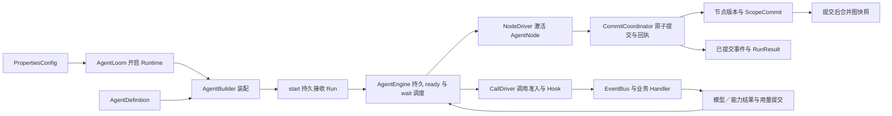

# SDK 当前实现与验证

日期：2026-10-19。实现版本：`agentloom-sdk 0.1.0a1`。当前推荐入口是 `PropertiesConfig → AgentLoom → build(AgentDefinition)`，默认使用文件系统保存执行状态。安装、可运行代码和接续步骤见 [SDK 接入指南](integration.md)。Workflow 按当前开发范围暂不接入。

本页先说明当前状态与实现职责，再保留各阶段修复及验证记录。最新修复见[代码审计边界](#代码审计边界修复)，上一轮见[第十轮节点边界](#第十轮节点边界修复)，结构调整见[节点协议与检查点](#节点协议与检查点设计对齐)，文件接入机制见[文件提供者 SPI](#文件提供者-spi)。SDK 已按 LangChain 模板适配 ReAct／Planner／Executor，业务方只填写业务 Prompt，见[LangChain 模板适配](#langchain-模板适配与回归)。首次自动注入与第五轮修复分别保留在[模式提示词实现](#sdk-自动模式提示词)和[第五轮记录](#第五轮持久化-json-深度与异常记录修复)。其他 SDK 章节仍含完整目标设计，不能据此推定全部接口已发布。

## 当前接口与交付状态

| 范围 | 当前可用内容 | 边界或待实现内容 |
| --- | --- | --- |
| 参数与装配 | PropertiesConfig、RuntimeProperties、AgentProperties、ServiceProperties、FileProperties；AgentLoom、AgentBuilder、直接构造共用校验 | 配置不可变，服务实例借用；不提供全局可变参数容器或热更新 |
| Agent 执行 | ReAct／Plan–Executor、RunHandle、停止、补充、同配置重开、独立角色上下文 | 一个实例绑定一个 Run；AgentNode 实现生成器协议，NodeDriver 提交并回送回执；Workflow／StateGraph 未接入 |
| 模式提示词 | SDK 自动生成 ReAct／Planner／Executor 指令、输入输出合同，Run 保存固定版本正文 | 业务 Prompt 独立；模式指令受保护并计入预算；Prompt 引导行为，运行时约束实际动作 |
| 模型 | Chat Completions／Responses、ScriptedModel；ModelAdapter.stream_once、ProviderEvent、ModelDescriptor | 窗口显式提供，未实现统一 ModelAdapter.discover；公开事件不是 token 流 |
| 能力扩展 | CapabilityAdapter.invoke_once、CapabilityRequest、ToolInvocationContext、ToolResult；目录 for_role／for_node_binding／resolve | 先注册再按角色绑定；旧 invoke 仅作兼容；独立内容引用和 Artifact 授权未实现 |
| Hook | HookInput、HookContext、HookRecordView／Page、FunctionHookHandler、有序 request／response 链 | 读端口固定版本且可过期；尚无 ScriptHookHandler 和生命周期修改 Hook |
| 查询与删除 | runs／tasks／operations／events／sessions、补充和停止回执、records.delete | 当前多为 JSON dict／列表，尚无完整 RunSnapshot／分页／回执 DTO；sessions.inputs 无分页 |
| 文件与环境 | WorkspaceBackend、11 个普通方法、entry points 加载、FileProperties、默认本地实现、授权与恢复绑定 | 完整 EnvironmentProvider／SandboxGateway、多后端挂载及真实共享／对象存储驱动待补齐；没有默认宿主 shell |
| 上下文与内容 | 原始／有效记录、历史、压缩、结果预览、按角色分片读取 | 完整值保存在执行快照；独立 ContentStore／BlobStore、ArtifactRef 输入和来源授权待实现 |
| 存储与恢复 | FileRuntimeStore 默认、MemoryRuntimeStore 可选；不可变节点／图检查点、ScopeCommit 增量、提交回执、租约、单机进程恢复 | 无 SQLite／PostgreSQL 实现；跨机存储与任意历史版本迁移未实现 |
| 事件总线 | 按类型＋版本分发、局部注册、业务 Handler、Hook 调用阶段持久化、已提交 RunEvent 观察 | 不等于完整可靠总线；独立 outbox、订阅 ACK 和全部持久等待合同待实现 |

## 代码审计边界修复

针对 2026-10-19 的代码审计，先实测并对照既有合同，再修复确认的问题。报告的 M1（Run 创建前 stop 关闭准入）符合停止抢先到达的设计；L11（完成回执拒绝普通 Python 异常）符合 `report_completion` 的强类型合同，两项行为保留。M3 的普通符号链接原本已被拒绝，本次修复的是末段换链竞态下的跨平台错误分类；L6／L8 的非法模型参数原本已被公共文件服务拦截，本次补齐本地后端直接调用的校验。

| 审计项 | 修复与实际边界 |
| --- | --- |
| M2：Skill 导入与读取不一致 | `filesystem.posix` 统一逐段 no-follow、普通文件检查、20 MiB 单文件上限与版本一致性读取；`capabilities.skill_files` 负责 Skill 错误映射。包根、祖先和包内符号链接均拒绝，导入与运行时共享边界，不再借用工作区后端私有方法。 |
| M3、L6／L7／L8／L13：文件错误边界 | 使用平台 `errno`，只在实际打开路径处转换符号链接错误；调用方 body 的错误保留。list limit、edit 文本类型在后端显式校验；`/dev/null` patch 头按不支持的路径拒绝，未增加整文件创建／删除语义。 |
| M4：非法节点 effect 升级为基础设施故障 | `nodes.effect_validation` 校验完整提案形状、初始模型操作及引用归属；effects 在事务内检查可消费状态。非法提案回滚同次写集，只失败所属任务，Planner 和其他 Executor 可继续；真实票据／持久化不变量失败仍按基础设施故障处理。 |
| M5、L2／L5：缺失执行事实 | 续租和 worker 读取遇到逻辑 Run 消失按 LeaseLost 退出；旧格式缺少决策操作返回明确的票据错误；补充输入索引与正文不一致返回 PERSISTENCE_INVARIANT_BROKEN。磁盘对象损坏仍由文件存储报告 STORE_CORRUPT，不伪装成可恢复的业务失败。 |
| L1、L10：外部协议与诊断 | Responses 已知事件及续传材料先校验形状，非法材料归为模型协议错误；未知字符串事件名仍可忽略。MCP 已返回但无法序列化的结果保留 completed 事实与原异常原因，直接异常和 ExceptionGroup 都不再形成自指 cause。 |
| L3、L9：控制信号与文件授权 | Hook 读取触发 Run 停止／总截止时直接传播，不伪造 allow；普通 Hook 错误仍遵守放行合同。缺失、损坏或类型非法的 epoch 文件拒绝工作区访问，不由普通操作重建授权；其他读取 I/O 故障作为基础设施错误处理。 |
| L4、L12：文件故障补偿与暂存清理 | 跨设备 move 明确拒绝；创建目标硬链接后源删除失败时，先核对源与目标身份再补偿。证据变化或补偿失败返回 FILE_MOVE_OUTCOME_UNKNOWN，不误删替换文件或唯一副本。写暂存清理后同步目录；prepare 在锁内清理精确匹配的 SDK 普通暂存文件，不穿过符号链接。 |
| 次要一致性问题 | 内存后端拒绝同 namespace 嵌套事务，与文件后端一致；第三方文件资源关闭保留 SDK 异常；MCP 目录不匹配统一为 conflict。 |

新增 125 项回归分在 `test_node_effect_contract.py`、`test_control_faults.py`、`test_workspace_faults.py`、`test_skill_files.py`、`test_response_shapes.py`、`test_mcp_diagnostics.py`。覆盖内存／文件后端、非法 Executor 与兄弟任务隔离、异常提交的写集回滚、真实 SIGKILL 后暂存清理、目标被替换／源消失时的安全补偿、SDK 错误及原始 cause 的保留。新增用例 **125 passed**，既有相关测试 **180 passed**。

首次完整回归为 **2019 passed、1 failed**；失败来自既有慢撤权测试的 120 ms 租约在并行调度时、进入撤权前已经过期，独立重跑 4 个场景均通过。该测试改为 1 秒租约和超过完整 TTL 的阻塞撤权，并加强 owner／epoch 不变及 expires_at 持续延长的断言；连同真实失权用例，**6 passed**。SDK 的失权校验未放宽，既有 QA 断言未修改。

提交前再次复跑还发现提示词进程恢复用例的 300 ms 租约在并行负载下过期。该用例改用 2 秒租约，并读取崩溃后保存的 expires_at 等待真实到期，校验等待期间租约没有变化；保留强制进程退出、模板升级、角色指令冻结和调用次数断言。生产租约与恢复逻辑没有因此放宽；[该次失败记录](../../agentloom-sdk/qa/evidence/code-audit-fixes-20261019/prepush-failure.txt)单独保留。

后续并行验证在原 QA 的 150 ms 租约场景中再次发生调度过期：清理和会话释放已完成，失败发生在后续新任务。该轮在已出现失败后中断并保存[未完成记录](../../agentloom-sdk/qa/evidence/code-audit-fixes-20261019/prepush-parallel-interrupted-summary.json)，不计作完整通过。保留原 QA 断言，最终使用 `scripts/test_all.py --workers 1` 执行完整串行回归。

最终完整串行回归为 **2020 passed，764.09 秒**，无失败、错误或跳过；217 个源码／资源／测试／配置文件的运行前后摘要一致，`scripts/test_all.py --check` 确认结果与当前工作区匹配。独立安装 wheel 后，129 个源码／资源文件逐字节一致，新增 125 项回归在安装目录再次全部通过。Ruff lint／format、文档构建和站点检查通过。见[审计项处理清单](../../agentloom-sdk/qa/evidence/code-audit-fixes-20261019/fixes-summary.json)、[完整回归摘要](../../agentloom-sdk/qa/evidence/code-audit-fixes-20261019/regression-summary.json)、[完整日志](../../agentloom-sdk/qa/evidence/code-audit-fixes-20261019/regression.txt)、[安装包验证](../../agentloom-sdk/qa/evidence/code-audit-fixes-20261019/wheel-summary.json)及[既有测试完整性](../../agentloom-sdk/qa/evidence/code-audit-fixes-20261019/existing-tests-integrity.json)。首次失败日志与定向重跑证据也在同一目录保留。

本次没有实现文件 mutation journal、跨机 fencing、完整可靠事件总线或 Workflow；进程在 move 的两次文件系统修改之间退出仍可能留下未知结果，不能把异常补偿等同于跨崩溃原子移动。排序差异和非法异步生成器返回值的可选诊断整理也未纳入本轮。

## 第十轮节点边界修复

原报告的 4 项 P2 均可复现：46 项原 QA 为 **34 failed、12 passed**，不是 34 个独立问题。原报告、用例和失败证据保留不变；本轮修复生产实现并扩充合同测试。

| 问题 | 修复及验证边界 |
| --- | --- |
| R10-01：恢复输入重复封装 | `PayloadRef.from_dict` 校验 inline 类型、Owner 和已保存 hash，恢复原 value；缺少引用与引用内容为 null／false／0／空容器分开处理。Driver 激活前还原，恢复入口也验证持久引用；提交即 ready 和真正 waiting 两条路径均检查接管后的同一引用。 |
| R10-02：非法 continuation 先提交再被恢复拒绝 | `nodes.validation` 为提交与恢复共享校验规则：协议类型／版本、phase 与终态组合、角色／上下文绑定、循环序号、上下文修订和 Operation／批次引用。提交前验证候选字段，effects 应用后在同一事务内再次核验目标事实，合法才发布不可变版本；失败回滚写集并返回 NODE_OUTCOME_INVALID。 |
| R10-03：生成器关闭异常覆盖已提交结果 | `nodes.lifecycle` 将普通关闭错误保存为激活级 NODE_GENERATOR_CLOSE_FAILED 诊断，不改 TaskResult。诊断使用结构化 RecordActivationCleanup 命令；诊断保存失败也不替换业务结果或原提交异常。取消与执行权异常仍走既有控制路径。验证 Complete／Wait／Fail、提交确认丢失和诊断写入失败后的接管。 |
| R10-04：已知快照结构损坏无法回退 | 在单个候选快照边界处理缺字段、null 和错误类型；仅完整校验通过的载荷成为恢复起点。旧快照或完整增量可用时重放到当前水位；未知协议版本、增量缺号、链断裂仍拒绝。新增空载荷、连续坏快照及“坏引用同时未知版本”的反例。 |

新增 76 项边界测试位于 `test_node_boundaries.py`、`test_checkpoint_protocol.py`；与第十轮原 QA、既有节点合同测试一起执行，**172 passed**。固定源码完整回归为 **1886 passed，726.47 秒**，没有失败、错误或跳过；运行前后摘要一致，`scripts/test_all.py --check` 确认与当前工作区匹配。原第十轮 QA 文件 hash 与报告一致，没有修改断言。Ruff lint／format 通过。

独立安装 wheel 的 120 个源码／资源文件与工作区逐字节一致；三个独立进程分别验证 Wait 提交后中断、还原 null 恢复引用并在关闭异常后成功、终态重开不重复激活，均使用真实文件后端且模型调用为 0。见[完整回归摘要](../../agentloom-sdk/qa/evidence/round10-fixes-20261019/regression-summary.json)、[测试日志](../../agentloom-sdk/qa/evidence/round10-fixes-20261019/regression.txt)、[原 QA 完整性](../../agentloom-sdk/qa/evidence/round10-fixes-20261019/qa-integrity.json)和[安装包接管验证](../../agentloom-sdk/qa/evidence/round10-fixes-20261019/wheel-summary.json)。

报告中的 G10-01（预算申请 FIFO 与完整持久等待）、G10-02（所有关键变更统一结构化命令）仍是设计能力缺口，未计入这 4 项缺陷的修复结论。Workflow 继续排除；完整目标的其他缺口见[设计差异](#与完整目标设计的差异)。

## 节点协议与检查点设计对齐

本轮按 runtime／event-bus／checkpoints 设计调整内部执行结构，保留默认文件后端和现有业务装配方式；Workflow 暂不接入。

- `AgentNode.activate(input, continuation, context)` 返回异步生成器。`NodeDriver` 先提交激活，再读取交付；Progress 的命令、上下文效果和 continuation 提交成功后才 `asend(CommitReceipt)`。Wait／Complete／Fail 提交后关闭生成器，不继续运行节点。无终态、非法交付和节点异常形成明确任务错误，基础设施异常交还接管路径。
- NodeContext 保存当前激活身份、控制和受限服务端口，不再直接持有 Runner。端口在激活结束后失效。输入和 continuation 绑定同一任务；AgentContext 暴露已提交 continuation。
- 图引擎从持久 ready 顺序激活节点；模型调用及动作推进独立于节点激活。模型／批次等待保存条件与恢复输入，结算与等待注册均复核条件。并行成员按冻结 ordinal 汇合，父节点只消费一次。
- Executor 在 before Hook 前保留准入名额；GraphExecutionHandler 只准备提案，StartExecutor 同一事务保存许可、唯一子任务、原 Operation 关联和 ready 意图。子终态与委派 raw 同时提交，after Hook 不占 Executor 名额。
- 模型原始响应和后置处理先持久保存；节点接受有效决策时，在同一提交里消费 Loop 票据、追加消息并冻结批次。Executor 模型失败随失败任务结果结算反馈票据。
- 根总线严格按 `(event_type, schema_version)` 解析，不回落到其他版本。Context 的物化／修改／压缩和 Environment 的准备／文件读写经过 Handler；文件 Provider 继续通过原有同步 SPI 接入。
- 每次相关提交保存不可变节点版本与有序 ScopeCommit；图快照在关键提交之后合并生成，保存公共信封和 Agent 专属引用清单。图快照失败记录诊断，不能回滚已提交结果；不可变节点版本和增量保存失败仍属于必须阻止推进的基础设施错误。恢复从快照重放到一致读取水位，核验 hash、连续序号、节点引用与查询投影，再安装恢复结果；旧的停止／截止／租约不覆盖当前控制。记录删除同时清理所属检查点。已知旧单机格式通过显式适配进入节点协议，未知引擎／协议不猜测恢复。

本轮同时复核新加入工作区的第九轮 QA：修复 `result_read` 超末尾空页、unified diff 对非 LF Unicode 字符的分行，以及 glob pattern 的点段／重复分隔符规范化。没有更改第九轮 QA 的断言；非法 astream 游标仍遵循文档的先启动再观察语义。

旧快照测试现在同时移除新协议检查点后再构造旧格式；故障注入测试识别 RuntimeCommit 的命令 ID，仍在原 Attempt 完成边界制造故障；后台清理测试等待持久终态，不把一次扫描等同于等待其他 Worker 完成。新增 `test_node_protocol.py` 和 `test_checkpoint_protocol.py` 检查真实 Driver 握手、激活失效、节点错误分类、模型票据／批次原子接受、双后端重放、快照失败隔离、hash／缺号拒绝和 Owner 删除。

固定源码完整回归：SDK 与 QA **1764 passed，710.48 秒**，没有失败、错误或跳过；运行前后源码与测试摘要一致，`scripts/test_all.py --check` 确认结果匹配当前工作区。包括新增的 50 项节点／检查点测试和第九轮原有 49 项 QA。Ruff lint／format 通过。独立安装的 wheel 中 118 个源码／资源文件与工作区一致；Plan→Executor→文件写入成功，另一个进程重开相同 Run 时模型调用为 0。见[完整回归摘要](../../agentloom-sdk/qa/evidence/node-protocol-20261018/regression-summary.json)、[测试日志](../../agentloom-sdk/qa/evidence/node-protocol-20261018/regression.txt)和[安装包验证](../../agentloom-sdk/qa/evidence/node-protocol-20261018/wheel-summary.json)。

这次没有把 Workflow 原生保存点、跨机器 lease 或独立内容授权视为已交付。完整目标中的公共 DTO 和可靠订阅仍按下方差异表说明。

## 模块职责与调用路径

| 包／主要模块 | 实现职责 |
| --- | --- |
| `public.application/properties/builder/assembly` | 启动参数组合、宿主生命周期、从定义 build、统一装配与资源所有权 |
| `public.agents/handles/projections` | 执行门面、实例绑定、观察／控制和公开结果过滤 |
| `configuration.properties/models/schemas/actions` | 参数冻结、默认值、数值与 Schema 校验、角色动作权限及恢复清单 |
| `configuration.definitions/assembly/recovery` | 变量声明类型快照、版本化绑定清单、类型语义比较及旧清单兼容边界 |
| `configuration.json_values/json_documents`、`operation_errors` | 边界 JSON 与内部文档的统一深度、迭代复制／冻结／RFC 8785；共享 OperationError 校验 |
| `prompts.roles/protocol/templates/assembly/recovery` | LangChain 三角色适配、原生协议、版本目录、输入输出合同组装、Run 指令快照与恢复校验 |
| `runtime.host/runner/agent_engine/agent_loop` | 本机宿主、每 Run 执行者、持久 ready／wait 调度和 ReAct 节点程序 |
| `nodes.contracts/validation/effect_validation/driver/commands/effects/ports/lifecycle` | 引用编解码、continuation 与 effect 语义校验、节点提交握手、激活授权及关闭诊断；Activate／Progress／Wait／Complete／Fail 命令 |
| `runtime.batches/domain_handlers` | 持久批次准入规则，Context／Environment／GraphExecution 事件入口 |
| `checkpoints.journal/snapshots` | 公共图信封、Agent 载荷、不可变节点版本与 ScopeCommit 重放、提交后合并图快照、Owner 删除 |
| `runtime.calls/completion/handlers/usage` | 准入与重试、Attempt 完成回执、单次适配器调用、原子用量计量 |
| `runtime.output` | 区分可纠正的模型候选错误与不可由模型修正的 Schema 配置错误 |
| `runtime.recovery/control/maintenance/cleanup/leases` | 恢复账本核验、停止和截止、撤权与清理重试、执行及清理租约 |
| `events.hooks/hook_views/hook_reads/patches/control` | 有序 Hook、受限输入视图、读取授权、双补丁提交与无 Agent 控制收束 |
| `context` | 消息物化、历史与补充顺序、受保护输入、预算、可恢复摘要、大结果读取 |
| `capabilities`、`models` | 资源目录及结果合同、工具／MCP／Skill 适配；skill_files 统一包文件边界，response_protocol 验证 Responses 形状；完整材料与 usage 校验 |
| `workspace.contracts/properties/loader/local/service/results/runtime` | 文件接口与 DTO、参数组、选中提供者加载、本地适配、授权／结果检查和生命周期 |
| `filesystem.posix` | 不依赖工作区的逐段 no-follow、普通文件有界读取、版本核验与遍历 |
| `environment.local/mutations/fencing/moves/staging` | POSIX 工作区文件操作、epoch 授权、移动补偿和暂存清理 |
| `storage` | JSON 文件事务、内存事务、提交回执和租约校验 |



参数对象和服务引用停留在装配层；检查点只保存恢复合同需要的固定配置与执行事实。模型 completed 和 MCP 已知响应在资源关闭前进入结果提交；自定义能力内部有关闭阶段时可使用当前 Attempt 的 report_completion 回调。关闭仍在原调用任务中进行，不另起脱离生命周期的后台任务。

| 异常／恢复边界 | 当前处理 |
| --- | --- |
| 已保存 raw 后关闭失败、超时或进程退出 | 保留完成事实，关闭诊断独立保存；接续只做后处理，不重复已完成调用 |
| 结果提交或提交观察回调失败 | 作为基础设施故障向上传播；按原命令回执恢复，不降级成业务错误继续交付 |
| 外部调用开始、尚无可靠结果时进程退出 | 记录 CALL_OUTCOME_UNKNOWN；不把未知副作用当作未执行后自动补发 |
| 停止、根截止或执行权丢失 | 阻止后续业务交付；有效租约下保留已取得事实，旧 owner 不再写入 |
| 单 Run 撤权／后台清理失败 | 保存维护诊断和重试时间，隔离其他 Run；终态与清理状态分别查询 |
| usage、工具结果或锁等待参数非法 | 在对应协议／参数边界拒绝；已返回但非法的工具值保留 completed 事实，非规范 JSON 不写入检查点 |

## 验证口径

最新代码审计修复后的完整回归为 **2020 passed，0 failed，0 skipped**，详细边界和安装包验证见[代码审计边界修复](#代码审计边界修复)。以下记录为此前各阶段的固定源码结果。

第八轮修复后的完整回归为 **1665 passed，0 failed，0 skipped**：SDK 1142 项、全部八轮 QA 523 项，约 385 秒。包含原第八轮 61 项及本次新增 67 项边界测试，没有排除用例或修改既有 QA 断言。189 个源码／资源／测试文件在回归前后摘要一致，见[本轮结果](../../agentloom-sdk/qa/evidence/round8-fixes-20261018/regression-summary.json)、[完整日志](../../agentloom-sdk/qa/evidence/round8-fixes-20261018/regression.txt)与[QA 完整性核对](../../agentloom-sdk/qa/evidence/round8-fixes-20261018/qa-integrity.json)。

此前统一提交所有剩余改动，包括 LangChain 三角色模式提示词、恢复合同与公开事件修复、输出与异常结果校验、测试、文档、示例及历史验证证据。提交前重新完整执行 SDK 与七轮 QA：**1537 passed，0 failed，0 skipped**，其中 SDK 1075 项、QA 462 项，耗时 342.81 秒。189 个源码／资源／测试／示例文件在运行前后保持一致，没有排除用例或功能子集，见[该次完整回归](../../agentloom-sdk/qa/evidence/full-workspace-publish-20261018/regression-summary.json)和[日志](../../agentloom-sdk/qa/evidence/full-workspace-publish-20261018/regression.txt)。

此前文件提供者 SPI 完成时的完整工作区回归 **1537 passed，0 failed，0 skipped**：SDK 1075 项、七轮 QA 462 项，耗时 336.82 秒。该轮新增 54 项测试，完整执行 SDK 与 QA 两个目录，没有排除用例；171 个源码／测试／配置文件摘要在运行前后保持一致，见[固定源码与回归结果](../../agentloom-sdk/qa/evidence/workspace-spi-20261018/regression-summary.json)。

此前恢复绑定与公开事件修复后的 1483 项及 1317／1155／1089／948／813 等数字属于历史快照，各轮原始审查和失败证据保留；前一轮验证见[恢复合同回归记录](../../agentloom-sdk/qa/evidence/recovery-contracts-20261018/regression-summary.json)。

这些验证使用本地确定性模型、协议替身和已有的 MCP stdio／SSE 测试，没有远端模型、远端 MCP、多机或 Workflow 的验收结论。完整目标尚未实现的部分集中列在[设计差异](#与完整目标设计的差异)。

接入文档此前另有 8 个本地验证场景，覆盖 7 个 Python 代码块及控制／查询签名，见[文档验证记录](../../agentloom-sdk/qa/evidence/docs-integration-20261017/summary.json)。该次文档整理没有修改 SDK 源码与测试，文档用例不重复计入 SDK 回归。

## 已实现的执行链路

- 独立安装与导入，`ReactAgent`、`PlanAgent`、`AgentNode` 门面、`RuntimeEngine` 和 `RunHandle`；调用方注入模型、能力和工作区，默认文件存储可替换，不导入 Platform。
- `AgentBuilder` 从现有 AgentDefinition 构建独立 Agent，提供不可变的共享默认配置和 `with_options()` 派生；与直接构造共用校验、角色授权和恢复清单，详见[构建合同](assembly.md#23-从定义构建-agentbuilder)。
- `PropertiesConfig` 统一 runtime／defaults／services／files 四组参数，AgentLoom 管理宿主开启和关闭；Runtime、Builder、Agent 读取对应只读参数组，原关键字入口通过同一解析路径兼容，详见[参数合同](assembly.md#24-统一参数配置-propertiesconfig)。
- 每次委派独立的 ReactAgent、任务与上下文；根级 Loop / deadline 共享，按配置串行或并行执行，批次全部结算后按模型给出的次序反馈。
- 冻结配置、JSON Schema、声明式 Prompt 变量、原始／有效结果分离、有序 Hook、合法拒绝、无效 patch 放行、受限且可过期的读取端口。
- 最近 N 轮实际根角色历史、补充输入的领取／送达／跨轮转交、input_id 去重、受保护输入、预算计量与可接续的分块压缩。
- Chat Completions / Responses 流式适配器；完成证据、首输出／空闲超时、独立 Attempt、完整响应后一次逻辑后置 Hook。Responses 保存用于无状态续传的 output items，包括 encrypted reasoning 与 assistant phase，参照 [OpenAI 官方说明](https://developers.openai.com/api/docs/guides/reasoning)。
- 显式工具注册与角色绑定、MCP 官方客户端的 stdio / Streamable HTTP 连接、调用前目录一致性校验、Skill manifest 与参数渲染、文件能力、大结果预览及受限分片读取。
- 默认 JSON 文件后端、显式选择的内存后端、幂等提交回执、租约 epoch fencing、独立进程恢复；已保存 raw / Hook result / 子任务 / 批次继续原阶段，没有可靠外部结果的调用标记 unknown。文件后端采用 namespace 文件锁、不可变记录和原子清单，不需要数据库。
- 独立停止命令与停止前准入关闭，宿主关闭保留现场；终态与 CleanupJob 原子提交，清理独立领取租约、失败重试，不再次激活 Agent。

源码按 `public`、`configuration`、`prompts`、`runtime`、`nodes`、`checkpoints`、`events`、`context`、`capabilities`、`workspace`、`environment`、`filesystem`、`models`、`storage` 分包。具体接入见[接入指南](integration.md)，包安装说明见 [SDK README](../../agentloom-sdk/README.md)。

## 第八轮租约与路径边界修复

第八轮报告的两项缺陷均属实：同步 prepare／文件操作会阻塞原有续租协程，glob 使用未规范化的 root 裁剪路径导致漏报。保留原 61 项 QA 断言，修复后该批全部通过。

| 边界 | 实现与验证 |
| --- | --- |
| 同步调用跨租约 | `runtime.leases` 独立续租，`runtime.runner` 从 prepare 开始管理执行心跳；11 个普通文件方法与第三方注册合同不变，ReAct／Planner／Executor 共用执行保护 |
| 失权、停止与截止 | 心跳失败拒绝新业务与提交；原 worker／epoch 始终校验，不延长业务 deadline。终态前回收执行心跳，宿主关闭等待执行与撤权收束 |
| 准备中途退出 | `workspace.runtime` 在第三方 prepare 前持久化 scope；停止、截止及业务失败进入正常终态处理，撤权和清理仍能定位已分配资源 |
| glob 等价路径 | `environment.mutations` 按 `workspace.paths` 的规范路径段计算相对路径，保留递归、排序、截断和授权规则 |
| `/work//` 路径边界 | 补充测试发现去除别名后可能残留绝对路径；共享解析确保其仍是工作区相对路径。工作区内外同名文件验证覆盖 read／write／delete／list／glob／grep |

新增回归按职责放在 `test_workspace_leases.py` 和 `test_workspace_glob.py`。前者基于真实安装并通过 entry point 加载的提供者覆盖全部 11 个 Executor 文件操作、真实 epoch 接管、续租失败、停止／截止、部分准备失败与关闭；后者覆盖路径别名、中文目录、递归搜索、范围拒绝和符号链接。Workflow 和此前声明的目标缺口不在本次变更范围。

更新后的 SDK 与独立提供者重新构建并安装为 wheel，108 个源码／资源文件逐字节一致；两种模式的本地／第三方 11 个操作、写入后进程退出、错误配置拒绝和原配置恢复共 10 个进程场景通过，见[本轮安装包验证](../../agentloom-sdk/qa/evidence/round8-fixes-20261018/wheel-summary.json)。

## 文件提供者 SPI

本轮按包注册、配置选择、SDK 加载的机制实现完整文件 SPI。`WorkspaceBackend` 是普通方法抽象基类；第三方实现全部 11 个操作，在 `agentloom.workspace_backends` 登记实现类。业务只设置 `PropertiesConfig.files = FileProperties(provider="...", options={})`；地址可由实现包内置。默认 local 也走同一接口，LLM 工具名称与 Schema 保持不变。

`workspace` 按合同／DTO、配置、加载、本地适配、公共授权、结果检查和生命周期分包。Runtime 仍负责 Hook、Attempt、重试、结果提交及恢复；没有新增文件工具调度循环。SDK 仅创建与关闭选中的提供者实例，实例可跨 Run 复用，但 context 和授权逐次隔离。

处理了缺失／重名登记、接口不完整、构造失败、实例方法被覆盖、异步结果、错误 DTO、越权结果、关闭失败重试等边界。恢复比较保留 options 中 bool／int／float 的类型；已保存 raw 的恢复不重复写入。后台清理核对 scope 提供者身份，传递独立 cleanup_job_id／cleanup_lease_epoch 并校验清理租约；持久工作区保留内容。已返回的非法结果与超时结果仍保留 completed 事实，避免把已完成写入误判成 unknown 后重试。

新增的 54 项测试实际构建并安装独立提供者包，使用公开接口实现全部操作。另有 ReAct／Plan 跨进程写入后退出、错误配置拒绝和原配置接续验证。最终完整回归 **1537 passed，0 failed，0 skipped**，见[回归证据](../../agentloom-sdk/qa/evidence/workspace-spi-20261018/regression-summary.json)和[完整日志](../../agentloom-sdk/qa/evidence/workspace-spi-20261018/regression.txt)。

SDK 与第三方包均构建为 wheel 并独立安装，108 个 SDK 源码／资源文件与工作区逐字节一致；10 个独立进程场景通过，覆盖两种模式下本地及第三方的全部 11 个操作、写入后进程退出、配置变更拒绝和原配置恢复，见[安装包验证](../../agentloom-sdk/qa/evidence/workspace-spi-20261018/wheel-summary.json)。Ruff lint／format、文档构建和站点检查通过；本轮范围以外的既有修改保持不变。真实 NFS／对象存储、脚本挂载以及 Workflow 不在本轮验收范围。

## 恢复绑定与公开事件边界修复

确认三类缺陷：直接比较字典会把 `true` 与 `1` 当成相同配置；`asdict()` 不能保留 VariableSpec 与普通字典默认值的区别；RunEvent 再次使用外部 JSON 深度预算会拒绝已经成功交付的深层输出。修复前 73 项复现／对照为 **57 failed、16 passed**，覆盖三角色、双后端及事件观察路径。

| 问题 | 修复及职责 |
| --- | --- |
| 恢复误接受布尔／数字替换 | `configuration.recovery` 比较规范 JSON，保留 JSON 类型语义；领取执行权、环境准备和任何模型／工具派发前拒绝不匹配。账本中的策略副本也采用同一规范语义核对 |
| 变量声明类型丢失 | `configuration.definitions` 保存显式 spec 名称及普通默认值的类型推导，`configuration.assembly` 将其写入 `binding_version=2` 清单。动作／Hook 快照共用这份定义合同，恢复后 `1.0` 的 number 校验不会变成 integer |
| 公开终态事件深度不足 | RunEvent.payload 改用内部文档的 512 层冻结预算；业务 JSON 上限保持 128 层，所有公开嵌套值仍不可变。wait、events、astream 与终态游标回放使用同一已提交结果 |

新清单完整核对 ReAct、Planner 和所有 Executor，包括尚未创建的角色。旧清单没有保存变量类型的事实，不能仅凭新提供的定义补齐：有 spec 形状的普通对象或整数值数字默认值时，明确返回 `RECOVERY_BINDING_MISMATCH` 和变量路径。无歧义旧绑定可以继续，原清单与 Prompt 不重写；终态读取不触发配置替换或重新执行。旧的无类型 Hook 快照遇到无法确定的变量校验时保留 `HOOK_VARIABLE_VALIDATION_UNAVAILABLE` 诊断，不猜测后接受补丁。

专项回归 **221 passed**，包含已保存类型的规范 JSON 往返、旧格式的安全接续／拒绝、真实进程退出后错误配置被拒绝及原配置继续，以及深层事件的实时观察、关闭重开和 after_seq 回放。原 QA、既有测试和历史报告保留不变。[专项结果](../../agentloom-sdk/qa/evidence/recovery-contracts-20261018/focused.txt)与[修改前基线](../../agentloom-sdk/qa/evidence/recovery-contracts-20261018/baseline.txt)分别保存。

wheel 独立安装后 98 个源码／资源文件与工作区逐字节一致。另执行 10 个真实进程场景，其中 8 个使用修改前源码创建检查点，再由新安装包接管：无歧义配置按原进度完成，错误配置和已丢失变量类型的清单在派发前拒绝。安装目录内的 ReAct／Plan × 内存／文件 4 个场景也能通过 wait 和终态事件交付 128 层结果，见[安装包与兼容验证](../../agentloom-sdk/qa/evidence/recovery-contracts-20261018/wheel-summary.json)。

最终完整回归 **1483 passed，0 failed，0 skipped**，耗时 324.06 秒；166 个源码／测试／配置文件摘要在运行前后保持一致。Ruff lint／format 通过，167 个 Python 文件格式一致。453 个既有测试、QA 报告／证据和示例文件摘要未变化；新增 124 项用例使用四个独立测试文件及一个进程脚本。执行命令、测试清单与结果见[回归证据](../../agentloom-sdk/qa/evidence/recovery-contracts-20261018/regression-summary.json)及[完整日志](../../agentloom-sdk/qa/evidence/recovery-contracts-20261018/regression.txt)。

## LangChain 模板适配与回归

当前模板版本为 `agentloom-langchain-modes-v2`。`AgentDefinition.prompt` 继续只承载业务要求；直接构造、Builder 和 AgentLoom 自动注入角色系统指令。原文对应的固定提交、文件 SHA-256 与 MIT 许可证随安装包保存，运行时不下载模板、不依赖 LangChain 包。详见[来源与适配说明](../../agentloom-sdk/src/agentloom/prompts/NOTICE.md)及[源文件清单](../../agentloom-sdk/src/agentloom/prompts/sources.json)。

| 模块 | 来源与适配 |
| --- | --- |
| `prompts.roles.react` | LangChain classic ReAct 的思考、动作、观察、结束循环；工具名称与输入采用原生工具协议，已有消息代替文本 scratchpad |
| `prompts.roles.planner` | LangGraph 官方 Plan-and-Execute 历史教程的 planner_prompt／replanner_prompt；当前 Planner 循环使用目标、已执行结果和剩余工作继续推进，只有存在 Executor 时才注入委派合同 |
| `prompts.roles.executor` | LangChain experimental 执行器的当前目标、先前步骤和执行记录组织；委派输入只携带显式传入材料，并复用 ReAct 循环 |
| `prompts.protocol/templates/assembly/recovery` | SDK 传输与结束规则、不可变角色目录与模板版本、声明 Schema 组装、Run 快照与恢复核验 |

角色标签用于解释控制流程，不要求向用户输出思维过程或 Action 文本。工具产生实际 Observation；无工具调用的完整回复进入原有 output_schema 校验。当前没有新增 Plan／Response 专用规划调用、write_todos 看板、文本动作解析器或 Workflow。规划与重新规划由模板引导，实际授权、调用、结果反馈及预算仍由 SDK 执行。

新增验证覆盖：安装包内来源与许可证、文本标签不会执行工具、Executor 失败后 Planner 接收真实错误并继续委派，以及旧模板在根任务／子任务尚未创建时的真实进程退出与接续。v1 保存的正文在 v2 代码下保持原样，新 Run 使用 v2；SDK 指令的 Hook 保护、摘要排除、角色隔离和窗口计量继续使用原合同。

完整回归同时纳入第六轮 QA 和独立白盒探针。修改前基线为 95 passed／45 failed：第六轮 42 个失败对应两类缺陷，白盒 3 个失败来自夹具／断言；停止测试还存在已披露的时序竞态。此次修正如下：

- `runtime.output` 区分候选数据与 Schema 配置。NaN、溢出数值、非法 Unicode、规范 JSON 边界以及解析递归错误进入格式纠错；真正不可用的 Schema 立即失败。纠错消耗新业务 Loop，受原额度限制，不成为传输重试。
- `runtime.completion` 复用能力结果合同校验 tool_result，检查 invalid_tool_result 包装形状。非法附带材料不进入 Attempt，已有 completed／unknown 事实不被改写，基础设施异常仍传播。
- 白盒探针按业务模型调用数决定压缩场景何时结束；修正模型＋工具 Operation 数量，补齐跨角色读取的 run_id，并用事件同步停止发生点。保留压缩、授权拒绝、停止优先及幂等业务断言。

本轮新增 22 项测试，完整执行 `agentloom-sdk/tests` 和 `agentloom-sdk/qa`，不排除白盒或第六轮用例。最终 **1317 passed，0 failed，0 skipped**，耗时 311.19 秒；158 个源码／测试／配置文件摘要在执行前后保持一致。Ruff lint／format 通过，158 个 Python 文件格式一致。

安装包校验包含 96 个源码及资源文件的逐字节比对，确认角色模块、来源清单、许可证和 py.typed 均已打包。真实子进程在根任务／子任务创建前退出后可接续，v1 检查点在 v2 安装包下恢复也保留原指令正文；四个场景均成功且 stderr 为空，见[安装包与恢复记录](../../agentloom-sdk/qa/evidence/langchain-prompts-20261018/wheel-summary.json)。

执行命令、最终结果和固定源码摘要见[回归证据](../../agentloom-sdk/qa/evidence/langchain-prompts-20261018/regression-summary.json)；[完整日志](../../agentloom-sdk/qa/evidence/langchain-prompts-20261018/regression.txt)、[修改前基线](../../agentloom-sdk/qa/evidence/langchain-prompts-20261018/baseline.txt)与[原始上游模板](../../agentloom-sdk/qa/evidence/langchain-prompts-20261018/upstream-prompts.json)独立保存。测试使用确定性模型、协议替身和真实本地子进程，不将这些结果作为真实 LLM 规划质量或远端服务验收。

## SDK 自动模式提示词

本节记录首次 `agentloom-modes-v1` 实现及其验证快照；当前模板见[LangChain 适配](#langchain-模板适配与回归)。

业务方只提供 AgentDefinition.prompt 的业务内容。SDK 自动为独立 ReAct、Plan 的 Planner 及各 Executor 组装不同的系统指令；直接构造、Builder 和 PropertiesConfig／AgentLoom 均使用同一实现，不增加业务方必须填写的系统模板参数。首次模型请求同时说明最终输出 Schema，以及 Planner 所需的 Executor 结构化任务／变量合同。变量只公开 Schema 和必填性，不公开私有默认值；`configuration.variables` 共用普通变量的类型推导，避免提示词与实际校验漂移。

`prompts.templates` 保存版本化角色模板；`prompts.assembly` 生成每个角色的独立指令正文，在接收 Run 时保存为 prompt_contract。`prompts.recovery` 验证快照、角色记录与模型请求，不依据安装版本重新渲染。尚未创建的根任务和 Executor 也使用接收时的快照。旧 Run 没有该字段时维持旧消息布局，不向已冻结请求补插指令。

业务 system 消息保留在首条，SDK system 紧随其后，便于已有业务 Hook 继续编辑原记录；SDK 指令标为 sdk_instructions、fixed、protected，不能被两种 Hook 补丁覆写，也不被压缩或带入下一轮历史。摘要现在插在全部 system 前缀之后。SDK 指令及 Schema 按实际内容参与预算，超窗明确失败。

运行时继续负责动作授权、参数和输出校验、批次等待、额度与停止；Prompt 负责默认行为引导，不以“输出过计划文字”证明已执行。简单 Plan 任务及空 Executor 表仍可直接完成。

本轮测试覆盖三种装配入口、两种存储、Chat／Responses 实际请求体、Planner／Executor 隔离、输入输出 Schema、Hook 修改保护、压缩／历史、固定输入预算、模板升级、旧记录兼容与真实子进程退出恢复。原测试中依赖消息数量或固定下标的选择改为按语义选择，保留原业务断言。另一个任务的白盒探针未修改。

完整回归另暴露一处既有维护关闭竞态：父协程取消 gather 后又在 finally 取消子协程，第二次取消会打断子协程等待扫描线程退出，旧宿主可能在关闭后继续处理新停止请求。`runtime.host` 现在隔离外层取消，在 finally 统一取消一次并等待扫描收束。四个门控测试覆盖控制／清理扫描和两种后端，修复前全部失败，修复后连同原撤权失败重试场景共六项通过；没有放宽等待断言或改动租约规则。

最终固定源码回归 **1155 passed，0 failed，0 skipped**，耗时 295.44 秒；138 个源码／测试／配置文件摘要保持一致。新增维护关闭与恢复子集 34 项通过。Ruff lint／format 通过，146 个 Python 文件格式一致。wheel 安装后 86 个模块逐字节一致，安装包通过根任务／子任务创建前的真实进程退出恢复，且关闭时无未领取的后台异常；旧 `2b47ea9` 源码生成的检查点也由新安装包接续成功，两个工具均只调用一次。

[完整回归日志](../../agentloom-sdk/qa/evidence/mode-prompts-20261018/regression-final.txt)、[命令与源码摘要](../../agentloom-sdk/qa/evidence/mode-prompts-20261018/summary.json)、[安装包验证](../../agentloom-sdk/qa/evidence/mode-prompts-20261018/wheel-summary.json)和[旧检查点接续](../../agentloom-sdk/qa/evidence/mode-prompts-20261018/legacy-recovery.json)独立保存。早期受机器休眠影响的运行、维护竞态复现和中间修改验证均保留原证据；最终回归仅在进程运行期间阻止自动休眠。其他任务的 26 个文件摘要未变化。

## 第五轮持久化 JSON 深度与异常记录修复

以 `bfe582a` 为基线，独立复测第五轮原始 72 项用例，得到 **28 failed、44 passed**，两类问题均属实。原第五轮测试与报告保留不变，修复后相同 72 项全部通过。

| 问题 | 修复及职责 |
| --- | --- |
| R5-01：已校验结果无法复制／保存／重启读取 | `configuration.json_values` 按完整边界材料限定 128 层容器，以显式栈完成循环检查、复制、冻结和规范化；数值／字符串继续使用 RFC 8785 编码，保留原摘要兼容性。`json_documents` 单独提供 512 层的 SDK 文档预算，供状态、审计、Hook 读取、上下文和恢复使用；内存／文件后端统一，避免在材料外再包装 SDK 字段后重新越界 |
| R5-02：直接抛出的非法异常绕过错误 DTO 校验 | `operation_errors` 提供共享字段合同，能力结果和 `errors.error_record` 复用；非法直接异常生成安全的 ADAPTER_ERROR_INVALID／protocol／unknown，不把 NaN、非法枚举等交给存储，也不依据非法 retry 字段重试。`runtime.completion` 仅处理事实及受限材料投影，保留存储／控制异常传播 |

超深工具信封及非法原始审计材料在首次结果写入前拒绝，保存 CAPABILITY_RESULT_INVALID／completed，正常进入后处理并释放会话。128 层计算根容器，inline JSON 信封占 4 层，因此单个值允许 124 层；内部 512 层不向扩展方开放更大的输入限额。已保存结果走内部文档路径，避免再次遭遇递归 deepcopy。

新增边界与进程测试覆盖刚好达到上限／超出一层、四种结果入口、双后端、后置 Hook、会话释放、合法错误重试语义、非法异常字段、错误序列化器和附带审计材料；原第五轮及以往所有 QA 断言保持不变。

另外以旧 `bfe582a` 源码真实保存 465 层成功结果，在关闭资源时执行 `os._exit(74)`，新实现直接恢复并正常结束，工具总调用次数仍为 1；不是先把旧结果改成失败再重启。该兼容性验证不构成任意历史格式迁移承诺，详见[旧检查点恢复证据](../../agentloom-sdk/qa/evidence/round5-fixes-20261017/legacy-recovery.txt)。

最终固定源码完整回归 **1089 passed，0 failed，0 skipped**，耗时 288.41 秒；130 个源码／测试／配置文件摘要保持一致。本轮新增 69 项 SDK 测试，另有 72 项原第五轮 QA；新增边界与进程恢复子集为 74 项全部通过。Ruff lint／format 通过；wheel 安装后 81 个源码模块逐字节一致，安装包内上限／超限完成回执均通过真实进程退出恢复。文档构建及链接检查通过。

独立白盒探针的固定快照为 23 passed、3 failed，原因分别为压缩后用工具消息数量充当退出计数、少算最终模型 Operation、未记录 run_id 就读取 Executor 引用；只修正临时测试副本后 3 项均通过，未改动工作区原探针。这些结果及首次探索回归的失败日志单独保留，与第五轮 SDK 缺陷分开记录。

[第五轮原用例复测](../../agentloom-sdk/qa/evidence/round5-fixes-20261017/boundaries.txt)、[新增边界测试](../../agentloom-sdk/qa/evidence/round5-fixes-20261017/new-boundaries-final.txt)与[完整回归日志](../../agentloom-sdk/qa/evidence/round5-fixes-20261017/regression-final.txt)分别保存。Workflow 和此前披露的目标设计缺口不纳入本次实现。

## 第四轮完成回调与 JSON 边界修复

在第三轮修复工作区基础上处理第四轮报告的两类问题，Workflow 继续排除。原第四轮 QA 文件和报告未改；修复前 22 项失败按原断言复测全部通过。

| 问题 | 修复及职责 |
| --- | --- |
| error 完成回调绕过结果校验 | `capabilities.invocation.normalize_error_completion` 将错误及附带材料送入统一 ToolResult 校验；明确 known／unknown／not_started 决定执行事实，不依赖私有异常属性。合法失败提交后仍抛出原异常，非法 DTO 转为完成后的协议失败；`runtime.handlers` 只负责输出 Schema、回执提交和异常传播 |
| 循环返回值丢失完成事实 | `configuration.json_values` 检查当前遍历路径上的循环，允许不同分支共享子对象；JSON 校验、复制、规范化和冻结中的递归溢出归一为 ConfigurationError。已返回值继续由能力边界转为 CAPABILITY_RESULT_INVALID／protocol／completed，不改变函数执行中直接抛错的语义 |

错误完成路径继续经过原 Attempt 完成回执和事务入口。真正的存储故障、取消、停止／截止及失权不会被当作非法结果吞掉；已提交失败在关闭或进程退出后可直接接续后处理。Retry-After 和错误字段通过同一校验来源，非有限数值不再以存储故障的形式中断运行。

针对性回归 **180 passed**，覆盖原第四轮 56 项、共享／循环／过深容器、错误 DTO、私有属性不覆盖明确执行事实、回调过期、双后端租约接管、停止／截止／关闭、提交前后故障及真实进程退出。两个新增进程退出场景分别在原生错误回调提交合法失败、拒绝非法错误之后退出，重启均未重复工具调用。

完整回归 **948 passed，0 failed，0 skipped**，耗时约 270 秒；较原有 813 项回归增加第四轮 QA 56 项和本轮 79 项验证。Ruff lint／format 通过，123 个 Python 文件格式一致；完整回归期间 124 个源码、配置与测试文件摘要未变化。离线 wheel 构建、独立目录安装及 79 模块逐字节对照通过；安装包的模型、MCP 成功／业务失败、原生错误／非法错误回调共 5 个真实进程退出场景全部恢复，完成调用未重复。

[完整回归日志](../../agentloom-sdk/qa/evidence/round4-fixes-20261017/regression.txt)及[命令、源码和安装包摘要](../../agentloom-sdk/qa/evidence/round4-fixes-20261017/summary.json)独立保存。新增测试首次执行发现复用已绑定 Agent 的夹具错误，已按实例绑定合同修正为新建 Agent 后重跑；首次日志保留。

## 第三轮边界问题修复

以 `84b3355` 为基线，修复第三轮 QA 确认的四类问题。`runtime.completion` 单独管理完成结果投影和 Attempt 完成回执；调用驱动继续负责事务、重试和控制，资源关闭仍在原调用任务中执行，没有分离到失去生命周期约束的后台任务。

| 问题 | 修复及边界 |
| --- | --- |
| 关闭阶段覆盖完成事实 | 模型 completed 和 MCP 已知响应在流／会话关闭前提交；关闭诊断单独保存，已完成结果不进入重试。停止、根截止、失权继续生效；恢复只续已提交结果的后处理。完成回调绑定 Attempt、执行租约及有效期，不能由旧回调写入新尝试；提交／回执异常按基础设施故障传播，不能降级为业务错误后继续交付 |
| usage 事件被丢弃／越界漏检 | 通用 ModelHandler 按 Attempt 合并累计计数，completed 的缺字段／null 不清除已知值，0 保持合法；usage 事件、完整响应共用 `2**53-1` 上界，运行汇总继续使用原原子计量合同 |
| 值返回适配器丢失完成事实 | FunctionToolAdapter 与旧 invoke 桥共用已返回值的包装边界；非法结果归协议失败并记录 completed，函数执行中抛错仍保留原失败事实。原生信封和提前报告的结果共用归一与输出 Schema 校验 |
| 极端文件锁参数泄漏异常 | RuntimeProperties 和 FileRuntimeStore 共用安全数值转换；超大整数等非法值在 I/O 前归一为 STORE_LOCK_TIMEOUT_INVALID，0 仍表示不等待 |

第三轮原测试保持断言不变；另补充双后端停止／截止／关闭恢复、失权前后结果提交、提交前后故障与幂等恢复、业务／Schema 错误与关闭超时竞争、回调过期、值桥接、usage 字段／上界及三个真实进程退出场景。旧审查报告和失败证据保留，不据本次修复推定 Workflow 或其他未完成目标已验收。

完整回归 **813 passed in 251.51s**：SDK 635 项、原 QA 110 项、复审 QA 24 项、第三轮 QA 44 项，无失败或跳过；本轮新增 71 项边界验证。Ruff lint／format 通过，127 个 Python 文件格式一致。最终回归期间 120 个源码与测试文件摘要未变化。

离线 wheel 构建和独立目录安装通过，79 个源码模块与安装包逐字节一致。安装后的模型完成、MCP 成功和 MCP 业务失败三个真实进程退出场景均可从文件检查点恢复，已完成调用不重复，用量不重复累计。文档构建及内部链接检查通过。验证使用本地确定性模型和协议替身，不包含付费模型、远端 MCP 或 Workflow。

[完整回归日志](../../agentloom-sdk/qa/evidence/round3-fixes-20261017/regression.txt)与[命令、安装包及源码摘要](../../agentloom-sdk/qa/evidence/round3-fixes-20261017/summary.json)独立保存；首轮完整回归发现的两项提交异常传播失败及新增测试的初始夹具错误也保留在本轮证据目录，最终结果基于修正后的完整重跑。

## PropertiesConfig 统一参数入口

`PropertiesConfig` 汇总 `runtime`、`defaults`、`services`，通过 `async with AgentLoom(properties) as app` 开启宿主，再用 `app.build(agent_def)` 构建 Agent。`configuration.properties` 管理纯值参数及校验；`public.properties` 管理参数组合、服务引用和跨组校验；`public.application` 负责宿主生命周期，继续复用 AgentBuilder 和 RuntimeEngine。

Runtime、Builder、Agent 从各自的只读参数组取值；旧属性转发到同一来源，不保留独立副本。单个 Agent 的覆盖生成新参数组，不能热改已启动实例或绕过恢复绑定。默认文件路径和锁等待也使用共同定义；未引入全局变量、服务自动发现或数据库。服务实例由调用方持有，只有默认创建的文件存储随宿主关闭。

配置构造不打开存储或调用外部服务。启动失败清理已创建的宿主；清理异常不覆盖原错误，并可再次关闭重试。关闭活动宿主保留执行现场；恢复时仍区分可靠已提交结果与未知外部结果，不重发未知调用。统一入口、Builder、直接构造共用恢复清单，检查点不序列化整个参数对象或服务引用。

完整回归 **698 passed in 222.77s**：SDK 564 项、原 QA 110 项、复审 QA 24 项，无失败或跳过。较 Builder 阶段新增 38 项参数／生命周期合同测试，以及 4 项真实进程退出恢复场景；覆盖跨入口接续、工具许可后的未知结果、已保存工具结果、Hook 应用和子任务完成。

Ruff lint／format 通过，120 个 Python 文件格式一致。离线 wheel 构建、独立目录安装及 78 个源码模块逐字节核对通过，三个新模块和 py.typed 均包含。仓库外两个独立进程通过 PropertiesConfig／AgentLoom 使用默认 FileRuntimeStore，首次完成 ReAct 和 Plan，重开两个原 Run 的模型调用次数为 0。文档构建和链接检查通过。

[完整回归日志](../../agentloom-sdk/qa/evidence/properties-config-20261017/regression.txt)与[命令、安装包及源码摘要](../../agentloom-sdk/qa/evidence/properties-config-20261017/summary.json)独立保存；验证未调用付费模型或远端 MCP，也不包含 Workflow 和文末列出的其他目标缺口。

## AgentBuilder 装配入口

`public.builder` 提供 `AgentBuilder.build(definition)` 和不可变配置派生 `with_options()`；`public.assembly` 统一 Builder 与原构造器的依赖、默认策略和模型预算校验。ReAct／Plan 的模式选择、Executor 表、能力及 Hook 授权仍由现有 Agent 构造合同控制，执行、存储和恢复链路复用原实现。每次 build 都创建新 Agent，Builder 不持有活动实例或接管依赖的关闭职责。

本轮完整回归 **656 passed in 216.94s**：SDK 522 项、原 QA 110 项、复审 QA 24 项，无失败或跳过。较前一轮新增 31 项 Builder 合同测试，以及工具结果提交、Hook 应用、终态提交后在 Builder／直接构造之间跨进程接续的 3 项场景；已有的 8 个崩溃切点继续保留。

Ruff lint／format 通过，116 个 Python 文件格式一致。wheel 构建和安装通过，75 个源码模块逐一核对，两个新模块与 py.typed 均包含。仓库外两个独立进程使用默认 FileRuntimeStore，首进程通过 Builder 完成 ReAct 和 Plan，次进程重开两个原 Run，模型调用次数为 0。文档构建和内部链接检查通过。

验证使用本地确定性模型和已有协议测试，不包含付费模型、远端 MCP 或 Workflow 验证。[完整回归日志](../../agentloom-sdk/qa/evidence/builder-20261017/regression.txt)、[命令与源码摘要](../../agentloom-sdk/qa/evidence/builder-20261017/summary.json)独立保存，不覆盖前轮审查证据。wheel 冒烟脚本首次因 macOS 临时路径别名比较失败，在将两端路径统一解析后重新运行通过；SDK 源码未因此变动。

## 本轮逐项核对及修正

以[行为约定](requirements.md)、[装配职责](assembly.md)、[Agent 执行](runtime.md)、[调用阶段](event-bus.md)、[上下文](context.md)和[能力合同](capabilities.md)为依据；以下是已经改动并验证的偏差，不代表完整验收矩阵全部完成。

| 核对项 | 发现的偏差与本轮结果 |
| --- | --- |
| 默认存储与所有权 | `RuntimeEngine()` 原来默认内存；现默认 `.agentloom/state`，移除 SQLite 实现和导出。Runtime 只关闭自己创建的存储，显式注入对象仍归调用方管理 |
| Agent 与图引擎职责 | 原循环集中在图引擎，PlanAgent 没有暴露 Planner 现场；现由独立 `AgentLoop` 随角色 ReactAgent 激活，图引擎负责绑定和激活；根 `agent.context` 提供所属角色的只读消息、修订和进度 |
| Executor 并发边界 | 原来先创建子任务再等待名额；现先取得名额，再原子提交目标和许可；等待中的委派不会提前创建子任务，子任务完成即释放名额，后置 Hook 仍参与全批结算 |
| 纯准备与实际尝试 | 模型给出不存在的能力或不合 Schema 的参数，原来可能进入 Attempt；现先本地校验并持久化反馈，不创建 Operation、Attempt，也不调用 Hook 或适配器 |
| Loop 票据 | 根模型最终失败且没有接受决策时释放票据；Executor 模型失败反馈按一次 Loop 计量，before deny 同样占反馈额度，但不创建执行许可或 Attempt |
| Hook 的有效修改 | 工具／委派输出修改重新检查输出 Schema；模型工具名或参数修改重新检查当前角色的能力与参数。非法 patch 保留原有效结果并记录诊断，合法 deny 仍生效 |
| 首输出与补充送达 | 完整响应帧先验证协议和调用结构，再确认首有效输出；损坏的终帧不会虚假标记补充已经送达 |
| 根控制与压缩 | Executor 的压缩失败或上下文硬窗口错误终止根执行；终态提交时重查总截止，避免任务先完成、提交延迟后仍报成功；超时配置下界统一为设计的 1 秒 |
| 恢复绑定 | 工作区根目录进入恢复清单；换目录后接续非终态执行会在创建新工作区前被拒绝 |
| 能力边界 | Skill 列表返回角色可见别名；MCP 重复分页游标明确报错；目录缩小时旧游标返回 `DIRECTORY_CHANGED`，不误判为普通偏移非法 |
| 文件读取开销 | 子路径读取只复制所需字段，清单校验直接校验持久化字节，避免每次状态查询重复复制整个运行记录或重编码清单；文件仍是持久化依据 |

## 审查回归修复

审查提供的 7 个场景分别在内存和文件后端执行，修复前 **14 failed**，修复后 **14 passed**。这些用例已纳入 `test_review_regressions.py`；另外补充了并发、恢复、控制截止和连续转交的边界验证。以下六项属于已实现链路的缺陷，与文末尚未实施的目标设计分开记录；Workflow 不在此次修复范围内。

| 审查项 | 修复与断言 |
| --- | --- |
| 工具 Hook 改参后历史仍旧 | Operation 保存来源 call_id；Hook 同一提交更新有效请求和对应 assistant 调用槽，保留 raw。并行修改不同槽位互不覆盖；Hook result／apply 后中断再接续不重跑 Hook；Responses 续传同样使用新参数 |
| Hook 修正来源后仍用旧摘要 | 每次业务模型前置 Hook 应用后，按当前来源 hash 重新物化消息和 record_ids。来源已变的摘要不再用于本次请求，后续 Hook 也读到新的请求映射 |
| 尝试超时不重试 | 首有效输出、流中空闲和工具尝试超时按 RetryPolicy 创建新 Attempt，复用原 Operation、冻结请求和 Loop 票据；前后 Hook 各运行一次，保留前次不完整材料。根截止及未确定的崩溃结果不因此重试 |
| 额度耗尽仍先压缩 | 新业务调用在前置处理前检查额度，压缩准备及每个块发送前再次检查。额度被其他调用预占时等待结算；实际耗尽后不调用摘要模型，也不禁止最后一轮已接受决策的工具执行 |
| 超窗 Hook 修改未放行 | 在提交候选前完整计量不可压缩记录、工具 Schema 和模型参数。固定材料超窗则拒绝本项全部修改、保存诊断，后续 Hook／模型继续看到原值；可压缩结果变长仍走正常压缩 |
| 转交补充排在新问题后 | 输入按 session_seq 保存和投影，根任务统一在 prepare 中插入保护输入。结束转交、初始化和历史排序不再依赖 inputs[0] 是初始问题；跨两轮转交保持 ID、顺序、送达状态及去重 |

## 基于 ef31404 的复审修复

本轮覆盖复审提出的 3 项 P2 行为偏差和 2 项 P3 编码规范问题；不扩展 Workflow 或文末尚未实现的目标能力。按 [阿里巴巴开发规范](https://alibaba.github.io/Alibaba-Java-Coding-Guidelines/)中适用于 Python 的通用要求补充接口契约，并按职责组织常量。

| 复审项 | 修复与验证边界 |
| --- | --- |
| 撤权异常中止维护 | 停止收束、终态清理按 Run 捕获异常；两类扫描各自隔离发现阶段故障。撤权失败保留 stopping，不生成虚假终态；维护诊断与下次重试时间写入文件／内存后端，重启后仍生效，成功恢复保留最近错误。领取租约时原子复查重试条件，避免使用旧扫描结果提前重试；存储不可用时记录脱敏诊断并继续扫描 |
| 非法委派 Hook patch 被接受 | 原始调用、Hook 修改和子任务启动共用 validate_action，完整校验参数 Schema、无 Schema 时非空文本、变量和目标权限；非法 patch 连同 context_patch 整体丢弃，后续 Hook、Executor 与有效调用记录继续使用原值。显式 JSON Schema 允许的 null 仍合法；非法补丁不撤销合法 deny |
| HTTP 429 忽略 Retry-After | Chat / Responses 共用 HTTP 层解析秒数和 HTTP 日期，将服务端绝对时间纳入结构化错误；按 max(配置间隔, 服务端剩余等待) 保存 next_attempt_at。恢复不重算完整等待、不提前发起 Attempt；保留同一 Operation 和一次前后 Hook，停止／总截止照常阻止新发送 |
| 公开 API 契约不足 | start、ainvoke、astream 和 RunHandle 的观察／控制方法补充参数、返回、异常与实例绑定约定，区分本地等待超时、Run 截止和停止，说明流提前结束不会取消业务执行 |
| 重复大小字面量 | environment.limits 管理完整文件和读取分片大小，工具 Schema 与实际 I/O 共用；models.limits 管理模型响应大小，HTTP 与 ModelHandler 共用；Hook 的 result.read 限制引用 context.results 的同一预览常量 |

上述复审阶段新增 `test_followup_review.py` 的 54 项测试覆盖两种后端、双 HTTP 协议、重启接续与非法输入边界；当时只单独运行 QA 中委派及限流问题对应的 14 项。其余 QA 问题的后续修复见下一节，历史报告继续保留原版本的复现事实。

## 系统测试异常修复

本次以 `ec1c93d` 为基线，处理 QA 复评确认的 11 类问题，以及 MCP 的 `Retry-After` 遗漏；原 AUD-01 和模型路径 AUD-09 的修复继续回归。Workflow 和文末目标设计缺口仍不纳入这次修复。

| QA 项 | 实现与验证边界 |
| --- | --- |
| AUD-02／03：Schema 引用与字面数据 | `configuration.schemas` 使用离线引用注册表，按 Schema 位置和资源作用域解析本地引用，支持 anchor、递归引用、嵌入资源及转义路径。字面数据与属性名 `$ref` 不误判；无效引用在装配完成前拒绝，运行期 Schema 故障归一为 INVALID_SCHEMA，不进入模型格式纠正循环。JSON 冻结与规范化独立为 `configuration.json_values` |
| AUD-04：异常 usage | `models.material` 在完整响应接收边界验证 usage，非法结构归 protocol / MODEL_PROTOCOL_ERROR 并形成持久失败；缺失统计保持未知。Chat／Responses 使用同一统计归一入口，持久汇总另有类型保护，终态释放票据和 Session |
| AUD-05／06：公开参数 | `public.validation` 统一校验明确身份和分页参数，命令在写入前拒绝 None、空白或错误类型，不以任意 str 转换制造幂等键；事件读取先校验再比较游标或访问存储 |
| AUD-07：Skill 构造绕过 | `capabilities.skill_profile` 共用 metadata 校验，直接准备包与目录导入均拒绝未支持字段和错误布尔类型；使用现有角色授权，不将 Skill 文本变成新增权限 |
| AUD-08：错误工具输出证据 | 输出 Schema 失败保留已经返回的完整 JSON，包括 null、Unicode 和外部凭证；失败状态与 completed 执行事实同时保存，后置 Hook 可读原材料，重开不重新执行工具 |
| AUD-09：MCP 等待遗漏 | MCP 的 HTTP 错误和异常组保留 Retry-After，由已有统一调用驱动保存 next_attempt_at；秒数／日期／配置下界、Runtime 重开、停止与根截止均有回归 |
| AUD-10：超窗错误分类 | `models.provider_errors` 按明确供应商 code 映射 MODEL_CONTEXT_LENGTH_EXCEEDED；HTTP 错误体有读取上限，不凭远端 message 猜测，也不为该错误重试模型 |
| AUD-11：中断材料 | 文本、reasoning 和不完整调用按 Attempt 保存，带提供方索引／ID；重试不混合，取消在有效租约下保留材料。非文本材料同样计入大小上限，超限保留限额内片段并标截断；未完成调用永不执行 |
| AUD-12：清理续租 | `runtime.cleanup_lease` 对固定 Run／Job／worker／epoch 独立续期，验证到期与接管；耗时文件操作在事务外执行，旧 owner 不可续活或提交。关闭宿主时等待本机清理线程收束，清理进度不改变业务终态 |
| AUD-13：无 owner 截止 | `runtime.deadlines` 使用存储时间提交关闭准入和首个控制原因，再由已有停止服务领取有效执行权、撤权和收束；queued、失去 owner、进程退出均不要求重建 Agent。截止控制与慢清理分开扫描，后到的停止／截止不覆盖首个已保存原因 |

QA 的 Schema 用例调整为验证完整装配边界，并通过单独故障注入验证运行期兜底；usage 的错误映射写入能力合同，测试额外断言唯一终态、Operation 收束、票据释放及同 Session 可继续。原始失败日志和评估记录不改写。

## 异常与恢复复审修复

本轮以 SDK 提交 `220ebd4` 为基线，当前工作区 HEAD 为 `3450aed`，修复继续复审确认的九类偏差。Workflow 和文末列出的目标设计缺口仍不在本轮范围内。

| 复审项 | 修复与模块职责 |
| --- | --- |
| 完成结果被连接关闭异常覆盖 | `resources` 统一保持资源体内的完成结果或原错误；Chat、Responses、MCP 共用退出处理，普通关闭失败保存 Attempt 诊断，不触发重复外部调用。取消和执行权丢失仍控制收束，异常组不能吞掉控制信号 |
| 慢撤权反复丢租约 | `runtime.leases` 对同步环境工作提供心跳；停止和正常终态收束覆盖校验、撤权过程，清理服务复用同一机制。续期只针对原 worker／epoch，到期或被接管时拒绝终态提交 |
| 停止恢复丢失 Hook 决定 | `events.patch_contract` 保存验证输入与模型参数校验凭据；`events.patches` 纯校验并原子应用双补丁，`events.control` 在无 Agent／模型／用户 Hook 的情况下结算已保存结果。合法 deny 保持 blocked，冲突或非法补丁留诊断，未开始链登记 skipped_control，已开始无结果登记 indeterminate；raw 与控制前有效结果保留 |
| 中断批次历史失真 | `context.history_facts` 从同一根任务的 Operation 读取已提交执行证据，按原 call_id 输出 true／false／unknown 占位；不把未消费的结果正文冒充已经交付的历史内容 |
| 恢复缺少账本核验 | `runtime.recovery` 在环境准备及任何业务派发前核对任务归属、票据投影、冻结请求 hash、Attempt 身份和次数、token 汇总及事件序号。发现不一致报 PERSISTENCE_INVARIANT_BROKEN 并停止推进，不补发票据或重写余额；合法 raw／完成／决策切点仍能接续 |
| token 汇总溢出 | `runtime.usage` 在 Attempt 结果事务中先验证累加值；超出规范 JSON 整数范围时保留完整返回材料，产生 MODEL_USAGE_OVERFLOW，保持已有部分计数和不完整标记，正常结束角色并释放 Session。内存后端也拒绝不可规范化值 |
| 空统计帧覆盖已知值 | `models.material` 按字段合并供应商累计统计，空对象、null 和部分缺失字段不会清空已知值；只提供一个计数时仍保留该部分统计，并保持 complete=false |
| Responses 顶层超窗错误分类错误 | `models.provider_errors` 同时识别显式顶层 error 和嵌套 response.failed 的 code，统一归 MODEL_CONTEXT_LENGTH_EXCEEDED；未知 code 或仅 message 命中不猜测分类 |
| 已准备 Skill 绕过正文校验 | `capabilities.skill_profile` 共用正文语法验证；目录导入、SKILL.md 入口读取及资源读取均验证未渲染源文本。参数替换后的文本保持字面值，不二次解释或执行 |

委派原始参数和 Hook 修改继续共用 `configuration.actions` 的完整权限、Schema、非空任务和变量检查。新写入的 Hook 验证快照明确区分 VariableSpec 与普通字典默认值；旧快照可以按已保存绑定恢复纯 Schema，但缺少参数校验凭据或变量类型证据的修改会被拒绝并留下诊断，合法 deny 和原始材料仍保留。这不等于支持任意历史版本迁移。

新增 `test_completion_cleanup.py`、`test_control_reconciliation.py`、`test_recovery_invariants.py`、`test_history_execution_facts.py`、`test_usage_accounting.py`，并扩展模型与 Skill 合同测试；包括真实进程退出、双后端、旧 epoch 拒绝、双补丁原子拒绝、原始错误保留、零重复调用和 Session 可继续的断言。原始 QA 失败报告与证据保持历史状态。

## 验证环境与证据

### 公开接口合同修复

2026-10-17 接口复审的三项问题已按职责修复，Workflow 仍不接入。这里的结论不包括独立内容存储、所有查询 DTO、脚本 Hook 或完整可靠总线等文末目标缺口。

| 复审项 | 实现与验证边界 |
| --- | --- |
| 公开结果包含内部审计 | `public.projections` 统一生成 RunResult；内部 PartialModelMaterial 不作为公共部分结果发布，重试成功、失败、取消、Executor 和旧记录重开都遵守同一规则。原始碎片继续保存在 Attempt／执行账本，未删除或改写 |
| Hook 输入及读取合同 | `events.hook_views` 提供 HookInput、HookContext、HookRecordView、HookRecordPage；`events.hook_reads` 固定修订、按 context_seq 分页、过滤 raw／协议私有字段、提供深度不可变视图并在 Hook 结束后关闭端口。HookHandler 保存本次可信元数据，链式修改与无 Agent 停止恢复仍共用已有提交机制 |
| 能力扩展及目录查询 | `capabilities.contracts` 定义 invoke_once、CapabilityRequest、ToolInvocationContext、ToolResult／ContentBlock；`capabilities.invocation` 只调用一次、校验结果和执行事实。原始信封与非法返回仅留 Attempt 审计，模型只读有效结果。`capabilities.catalog` 与注册表提供不可变的 for_role／for_node_binding／resolve；装配生成独立绑定视图，原注册表不因 Agent 开始运行而改变 |

旧 `invoke`、Hook 的 payload／operation_id 访问及 reader.messages() 保留兼容路径，但不会在失败后换签名重调。旧 CapabilitySpec 的恢复清单维持原形状，新显式资源字段参与指纹。单机 ToolResult 支持文本与 inline JSON，尚未接入内容服务的 blob／artifact 引用明确拒绝；不将新增类型声明当成已完成外部内容授权。

新增 `test_public_result_projection.py`、`test_hook_public_contract.py`、`test_capability_public_contract.py`；真实进程退出测试改用文档规定的 HookInput 和 invoke_once，并增加工具许可提交、工具结果提交两个退出切点。接管后复用原冻结请求，派发前验证当前 Attempt 的租约，不把历史许可的 epoch 当成新执行权。原来将未完成文本作为公开结果的两处断言，改为同时断言内部保留与公开不可见。

接口修复的最终验证结果：

| 检查 | 结果 |
| --- | --- |
| 完整 SDK／QA 回归 | **622 passed in 212.15s**：SDK 488 项、原 QA 110 项、复审 QA 24 项；无失败／跳过。相较上轮 572 项新增 48 项接口测试和 2 个真实进程退出切点 |
| 原接口审查用例 | **12 passed，1 deselected**；排除的 1 项是独立 content_store 注入缺口，不属于这三项修复，也未标记为通过 |
| 静态检查 | Ruff lint／format 通过，113 个 Python 文件格式一致 |
| wheel 与默认文件后端 | 构建、安装通过，包内 73 个源码模块逐一与工作区比对；6 个新增职责模块和 py.typed 均包含。仓库外两个独立进程完成执行／重开，第二进程的模型、工具、Hook 调用均为 0，审计保留且公开结果不含碎片 |
| 文档 | 构建与内部链接检查通过；大 chunk 为非阻断提示 |

[完整回归日志](../../agentloom-sdk/qa/evidence/api-contract-fixes-20261017/regression.txt)、[原接口用例复测](../../agentloom-sdk/qa/evidence/api-contract-fixes-20261017/review.txt)与[命令及源码摘要](../../agentloom-sdk/qa/evidence/api-contract-fixes-20261017/summary.json)单独保存。首次完整运行发现的两个 MCP 接管重试失败记录保留为 regression-first；上述 622 项是在修正后同一份源码／测试快照上重新完整执行的结果。

- 初始实现基于 `5e32dd2b8027ccb3bea0c651495747dd6741121a`；上轮实现与六项修复已提交为 `ef31404d71f4abbf3d9c9db80ddf25b06dcf6183`，本轮复审修复以此为基线。
- 环境：macOS 26.7 / arm64、Python 3.12.14；项目 `.venv`，默认本地 JSON 文件目录；只有显式内存场景使用内存后端。
- 独立进程测试以 `os._exit(73)` 在真实提交回执后退出，再启动第二进程；持久化后端不是 mock。测试会断言任务和操作数量、调用次数、Hook 次数、Loop 用量、终态和清理状态。
- 模型协议使用 `httpx.MockTransport` 与分片 SSE 字节流；MCP stdio 使用真实子进程及官方客户端。没有真实付费模型调用、远程 MCP 服务或跨机器测试。

| 测试文件 | 已覆盖的主要行为 |
| --- | --- |
| `test_execution_contract.py` | ReAct、Plan 隔离、串并行、全批结算、重入、100 次边界、格式纠正、重试、停止、等待取消、超时、补充、构造校验、并行 token 计量 |
| `test_hook_context_contract.py` | Hook 顺序、raw 保留、读端口过期、deny 与非法 patch、压缩预算及保护输入、Skill 读取和 manifest |
| `test_persistence_contract.py` | raw 保存、Hook result、Hook apply、子任务完成、批次消费、终态等 6 个进程退出切点；双宿主互斥和关闭重入 |
| `test_file_store_contract.py` | 文件记录同步／清单发布前后退出、独立进程并发提交、锁等待与 namespace 隔离、损坏拒绝、回执确认丢失、垃圾回收 |
| `test_control_and_history.py` | 历史不递归膨胀、类型变量、JSON null、无 Agent 的停止收束、恢复不重置截止、清理重试、提交回执丢失、删除墓碑和依赖 |
| `test_model_protocols.py` | 分片参数、完整结束证据、后置 Hook 次数、HTTP 分类、Responses reasoning / phase 与有效文本续传、非有限 JSON 参数 |
| `test_mcp_protocol.py` | 实际 stdio 初始化、工具目录、调用元数据、业务错误不自动重试、Schema 漂移拒绝调用 |
| `test_environment_contract.py` | etag 冲突、精确 patch、移动／删除、越根及符号链接、epoch 撤销、持久卷、搜索顺序与完整文本 |
| `test_workspace_leases.py` | 已安装 SPI 的全部 Executor 文件操作跨租约、接管／续租失败拒绝写入、准备中停止／截止／失败、工具超时、关闭时心跳与慢撤权收束 |
| `test_workspace_glob.py` | 等价根路径、递归／排序／截断、中文目录、授权／符号链接边界及 `/work//` 宿主路径隔离 |
| `test_result_and_scope_contract.py` | 64 KiB 有效预览、分片读取、Executor 私有引用拒绝、目录游标、UTF-8 边界、过期 owner 的自动接管 |
| `test_design_alignment.py` | 默认文件重开与资源所有权、Planner 只读现场、并发准入、无 Attempt 的本地拒绝、失败计票、Hook 校验、首输出送达、恢复绑定、压缩终止、最终截止与目录／MCP 游标 |
| `test_review_regressions.py` | 审查的 14 次双后端复现，加并行改参、Hook 保存／应用后接续、超窗修改原子拒绝、可压缩修改、idle 重试、根截止、预占额度等待、连续补充转交，共 34 项 |
| `test_followup_review.py` | 撤权和维护异常隔离、持久诊断及重启退避，委派非法参数整体放行与合法 Schema／deny，Chat／Responses 的 Retry-After、配置间隔、非法值、重启时间和根控制，共 54 项 |
| `test_schema_contract.py` | Schema 结构位置、本地与递归引用、anchor／资源作用域、运行期失败归一及离线边界 |
| `test_public_validation.py` | 命令身份拒绝无副作用、UUID／显式键一致性、非法游标先于存储读取拒绝 |
| `test_model_material.py` | usage 协议边界、Chat／Responses 中断材料隔离、停止和大小限制、错误工具输出持久保留、精确超窗错误分类 |
| `test_maintenance_contract.py` | 双宿主清理互斥与续租、旧 epoch／到期拒绝、慢清理与截止隔离、撤权重试、首个控制原因和真实进程退出后的无 Agent 收束 |
| `test_mcp_retry_contract.py` | HTTP 异常组、秒数／日期／配置间隔、持久等待重开、停止与截止 |
| `test_skill_profile_contract.py` | 两种 Skill 构造路径共享字段限制及不可变 metadata |
| `qa/test_sdk_audit.py` | 原 110 项系统边界用例，包含本次修订的装配和持久终态断言 |

运行命令：

```sh
.venv/bin/python -m pytest -q agentloom-sdk/tests agentloom-sdk/qa
.venv/bin/ruff check agentloom-sdk/src agentloom-sdk/tests agentloom-sdk/qa
.venv/bin/ruff format --check agentloom-sdk/src agentloom-sdk/tests agentloom-sdk/qa
.venv/bin/python -m pip wheel ./agentloom-sdk --no-build-isolation --no-deps --no-index -w /tmp/agentloom-wheels
npm run docs:build
npm run docs:check
```

上轮（`ef31404`）验证结果：

| 检查 | 实际结果 |
| --- | --- |
| 完整 SDK 测试 | **148 passed in 132.94s**，包含审查回归与扩展的 34 项、默认文件后端的第 100 次完成／第 101 次拒绝、6 个任务崩溃切点及文件提交的 4 个退出切点 |
| Ruff lint / format | 通过，62 个 Python 文件格式一致 |
| 安装包构建 | 离线构建 `agentloom_sdk-0.1.0a1-py3-none-any.whl` 成功，检查包内容不含 SQLite 实现或测试文件，包含 `py.typed` |
| wheel 独立导入 | 仓库外两个独立 Python 进程直接从 wheel 导入；第一个使用 `RuntimeEngine()` 的默认文件存储完成执行，第二个重开同 run_id 读取原结果，模型未重调，未加载 SQLite 或 Platform |
| 文档构建 | 通过；打包器提示部分前端 chunk 大于 500 kB，不影响构建成功 |
| 文档链接 | 56 个 HTML 页面、1240 条内部链接、430 个锚点、239 个资源引用检查通过 |

本轮复审修复验证结果（2026-10-17）：

| 检查 | 实际结果 |
| --- | --- |
| 完整 SDK 测试 | **202 passed in 155.77s**；上轮 148 项及新增 54 项全部通过 |
| 定向复测 | **68 passed in 23.86s**；新增 54 项加已有 QA 中本轮相关的 14 项，另 96 项 QA 未在本命令执行 |
| Ruff lint / format | 通过，66 个 Python 文件格式一致 |
| 安装包与进程隔离 | 离线 wheel 构建成功；仓库外两个独立进程从该 wheel 导入，默认文件后端执行与重开成功，未再次调用模型，未加载 SQLite／Platform |
| 文档 | 构建成功；56 个页面、1241 条内部链接、431 个锚点、239 个资源引用检查通过；仍有前端 chunk 大于 500 kB 的非阻断提示 |

系统测试修复验证结果（`ec1c93d` 后的工作区，2026-10-17）：

| 检查 | 实际结果 |
| --- | --- |
| 完整 SDK 与 QA 回归 | **447 passed in 186.44s**：原正常套件 202 项、新增专项回归 135 项、调整断言后的 QA 110 项 |
| Ruff lint / format | 通过，85 个 Python 文件格式一致，包含 QA 和历史探针 |
| 安装包 | 离线 wheel 构建、独立目录安装成功；八个新增职责模块均打入包，包含 py.typed，不包含测试／QA／SQLite 实现 |
| 文件持久化重开 | 仓库外两个独立进程从已安装 wheel 导入；默认 FileRuntimeStore 首次执行模型 1 次，重开同 run_id 调用模型 0 次 |

逐项修复和原始验证日志见[QA 修复报告](../../agentloom-sdk/qa/FIX_REPORT.md)。测试覆盖的 HTTP 服务使用 MockTransport，MCP 限流在生产适配器的 session 边界注入 HTTP 异常；没有将其表述为真实远程 MCP 或供应商联调。

异常与恢复复审修复验证结果（`220ebd4` 后的 SDK 工作区，2026-10-17）：

| 检查 | 实际结果 |
| --- | --- |
| 完整 SDK／QA 回归 | **570 passed in 202.42s**：SDK 436 项、原 QA 110 项、复审 QA 24 项；无失败／跳过 |
| 追加旧快照回归 | **2 passed in 0.16s**：去掉新 Hook 验证快照和参数校验凭据，双后端仍保留合法 deny，并按原 Schema 应用可验证的委派补丁；加上完整回归共覆盖当前套件 **572 项** |
| 原复审白盒场景 | **40 passed in 10.46s**，对应修复前的 29 failed／11 passed；覆盖双模型协议、MCP、双后端和真实进程退出 |
| Ruff lint／format | 通过；104 个 Python 文件格式一致 |
| 安装包／默认文件后端 | 离线 wheel 构建、独立目录安装通过，九个新增职责模块及 py.typed 在包内；两进程重开分别调用模型 1 次／0 次，均使用 FileRuntimeStore |
| 文档 | 构建和内部链接检查通过；前端大 chunk 提示仍为非阻断提示 |

本轮[完整回归日志](../../agentloom-sdk/qa/evidence/recovery-fixes-20261017/regression.txt)、[旧快照回归](../../agentloom-sdk/qa/evidence/recovery-fixes-20261017/legacy.txt)、[原复现场景](../../agentloom-sdk/qa/evidence/recovery-fixes-20261017/review-probes.txt)及[命令与源码摘要](../../agentloom-sdk/qa/evidence/recovery-fixes-20261017/summary.json)单独保存，不覆盖旧报告。

## 与完整目标设计的差异

当前交付采用明确的单机存储／环境实现范围：

1. 默认 JSON 文件后端保存运行查询投影、幂等命令回执、独立 NodeCheckpoint／GraphCheckpoint 和不可变 ScopeCommit 增量。恢复在一致水位重放并核对投影，按 namespace 串行提交；清单包含该 namespace 当前所有记录引用，大运行记录的写入和查询仍有规模开销。已完成进程退出恢复验证，未验证断电或 NFS／跨机协调，也不提供任意历史版本迁移。当前只有文件与内存后端，没有 SQLite 或 PostgreSQL 实现；目标设计中出现的数据库适配不是依赖要求或已交付能力。
2. LocalEnvironment 只 fence 经 SDK 文件服务的访问，文件锁不约束任意宿主代码。没有 OCI 执行服务、多机卷撤销证明、NFS mutation journal；脚本适配器需要调用方另行提供配套的隔离环境和网关，默认拒绝本地宿主执行。[默认工具与 SPI](builtin-tools-spi.md)中的独立 WorkspaceBackend、包注册发现与配置加载已实现；公共路径与授权已从本地 driver 分离。完整环境／沙箱协议、按后端能力裁剪工具、多后端挂载、共享文件／对象存储驱动仍待实施，不能以本轮文件 SPI 测试覆盖 SPI01–SPI10 的所有目标环境。
3. 大结果完整值保存在执行快照，已有预览、有效 hash、按角色受限的 `result.read`；尚无独立 BlobStore、ArtifactRef 导入、跨工作区来源撤销和显式外部结果授权。非空 `AgentInput.artifacts` 明确拒绝。
4. 本地文件 grep 当前为字面搜索，未提供 RE2；目录 move 暂不支持。未知外部副作用不被重试成假成功；工作文件变更与运行状态提交是两个动作，即使使用同一文件系统，也不宣称二者原子。
5. EventBus 已有精确版本路由、局部注册和调用阶段持久化，Executor／Context／Environment 通过各自 Handler 接入。节点等待、批次成员准入和消费记录持久化；Executor 配额来自活跃子任务加保留准入记录，不使用本地 Semaphore。尚无完整独立 outbox／订阅 ACK、统一公共 EventRequest 门面和生命周期修改 Hook；模型／能力阶段由内部 CallDriver 推进。完整机器 Schema、查询／内容授权 DTO 仍待补齐；公开查询目前返回 JSON 投影。
6. 恢复清单固定定义、策略、Schema、模型规格、Skill manifest、Hook 绑定与工作区根目录，文件提供者另固定登记名称、实现入口、发行包与版本及类型敏感 options 摘要；但没有对其他注入的 Python handler 实现、客户端配置／服务地址做完整版本指纹。接续方仍须重建相同实现和资源；记录删除要求先移除后续历史依赖。
7. Workflow / StateGraph / LangGraph 按本轮范围暂不接入；容器驱动、跨机存储、真实付费模型、真实远程 MCP 均未作为本轮验收通过项。
8. 节点交付和激活清理诊断使用结构化 RuntimeCommit；StartExecutor 及部分调用／控制变更仍经字符串命令和内部 mutation 回调提交，尚未统一 expected revisions 与语义 fingerprint。模型／批次完成可持久唤醒节点；预算不足仍在 CallDriver 轮询，没有持久预算申请序与 FIFO 准入，Executor 结果观察也仍有轮询。这两项分别对应第十轮 G10-02、G10-01。

这些边界不以静默降级方式隐藏；其余目标继续以 [SDK 验收矩阵](verification.md) 为准。
