# SDK 对象关系与交互 UML

状态：当前已实现 ReAct／Plan 角色、NodeDriver 生成器交付、受限 NodeContext、GraphExecutionHandler 委派及图／节点检查点。下方 UML 仍包含完整目标中的 Workflow、内容存储和可靠订阅对象，不能将其全部视为已发布接口；当前实现映射见[实现记录](implementation.md#节点协议与检查点设计对齐)。

图例：实线带菱形表示组成及生命周期管理，普通箭头表示引用／调用，普通虚线箭头表示依赖；实线空心三角表示类继承，虚线空心三角表示接口实现。时序图的箭头才表示执行先后。不能把“能访问某对象”理解为拥有它的生命周期。

## 1. 对象分为四类

| 类别 | 对象 | 有什么状态 | 何时创建／释放 |
| --- | --- | --- | --- |
| 执行配置 | AgentDefinition、GraphDefinition、NodeBinding、执行／上下文／模型策略、HookSet、HookBinding、SkillPackage | 不可变配置与资源描述 | 构造 Agent／编译 Workflow 时固定 |
| 可复用服务 | RuntimeEngine、NodeRegistry、ModelAdapter、CapabilityAdapter、SkillLoader、RuntimeStore | 连接、不可变注册和工厂；不存某次角色消息 | 调用方装配，通常跨 ExecutionRecord 复用 |
| 本次进程对象 | ReactAgent／PlanAgent、AgentNode、AgentContext、NodeContext、ExecutionRunner 及本次总线服务 | Agent 私有状态、任务服务视图、本机任务与等待者 | 按执行任务创建；接管时从已提交事实重建 |
| 持久执行实体 | ExecutionRecord、GraphExecution、NodeTask、AgentContextHead、Operation、Attempt、HookInvocation、Checkpoint | 可恢复进度、结果、身份与版本 | 原子提交后保存；进程销毁不删除 |

ReactAgent、PlanAgent 实现公共 Agent 接口，不等于平台 Agent 应用或 ExecutionRecord。构造只冻结配置并装配依赖；start 才绑定、附着或恢复执行，ainvoke／astream 复用 start。实际执行的 ReactAgent 持有自己的 AgentContext；AgentNode 持有该 Agent，不另存一份消息。配置和基础设施可以复用，活动 Agent 实例按任务隔离。Workflow 是另一种可执行程序，不继承 Agent。构造合同与资源所有权见[装配设计](assembly.md)。

### 1.1 作用域与生命周期的读法

下方每张对象图后都列出概念的作用域。**作用域**说明对象属于哪一份配置、哪一次执行或哪一个调用；**生命周期**说明它何时创建、何时失效、是否需要持久保存。二者不能混用：一个执行记录能跨机器保存，不代表它的驱动器、总线和协程也能跨机器复用。

| 范围 | 如何确定 | 共享和隔离规则 |
| --- | --- | --- |
| 接口／类型 | Agent、Node、EventHandler、EventBus、HandlerRegistry 等代码协议 | 协议本身没有某次执行身份；实现对象按下表约束分配 |
| 宿主实例 | 一次 `RuntimeEngine(...)` 装配及其 asyncio event loop | 可同时托管多次执行；不是进程或集群强制单例，不持有跨执行共享的角色消息 |
| 程序配置 | 一次 ReactAgent／PlanAgent 构造或 Workflow 编译 | 不可变定义与已解析资源可跨执行复用；不等于平台的应用或发布实体 |
| 会话 | `namespace + session_id` | 多次提问的正式输入及历史关联；同一会话的不同提问不共用活动 Runner、Agent 实例或可写 AgentContext |
| 一次逻辑执行 | `namespace + run_id`，持久实体为 ExecutionRecord | 共享根额度、截止、停止和结果；可跨进程恢复，不能因接管变成一次新提问 |
| 本机执行权期间 | 同一 `run_id` 的本机 ExecutionRunner 与当前有效 lease epoch | 管理该次执行的临时服务和协程；失权即停止推进，接管时重建对象 |
| 图／完整 Agent 调用 | `graph_execution_id`／`invocation_id` | 图状态按图隔离；每次完整 Agent 调用有自己的内层图和环境范围，同一根执行可包含多个 |
| 角色任务／激活 | `node_task_id`／`activation_id` | 任务保留自己的 continuation 和上下文；一次激活结束不代表任务已完成 |
| 逻辑调用／尝试／Hook 调用 | `operation_id`／`attempt_id`／`hook_invocation_id` | 自动重试属于原 Operation；一次尝试、一次 Hook 执行各有身份与结果 |

作用域标识只用于归属和关联，**不是权限凭据**。即使对象共用 ExecutionRunner、总线或适配器，也须按 InvocationScopeRef、内容授权和执行租约验证访问。下文“一个”均指该范围中的逻辑实例数，不要求建成全局单例。

当前命名为 `RuntimeEngine`（运行时引擎）、`ExecutionRecord`（执行记录）和 `ExecutionRunner`（单次执行驱动器）。`run_id` 继续标识 ExecutionRecord，RunHandle／RunResult 分别是它的句柄／结果投影，不另设名为 Run 的实体。ExecutionRunner 驱动一整次执行，与 Planner 委派的业务 Executor 是两个职责。

### 1.2 定义与资源的作用域

| 概念 | 作用域 | 生命周期与共享边界 |
| --- | --- | --- |
| AgentDefinition | 一个 Agent 的行为配置 | 统一保存 Prompt、变量、能力选择与格式；可供独立 ReAct、Planner 或 Executor 使用。构造时冻结，不保存其他 Agent 定义、消息或进度 |
| ExecutionPolicy／ContextPolicy／ModelOptions | 一次完整 Agent 装配的策略 | 由构造参数传入；同一 Plan 的 Planner／Executor 共用固定策略和模型，消息各自独立，预算按所属执行计数 |
| GraphDefinition／NodeDefinition | 一份图结构及其中的节点位置 | 构造／编译时冻结；多个 GraphExecution 可使用同一结构，节点定义不等于任务实例 |
| StateGraph | 一次 Workflow 编译前的构建器 | 构建阶段收集可变节点、边与状态声明；compile 产生固定程序，活动执行不共享构建器的编辑状态 |
| NodeBinding | 当前程序装配内的节点与 Agent 定义／能力绑定 | 随程序固定；关联定义、依赖和实例创建方式，role_key 只表示装配位置，不负责保存节点状态 |
| HookSet／HookBinding | 当前程序及其中的一个绑定 key | 固定处理器、时机、顺序和匹配规则；执行游标另存于 Operation／HookInvocation |
| CapabilityRegistry／CapabilityBinding | 已解析资源目录及角色／节点的授权选择 | 只读目录可复用；每次调用仍按所属程序和角色选择受限视图，不能合并所有角色授权 |
| SkillPackage | 一个已经解析的只读资源包 | 可被多个获准角色引用；加载不会创建角色任务，使用情况与正文注入归当前上下文 |
| WorkspaceBinding | 一份程序的稳定文件根和环境策略 | 构造时注入；运行目录、可写视图及租约在执行期按 scope 派生 |

## 2. Agent 与 RuntimeEngine 的装配关系

先从调用方看两个对象：**Agent 负责完成任务；RuntimeEngine 给 Agent 提供运行服务，并管理这次执行的开始、恢复和结束。**

以 ReactAgent 为例，它知道自己的 Prompt、模型、工具、Skill 和 Hook 配置，执行自己的 Loop，并持有本任务的 AgentContext。RuntimeEngine 接入存储和环境服务，组织每次执行需要的总线、提交服务和图引擎。模型下一步做什么，仍由 Agent 的 Loop 决定。

### 2.1 构造时：把同一个 RuntimeEngine 传给 Agent

这张是引用关系图，只表示装配，不表示执行顺序：

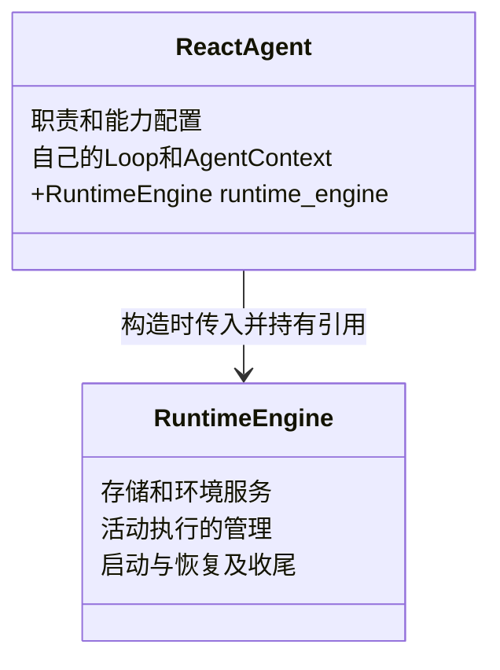

箭头的意思就是：创建 Agent 时传入 `runtime_engine=runtime`，Agent 保存这个引用。它不创建另一个 RuntimeEngine，也不继承 RuntimeEngine。PlanAgent 使用相同装配方式；它配置的 Planner／Executor 复用这次执行的运行服务。

| 放在 Agent 这一侧 | 放在 RuntimeEngine 这一侧 |
| --- | --- |
| 这个 Agent 做什么、用什么模型与能力、怎样决策和循环 | 接入存储和环境，为每次执行准备服务，管理执行生命周期 |
| 每个角色自己的消息与 Loop 进度 | 运行服务的装配、执行托管、恢复与收尾 |

RuntimeEngine 不持有供所有 Agent 共用的聊天记录。角色的 AgentContext 归相应 ReactAgent；保存和恢复使用 RuntimeEngine 提供的持久化设施。构造 Agent 时只检查、固定配置，真正执行从 start／ainvoke／astream 开始。

<details>
<summary>展开：构造参数示意</summary>

下面的变量代表调用方已准备好的配置和适配器，名称及参数遵循[构造合同](assembly.md#2-python-构造合同)。这是完整目标设计示意；已实现的构造方式与可运行示例见[接入指南](integration.md)，目标中的其他接口以实现记录列出的边界为准。

```python
runtime = RuntimeEngine(
    namespace=namespace,
    store=execution_store,
    content_store=content_store,
    environment=environment,
)

agent = ReactAgent(
    definition=definition,
    model=model,
    capabilities=capabilities,
    hooks=hooks,
    workspace=workspace,
    runtime_engine=runtime,
)

async with runtime:
    result = await agent.ainvoke("检查这份 SQL，并说明问题")
```

调用方不需要手工创建 ExecutionRunner、EventBus 或检查点。上层 Platform 做的事情也是准备这些参数，再构造 Agent；SDK 不需要反查平台的用户或应用。

</details>

### 2.2 开始执行后：SDK 创建本次 ExecutionRunner

**ExecutionRunner 是 RuntimeEngine 内部管理一次执行的对象。** 它负责这次执行的服务、控制与收尾；它不是业务 Executor，也不代替 Agent 的 Loop。只有取得本机执行权才创建它，单纯查询已有结果不会创建。

下面是启动时序；为突出先后关系，暂不展开图引擎和存储：

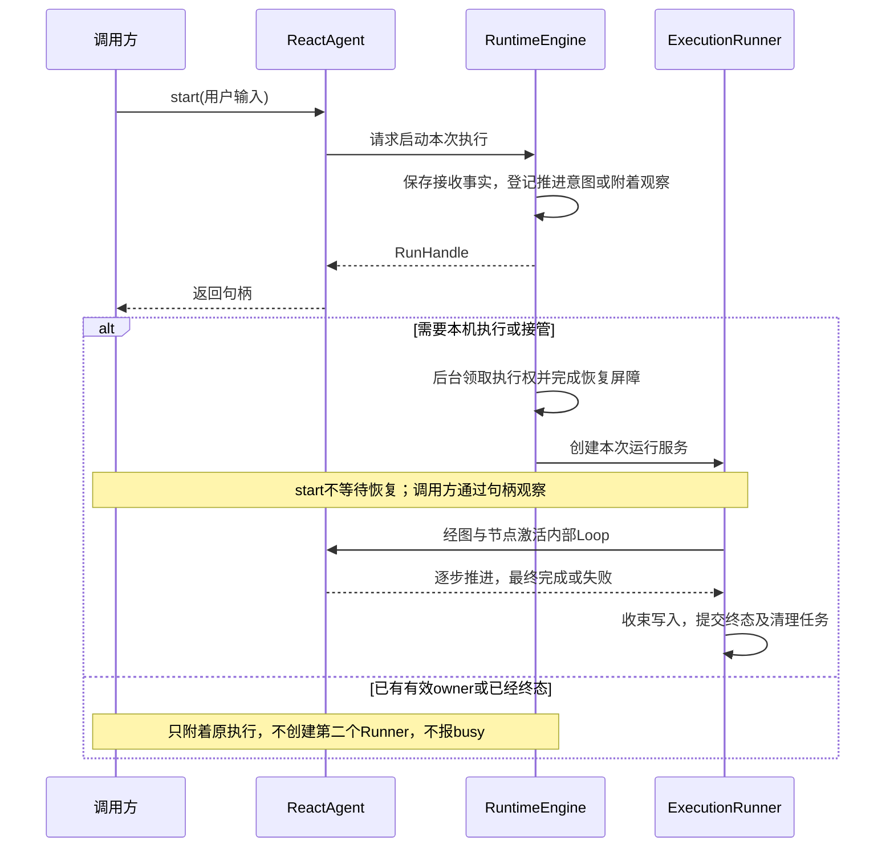

Agent.start 是面向调用方的入口；图内激活的是同一任务的内部执行逻辑，不会再次调用 start 新建一轮执行。Runner 通过图引擎和 AgentNode 驱动 Agent；图引擎管理调度，Agent 决定模型和工具循环。它们各负责一个部分。

RunHandle 只是这次执行的观察和控制入口，例如等待结果、读取事件或发出停止请求。调用方使用 ainvoke 时，SDK 代为启动并等待最终结果；使用 astream 时读取相同执行的事件。终态后的工作文件清理由 RuntimeEngine 托管的 CleanupService 领取独立清理租约，不为此重建 ExecutionRunner 或再次激活 Agent；其权限和接管规则见[终态清理执行权](checkpoints.md#81-终态清理执行权与重试)。

### 2.3 同时执行两个任务，会有几个对象

假设同一进程使用一个 RuntimeEngine，同时启动两个独立的 ReAct 任务：

| 对象 | 数量 | 各自负责什么 |
| --- | --- | --- |
| RuntimeEngine | 1 | 共享运行设施，托管两次执行 |
| ReactAgent | 2 | 每个任务一个活动实例，各有自己的 AgentContext |
| ExecutionRunner | 2 | 每次执行一个，分别管理自己的总线、控制及收尾 |
| ExecutionRecord | 2 | 保存两次执行的身份、状态和结果 |

两次执行可以使用同一份不可变 Agent 配置和相同存储服务，但不共享可变对话记录或进度。任务结束后释放其 Runner 和本机运行对象，ExecutionRecord 与历史记录仍保留。

Plan 模式的一次任务即使派生多个 Executor，仍使用一个根 ExecutionRunner；每个角色任务有自己的 Agent／AgentContext。这里的“一次执行驱动器”和“完成子任务的执行 Agent”不是同一个概念。

### 2.4 运行设施的完整关系

上面三节足以理解如何装配和调用。下方保留实现级关系，说明 EventBus、图引擎和存储的具体归属。

<details>
<summary>展开：完整对象 UML、作用域和生命周期</summary>

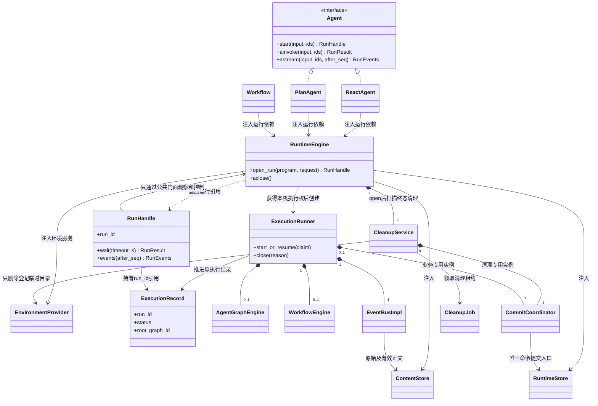

| 概念 | 作用域 | 生命周期与共享边界 |
| --- | --- | --- |
| Agent | SDK 公共接口 | 没有独立实例或执行状态；定义 start／ainvoke／astream 的使用合同 |
| ReactAgent／PlanAgent | 一个待绑定或已绑定任务的 Agent 对象 | 配置可复用；执行实例只绑定一次逻辑任务，消息与进度由其私有上下文管理；接管可重建物理对象 |
| Workflow | 一个已编译的工作流程序 | 编译结构可复用；每次调用产生独立执行现场，不在编译对象保存可变节点状态 |
| RuntimeEngine | 一个本机宿主实例 | open 到 closed；持有多次执行的任务和服务引用，注入客户端仍归调用方所有 |
| ExecutionRecord | 一次逻辑执行，键为 `namespace + run_id` | 初次接收时创建，结束后保留；保存状态、根控制与结果关联，不运行协程 |
| ExecutionRunner | 一次执行在本机持有执行权的期间 | 只推进一个 ExecutionRecord；完成必要收尾或关闭／失权后释放，故障接管新建；同一记录至多一个有效 owner |
| RunHandle | 一个观察者对一个 `run_id` 的本机引用 | 一条执行记录可有多个句柄；不拥有 Runner，关闭观察不停止执行，也不删除记录 |
| AgentGraphEngine／WorkflowEngine | 一个 ExecutionRunner 中对应的图内核服务，各 0..1 个 | 按需装配，可推进该次执行的多个所属图；每张图的状态和队列归各自内核管理 |
| EventBusImpl | 一个 ExecutionRunner，一个逻辑总线 | 路由调用方发出的业务／阶段事件，管理实际 Attempt；同次执行内的角色共享，通过scope隔离，其他执行不共享可变索引 |
| CommitCoordinator | 一个Runner的业务提交实例，或一个CleanupService的清理提交实例 | 两种实例复用相同命令提交设施，各自只持有对应受限权限；不共享当前任务等可变现场，一个实例只归一个宿主 |
| CleanupService／CleanupJob | 前者属于RuntimeEngine；后者属于某个终态ExecutionRecord | 服务扫描并领取独立CleanupLease，Job和进度持久保存；故障不重建业务Runner、不激活Agent |
| RuntimeStore／ContentStore／EnvironmentProvider | 调用方注入的存储或环境服务 | 可在遵守并发合同下跨程序、跨执行复用；请求必须带受限范围；Runner 退出不关闭共享客户端或删除持久内容 |

ExecutionRunner 具有一个逻辑总线，外层 Workflow 与其中的 AgentInvocation 共享它，按 scope 隔离。不同 ExecutionRecord 各建自己的总线和本机等待器。GraphExecution 可以有多个，AgentGraphEngine 是推进这些内层图的服务，不要求每个 Executor 新建一个 Engine。

RuntimeEngine 托管本进程的多次执行，每次实际执行／接管时创建独立 ExecutionRunner。图中的总线和图引擎服务归该次现场装配；总线内部的处理器注册关系在第 4 节展开。RuntimeEngine 只复用基础设施，不让多次 ExecutionRecord 共用可变现场。模型、Prompt、角色资源和 Hook 绑定仍来自各自 Agent 配置。职责拆分见[运行时引擎范围](assembly.md#11-runtimeengine-管理的范围)。

引擎服务按需装配：直接 Agent 只需要 AgentGraphEngine，纯工具 Workflow 只需要 WorkflowEngine，包含 AgentNode 的 Workflow 两者都需要。这里的 0..1 表示本机服务对象数量，不是持久 GraphExecution 数量。

RuntimeStore／ContentStore 由调用方注入，不能画成 Agent 销毁就级联删除的子对象。SDK 关闭本机 ExecutionRunner 只释放连接、等待者和执行权；持久记录由独立删除操作处理。


</details>

## 3. Node、角色与执行实例

先看最直接的关系：**AgentNode 持有 Agent，Agent 读取 AgentDefinition。** Planner 与 Executor 都使用 ReactAgent 和同一种定义格式；“规划／执行”是它们在图中的职责。

下面是一个 Planner 和一个检索 Executor 的对象示例，每个框上方是类型名，下方说明它在这个例子中的用途：

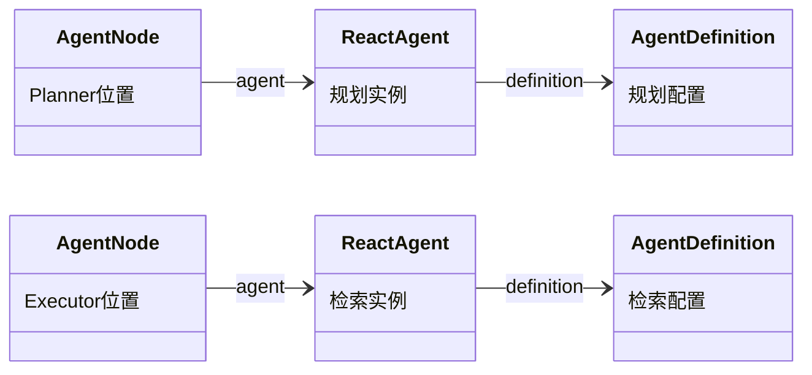

PlanAgent 构造时接收 `definition=规划配置`、`executors={"research": 检索配置}`。它据此生成 Planner 与 Executor 的节点绑定，执行时再为任务创建 AgentNode 和 ReactAgent。定义只保存当前 Agent 的 Prompt、变量、Skill／Tool／MCP 选择和输入输出格式；组合关系由 PlanAgent 持有。具体构造参数见[SDK 装配](assembly.md#2-python-构造合同)。

模型、执行额度和上下文策略在完整 Agent 装配时传入；同一 Plan 的 Executor 沿用这些设置。它自己的 Prompt 与能力读取自己的 AgentDefinition，不复制 Planner Prompt。

**执行中的 ReactAgent 另持有自己的 AgentContext；图引擎向节点传入 NodeContext。** 前者保存任务消息和进度，后者提供本次激活的身份及服务。下面的完整类型图用于查接口，不改变上面的对象关系。

<details>
<summary>展开：Agent／Node 接口与上下文的完整类型关系</summary>

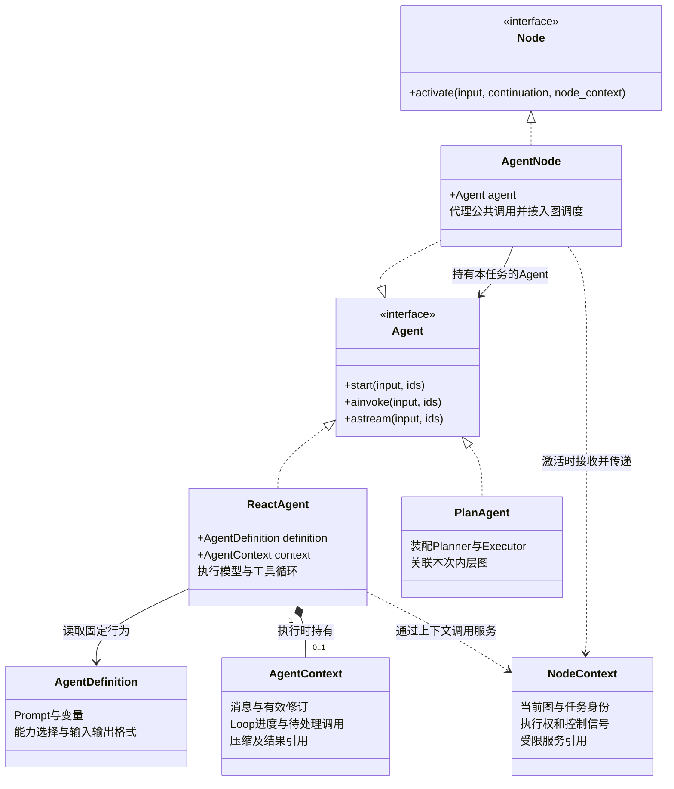

图中的组成关系表示**本机对象的归属**，不表示 Agent 对象释放就删除历史或检查点。ReactAgent 构造后尚未执行时没有 AgentContext；获得本机执行权并创建／恢复任务后拥有一个。仅附着远端执行或查询终态时，通过 RunHandle 观察，不伪造一份活动上下文。

</details>

| 概念 | 作用域 | 保存什么、由谁使用 |
| --- | --- | --- |
| Agent／Node | 接口／类型 | Agent 面向调用者，Node 面向图调度；普通函数和工具节点不必实现 Agent |
| ReactAgent | 一次任务的本机执行实例 | `definition: AgentDefinition` 与私有 `context: AgentContext`；实现唯一的 ReAct Loop |
| PlanAgent | 一次完整 Plan 调用的本机对象 | Planner 的 definition、Executor 定义表、共享策略、图绑定与本次图引用；消息由各任务的 ReactAgent 保存 |
| AgentNode | 本次图任务的 Agent 适配对象 | `agent` 引用与接入绑定；公共方法代理 Agent，图内激活接续当前任务 |
| AgentContext | 一个 ReactAgent 的角色任务 | 输入、消息、工具结果、有效修订、压缩引用、Loop 进度及待处理调用；各任务私有 |
| NodeContext | 当前任务的一次激活 | 任务身份、当前 lease、停止／截止视图及受限服务入口；不存模型消息，不进入检查点 |
| AgentDefinition | 一份可复用的行为配置 | 独立 ReAct、Planner 和 Executor 使用同一结构；多次委派可读同一份定义 |
| NodeDefinition／NodeBinding | 一个图位置及其装配关系 | 定义位置与流转，绑定具体 Agent 定义和创建依赖；活动对象按任务创建 |
| NodeTask | 图内一次逻辑任务的持久记录 | 状态、输入和上下文／检查点引用；Loop 与恢复沿用原任务身份 |

### 3.1 NodeContext 与 AgentContext 怎样分工

`NodeContext` 是图引擎为当前调用组装的参数对象，服务仍来自 RuntimeEngine 所组织的本次 ExecutionRunner。它只引用已有服务，并绑定任务权限；不新建总线、模型客户端、文件系统或检查点引擎。普通函数节点也可以需要这种调用环境，即使它完全没有 Agent 或模型消息。

`AgentContext` 才是 Agent 的执行上下文。ReactAgent 推进自己的消息和 Loop；AgentNode 不另存 messages，NodeContext 也不复制它。`NodeContext.context_port` 如存在，只是访问上下文服务的受限入口，不是一份上下文数据。

| 内容 | 所属位置 |
| --- | --- |
| 问题、补充、模型回答、工具反馈、压缩摘要引用 | `agent.context` 的消息及有效修订部分 |
| 当前阶段、Loop 序号、待处理模型／工具批次、结果消费位置 | `agent.context.continuation` |
| 当前 graph／task／activation 标识、执行租约、停止信号 | `node_context` |
| 模型、能力、上下文、文件等受限服务入口 | `node_context` 引用本次执行已有服务 |
| 消息记录、有效修订和已提交进度的持久保存 | 统一 CommitCoordinator／RuntimeStore，不由 Agent 自行写数据库 |

ContextHandler 负责历史选择、上下文物化与压缩等处理；这是一项可复用服务，不是所有 Agent 共用的消息容器。Hook 的有效修改提交后，Agent 在下一次物化／推进边界读取新修订；不能一直使用旧内存消息列表，也不能把未提交修改当作已完成事实。

### 3.2 ReAct 与 Plan–Executor 的实例关系

| 模式 | 图中的位置 | 运行中的 Agent | 上下文 |
| --- | --- | --- | --- |
| ReAct | 一个主节点 | 一个 ReactAgent，由 AgentNode 接入 | 一个私有 AgentContext |
| Plan–Executor | Planner 与配置的 Executor 位置 | Planner 和每次 Executor 委派各有一个 ReactAgent | 每个执行实例各自持有 AgentContext |

PlannerNode／ExecutorNode 若作为专用类保留，继承 AgentNode，只表达节点绑定与接入约束；Loop 放在内部 ReactAgent，不再设计 ReactNode 的另一套 Loop 继承链。PlannerNode 持有使用 PlanAgent.definition 的 ReactAgent，不持有完整 PlanAgent；ExecutorNode 持有使用 executors[key] 的 ReactAgent。两者共用主模型与执行策略，Executor 使用自己的 Prompt 和能力范围，首版不递归委派。

**两次“资料检索”委派：** 复用 `executors["research"]` 这一份 AgentDefinition 和一个 Executor 节点定义，创建两个 NodeTask、两个 AgentNode、两个 ReactAgent 和两个 AgentContext。两个 ReactAgent 读取同一份定义，各自推进自己的任务。Planner 自己还有一个 ReactAgent 和一个上下文；这三个任务仍在同一内层 GraphExecution 中，合计使用一份 Loop 额度。工作文件和授权基础设施可以共享，模型消息不能共享。

继续 Loop／从等待恢复时沿用原任务及其上下文；故障接管时可重建物理 Agent 对象，但恢复原 `task_id`、`context_id` 和进度。普通 Tool／MCP、Skill 读取和脚本调用产生 Operation，不额外创建 AgentContext 或图实例。

### 3.3 两个入口与配置复用

| 入口 | 调用如何处理 | 执行范围 |
| --- | --- | --- |
| Agent 的 `start`／`ainvoke`／`astream` | 代理内部 Agent 同名方法，返回原句柄、结果或事件流 | 开始、附着或恢复调用者指定的执行；AgentNode 不额外创建根记录 |
| Node 的 `activate(input, continuation, node_context)` | 接入已分配的任务，恢复内部 AgentContext 后推进 Agent | 继续图内执行，沿用原额度、总线和停止控制；不再调用公共 start |

AgentNode 不重复实现 Loop、消息、额度或模型／工具 Hook。`continuation` 是激活时从检查点恢复进度的输入；接入后就是 `agent.context.continuation` 的已提交起点，不是 NodeContext 中的第二份进度。

共享的注册表保存固定配置和创建绑定的工厂；**不把一个正在执行的 Agent 对象交给两个任务**。公开构造返回待绑定实例；首次成功接收调用时绑定执行身份，之后同身份可附着或恢复。下一次新提问创建新 Agent，继续复用配置与基础设施。完整规则见[装配生命周期](assembly.md#12-agent-实例与配置复用)。

外层 Workflow 调用完整 ReactAgent／PlanAgent 时，经调用桥创建或接回 AgentInvocation，使用独立的内层图；内层角色委派仅创建角色任务。Workflow 编译保存固定装配绑定，执行时据此实例化 Agent，而非把编译时的活动对象当作共享实例。两套节点调度协议由 WorkflowNodeAdapter 适配，不把内层 activate 冒充外层原生节点接口。

独立调用 Planner 必须已经具备完整的委派目标及图服务绑定；代理不自动补出缺失配置。只有公共 Agent 方法的第三方实现，也不能据此声明支持可恢复嵌入。

### 3.4 上下文怎样保存与恢复

AgentContext 由 Agent 使用和持有，持久化由统一设施完成；这两个职责不冲突。

1. 消息头 `AgentContextHead`、原始记录、有效修订和摘要引用保存上下文内容；`ReactContinuation` 保存 Loop 位置。它们是 AgentContext 的存储组成，不是两个新的上下文管理器。
2. NodeCheckpoint 引用不可变 continuation，NodeTask 关联该检查点与上下文身份。一次推进涉及的消息修改和进度通过同一个 RuntimeCommit 发布。
3. 恢复时读取一致的任务现场，重建 ReactAgent 及其 AgentContext，再装配带新执行权的 NodeContext；不把模型客户端、服务引用、锁或协程写进检查点。
4. Agent 本机对象释放后，持久记录继续保留。删除 Agent 应用、记录过期等业务生命周期仍由平台按约定发起。

### 3.5 引擎内部辅助对象

| 辅助对象 | 实际作用及作用域 |
| --- | --- |
| NodeDriver | 图引擎内部激活节点、提交进度、等待和恢复的代码；可先实现为引擎内部方法 |
| NodeRegistry | 固定节点配置与创建工厂的只读映射；不保存跨任务共享的活动 Agent |
| ModelPort／CapabilityPort／ContextPort／DelegationPort | 现有服务的任务受限入口；委派入口仅授予 Planner，不是四套新引擎 |
| WorkflowNodeAdapter／CapabilityNode | 外层工作流的接入和能力节点，单独在 Workflow 设计中展开 |

NodeContext 不暴露原始数据库连接、平台应用服务、凭据或无限制文件路径。模型／能力／委派入口仍经过事件总线；上下文内部的物化和准备写集可直接调用，避免递归包装持久化基础操作。

## 4. EventBus、HandlerRegistry 与 EventHandler

**Loop 发出事件，EventBusImpl 按注册表交给对应 Handler。HookHandler 也是其中一个 Handler，只是它还拥有自己的子处理器注册表。** 这两层注册与处理在本节一起说明。

### 4.1 三个接口与两个组合对象

| 接口 | 负责什么 | 谁实现 |
| --- | --- | --- |
| HandlerRegistry | register_handler／resolve／freeze：注册、查询和冻结处理器绑定 | EventBusImpl、HookHandler |
| EventBus | request：发送请求并等待对应类型的结果 | EventBusImpl、HookHandler |
| EventHandler | handle：处理收到的事件并返回结果 | HookHandler、ModelHandler 等业务处理器，以及各个 Hook 子处理器 |

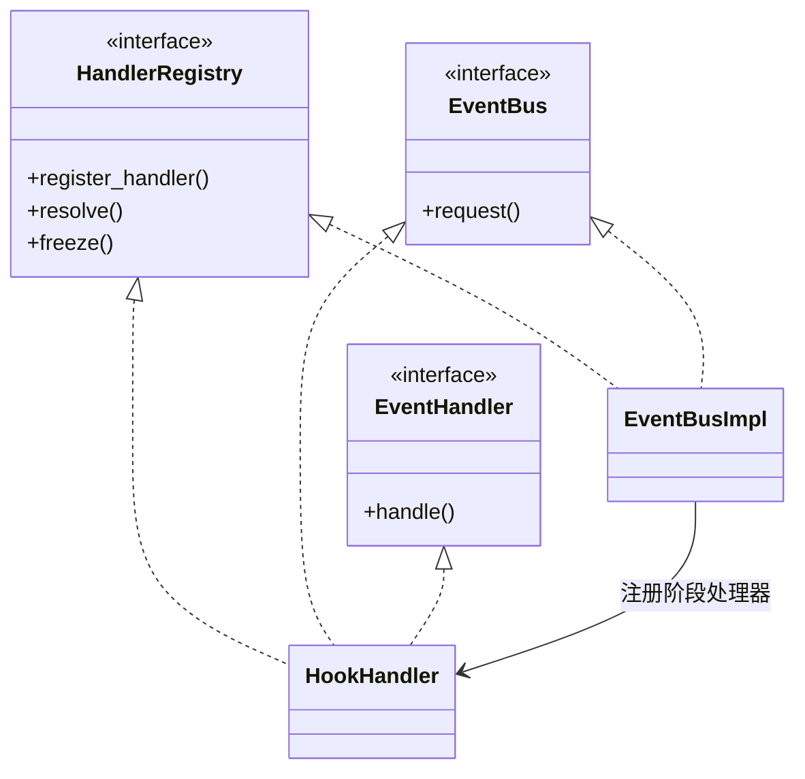

虚线空心三角表示接口实现，普通箭头表示注册关系。HookHandler 对上通过 handle 接收事件，对下通过自己的 request 和注册表调用子处理器。EventBusImpl 实现注册与发送接口；普通业务 Handler、末端 Hook 只需实现 EventHandler。

**HandlerRegistry 是接口名称。** EventBusImpl 和 HookHandler 分别持有本地绑定表，无需再创建一个全局注册中心。注册表不保存调用进度；Operation 才保存本次调用选中的链和游标。接口的完整签名和输入输出类型见[调用接口](event-bus.md#10-三个接口与组合关系)。

### 4.2 根处理器与 Hook 子处理器的注册关系

下图中的箭头均表示注册／持有的处理器引用，不表示执行先后，也不表示类继承。除了左侧 EventBusImpl，图中各类都实现 EventHandler；其中 HookHandler 还实现上图中的注册和发送接口。

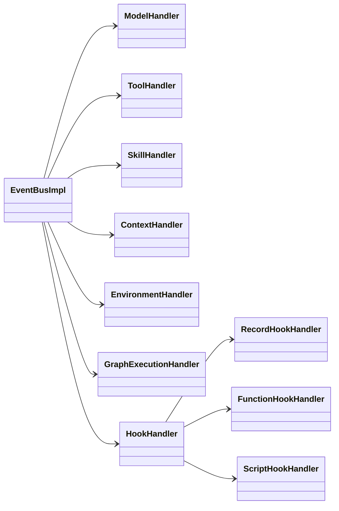

ModelHandler 等业务处理器注册在根总线；RecordHookHandler 等子处理器注册在 HookHandler 的本地表。注册某个子 Hook 不会使它自动成为根总线上的业务处理器。图中的子类型是可选示例，不要求每次执行都创建三种实例。

| 处理器 | 接收的事件／输入 | 负责什么 |
| --- | --- | --- |
| ModelHandler | model.generate、model.embed | 校验执行许可，调用模型适配器，聚合完整响应并返回原始结果 |
| ToolHandler | capability.invoke、result.read | 按当前授权目录解析工具、MCP、文件或脚本适配器，执行或读取结果 |
| SkillHandler | skill.list、skill.read、skill.resource.read | 查询授权 Skill 目录、读取入口及包内资源；调用已注册 SkillLoader，返回结果，不执行脚本 |
| ContextHandler | context.materialize、context.mutate、context.compact | 生成上下文投影、准备修改写集或可恢复压缩计划 |
| EnvironmentHandler | environment.prepare、environment.read、environment.write | 处理授权环境与文件请求，调用环境服务或准备相关操作 |
| GraphExecutionHandler | executor.delegate、agent.invoke | 准备委派／完整 Agent 调用的关联计划，由所属图引擎调度 |
| HookHandler | model.generate.before／after 等 CallStageEvent | 选择当前程序的子链，顺序处理、校验并提交修改，返回 StageResult |
| RecordHookHandler | HookInput | 记录型 Hook 的示例，返回 HookDecision；普通只读日志也可使用观察订阅 |
| FunctionHookHandler／ScriptHookHandler／用户子处理器 | HookInput | 执行具体函数、脚本或用户逻辑，返回 HookDecision，由 HookHandler 统一处理 |

ContextHandler 的写集和 GraphExecutionHandler 的启动计划均为准备结果，必须先通过 CommitCoordinator 提交才能生效。GraphExecutionHandler 不启动另一套调度器；ModelHandler／ToolHandler 不替 Loop 发出调用前后事件。

### 4.3 作用域、配置与子链状态

| 概念 | 作用域 | 生命周期与共享边界 |
| --- | --- | --- |
| EventBusImpl | 当前 ExecutionRunner 的根总线 | 登记和路由请求、管理 Attempt 超时重试、等待结果；各执行独立装配 |
| HookHandler | 当前根总线注册的组合处理器 | handle 进入自身的 request；按程序、阶段和 matcher 选择本地固定链，共用根执行的提交与存储设施 |
| ModelHandler／ToolHandler／SkillHandler／ContextHandler／EnvironmentHandler／GraphExecutionHandler | 当前 ExecutionRunner 的业务处理服务 | 持有已解析依赖，按本次可信 scope 处理；不保存多个角色共用的可变消息列表 |
| HandlerBinding／HookBinding | 根路由项／所属程序的 Hook 子注册项 | 装配期固定；HookBinding 保存处理器、阶段、顺序、matcher 和 timeout，不保存执行游标 |
| FunctionHookHandler／ScriptHookHandler／用户子处理器 | 单项 Hook 的 EventHandler 实现 | 可复用实现须遵守并发合同，不保留上次调用的可变上下文；只返回决定或修改提案 |
| CallStageEvent／StageResult | 原 Operation 的阶段输入／聚合结果 | Loop 发出并等待；结果引用累计已提交的有效修订，不生成另一项业务 Operation |
| HookInput／HookCallContext | 一次 HookInvocation 的输入／受限环境 | HookCallContext 包含身份元数据 HookContext 和读取端口 HookReadPort；端口调用结束即失效，不序列化客户端 |
| HookSchemaRegistry | SDK 挂点及可修改字段的规则表 | 规则可跨执行复用；与 HandlerRegistry 的处理器绑定表职责不同 |
| ModelPortProxy／CapabilityPortProxy／DelegationPortProxy | 当前任务的受限发送端口 | 只获得发送能力及可信 scope，不获得注册能力 |
| ResultWaitRegistry／ObservationDispatcher | 根总线内部的等待与观察设施 | 本机等待者和队列在接管时重建；可靠通知游标按既有存储合同保存 |

HookSet 是构造期配置，据此装配 HookHandler 的本地表，字段见[Hook 装配](assembly.md#5-hookset-与-hookbinding)。同一 ExecutionRecord 可包含多个程序：HookHandler 先按可信 ExecutionBindingRef／program_key 选择程序，再按阶段和 matcher 选择子链，不合并不同程序或角色的私有上下文。

固定链、每项决定和游标保存到原 Operation；故障恢复沿用原选择。HookHandler 经 ContextHandler 准备有效修改，再经 CommitCoordinator 一致提交决定、修订和游标；子处理器不能直接改上下文或存储。后续 Hook、Agent 上下文物化、历史读取和恢复均读取相应授权范围内的有效修订。

### 4.4 一次请求怎样经过这组对象

1. Agent 的 Loop 经受限端口登记本次业务 Operation，保存调用阶段。
2. Loop 发出 model.generate.before 或 capability.invoke.before 等事件，说明自己即将做什么；根总线按阶段绑定交给 HookHandler。
3. HookHandler.handle 委托自己的 request，在本地表选择子 Handler，按固定顺序调用 handle。每项有效修改和游标提交后，下一项才读取更新后的视图；完成或合法拒绝后返回已提交 StageResult。
4. Loop 等待阶段结果；模型／普通能力允许后完成最终校验和许可提交，再经总线执行主处理器。graph调用先路由GraphExecutionHandler纯准备提案，再同事务提交目标与许可，具体顺序见第8节。
5. 原始结果先保存，Loop 再发对应 after 事件。HookHandler 处理结束后，原调用方保存最终有效响应，才解释结果或向批次交付。

**Loop 知道业务阶段，不知道有没有 Hook。EventBus 知道如何路由，不决定何时开始下一业务阶段。** 首版即使没有用户 Hook，也注册阶段处理器；空链返回原有效视图。漏注册阶段路由必须在装配时报告，不能当作自动允许。调用方的阶段算法由原 Loop／NodeDriver 复用，无需 InvocationPipeline 对象；故障从原 Operation 阶段恢复。

before／after 必须等待结果，避免 Hook 尚未拒绝而业务已经执行。合法 deny 终止当前 Hook 链；Hook 自身异常、超时或非法返回按规则记录后继续。必要持久化／租约错误必须中止推进，不能按 Hook 失败放行。后置拒绝不能撤回已经发生的外部副作用。

### 4.5 注册与分发边界

根业务路由的 (event_type, schema_version) 只允许一个主 Handler；同键重复注册拒绝，缺项返回 ROUTE_NOT_FOUND。HookHandler 本地同一事件可以注册多个子 Handler，按固定 ordinal 顺序处理；同一程序内 binding_key 重复仍拒绝。resolve 返回不可变有序列表：根路由至多一项，本地 Hook 链可有多项，分发方检查相应基数。

两个注册表分别归属当前对象，装配时校验并冻结，不自动回退到父总线。HookHandler.handle → request → 子 Handler.handle 只在本地分发，不把当前阶段再次发回根总线，不递归触发自身 Hook，不新建 Operation 或执行额度。需要跨领域请求时使用明确注入的受限根发送端口。子处理器返回 HookDecision，HookHandler 汇总为 StageResult，不能把任意订阅者的返回值拼成业务结果。

HandlerOutcome 按业务绑定的 execution_kind 区分：

| 类型 | 主 Handler 返回什么 | 后续由谁处理 |
| --- | --- | --- |
| external | 一次外部尝试的 RawResult | 总线保存 Attempt／raw 并返回；Loop 发 after，再结算有效响应 |
| internal | PreparedDomainEffect 与读／写集 | CommitCoordinator 校验并应用，处理器不自行写表 |
| graph | before_call阶段的纯PreparedDelegate，不要求先有permit | 对应引擎原子提交目标/父关联/permit/ready意图后调度；总线只等待原目标结果 |
| recoverable | RecoverableWaitPlan，例如压缩 Episode | 注册可恢复目标后等待，不伪造一次网络 Attempt |

before／after 使用 call_stage 路由，沿用原 Operation。普通观察 subscribe 只消费已提交事实，返回值不修改执行。request_many(batch_ref,scope) 仅推进／等待已保存的模型决策批次，不接收任意事件列表；结果按原 ordinal 返回。begin、await_result、request_many、prepare_graph、subscribe 等根总线方法仍只属于 EventBusImpl 的附加能力，不要求 HookHandler 重复实现。graph Handler 在允许的 before_call 纯准备计划；计划、目标和许可同事务提交后，实际推进只接回该目标，不能按普通外部调用先发许可再建子任务。

## 5. Event、Operation 与 Hook 记录

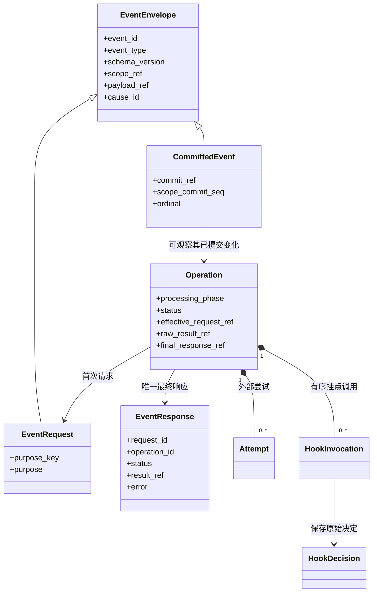

| 概念 | 作用域 | 生命周期与共享边界 |
| --- | --- | --- |
| EventEnvelope | 一条消息的身份及 scope | 不可变值对象；scope、source、cause_id 的作用不同，不能用追踪字段代替授权 |
| EventRequest | 一次有稳定 purpose_key 的逻辑请求 | 首次 begin 与 Operation 关联；相同逻辑重投读取原关联，不创建新的业务调用 |
| EventResponse | 一个请求的最终有效响应 | 持久逻辑调用最多一个最终响应；开始前本地拒绝可无 operation_id，但仍属于原批次成员 |
| CommittedEvent | 某个已提交事务中的一个通知项 | 以 commit_ref／scope／ordinal 定位；可被多个获准观察者读取，投递重复不重做业务 |
| Operation | 一次执行中的一项可恢复逻辑调用 | 跨等待、自动重试及接管沿用；关联发起任务／图／系统 scope，不是每个网络包一条 |
| Attempt | 一个 Operation 的一次外部尝试 | 每次尝试独立记录状态和原始结果；不同尝试的半截模型输出不能拼接 |
| HookInvocation | 一个 Operation 某阶段固定链中的一项 Hook 调用 | 调用身份和结果持久保存，恢复按原游标继续；不共享其他 Operation 的决定 |
| HookDecision | 某次 HookInvocation 返回的决定 | 保存 allow／deny／patch 及来源；补丁提交后成为相应授权上下文的有效修订 |

Event 是通信值对象，Operation 是一次可恢复逻辑调用。event_id 用于消息身份；operation_id 用于执行事实；purpose_key 用于逻辑重投；cause_id 用于追踪，均不能替代权限或租约。

普通事件不自行生成检查点。必要状态由 Coordinator 一致提交，outbox 是同提交的通知投影。消费观察事件不能触发重放工具。没有订阅者也必须能够执行和恢复。

## 6. Skill 与能力对象

**Agent 通过事件请求能力。SkillHandler 处理 Skill 的发现和读取；ToolHandler 处理工具、MCP 和脚本调用。** SkillPackage 是资源数据，SkillLoader 是读取接口，两者由调用方准备并注册，运行时由 SkillHandler 使用。

### 6.1 运行时：事件交给哪个 Handler

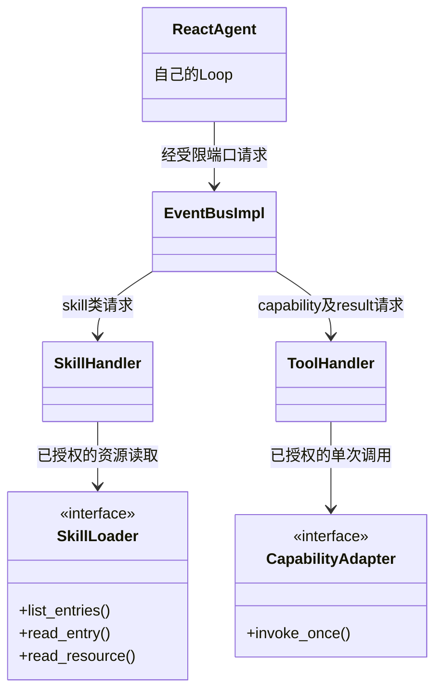

图中展示调用依赖；受限端口的类型已在第 4 节说明。SkillHandler 和 ToolHandler 都实现 EventHandler，分别注册在根总线上。它们读取当前节点绑定的 CapabilityRegistry 视图，不能把 Planner 与各 Executor 的能力合成全局权限。

| 模型或调用方要做什么 | 业务事件 | 主处理器 | 实际行为 |
| --- | --- | --- | --- |
| 查看可用 Skill | skill.list | SkillHandler | 从当前授权视图返回名称、说明和入口元信息 |
| 阅读某个 SKILL.md | skill.read | SkillHandler | 校验入口和参数，经 SkillLoader 读取并渲染指令 |
| 阅读 references／assets／scripts 中的文件 | skill.resource.read | SkillHandler | 限定在已绑定 Skill 的资源范围；返回文本或内容引用 |
| 执行 Skill 中的脚本 | capability.invoke，目标为 exec 工具 | ToolHandler | ScriptToolAdapter 在授权沙箱／工作目录中执行 |
| 读写任务文件 | capability.invoke，目标为 read／write 等工具 | ToolHandler | FileToolAdapter 使用受限文件服务 |
| 调用 MCP 或函数工具 | capability.invoke | ToolHandler | McpToolAdapter／FunctionToolAdapter 执行一次调用 |

模型可见的入口由 SDK 装配时固定映射为事件类型，模型不能自行指定路由或 Handler。Skill 的名称不是可执行函数名；配置了 Skill 也不会自动获得 exec 权限。具体 DTO、路由与错误语义见[Skill 调用设计](capabilities.md#33-skillhandler-的事件入口)。

每次显式读取都是一个逻辑 Operation，前后阶段由原 Loop／节点驱动器发出，HookHandler 按第 4 节协议处理。SkillHandler 返回读取结果后，由总线保存原始结果，Loop 等待 after 完成并消费有效响应，再将它写入自己的 AgentContext；SkillHandler 不直接改消息。

### 6.2 配置与资源：谁引用谁

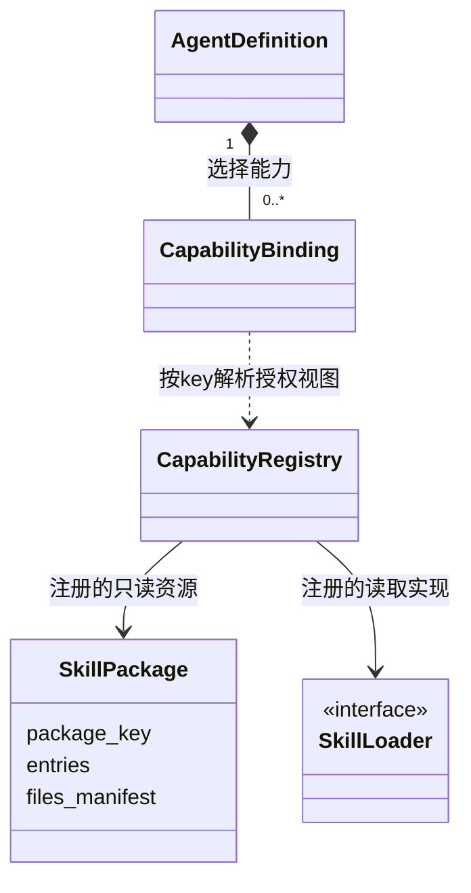

CapabilityRegistry 是资源目录，保存 SkillRegistration／CapabilityRegistration 等装配数据；HandlerRegistry 是事件处理器注册接口。两者不互相替代：**前者回答“这个 Agent 可以用哪些资源”，后者回答“这个事件交给谁处理”。**

SkillRegistration 将 SkillPackage 与 SkillLoader 关联。SkillHandler 按当前绑定找到它们，不向平台查询资源或版本。初始上下文只取已冻结目录中的元信息；运行时正文按需读取。资源包本身不订阅事件、不继承 Node，也不保存任何会话消息。

首版 Skill 读取不创建一个持续生效的“Skill 使用实例”，也不改变后续工具目录。工具权限始终来自当前 AgentDefinition 的固定能力绑定；尚无生效范围协议的 allowed-tools／disallowed-tools 在装配时明确拒绝。正文模板的原参数串 raw_arguments 与位置参数 arguments 分开保存，具体规则见[Skill 支持范围](capabilities.md#32-支持与读取)。

### 6.3 工具适配器与文件执行环境

默认工具清单和 SPI 合同见[默认工具与 SPI](builtin-tools-spi.md)。新增业务工具实现 CapabilityAdapter；更换文件介质实现 WorkspaceBackend；更换命令环境实现 SandboxGateway。内置与用户工具使用相同的注册和调用路径。

文件工具与存储的关系：

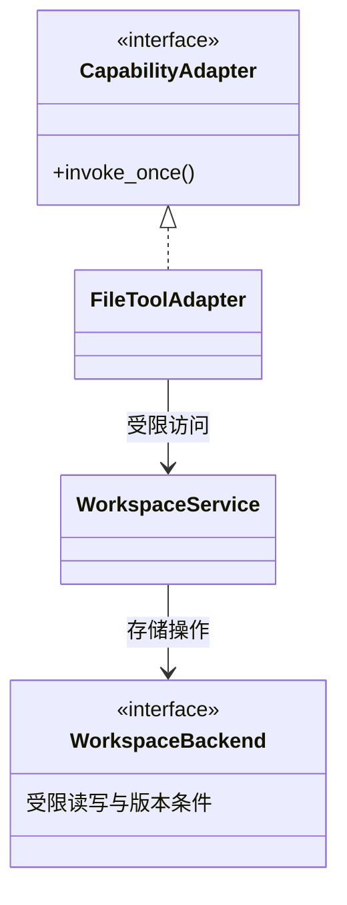

脚本工具与环境装配的关系：

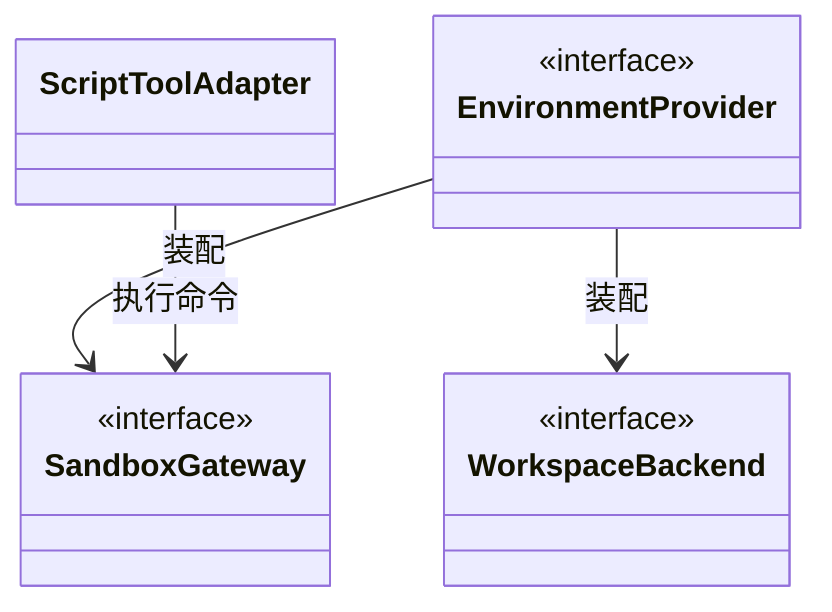

ScriptToolAdapter、McpToolAdapter、FunctionToolAdapter 均实现第一张图中的 CapabilityAdapter；两张图的 WorkspaceBackend 是同一接口。分图分别说明访问与装配，不新增另一套执行环境或工具调度器。

ScriptToolAdapter 使用只读 `/skills/<name>` 资源挂载及授权 `/work` 工作目录；Planner／Executor 可共享该工作目录，消息上下文仍各自独立。解释器与挂载来自已配置环境，模型不能传入宿主目录替代它们。

SkillLoader 只读资源，文件工具通过 WorkspaceService 访问文件。即使 read 工具读取的是 `/skills` 下的文件，也必须遵守同一只读挂载和路径授权；普通文件读取不隐式执行 Skill 模板、脚本或 Hook。脚本内部每次文件系统操作不会生成新的业务 Operation，外层 exec 调用负责该脚本的执行记录和结果。

WorkspaceService 承担公共路径、访问范围和挂载路由，Backend 承担真实 I/O、版本条件及声明的原子操作。EnvironmentProvider 使文件工具和脚本看到同一逻辑挂载；对象存储若没有合格的执行挂载／同步实现，就不能仅凭支持 read/write 开放 exec。检查点仍走独立 RuntimeStore，不由文件工具读写。

### 6.4 对象作用域与结果归属

| 概念 | 作用域 | 生命周期与共享边界 |
| --- | --- | --- |
| AgentDefinition／CapabilityBinding | 一个 Agent 的行为及能力选择 | 固定配置可复用；每个节点绑定解析自己的授权视图 |
| CapabilityRegistry／SkillRegistration／SkillPackage | 已装配资源目录、注册项和只读包 | 可被多个获准 Agent 引用；注册资源不等于授权所有角色 |
| SkillHandler／ToolHandler | 当前 ExecutionRunner 的事件处理服务 | 每次处理显式携带可信 scope，不保存共享的角色消息或当前 Skill 全局变量 |
| SkillLoader | 调用方注入的只读资源接口 | 可跨执行复用；每次读取校验范围和固定 manifest，不负责事件路由、Hook、循环或上下文提交 |
| CapabilityAdapter 及其具体实现 | 已装配的单次调用接口与客户端 | 不拥有图或任务生命周期；并发安全的实现可复用，每次使用独立调用参数 |
| WorkspaceService | 当前调用的受限文件视图 | 按 scope、角色及挂载校验逻辑路径，不持有全局 current_session；更换后端不改变工具合同 |
| WorkspaceBackend／SandboxGateway | 注入的存储／脚本执行实现 | 可共享并发安全客户端；每次使用受限句柄与有效执行权，失权后不能继续写；不负责保存 Agent 消息 |
| EnvironmentProvider | 调用方注入的环境服务 | 装配后端、只读资源和沙箱，保证同一工作区视图，按根执行的生命周期撤权与清理 |
| SkillReadResult／ToolResult | 一次逻辑读取或执行的结果 | 原始结果和 Hook 后有效结果分别保存；只进入发起 Agent 的上下文，恢复复用已提交结果 |

读取 Skill、执行脚本和调用 MCP 都不会创建新的 Agent／图实例。是否把一次能力调用放进 Workflow 的 CapabilityNode，由外层编排决定；Executor 委派仍走 GraphExecutionHandler，不能因为任务提及 Skill 就自动创建 Executor。

## 7. 一次模型调用的时序

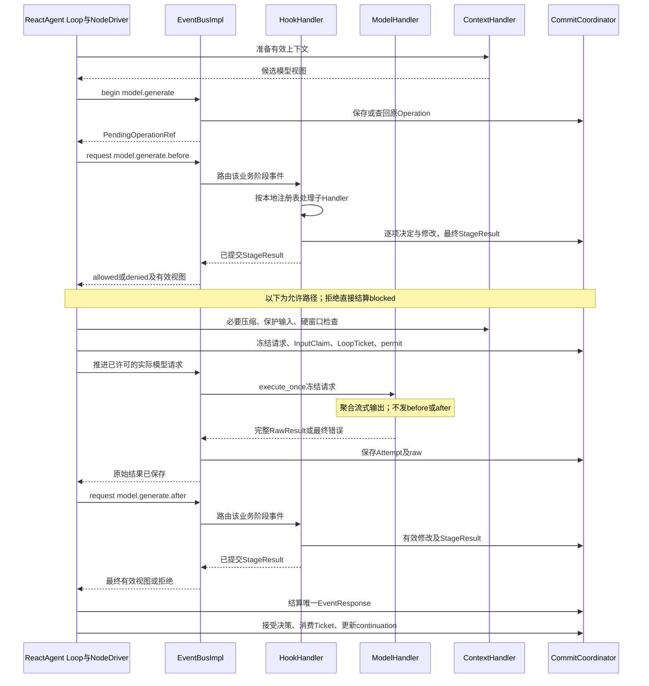

这条时序属于一个 NodeTask 的一次模型逻辑调用。根总线和组合处理器是本次 ExecutionRunner 的服务；Operation、Attempt、HookInvocation、LoopTicket 属于本次调用。下一次业务 Loop 新建模型 Operation；连接重试沿用 Operation，新增 Attempt。HookHandler 的内部转发不额外生成业务调用。before／after 的 source 始终是原 Loop，HookHandler 自己的诊断来源单独记录。

前置 Hook 完成后，必须处理压缩、最终预算和额度许可才能发送模型请求。前置 deny 直接返回 blocked，不进入图中允许路径。不同 Attempt 不重复执行已完成 Hook 或领取新输入，不拼接失败流。原始结果保存后恢复只由原 Loop 继续 after 和最终提交，不重新调用模型。每次完整模型响应发一次 after，不按 token 发；raw_saved 只是内部阶段事实，不等于向用户交付最终答案。

## 8. Tool／MCP／Skill 与 Executor 的交互差异

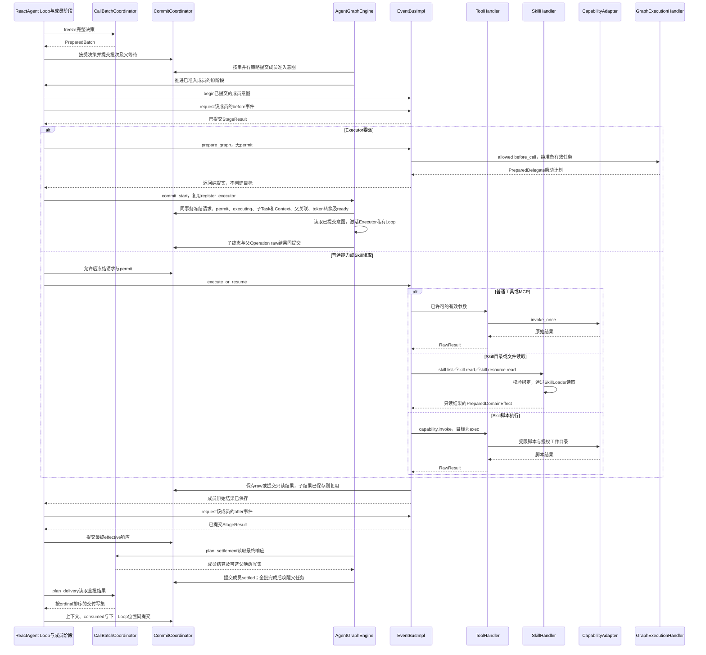

| 概念 | 作用域 | 生命周期与共享边界 |
| --- | --- | --- |
| CallBatchCoordinator | 当前 ExecutionRunner 的批次规则服务 | 可以处理不同父任务的批次，但只返回准备写集；不自建执行协程或保存共享的“当前批次” |
| CallBatch／WaitGroup | 某个 NodeTask 一次模型决策产生的动作批次 | 成员固定，按该批配置准入；等待全批结算后只向原父任务交付一次 |
| PreparedBatch／PreparedDelegate | 一次批次／委派命令的提案 | 提交前只是候选数据；只有已提交的 Task、关联和 ready 意图才能触发执行 |
| Executor NodeTask | 同一内层 GraphExecution 中一次委派的任务 | 同一个执行器配置被委派两次产生两个任务和两份私有上下文；共用 Invocation 工作文件 |

图中的 N 包括原 Loop 的动作成员推进方法，不表示每完成一个动作就调用一次模型；这些方法经 NodeDriver 恢复和调度，不建立另一层 Agent。before 拒绝直接结算该成员，不进入实际执行或 after。图中的分支是单个成员的不同类型，不表示整批只能选一种。一个批次可以同时有 Tool、MCP 和多个 Executor；只有 parallel_enabled 开启才并行。工具执行不会新增图实例，Executor 也只新增本内层图的 NodeTask。

图中一次“保存”箭头概括相应阶段的提交，raw、各 Hook 与最终响应仍遵循调用协议各自的原子边界；Executor 的 raw 已在子终态事务保存，原成员推进逻辑续发 after。Coordinator 才能写入事实；CallBatchCoordinator／GraphExecutionHandler 返回准备结果，不能自行启动协程或提交。批次本地拒绝项无 Operation，按 Agent 执行协议直接结算。

## 9. 故障恢复的对象重建

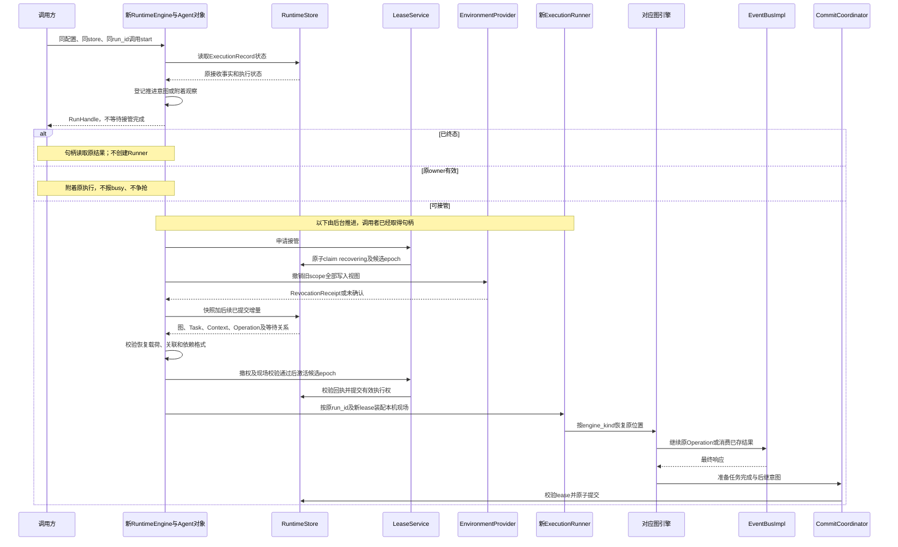

| 概念 | 作用域 | 生命周期与共享边界 |
| --- | --- | --- |
| Session | 多次提问的正式输入与历史范围 | 独立持久保存；新提问创建新 ExecutionRecord，历史按策略投影进入新 Agent 的 AgentContext |
| AgentInvocation | 一次完整 Agent 调用 | 直接 Agent 有根 Invocation；外层每次 AgentNode 调用另建 Invocation；业务 Executor 委派不另建 Invocation |
| GraphExecution | 一张图的一次逻辑执行 | 固定 engine_kind；父外层图与内层图分别保存现场，同一记录内可有多张图 |
| GraphState | 一个外层 GraphExecution 的工作流业务状态 | 按 schema／reducer 合并并持久保存；不会自动吸收内层角色的私有 AgentContext |
| NodeActivation | 一个 NodeTask 的一次物理激活 | 可以有多次；故障恢复创建新的激活，沿用原任务及 continuation |
| RunControl | 一次根执行的控制范围 | 根额度、截止、停止按 run_id 保存并由新 Runner 接续；图和 Executor 不另建根额度 |
| Checkpoint／GraphCheckpoint | 检查点概念／某个图的具体快照信封 | 引擎载荷按图分开保存，由 RecoveryBundle 及提交关联组织恢复；不是每个组件各存一套任意快照 |
| LeaseService／ExecutionLease | 执行存储的控制服务／一个 run_id 的所有权 epoch | 服务可由宿主复用；有效租约只能用于该执行，接管必须先确认旧写入域撤销 |
| RecoveryBundle／RevocationReceipt | 某次接管读取的恢复包／撤权证据 | 固定版本和旧域集合；验证通过后才能激活新 owner，不恢复旧连接、协程或文件句柄 |

恢复时新建的是 Python 对象、连接和协程；被恢复的是持久身份及执行位置。检查点不保存平台对象，不重新查发布，不要求 LLM 重新规划全部工作。外层 AgentNode 恢复接回同一子 Invocation；具体 pending writes 屏障见[Workflow 适配](workflow.md)。

LeaseService 的控制面 claim／激活通过 RuntimeStore 的受控事务入口执行，不经业务 Hook。EnvironmentProvider 负责实际撤权，数据库仅保存回执与执行权；未取得撤权确认就不能激活新 writer。图中后续激活步骤以撤权成功为前提。

## 10. 实现时的唯一责任清单

| 需要做的事 | 唯一责任位置 | 不应放在哪里 |
| --- | --- | --- |
| 解释模型决策并决定继续Loop | ReactAgent（主角色／Planner／Executor） | AgentNode、EventBus、ToolHandler |
| 任务准入与整批汇合 | AgentGraphEngine／CallBatchCoordinator | Hook、MCP adapter |
| 请求路由到一个领域处理器 | EventBusImpl 使用自身 HandlerRegistry 注册表 | 全局观察订阅 |
| 发出调用前后事件并接续阶段 | 原 ReactAgent Loop／NodeDriver；无 Loop 的调用由原节点驱动器负责 | EventBus 自动加 Hook、ModelHandler／ToolHandler 发起外围阶段 |
| Attempt超时、配置允许的自动重试与raw保存 | EventBusImpl 的执行设施 | ModelAdapter 隐式重试、每个 Node 重写重试算法 |
| Hook选择与有序处理 | HookHandler | Node逐个手写Hook调用 |
| 上下文投影与patch写集 | ContextHandler | ModelAdapter私自裁剪消息 |
| 原子提交与执行权验证 | CommitCoordinator／RuntimeStore | Hook直接SQL、观察事件回调 |
| 文件实际访问及脚本执行 | EnvironmentProvider与受限适配器 | LLM提供宿主路径 |
| 用户、发布、资源管理 | Platform | SDK运行时 |

首版实现必须让这些图与接口测试一致。特别检查没有“一个对象既持有可变会话，又被跨 ExecutionRecord 共享”、没有“Handler 和引擎都启动子任务”、没有“Hook 已修改但下次 Loop 读回 raw 值”。
