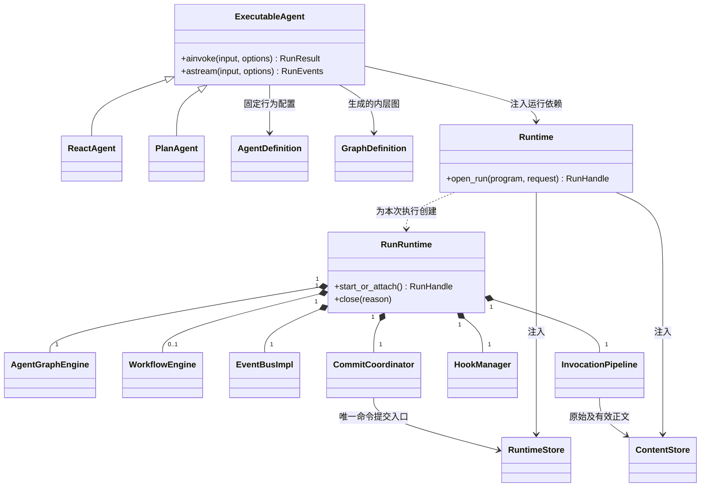
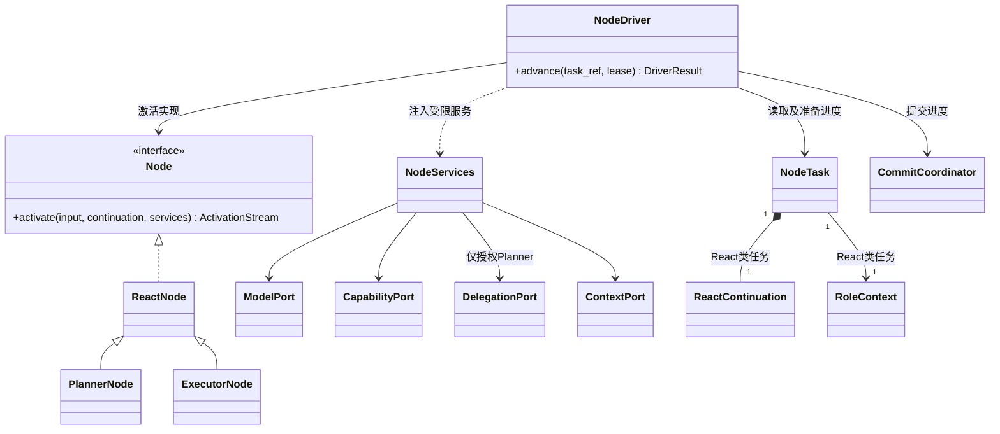
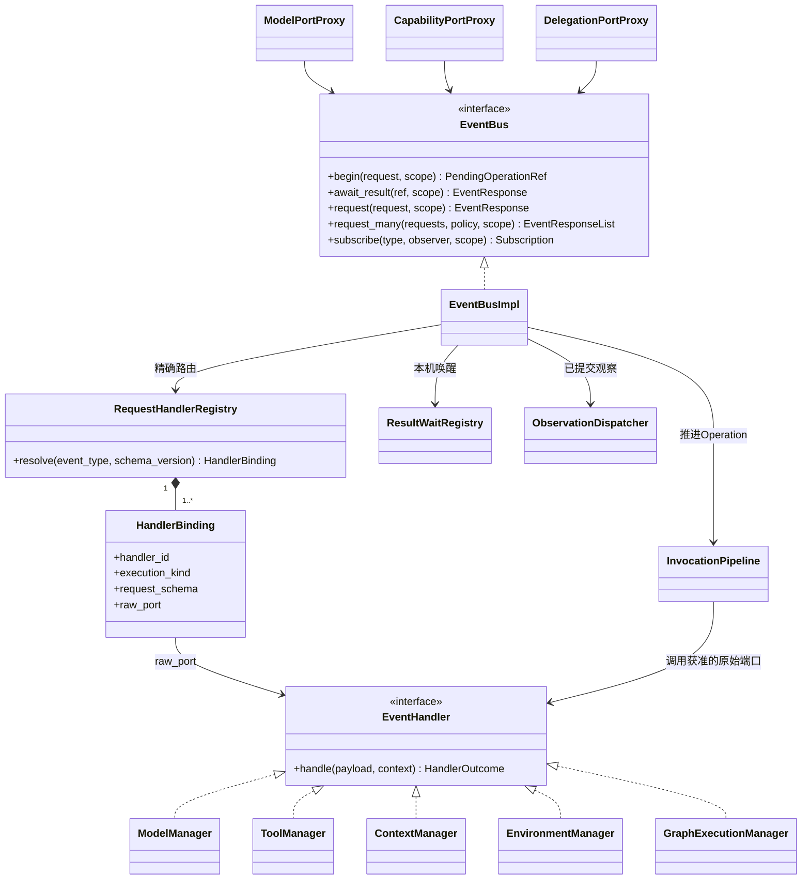
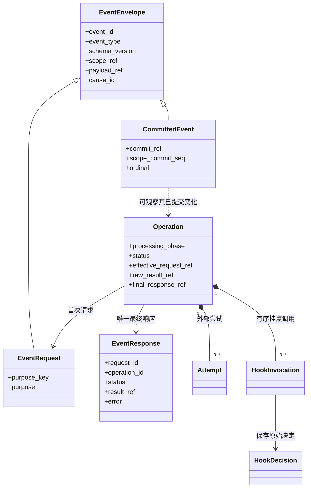
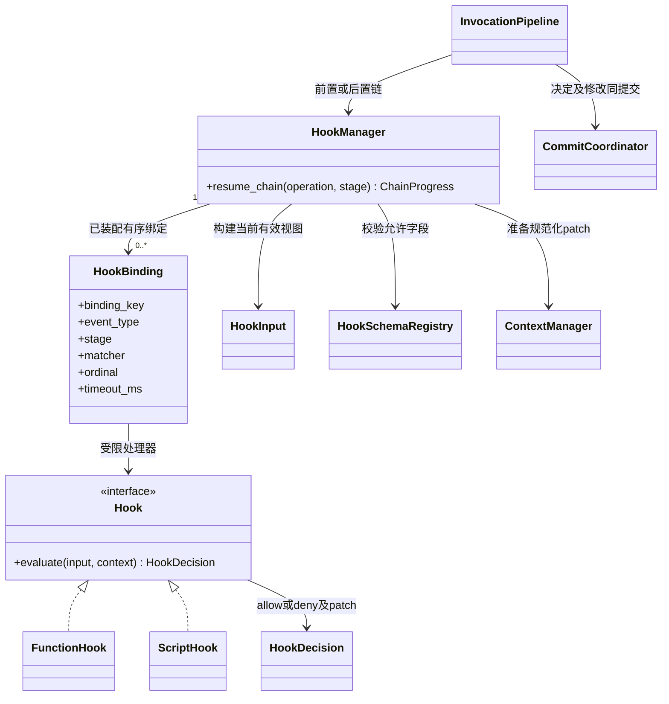
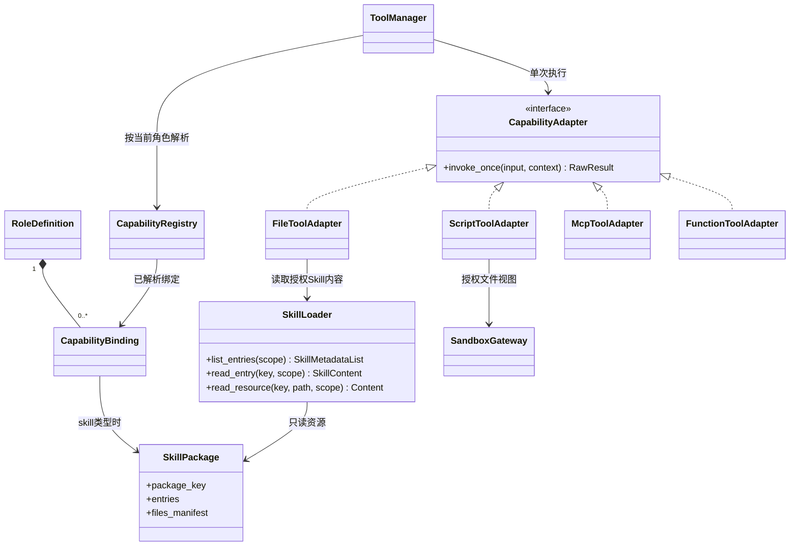
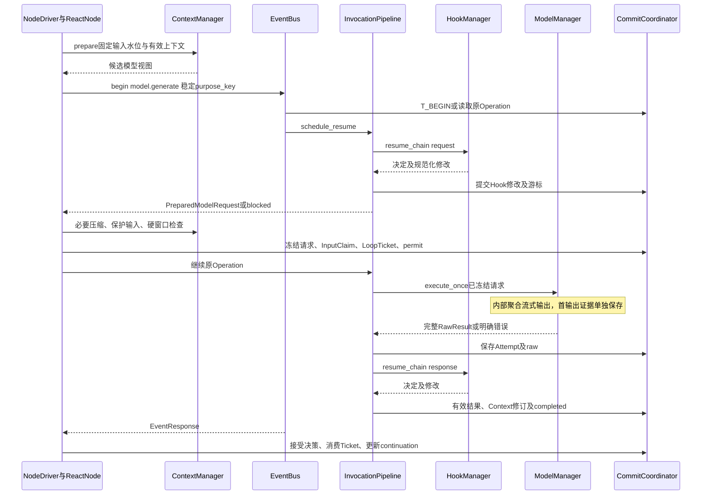
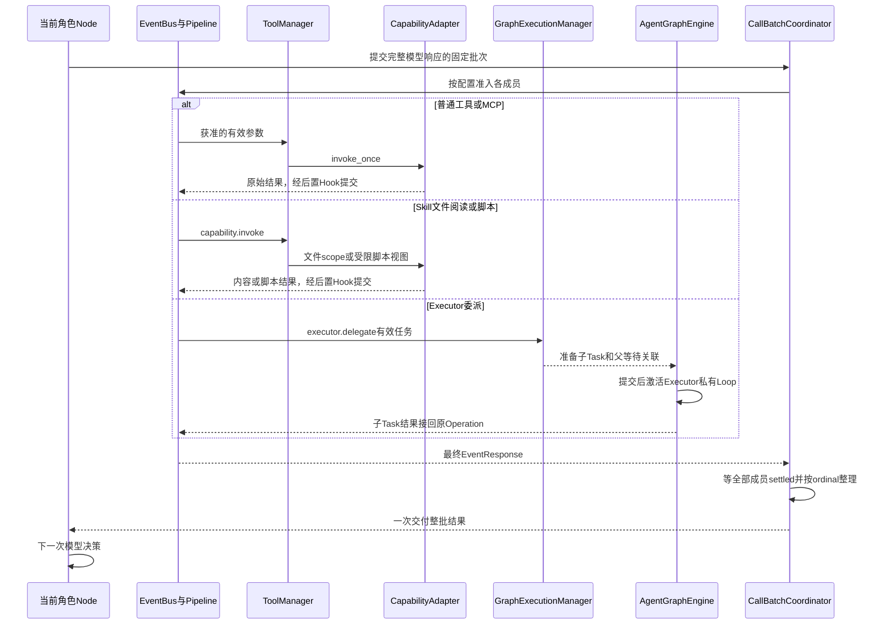
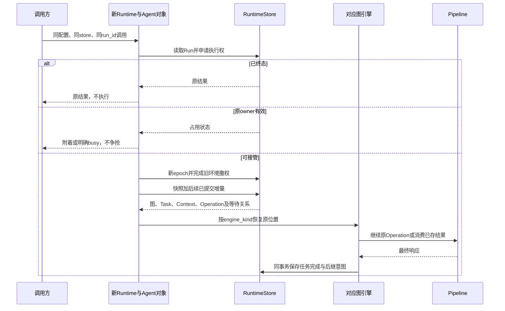

# SDK 对象关系与交互 UML

状态：详细设计，尚未实现。本页定义对象如何协作；[Definition 与运行实体](definitions.md)定义身份与归属，[调用总线](event-bus.md)和[检查点](checkpoints.md)定义状态机与提交算法。三者共同作为实现依据。

图例：实线带菱形表示组成及生命周期管理，普通箭头表示引用／调用，虚线表示依赖，三角箭头表示继承或实现。时序图的箭头才表示执行先后。不能把“能访问某对象”理解为拥有它的生命周期。

## 1. 对象分为四类

| 类别 | 对象 | 有什么状态 | 何时创建／释放 |
| --- | --- | --- | --- |
| 执行配置 | AgentDefinition、RoleDefinition、GraphDefinition、NodeBinding、HookBinding、SkillPackage | 不可变配置与资源描述 | 构造 Agent／编译 Workflow 时固定 |
| 可复用服务 | Runtime、NodeRegistry、ModelAdapter、CapabilityAdapter、SkillLoader、RuntimeStore | 连接、不可变注册和工厂；不存某次角色消息 | 调用方装配，通常跨 Run 复用 |
| 本次进程对象 | RunRuntime、EventBusImpl、InvocationPipeline、HookManager、NodeDriver、ResultWaitRegistry | 本机任务、等待者、当前 lease 与运行 scope | 每次执行或故障接管重新创建 |
| 持久执行实体 | Run、GraphExecution、NodeTask、RoleContext、Operation、Attempt、HookInvocation、Checkpoint | 可恢复进度、结果、身份与版本 | 原子提交后保存；进程销毁不删除 |

Agent 对象是可执行程序入口，不等于数据库中的 Agent 应用，也不等于 Run。new PlanAgent 只装配依赖；ainvoke 才开始、附着或恢复一次执行。Node 实现不保存 messages 等可变任务状态，NodeTask 与 RoleContext 才保存这些内容。

## 2. Agent 与 Runtime 的装配关系

RunRuntime 具有一个逻辑总线，外层 Workflow 与其中的 AgentInvocation 共享它，按 scope 隔离。不同 Run 各建自己的总线和本机等待器。GraphExecution 可以有多个，AgentGraphEngine 是推进这些内层图的服务，不要求每个 Executor 新建一个 Engine。

RuntimeStore／ContentStore 由调用方注入，不能画成 Agent 销毁就级联删除的子对象。SDK 关闭本机 RunRuntime 只释放连接、等待者和执行权；持久记录由独立删除操作处理。

## 3. Node、角色与执行实例

此图聚焦 React 类任务，普通 Workflow 节点可以没有 ReactContinuation 或 RoleContext。

- ReactNode 实现完整任务的决策规则，但可以在一次激活中返回 Progress、Wait、Complete、Fail；NodeDriver 保存 continuation 后再推进。
- PlannerNode 复用 ReactNode，增加委派能力。它能调用自己的普通工具，不能直接改 Executor 的私有消息。
- ExecutorNode 复用 ReactNode，按任务参数开始；不递归委派其他 Executor。
- 同一 Executor 配置被调用两次：两个 NodeTask、两个 RoleContext，一个内层 GraphExecution。
- 恢复新建 NodeDriver 和本机协程，沿用 NodeTask、RoleContext 和 Operation ID，不从头重复完整任务。

NodeServices 不暴露数据库连接、平台应用服务、原始凭据或无限制文件路径。模型／能力／委派端口注入代理；ContextManager 的内部纯物化和准备写集可以直接调用，不能为了“全部经过总线”递归包装持久化基础操作。

## 4. EventBus、EventHandler 与 Manager

EventHandler 是被注册处理器的接口，不是一个统一的大类。Manager 按领域实现该入口，再调用自己的原始适配器。实现可以将 handle 绑定到对应方法；ModelManager.execute_once 等方法仍是单次执行端口。Registry 不注册已经代理过的端口，避免再次回到同一个请求。

HandlerOutcome 是按 HandlerBinding.execution_kind 判别的结果：

| 类型 | Handler 返回什么 | 后续由谁处理 |
| --- | --- | --- |
| external | 一次外部尝试的 RawResult | Pipeline 保存 Attempt／raw，驱动后置 Hook |
| internal | PreparedDomainEffect 与读／写集 | CommitCoordinator 校验并应用，Manager 不自行提交 |
| graph | 委派／完整 Agent 调用的启动计划 | 对应引擎按已提交意图调度；Pipeline 等原目标结果 |
| recoverable | RecoverableWaitPlan，例如压缩 Episode | 注册可恢复目标后等待，不伪造一次网络 Attempt |

一个请求类型恰好匹配一个 Handler；零个返回 ROUTE_NOT_FOUND，重复注册拒绝。subscribe 只是观察已提交事件，不参与请求响应，不以多个观察回调的返回值决定业务结果。request_many 的 list 来自多个独立请求的最终 EventResponse，而不是广播后收集未知订阅者的返回值。

## 5. Event、Operation 与 Hook 记录

Event 是通信值对象，Operation 是一次可恢复逻辑调用。event_id 用于消息身份；operation_id 用于执行事实；purpose_key 用于逻辑重投；cause_id 用于追踪，均不能替代权限或租约。

普通事件不自行生成检查点。必要状态由 Coordinator 一致提交，outbox 是同提交的通知投影。消费观察事件不能触发重放工具。没有订阅者也必须能够执行和恢复。

## 6. Hook 与 HookManager

Hook 是用户处理器，HookBinding 描述何时运行，HookManager 负责筛选、顺序、超时、校验与恢复链游标。它不是全局事件观察者；需要修改或阻止调用时必须在 Pipeline 中被有序 await。

FunctionHook 面向可信高代码函数；不可信脚本通过受限 HookAdapter 执行。脚本失败、非法修改和合法拒绝分别处理：

1. 失败或超时：记录诊断，放行原有效值。
2. patch 非法：丢弃非法修改，保留此前合法修改；如果仍有独立合法 deny，拒绝仍生效。
3. allow＋合法 patch：提交有效 payload、ContextMutation、Hook 游标，再执行下一项。
4. deny：保存明确拒绝；前置未执行、后置已执行的事实不能混写。
5. 提交失败：停止推进等待恢复，不能以 Hook fail-open 为由跳过必要存储。

“全上下文可见”指合法修改成为相应授权 scope 的权威有效修订，供后续 Loop、历史投影、压缩与恢复读取；并非允许 Hook 读取或修改所有 Executor 私有 Context。

## 7. Skill 与能力对象

Skill 是指令与附属文件，不继承 Node，不订阅总线，也不会自动注册可执行脚本。上下文只初始注入目录元信息；LLM 决定读取 SKILL.md 后，经授权文件能力获得内容。脚本需要显式能力调用；SDK 从 scope 派生工作目录和挂载，不信任 LLM 提供宿主绝对路径。

MCP 只是一类能力适配器，FunctionTool 是另一类；它们共用 Operation、Hook、重试和结果交付。是否在 Workflow 中出现 CapabilityNode 由编排决定，与底层协议无关。

## 8. 一次模型调用的时序

前置 Hook 后不能直接发业务模型请求：必须先处理压缩、最终输入预算和额度许可。不同 Attempt 不重复跑 Hook 或领取新输入，不拼接两次失败流。Driver 等待时释放本机推进资源。

## 9. Tool／MCP／Skill 与 Executor 的交互差异

图中的分支是单个成员的不同类型，不表示整批只能选一种。一个批次可以同时有 Tool、MCP 和多个 Executor；只有 parallel_enabled 开启才并行。工具执行不会新增图实例，Executor 也只新增本内层图的 NodeTask。

## 10. 故障恢复的对象重建

恢复时新建的是 Python 对象、连接和协程；被恢复的是持久身份及执行位置。检查点不保存平台对象，不重新查发布，不要求 LLM 重新规划全部工作。外层 AgentNode 恢复接回同一子 Invocation；具体 pending writes 屏障见[Workflow 适配](workflow.md)。

## 11. 实现时的唯一责任清单

| 需要做的事 | 唯一责任位置 | 不应放在哪里 |
| --- | --- | --- |
| 解释模型决策并决定继续Loop | ReactNode／PlannerNode | EventBus、ToolManager |
| 任务准入与整批汇合 | AgentGraphEngine／CallBatchCoordinator | Hook、MCP adapter |
| 请求路由到一个领域处理器 | RequestHandlerRegistry | 全局观察订阅 |
| Attempt重试与调用阶段恢复 | InvocationPipeline | 模型SDK内部隐式重试、Node重复实现 |
| Hook选择与有序处理 | HookManager | Node逐个手写Hook调用 |
| 上下文投影与patch写集 | ContextManager | ModelAdapter私自裁剪消息 |
| 原子提交与执行权验证 | CommitCoordinator／RuntimeStore | Hook直接SQL、观察事件回调 |
| 文件实际访问及脚本执行 | EnvironmentProvider与受限适配器 | LLM提供宿主路径 |
| 用户、发布、资源管理 | Platform | SDK运行时 |

首版实现必须让这些图与接口测试一致。特别检查没有“一个对象既持有可变会话，又被跨 Run 共享”、没有“Manager 和引擎都启动子任务”、没有“Hook 已修改但下次 Loop 读回 raw 值”。
