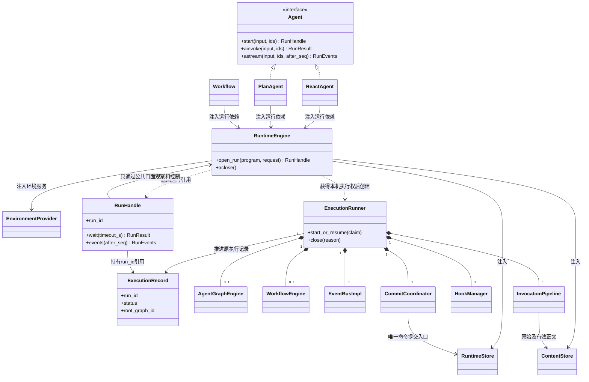
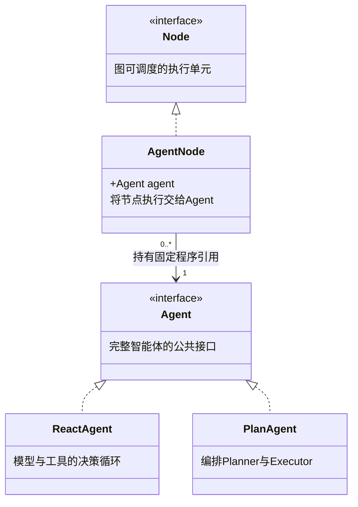
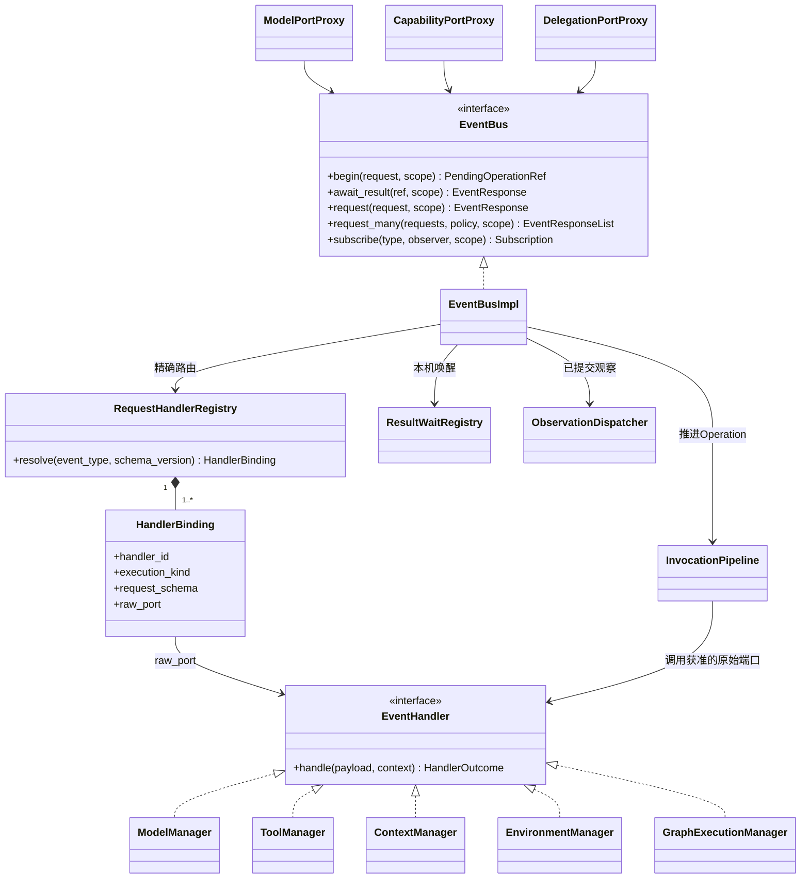
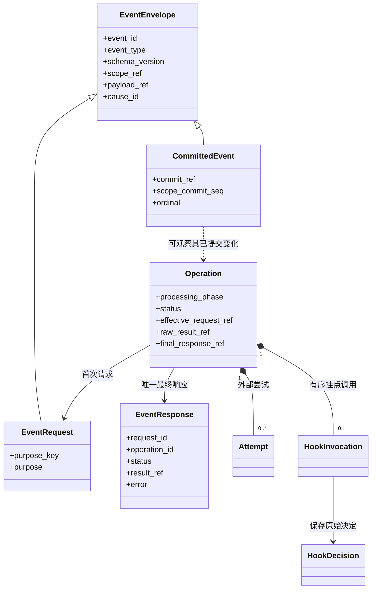
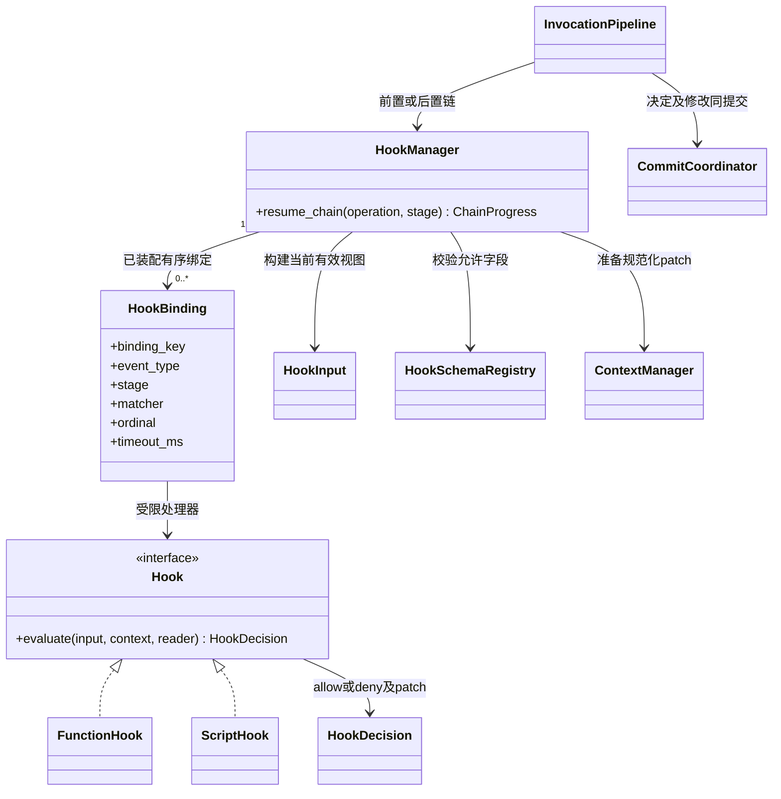
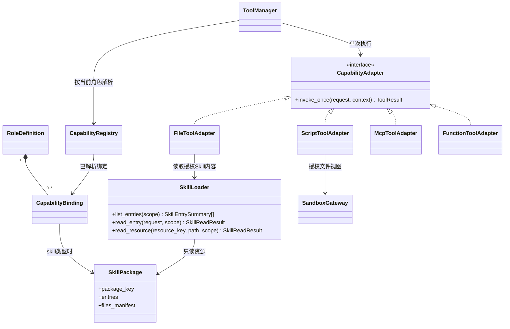
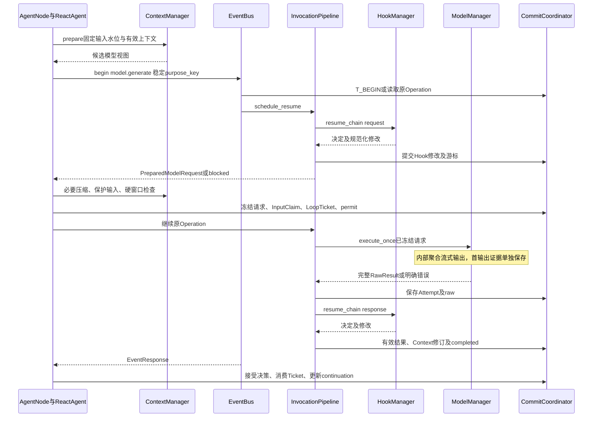
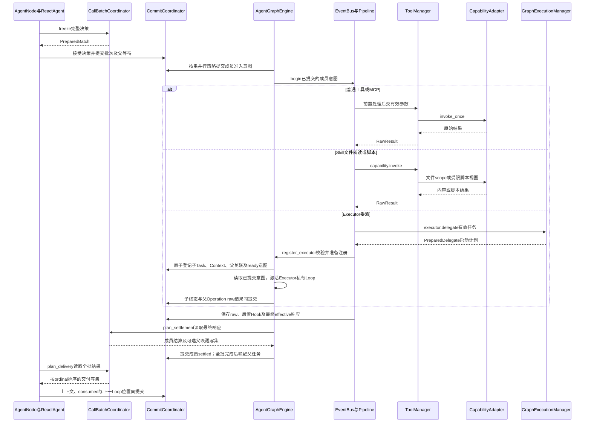
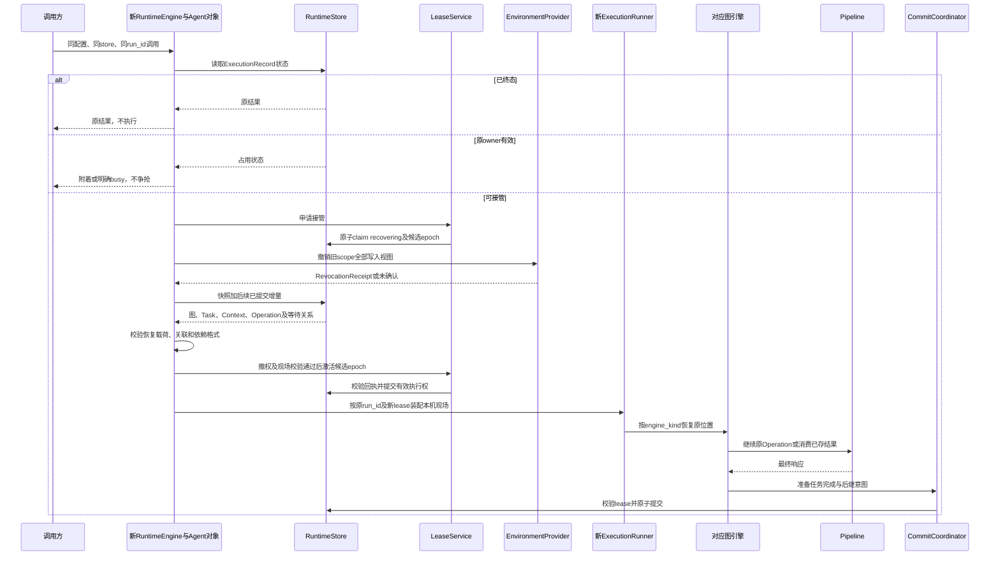

# SDK 对象关系与交互 UML

状态：详细设计，尚未实现。本页定义对象如何协作；[Definition 与运行实体](definitions.md)定义身份与归属，[调用总线](event-bus.md)和[检查点](checkpoints.md)定义状态机与提交算法。三者共同作为实现依据。

图例：实线带菱形表示组成及生命周期管理，普通箭头表示引用／调用，普通虚线箭头表示依赖；实线空心三角表示类继承，虚线空心三角表示接口实现。时序图的箭头才表示执行先后。不能把“能访问某对象”理解为拥有它的生命周期。

## 1. 对象分为四类

| 类别 | 对象 | 有什么状态 | 何时创建／释放 |
| --- | --- | --- | --- |
| 执行配置 | AgentDefinition、RoleDefinition、GraphDefinition、NodeBinding、HookSet、HookBinding、SkillPackage | 不可变配置与资源描述 | 构造 Agent／编译 Workflow 时固定 |
| 可复用服务 | RuntimeEngine、NodeRegistry、ModelAdapter、CapabilityAdapter、SkillLoader、RuntimeStore | 连接、不可变注册和工厂；不存某次角色消息 | 调用方装配，通常跨 ExecutionRecord 复用 |
| 本次进程对象 | ExecutionRunner、EventBusImpl、InvocationPipeline、HookManager、NodeDriver、ResultWaitRegistry | 本机任务、等待者、当前 lease 与运行 scope | 每次执行或故障接管重新创建 |
| 持久执行实体 | ExecutionRecord、GraphExecution、NodeTask、RoleContext、Operation、Attempt、HookInvocation、Checkpoint | 可恢复进度、结果、身份与版本 | 原子提交后保存；进程销毁不删除 |

ReactAgent、PlanAgent 是实现公共 Agent 接口的程序对象，不等于数据库中的 Agent 应用，也不等于 ExecutionRecord。Workflow 是另一种可执行程序，不继承 Agent。new PlanAgent 只装配依赖；start 开始、附着或恢复一次执行，ainvoke／astream 复用 start。Node 是图内调度接口，节点实现不保存 messages 等可变任务状态，NodeTask 与 RoleContext 才保存这些内容。构造合同与资源所有权见[装配设计](assembly.md)。

### 1.1 作用域与生命周期的读法

下方每张对象图后都列出概念的作用域。**作用域**说明对象属于哪一份配置、哪一次执行或哪一个调用；**生命周期**说明它何时创建、何时失效、是否需要持久保存。二者不能混用：一个执行记录能跨机器保存，不代表它的驱动器、总线和协程也能跨机器复用。

| 范围 | 如何确定 | 共享和隔离规则 |
| --- | --- | --- |
| 接口／类型 | Agent、Node、EventHandler、Hook 等代码协议 | 协议本身没有某次执行身份；实现对象按下表约束分配 |
| 宿主实例 | 一次 `RuntimeEngine(...)` 装配及其 asyncio event loop | 可同时托管多次执行；不是进程或集群强制单例，不持有跨执行共享的角色消息 |
| 程序配置 | 一次 ReactAgent／PlanAgent 构造或 Workflow 编译 | 不可变定义与已解析资源可跨执行复用；不等于平台的应用或发布实体 |
| 会话 | `namespace + session_id` | 多次提问的正式输入及历史关联；同一会话不共用一个活动 Runner 或可写 RoleContext |
| 一次逻辑执行 | `namespace + run_id`，持久实体为 ExecutionRecord | 共享根额度、截止、停止和结果；可跨进程恢复，不能因接管变成一次新提问 |
| 本机执行权期间 | 同一 `run_id` 的本机 ExecutionRunner 与当前有效 lease epoch | 管理该次执行的临时服务和协程；失权即停止推进，接管时重建对象 |
| 图／完整 Agent 调用 | `graph_execution_id`／`invocation_id` | 图状态按图隔离；每次完整 Agent 调用有自己的内层图和环境范围，同一根执行可包含多个 |
| 角色任务／激活 | `node_task_id`／`activation_id` | 任务保留自己的 continuation 和上下文；一次激活结束不代表任务已完成 |
| 逻辑调用／尝试／Hook 调用 | `operation_id`／`attempt_id`／`hook_invocation_id` | 自动重试属于原 Operation；一次尝试、一次 Hook 执行各有身份与结果 |

作用域标识只用于归属和关联，**不是权限凭据**。即使对象共用 ExecutionRunner、总线或适配器，也须按 InvocationScopeRef、内容授权和执行租约验证访问。下文“一个”均指该范围中的逻辑实例数，不要求建成全局单例。

当前命名为 `RuntimeEngine`（运行时引擎）、`ExecutionRecord`（执行记录）和 `ExecutionRunner`（单次执行驱动器）。`run_id` 继续标识 ExecutionRecord，RunHandle／RunResult 分别是它的句柄／结果投影，不另设名为 Run 的实体。ExecutionRunner 驱动一整次执行，与 Planner 委派的业务 Executor 是两个职责。

### 1.2 定义与资源的作用域

| 概念 | 作用域 | 生命周期与共享边界 |
| --- | --- | --- |
| AgentDefinition | 一份 Agent 程序的行为配置 | 构造时冻结；可供多次执行读取，不保存消息、租约或当前进度 |
| RoleDefinition | 所属 AgentDefinition 中的一个 `role_key` | 描述主角色或 Executor 类型；多次委派复用定义，不复用任务上下文 |
| GraphDefinition／NodeDefinition | 一份图结构及其中的节点位置 | 构造／编译时冻结；多个 GraphExecution 可使用同一结构，节点定义不等于任务实例 |
| StateGraph | 一次 Workflow 编译前的构建器 | 构建阶段收集可变节点、边与状态声明；compile 产生固定程序，活动执行不共享构建器的编辑状态 |
| NodeBinding | 当前程序装配内的节点与角色／能力绑定 | 随程序固定；负责配置关联，不负责保存节点状态 |
| HookSet／HookBinding | 当前程序及其中的一个绑定 key | 固定处理器、时机、顺序和匹配规则；执行游标另存于 Operation／HookInvocation |
| CapabilityRegistry／CapabilityBinding | 已解析资源目录及角色／节点的授权选择 | 只读目录可复用；每次调用仍按所属程序和角色选择受限视图，不能合并所有角色授权 |
| SkillPackage | 一个已经解析的只读资源包 | 可被多个获准角色引用；加载不会创建角色任务，使用情况与正文注入归当前上下文 |
| WorkspaceBinding | 一份程序的稳定文件根和环境策略 | 构造时注入；运行目录、可写视图及租约在执行期按 scope 派生 |

## 2. Agent 与 RuntimeEngine 的装配关系

本图聚焦具体程序与宿主的关系；配置和节点绑定由具体程序持有，见[Definition 关系图](definitions.md#1-定义不是管理实体)。Agent 接口不作为配置容器。

| 概念 | 作用域 | 生命周期与共享边界 |
| --- | --- | --- |
| Agent | SDK 公共接口 | 没有独立实例或执行状态；定义 start／ainvoke／astream 的使用合同 |
| ReactAgent／PlanAgent／Workflow | 一个已装配的可执行程序 | 构造后可复用；每次 start 指向具体执行，不把其消息放入程序对象 |
| RuntimeEngine | 一个本机宿主实例 | open 到 closed；持有多次执行的任务和服务引用，注入客户端仍归调用方所有 |
| ExecutionRecord | 一次逻辑执行，键为 `namespace + run_id` | 初次接收时创建，结束后保留；保存状态、根控制与结果关联，不运行协程 |
| ExecutionRunner | 一次执行在本机持有执行权的期间 | 只推进一个 ExecutionRecord；完成必要收尾或关闭／失权后释放，故障接管新建；同一记录至多一个有效 owner |
| RunHandle | 一个观察者对一个 `run_id` 的本机引用 | 一条执行记录可有多个句柄；不拥有 Runner，关闭观察不停止执行，也不删除记录 |
| AgentGraphEngine／WorkflowEngine | 一个 ExecutionRunner 中对应的图内核服务，各 0..1 个 | 按需装配，可推进该次执行的多个所属图；每张图的状态和队列归各自内核管理 |
| EventBusImpl／InvocationPipeline／HookManager／CommitCoordinator | 一个 ExecutionRunner，每类一个逻辑服务 | 同次执行内的图和角色共享服务，通过 scope 隔离；其他执行不共用这些可变服务对象 |
| RuntimeStore／ContentStore／EnvironmentProvider | 调用方注入的存储或环境服务 | 可在遵守并发合同下跨程序、跨执行复用；请求必须带受限范围；Runner 退出不关闭共享客户端或删除持久内容 |

ExecutionRunner 具有一个逻辑总线，外层 Workflow 与其中的 AgentInvocation 共享它，按 scope 隔离。不同 ExecutionRecord 各建自己的总线和本机等待器。GraphExecution 可以有多个，AgentGraphEngine 是推进这些内层图的服务，不要求每个 Executor 新建一个 Engine。

RuntimeEngine 托管本进程的多次执行，每次实际执行／接管时创建独立 ExecutionRunner。图中的 EventBus、HookManager 和图引擎服务归该次现场装配；RuntimeEngine 只复用基础设施，不让多次 ExecutionRecord 共用可变现场。模型、Prompt、角色资源和 Hook 绑定仍来自各自 Agent 配置。职责拆分见[运行时引擎范围](assembly.md#11-runtimeengine-管理的范围)。

引擎服务按需装配：直接 Agent 只需要 AgentGraphEngine，纯工具 Workflow 只需要 WorkflowEngine，包含 AgentNode 的 Workflow 两者都需要。这里的 0..1 表示本机服务对象数量，不是持久 GraphExecution 数量。

RuntimeStore／ContentStore 由调用方注入，不能画成 Agent 销毁就级联删除的子对象。SDK 关闭本机 ExecutionRunner 只释放连接、等待者和执行权；持久记录由独立删除操作处理。

## 3. Node、角色与执行实例

**AgentNode 持有 Agent，图引擎通过节点调用 Agent。** Agent 负责决策循环；节点负责接入图；本次任务的消息与执行进度单独保存。

本节按最新讨论改为组合关系，先核对这张对象图。其他设计页中的 ReactNode → PlannerNode／ExecutorNode 继承结构属于前一版，待本图确认后统一调整接口和详细调用协议；不把两套结构同时作为实现要求。

图中虚线空心三角表示接口实现，普通箭头表示持有引用；这里没有 Agent 与 Node 之间的继承。`AgentNode.agent` 是程序引用，不是当前任务的消息容器。角色配置与任务状态放在下表单独解释，避免与执行接口混在同一层。

| 概念 | 作用域 | 生命周期与共享边界 |
| --- | --- | --- |
| Agent／Node | 两个不同用途的接口 | Agent 面向智能体调用者，Node 面向图调度；普通函数或工具节点无须拥有 Agent |
| ReactAgent | 一份已装配的 ReAct 程序 | 实现模型—工具循环，可用于主角色、Planner 或 Executor；不把任务消息存进共享程序对象 |
| PlanAgent | 一份已装配的 Plan–Executor 程序 | 定义内部图及角色绑定；图引擎实际调度 Planner 与 Executor，PlanAgent 不维护第二份调度队列 |
| AgentNode | 图中的一个已绑定执行位置 | 持有一个固定 Agent 引用，可被多次调度；内层 Planner／Executor 位置均绑定 ReactAgent |
| RoleDefinition | 当前 Agent 配置中的一个角色 | 固定职责、Prompt 和可用能力；同一角色可产生多次任务，不共享可变上下文 |
| NodeTask | 当前图内的一次实际任务 | 保存输入，关联自己的上下文与执行进度；Loop 和恢复沿用原任务身份，新委派才产生新任务 |

### 3.1 ReAct 与 Plan–Executor 怎样使用这组对象

| 模式 | 图中的位置 | AgentNode 持有的 Agent | 谁执行 Loop |
| --- | --- | --- | --- |
| ReAct | 一个主节点 | 当前已装配的 ReactAgent | ReactAgent 使用主任务上下文执行循环 |
| Plan–Executor | 一个 Planner，以及配置好的 Executor 位置 | 各位置绑定对应角色配置的 ReactAgent | Planner 与每个 Executor 任务分别运行自己的循环 |

Planner 和 Executor 在这里是**角色与图中位置**，不再是分别实现 Loop 的两个节点子类。Planner 的授权包含委派任务，也可使用自己的普通工具；Executor 接收任务并执行，首版不递归委派。Executor 继续继承主模型配置，拥有自己配置的 Prompt 与能力范围。

**例子：Planner 同时委派两次“资料检索”。** 一份检索角色配置、一个绑定该角色 ReactAgent 的 Executor 节点，会产生“查价格”和“查限制”两个 NodeTask。两份上下文和两份进度彼此独立，允许共享本次任务的工作文件；仍属于同一个内层 GraphExecution。继续 Loop 不创建新任务，普通 Tool／MCP 调用也不创建新 Agent 或图。

组合关系不表示节点直接调用 `agent.start()`：公开入口负责开始或附着整次执行，图内通过内部可恢复执行入口继续当前任务，沿用本次执行的额度、总线和停止控制。ReactAgent 在此入口只推进自己的 Loop，不再创建另一张包住自身的图，避免递归装配和重复启动。

外层 Workflow 仍可用节点承载完整 ReactAgent／PlanAgent。外层完整 Agent 调用与内层角色任务的范围不同，前者仍通过调用桥创建或接回子 Invocation；内层 Executor 委派只创建角色任务。**有 `agent` 属性不等于每次调用都新增根执行或子图。** Workflow 的原生节点协议仍由适配层衔接，不要求两套引擎采用相同激活方法。

### 3.2 本次任务保存什么

| 任务状态 | 含义 | 保存与恢复 |
| --- | --- | --- |
| 上下文 `RoleContext` | 本次任务的输入、模型消息、工具结果 | 每个任务私有；共享文件不等于共享消息 |
| 执行进度 `ReactContinuation` | 当前执行阶段、待处理调用与结果消费位置 | 随进度提交；恢复后从原位置继续，不只把聊天记录交给 LLM 重新开始 |

它们是执行实例的状态组成部分，无须各自成为一个新的运行引擎。AgentNode 衔接 Agent 的进度与图内等待，图引擎通过统一提交路径保存；重建 Python 对象时沿用已保存的任务、上下文和调用身份。

### 3.3 引擎内部辅助对象

下列名称从主图中移出，作为实现细节保留；不要求每个名称都单独建设一个模块。

| 辅助对象 | 实际作用及作用域 |
| --- | --- |
| NodeDriver | 图引擎内部负责节点激活、提交进度、等待和恢复的代码，可先实现为引擎内部方法；不另建调度器 |
| NodeRuntime | 本次任务激活的受限运行环境参数；提供当前身份、租约和可用服务，不是另一个 RuntimeEngine，也不进入检查点 |
| ModelPort／CapabilityPort／ContextPort／DelegationPort | 绑定当前任务授权的模型、能力、上下文与委派入口；通过现有总线及 Manager 提供服务，不是四套新引擎；委派入口仅授予 Planner |
| NodeRegistry | 已装配节点实现或工厂的只读映射表；不管理任务状态 |
| WorkflowNodeAdapter／CapabilityNode | 外层工作流的适配和能力节点细节，单独在 Workflow 设计中展开 |

运行环境不暴露原始数据库连接、平台应用服务、凭据或无限制文件路径。模型／能力／委派入口继续经过事件总线；上下文内部的纯物化和准备写集可直接调用，避免递归包装持久化基础操作。

## 4. EventBus、EventHandler 与 Manager

| 概念 | 作用域 | 生命周期与共享边界 |
| --- | --- | --- |
| ModelPortProxy／CapabilityPortProxy／DelegationPortProxy | 当前任务激活或受限调用端口 | 带入可信 scope，使用所属 ExecutionRunner 的总线；不是全局可切换身份的代理 |
| EventBus | 调用与观察协议 | 接口无活动状态；EventBusImpl 是单次执行内的实现 |
| RequestHandlerRegistry／HandlerBinding | 当前 ExecutionRunner 的固定路由表／路由项 | 装配后只读；绑定该现场的 Manager 原始端口，不能引用另一 Runner 的处理器 |
| EventHandler | 领域处理器接口 | 实现实例由本次现场装配；每次调用显式接收请求及上下文 |
| ModelManager／ToolManager／ContextManager／EnvironmentManager／GraphExecutionManager | 当前 ExecutionRunner 的领域服务 | 可处理多个角色的调用，但不得用可变 `current_context` 等字段保存隐式调用身份；通过参数及存储引用定位 |
| InvocationPipeline | 当前 ExecutionRunner 的逻辑调用推进服务 | 按 operation_id 隔离本机 runner 和阶段；恢复从持久 Operation 接续，不从 Python 调用栈猜测 |
| ResultWaitRegistry | 当前 ExecutionRunner 的本机等待器目录 | 同 Operation 可有多个 waiter；关闭／失权时解除等待，持久结果仍在存储中 |
| ObservationDispatcher／Subscription | 本次执行的通知分发器／一个观察订阅 | 订阅有自己的授权 scope、队列和游标；可靠游标可持久保存，本机回调和队列需要重建 |

EventHandler 是被注册处理器的接口，不是一个统一的大类。Manager 按领域实现该入口，再调用自己的原始适配器。实现可以将 handle 绑定到对应方法；ModelManager.execute_once 等方法仍是单次执行端口。Registry 不注册已经代理过的端口，避免再次回到同一个请求。

HandlerOutcome 是按 HandlerBinding.execution_kind 判别的结果：

| 类型 | Handler 返回什么 | 后续由谁处理 |
| --- | --- | --- |
| external | 一次外部尝试的 RawResult | Pipeline 保存 Attempt／raw，驱动后置 Hook |
| internal | PreparedDomainEffect 与读／写集 | CommitCoordinator 校验并应用，Manager 不自行提交 |
| graph | 委派／完整 Agent 调用的启动计划 | 对应引擎按已提交意图调度；Pipeline 等原目标结果 |
| recoverable | RecoverableWaitPlan，例如压缩 Episode | 注册可恢复目标后等待，不伪造一次网络 Attempt |

一个请求类型恰好匹配一个 Handler；零个返回 ROUTE_NOT_FOUND，重复注册拒绝。subscribe 只是观察已提交事件，不参与请求响应，不以多个观察回调的返回值决定业务结果。request_many 的 list 来自多个独立请求的最终 EventResponse，而不是广播后收集未知订阅者的返回值。

## 5. Event、Operation 与 Hook 记录

| 概念 | 作用域 | 生命周期与共享边界 |
| --- | --- | --- |
| EventEnvelope | 一条消息的身份及 scope | 不可变值对象；scope、source、cause_id 的作用不同，不能用追踪字段代替授权 |
| EventRequest | 一次有稳定 purpose_key 的逻辑请求 | 首次 begin 与 Operation 关联；相同逻辑重投读取原关联，不创建新的业务调用 |
| EventResponse | 一个请求的最终有效响应 | 持久逻辑调用最多一个最终响应；开始前本地拒绝可无 operation_id，但仍属于原批次成员 |
| CommittedEvent | 某个已提交事务中的一个通知项 | 以 commit_ref／scope／ordinal 定位；可被多个获准观察者读取，投递重复不重做业务 |
| Operation | 一次执行中的一项可恢复逻辑调用 | 跨等待、自动重试及接管沿用；关联发起任务／图／系统 scope，不是每个网络包一条 |
| Attempt | 一个 Operation 的一次外部尝试 | 每次尝试独立记录状态和原始结果；不同尝试的半截模型输出不能拼接 |
| HookInvocation | 一个 Operation 某阶段固定链中的一项 Hook 调用 | 调用身份和结果持久保存，恢复按原游标继续；不共享其他 Operation 的决定 |
| HookDecision | 某次 HookInvocation 返回的决定 | 保存 allow／deny／patch 及来源；补丁提交后成为相应授权上下文的有效修订 |

Event 是通信值对象，Operation 是一次可恢复逻辑调用。event_id 用于消息身份；operation_id 用于执行事实；purpose_key 用于逻辑重投；cause_id 用于追踪，均不能替代权限或租约。

普通事件不自行生成检查点。必要状态由 Coordinator 一致提交，outbox 是同提交的通知投影。消费观察事件不能触发重放工具。没有订阅者也必须能够执行和恢复。

## 6. Hook 与 HookManager

| 概念 | 作用域 | 生命周期与共享边界 |
| --- | --- | --- |
| HookManager | 当前 ExecutionRunner 的拦截服务 | 同次执行可服务多个程序；按 ExecutionBindingRef 选链，不把各程序 Hook 混成一条链 |
| HookBinding | 所属程序中的一个绑定 | 固定时机、顺序和 matcher；可以被多次调用命中，绑定本身不保存执行游标 |
| Hook／FunctionHook／ScriptHook | 用户处理器协议／其已装配实现 | 处理器可复用，但每次 evaluate 的输入与授权独立；可复用实例必须满足并发合同，不保留上次调用的上下文 |
| HookInput／HookContext／HookReadPort | 一次 HookInvocation 的有效输入、元数据与读取能力 | 输入固定引用已提交版本；HookReadPort 为本次调用创建，结束即失效，不序列化客户端或读取函数 |
| HookSchemaRegistry | 当前 SDK 协议的不可变挂点及补丁规则表 | 规则可跨执行复用；不保存用户决定，不允许通过运行期注册绕过字段校验 |
| ContextManager／CommitCoordinator | 当前 ExecutionRunner 的上下文服务／提交入口 | Hook 修改通过原任务授权范围准备并提交；可访问服务不等于可访问所有角色消息 |

Hook 是用户处理器，HookBinding 描述何时运行，HookManager 负责筛选、顺序、超时、校验与恢复链游标。它不是全局事件观察者；需要修改或阻止调用时必须在 Pipeline 中被有序 await。HookSet 的精确绑定字段、受限读取端口及 matcher 规则见[Hook 装配](assembly.md#5-hookset-与-hookbinding)。

同一 ExecutionRecord 可能包含多个可执行 Agent 的配置。HookManager 按可信 ExecutionBindingRef 选择该程序的绑定，再用 stage／matcher 筛选角色；不会将外层 Workflow、Planner 和所有子 Agent 的 Hook 合成全局链。绑定 key 在 program_key 内唯一，固定链及已选绑定保存到 Operation，恢复不跨程序重新选取。

FunctionHook 面向可信高代码函数；不可信脚本通过受限 HookAdapter 执行。脚本失败、非法修改和合法拒绝分别处理：

1. 失败或超时：记录诊断，放行原有效值。
2. patch 非法：丢弃非法修改，保留此前合法修改；如果仍有独立合法 deny，拒绝仍生效。
3. allow＋合法 patch：提交有效 payload、ContextMutation、Hook 游标，再执行下一项。
4. deny：保存明确拒绝；前置未执行、后置已执行的事实不能混写。
5. 提交失败：停止推进等待恢复，不能以 Hook fail-open 为由跳过必要存储。

“全上下文可见”指合法修改成为相应授权 scope 的权威有效修订，供后续 Loop、历史投影、压缩与恢复读取；并非允许 Hook 读取或修改所有 Executor 私有 Context。

## 7. Skill 与能力对象

| 概念 | 作用域 | 生命周期与共享边界 |
| --- | --- | --- |
| RoleDefinition／CapabilityBinding | 当前程序的角色及其能力选择 | 固定配置可复用；绑定只缩小资源授权，不从角色名称推导全局权限 |
| CapabilityRegistry／SkillPackage | 已解析资源目录／只读 Skill 包 | 可在授权允许时被多个程序引用；各角色只获得自己的选择视图 |
| SkillLoader | 调用方准备的资源读取服务 | 可跨执行复用，list／read 每次都带 scope；读取结果归当前 Operation 与上下文 |
| ToolManager | 当前 ExecutionRunner 的能力调用服务 | 从当前程序／角色目录解析适配器；不持有某个角色的共享消息列表 |
| CapabilityAdapter | 单次能力调用协议 | 实现不拥有图或任务的生命周期；invoke_once 接收本次受限调用上下文 |
| FileToolAdapter／ScriptToolAdapter／McpToolAdapter／FunctionToolAdapter | 已装配能力实现及其客户端 | 遵守并发合同可跨执行复用；路径视图、请求参数、凭据访问范围按单次调用传入 |
| ModelAdapter | 已配置的模型连接适配器 | 可复用客户端连接；每次请求使用当前角色的有效上下文和参数，不在共享实例存对话历史 |
| SandboxGateway | 调用方环境服务中的受限执行网关 | 客户端可复用；执行域／挂载句柄按 workspace scope、execution_view_key、epoch 隔离，失权后不能继续写 |

Skill 是指令与附属文件，不继承 Node，不订阅总线，也不会自动注册可执行脚本。上下文只初始注入目录元信息；LLM 决定读取 SKILL.md 后，经授权文件能力获得内容。脚本需要显式能力调用；SDK 从 scope 派生工作目录和挂载，不信任 LLM 提供宿主绝对路径。

MCP 只是一类能力适配器，FunctionTool 是另一类；它们共用 Operation、Hook、重试和结果交付。是否在 Workflow 中出现 CapabilityNode 由编排决定，与底层协议无关。

## 8. 一次模型调用的时序

作用域：这条时序属于一个 NodeTask 的一次模型逻辑调用。NodeDriver、Manager、Pipeline 和 HookManager 是本次 ExecutionRunner 的服务；Operation、各 Attempt、HookInvocation、LoopTicket 和输入水位属于本次调用。下一次业务 Loop 新建模型 Operation；同一次调用的连接重试沿用 Operation，新增 Attempt。

前置 Hook 后不能直接发业务模型请求：必须先处理压缩、最终输入预算和额度许可。不同 Attempt 不重复跑 Hook 或领取新输入，不拼接两次失败流。Driver 等待时释放本机推进资源。

## 9. Tool／MCP／Skill 与 Executor 的交互差异

| 概念 | 作用域 | 生命周期与共享边界 |
| --- | --- | --- |
| CallBatchCoordinator | 当前 ExecutionRunner 的批次规则服务 | 可以处理不同父任务的批次，但只返回准备写集；不自建执行协程或保存共享的“当前批次” |
| CallBatch／WaitGroup | 某个 NodeTask 一次模型决策产生的动作批次 | 成员固定，按该批配置准入；等待全批结算后只向原父任务交付一次 |
| PreparedBatch／PreparedDelegate | 一次批次／委派命令的提案 | 提交前只是候选数据；只有已提交的 Task、关联和 ready 意图才能触发执行 |
| Executor NodeTask | 同一内层 GraphExecution 中一次委派的任务 | 同一个执行器配置被委派两次产生两个任务和两份私有上下文；共用 Invocation 工作文件 |

图中的分支是单个成员的不同类型，不表示整批只能选一种。一个批次可以同时有 Tool、MCP 和多个 Executor；只有 parallel_enabled 开启才并行。工具执行不会新增图实例，Executor 也只新增本内层图的 NodeTask。

图中一次“保存”箭头概括相应阶段的提交，raw、各 Hook 与最终响应仍遵循调用协议各自的原子边界；Executor 的 raw 已在子终态事务保存，Pipeline 只续后置阶段。Coordinator 才能写入事实；CallBatchCoordinator／GraphExecutionManager 返回准备结果，不能自行启动协程或提交。批次本地拒绝项无 Operation，按 Agent 执行协议直接结算。

## 10. 故障恢复的对象重建

| 概念 | 作用域 | 生命周期与共享边界 |
| --- | --- | --- |
| Session | 多次提问的正式输入与历史范围 | 独立持久保存；新提问创建新 ExecutionRecord，历史按策略投影进入新的 RoleContext |
| AgentInvocation | 一次完整 Agent 调用 | 直接 Agent 有根 Invocation；外层每次 AgentNode 调用另建 Invocation；业务 Executor 委派不另建 Invocation |
| GraphExecution | 一张图的一次逻辑执行 | 固定 engine_kind；父外层图与内层图分别保存现场，同一记录内可有多张图 |
| GraphState | 一个外层 GraphExecution 的工作流业务状态 | 按 schema／reducer 合并并持久保存；不会自动吸收内层角色的私有 RoleContext |
| NodeActivation | 一个 NodeTask 的一次物理激活 | 可以有多次；故障恢复创建新的激活，沿用原任务及 continuation |
| RunControl | 一次根执行的控制范围 | 根额度、截止、停止按 run_id 保存并由新 Runner 接续；图和 Executor 不另建根额度 |
| Checkpoint／GraphCheckpoint | 检查点概念／某个图的具体快照信封 | 引擎载荷按图分开保存，由 RecoveryBundle 及提交关联组织恢复；不是每个组件各存一套任意快照 |
| LeaseService／ExecutionLease | 执行存储的控制服务／一个 run_id 的所有权 epoch | 服务可由宿主复用；有效租约只能用于该执行，接管必须先确认旧写入域撤销 |
| RecoveryBundle／RevocationReceipt | 某次接管读取的恢复包／撤权证据 | 固定版本和旧域集合；验证通过后才能激活新 owner，不恢复旧连接、协程或文件句柄 |

恢复时新建的是 Python 对象、连接和协程；被恢复的是持久身份及执行位置。检查点不保存平台对象，不重新查发布，不要求 LLM 重新规划全部工作。外层 AgentNode 恢复接回同一子 Invocation；具体 pending writes 屏障见[Workflow 适配](workflow.md)。

LeaseService 的控制面 claim／激活通过 RuntimeStore 的受控事务入口执行，不经业务 Hook。EnvironmentProvider 负责实际撤权，数据库仅保存回执与执行权；未取得撤权确认就不能激活新 writer。图中后续激活步骤以撤权成功为前提。

## 11. 实现时的唯一责任清单

| 需要做的事 | 唯一责任位置 | 不应放在哪里 |
| --- | --- | --- |
| 解释模型决策并决定继续Loop | ReactAgent（主角色／Planner／Executor） | AgentNode、EventBus、ToolManager |
| 任务准入与整批汇合 | AgentGraphEngine／CallBatchCoordinator | Hook、MCP adapter |
| 请求路由到一个领域处理器 | RequestHandlerRegistry | 全局观察订阅 |
| Attempt重试与调用阶段恢复 | InvocationPipeline | 模型SDK内部隐式重试、Node重复实现 |
| Hook选择与有序处理 | HookManager | Node逐个手写Hook调用 |
| 上下文投影与patch写集 | ContextManager | ModelAdapter私自裁剪消息 |
| 原子提交与执行权验证 | CommitCoordinator／RuntimeStore | Hook直接SQL、观察事件回调 |
| 文件实际访问及脚本执行 | EnvironmentProvider与受限适配器 | LLM提供宿主路径 |
| 用户、发布、资源管理 | Platform | SDK运行时 |

首版实现必须让这些图与接口测试一致。特别检查没有“一个对象既持有可变会话，又被跨 ExecutionRecord 共享”、没有“Manager 和引擎都启动子任务”、没有“Hook 已修改但下次 Loop 读回 raw 值”。
