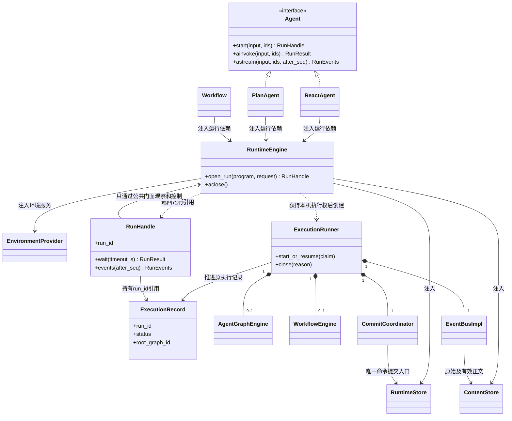
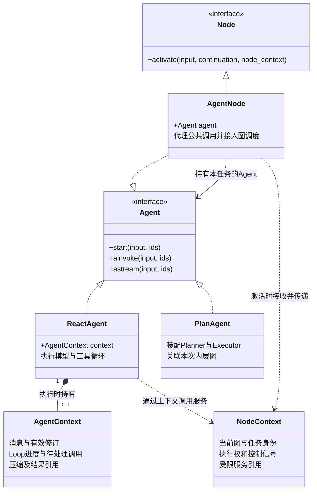
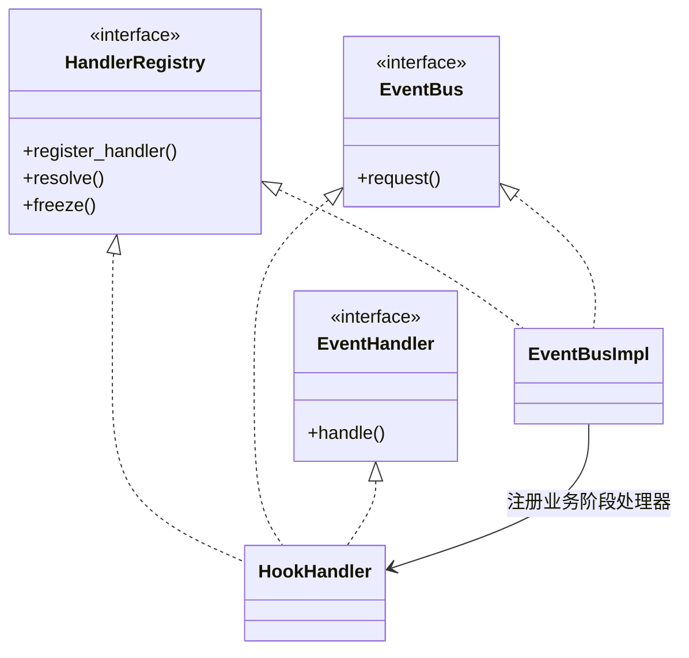
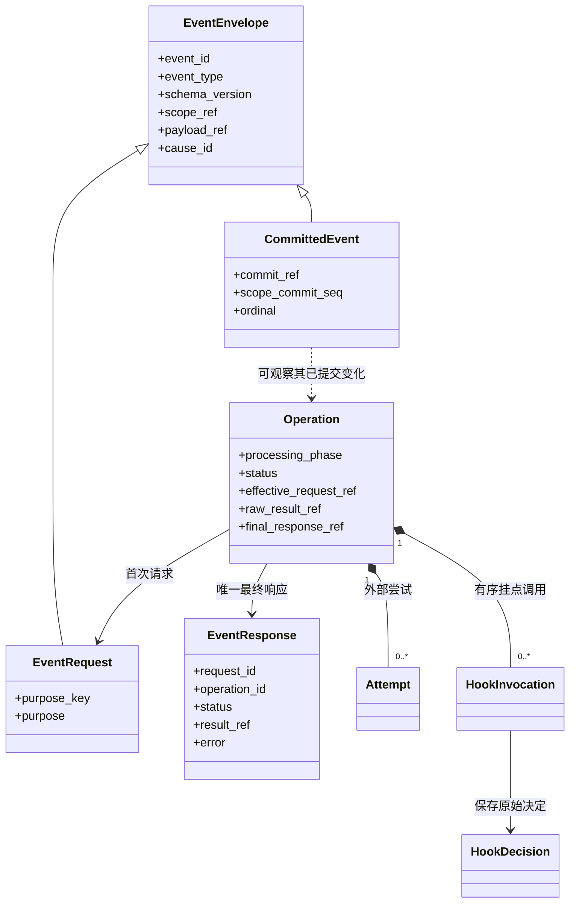
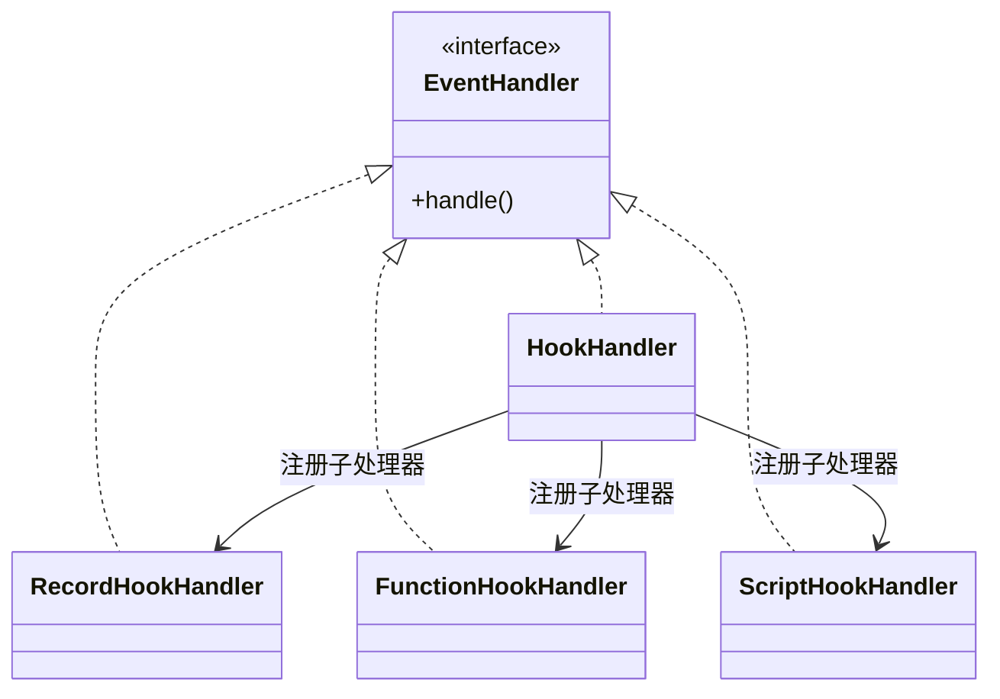
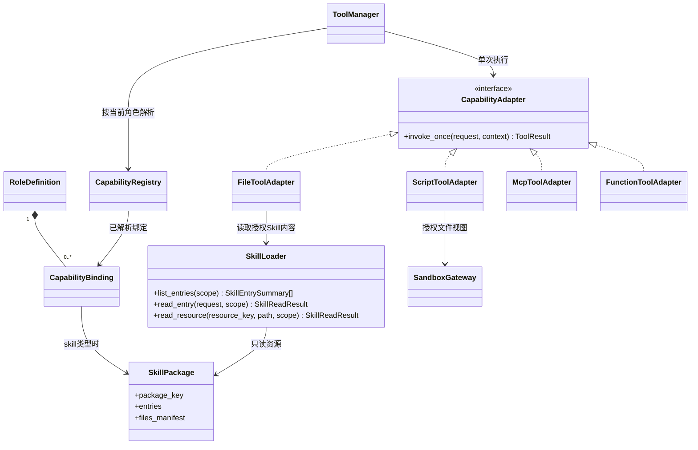
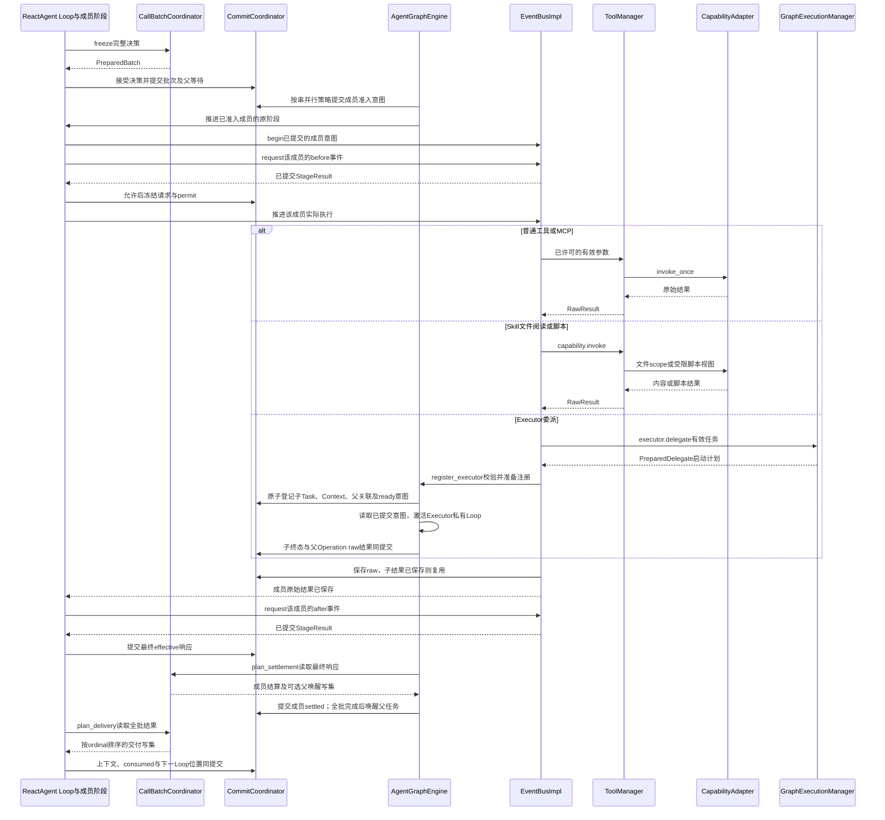
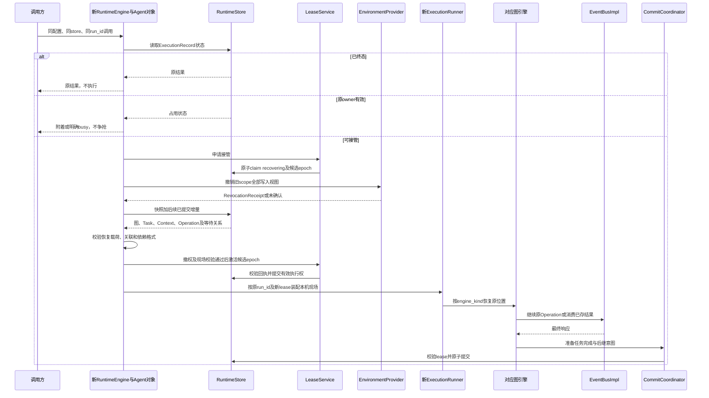

# SDK 对象关系与交互 UML

状态：详细设计，尚未实现。本页定义对象如何协作；[Definition 与运行实体](definitions.md)定义身份与归属，[调用总线](event-bus.md)和[检查点](checkpoints.md)定义状态机与提交算法。三者共同作为实现依据。

图例：实线带菱形表示组成及生命周期管理，普通箭头表示引用／调用，普通虚线箭头表示依赖；实线空心三角表示类继承，虚线空心三角表示接口实现。时序图的箭头才表示执行先后。不能把“能访问某对象”理解为拥有它的生命周期。

## 1. 对象分为四类

| 类别 | 对象 | 有什么状态 | 何时创建／释放 |
| --- | --- | --- | --- |
| 执行配置 | AgentDefinition、RoleDefinition、GraphDefinition、NodeBinding、HookSet、HookBinding、SkillPackage | 不可变配置与资源描述 | 构造 Agent／编译 Workflow 时固定 |
| 可复用服务 | RuntimeEngine、NodeRegistry、ModelAdapter、CapabilityAdapter、SkillLoader、RuntimeStore | 连接、不可变注册和工厂；不存某次角色消息 | 调用方装配，通常跨 ExecutionRecord 复用 |
| 本次进程对象 | ReactAgent／PlanAgent、AgentNode、AgentContext、NodeContext、ExecutionRunner 及本次总线服务 | Agent 私有状态、任务服务视图、本机任务与等待者 | 按执行任务创建；接管时从已提交事实重建 |
| 持久执行实体 | ExecutionRecord、GraphExecution、NodeTask、AgentContextHead、Operation、Attempt、HookInvocation、Checkpoint | 可恢复进度、结果、身份与版本 | 原子提交后保存；进程销毁不删除 |

ReactAgent、PlanAgent 实现公共 Agent 接口，不等于平台 Agent 应用或 ExecutionRecord。构造只冻结配置并装配依赖；start 才绑定、附着或恢复执行，ainvoke／astream 复用 start。实际执行的 ReactAgent 持有自己的 AgentContext；AgentNode 持有该 Agent，不另存一份消息。配置和基础设施可以复用，活动 Agent 实例按任务隔离。Workflow 是另一种可执行程序，不继承 Agent。构造合同与资源所有权见[装配设计](assembly.md)。

### 1.1 作用域与生命周期的读法

下方每张对象图后都列出概念的作用域。**作用域**说明对象属于哪一份配置、哪一次执行或哪一个调用；**生命周期**说明它何时创建、何时失效、是否需要持久保存。二者不能混用：一个执行记录能跨机器保存，不代表它的驱动器、总线和协程也能跨机器复用。

| 范围 | 如何确定 | 共享和隔离规则 |
| --- | --- | --- |
| 接口／类型 | Agent、Node、EventHandler、EventBus、HandlerRegistry 等代码协议 | 协议本身没有某次执行身份；实现对象按下表约束分配 |
| 宿主实例 | 一次 `RuntimeEngine(...)` 装配及其 asyncio event loop | 可同时托管多次执行；不是进程或集群强制单例，不持有跨执行共享的角色消息 |
| 程序配置 | 一次 ReactAgent／PlanAgent 构造或 Workflow 编译 | 不可变定义与已解析资源可跨执行复用；不等于平台的应用或发布实体 |
| 会话 | `namespace + session_id` | 多次提问的正式输入及历史关联；同一会话的不同提问不共用活动 Runner、Agent 实例或可写 AgentContext |
| 一次逻辑执行 | `namespace + run_id`，持久实体为 ExecutionRecord | 共享根额度、截止、停止和结果；可跨进程恢复，不能因接管变成一次新提问 |
| 本机执行权期间 | 同一 `run_id` 的本机 ExecutionRunner 与当前有效 lease epoch | 管理该次执行的临时服务和协程；失权即停止推进，接管时重建对象 |
| 图／完整 Agent 调用 | `graph_execution_id`／`invocation_id` | 图状态按图隔离；每次完整 Agent 调用有自己的内层图和环境范围，同一根执行可包含多个 |
| 角色任务／激活 | `node_task_id`／`activation_id` | 任务保留自己的 continuation 和上下文；一次激活结束不代表任务已完成 |
| 逻辑调用／尝试／Hook 调用 | `operation_id`／`attempt_id`／`hook_invocation_id` | 自动重试属于原 Operation；一次尝试、一次 Hook 执行各有身份与结果 |

作用域标识只用于归属和关联，**不是权限凭据**。即使对象共用 ExecutionRunner、总线或适配器，也须按 InvocationScopeRef、内容授权和执行租约验证访问。下文“一个”均指该范围中的逻辑实例数，不要求建成全局单例。

当前命名为 `RuntimeEngine`（运行时引擎）、`ExecutionRecord`（执行记录）和 `ExecutionRunner`（单次执行驱动器）。`run_id` 继续标识 ExecutionRecord，RunHandle／RunResult 分别是它的句柄／结果投影，不另设名为 Run 的实体。ExecutionRunner 驱动一整次执行，与 Planner 委派的业务 Executor 是两个职责。

### 1.2 定义与资源的作用域

| 概念 | 作用域 | 生命周期与共享边界 |
| --- | --- | --- |
| AgentDefinition | 一份 Agent 程序的行为配置 | 构造时冻结；可供多次执行读取，不保存消息、租约或当前进度 |
| RoleDefinition | 所属 AgentDefinition 中的一个 `role_key` | 描述主角色或 Executor 类型；多次委派复用定义，不复用任务上下文 |
| GraphDefinition／NodeDefinition | 一份图结构及其中的节点位置 | 构造／编译时冻结；多个 GraphExecution 可使用同一结构，节点定义不等于任务实例 |
| StateGraph | 一次 Workflow 编译前的构建器 | 构建阶段收集可变节点、边与状态声明；compile 产生固定程序，活动执行不共享构建器的编辑状态 |
| NodeBinding | 当前程序装配内的节点与角色／能力绑定 | 随程序固定；负责配置关联，不负责保存节点状态 |
| HookSet／HookBinding | 当前程序及其中的一个绑定 key | 固定处理器、时机、顺序和匹配规则；执行游标另存于 Operation／HookInvocation |
| CapabilityRegistry／CapabilityBinding | 已解析资源目录及角色／节点的授权选择 | 只读目录可复用；每次调用仍按所属程序和角色选择受限视图，不能合并所有角色授权 |
| SkillPackage | 一个已经解析的只读资源包 | 可被多个获准角色引用；加载不会创建角色任务，使用情况与正文注入归当前上下文 |
| WorkspaceBinding | 一份程序的稳定文件根和环境策略 | 构造时注入；运行目录、可写视图及租约在执行期按 scope 派生 |

## 2. Agent 与 RuntimeEngine 的装配关系

本图聚焦具体程序与宿主的关系；配置和节点绑定由具体程序持有，见[Definition 关系图](definitions.md#1-定义不是管理实体)。Agent 接口不作为配置容器。

| 概念 | 作用域 | 生命周期与共享边界 |
| --- | --- | --- |
| Agent | SDK 公共接口 | 没有独立实例或执行状态；定义 start／ainvoke／astream 的使用合同 |
| ReactAgent／PlanAgent | 一个待绑定或已绑定任务的 Agent 对象 | 配置可复用；执行实例只绑定一次逻辑任务，消息与进度由其私有上下文管理；接管可重建物理对象 |
| Workflow | 一个已编译的工作流程序 | 编译结构可复用；每次调用产生独立执行现场，不在编译对象保存可变节点状态 |
| RuntimeEngine | 一个本机宿主实例 | open 到 closed；持有多次执行的任务和服务引用，注入客户端仍归调用方所有 |
| ExecutionRecord | 一次逻辑执行，键为 `namespace + run_id` | 初次接收时创建，结束后保留；保存状态、根控制与结果关联，不运行协程 |
| ExecutionRunner | 一次执行在本机持有执行权的期间 | 只推进一个 ExecutionRecord；完成必要收尾或关闭／失权后释放，故障接管新建；同一记录至多一个有效 owner |
| RunHandle | 一个观察者对一个 `run_id` 的本机引用 | 一条执行记录可有多个句柄；不拥有 Runner，关闭观察不停止执行，也不删除记录 |
| AgentGraphEngine／WorkflowEngine | 一个 ExecutionRunner 中对应的图内核服务，各 0..1 个 | 按需装配，可推进该次执行的多个所属图；每张图的状态和队列归各自内核管理 |
| EventBusImpl／CommitCoordinator | 一个 ExecutionRunner，每类一个逻辑服务 | 总线路由调用方发出的业务／阶段事件，管理实际 Attempt；提交协调器保存权威事实。同次执行内的角色共享服务，通过 scope 隔离；其他执行不共用这些可变对象 |
| RuntimeStore／ContentStore／EnvironmentProvider | 调用方注入的存储或环境服务 | 可在遵守并发合同下跨程序、跨执行复用；请求必须带受限范围；Runner 退出不关闭共享客户端或删除持久内容 |

ExecutionRunner 具有一个逻辑总线，外层 Workflow 与其中的 AgentInvocation 共享它，按 scope 隔离。不同 ExecutionRecord 各建自己的总线和本机等待器。GraphExecution 可以有多个，AgentGraphEngine 是推进这些内层图的服务，不要求每个 Executor 新建一个 Engine。

RuntimeEngine 托管本进程的多次执行，每次实际执行／接管时创建独立 ExecutionRunner。图中的总线和图引擎服务归该次现场装配；总线内部的处理器注册关系在第 4 节展开。RuntimeEngine 只复用基础设施，不让多次 ExecutionRecord 共用可变现场。模型、Prompt、角色资源和 Hook 绑定仍来自各自 Agent 配置。职责拆分见[运行时引擎范围](assembly.md#11-runtimeengine-管理的范围)。

引擎服务按需装配：直接 Agent 只需要 AgentGraphEngine，纯工具 Workflow 只需要 WorkflowEngine，包含 AgentNode 的 Workflow 两者都需要。这里的 0..1 表示本机服务对象数量，不是持久 GraphExecution 数量。

RuntimeStore／ContentStore 由调用方注入，不能画成 Agent 销毁就级联删除的子对象。SDK 关闭本机 ExecutionRunner 只释放连接、等待者和执行权；持久记录由独立删除操作处理。

## 3. Node、角色与执行实例

**AgentNode 持有 Agent；执行中的 ReactAgent 持有自己的 AgentContext；图引擎向节点传入 NodeContext。** 三者的责任分别是图接入、智能体执行状态、图内调用环境。Planner 和 Executor 的 Loop 都由 ReactAgent 执行。

图中的组成关系表示**本机对象的归属**，不表示 Agent 对象释放就删除历史或检查点。ReactAgent 构造后尚未执行时没有 AgentContext；获得本机执行权并创建／恢复任务后拥有一个。仅附着远端执行或查询终态时，通过 RunHandle 观察，不伪造一份活动上下文。

| 概念 | 作用域 | 保存什么、由谁使用 |
| --- | --- | --- |
| Agent／Node | 接口／类型 | Agent 面向调用者，Node 面向图调度；普通函数和工具节点不必实现 Agent |
| ReactAgent | 一次角色任务的本机执行实例 | 固定角色配置，以及私有 `context: AgentContext`；实现唯一的 ReAct Loop |
| PlanAgent | 一次完整 Plan 调用的本机对象 | 固定角色目录、图绑定与本次图引用；不另建汇总所有角色消息的上下文，不维护第二份调度队列 |
| AgentNode | 本次图任务的 Agent 适配对象 | `agent` 引用与接入绑定；公共方法代理 Agent，图内激活接续当前任务 |
| AgentContext | 一个 ReactAgent 的角色任务 | 输入、消息、工具结果、有效修订、压缩引用、Loop 进度及待处理调用；各任务私有 |
| NodeContext | 当前任务的一次激活 | 任务身份、当前 lease、停止／截止视图及受限服务入口；不存模型消息，不进入检查点 |
| RoleDefinition／NodeDefinition | 一份配置／一个图位置 | 可被多次执行复用；节点定义不等于运行中的 AgentNode 对象 |
| NodeTask | 图内一次逻辑任务的持久记录 | 状态、输入和上下文／检查点引用；Loop 与恢复沿用原任务身份 |

### 3.1 NodeContext 与 AgentContext 怎样分工

`NodeContext` 是图引擎为当前调用组装的参数对象，服务仍来自 RuntimeEngine 所组织的本次 ExecutionRunner。它只引用已有服务，并绑定任务权限；不新建总线、模型客户端、文件系统或检查点引擎。普通函数节点也可以需要这种调用环境，即使它完全没有 Agent 或模型消息。

`AgentContext` 才是 Agent 的执行上下文。ReactAgent 推进自己的消息和 Loop；AgentNode 不另存 messages，NodeContext 也不复制它。`NodeContext.context_port` 如存在，只是访问上下文服务的受限入口，不是一份上下文数据。

| 内容 | 所属位置 |
| --- | --- |
| 问题、补充、模型回答、工具反馈、压缩摘要引用 | `agent.context` 的消息及有效修订部分 |
| 当前阶段、Loop 序号、待处理模型／工具批次、结果消费位置 | `agent.context.continuation` |
| 当前 graph／task／activation 标识、执行租约、停止信号 | `node_context` |
| 模型、能力、上下文、文件等受限服务入口 | `node_context` 引用本次执行已有服务 |
| 消息记录、有效修订和已提交进度的持久保存 | 统一 CommitCoordinator／RuntimeStore，不由 Agent 自行写数据库 |

ContextManager 负责历史选择、上下文物化与压缩等处理；这是一项可复用服务，不是所有 Agent 共用的消息容器。Hook 的有效修改提交后，Agent 在下一次物化／推进边界读取新修订；不能一直使用旧内存消息列表，也不能把未提交修改当作已完成事实。

### 3.2 ReAct 与 Plan–Executor 的实例关系

| 模式 | 图中的位置 | 运行中的 Agent | 上下文 |
| --- | --- | --- | --- |
| ReAct | 一个主节点 | 一个 ReactAgent，由 AgentNode 接入 | 一个私有 AgentContext |
| Plan–Executor | Planner 与配置的 Executor 位置 | Planner 和每次 Executor 委派各有一个 ReactAgent | 每个执行实例各自持有 AgentContext |

PlannerNode／ExecutorNode 若作为专用类保留，继承 AgentNode，只表达角色绑定与接入约束；Loop 放在内部 ReactAgent，不再设计 ReactNode 的另一套 Loop 继承链。PlannerNode 持有规划角色的 ReactAgent，不持有完整 PlanAgent。Executor 继承主模型，使用自己的 Prompt 和能力范围，首版不递归委派。

**两次“资料检索”委派：** 复用一份检索配置和一个 Executor 节点定义，创建两个 NodeTask、两个 AgentNode、两个 ReactAgent 和两个 AgentContext。Planner 自己还有一个 ReactAgent 和一个上下文；这三个角色任务仍在同一内层 GraphExecution 中。工作文件和授权基础设施可以共享，模型消息不能共享。

继续 Loop／从等待恢复时沿用原任务及其上下文；故障接管时可重建物理 Agent 对象，但恢复原 `task_id`、`context_id` 和进度。普通 Tool／MCP、Skill 读取和脚本调用产生 Operation，不额外创建 AgentContext 或图实例。

### 3.3 两个入口与配置复用

| 入口 | 调用如何处理 | 执行范围 |
| --- | --- | --- |
| Agent 的 `start`／`ainvoke`／`astream` | 代理内部 Agent 同名方法，返回原句柄、结果或事件流 | 开始、附着或恢复调用者指定的执行；AgentNode 不额外创建根记录 |
| Node 的 `activate(input, continuation, node_context)` | 接入已分配的任务，恢复内部 AgentContext 后推进 Agent | 继续图内执行，沿用原额度、总线和停止控制；不再调用公共 start |

AgentNode 不重复实现 Loop、消息、额度或模型／工具 Hook。`continuation` 是激活时从检查点恢复进度的输入；接入后就是 `agent.context.continuation` 的已提交起点，不是 NodeContext 中的第二份进度。

共享的注册表保存固定配置和创建绑定的工厂；**不把一个正在执行的 Agent 对象交给两个任务**。公开构造返回待绑定实例；首次成功接收调用时绑定执行身份，之后同身份可附着或恢复。下一次新提问创建新 Agent，继续复用配置与基础设施。完整规则见[装配生命周期](assembly.md#12-agent-实例与配置复用)。

外层 Workflow 调用完整 ReactAgent／PlanAgent 时，经调用桥创建或接回 AgentInvocation，使用独立的内层图；内层角色委派仅创建角色任务。Workflow 编译保存固定装配绑定，执行时据此实例化 Agent，而非把编译时的活动对象当作共享实例。两套节点调度协议由 WorkflowNodeAdapter 适配，不把内层 activate 冒充外层原生节点接口。

独立调用 Planner 必须已经具备完整的委派目标及图服务绑定；代理不自动补出缺失配置。只有公共 Agent 方法的第三方实现，也不能据此声明支持可恢复嵌入。

### 3.4 上下文怎样保存与恢复

AgentContext 由 Agent 使用和持有，持久化由统一设施完成；这两个职责不冲突。

1. 消息头 `AgentContextHead`、原始记录、有效修订和摘要引用保存上下文内容；`ReactContinuation` 保存 Loop 位置。它们是 AgentContext 的存储组成，不是两个新的上下文管理器。
2. NodeCheckpoint 引用不可变 continuation，NodeTask 关联该检查点与上下文身份。一次推进涉及的消息修改和进度通过同一个 RuntimeCommit 发布。
3. 恢复时读取一致的任务现场，重建 ReactAgent 及其 AgentContext，再装配带新执行权的 NodeContext；不把模型客户端、服务引用、锁或协程写进检查点。
4. Agent 本机对象释放后，持久记录继续保留。删除 Agent 应用、记录过期等业务生命周期仍由平台按约定发起。

### 3.5 引擎内部辅助对象

| 辅助对象 | 实际作用及作用域 |
| --- | --- |
| NodeDriver | 图引擎内部激活节点、提交进度、等待和恢复的代码；可先实现为引擎内部方法 |
| NodeRegistry | 固定节点配置与创建工厂的只读映射；不保存跨任务共享的活动 Agent |
| ModelPort／CapabilityPort／ContextPort／DelegationPort | 现有服务的任务受限入口；委派入口仅授予 Planner，不是四套新引擎 |
| WorkflowNodeAdapter／CapabilityNode | 外层工作流的接入和能力节点，单独在 Workflow 设计中展开 |

NodeContext 不暴露原始数据库连接、平台应用服务、凭据或无限制文件路径。模型／能力／委派入口仍经过事件总线；上下文内部的物化和准备写集可直接调用，避免递归包装持久化基础操作。

## 4. EventBus、HandlerRegistry 与 EventHandler

通信层固定三个独立接口：**HandlerRegistry 注册和查询处理器，EventBus 发送请求并取得响应，EventHandler 处理收到的事件。** 注册接口不保存执行进度；发送接口不要求接收方同时具有注册权限。

虚线空心三角表示接口实现，普通箭头表示注册／调用关系。主图只显示三个接口与两个实现；子处理器在第 6 节展开。HookHandler 对上作为 EventHandler，对下通过自己的 HandlerRegistry 和 EventBus 接口组织处理器；EventBusImpl 实现注册和发送两个接口，不要求实现 EventHandler。方法完整签名见调用设计。

| 概念 | 作用域 | 生命周期与共享边界 |
| --- | --- | --- |
| HandlerRegistry | 注册／查询／冻结的接口 | 接口没有实例状态；EventBusImpl 和 HookHandler 分别持有自己的绑定表，注册后冻结 |
| EventBus | 请求发送接口 | 最小共同方法为 request；请求与返回值按事件类型配对，不强迫所有总线都暴露根执行控制和持久查询 |
| EventHandler | 事件处理接口 | 每次显式接收事件与受限处理环境；普通 Handler、组合 HookHandler 和末端 Hook 都实现它，输入输出类型各自明确 |
| EventBusImpl | 当前 ExecutionRunner 的根总线 | 登记和路由请求、管理 Attempt 超时重试、等待结果；调用前后事件由 Loop 发出，不在总线中隐式编排 |
| HookHandler | 当前根总线注册的组合处理器 | 拥有本地 HookBinding 表；按程序、阶段和 matcher 选择有序子链，共用根执行的提交与存储设施 |
| HandlerBinding／HookBinding | 根路由项／本地 Hook 注册项 | 装配期固定，保存 handler 身份及配置；Operation 另存选中的链和执行游标 |
| ModelManager／ToolManager／ContextManager／EnvironmentManager／GraphExecutionManager | 当前 ExecutionRunner 的领域服务 | 实现 EventHandler 入口并调用原始适配器或准备领域操作；不要求每个末端处理器再实现总线与注册接口 |
| ModelPortProxy／CapabilityPortProxy／DelegationPortProxy | 当前任务的受限发送端口 | 只获得 EventBus 发送能力及可信 scope，不获得 HandlerRegistry 注册能力 |
| ResultWaitRegistry／ObservationDispatcher | 根总线内部的等待与观察设施 | 本机等待者与队列接管时重建；已提交结果和可靠通知游标按既有存储合同保存 |

**HandlerRegistry 是接口名称，不是另一个必须实例化的注册中心。** 各实现可以使用普通映射保存绑定。调用方组装时使用注册接口，执行中的 Agent／Node 只使用发送接口。begin、await_result、request_many、subscribe 等根总线方法在详细设计中定义，不作为 HookHandler 必须重复实现的基础接口。

### 4.1 请求怎样经过这组对象

1. Agent 的 Loop 经受限端口登记本次业务 Operation，保存调用阶段。
2. Loop 发出 `model.generate.before` 或 `capability.invoke.before` 等事件，说明自己即将做什么。总线路由给注册处理器，发送方不直接调用 HookHandler。
3. HookHandler 若被注册到该阶段，就通过自己的 request 调用本地子 Handler。每项有效修改和游标经 CommitCoordinator 保存；全部处理完成或合法拒绝后，返回已提交 StageResult。
4. Loop 等待阶段结果；允许后进行最终校验和许可提交，再经总线执行主 Handler。ModelManager／ToolManager 只返回业务原始结果，不替 Loop 发前后事件。
5. 原始结果先保存，Loop 再发对应 after 事件；处理完成后保存最终有效响应，才解释结果或向批次交付。

**Loop 知道业务阶段，不知道有没有 Hook。EventBus 知道如何路由，不决定何时开始下一业务阶段。** 调用方的阶段算法在原 Loop／NodeDriver 内复用，无需 InvocationPipeline 对象。状态仍记录在原 Operation；故障后从原阶段恢复。

before／after 都是需要等待结果的事件。把 before 当普通异步广播，会造成 Hook 还未拒绝，模型或工具就已执行。只读记录／展示订阅另走已提交事实通知，其返回值不参与决策。

### 4.2 注册与分发边界

根业务路由的 `(event_type, schema_version)` 只允许一个主 Handler；同键重复注册拒绝，缺项返回 ROUTE_NOT_FOUND。HookHandler 的本地同一事件可以注册多个子 Handler，按固定 ordinal 顺序处理；同一程序内 binding_key 重复仍拒绝。resolve 统一返回不可变有序列表：根业务路由至多一项，本地 Hook 链可有多项，发送方负责检查相应基数。

本地注册、冻结和分发只作用于当前对象，不自动回退到父总线。跨领域的业务请求使用显式注入的根发送端口；Hook 阶段分发不能再次触发自身的前后 Hook，也不能新建一套 Operation 或执行额度。子处理器输入与输出分别为 HookInput／HookDecision；组合处理器接收 CallStageEvent 并返回 StageResult，类型合同见[调用接口](event-bus.md#10-三个接口与组合关系)。

HandlerOutcome 继续按业务绑定的 execution_kind 区分：

| 类型 | 主 Handler 返回什么 | 后续由谁处理 |
| --- | --- | --- |
| external | 一次外部尝试的 RawResult | 总线保存 Attempt／raw 并返回；Loop 发 after，再结算有效响应 |
| internal | PreparedDomainEffect 与读／写集 | CommitCoordinator 校验并应用，领域服务不自行写表 |
| graph | 委派／完整 Agent 调用的启动计划 | 对应引擎按已提交意图调度，根总线等待原目标结果 |
| recoverable | RecoverableWaitPlan，例如压缩 Episode | 注册可恢复目标后等待，不伪造一次网络 Attempt |

调用方发出的 before／after 阶段属于独立内部路由种类 call_stage，不占用上表的业务 Operation 类型。普通观察 subscribe 只消费已提交事实；返回值不修改执行。request_many 的结果列表来自多个独立业务请求，不来自广播后任意订阅者的返回值。

## 5. Event、Operation 与 Hook 记录

| 概念 | 作用域 | 生命周期与共享边界 |
| --- | --- | --- |
| EventEnvelope | 一条消息的身份及 scope | 不可变值对象；scope、source、cause_id 的作用不同，不能用追踪字段代替授权 |
| EventRequest | 一次有稳定 purpose_key 的逻辑请求 | 首次 begin 与 Operation 关联；相同逻辑重投读取原关联，不创建新的业务调用 |
| EventResponse | 一个请求的最终有效响应 | 持久逻辑调用最多一个最终响应；开始前本地拒绝可无 operation_id，但仍属于原批次成员 |
| CommittedEvent | 某个已提交事务中的一个通知项 | 以 commit_ref／scope／ordinal 定位；可被多个获准观察者读取，投递重复不重做业务 |
| Operation | 一次执行中的一项可恢复逻辑调用 | 跨等待、自动重试及接管沿用；关联发起任务／图／系统 scope，不是每个网络包一条 |
| Attempt | 一个 Operation 的一次外部尝试 | 每次尝试独立记录状态和原始结果；不同尝试的半截模型输出不能拼接 |
| HookInvocation | 一个 Operation 某阶段固定链中的一项 Hook 调用 | 调用身份和结果持久保存，恢复按原游标继续；不共享其他 Operation 的决定 |
| HookDecision | 某次 HookInvocation 返回的决定 | 保存 allow／deny／patch 及来源；补丁提交后成为相应授权上下文的有效修订 |

Event 是通信值对象，Operation 是一次可恢复逻辑调用。event_id 用于消息身份；operation_id 用于执行事实；purpose_key 用于逻辑重投；cause_id 用于追踪，均不能替代权限或租约。

普通事件不自行生成检查点。必要状态由 Coordinator 一致提交，outbox 是同提交的通知投影。消费观察事件不能触发重放工具。没有订阅者也必须能够执行和恢复。

## 6. HookHandler 与子处理器

HookHandler 同时实现的 HandlerRegistry 与 EventBus 已在第 4 节展示；本图只展开子处理器关系。RecordHookHandler 是记录型 Hook 的示例名称；FunctionHookHandler 和 ScriptHookHandler 分别适配函数和脚本，均返回 HookDecision。

| 概念 | 作用域 | 生命周期与共享边界 |
| --- | --- | --- |
| HookHandler | 当前 ExecutionRunner 中根总线注册的组合处理器 | handle 进入自身的 request；选择本地固定链、按顺序执行并返回已提交阶段结果，不启动新的根调用 |
| HookBinding | 所属程序中的一个子处理器注册项 | 固定事件类型、阶段、顺序、matcher、timeout；不保存本次执行游标 |
| FunctionHookHandler／ScriptHookHandler／用户子处理器 | EventHandler 的具体实现 | handle 返回 HookDecision；可复用实现必须遵守并发合同，不保留上次调用的可变上下文 |
| CallStageEvent／StageResult | 一项已登记 Operation 的阶段输入／聚合结果 | 由原 Loop 发出、等待；不暴露 Hook 内部游标，不产生第二套 Operation；结果引用累计已提交的有效修订 |
| HookInput／HookContext／HookReadPort | 一次 HookInvocation 的输入、身份和读取能力 | 读取固定授权版本；端口执行结束即失效，不把客户端写入检查点 |
| HookSchemaRegistry | SDK 协议的挂点与字段规则表 | 规则可跨执行复用；不是 HandlerRegistry 的路由绑定表，不保存用户决定 |
| ContextManager／CommitCoordinator | 当前执行的上下文服务／唯一提交入口 | HookHandler 经二者准备并提交决定、有效修改和链游标；子 Handler 不能直接写上下文或存储 |

HookHandler 统一承担选择、顺序、限时、字段校验和链恢复。每个子处理器实现 EventHandler，输入内容校验与业务修改在 handle 中完成。HookSet 是构造期配置，执行时据其组装 HookHandler 的本地注册表；受限端口和精确字段见[Hook 装配](assembly.md#5-hookset-与-hookbinding)。

同一 ExecutionRecord 可包含多个程序。HookHandler 按可信 ExecutionBindingRef／program_key 选择注册项，再按 stage／matcher 筛选；不把不同程序或角色的私有上下文拼成一条全局链。固定链、每项结果和游标保存到原 Operation，接管使用原选择。

合法 deny 终止当前链；Hook 自身异常、超时或非法返回按既有规则记录后继续。必要持久化／租约错误必须中止推进，不能当成用户 Hook 失败放行。每项有效修改先提交，随后 Hook、Agent 的下一轮物化、历史读取和恢复都使用相应授权范围内的有效修订。后置拒绝不声称撤回已发生的外部副作用。

## 7. Skill 与能力对象

| 概念 | 作用域 | 生命周期与共享边界 |
| --- | --- | --- |
| RoleDefinition／CapabilityBinding | 当前程序的角色及其能力选择 | 固定配置可复用；绑定只缩小资源授权，不从角色名称推导全局权限 |
| CapabilityRegistry／SkillPackage | 已解析资源目录／只读 Skill 包 | 可在授权允许时被多个程序引用；各角色只获得自己的选择视图 |
| SkillLoader | 调用方准备的资源读取服务 | 可跨执行复用，list／read 每次都带 scope；读取结果归当前 Operation 与上下文 |
| ToolManager | 当前 ExecutionRunner 的能力调用服务 | 从当前程序／角色目录解析适配器；不持有某个角色的共享消息列表 |
| CapabilityAdapter | 单次能力调用协议 | 实现不拥有图或任务的生命周期；invoke_once 接收本次受限调用上下文 |
| FileToolAdapter／ScriptToolAdapter／McpToolAdapter／FunctionToolAdapter | 已装配能力实现及其客户端 | 遵守并发合同可跨执行复用；路径视图、请求参数、凭据访问范围按单次调用传入 |
| ModelAdapter | 已配置的模型连接适配器 | 可复用客户端连接；每次请求使用当前角色的有效上下文和参数，不在共享实例存对话历史 |
| SandboxGateway | 调用方环境服务中的受限执行网关 | 客户端可复用；执行域／挂载句柄按 workspace scope、execution_view_key、epoch 隔离，失权后不能继续写 |

Skill 是指令与附属文件，不继承 Node，不订阅总线，也不会自动注册可执行脚本。上下文只初始注入目录元信息；LLM 决定读取 SKILL.md 后，经授权文件能力获得内容。脚本需要显式能力调用；SDK 从 scope 派生工作目录和挂载，不信任 LLM 提供宿主绝对路径。

MCP 只是一类能力适配器，FunctionTool 是另一类；它们共用 Operation、Hook、重试和结果交付。是否在 Workflow 中出现 CapabilityNode 由编排决定，与底层协议无关。

## 8. 一次模型调用的时序

这条时序属于一个 NodeTask 的一次模型逻辑调用。根总线和组合处理器是本次 ExecutionRunner 的服务；Operation、Attempt、HookInvocation、LoopTicket 属于本次调用。下一次业务 Loop 新建模型 Operation；连接重试沿用 Operation，新增 Attempt。HookHandler 的内部转发不额外生成业务调用。before／after 的 source 始终是原 Loop，HookHandler 自己的诊断来源单独记录。

前置 Hook 完成后，必须处理压缩、最终预算和额度许可才能发送模型请求。前置 deny 直接返回 blocked，不进入图中允许路径。不同 Attempt 不重复执行已完成 Hook 或领取新输入，不拼接失败流。原始结果保存后恢复只由原 Loop 继续 after 和最终提交，不重新调用模型。每次完整模型响应发一次 after，不按 token 发；raw_saved 只是内部阶段事实，不等于向用户交付最终答案。

## 9. Tool／MCP／Skill 与 Executor 的交互差异

| 概念 | 作用域 | 生命周期与共享边界 |
| --- | --- | --- |
| CallBatchCoordinator | 当前 ExecutionRunner 的批次规则服务 | 可以处理不同父任务的批次，但只返回准备写集；不自建执行协程或保存共享的“当前批次” |
| CallBatch／WaitGroup | 某个 NodeTask 一次模型决策产生的动作批次 | 成员固定，按该批配置准入；等待全批结算后只向原父任务交付一次 |
| PreparedBatch／PreparedDelegate | 一次批次／委派命令的提案 | 提交前只是候选数据；只有已提交的 Task、关联和 ready 意图才能触发执行 |
| Executor NodeTask | 同一内层 GraphExecution 中一次委派的任务 | 同一个执行器配置被委派两次产生两个任务和两份私有上下文；共用 Invocation 工作文件 |

图中的 N 包括原 Loop 的动作成员推进方法，不表示每完成一个动作就调用一次模型；这些方法经 NodeDriver 恢复和调度，不建立另一层 Agent。before 拒绝直接结算该成员，不进入实际执行或 after。图中的分支是单个成员的不同类型，不表示整批只能选一种。一个批次可以同时有 Tool、MCP 和多个 Executor；只有 parallel_enabled 开启才并行。工具执行不会新增图实例，Executor 也只新增本内层图的 NodeTask。

图中一次“保存”箭头概括相应阶段的提交，raw、各 Hook 与最终响应仍遵循调用协议各自的原子边界；Executor 的 raw 已在子终态事务保存，原成员推进逻辑续发 after。Coordinator 才能写入事实；CallBatchCoordinator／GraphExecutionManager 返回准备结果，不能自行启动协程或提交。批次本地拒绝项无 Operation，按 Agent 执行协议直接结算。

## 10. 故障恢复的对象重建

| 概念 | 作用域 | 生命周期与共享边界 |
| --- | --- | --- |
| Session | 多次提问的正式输入与历史范围 | 独立持久保存；新提问创建新 ExecutionRecord，历史按策略投影进入新 Agent 的 AgentContext |
| AgentInvocation | 一次完整 Agent 调用 | 直接 Agent 有根 Invocation；外层每次 AgentNode 调用另建 Invocation；业务 Executor 委派不另建 Invocation |
| GraphExecution | 一张图的一次逻辑执行 | 固定 engine_kind；父外层图与内层图分别保存现场，同一记录内可有多张图 |
| GraphState | 一个外层 GraphExecution 的工作流业务状态 | 按 schema／reducer 合并并持久保存；不会自动吸收内层角色的私有 AgentContext |
| NodeActivation | 一个 NodeTask 的一次物理激活 | 可以有多次；故障恢复创建新的激活，沿用原任务及 continuation |
| RunControl | 一次根执行的控制范围 | 根额度、截止、停止按 run_id 保存并由新 Runner 接续；图和 Executor 不另建根额度 |
| Checkpoint／GraphCheckpoint | 检查点概念／某个图的具体快照信封 | 引擎载荷按图分开保存，由 RecoveryBundle 及提交关联组织恢复；不是每个组件各存一套任意快照 |
| LeaseService／ExecutionLease | 执行存储的控制服务／一个 run_id 的所有权 epoch | 服务可由宿主复用；有效租约只能用于该执行，接管必须先确认旧写入域撤销 |
| RecoveryBundle／RevocationReceipt | 某次接管读取的恢复包／撤权证据 | 固定版本和旧域集合；验证通过后才能激活新 owner，不恢复旧连接、协程或文件句柄 |

恢复时新建的是 Python 对象、连接和协程；被恢复的是持久身份及执行位置。检查点不保存平台对象，不重新查发布，不要求 LLM 重新规划全部工作。外层 AgentNode 恢复接回同一子 Invocation；具体 pending writes 屏障见[Workflow 适配](workflow.md)。

LeaseService 的控制面 claim／激活通过 RuntimeStore 的受控事务入口执行，不经业务 Hook。EnvironmentProvider 负责实际撤权，数据库仅保存回执与执行权；未取得撤权确认就不能激活新 writer。图中后续激活步骤以撤权成功为前提。

## 11. 实现时的唯一责任清单

| 需要做的事 | 唯一责任位置 | 不应放在哪里 |
| --- | --- | --- |
| 解释模型决策并决定继续Loop | ReactAgent（主角色／Planner／Executor） | AgentNode、EventBus、ToolManager |
| 任务准入与整批汇合 | AgentGraphEngine／CallBatchCoordinator | Hook、MCP adapter |
| 请求路由到一个领域处理器 | EventBusImpl 使用自身 HandlerRegistry 注册表 | 全局观察订阅 |
| 发出调用前后事件并接续阶段 | 原 ReactAgent Loop／NodeDriver；无 Loop 的调用由原节点驱动器负责 | EventBus 自动加 Hook、ModelManager／ToolManager 发起外围阶段 |
| Attempt超时、配置允许的自动重试与raw保存 | EventBusImpl 的执行设施 | ModelAdapter 隐式重试、每个 Node 重写重试算法 |
| Hook选择与有序处理 | HookHandler | Node逐个手写Hook调用 |
| 上下文投影与patch写集 | ContextManager | ModelAdapter私自裁剪消息 |
| 原子提交与执行权验证 | CommitCoordinator／RuntimeStore | Hook直接SQL、观察事件回调 |
| 文件实际访问及脚本执行 | EnvironmentProvider与受限适配器 | LLM提供宿主路径 |
| 用户、发布、资源管理 | Platform | SDK运行时 |

首版实现必须让这些图与接口测试一致。特别检查没有“一个对象既持有可变会话，又被跨 ExecutionRecord 共享”、没有“Manager 和引擎都启动子任务”、没有“Hook 已修改但下次 Loop 读回 raw 值”。
