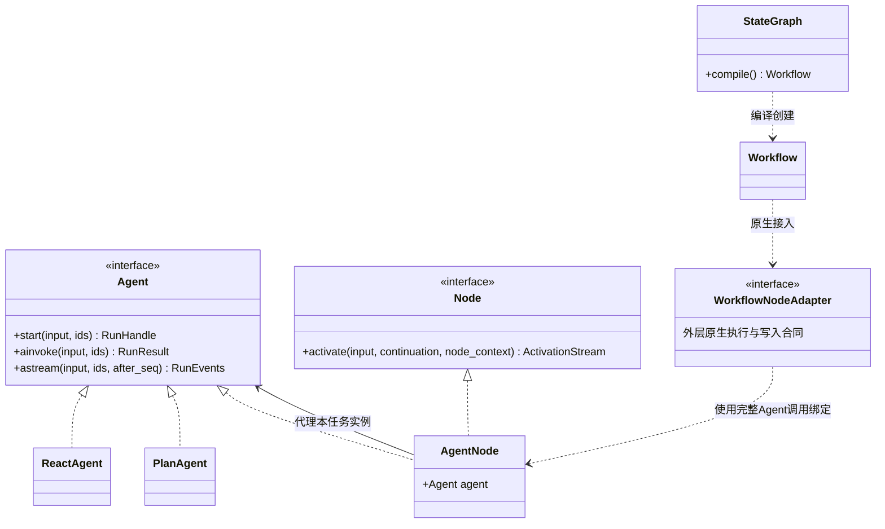

# SDK 公共接口与依赖注入

状态：Python 接口详细设计，尚未实现。本文固定直接 Agent 的构造后调用、重入、观察和控制合同；构造参数、注册 DTO 与资源所有权见[构造与绑定](assembly.md)。公开入口不包含平台用户、应用、发布或资源目录 CRUD。

## 1. 调用者看到的最小流程

```python
# store、content_store、environment、model 等均由宿主预先准备。
# 本例展示目标接口，不是当前可安装包的运行代码。
async with RuntimeEngine(
    namespace=namespace,
    store=store,
    content_store=content_store,
    environment=environment,
) as runtime_engine:
    agent = PlanAgent(
        definition=planner_definition,
        executors={"research": research_definition},
        model=model,
        capabilities=capabilities,
        hooks=hooks,
        workspace=workspace,
        runtime_engine=runtime_engine,
    )
    handle = await agent.start(
        input=AgentInput(content="检索资料并整理报告"),
        session_id=session_id,
        run_id=run_id,
        input_id=input_id,
    )
    result = await handle.wait()
```

构造 ReactAgent／PlanAgent 只校验与冻结配置，不开始任务。实例在首次成功接收调用时绑定执行身份，同身份可重入；新提问用同配置创建新实例。具体约束见[实例生命周期](assembly.md#12-agent-实例与配置复用)。start 返回运行句柄；需要直接等结果时使用 ainvoke，需要持续观察时使用 astream。三者使用同一条准入／恢复路径，不实现三套执行逻辑。

planner_definition 与 research_definition 都是 AgentDefinition，分别配置 Prompt、能力选择和输入输出格式。executors 保存定义，SDK 在每次委派时创建独立 ReactAgent。execution_policy、context_policy、model_options 可在构造时显式传入；省略时解析固定默认值，Executor 沿用 PlanAgent 的策略与模型。ReactAgent 使用同样的 definition 结构，不接收 executors。

`RuntimeEngine` 是调用方装配的 SDK 运行时引擎，参数统一命名为 `runtime_engine`。同一实例可以托管多次 Agent／Workflow 执行；每次执行的上下文、预算和活动现场独立。进入 `async with` 开启托管服务，调用 `agent.start(...)` 才接收具体任务。Node.activate 的 `node_context: NodeContext` 是任务身份、控制和受限服务引用；AgentContext 则由执行中的 ReactAgent 持有。两者均不等于共享宿主 RuntimeEngine。

SDK 将该次执行的持久记录称为 `ExecutionRecord`，由取得执行权的 `ExecutionRunner` 在本机推进。公开 `run_id` 标识这条记录；`RunHandle` 是它的观察／控制句柄，`RunResult` 是结果投影。调用者不直接 new ExecutionRunner，也不通过修改 ExecutionRecord 推进执行，恢复仍使用原 `run_id` 调用同一入口。

### 1.1 公共 Agent 接口与图内 Node 接口

| 类型 | 面向谁 | 职责与关系 |
| --- | --- | --- |
| Agent | SDK 调用者和平台装配代码 | 完整智能体的执行接口；由 ReactAgent、PlanAgent 实现 |
| ReactAgent | SDK 调用者 | 执行 ReAct Loop，持有私有 AgentContext；通过 AgentNode 接入轻量图 |
| PlanAgent | SDK 调用者 | 构造 Planner／Executor 程序，内部使用同一轻量图引擎 |
| Workflow | SDK 调用者 | 编译后的通用工作流；独立于 Agent，可以完全没有模型或 Agent 节点 |
| StateGraph | 工作流作者 | 定义节点、边与状态，compile 返回 Workflow；构建器不直接执行任务 |
| Node | 内层图引擎及节点扩展作者 | activate 合同；返回进度、等待、完成或失败，由 Driver 保存现场 |
| AgentNode | 图内角色接入及工作流装配 | 同时实现 Agent 和 Node，组合并代理本任务 Agent；外层原生调度另由 WorkflowNodeAdapter 衔接 |



`Agent` 用 Python Protocol 定义统一使用合同；`ReactAgent`、`PlanAgent` 是可构造的具体类。创建通过具体类的构造函数完成，接口不提供 `Agent.create()`，也不负责查找平台配置。平台可以在自己的 AssemblyService 中根据 mode 选择构造函数；未来便利工厂也只能包装同一合同。

`Agent` 与 `Node` 是两类职责接口，并非整个 SDK 只有两个协议。Node 的激活方法服务内层调度，外层迁入内核通过 WorkflowNodeAdapter 适配自己的状态／写入合同，不能只因为都叫节点就交换使用。接口实现用虚线空心三角，具体类继承用实线空心三角；组合绑定使用普通引用箭头。

## 2. 输入与执行门面

### 2.1 正式签名

```python
@dataclass(frozen=True)
class AgentInput:
    content: JsonValue
    variables: Mapping[str, JsonValue] = field(default_factory=dict)
    artifacts: tuple[ArtifactRef, ...] = ()


class Agent(Protocol):
    async def start(
        self, input: AgentInput | str | None = None, *,
        session_id: UUID | None = None,
        run_id: UUID | None = None,
        input_id: UUID | None = None,
    ) -> RunHandle: ...

    async def ainvoke(
        self, input: AgentInput | str | None = None, *,
        session_id: UUID | None = None,
        run_id: UUID | None = None,
        input_id: UUID | None = None,
    ) -> RunResult: ...

    def astream(
        self, input: AgentInput | str | None = None, *,
        session_id: UUID | None = None,
        run_id: UUID | None = None,
        input_id: UUID | None = None,
        after_seq: int = 0,
    ) -> AsyncIterator[RunEvent]: ...
```

Python 的 str 是 `AgentInput(content=该文本)` 的便利写法；业务 JSON 必须显式放入 AgentInput.content，避免与 SDK 的输入信封字段混淆。JsonValue 仅允许 JSON 值，不接受任意 Python 对象。Mapping、数组和内容在入口深度冻结；frozen dataclass 本身不能代替深度不可变。

content 按 definition.input_schema 校验；variables 按 definition.variables 声明校验；Plan 入口的 definition 就是 Planner 使用的定义。artifacts 必须是当前 RuntimeEngine 获准读取且仍有效的引用，不接受裸宿主路径。三部分一起保存为原始输入，参与重复请求比较。没有输入 Schema 时 content 为非空文本。空输入与恢复时省略 input 的含义不同。

### 2.2 新执行与恢复参数矩阵

| ExecutionRecord 是否存在 | input | 其他规则 | 结果 |
| --- | --- | --- | --- |
| 新执行 | 必须提供 | 可省略全部 ID，由 SDK 分配；未传 session_id 创建一次性 Session | 原子登记 ExecutionRecord、正式问题、接收回执及启动意图，返回 RunHandle |
| 指定 run_id，但存储中不存在 | 未提供 | 不得以空问题初始化 | RUN_NOT_FOUND |
| 已存在 | 未提供 | 必须传 run_id；可附 session_id 作一致性断言，不传 input_id | 接续／附着原执行，或读原终态 |
| 已存在 | 提供 | input_id 若省略则取该 ExecutionRecord 原始问题 ID；若提供必须相同；内容规范化后必须相同 | 重复提交原问题，不创建新输入 |

`input=None` 表示无新输入；若业务 Schema 允许 JSON null，应显式使用 `AgentInput(content=None)`。显式 input_id 必须同时提供 run_id，不提供“只凭一个输入 ID 猜测运行”的恢复入口；否则报 INVALID_ID_COMBINATION。未给 run_id 时新建执行并生成配套 input_id。已删除记录的处理不得把最小关闭标记绕过而重建同 ID。

接收幂等按 `(namespace,input_id)` 唯一，并验证原 run_id／Session 关联；显式 session_id／run_id 与原接收事实冲突时报 INPUT_CONFLICT。输入比较采用冻结后规范 JSON 摘要，不比较 Python 地址。并发初次提交同 run_id 由 RuntimeStore 唯一键／事务决定唯一 ExecutionRecord，失败方回读原接收事实。已存在 ExecutionRecord 的重投先核对原接收记录；不因原 Artifact 后来过期就拒绝附着，但后续读取仍遵守来源生命周期。

一个 Session 同时只允许一个活动 ExecutionRecord；新问题占用失败返回 SESSION_BUSY，不偷偷把问题变成补充。同 ExecutionRecord 重投是附着，不属于这个冲突。SDK Session 不含平台应用权限，调用方负责保持 Session 的应用归属。

需要可靠恢复的宿主应在调用前持久保存 run_id 和 input_id。一次性示例可让 SDK 分配；start 返回的句柄暴露生成 ID，但在回执丢失且调用者未保存任何稳定键时，不能承诺调用者可以定位原任务。

### 2.3 同一 ExecutionRecord 的处理顺序

1. 校验 RuntimeEngine 处于 open、Agent 实例未绑定或与原执行身份一致、身份参数与权限范围；检查已接收输入和停止准入标记。
2. 对不存在的 ExecutionRecord 原子初始化；已存在则验证原 Session／初始问题，不能把重投内容追加为补充。
3. ExecutionRecord 已终态：返回只读句柄，wait 立即读取原结果，不触发模型、Hook 或沙箱准备。
4. 原 owner 仍有效：默认附着，不报模糊的“可能 busy”，也不抢执行权。
5. 无有效 owner：登记本机推进意图，由 SDK 领取执行权、验证旧环境撤权屏障、加载检查点并接续。start 不等待整个恢复或任务完成。

admission_closed 禁止初始化被关闭的 ID 及启动新业务，不妨碍附着读取已有 ExecutionRecord。已有 stopping ExecutionRecord 没有 owner 时，可取得执行权继续必要收束；不能重新开启业务调用。

调用方必须提供该 ExecutionRecord 的原配置和资源。SDK 不选择平台版本、不比较发布指纹；缺少保存的绑定、协议不支持或内容无法读取时明确失败，不能退回 Planner 重新规划来掩盖恢复错误。RuntimeEngine 宿主退出后不会凭空产生另一个 Worker，跨机重新投递仍由宿主完成。

## 3. RunHandle 只持有运行引用

```python
class RunHandle(Protocol):
    run_id: UUID
    session_id: UUID | None
    input_id: UUID | None

    async def wait(self, *, timeout_s: float | None = None) -> RunResult: ...
    def events(self, *, after_seq: int = 0) -> AsyncIterator[RunEvent]: ...
    async def snapshot(self) -> RunSnapshot: ...
    async def stop(self, *, command_id: UUID, reason: str = "user") -> StopReceipt: ...
```

RunHandle 是本机门面，不能序列化连接供另一进程接着用；跨进程传 run_id，然后新建句柄。它引用 RuntimeEngine 公共查询与控制服务，不持有角色 Context，也没有自己的调度器。

| 方法 | 确定行为 |
| --- | --- |
| agent.ainvoke | 等价于 `handle = await agent.start(...)`，再 `await handle.wait()` |
| agent.astream | 开始迭代时调用 start，再迭代 handle.events；仅创建 iterator 尚未提交执行 |
| handle.wait | 等待业务终态并返回 RunResult；可调用多次，不消费结果、不追加模型总结 |
| handle.events | 从公开序号 after_seq 之后回放，再观察新事件；不是模型逐 token 流 |
| handle.snapshot | 读取最新已提交快照，不根据内存 Future 推测完成 |
| handle.stop | 等价于 runtime_engine.runs.stop；返回停止接收回执，不等于全部执行已停止 |
| runtime_engine.runs.attach | 仅获得原 ExecutionRecord 的观察／控制句柄，不提供程序，不启动或接管执行 |

wait 的 timeout_s 只限制本次等待，正数或 null；超时抛 WaitTimeout，不改变 ExecutionRecord deadline。取消等待、关闭事件迭代器或 HTTP 断开都不停止后台执行；后台任务由 RuntimeEngine supervisor 持有。RuntimeEngine 关闭后本机未完成等待收到 RUNTIME_CLOSED，持久事实保留；用户主动结束使用 stop。

## 4. 结果、事件与错误

### 4.1 终态结果

| DTO | 字段 |
| --- | --- |
| RunResult | schema_version=1、run_id、session_id?、status、output:FinalOutput?、error:RuntimeErrorRecord?、partial_results:tuple[PayloadRef,...]、usage:RunUsage、started_at?、ended_at、cleanup_state |
| FinalOutput | kind:text\|json、value:JsonValue、source_ref:PayloadRef |
| RunUsage | loops_consumed、loops_reserved、business_model_attempts、compaction_model_attempts、tool_attempts、input_tokens?、output_tokens?、token_counts_complete:bool |

status 仅允许 succeeded／failed／cancelled／timed_out／budget_exhausted。succeeded 必须有 FinalOutput 且 error=null；JSON null 也装在 FinalOutput.value 中，不与“无输出”混淆。其他状态 output=null，必须有 RuntimeErrorRecord，可含已提交且获准展示的 partial_results；未完成内容不能冒充最终答案。

usage 在根 ExecutionRecord 内按持久身份去重汇总，压缩不计 loops_consumed。没有供应商 token 统计时不能伪造为 0：对应字段为 null，token_counts_complete=false；部分已知时可返回已知合计但仍标 false。预算释放完毕的终态 loops_reserved=0。

started_at 在执行前即被停止时可以为 null。cleanup_state 使用 pending／running／succeeded／failed；无需删除持久工作区的清理是成功的空操作。RunResult 的业务结果和用量固定，后续重复读取可看到更新的清理进度；清理失败不重新启动业务。清理重试由RuntimeEngine托管的CleanupService通过独立CleanupLease完成，终态start仍只附着读取，不创建Runner，也无需用户再次提问触发清理。领取及允许写集见[终态清理执行权](checkpoints.md#81-终态清理执行权与重试)。RunSnapshot 的全部查询字段另行按查询 Schema 冻结。

### 4.2 公开事件

`RunEvent` 固定字段：`schema_version=1,event_id,run_id,seq,type,payload:JsonObject,committed_at`。它是已提交事件的授权公开投影，seq 使用本 ExecutionRecord 的 public_seq，从 1 开始单调增长，不是图内 checkpoint 序号。大正文使用受限引用；不能向平台终端输出内部凭据、原始宿主路径或 Executor 私有上下文。

- after_seq 是最后已处理的序号，0 表示从头；返回的每项必须 seq > after_seq，按 seq 升序。
- 同一迭代器不重复发同序号；跨连接重放允许客户端按 event_id／seq 去重。
- 游标超过最新公开序号时，报 EVENT_CURSOR_AHEAD，不永久空等；负值也拒绝。
- ExecutionRecord 的业务终态提交包含公开终态事件和 terminal_seq。观察补齐至 terminal_seq 后结束；游标已到达／超过该终态边界且不超过最新公开序号的合法重连立即结束。清理进度再通过 snapshot 查询，不为文件删除无限延长答案流。
- 事件丢提示时从持久 outbox 补读，不根据事件重放工具。关闭迭代器释放本机观察，不向 ExecutionRecord 传播取消。

模型适配器内部仍流式接收和检测首输出；完整响应才提交模型响应事实，不逐 token 发总线事件。完整模型响应可能包含工具调用，所以它不等于 ExecutionRecord 成功。

### 4.3 何时抛异常

| 情况 | API 行为 | 是否可以推断 ExecutionRecord 失败 |
| --- | --- | --- |
| 构造引用缺失／模式冲突 | ConfigurationError | 没有创建 ExecutionRecord |
| 已绑定 Agent 实例用于另一执行，或再次调用时未提供原 run_id | RequestError，code=AGENT_INSTANCE_BOUND | 不创建新执行；使用原身份附着，或用相同配置构造新 Agent |
| 新输入不合法、INPUT_CONFLICT、SESSION_BUSY、RUN_ADMISSION_CLOSED | RequestError，含稳定 code 和字段定位 | 本请求未成功接收，既有 ExecutionRecord 不受影响 |
| 接收或查询时存储失联 | InfrastructureError，注明接收结果可能未知 | 不可以；用相同 ID 查询／重投 |
| 已持久结束：模型失败、预算耗尽、用户停止等 | wait／ainvoke 返回非成功 RunResult | 可以，以保存的终态为准 |
| 观察等待超时、调用者取消、RuntimeEngine 关闭 | WaitTimeout／CancelledError／RUNTIME_CLOSED | 不可以；执行与观察分开 |
| 读取正文时授权撤销／源删除 | 明确读取错误 | 不得绕过撤销从旧缓存返回正文 |

Hook 普通执行失败继续执行的规则不适用于必要存储故障。未形成可靠终态时不能为凑一个 RunResult 在本机虚构 failed。

## 5. 补充输入与停止

```python
class RunService(Protocol):
    async def attach(self, run_id: UUID) -> RunHandle: ...
    async def get(self, run_id: UUID) -> RunSnapshot: ...
    async def stop(
        self, run_id: UUID, *, command_id: UUID, reason: str = "user",
    ) -> StopReceipt: ...


class InputCommands(Protocol):
    async def append(
        self, run_id: UUID, *, input_id: UUID, content: str,
    ) -> InputReceipt: ...
```

InputReceipt 字段为 `input_id,session_id,run_id,acceptance:accepted,delivery_state,session_seq,commit_ref`。run_id 固定为原接收 ExecutionRecord；delivery_state 为 pending／claimed／delivered／pending_next_run，是 UserInputDelivery 的查询投影，commit_ref 指向该投影所依据的提交。重复接收返回相同接收身份，并可以返回已经推进的当前投递状态；不创建第二条用户输入。未接收则抛明确错误，不返回 acceptance=accepted 的失败回执。

本节只适用于直接 ReAct／Plan ExecutionRecord：

1. input_id 重复且内容、来源 ExecutionRecord 相同，返回原接收事实；冲突报 INPUT_CONFLICT。
2. SDK 固定正式输入及顺序，Plan 只交给 Planner，ReAct 只交给入口角色的下一 Loop。
3. 已接收但未送达模型的补充在结束时转 pending_next_run，下一次主动提问接回；不自动开 ExecutionRecord。
4. ExecutionRecord 已结束且此前未接收该 input_id，返回 RUN_ENDED。平台可将它作为下一提问，但回执未知时须先查原接收事实，不能双重入库。
5. 输入领取、送达和转交由 SDK 原子提交；实现算法见[上下文输入协议](context.md#32-正式输入与保护清单)。

StopReceipt 字段为 `run_id,command_id,admission_closed:true,status_at_commit:RunStatus|null,commit_ref`。没有 ExecutionRecord 时 status_at_commit=null；已经终态返回真实终态；仍在执行返回 stopping。只证明停止命令已保存，确认结束需 wait 或读取 snapshot。

stop 与初次 start 争用同一 admission key：stop 先提交则迟到 start 返回 RUN_ADMISSION_CLOSED；start 先提交则按原 ExecutionRecord 收束。终态不重开，command_id 重投幂等，相同 command_id 不同参数报 IDEMPOTENCY_CONFLICT。停止采用独立受信控制入口，不经过用户 Hook。

删除正文后仍保留最小准入关闭标记，直到调用方确认对应旧分派已撤销；records.delete 不能使旧 run_id 复活。具体锁和事务见[检查点](checkpoints.md)。

## 6. Workflow 与 AgentNode 的边界

StateGraph.compile 返回公开类型 Workflow。Workflow 不实现 Agent；其 start／ainvoke／astream 与 RunHandle 复用相同根执行控制和结果语义，但输入是 Workflow 自身的结构化状态，不能直接把 AgentInput 的聊天补充协议套上去。Workflow 初始输入回执、完整编译签名和映射 DSL 仍在[Workflow 合同](workflow.md)中待细化。

编译时传入预装配的 ReactAgent／PlanAgent 或其 PreparedAgentRef，编译结果保存冻结装配绑定和创建方式，不保存活动上下文。AgentNode 代理也可解包到相同内置绑定，禁止循环代理。每次实际任务创建自己的 Agent 实例，经内部调用桥保存父 Operation 与子 Invocation 引用，共享根 ExecutionRecord 和预算。不能在普通节点里无关联地调用 child.ainvoke，再声称获得了嵌套恢复。

公共 Agent 接口保证完整程序可独立执行，不保证任意第三方实现都支持图内接续。首版编译器只接受带 SDK 内部执行绑定的两种内置实现（含可解包到它们的 AgentNode 代理），并校验 RuntimeEngine 一致；仅提供 start／ainvoke／astream 的对象须报 ConfigurationError，不退化为新建子 ExecutionRecord。将来开放第三方 Agent 嵌入时，需要单独定义执行绑定与恢复协议，不能偷偷把它加入 Agent 的公共使用接口。

Workflow 活动输入必须有显式接收点和状态映射。当前未定义的接收模式返回 WORKFLOW_INPUT_UNSUPPORTED，不自动广播或交给任意 AgentNode，更不能先 accepted 再丢弃。初始 Workflow 输入不受此限制。

## 7. 扩展端口和公共查询

| 端口 | 最小职责 | 恢复约束 |
| --- | --- | --- |
| ModelAdapter | 单次流式请求、完整决策、结构化异常 | 不拼接不同 Attempt 的半截结果 |
| CapabilityAdapter | 单次工具调用、结果归一、外部关联 | 已保存原始结果不重发 |
| SkillLoader | 供 SkillHandler 使用的底层接口：列目录、读 SKILL.md 和包内资源 | 固定只读包，不回查平台；不自行处理事件、Hook 或上下文写入 |
| HookAdapter | 受限执行 Hook，返回决定／patch | 已应用修改与链游标复用 |
| RuntimeStore | 原子命令、CAS、执行权、快照增量和事件 | 不能退化成各表单独 save |
| ContentStore | 大内容存取、完整性与授权 | 引用发布前内容持久，孤儿可清理 |
| EnvironmentProvider | 受限文件／脚本、撤权和清理 | 活动现场保留，旧 owner 不能继续写 |

端口实现是高代码扩展；SkillHandler、ToolHandler 等 EventHandler 实现及 CommitCoordinator 由 SDK 装配，不需要每个用户注册一遍。调用方提供 SkillRegistration／CapabilityRegistration 和授权选择即可。应用和平台只通过以下公共查询门面读取权威进度：

| 门面 | 内容 | 边界 |
| --- | --- | --- |
| runtime_engine.sessions.history / inputs | 历史、正式输入及投递状态 | 授权分页，不暴露可变消息表 |
| runtime_engine.tasks.list / operations.get | 任务及逻辑调用视图 | 不允许修改 continuation 或强制完成 |
| runtime_engine.events.read | 已提交公开事件分页 | 与 RunHandle.events 使用相同序号和授权投影 |
| runtime_engine.records.delete | 指定已收束记录的删除命令及回执 | 拒绝活动执行，不负责平台应用删除决策 |

这些查询的分页 DTO、删除任务 DTO、各端口机器 Schema 仍需单独完成，不能把本页签名冻结理解成整个 SDK 的所有接口已经定稿。RuntimeEngine 的线程／loop 约束、共享依赖关闭责任与 shutdown 行为见[对象生命周期](assembly.md#7-生命周期与资源所有权)。
