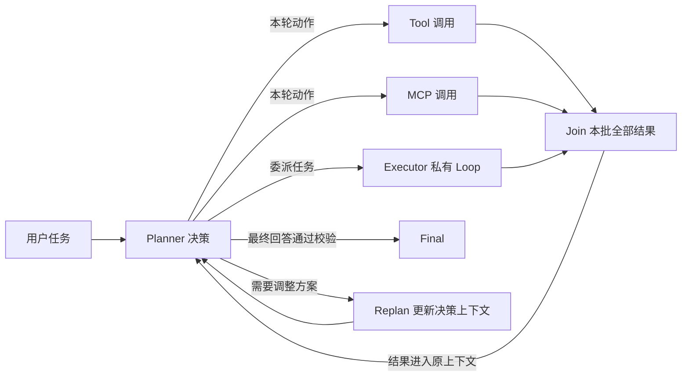
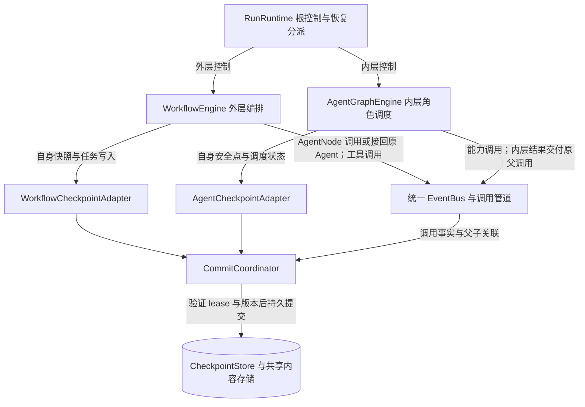

# SDK Workflow 引擎与双引擎检查点适配

状态：目标设计，尚未迁入上游源码或实现 Workflow。两套引擎都属于 agentloom-sdk；Platform 负责配置和装配，不拥有第三套流程调度器。

## 1. 决策与代价

AgentLoom 包内保留两套用途明确的执行内核：

| 内核 | 负责的图 | 调度与状态语义 | 不负责什么 |
| --- | --- | --- | --- |
| `AgentGraphEngine` | 配置生成的 ReAct／Plan–Executor 图 | 角色任务、ReactContinuation、一次模型响应的动作批次、按配置准入、全批汇合回原角色 | 任意用户工作流、channels／Pregel、外层节点路由 |
| `WorkflowEngine` | 用户编排的完整 Agent、工具及业务流程 | 迁移并适配 LangGraph 的编译、状态、channels／reducer、super-step、动态分派和任务写入机制 | 接管角色私有 Loop、解释模型消息、重新执行已经完成的 Agent 调用 |

这是**两套引擎实现**，不是给同一内核起两个名字，也不是再加第三套总调度器。两者共用 Run 控制、调用管道、能力服务和持久化基础设施；每个 GraphExecution 固定一个 `engine_kind`，只由对应内核推进。

小图可以运行在通用引擎上；选择双引擎的理由是内层只需要有限的角色调度规则，可以独立演进，不必随外层的状态和同步机制变化。代价是必须维护父子调用、两种现场格式和故障切点的适配测试。不能因为流程简单就省略内层恢复、调用去重或停止协议。

外层采用**源码迁移并融合到 AgentLoom 包内**的方式，不以应用直接安装／调用 `langgraph` 包作为目标方案。导入范围、必要依赖、上游版本、许可证和本地修改要明确记录；不能仅改包名就宣称已完成融合，也不默认迁入全部上游功能。

## 2. 内层 Plan–Executor 的循环

下面是行为流转图，不是实现类继承图，也不是要求为每个工具建立 NodeDefinition。



- **Planner** 是继承 ReactNode 的角色节点。它可以调用授权 Tool／MCP，也可以委派 Executor；没有执行器时仍可完成自己的模型—工具循环。
- **Tool／MCP** 是统一调用管道中的 Operation，由相应 Manager 执行；内层图不为每项能力注册一个节点。Skill 阅读、脚本执行遵循相同能力边界。
- **Executor** 是同一内层图中被分派的 NodeTask，继承 ReactNode，拥有私有上下文。同一角色配置委派两次产生两个任务，不增加两个图实例。
- **Join** 是固定批次的结算条件，属于引擎与批次协调器；不调用模型。关闭并行时逐项执行，开启后按配置准入；单项业务错误不取消其他成员，全批 settled 后一次交回原 Planner。
- **Replan** 表示 Planner 调整任务方案并继续原任务。它不是默认新增的 Agent、必经图节点或额外模型请求。收到工具结果后的下一次决策本身就可以重新规划；不能因为“尚无最终答案”再插入一次强制模型调用。
- **Final** 要求节点输出通过配置的校验、子任务已收束且有效结果已提交。模型流中的文字或单次模型完成事件不能直接宣告 Run 成功。

Planner 的等待、再次决策和故障恢复沿用原 NodeTask。ReAct 模式使用同一轻量引擎，只保留入口 ReactNode 和普通能力批次，没有业务 Executor。两种模式继续使用同一公共 Loop；不把 LLM 的 `plan_steps` 编译成外层工作流。

## 3. 两套引擎怎样接入 SDK Runtime



图表达两套引擎对共同服务的依赖，不表示实体归属或执行先后。外层经 AgentNode／调用管道请求内层，内层结果经原父调用返回；详细顺序见第 5 节。`RunRuntime` 只控制整次执行和分派恢复，不判断下一节点，也不维护第三份 ready 队列。`GraphExecutionManager` 在调用桥内准备关联命令，不启动角色协程；所属引擎在提交成功后读取持久启动意图并调度。

外层自己的 CapabilityNode 也通过同一 EventBus／InvocationPipeline 调用工具和 MCP，但不产生 AgentInvocation。Hook、上下文、权限、Operation／Attempt 不在两套引擎内各实现一份。节点及工具不能直接写检查点表。

本组文档中的 `GraphEngine` 是公共端口或尚未展开的引擎称呼：**内部调度算法具体归 AgentGraphEngine；外层归 WorkflowEngine。** 公共端口不要求两者共用 ready queue、WaitGroup、reducer 或 NodeDriver 的内部实现。

## 4. 定义与运行身份

GraphDefinition 保留公共本地 key、节点绑定及输入输出契约；增加引擎类型判别，具体结构按类型校验。不能要求外层迁移内核同时维护旧自研 branch cursor／配对 Join 算法。

| 对象 | 必须固定的边界 |
| --- | --- |
| `GraphDefinition` | `engine_kind: agent 或 workflow`；Agent 图只接受生成模板允许的结构，Workflow 图按迁移后的编译规则验证 |
| `CompiledGraphDescriptor` | `engine_kind`、`engine_protocol_version`、节点契约、已解析绑定 key、引擎专属编译描述；不保存运行进度 |
| `GraphExecution` | `engine_kind`、调用方重建的编译程序引用、Run 归属、parent 引用；恢复不能换引擎或换业务配置 |
| `NodeTask` | SDK 逻辑身份；内层由轻量引擎创建，外层由内核任务身份映射；同名节点的再次业务执行不是同一任务 |
| `WorkflowTaskBinding` | `(graph_execution_id, origin_engine_checkpoint_id, engine_task_id, engine_task_path) → node_task_id` 的持久映射；用于将外层任务接回SDK Operation |

外层任务恢复复用原映射；不能用节点名称、输入参数、内存 Activation ID 或网络重试次数生成新的子调用键。正常工作流回边产生新的原生任务身份，从而创建新的 NodeTask。迁移前必须验证所选源码版本在恢复／重试时的身份稳定性；不支持时应在内核任务创建边界固定映射，而非运行时猜测。

直接调用 Agent：一个根 AgentInvocation 和一个 `engine_kind=agent` 的图。Workflow 调用一个 Plan Agent：一个 `workflow` 图和一个 `agent` 图；Plan 内两个 Executor 只是后者的两个任务。被调用 Agent 复用根 Run，保留自身局部限制和文件授权，不能重置根额度或继承整个外层上下文。

### 4.1 输入、历史与角色上下文

| 执行入口 | 初始内容 | 历史与后续上下文 |
| --- | --- | --- |
| 直接 ReactAgent／PlanAgent | 本次问题、正式补充及按策略投影的 Session 历史 | 根角色保留本 Run 有效过程；Executor 只获得显式委派输入及自己的过程 |
| Workflow 根图 | 本次结构化输入，按输入 Schema 初始化 GraphState | Workflow Session 记录交互，不自动把历史问答注入业务状态或每个模型请求 |
| Workflow 的 AgentNode | input_mapping 产生的 input_only 输入及 file_grants | 新 Invocation 的独立上下文；不复用该 Agent 其他 Session，也不继承外层全部状态 |
| 原任务故障重入 | 已固定的原输入和运行关联 | 接续原 Graph／Task／Context，不再次做新任务的初始化或历史选取 |

AgentNode 的输入成为受保护任务原文；后续压缩不得省略。它没有根 Agent Session 的补充领取权，其他 AgentNode 的私有消息不通过 GraphState 共享。需要传递前一步材料时必须显式映射输出／授权文件。

外层初始输入写入和历史查询应与其状态初始化协议一致；不能用“某个子 Agent 首输出”代表整个 Workflow 已消费用户输入。Workflow 运行中的追加输入尚需定义接收节点、投递回执和终态交接，本版不将直接 Agent 的 inputs.append 协议视作已覆盖此场景。

## 5. 父子调用交接协议

### 5.1 开始与等待

1. WorkflowEngine 在调用步骤出网／启动子图前，先持久保存该步原生任务的恢复依据及 WorkflowTaskBinding。
2. AgentNode 以 `(parent_node_task_id, logical_call_key)` 调用 `begin agent.invoke`；首次创建 Operation，重入返回原引用。该次调用固定 PreparedAgentRef、输入和授权文件引用。
3. 前置 Hook 通过后，StartChild 在同一 SDK 执行存储事务保存父调用等待关联、唯一 AgentInvocation、内层 GraphExecution 和启动意图。拒绝时只交付 blocked，不创建子图。
4. AgentGraphEngine 读取已提交启动意图推进内层图。外层异步等待结果，释放数据库锁；其线程／本机 Future 不是恢复依据。

外层可以保持一个异步节点调用等待，也可以由适配层释放本次激活；这不暴露用户暂停动作。原生图重新进入该任务时，适配器先按固定映射接回原 Operation 和子图，不能直接重新 invoke Agent。

### 5.2 完成与消费

1. 内层图完成时，一致提交内层终态、结果和原父 Operation 的 raw 结果关联。
2. 原调用管道继续后置 Hook，提交有效结果与可交付状态。外层只能消费此 effective 结果，不能抢先消费子图 raw 输出。
3. AgentNode 将结果映射为该外层任务的输出写集。WorkflowCheckpointAdapter 在提交该任务的原生 pending writes 时，一并提交SDK 结果消费标记及节点完成投影；之后才向内核确认持久成功。
4. 外层下一 super-step 如何应用写入、推进 channels 和选择后继，由 WorkflowEngine 决定。平台不能另按旧自研路由表创建一套后继任务。

如果在第 2、3 步之间宕机，外层任务可以重新进入适配器并取回已保存结果，**不会重跑 Agent 或后置 Hook**。如果第 3 步已完成，则使用保存的 pending writes；不能再次应用同一输出。通知由 outbox 补发，丢通知不丢完成事实。

外层的“任务输出已保存”和“该步写入已应用到图状态”是两个阶段，不能把SDK 消费标记当成后者。有效失败结果也按一次交付处理，后续走已编译 Workflow 固定的错误策略；内层的 all-settled 规则不强制改变外层原生错误传播语义。

### 5.3 失败、取消和重入的确定映射

AgentNode／CapabilityNode 适配器先区分**已经形成有效响应的业务结果**与**尚不能确认提交的基础设施故障**。不能把所有非成功响应都 `raise` 给原生 runner：核对基线中，未处理异常可能取消同批其他任务，ERROR／INTERRUPT 写入也不等于该任务已经成功交付，见[原生异常与取消处理](https://github.com/langchain-ai/langgraph/blob/afbe7e48b17f62e139b5c6337ab934549e6dc73b/libs/langgraph/langgraph/pregel/_runner.py#L575)。

| 情况 | 适配器和 SDK 动作 | 外层调度与恢复 |
| --- | --- | --- |
| 有效响应 succeeded | 保存带原 Operation／response 引用的完成输出 | 原生正常任务写入；恢复复用输出，不再调用能力 |
| 有效响应 failed／blocked，包括局部 Agent 超时、模型失败、前后置 deny | 保存 `business_outcome` 和错误引用；这是正常完成交付的任务输出，不向原生 ERROR channel 抛业务异常 | 由构造时固定的错误路由选择后继；本 super-step 其他任务继续。无错误路由时，待本 step 收束后 Workflow 失败，不走成功后继、不默默当作成功 |
| 父节点等待 Future 被取消，但根 Run 仍 active | 只解除本次本机等待／激活；不据此取消 Operation 或子 Invocation，不创建新调用，不标记已消费 | 接回原 NodeTask、Operation、child；不得把本机 CancelledError 当成子业务结果或用户停止 |
| 根停止／总超时／根额度耗尽 | 先提交根控制关闭新工作；两套内核及调用管道按收束协议完成或撤销在途工作 | 不走业务错误后继；收束记录可以保存，禁止普通后继启动和终态复活；仅局部 Invocation 关闭不冒充根停止 |
| 存储不可用、提交回执不明、进程故障 | 关闭当前 Worker 新工作门，保留未完成关联；先查原 command_id 回执，不伪造 completed/failed 能力响应 | 属于内部接管／修复路径；没有成功写入依据就不推进下一 step，也不能通过换 Operation ID 重试业务 |
| 租约失效 | 旧 Worker 停止推进及提交；只允许撤权／本地收束动作 | 新 Worker 取得执行权后按原关联恢复；旧 CancelledError／迟到结果不能覆盖新状态 |

`business_outcome` 是适配器保存的有类型交付记录：`node_task_id、operation_id、effective_response_ref、status(succeeded|failed|blocked)、execution_fact、mapped_output_ref?、error_ref?、routing_decision_ref`。后置拒绝保留已经发生的执行事实；失败／拒绝只写失败输出和明确的错误映射，不能混入成功路径业务写集。该记录随原生任务完成写集保存，放在引擎私有、按稳定 task 身份区分的结果槽，不注入其他 Agent 的模型上下文。即使业务输出为空，也必须保存可被原生恢复识别的完成标记。

**原生任务完成**表示其输出可供下一步读取；SDK NodeTask 的业务终态使用既定枚举：succeeded 响应对应 succeeded，failed／blocked 响应对应 failed。具体 blocked 保存在 Operation／有效响应中，不给 NodeTask 新增 blocked 枚举。不能因为用了原生成功写入路径而把业务失败改成成功。

对这两种SDK 节点，不另启用一层会重新执行业务的原生 RetryPolicy。同一次失败节点重入、连接重试或接管均读取同一个 Operation；Runtime 的 Attempt 重试继续由用户固定策略控制。工作流若通过显式回边再次调用同一 Agent，是新原生 task／NodeTask 和新业务调用，不能由异常处理器悄悄替代。

原生 ERROR／INTERRUPT 写入只记录其真实原生故障／中断语义，不自动消费SDK 结果、不直接终结子 Invocation。迁移内核保留这些记录用于诊断与恢复；恢复先检查根控制和SDK 调用事实，再决定接回原调用或只执行收束。本版不因迁移引入用户 pause／resume。

## 6. 统一检查点管理，保留两种现场

统一的是身份、授权、存储、事务、历史查询、删除、执行权和恢复入口；**不统一两套引擎内部的状态机与快照字段。**

```text
GraphCheckpoint（公共信封）
  format_version, namespace
  run_id, graph_execution_id
  engine_kind: agent | workflow
  engine_protocol_version
  checkpoint_id, checkpoint_seq, previous_checkpoint_id?
  covered_commit_seq
  parent_execution_ref?, run_control_ref
  engine_state_ref: PayloadRef
  created_at

engine_state_ref 指向一种受版本约束的载荷：
  AgentCheckpointPayload
    角色任务／Continuation 引用、ready／wait、CallBatch、已完成结果
  WorkflowCheckpointPayload
    原生 checkpoint 与 metadata、channels／版本信息、原生父快照引用
    任务映射引用；pending writes 通过一致读恢复包另行关联
```

| 适配器 | 接收什么 | 恢复时返回什么 |
| --- | --- | --- |
| `AgentCheckpointAdapter` | NodeDriver 安全点、批次和内层调度提交 | 原任务、Continuation、待完成调用、ready／wait |
| `WorkflowCheckpointAdapter` | 迁移内核的 `get_tuple / put / put_writes` 及异步等价接口 | 该原生快照、metadata、parent config 和同一读水位内的 pending writes |

两者均经 CommitCoordinator 提交到集中 CheckpointStore。同步和异步 Saver 接口是同一协议的不同入口，不能各维护一套存储。业务调用仍由 InvocationPipeline 记录；Saver 不能根据“没有 pending writes”认定工具尚未执行。

### 6.1 外层 Saver 的具体适配要求

1. **命名空间**：原生 `thread_id` 由 GraphExecution ID 派生，`checkpoint_ns` 由可信运行身份生成。Agent Session ID 不作为外层恢复身份。原生 checkpoint ID 与SDK checkpoint ID 保存显式对应，不把时间戳当顺序。
2. **写入路径**：`put` 转成 `CommitWorkflowCheckpoint`；`put_writes` 转成 `CommitWorkflowTaskWrites`。均验证根 lease、格式、引擎协议版本和幂等回执，再通过唯一协调器提交。外层不能同时使用一个另接数据库、绕过SDK 执行权的原生 Saver。
3. **写入内容**：保留原生 channel 版本、任务写入顺序、保留 channel 的更新规则和 parent chain；不把它们改名成内层 WaitGroup／ScopeCommit 就当作兼容。SDK ScopeCommit 记录提交引用，不充当第二套 channel 合并算法。
4. **读取路径**：`get_tuple` 在固定读水位装配原生快照和 pending writes，以及SDK 任务／调用关联。尚未形成下一快照的成功任务写入也必须可读。历史读取和最新恢复读取分别定义，不能混入无限变化的最新结果。
5. **提交屏障**：父子关联、任务写入及对外生效的关键边界必须等待持久提交确认；原生异步存储失败要阻止相关后续执行。增加两个适配命令并不自动使所有原生步骤落在一个数据库事务中，各边界仍按第 5 节验证。
6. **内容安全**：使用受控版本化序列化格式和 PayloadRef；不恢复任意可执行 Python 对象，不在快照保存可继续使用的旧 lease、数据库连接或明文凭据。

共同端口继续使用 `CommitCoordinator.commit`、`CheckpointStore.load_recovery_bundle` 和 `RecoveryService.recover_run`。两个新增提交命令采用有类型的引擎载荷、预期版本、幂等键及关联写集，不能通过一个任意 dict 修改其他图。具体原生写入键／保留 channel 的修订规则、DDL 与逐方法映射需随实际导入版本定稿，属于实施适配，不再是“选一套还是两套引擎”的待定问题。

### 6.2 恢复分派

根 Run 接管先关闭旧执行权、撤销旧文件写入者，并取得统一读水位。随后按 `engine_kind` 装载各自恢复包，验证父子关系和已保存结果，再恢复可执行任务。RunRuntime 不把所有图都塞进内部 Agent 的 ready heap，也不将外层每个 NodeTask 标成 ready 来取代原生恢复。

| 持久现场 | 应采取的动作 |
| --- | --- |
| 子图创建事务未提交 | 不启动子图；重入原 Operation 准备原始调用位置 |
| 父等待已保存、子图启动通知丢失 | 按原 child ID 执行已提交启动意图 |
| 内层执行中发生机器故障 | AgentCheckpointAdapter 恢复原角色阶段与已完成动作；外层仍等待同一个调用 |
| 内层已完成、父调用 Hook 未结束 | 只继续原调用后置处理，不重新启动内层图 |
| effective 已存、外层 pending writes 尚未保存 | 外层任务重入只取回结果，完成输出写入和消费事务 |
| pending writes 已存、下一原生快照尚未生成 | WorkflowCheckpointAdapter 返回已保存写入，由原生恢复规则推进 |
| 后继已保存但唤醒通知丢失 | 按所属引擎恢复依据继续，不能重跑前序 Agent／工具 |
| 任一层发现根停止／超时／额度耗尽 | 两套引擎关闭新工作，收束整树；写入者静默后统一清理 |

没有外层时，AgentGraphEngine 单独工作，无需创建空 Workflow。发生接管时恢复整棵 Run，当前不要求把内外层同时调度到不同机器。外部工具“已经生效但尚未保存结果”的窗口依然存在，检查点不保证业务副作用恰好一次。

### 6.3 任务写入的持久提交屏障

仅把 Saver 接口换成SDK 存储适配器还不够。核对基线的 [`_loop.put_writes`](https://github.com/langchain-ai/langgraph/blob/afbe7e48b17f62e139b5c6337ab934549e6dc73b/libs/langgraph/langgraph/pregel/_loop.py#L498) 会先更新内存写入列表，再后台调用 Saver；特定 channel 才把写入 Future 纳入已有等待集合。迁移时必须改造**提交完成到下一步推进**这一段，普通 channel、空输出、动态分派与失败结果都不能漏掉。

1. **冻结完整提交包。** Workflow 节点适配器返回输出候选后，内核完成输出映射、路由计算和必要完成标记，冻结同一原生任务的有序写集。结果类型为 `task_result|task_error|task_interruption|system_writes`；仅 task_result 可以携带SDK 结果消费集合，且只能引用已经完成后置处理的 effective response。业务 failed／blocked 属于 task_result，不属于 task_error。
2. **固定写入身份。** 提交包保存 graph ID、原生 checkpoint ID、task ID/path、SDK task binding、写入 revision/hash、期望版本及 result_consumptions。Coordinator 在同一事务检查执行权、固定映射及 response 归属，保存原生写入、消费标记与SDK NodeTask 终态投影。每笔消费唯一键为 `(node_task_id,operation_id)`；重投同包取原回执，内容冲突不能静默覆盖。
3. **等待真实回执。** 异步 Saver 返回 awaitable，必须等到数据库提交才完成；同步入口返回前也必须完成相同提交。WorkflowEngine 持有本 step **全部**写入的确认集合，不能仅等待 Delta／错误路由 channel。内存候选或后台 Future 已创建均不算确认。
4. **阻止越过屏障。** 在应用该 step 的状态写入／reducer、保存下一原生快照、发布节点有效完成或启动依赖它的后继之前，等待相关写入全部确认。动态 Send／PUSH 的可执行意图也在所属写集确认后发布；不得通过即时分派绕开屏障。同一 step 的独立兄弟已获准工作可继续并行，各自的成功结果可以先行持久化；这不改变 super-step 状态可见性。
5. **提交下一快照。** 只有确认的写入可以生成下一原生快照。`CommitWorkflowCheckpoint` 保存它与上一原生快照及已确认写入水位的关联；等待其回执后才推进下一 step。快照失败时，原成功 pending writes 仍在；恢复可重建状态计算，但不能重新调用已完成的业务或重复消费结果。
6. **失败与不确定结果。** 任一必要保存失败／回执未知，关闭本机新工作门，不发布未持久的完成，不开始后继。按原 command_id 查证；成功就复用，确认未提交才补交同一逻辑写入。失去租约交由新 Worker 处理。不能以“普通快照可延后”忽略外层原生恢复依据的保存失败。

普通原生任务可以在错误恢复后继续产生写入，因此 `task_error/task_interruption` 的存在不占用永久业务完成键；任务写入的替换顺序、保留 channel 的更新规则由固定内核协议处理。它们不能携带 `result_consumptions`。一旦 task_result 和SDK 消费已提交，该结果及完成标记不可被迟到的错误／取消写入覆盖；重入只能复用或报一致性冲突。空集合不意味着已消费，也不能根据“收到了 put_writes”就无条件将 NodeTask 置为终态。

这里规定的是迁移内核与适配器必须实现的调用顺序，不是另加调度器。精确原生索引／序列化／DDL 仍随导入版本落地，但不能改变以上提交语义。内层每 16 次增量汇总快照的优化，仅适用于 AgentCheckpointAdapter；不能用它合并或跳过外层每个必需的原生保存边界。

## 7. 迁移与验收边界

先固定源码导入清单，再实现 WorkflowCheckpointAdapter、AgentNode 调用桥和最小工作流，最后扩展复杂编排。不能只证明两个引擎各自能运行，就宣称互相恢复已经正确。

- ReAct 和 Plan–Executor 不依赖 WorkflowEngine 即可运行；工具／MCP 不增加内层图或任务节点。
- 内层混合批次按并行配置运行，包含错误的全批结果一次交回 Planner；Replan 不产生隐含模型调用。
- 外层同批两个 AgentNode：分别创建内层调用；一个完成后故障，恢复不能重跑已完成者。
- 在第 5 节每次提交的前后断开进程，验证调用身份、Hook、消费和原生 pending writes 不重复。
- 暂无下一快照但已有成功 writes 时仍可恢复；保存失败时不发布未持久的成功。
- 外层循环再次访问同名节点会创建新任务；同一任务故障重入复用原子调用。
- 根停止、租约失效、发布停止和删除覆盖两套引擎；不能由迟到结果重新启动终态 Run。
- 对迁移的状态可见性、reducer、super-step、动态分派和 Saver 原生测试保留回归；AgentLoom 的 Hook／调用／恢复另做适配测试。

下列是迁移后的故障验收要求，**当前尚未执行**：

| 场景 | 必须观察到的结果 |
| --- | --- |
| 同步启动 A、B 两个 AgentNode；A 局部失败或 Hook 拒绝，B 尚在运行 | A 生成业务失败输出，不抛原生未处理异常取消 B；B 保持原调用并完成；外层只按冻结错误路由或 step 收束后的失败策略推进 |
| 取消父等待 Future；另案先提交根停止再取消 | 首案重入接回原 Operation／child，实例数不增加；后案两内核只收束，不执行错误后继 |
| 非 Delta 普通输出已计算，故意延迟／失败其 put_writes | 依赖后继、下一状态应用、下一快照和有效完成发布均未发生；确认后各发生一次 |
| 业务输出为空或返回动态 Send | 空结果仍有持久完成标记，恢复不重跑；Send 在所属写入确认前不执行目标 |
| A 的写入已确认，B 的写入失败，然后进程宕机 | 复用 A；B 按原 SDK 调用取回 effective 结果或接续原未完成调用；不为了补写而重新 invoke 已完成的 Agent／工具 |
| task_error 保存后重入；另案 task_result 提交后迟到 ERROR／取消 | 首案不因错误写入误标SDK 结果已消费；后案不覆盖原已消费结果，不重复交付或重开终态任务 |
| 所有任务 writes 已保存，下一原生 checkpoint 保存失败 | 不启动下一 step；恢复从原 checkpoint＋writes 重建，结果消费数不增加 |

上游核对基线为 `afbe7e48b17f62e139b5c6337ab934549e6dc73b`：参考 [Pregel 阶段](https://github.com/langchain-ai/langgraph/blob/afbe7e48b17f62e139b5c6337ab934549e6dc73b/libs/langgraph/langgraph/pregel/main.py#L460)、[Saver 接口](https://github.com/langchain-ai/langgraph/blob/afbe7e48b17f62e139b5c6337ab934549e6dc73b/libs/checkpoint/langgraph/checkpoint/base/__init__.py#L199)、[任务 writes 保存](https://github.com/langchain-ai/langgraph/blob/afbe7e48b17f62e139b5c6337ab934549e6dc73b/libs/langgraph/langgraph/pregel/_loop.py#L452)。这些源码支撑采用方向，不表示当前 AgentLoom 已实现该适配。

## 8. 对外 Workflow API 的兼容范围

拟提供 StateGraph(schema)、add_node、add_edge、add_conditional_edges、set_entry_point、compile。StateGraph 是构建器，compile 返回公开类型 Workflow；Workflow 提供 start／ainvoke／astream，复用 Runtime 和 RunHandle，但不实现面向智能体输入的 Agent 接口。支持状态字段 reducer、Send、Command 和条件循环。“兼容 LangGraph”指声明的图构建与状态语义 profile；不承诺任意 LangChain Runnable、第三方 saver、全部上游配置项或持久数据可以直接替换。

AgentNode 绑定已构造 ReactAgent／PlanAgent；CapabilityNode 绑定已解析 Tool／MCP／函数适配器。输入映射从当前 Workflow 状态显式生成任务输入；输出映射只写声明状态字段；角色私有消息不自动写入 GraphState。高代码用户可以注册普通纯函数节点，外部副作用必须使用可恢复调用端口，不可藏在 reducer 或 predicate 中。

AgentNode 与 Agent 是组合关系；与 ReactNode 没有继承关系。AgentNode 使用 WorkflowNodeAdapter 和 SDK 内部调用桥，不能通过公共 agent.start／ainvoke 创建另一个根 Run。首版只接受两种内置 Agent 的可恢复绑定；只有同名公共方法的第三方对象须在编译阶段拒绝，不能假定它支持嵌套恢复。

首批迁移包含图编译、channels／reducers、调度、Send／Command、原生快照、pending writes、任务身份和本页适配；通用 UI、平台发布和用户服务不在 SDK。源码迁入必须保留原许可证与版权声明，固定基线并记录修改。业务发布版本由调用方处理，SDK 不为恢复反查发布目录。
